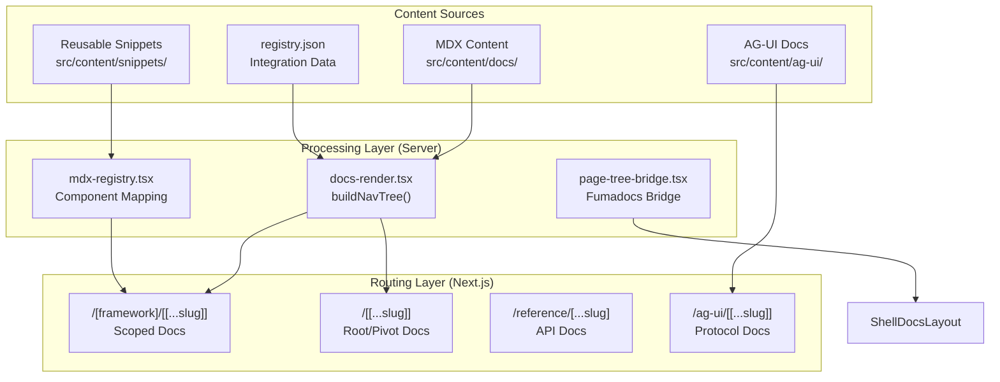
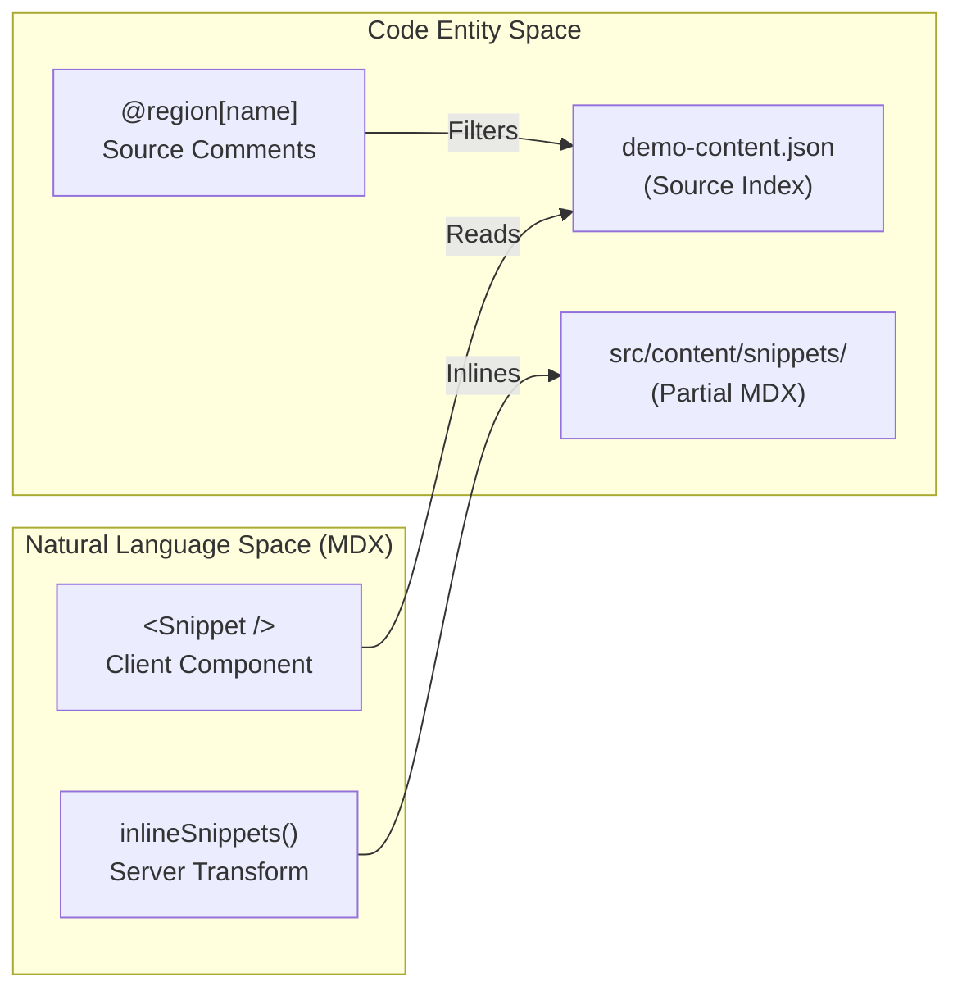
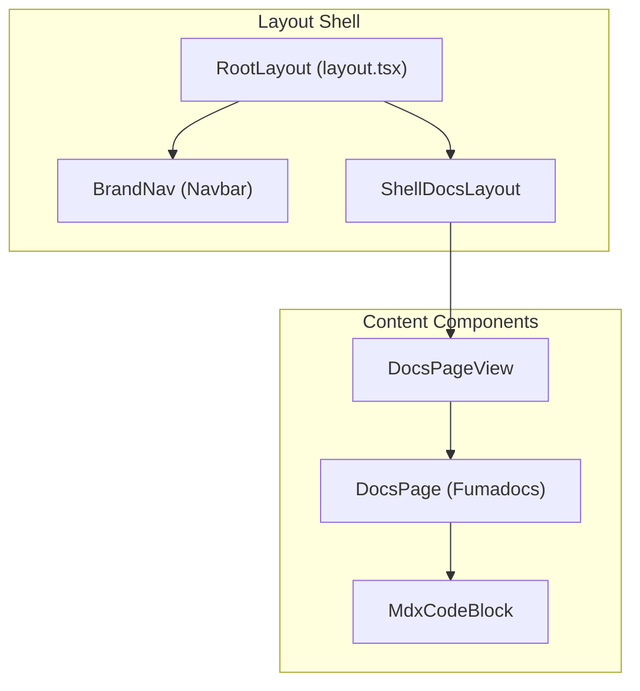

<!-- source: DeepWiki mcp.deepwiki.com · repo CopilotKit/CopilotKit · page 10 Documentation System · fetched 2026-10-30 -->

# Documentation System

Relevant source files

The following files were used as context for generating this wiki page:

- [showcase/angular/src/app/features/media/media-model.ts](showcase/angular/src/app/features/media/media-model.ts)
- [showcase/angular/src/styles.css](showcase/angular/src/styles.css)
- [showcase/integrations/langgraph-python/src/agents/frontend_tools.py](showcase/integrations/langgraph-python/src/agents/frontend_tools.py)
- [showcase/scripts/check-claude-quickstarts-runtime.ts](showcase/scripts/check-claude-quickstarts-runtime.ts)
- [showcase/scripts/lib/demo-region-guard.ts](showcase/scripts/lib/demo-region-guard.ts)
- [showcase/scripts/probe-claude-quickstarts.ts](showcase/scripts/probe-claude-quickstarts.ts)
- [showcase/scripts/probe-shell-docs.ts](showcase/scripts/probe-shell-docs.ts)
- [showcase/scripts/verify-shell-docs.test.ts](showcase/scripts/verify-shell-docs.test.ts)
- [showcase/scripts/verify-shell-docs.ts](showcase/scripts/verify-shell-docs.ts)
- [showcase/shell-docs/src/app/[[...slug]]/error.tsx](showcase/shell-docs/src/app/[[...slug]]/error.tsx)
- [showcase/shell-docs/src/app/[[...slug]]/page.tsx](showcase/shell-docs/src/app/[[...slug]]/page.tsx)
- [showcase/shell-docs/src/app/[framework]/[[...slug]]/page.tsx](showcase/shell-docs/src/app/[framework]/[[...slug]]/page.tsx)
- [showcase/shell-docs/src/app/__tests__/globals-css.test.ts](showcase/shell-docs/src/app/__tests__/globals-css.test.ts)
- [showcase/shell-docs/src/app/ag-ui/[[...slug]]/error.tsx](showcase/shell-docs/src/app/ag-ui/[[...slug]]/error.tsx)
- [showcase/shell-docs/src/app/ag-ui/[[...slug]]/page.tsx](showcase/shell-docs/src/app/ag-ui/[[...slug]]/page.tsx)
- [showcase/shell-docs/src/app/globals.css](showcase/shell-docs/src/app/globals.css)
- [showcase/shell-docs/src/app/layout.tsx](showcase/shell-docs/src/app/layout.tsx)
- [showcase/shell-docs/src/app/not-found.tsx](showcase/shell-docs/src/app/not-found.tsx)
- [showcase/shell-docs/src/app/reference/[...slug]/page.tsx](showcase/shell-docs/src/app/reference/[...slug]/page.tsx)
- [showcase/shell-docs/src/app/reference/page.tsx](showcase/shell-docs/src/app/reference/page.tsx)
- [showcase/shell-docs/src/components/__tests__/banners.test.tsx](showcase/shell-docs/src/components/__tests__/banners.test.tsx)
- [showcase/shell-docs/src/components/__tests__/brand-nav.test.tsx](showcase/shell-docs/src/components/__tests__/brand-nav.test.tsx)
- [showcase/shell-docs/src/components/__tests__/hero-start-commands.test.tsx](showcase/shell-docs/src/components/__tests__/hero-start-commands.test.tsx)
- [showcase/shell-docs/src/components/__tests__/stored-framework-highlight.test.tsx](showcase/shell-docs/src/components/__tests__/stored-framework-highlight.test.tsx)
- [showcase/shell-docs/src/components/ai/page-actions.tsx](showcase/shell-docs/src/components/ai/page-actions.tsx)
- [showcase/shell-docs/src/components/banners.tsx](showcase/shell-docs/src/components/banners.tsx)
- [showcase/shell-docs/src/components/brand-nav.tsx](showcase/shell-docs/src/components/brand-nav.tsx)
- [showcase/shell-docs/src/components/content/iframe-switcher.tsx](showcase/shell-docs/src/components/content/iframe-switcher.tsx)
- [showcase/shell-docs/src/components/content/index.ts](showcase/shell-docs/src/components/content/index.ts)
- [showcase/shell-docs/src/components/content/landing-pages/__tests__/framework-overview.test.tsx](showcase/shell-docs/src/components/content/landing-pages/__tests__/framework-overview.test.tsx)
- [showcase/shell-docs/src/components/content/landing-pages/framework-overview.tsx](showcase/shell-docs/src/components/content/landing-pages/framework-overview.tsx)
- [showcase/shell-docs/src/components/copy-button.tsx](showcase/shell-docs/src/components/copy-button.tsx)
- [showcase/shell-docs/src/components/demo-source.tsx](showcase/shell-docs/src/components/demo-source.tsx)
- [showcase/shell-docs/src/components/docs-landing-next.tsx](showcase/shell-docs/src/components/docs-landing-next.tsx)
- [showcase/shell-docs/src/components/docs-page-view.tsx](showcase/shell-docs/src/components/docs-page-view.tsx)
- [showcase/shell-docs/src/components/docs-steps.tsx](showcase/shell-docs/src/components/docs-steps.tsx)
- [showcase/shell-docs/src/components/framework-tabs.tsx](showcase/shell-docs/src/components/framework-tabs.tsx)
- [showcase/shell-docs/src/components/hero-quickstart-dropdown.tsx](showcase/shell-docs/src/components/hero-quickstart-dropdown.tsx)
- [showcase/shell-docs/src/components/hero-start-commands.tsx](showcase/shell-docs/src/components/hero-start-commands.tsx)
- [showcase/shell-docs/src/components/icons/a2a.tsx](showcase/shell-docs/src/components/icons/a2a.tsx)
- [showcase/shell-docs/src/components/icons/agent-spec-mark.tsx](showcase/shell-docs/src/components/icons/agent-spec-mark.tsx)
- [showcase/shell-docs/src/components/icons/framework-icons.tsx](showcase/shell-docs/src/components/icons/framework-icons.tsx)
- [showcase/shell-docs/src/components/icons/index.ts](showcase/shell-docs/src/components/icons/index.ts)
- [showcase/shell-docs/src/components/landing-sample-tabs.tsx](showcase/shell-docs/src/components/landing-sample-tabs.tsx)
- [showcase/shell-docs/src/components/link-to-copilot-cloud.tsx](showcase/shell-docs/src/components/link-to-copilot-cloud.tsx)
- [showcase/shell-docs/src/components/mobile-sidebar-footer-talk.tsx](showcase/shell-docs/src/components/mobile-sidebar-footer-talk.tsx)
- [showcase/shell-docs/src/components/mobile-top-nav.tsx](showcase/shell-docs/src/components/mobile-top-nav.tsx)
- [showcase/shell-docs/src/components/primary-docs-tabs.tsx](showcase/shell-docs/src/components/primary-docs-tabs.tsx)
- [showcase/shell-docs/src/components/property-reference.tsx](showcase/shell-docs/src/components/property-reference.tsx)
- [showcase/shell-docs/src/components/react/component-previews/new-look-and-feel.tsx](showcase/shell-docs/src/components/react/component-previews/new-look-and-feel.tsx)
- [showcase/shell-docs/src/components/reference-version-selector.tsx](showcase/shell-docs/src/components/reference-version-selector.tsx)
- [showcase/shell-docs/src/components/search-modal.tsx](showcase/shell-docs/src/components/search-modal.tsx)
- [showcase/shell-docs/src/components/search-trigger.tsx](showcase/shell-docs/src/components/search-trigger.tsx)
- [showcase/shell-docs/src/components/shell-docs-layout.tsx](showcase/shell-docs/src/components/shell-docs-layout.tsx)
- [showcase/shell-docs/src/components/sidebar-folder-state-preserver.tsx](showcase/shell-docs/src/components/sidebar-folder-state-preserver.tsx)
- [showcase/shell-docs/src/components/sidebar-framework-selector.tsx](showcase/shell-docs/src/components/sidebar-framework-selector.tsx)
- [showcase/shell-docs/src/components/sidebar-react-docs-notice.tsx](showcase/shell-docs/src/components/sidebar-react-docs-notice.tsx)
- [showcase/shell-docs/src/components/snippet.tsx](showcase/shell-docs/src/components/snippet.tsx)
- [showcase/shell-docs/src/components/stored-framework-highlight.tsx](showcase/shell-docs/src/components/stored-framework-highlight.tsx)
- [showcase/shell-docs/src/components/theme-switch.tsx](showcase/shell-docs/src/components/theme-switch.tsx)
- [showcase/shell-docs/src/components/ui/button.tsx](showcase/shell-docs/src/components/ui/button.tsx)
- [showcase/shell-docs/src/components/ui/popover.tsx](showcase/shell-docs/src/components/ui/popover.tsx)
- [showcase/shell-docs/src/content/snippets/integrations/agentcore/index.mdx](showcase/shell-docs/src/content/snippets/integrations/agentcore/index.mdx)
- [showcase/shell-docs/src/lib/__tests__/demo-code.test.ts](showcase/shell-docs/src/lib/__tests__/demo-code.test.ts)
- [showcase/shell-docs/src/lib/__tests__/redirects.test.ts](showcase/shell-docs/src/lib/__tests__/redirects.test.ts)
- [showcase/shell-docs/src/lib/__tests__/reference-discovery.test.ts](showcase/shell-docs/src/lib/__tests__/reference-discovery.test.ts)
- [showcase/shell-docs/src/lib/__tests__/registry.test.ts](showcase/shell-docs/src/lib/__tests__/registry.test.ts)
- [showcase/shell-docs/src/lib/docs-render.tsx](showcase/shell-docs/src/lib/docs-render.tsx)
- [showcase/shell-docs/src/lib/framework-order.ts](showcase/shell-docs/src/lib/framework-order.ts)
- [showcase/shell-docs/src/lib/mdx-registry-loader.tsx](showcase/shell-docs/src/lib/mdx-registry-loader.tsx)
- [showcase/shell-docs/src/lib/mdx-registry.tsx](showcase/shell-docs/src/lib/mdx-registry.tsx)
- [showcase/shell-docs/src/lib/reference-items.ts](showcase/shell-docs/src/lib/reference-items.ts)
- [showcase/shell-docs/src/lib/registry.ts](showcase/shell-docs/src/lib/registry.ts)
- [showcase/shell-docs/src/lib/rewrite-demo-code.ts](showcase/shell-docs/src/lib/rewrite-demo-code.ts)
- [showcase/shell-docs/src/lib/toc.ts](showcase/shell-docs/src/lib/toc.ts)

The documentation system provides the technical infrastructure for rendering, organizing, and serving the CopilotKit documentation website. It is primarily located in `showcase/shell-docs/` and serves the production site at [docs.copilotkit.ai](https://docs.copilotkit.ai).

**Note on Retired Content:** The top-level `docs/` folder in the repository is retired and read-only. All active documentation development and content management occur within the `showcase/shell-docs/` directory [showcase/shell-docs/src/lib/docs-render.tsx:17]().

## System Architecture

The documentation system is built on **Next.js** using the **Fumadocs** framework for MDX processing and UI components [showcase/shell-docs/src/app/layout.tsx:4](). It uses a dual-mode content resolution strategy: "Authored" mode for hand-crafted framework documentation and "Generated" mode for standard integration pages [showcase/shell-docs/src/lib/registry.ts:36-52]().

### Documentation Data Flow

**Sources:** [showcase/shell-docs/src/lib/docs-render.tsx:17-18](), [showcase/shell-docs/src/app/[framework]/[[...slug]]/page.tsx:64-70](), [showcase/shell-docs/src/app/ag-ui/[[...slug]]/page.tsx:95-104](), [showcase/shell-docs/src/lib/registry.ts:1-24]()

For details on the Next.js and Fumadocs-ui setup, including MDX processing and directory organization, see [Documentation Site Architecture](#10.1).

## Navigation and Integration Selection

The system features a "Pivot" UI that allows users to view the documentation through the lens of specific frameworks (e.g., LangGraph, Mastra, PydanticAI).

### Integration Resolution

The system resolves the "effective framework" via a hierarchy: URL path segment → LocalStorage → Default (Built-in Agent) [showcase/shell-docs/src/lib/registry.ts:136](). Framework-scoped routes (e.g., `/langgraph-python/quickstart`) maintain context across the session [showcase/shell-docs/src/app/[framework]/[[...slug]]/page.tsx:1-15]().

| Route Type | URL Pattern | Navigation Tree |
| :--- | :--- | :--- |
| **Agnostic** | `/quickstart` | Root surface tree (BIA default) [showcase/shell-docs/src/app/[[...slug]]/page.tsx:99-107]() |
| **Scoped** | `/mastra/quickstart` | Framework-specific tree [showcase/shell-docs/src/app/[framework]/[[...slug]]/page.tsx:65-67]() |
| **Protocol** | `/ag-ui/introduction` | AG-UI Protocol tree [showcase/shell-docs/src/app/ag-ui/[[...slug]]/page.tsx:104-168]() |
| **Reference** | `/reference/v2/...` | Versioned API tree [showcase/shell-docs/src/app/reference/[...slug]/page.tsx:160-161]() |

**Sources:** [showcase/shell-docs/src/app/[[...slug]]/page.tsx:101-105](), [showcase/shell-docs/src/app/[framework]/[[...slug]]/page.tsx:65-67](), [showcase/shell-docs/src/lib/registry.ts:136](), [showcase/shell-docs/src/components/brand-nav.tsx:31-47]()

For details on navigation, the framework selector, and routing resolution, see [Navigation and Integration Selection](#10.2).

## Content Processing and Snippets

A core feature of the documentation system is the snippet resolution engine, which pulls code from actual demo applications and pre-defined snippet files. This ensures that code examples are synchronized with the repository's active code.

### Snippet Resolution Logic

**Sources:** [showcase/shell-docs/src/lib/docs-render.tsx:18](), [showcase/shell-docs/src/components/docs-page-view.tsx:159-161](), [showcase/shell-docs/src/lib/mdx-registry.tsx:94-108]()

### Key Components

- **`MDXRemote`**: Renders dynamic content from the filesystem with plugins like `remarkGfm` and `rehypeCode` [showcase/shell-docs/src/app/[framework]/[[...slug]]/page.tsx:21-26]().
- **`loadDoc`**: Server-side helper that reads MDX files and parses frontmatter using `gray-matter` [showcase/shell-docs/src/lib/docs-render.tsx:69]().
- **`STUB_PARTIAL_MAP`**: Maps MDX component stubs to partial MDX files in the snippets directory [showcase/shell-docs/src/lib/mdx-registry.tsx:108-160]().
- **`ShellDocsLayout`**: The primary layout wrapper that provides the Fumadocs `tree` and custom `banner` slots [showcase/shell-docs/src/app/[framework]/[[...slug]]/page.tsx:27]().

For details on snippet reuse, MDX processing, and automated link verification, see [Content Processing and Link Verification](#10.3).

## Styling and UI

The documentation uses **Tailwind CSS** with the **Fumadocs UI** preset [showcase/shell-docs/src/app/globals.css:8-10](). It implements a custom theme with specialized variables for layout offsets and brand-specific colors [showcase/shell-docs/src/app/globals.css:33-65]().

### UI Layout Structure

**Sources:** [showcase/shell-docs/src/app/layout.tsx:34-38](), [showcase/shell-docs/src/components/docs-page-view.tsx:131-143](), [showcase/shell-docs/src/app/globals.css:20-32]()

---

