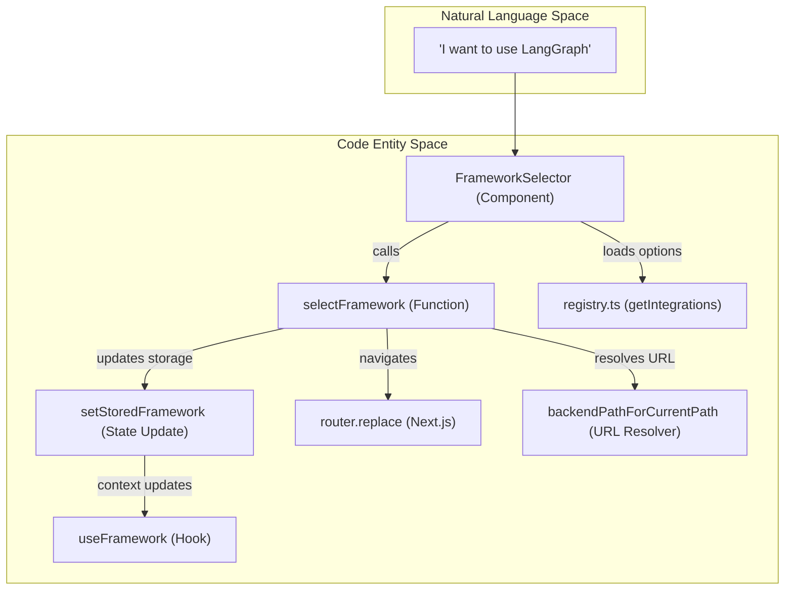
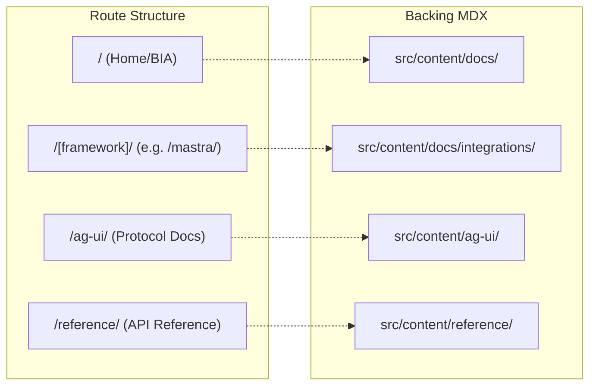

<!-- source: DeepWiki mcp.deepwiki.com · repo CopilotKit/CopilotKit · page 10.2 Navigation and Integration Selection · fetched 2026-10-30 -->

# Navigation and Integration Selection

Relevant source files

The following files were used as context for generating this wiki page:

- [showcase/integrations/langgraph-python/src/agents/frontend_tools.py](showcase/integrations/langgraph-python/src/agents/frontend_tools.py)
- [showcase/scripts/check-claude-quickstarts-runtime.ts](showcase/scripts/check-claude-quickstarts-runtime.ts)
- [showcase/scripts/generate-search-index.ts](showcase/scripts/generate-search-index.ts)
- [showcase/scripts/lib/demo-region-guard.ts](showcase/scripts/lib/demo-region-guard.ts)
- [showcase/scripts/probe-claude-quickstarts.ts](showcase/scripts/probe-claude-quickstarts.ts)
- [showcase/scripts/probe-shell-docs.ts](showcase/scripts/probe-shell-docs.ts)
- [showcase/scripts/verify-shell-docs.test.ts](showcase/scripts/verify-shell-docs.test.ts)
- [showcase/scripts/verify-shell-docs.ts](showcase/scripts/verify-shell-docs.ts)
- [showcase/shell-docs/public/images/threads/support-desk-threads.png](showcase/shell-docs/public/images/threads/support-desk-threads.png)
- [showcase/shell-docs/src/app/[[...slug]]/error.tsx](showcase/shell-docs/src/app/[[...slug]]/error.tsx)
- [showcase/shell-docs/src/app/[[...slug]]/page.tsx](showcase/shell-docs/src/app/[[...slug]]/page.tsx)
- [showcase/shell-docs/src/app/[framework]/[[...slug]]/page.tsx](showcase/shell-docs/src/app/[framework]/[[...slug]]/page.tsx)
- [showcase/shell-docs/src/app/ag-ui/[[...slug]]/error.tsx](showcase/shell-docs/src/app/ag-ui/[[...slug]]/error.tsx)
- [showcase/shell-docs/src/app/ag-ui/[[...slug]]/page.tsx](showcase/shell-docs/src/app/ag-ui/[[...slug]]/page.tsx)
- [showcase/shell-docs/src/app/not-found.tsx](showcase/shell-docs/src/app/not-found.tsx)
- [showcase/shell-docs/src/app/reference/[...slug]/page.tsx](showcase/shell-docs/src/app/reference/[...slug]/page.tsx)
- [showcase/shell-docs/src/app/reference/page.tsx](showcase/shell-docs/src/app/reference/page.tsx)
- [showcase/shell-docs/src/app/robots.ts](showcase/shell-docs/src/app/robots.ts)
- [showcase/shell-docs/src/app/sitemap.test.ts](showcase/shell-docs/src/app/sitemap.test.ts)
- [showcase/shell-docs/src/app/sitemap.ts](showcase/shell-docs/src/app/sitemap.ts)
- [showcase/shell-docs/src/components/__tests__/framework-selector.test.tsx](showcase/shell-docs/src/components/__tests__/framework-selector.test.tsx)
- [showcase/shell-docs/src/components/copy-button.tsx](showcase/shell-docs/src/components/copy-button.tsx)
- [showcase/shell-docs/src/components/demo-source.tsx](showcase/shell-docs/src/components/demo-source.tsx)
- [showcase/shell-docs/src/components/docs-landing-next.tsx](showcase/shell-docs/src/components/docs-landing-next.tsx)
- [showcase/shell-docs/src/components/docs-page-view.tsx](showcase/shell-docs/src/components/docs-page-view.tsx)
- [showcase/shell-docs/src/components/docs-steps.tsx](showcase/shell-docs/src/components/docs-steps.tsx)
- [showcase/shell-docs/src/components/framework-selector.tsx](showcase/shell-docs/src/components/framework-selector.tsx)
- [showcase/shell-docs/src/components/frontend-logo.tsx](showcase/shell-docs/src/components/frontend-logo.tsx)
- [showcase/shell-docs/src/components/icons/a2a.tsx](showcase/shell-docs/src/components/icons/a2a.tsx)
- [showcase/shell-docs/src/components/icons/agent-spec-mark.tsx](showcase/shell-docs/src/components/icons/agent-spec-mark.tsx)
- [showcase/shell-docs/src/components/icons/framework-icons.tsx](showcase/shell-docs/src/components/icons/framework-icons.tsx)
- [showcase/shell-docs/src/components/icons/index.ts](showcase/shell-docs/src/components/icons/index.ts)
- [showcase/shell-docs/src/components/property-reference.tsx](showcase/shell-docs/src/components/property-reference.tsx)
- [showcase/shell-docs/src/components/reference-version-selector.tsx](showcase/shell-docs/src/components/reference-version-selector.tsx)
- [showcase/shell-docs/src/components/snippet.tsx](showcase/shell-docs/src/components/snippet.tsx)
- [showcase/shell-docs/src/content/docs/frontends/angular.mdx](showcase/shell-docs/src/content/docs/frontends/angular.mdx)
- [showcase/shell-docs/src/content/docs/frontends/angular/auth.mdx](showcase/shell-docs/src/content/docs/frontends/angular/auth.mdx)
- [showcase/shell-docs/src/content/docs/frontends/angular/docs-status.mdx](showcase/shell-docs/src/content/docs/frontends/angular/docs-status.mdx)
- [showcase/shell-docs/src/content/docs/frontends/angular/guides/chat-ui.mdx](showcase/shell-docs/src/content/docs/frontends/angular/guides/chat-ui.mdx)
- [showcase/shell-docs/src/content/docs/frontends/angular/guides/frontend-tools-generative-ui.mdx](showcase/shell-docs/src/content/docs/frontends/angular/guides/frontend-tools-generative-ui.mdx)
- [showcase/shell-docs/src/content/docs/frontends/angular/guides/human-in-the-loop.mdx](showcase/shell-docs/src/content/docs/frontends/angular/guides/human-in-the-loop.mdx)
- [showcase/shell-docs/src/content/docs/frontends/angular/guides/shared-state.mdx](showcase/shell-docs/src/content/docs/frontends/angular/guides/shared-state.mdx)
- [showcase/shell-docs/src/content/docs/frontends/angular/guides/threads-memory-attachments-headless.mdx](showcase/shell-docs/src/content/docs/frontends/angular/guides/threads-memory-attachments-headless.mdx)
- [showcase/shell-docs/src/content/docs/integrations/adk/threads-import.mdx](showcase/shell-docs/src/content/docs/integrations/adk/threads-import.mdx)
- [showcase/shell-docs/src/content/docs/integrations/deepagents/meta.json](showcase/shell-docs/src/content/docs/integrations/deepagents/meta.json)
- [showcase/shell-docs/src/content/docs/integrations/langgraph/threads-import.mdx](showcase/shell-docs/src/content/docs/integrations/langgraph/threads-import.mdx)
- [showcase/shell-docs/src/content/docs/premium/managed-intelligence-platform.mdx](showcase/shell-docs/src/content/docs/premium/managed-intelligence-platform.mdx)
- [showcase/shell-docs/src/content/docs/premium/self-hosting.mdx](showcase/shell-docs/src/content/docs/premium/self-hosting.mdx)
- [showcase/shell-docs/src/content/docs/premium/threads-explained.mdx](showcase/shell-docs/src/content/docs/premium/threads-explained.mdx)
- [showcase/shell-docs/src/content/docs/threads.mdx](showcase/shell-docs/src/content/docs/threads.mdx)
- [showcase/shell-docs/src/content/reference/angular/components/CopilotChatInput.mdx](showcase/shell-docs/src/content/reference/angular/components/CopilotChatInput.mdx)
- [showcase/shell-docs/src/content/reference/angular/functions/connectAgentContext.mdx](showcase/shell-docs/src/content/reference/angular/functions/connectAgentContext.mdx)
- [showcase/shell-docs/src/content/reference/angular/functions/injectThreads.mdx](showcase/shell-docs/src/content/reference/angular/functions/injectThreads.mdx)
- [showcase/shell-docs/src/content/reference/hooks/useThreads.mdx](showcase/shell-docs/src/content/reference/hooks/useThreads.mdx)
- [showcase/shell-docs/src/content/reference/react-native/hooks/useThreads.mdx](showcase/shell-docs/src/content/reference/react-native/hooks/useThreads.mdx)
- [showcase/shell-docs/src/content/snippets/integrations/agentcore/index.mdx](showcase/shell-docs/src/content/snippets/integrations/agentcore/index.mdx)
- [showcase/shell-docs/src/content/snippets/shared/basics/copilot-threads-drawer.mdx](showcase/shell-docs/src/content/snippets/shared/basics/copilot-threads-drawer.mdx)
- [showcase/shell-docs/src/content/snippets/shared/cli/cli.mdx](showcase/shell-docs/src/content/snippets/shared/cli/cli.mdx)
- [showcase/shell-docs/src/content/snippets/shared/premium/headless-ui.mdx](showcase/shell-docs/src/content/snippets/shared/premium/headless-ui.mdx)
- [showcase/shell-docs/src/content/snippets/shared/premium/overview.mdx](showcase/shell-docs/src/content/snippets/shared/premium/overview.mdx)
- [showcase/shell-docs/src/content/snippets/shared/premium/self-hosting.mdx](showcase/shell-docs/src/content/snippets/shared/premium/self-hosting.mdx)
- [showcase/shell-docs/src/content/snippets/shared/threads/headless-threads.mdx](showcase/shell-docs/src/content/snippets/shared/threads/headless-threads.mdx)
- [showcase/shell-docs/src/content/snippets/shared/threads/overview.mdx](showcase/shell-docs/src/content/snippets/shared/threads/overview.mdx)
- [showcase/shell-docs/src/content/snippets/shared/threads/threads-import.mdx](showcase/shell-docs/src/content/snippets/shared/threads/threads-import.mdx)
- [showcase/shell-docs/src/content/snippets/shared/threads/threads-lifecycle.mdx](showcase/shell-docs/src/content/snippets/shared/threads/threads-lifecycle.mdx)
- [showcase/shell-docs/src/lib/__tests__/angular-backend-overview.test.ts](showcase/shell-docs/src/lib/__tests__/angular-backend-overview.test.ts)
- [showcase/shell-docs/src/lib/__tests__/angular-guide-search.test.ts](showcase/shell-docs/src/lib/__tests__/angular-guide-search.test.ts)
- [showcase/shell-docs/src/lib/__tests__/demo-code.test.ts](showcase/shell-docs/src/lib/__tests__/demo-code.test.ts)
- [showcase/shell-docs/src/lib/__tests__/docs-render.test.ts](showcase/shell-docs/src/lib/__tests__/docs-render.test.ts)
- [showcase/shell-docs/src/lib/__tests__/frontend-options.test.ts](showcase/shell-docs/src/lib/__tests__/frontend-options.test.ts)
- [showcase/shell-docs/src/lib/__tests__/llm-text.test.ts](showcase/shell-docs/src/lib/__tests__/llm-text.test.ts)
- [showcase/shell-docs/src/lib/__tests__/redirects.test.ts](showcase/shell-docs/src/lib/__tests__/redirects.test.ts)
- [showcase/shell-docs/src/lib/__tests__/reference-discovery.test.ts](showcase/shell-docs/src/lib/__tests__/reference-discovery.test.ts)
- [showcase/shell-docs/src/lib/__tests__/registry.test.ts](showcase/shell-docs/src/lib/__tests__/registry.test.ts)
- [showcase/shell-docs/src/lib/angular-backend-overview.ts](showcase/shell-docs/src/lib/angular-backend-overview.ts)
- [showcase/shell-docs/src/lib/docs-render.tsx](showcase/shell-docs/src/lib/docs-render.tsx)
- [showcase/shell-docs/src/lib/framework-order.ts](showcase/shell-docs/src/lib/framework-order.ts)
- [showcase/shell-docs/src/lib/frontend-options.ts](showcase/shell-docs/src/lib/frontend-options.ts)
- [showcase/shell-docs/src/lib/frontend-page-content.ts](showcase/shell-docs/src/lib/frontend-page-content.ts)
- [showcase/shell-docs/src/lib/mdx-registry-loader.tsx](showcase/shell-docs/src/lib/mdx-registry-loader.tsx)
- [showcase/shell-docs/src/lib/mdx-registry.tsx](showcase/shell-docs/src/lib/mdx-registry.tsx)
- [showcase/shell-docs/src/lib/reference-items.ts](showcase/shell-docs/src/lib/reference-items.ts)
- [showcase/shell-docs/src/lib/registry.ts](showcase/shell-docs/src/lib/registry.ts)
- [showcase/shell-docs/src/lib/rewrite-demo-code.ts](showcase/shell-docs/src/lib/rewrite-demo-code.ts)
- [showcase/shell-docs/src/lib/search-hrefs.ts](showcase/shell-docs/src/lib/search-hrefs.ts)
- [showcase/shell-docs/src/lib/toc.ts](showcase/shell-docs/src/lib/toc.ts)

## Purpose and Scope

This document describes the navigation system and framework selection mechanism for the CopilotKit documentation site (`showcase/shell-docs`). It covers the technical implementation of the framework selector, the resolution of the `effectiveFramework` state (URL → localStorage → fallback), authored vs generated content modes, and routing configuration for specialized documentation surfaces like AG-UI and API References.

For information about the overall documentation site architecture and MDX processing, see [10.1](). For details about content processing and link verification, see [10.3]().

## System Overview

The documentation site is built on **Fumadocs** and **Next.js**, utilizing a multi-layered navigation strategy to manage the transition between general documentation and framework-specific content.

- **Framework Selector** (`FrameworkSelector`): A persistent dropdown that anchors the docs experience to a specific agentic backend (e.g., LangGraph, Mastra) and frontend (e.g., React, Angular) [showcase/shell-docs/src/components/framework-selector.tsx:3-7]().
- **Navigation Tree Builder**: The `buildNavTree` function in `docs-render.tsx` recursively scans the filesystem to construct sidebars, handling section icons and framework scoping [showcase/shell-docs/src/lib/docs-render.tsx:210-220]().
- **Effective Framework Resolution**: Determining the current framework context by checking the URL path, falling back to `localStorage`, and finally defaulting to the Built-in Agent [showcase/shell-docs/src/components/framework-selector.tsx:108-110]().
- **Specialized Surfaces**: Dedicated routing for the **AG-UI Protocol** [showcase/shell-docs/src/app/ag-ui/[[...slug]]/page.tsx:95-99]() and **API Reference** [showcase/shell-docs/src/app/reference/[...slug]]/page.tsx:48-53]().

**Sources:** [showcase/shell-docs/src/components/framework-selector.tsx:3-7](), [showcase/shell-docs/src/lib/docs-render.tsx:210-220](), [showcase/shell-docs/src/app/ag-ui/[[...slug]]/page.tsx:95-99](), [showcase/shell-docs/src/app/reference/[...slug]]/page.tsx:48-53]()

## Framework Selection Architecture

### Effective Framework Resolution

The `FrameworkProvider` resolves the `effectiveFramework` using a prioritized hierarchy to ensure a consistent experience across page refreshes and direct links.

| Priority | Source | Implementation |
| :--- | :--- | :--- |
| 1 | **URL Path** | Extracted via `usePathname()`. If the first segment matches a known framework slug (e.g., `/langgraph-python`), it overrides all other state [showcase/shell-docs/src/components/framework-selector.tsx:106-110](), [showcase/shell-docs/src/lib/frontend-options.ts:18-23](). |
| 2 | **localStorage** | The `storedFramework` value persisted by `setStoredFramework(slug)` [showcase/shell-docs/src/components/framework-selector.tsx:108](). |
| 3 | **Fallback** | Defaults to `built-in-agent` (defined as `ROOT_FRAMEWORK`) [showcase/shell-docs/src/lib/registry.ts:136](). |

### Navigation Data Flow

The following diagram bridges the user's conceptual choice of a "Backend" to the code entities that manage that state and route the browser.

**Sources:** [showcase/shell-docs/src/components/framework-selector.tsx:108-153](), [showcase/shell-docs/src/lib/registry.ts:136-176](), [showcase/shell-docs/src/lib/frontend-options.ts:17-23]()

## Authored vs. Generated Content Modes

The navigation system adapts based on the `docs_mode` defined in the integration registry [showcase/shell-docs/src/lib/registry.ts:37-52]().

### Generated Mode
Standard for most integrations. It merges agnostic root MDX content (from `src/content/docs`) with per-framework code snippets and overrides. The `DocsPageView` component handles this merging by resolving snippets based on the active framework [showcase/shell-docs/src/components/docs-page-view.tsx:158-160]().

### Authored Mode
Used for complex integrations like the `built-in-agent` and `deepagents`. It renders a custom MDX tree located under `src/content/docs/integrations/<folder>/` with its own `meta.json` driving the sidebar structure [showcase/shell-docs/src/lib/registry.ts:41-44](). Authored frameworks do not merge into the root tree; they receive dedicated section icons to maintain visual parity [showcase/shell-docs/src/lib/docs-render.tsx:72-76]().

### Section Icons
The sidebar uses all-caps separators with icons. These are mapped in `SECTION_ICONS` for both root and authored frameworks:
- **Concepts**: `lucide/BookOpen` [showcase/shell-docs/src/lib/docs-render.tsx:80]()
- **Generative UI**: `lucide/Paintbrush` [showcase/shell-docs/src/lib/docs-render.tsx:82]()
- **Built-in Agent**: `lucide/Bot` [showcase/shell-docs/src/lib/docs-render.tsx:97]()

**Sources:** [showcase/shell-docs/src/lib/registry.ts:36-52](), [showcase/shell-docs/src/lib/docs-render.tsx:77-104](), [showcase/shell-docs/src/components/docs-page-view.tsx:158-160]()

## Routing Configuration

### Framework-Scoped Routes
Framework-specific pages are served at `/[framework]/[[...slug]]`. The first URL segment is validated against the registry's integration slugs [showcase/shell-docs/src/app/[framework]/[[...slug]]/page.tsx:12-15](). If a match is not found, the router falls through to the `UnscopedDocsPage` [showcase/shell-docs/src/app/[framework]/[[...slug]]/page.tsx:33]().

### Root Surface (Built-in Agent)
The `built-in-agent` is the `ROOT_FRAMEWORK` [showcase/shell-docs/src/lib/registry.ts:136](). Its documentation is served at the root URL surface (e.g., `/quickstart` instead of `/built-in-agent/quickstart`) [showcase/shell-docs/src/app/[[...slug]]/page.tsx:3-6](). The `buildRootSurfaceNav` function ensures the sidebar is stable between the home page and these unscoped docs [showcase/shell-docs/src/app/[[...slug]]/page.tsx:102-107]().

### Specialized Documentation Surfaces

**Sources:** [showcase/shell-docs/src/app/[framework]/[[...slug]]/page.tsx:1-15](), [showcase/shell-docs/src/app/[[...slug]]/page.tsx:99-107](), [showcase/shell-docs/src/app/ag-ui/[[...slug]]/page.tsx:95-99](), [showcase/shell-docs/src/app/reference/[...slug]]/page.tsx:48-53]()

## Framework Selector Implementation

The `FrameworkSelector` component handles both frontend and backend selection, supporting two presentation flavors:

### Selector Variants
1. **Sidebar**: Two full-width selector rows for frontend and backend. It pins the "Built-in Agent" (as "CopilotKit") at the top [showcase/shell-docs/src/components/framework-selector.tsx:49-51](), [showcase/shell-docs/src/components/framework-selector.tsx:212-214]().
2. **Topbar**: A compact pill sized for a horizontal navigation bar [showcase/shell-docs/src/components/framework-selector.tsx:48]().

### Frontend Selection
The selector allows switching between React and Angular (and other future frontends). It uses `frontendPathForCurrentPath` to preserve the user's current doc page while switching the frontend context [showcase/shell-docs/src/components/framework-selector.tsx:150-154]().

### Analytics Integration
Selection events are tracked via **PostHog**:
- **Backend Selection**: Captured via `docs.framework_selected`, including the slug, name, and category [showcase/shell-docs/src/components/framework-selector.tsx:183-188]().
- **Frontend Selection**: Captured via `docs.frontend_selected`, tracking the transition from one frontend to another [showcase/shell-docs/src/components/framework-selector.tsx:164-170]().

**Sources:** [showcase/shell-docs/src/components/framework-selector.tsx:47-52](), [showcase/shell-docs/src/components/framework-selector.tsx:149-201](), [showcase/shell-docs/src/components/framework-selector.tsx:212-214]()

---

