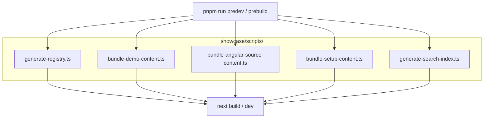
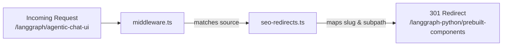

<!-- source: DeepWiki mcp.deepwiki.com · repo CopilotKit/CopilotKit · page 10.3 Content Processing and Link Verification · fetched 2026-10-30 -->

# Content Processing and Link Verification

Relevant source files

The following files were used as context for generating this wiki page:

- [showcase/harness/src/probes/drivers/seo-redirects.ts](showcase/harness/src/probes/drivers/seo-redirects.ts)
- [showcase/harness/test/fixtures/redirect-decommission/cli-stdout-human.txt](showcase/harness/test/fixtures/redirect-decommission/cli-stdout-human.txt)
- [showcase/harness/test/fixtures/redirect-decommission/cli-stdout.txt](showcase/harness/test/fixtures/redirect-decommission/cli-stdout.txt)
- [showcase/shell-docs/package-lock.json](showcase/shell-docs/package-lock.json)
- [showcase/shell-docs/package.json](showcase/shell-docs/package.json)
- [showcase/shell-docs/src/app/llms-full.txt/route.ts](showcase/shell-docs/src/app/llms-full.txt/route.ts)
- [showcase/shell-docs/src/app/llms-mdx/[[...slug]]/route.test.ts](showcase/shell-docs/src/app/llms-mdx/[[...slug]]/route.test.ts)
- [showcase/shell-docs/src/app/llms-mdx/[[...slug]]/route.ts](showcase/shell-docs/src/app/llms-mdx/[[...slug]]/route.ts)
- [showcase/shell-docs/src/app/llms.txt/route.ts](showcase/shell-docs/src/app/llms.txt/route.ts)
- [showcase/shell-docs/src/components/__tests__/channels-activation-impressions.test.tsx](showcase/shell-docs/src/components/__tests__/channels-activation-impressions.test.tsx)
- [showcase/shell-docs/src/components/__tests__/channels-activation-strip.test.tsx](showcase/shell-docs/src/components/__tests__/channels-activation-strip.test.tsx)
- [showcase/shell-docs/src/components/analytics-client.tsx](showcase/shell-docs/src/components/analytics-client.tsx)
- [showcase/shell-docs/src/components/channels-activation-strip.tsx](showcase/shell-docs/src/components/channels-activation-strip.tsx)
- [showcase/shell-docs/src/components/channels-start-prompt.tsx](showcase/shell-docs/src/components/channels-start-prompt.tsx)
- [showcase/shell-docs/src/components/integration-grid.tsx](showcase/shell-docs/src/components/integration-grid.tsx)
- [showcase/shell-docs/src/components/mdx-components.tsx](showcase/shell-docs/src/components/mdx-components.tsx)
- [showcase/shell-docs/src/components/react/__tests__/signup-link.ssr.test.tsx](showcase/shell-docs/src/components/react/__tests__/signup-link.ssr.test.tsx)
- [showcase/shell-docs/src/components/react/docs-conversion.tsx](showcase/shell-docs/src/components/react/docs-conversion.tsx)
- [showcase/shell-docs/src/components/react/ops-platform-cta.tsx](showcase/shell-docs/src/components/react/ops-platform-cta.tsx)
- [showcase/shell-docs/src/components/react/signup-link.tsx](showcase/shell-docs/src/components/react/signup-link.tsx)
- [showcase/shell-docs/src/content/docs/channels/commands-and-reactions.mdx](showcase/shell-docs/src/content/docs/channels/commands-and-reactions.mdx)
- [showcase/shell-docs/src/content/docs/channels/deploy-and-operate.mdx](showcase/shell-docs/src/content/docs/channels/deploy-and-operate.mdx)
- [showcase/shell-docs/src/content/docs/channels/files-and-multimodality.mdx](showcase/shell-docs/src/content/docs/channels/files-and-multimodality.mdx)
- [showcase/shell-docs/src/content/docs/channels/history-and-transcripts.mdx](showcase/shell-docs/src/content/docs/channels/history-and-transcripts.mdx)
- [showcase/shell-docs/src/content/docs/channels/identity-and-memory.mdx](showcase/shell-docs/src/content/docs/channels/identity-and-memory.mdx)
- [showcase/shell-docs/src/content/docs/channels/index.mdx](showcase/shell-docs/src/content/docs/channels/index.mdx)
- [showcase/shell-docs/src/content/docs/channels/intelligence.mdx](showcase/shell-docs/src/content/docs/channels/intelligence.mdx)
- [showcase/shell-docs/src/content/docs/channels/interactive/index.mdx](showcase/shell-docs/src/content/docs/channels/interactive/index.mdx)
- [showcase/shell-docs/src/content/docs/channels/persistence-and-scaling.mdx](showcase/shell-docs/src/content/docs/channels/persistence-and-scaling.mdx)
- [showcase/shell-docs/src/content/docs/channels/threads-and-state.mdx](showcase/shell-docs/src/content/docs/channels/threads-and-state.mdx)
- [showcase/shell-docs/src/content/docs/frontends/slack.mdx](showcase/shell-docs/src/content/docs/frontends/slack.mdx)
- [showcase/shell-docs/src/content/docs/frontends/teams.mdx](showcase/shell-docs/src/content/docs/frontends/teams.mdx)
- [showcase/shell-docs/src/content/docs/whats-new/langgraph-deep-agents.mdx](showcase/shell-docs/src/content/docs/whats-new/langgraph-deep-agents.mdx)
- [showcase/shell-docs/src/content/reference/channels/classes/Channel.mdx](showcase/shell-docs/src/content/reference/channels/classes/Channel.mdx)
- [showcase/shell-docs/src/content/reference/channels/classes/Thread.mdx](showcase/shell-docs/src/content/reference/channels/classes/Thread.mdx)
- [showcase/shell-docs/src/content/reference/channels/classes/Transcripts.mdx](showcase/shell-docs/src/content/reference/channels/classes/Transcripts.mdx)
- [showcase/shell-docs/src/content/reference/channels/functions/createChannel.mdx](showcase/shell-docs/src/content/reference/channels/functions/createChannel.mdx)
- [showcase/shell-docs/src/content/reference/channels/functions/defineChannelCommand.mdx](showcase/shell-docs/src/content/reference/channels/functions/defineChannelCommand.mdx)
- [showcase/shell-docs/src/content/reference/channels/functions/defineChannelTool.mdx](showcase/shell-docs/src/content/reference/channels/functions/defineChannelTool.mdx)
- [showcase/shell-docs/src/content/reference/channels/index.mdx](showcase/shell-docs/src/content/reference/channels/index.mdx)
- [showcase/shell-docs/src/content/reference/channels/types/InteractionContext.mdx](showcase/shell-docs/src/content/reference/channels/types/InteractionContext.mdx)
- [showcase/shell-docs/src/content/reference/channels/types/JSXCallbacks.mdx](showcase/shell-docs/src/content/reference/channels/types/JSXCallbacks.mdx)
- [showcase/shell-docs/src/content/reference/channels/types/StoreConfig.mdx](showcase/shell-docs/src/content/reference/channels/types/StoreConfig.mdx)
- [showcase/shell-docs/src/lib/__tests__/channels-activation.test.ts](showcase/shell-docs/src/lib/__tests__/channels-activation.test.ts)
- [showcase/shell-docs/src/lib/__tests__/channels-docs.test.ts](showcase/shell-docs/src/lib/__tests__/channels-docs.test.ts)
- [showcase/shell-docs/src/lib/__tests__/docs-link-rewrite.test.ts](showcase/shell-docs/src/lib/__tests__/docs-link-rewrite.test.ts)
- [showcase/shell-docs/src/lib/__tests__/search-hrefs.test.ts](showcase/shell-docs/src/lib/__tests__/search-hrefs.test.ts)
- [showcase/shell-docs/src/lib/__tests__/seo-redirects.test.ts](showcase/shell-docs/src/lib/__tests__/seo-redirects.test.ts)
- [showcase/shell-docs/src/lib/analytics-utils.ts](showcase/shell-docs/src/lib/analytics-utils.ts)
- [showcase/shell-docs/src/lib/channels-activation-contracts.ts](showcase/shell-docs/src/lib/channels-activation-contracts.ts)
- [showcase/shell-docs/src/lib/channels-activation-options.ts](showcase/shell-docs/src/lib/channels-activation-options.ts)
- [showcase/shell-docs/src/lib/docs-link-rewrite.ts](showcase/shell-docs/src/lib/docs-link-rewrite.ts)
- [showcase/shell-docs/src/lib/hooks/use-google-analytics.tsx](showcase/shell-docs/src/lib/hooks/use-google-analytics.tsx)
- [showcase/shell-docs/src/lib/llm-text.ts](showcase/shell-docs/src/lib/llm-text.ts)
- [showcase/shell-docs/src/lib/providers/copy-tracker.tsx](showcase/shell-docs/src/lib/providers/copy-tracker.tsx)
- [showcase/shell-docs/src/lib/providers/posthog-provider.tsx](showcase/shell-docs/src/lib/providers/posthog-provider.tsx)
- [showcase/shell-docs/src/lib/providers/scarf-pixel.tsx](showcase/shell-docs/src/lib/providers/scarf-pixel.tsx)
- [showcase/shell-docs/src/lib/seo-redirects.ts](showcase/shell-docs/src/lib/seo-redirects.ts)
- [showcase/shell-docs/src/lib/track-command-copy.ts](showcase/shell-docs/src/lib/track-command-copy.ts)
- [showcase/shell-docs/src/middleware.ts](showcase/shell-docs/src/middleware.ts)
- [showcase/shell/src/lib/seo-redirects.ts](showcase/shell/src/lib/seo-redirects.ts)

This page covers the documentation site's MDX content processing pipeline, snippet reuse mechanisms, automated verification scripts, and the SEO redirect management system. The active documentation source is located in `showcase/shell-docs/` (serving docs.copilotkit.ai), while the top-level `docs/` folder is retired and read-only.

---

## Overview

The documentation site uses a sophisticated build pipeline to process MDX content and ensure high availability of accurate information. Key responsibilities include:

1.  **MDX Processing**: Transforming `.mdx` files into interactive pages using `fumadocs-ui` and `next-mdx-remote` [showcase/shell-docs/package.json:21-26]().
2.  **Snippet Reuse**: Common documentation blocks are stored in `showcase/shell-docs/src/content/snippets/` to maintain a single source of truth for shared concepts.
3.  **SEO Redirect Management**: A centralized system for handling legacy URL mappings and framework renames (e.g., remapping `langgraph` to `langgraph-python`) [showcase/shell-docs/src/lib/seo-redirects.ts:58-65]().
4.  **Automated Verification**: Scripts that validate internal links, demo references, and snippet regions during the build process.

Sources: [showcase/shell-docs/package.json:21-26](), [showcase/shell-docs/src/lib/seo-redirects.ts:1-65]()

---

## Build and Verification Pipeline

The documentation build process involves several pre-processing steps to bundle dynamic content and verify integrity. These are executed via `tsx` scripts defined in the `package.json` [showcase/shell-docs/package.json:6-8]().

**Build Pipeline (Code Entity Space):**

| Script | Purpose |
|---|---|
| `generate-registry.ts` | Scans integrations to build the framework registry used for navigation and filtering [showcase/shell-docs/package.json:6](). |
| `bundle-demo-content.ts`| Extracts code regions from examples for use in snippet components [showcase/shell-docs/package.json:6](). |
| `bundle-angular-source-content.ts` | Specifically bundles Angular-specific source code for documentation display [showcase/shell-docs/package.json:6](). |
| `bundle-setup-content.ts` | Bundles framework-specific setup instructions used by the `<FrameworkSetup />` component [showcase/shell-docs/package.json:6](). |
| `generate-search-index.ts` | Builds the local search index for Fumadocs [showcase/shell-docs/package.json:6](). |

Sources: [showcase/shell-docs/package.json:1-16]()

---

## Channels Content Processing

The documentation for **Channels** (Slack, Teams, etc.) uses specialized MDX components and logic to manage cross-platform instructions and activation workflows.

### Activation Contracts
Entry points for Channels (like the activation strip or overview panel) use a shared contract defined in `channels-activation-contracts.ts` [showcase/shell-docs/src/lib/channels-activation-contracts.ts:3-16](). This ensures that analytics events like `docs.channels_activation_prompt_copied` are consistent across the site [showcase/shell-docs/src/lib/channels-activation-contracts.ts:7]().

### Components
- **`ChannelsStartPrompt`**: A client component that provides a copyable CLI prompt to help users bootstrap a Channels project. It tracks impressions and copy actions via PostHog [showcase/shell-docs/src/components/channels-start-prompt.tsx:40-120]().
- **`FrontendOnly`**: Used within MDX to conditionally render content based on the selected framework (e.g., only showing Slack manifest instructions when Slack is selected) [showcase/shell-docs/src/content/docs/channels/intelligence.mdx:22-31]().
- **`OpsPlatformCTA`**: Standardized call-to-action for managed Intelligence platform features [showcase/shell-docs/src/content/docs/channels/index.mdx:37-45]().

Sources: [showcase/shell-docs/src/lib/channels-activation-contracts.ts:1-76](), [showcase/shell-docs/src/components/channels-start-prompt.tsx:1-173](), [showcase/shell-docs/src/content/docs/channels/intelligence.mdx:1-50]()

---

## SEO Redirect and Middleware System

The documentation site manages a complex set of SEO redirects to handle framework renames and path restructuring. This is defined in `showcase/shell-docs/src/lib/seo-redirects.ts`.

### Redirect Strategy
1.  **Framework Renames**: Maps legacy slugs to canonical ones (e.g., `adk` → `google-adk`, `unselected` → `built-in-agent`) [showcase/shell-docs/src/lib/seo-redirects.ts:58-65]().
2.  **Subpath Renames**: Standardizes subpaths across all frameworks (e.g., `agentic-chat-ui` → `prebuilt-components`, `use-agent-hook` → `programmatic-control`) [showcase/shell-docs/src/lib/seo-redirects.ts:116-120]().
3.  **Wildcard Matching**: Uses `:path*` patterns to carry over sub-paths during a redirect [showcase/shell-docs/src/lib/seo-redirects.ts:24-27]().

### Middleware Implementation
The `middleware.ts` file processes every request. It builds a lookup map from the `seoRedirects` definitions at module load [showcase/shell-docs/src/middleware.ts:32-57](). If a match is found, it fires an `seo_redirect` event to PostHog and issues a 301 redirect [showcase/shell-docs/src/middleware.ts:84-106]().

**Redirect Resolution Flow:**

Sources: [showcase/shell-docs/src/lib/seo-redirects.ts:1-160](), [showcase/shell-docs/src/middleware.ts:1-189]()

---

## Automated Verification and Testing

The repository includes a suite of tests to ensure documentation integrity, specifically for the Channels journey and SEO redirects.

### Documentation Journey Tests
The `channels-docs.test.ts` file verifies that:
- Channels overview content is published correctly [showcase/shell-docs/src/lib/__tests__/channels-docs.test.ts:87-139]().
- Only supported platforms (Slack and Teams) have active setup routes [showcase/shell-docs/src/lib/__tests__/channels-docs.test.ts:141-185]().
- The correct, tested SDK versions are referenced in the installation commands [showcase/shell-docs/src/lib/__tests__/channels-docs.test.ts:187-195]().

### Link Verification
While primarily handled by `fumadocs`, custom link rewriting logic ensures that historical `/reference/v2/` links are remapped to `/reference/` within components like `Card` [showcase/shell-docs/src/components/mdx-components.tsx:58-58]().

Sources: [showcase/shell-docs/src/lib/__tests__/channels-docs.test.ts:1-200](), [showcase/shell-docs/src/components/mdx-components.tsx:58-58]()

---

