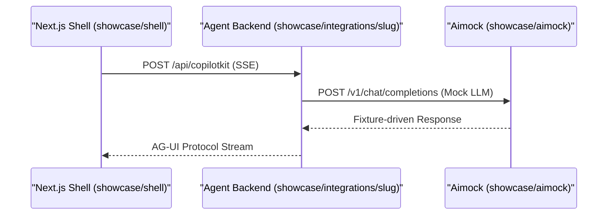

<!-- source: DeepWiki mcp.deepwiki.com · repo CopilotKit/CopilotKit · page 11 Examples and Showcase Applications · fetched 2026-10-30 -->

# Examples and Showcase Applications

<details>
<summary>Relevant source files</summary>

The following files were used as context for generating this wiki page:

- [examples/integrations/a2a-middleware/package-lock.json](examples/integrations/a2a-middleware/package-lock.json)
- [examples/integrations/a2a-middleware/package.json](examples/integrations/a2a-middleware/package.json)
- [examples/integrations/adk/package-lock.json](examples/integrations/adk/package-lock.json)
- [examples/integrations/adk/package.json](examples/integrations/adk/package.json)
- [examples/integrations/agno/package-lock.json](examples/integrations/agno/package-lock.json)
- [examples/integrations/agno/package.json](examples/integrations/agno/package.json)
- [examples/integrations/crewai-crews/package.json](examples/integrations/crewai-crews/package.json)
- [examples/integrations/crewai-flows/package-lock.json](examples/integrations/crewai-flows/package-lock.json)
- [examples/integrations/crewai-flows/package.json](examples/integrations/crewai-flows/package.json)
- [examples/integrations/langgraph-fastapi/package-lock.json](examples/integrations/langgraph-fastapi/package-lock.json)
- [examples/integrations/langgraph-fastapi/package.json](examples/integrations/langgraph-fastapi/package.json)
- [examples/integrations/langgraph-js/agent/package-lock.json](examples/integrations/langgraph-js/agent/package-lock.json)
- [examples/integrations/langgraph-js/package-lock.json](examples/integrations/langgraph-js/package-lock.json)
- [examples/integrations/langgraph-js/package.json](examples/integrations/langgraph-js/package.json)
- [examples/integrations/langgraph-python/package-lock.json](examples/integrations/langgraph-python/package-lock.json)
- [examples/integrations/langgraph-python/package.json](examples/integrations/langgraph-python/package.json)
- [examples/integrations/llamaindex/package-lock.json](examples/integrations/llamaindex/package-lock.json)
- [examples/integrations/llamaindex/package.json](examples/integrations/llamaindex/package.json)
- [examples/integrations/mastra/package-lock.json](examples/integrations/mastra/package-lock.json)
- [examples/integrations/mastra/package.json](examples/integrations/mastra/package.json)
- [examples/integrations/mcp-apps/package-lock.json](examples/integrations/mcp-apps/package-lock.json)
- [examples/integrations/mcp-apps/package.json](examples/integrations/mcp-apps/package.json)
- [examples/integrations/ms-agent-framework-dotnet/package-lock.json](examples/integrations/ms-agent-framework-dotnet/package-lock.json)
- [examples/integrations/ms-agent-framework-dotnet/package.json](examples/integrations/ms-agent-framework-dotnet/package.json)
- [examples/integrations/ms-agent-framework-python/package-lock.json](examples/integrations/ms-agent-framework-python/package-lock.json)
- [examples/integrations/ms-agent-framework-python/package.json](examples/integrations/ms-agent-framework-python/package.json)
- [examples/integrations/pydantic-ai/package-lock.json](examples/integrations/pydantic-ai/package-lock.json)
- [examples/integrations/pydantic-ai/package.json](examples/integrations/pydantic-ai/package.json)
- [examples/integrations/strands-python/package-lock.json](examples/integrations/strands-python/package-lock.json)
- [examples/integrations/strands-python/package.json](examples/integrations/strands-python/package.json)
- [showcase/DEBUGGING.md](showcase/DEBUGGING.md)
- [showcase/FRONTEND-STRATEGY.md](showcase/FRONTEND-STRATEGY.md)
- [showcase/GOTCHAS.md](showcase/GOTCHAS.md)
- [showcase/INTEGRATION-CHECKLIST.md](showcase/INTEGRATION-CHECKLIST.md)
- [showcase/RAILWAY.md](showcase/RAILWAY.md)
- [showcase/README.md](showcase/README.md)
- [showcase/STYLING-GUIDE.md](showcase/STYLING-GUIDE.md)
- [showcase/TESTING.md](showcase/TESTING.md)
- [showcase/aimock/RAILWAY.md](showcase/aimock/RAILWAY.md)
- [showcase/aimock/README.md](showcase/aimock/README.md)
- [showcase/aimock/d6/langgraph-typescript/a2ui-recovery.json](showcase/aimock/d6/langgraph-typescript/a2ui-recovery.json)
- [showcase/integrations/langgraph-typescript/PARITY_NOTES.md](showcase/integrations/langgraph-typescript/PARITY_NOTES.md)
- [showcase/integrations/langgraph-typescript/src/agent/multimodal.ts](showcase/integrations/langgraph-typescript/src/agent/multimodal.ts)
- [showcase/integrations/langgraph-typescript/src/agent/reasoning-agent.ts](showcase/integrations/langgraph-typescript/src/agent/reasoning-agent.ts)
- [showcase/integrations/langgraph-typescript/src/agent/recovery-agent.ts](showcase/integrations/langgraph-typescript/src/agent/recovery-agent.ts)
- [showcase/integrations/langgraph-typescript/src/app/demos/a2ui-recovery/chat.tsx](showcase/integrations/langgraph-typescript/src/app/demos/a2ui-recovery/chat.tsx)
- [showcase/integrations/langgraph-typescript/src/app/demos/a2ui-recovery/page.tsx](showcase/integrations/langgraph-typescript/src/app/demos/a2ui-recovery/page.tsx)
- [showcase/integrations/langgraph-typescript/src/app/demos/a2ui-recovery/suggestions.ts](showcase/integrations/langgraph-typescript/src/app/demos/a2ui-recovery/suggestions.ts)

</details>


CopilotKit provides a comprehensive suite of examples and a dedicated showcase platform to demonstrate the capabilities of the **AG-UI Protocol** across various agent frameworks. This ecosystem serves both as a collection of starter templates for developers and as a continuous integration (CI) harness for verifying feature parity across different backend integrations.

## Overview of Examples

The `examples/` directory contains implementations ranging from simple chat interfaces to complex multi-agent systems. These examples demonstrate core features such as **Generative UI**, **Shared State**, and **Human-in-the-Loop** workflows.

### Integration Examples
The `examples/integrations/` directory is the primary source for framework-specific starter templates. Each integration provides a complete full-stack setup, typically involving a Next.js frontend and an agent backend [[examples/integrations/langgraph-js/package.json:6-9]]().

Supported frameworks include:
*   **LangGraph** (Python and JS) [[examples/integrations/langgraph-python/package.json:1-10]](), [[examples/integrations/langgraph-js/package.json:1-10]](), [[examples/integrations/langgraph-fastapi/package.json:1-10]]()
*   **CrewAI** (Crews and Flows) [[examples/integrations/crewai-crews/package.json:1-10]]()
*   **Mastra** [[examples/integrations/mastra/package.json:1-10]]()
*   **PydanticAI** [[examples/integrations/pydantic-ai/package.json:1-10]]()
*   **LlamaIndex** [[examples/integrations/llamaindex/package.json:1-10]]()
*   **Agno** [[examples/integrations/agno/package.json:1-10]]()
*   **Strands** [[examples/integrations/strands-python/package.json:1-10]]()
*   **MS Agent Framework** (.NET and Python) [[examples/integrations/ms-agent-framework-python/package.json:1-10]]()
*   **ADK (Google)** [[examples/integrations/adk/package.json:1-10]]()

For details on specific framework setups, see [Integration Examples](#11.1).

---

## Showcase Platform Architecture

The `showcase/` directory contains a platform for deploying and monitoring these integrations. It includes a unified CLI (`bin/showcase`) for local development and a dashboard for tracking integration "depth" [[showcase/README.md:31-35]]().

### Showcase Components Relationship

The following diagram illustrates how the showcase platform bridges the gap between user requirements and the underlying code entities.

**Diagram: Showcase Platform Entity Map**
```mermaid
graph TD
    subgraph "Natural Language Space (User/Operator)"
        "UserIntent"["User Message / Intent"]
        "StatusView"["Integration Health Matrix"]
    end

    subgraph "Code Entity Space (Showcase Infrastructure)"
        direction TB
        "ShowcaseCLI"["showcase/bin/showcase (Unified CLI)"]
        "RegistryData"["showcase/shell/src/data/registry.json"]
        "HarnessService"["showcase-harness (Probing Service)"]
        "AimockServer"["showcase/aimock/Dockerfile (Mock LLM)"]
        "RailwayConfig"["showcase/scripts/railway-envs.ts"]
    end

    "UserIntent" -.-> "HarnessService"
    "StatusView" -.-> "RegistryData"
    "ShowcaseCLI" -- "manages" --> "HarnessService"
    "HarnessService" -- "validates via" --> "AimockServer"
    "RailwayConfig" -- "provisions" --> "HarnessService"
    "RegistryData" -- "generated by" --> "generate-registry.ts"
```
Sources: [[showcase/README.md:31-48]](), [[showcase/RAILWAY.md:10-13]](), [[showcase/aimock/RAILWAY.md:107-112]](), [[showcase/DEBUGGING.md:19-28]]().

### Feature Matrix and Monitoring
The showcase uses a "D0-D6" verification ladder to track integration depth [[showcase/README.md:22-23]](). Data files consumed by the shell apps are generated at build time [[showcase/README.md:54-56]]().

| Component | Role | Code Entity |
| :--- | :--- | :--- |
| **Integration Registry** | Full catalog with metadata and feature flags | `registry.json` [[showcase/README.md:60]]() |
| **Demo Content** | Bundled source code powering the Code tab | `demo-content.json` [[showcase/README.md:61]]() |
| **Mock LLM** | Deterministic fixture-driven responses | `aimock` [[showcase/aimock/README.md]]() |
| **Local Ports** | Deterministic host ports for Docker runs | `local-ports.json` [[showcase/README.md:41]]() |

For details on the dashboard and probe system, see [Showcase Platform](#11.3).

---

## Local Development and Testing

Developers iterate on integrations using the `bin/showcase` CLI, which manages the lifecycle of Docker containers and runs probe tests [[showcase/DEBUGGING.md:19-30]]().

### Local Interaction Loop
The system uses a standardized interaction loop where the frontend communicates with a backend runtime which then invokes the specific agent framework, often proxied through `aimock` for deterministic testing.

**Diagram: Local Runtime Flow**

Sources: [[showcase/aimock/RAILWAY.md:23-29]](), [[showcase/DEBUGGING.md:88-90]](), [[showcase/GOTCHAS.md:13-15]]().

### Verification SOP
The standard operating procedure for fixing integrations involves establishing a "Red Baseline" using the `--isolate` flag, which scopes builds to a single slug to speed up the iteration cycle [[showcase/TESTING.md:41-44]](), [[showcase/TESTING.md:90-98]]().

For setup instructions, see [Running Examples Locally](#11.2).

---

## Related Pages
*   [Integration Examples](#11.1) — Starter templates for LangGraph, CrewAI, Mastra, and more.
*   [Running Examples Locally](#11.2) — CLI and Docker instructions for local development.
*   [Showcase Platform](#11.3) — Architecture of the monitoring and verification infrastructure.

Sources: [[showcase/README.md:1-50]](), [[showcase/TESTING.md:1-40]](), [[showcase/DEBUGGING.md:1-50]](), [[showcase/RAILWAY.md:1-40]]().

---

