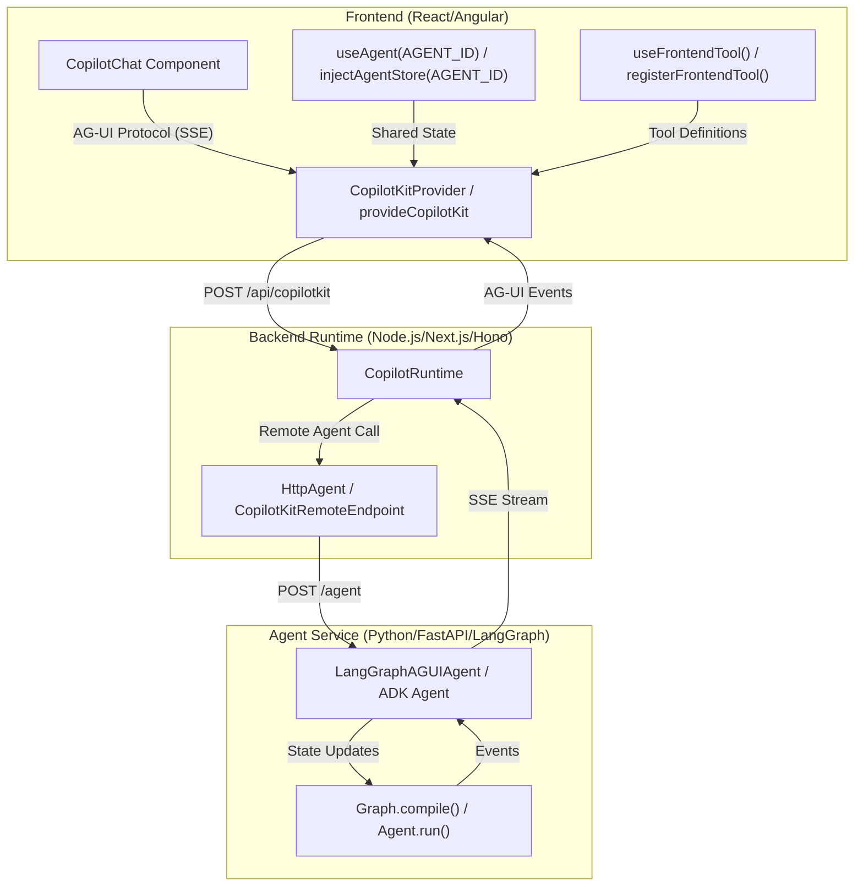
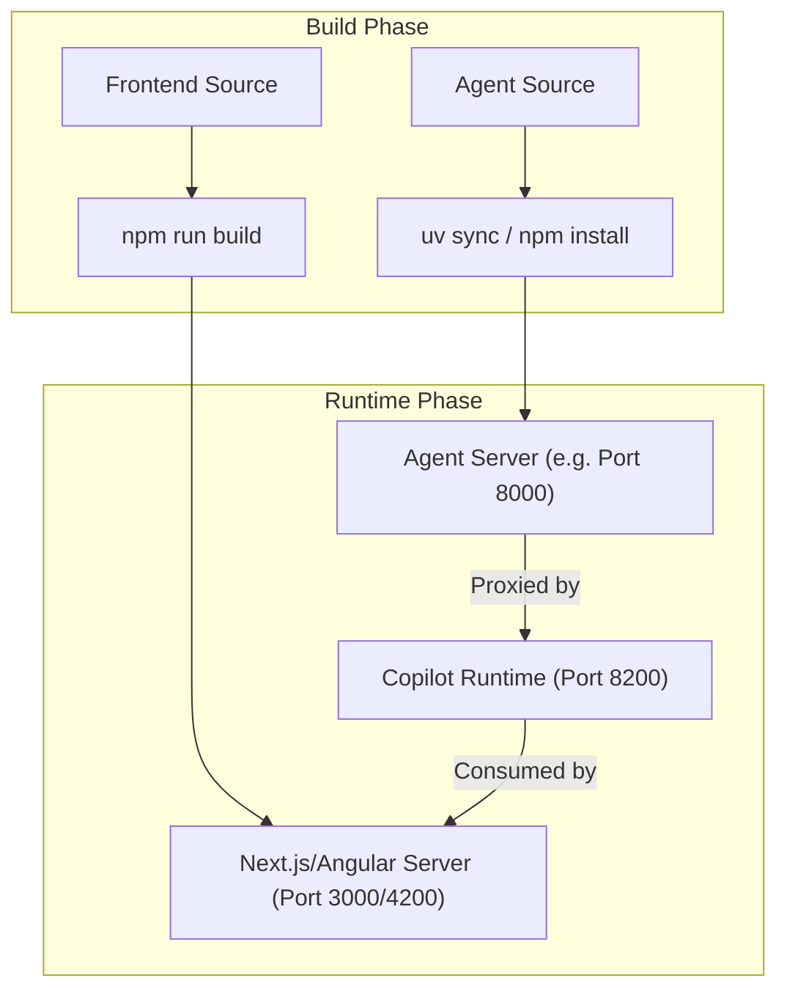

<!-- source: DeepWiki mcp.deepwiki.com · repo CopilotKit/CopilotKit · page 11.1 Integration Examples · fetched 2026-10-30 -->

# Integration Examples

<details>
<summary>Relevant source files</summary>

The following files were used as context for generating this wiki page:

- [examples/integrations/a2a-middleware/package-lock.json](examples/integrations/a2a-middleware/package-lock.json)
- [examples/integrations/a2a-middleware/package.json](examples/integrations/a2a-middleware/package.json)
- [examples/integrations/adk-angular/.env.example](examples/integrations/adk-angular/.env.example)
- [examples/integrations/adk-angular/.gitignore](examples/integrations/adk-angular/.gitignore)
- [examples/integrations/adk-angular/README.md](examples/integrations/adk-angular/README.md)
- [examples/integrations/adk-angular/agent/main.py](examples/integrations/adk-angular/agent/main.py)
- [examples/integrations/adk-angular/angular.json](examples/integrations/adk-angular/angular.json)
- [examples/integrations/adk-angular/package-lock.json](examples/integrations/adk-angular/package-lock.json)
- [examples/integrations/adk-angular/package.json](examples/integrations/adk-angular/package.json)
- [examples/integrations/adk-angular/scripts/run-agent.bat](examples/integrations/adk-angular/scripts/run-agent.bat)
- [examples/integrations/adk-angular/server.ts](examples/integrations/adk-angular/server.ts)
- [examples/integrations/adk-angular/src/app/agent-state.ts](examples/integrations/adk-angular/src/app/agent-state.ts)
- [examples/integrations/adk-angular/src/app/app.config.ts](examples/integrations/adk-angular/src/app/app.config.ts)
- [examples/integrations/adk-angular/src/app/app.ts](examples/integrations/adk-angular/src/app/app.ts)
- [examples/integrations/adk-angular/src/app/main-content.ts](examples/integrations/adk-angular/src/app/main-content.ts)
- [examples/integrations/adk-angular/src/app/proverbs.ts](examples/integrations/adk-angular/src/app/proverbs.ts)
- [examples/integrations/adk-angular/src/app/weather-card.ts](examples/integrations/adk-angular/src/app/weather-card.ts)
- [examples/integrations/adk-angular/src/app/web-inspector.ts](examples/integrations/adk-angular/src/app/web-inspector.ts)
- [examples/integrations/adk-angular/src/favicon.ico](examples/integrations/adk-angular/src/favicon.ico)
- [examples/integrations/adk-angular/src/index.html](examples/integrations/adk-angular/src/index.html)
- [examples/integrations/adk-angular/src/main.ts](examples/integrations/adk-angular/src/main.ts)
- [examples/integrations/adk-angular/src/styles.css](examples/integrations/adk-angular/src/styles.css)
- [examples/integrations/adk-angular/tsconfig.app.json](examples/integrations/adk-angular/tsconfig.app.json)
- [examples/integrations/adk-angular/tsconfig.json](examples/integrations/adk-angular/tsconfig.json)
- [examples/integrations/adk/package-lock.json](examples/integrations/adk/package-lock.json)
- [examples/integrations/adk/package.json](examples/integrations/adk/package.json)
- [examples/integrations/agno/package-lock.json](examples/integrations/agno/package-lock.json)
- [examples/integrations/agno/package.json](examples/integrations/agno/package.json)
- [examples/integrations/crewai-crews/package.json](examples/integrations/crewai-crews/package.json)
- [examples/integrations/crewai-flows/package-lock.json](examples/integrations/crewai-flows/package-lock.json)
- [examples/integrations/crewai-flows/package.json](examples/integrations/crewai-flows/package.json)
- [examples/integrations/langgraph-fastapi/package-lock.json](examples/integrations/langgraph-fastapi/package-lock.json)
- [examples/integrations/langgraph-fastapi/package.json](examples/integrations/langgraph-fastapi/package.json)
- [examples/integrations/langgraph-fastapi/src/components/example-layout/index.tsx](examples/integrations/langgraph-fastapi/src/components/example-layout/index.tsx)
- [examples/integrations/langgraph-fastapi/src/components/example-layout/mode-toggle.tsx](examples/integrations/langgraph-fastapi/src/components/example-layout/mode-toggle.tsx)
- [examples/integrations/langgraph-js/agent/package-lock.json](examples/integrations/langgraph-js/agent/package-lock.json)
- [examples/integrations/langgraph-js/package-lock.json](examples/integrations/langgraph-js/package-lock.json)
- [examples/integrations/langgraph-js/package.json](examples/integrations/langgraph-js/package.json)
- [examples/integrations/langgraph-js/src/components/example-layout/index.tsx](examples/integrations/langgraph-js/src/components/example-layout/index.tsx)
- [examples/integrations/langgraph-js/src/components/example-layout/mode-toggle.tsx](examples/integrations/langgraph-js/src/components/example-layout/mode-toggle.tsx)
- [examples/integrations/langgraph-python/package-lock.json](examples/integrations/langgraph-python/package-lock.json)
- [examples/integrations/langgraph-python/package.json](examples/integrations/langgraph-python/package.json)
- [examples/integrations/langgraph-python/src/components/example-layout/index.tsx](examples/integrations/langgraph-python/src/components/example-layout/index.tsx)
- [examples/integrations/langgraph-python/src/components/example-layout/mode-toggle.tsx](examples/integrations/langgraph-python/src/components/example-layout/mode-toggle.tsx)
- [examples/integrations/llamaindex/package-lock.json](examples/integrations/llamaindex/package-lock.json)
- [examples/integrations/llamaindex/package.json](examples/integrations/llamaindex/package.json)
- [examples/integrations/mastra/package-lock.json](examples/integrations/mastra/package-lock.json)
- [examples/integrations/mastra/package.json](examples/integrations/mastra/package.json)
- [examples/integrations/mcp-apps/package-lock.json](examples/integrations/mcp-apps/package-lock.json)
- [examples/integrations/mcp-apps/package.json](examples/integrations/mcp-apps/package.json)
- [examples/integrations/ms-agent-framework-dotnet/package-lock.json](examples/integrations/ms-agent-framework-dotnet/package-lock.json)
- [examples/integrations/ms-agent-framework-dotnet/package.json](examples/integrations/ms-agent-framework-dotnet/package.json)
- [examples/integrations/ms-agent-framework-python/package-lock.json](examples/integrations/ms-agent-framework-python/package-lock.json)
- [examples/integrations/ms-agent-framework-python/package.json](examples/integrations/ms-agent-framework-python/package.json)
- [examples/integrations/pydantic-ai/package-lock.json](examples/integrations/pydantic-ai/package-lock.json)
- [examples/integrations/pydantic-ai/package.json](examples/integrations/pydantic-ai/package.json)
- [examples/integrations/strands-python/package-lock.json](examples/integrations/strands-python/package-lock.json)
- [examples/integrations/strands-python/package.json](examples/integrations/strands-python/package.json)
- [examples/integrations/strands-python/src/components/example-layout/index.tsx](examples/integrations/strands-python/src/components/example-layout/index.tsx)
- [examples/integrations/strands-python/src/components/example-layout/mode-toggle.tsx](examples/integrations/strands-python/src/components/example-layout/mode-toggle.tsx)

</details>


This section provides an overview of the `examples/integrations/` directory, which contains starter templates and production-ready configurations for connecting CopilotKit with various agent frameworks. These examples demonstrate the implementation of the AG-UI protocol across different ecosystems, including Python-based AI frameworks, Node.js runtimes, and multi-agent systems.

## Overview of Supported Frameworks

CopilotKit provides first-class support for a wide array of agent frameworks. Each integration typically consists of a frontend (React/Next.js or Angular), a Copilot Runtime (BFF), and a remote agent endpoint.

| Framework | Implementation Language | Category | Key Features |
| :--- | :--- | :--- | :--- |
| **LangGraph** | Python / JS / TS | Popular | Shared state, HITL, multi-agent [examples/integrations/langgraph-js/package.json:52-53](), [examples/integrations/langgraph-python/package.json:1-10]() |
| **CrewAI** | Python | Popular | Crews & Flows orchestration [examples/integrations/crewai-crews/package.json:1-20](), [examples/integrations/crewai-flows/package.json:1-20]() |
| **Mastra** | TypeScript | Popular | Built-in tool management & memory [examples/integrations/mastra/package.json:22-25]() |
| **Agno** | Python | Emerging | Streaming, sub-agents, GenUI [examples/integrations/agno/package.json:1-30]() |
| **LlamaIndex** | Python | Emerging | RAG-focused agentic chat [examples/integrations/llamaindex/package.json:1-30]() |
| **PydanticAI** | Python | Emerging | Type-safe agent definitions [examples/integrations/pydantic-ai/package.json:18-21]() |
| **MS Agent Framework**| Python / .NET | Enterprise | Cross-language agent support [examples/integrations/ms-agent-framework-python/package.json:1-15](), [examples/integrations/ms-agent-framework-dotnet/package.json:1-15]() |
| **ADK** | Python / Angular | Framework | Gemini-powered ADK agents [examples/integrations/adk-angular/package.json:15-20]() |
| **AG2** | Python | Emerging | Formerly AutoGen, multi-agent |
| **Strands** | Python / TS | Emerging | Event-driven agentic workflows [examples/integrations/strands-python/package.json:18-22]() |
| **MCP Apps** | Python | Emerging | Model Context Protocol applications [examples/integrations/mcp-apps/package.json:1-20]() |
| **A2A** | Python | Emerging | Agent-to-Agent communication [examples/integrations/a2a-middleware/package.json:19-20]() |
| **AgentCore** | Python | Emerging | AWS AgentCore integration |

### System Data Flow: Integration Architecture

The following diagram illustrates how a typical integration bridges the "Natural Language Space" (User/LLM) to the "Code Entity Space" (FastAPI/CopilotRuntime).

**Integration Communication Loop**

Sources: [examples/integrations/adk-angular/src/app/app.config.ts:9-11](), [examples/integrations/adk-angular/src/app/app.config.ts:16-42](), [examples/integrations/adk-angular/src/app/app.ts:2-6](), [examples/integrations/langgraph-js/package.json:21-22]()

## Framework Specifics

### LangGraph (Python, JS, & TypeScript)
LangGraph integrations use the `ag-ui-langgraph` bridge (or `@copilotkit/sdk-js` for JS/TS) to map LangGraph's state management to the AG-UI protocol.
*   **Shared State**: UI writes preferences via `agent.setState`, and the agent reads this context.
*   **Development**: Uses `concurrently` to run the UI and agent backend simultaneously [examples/integrations/langgraph-js/package.json:6-9]().
*   **Environment Setup**: Uses `uv` for Python dependency management and `npm` for JS [examples/integrations/langgraph-fastapi/package.json:8-13](), [examples/integrations/langgraph-js/package.json:13-14]().

Sources: [examples/integrations/langgraph-js/package.json:6-14](), [examples/integrations/langgraph-fastapi/package.json:8-13]()

### ADK (Angular Integration)
The ADK starter demonstrates a full Angular implementation using the `@copilotkit/angular` package.
*   **Provider Configuration**: Uses `provideCopilotKit` to set the `runtimeUrl` and register Generative UI components like `WeatherCard` [examples/integrations/adk-angular/src/app/app.config.ts:16-21]().
*   **Agent ID**: Centrally defined `AGENT_ID` (e.g., "default") used for chat and configuration [examples/integrations/adk-angular/src/app/app.config.ts:11-11]().
*   **UI Components**: Includes `CopilotChat` and `CopilotThreadsDrawer` for thread management [examples/integrations/adk-angular/src/app/app.ts:24-25]().
*   **Frontend Tools**: Demonstrates theme management and mode toggling via `registerFrontendTool` [examples/integrations/adk-angular/src/app/app.ts:5-5]().

Sources: [examples/integrations/adk-angular/src/app/app.config.ts:11-46](), [examples/integrations/adk-angular/src/app/app.ts:2-25]()

### Mastra
A TypeScript-native agent framework providing built-in tool management and memory.
*   **Protocol Support**: Uses `@ag-ui/mastra` for seamless integration with the AG-UI protocol [examples/integrations/mastra/package.json:16-16]().
*   **Development Workflow**: Leverages `mastra dev` for local agent development [examples/integrations/mastra/package.json:7-7]().
*   **Dependencies**: Integrates with `@ai-sdk/openai` and `@mastra/core` [examples/integrations/mastra/package.json:17-23]().

Sources: [examples/integrations/mastra/package.json:7-23]()

### A2A (Agent-to-Agent)
A minimal starter template for building multi-agent applications using the A2A Protocol and AG-UI.
*   **Multi-Process**: Runs an Orchestrator, Research Agent, and Analysis Agent concurrently [examples/integrations/a2a-middleware/package.json:7-11]().
*   **Middleware**: Utilizes `@ag-ui/a2a-middleware` to facilitate communication between agents [examples/integrations/a2a-middleware/package.json:20-20]().

Sources: [examples/integrations/a2a-middleware/package.json:7-20]()

## Docker and Environment Configuration

Integration examples include Docker configurations for containerized deployment, often separating the frontend and agent runtimes.

### Multi-Stage Build Pattern
The Docker setup handles the complexity of running both a Node.js frontend and a Python/JS agent service.

**Docker Architecture for Integrations**

Sources: [examples/integrations/langgraph-js/package.json:6-9](), [examples/integrations/langgraph-python/package.json:6-9]()

### Key Environment Variables
Integrations rely on a `.env` file to configure connectivity:
*   `OPENAI_API_KEY`: Required for OpenAI-based agents.
*   `AGENT_URL`: Points the Copilot Runtime to the remote agent service.
*   `COPILOTKIT_LICENSE_TOKEN`: Enables managed Intelligence (threads/memory).

## Project Structure and Scripts

Integrations follow a consistent script pattern to manage the multi-process nature of Agentic apps.

| Script | Action |
| :--- | :--- |
| `npm run dev` | Starts UI and Agent service concurrently [examples/integrations/langgraph-js/package.json:6-6](). |
| `npm run install:agent` | Sets up the agent environment (e.g., `uv sync` or `cd agent && npm install`) [examples/integrations/langgraph-python/package.json:12-12](). |
| `npm run dev:agent` | Starts the remote agent server [examples/integrations/strands-python/package.json:7-7](). |

### Implementation Detail: `package.json`
The integration `package.json` acts as an orchestrator:
[examples/integrations/langgraph-js/package.json:5-15]()
```json
"scripts": {
  "dev": "concurrently \"npm run dev:ui\" \"npm run dev:agent\" --names ui,agent --prefix-colors blue,green --kill-others",
  "dev:ui": "next dev --turbopack",
  "dev:agent": "./scripts/run-agent.sh || scripts\\run-agent.bat",
  "install:agent": "cd agent && npm install",
  "postinstall": "npm run install:agent"
}
```
Sources: [examples/integrations/langgraph-js/package.json:5-15]()

## Shared Layout and Mode Toggling
Many React-based integrations share a common `ExampleLayout` component to demonstrate mode switching between "Chat" and "App" views.

*   **ModeToggle**: A UI component for switching between views [examples/integrations/langgraph-js/src/components/example-layout/index.tsx:5-5]().
*   **Frontend Tools**: Uses `useFrontendTool` to allow the agent to programmatically switch modes (e.g., `enableAppMode`, `enableChatMode`) [examples/integrations/langgraph-js/src/components/example-layout/index.tsx:16-31]().
*   **Responsive Design**: Adjusts layout width and visibility based on the active mode and viewport size [examples/integrations/langgraph-js/src/components/example-layout/index.tsx:38-43]().

Sources: [examples/integrations/langgraph-js/src/components/example-layout/index.tsx:1-84](), [examples/integrations/langgraph-python/src/components/example-layout/index.tsx:1-84]()

---

