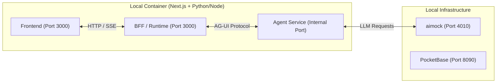
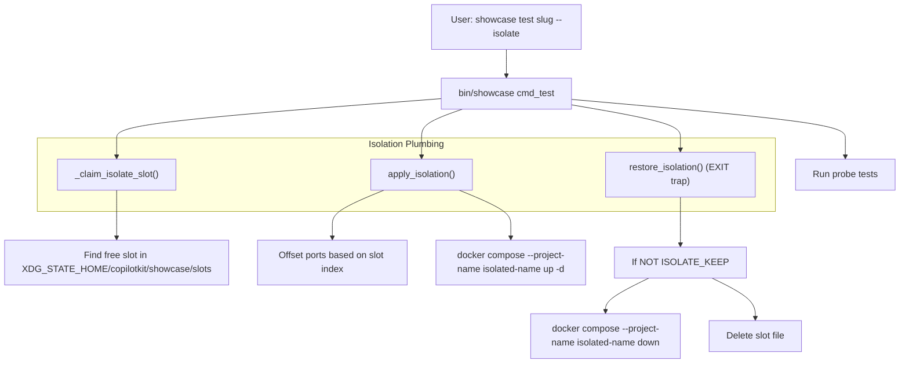

<!-- source: DeepWiki mcp.deepwiki.com · repo CopilotKit/CopilotKit · page 11.2 Running Examples Locally · fetched 2026-10-30 -->

# Running Examples Locally

Relevant source files

The following files were used as context for generating this wiki page:

- [showcase/.env.example](showcase/.env.example)
- [showcase/DEBUGGING.md](showcase/DEBUGGING.md)
- [showcase/FRONTEND-STRATEGY.md](showcase/FRONTEND-STRATEGY.md)
- [showcase/GOTCHAS.md](showcase/GOTCHAS.md)
- [showcase/INTEGRATION-CHECKLIST.md](showcase/INTEGRATION-CHECKLIST.md)
- [showcase/RAILWAY.md](showcase/RAILWAY.md)
- [showcase/README.md](showcase/README.md)
- [showcase/STYLING-GUIDE.md](showcase/STYLING-GUIDE.md)
- [showcase/TESTING.md](showcase/TESTING.md)
- [showcase/aimock/RAILWAY.md](showcase/aimock/RAILWAY.md)
- [showcase/aimock/README.md](showcase/aimock/README.md)
- [showcase/aimock/d5-recorded/.gitignore](showcase/aimock/d5-recorded/.gitignore)
- [showcase/aimock/d6/langgraph-typescript/a2ui-recovery.json](showcase/aimock/d6/langgraph-typescript/a2ui-recovery.json)
- [showcase/bin/showcase](showcase/bin/showcase)
- [showcase/docker-compose.dev.yml](showcase/docker-compose.dev.yml)
- [showcase/docker-compose.local.yml](showcase/docker-compose.local.yml)
- [showcase/docker-compose.record.yml](showcase/docker-compose.record.yml)
- [showcase/docker-compose.replay.yml](showcase/docker-compose.replay.yml)
- [showcase/harness/package-lock.json](showcase/harness/package-lock.json)
- [showcase/harness/src/cli.ts](showcase/harness/src/cli.ts)
- [showcase/harness/src/cli/aimock-rebuild.ts](showcase/harness/src/cli/aimock-rebuild.ts)
- [showcase/harness/src/cli/config.test.ts](showcase/harness/src/cli/config.test.ts)
- [showcase/harness/src/cli/config.ts](showcase/harness/src/cli/config.ts)
- [showcase/harness/src/cli/control-plane-run.test.ts](showcase/harness/src/cli/control-plane-run.test.ts)
- [showcase/harness/src/cli/control-plane-run.ts](showcase/harness/src/cli/control-plane-run.ts)
- [showcase/harness/src/cli/doctor.ts](showcase/harness/src/cli/doctor.ts)
- [showcase/harness/src/cli/eval/index.ts](showcase/harness/src/cli/eval/index.ts)
- [showcase/harness/src/cli/fixtures.ts](showcase/harness/src/cli/fixtures.ts)
- [showcase/harness/src/cli/frontend-matrix-ci.ts](showcase/harness/src/cli/frontend-matrix-ci.ts)
- [showcase/harness/src/cli/lifecycle.test.ts](showcase/harness/src/cli/lifecycle.test.ts)
- [showcase/harness/src/cli/lifecycle.ts](showcase/harness/src/cli/lifecycle.ts)
- [showcase/harness/src/probes/frontend-matrix-playwright-timeout.test.ts](showcase/harness/src/probes/frontend-matrix-playwright-timeout.test.ts)
- [showcase/harness/src/probes/frontend-matrix-playwright.test.ts](showcase/harness/src/probes/frontend-matrix-playwright.test.ts)
- [showcase/harness/src/probes/frontend-matrix-playwright.ts](showcase/harness/src/probes/frontend-matrix-playwright.ts)
- [showcase/harness/src/probes/frontend-matrix-runner.test.ts](showcase/harness/src/probes/frontend-matrix-runner.test.ts)
- [showcase/harness/src/probes/frontend-matrix-runner.ts](showcase/harness/src/probes/frontend-matrix-runner.ts)
- [showcase/harness/src/probes/frontend-parity-gate.test.ts](showcase/harness/src/probes/frontend-parity-gate.test.ts)
- [showcase/harness/src/probes/frontend-parity-gate.ts](showcase/harness/src/probes/frontend-parity-gate.ts)
- [showcase/harness/src/probes/helpers/d5-representatives.test.ts](showcase/harness/src/probes/helpers/d5-representatives.test.ts)
- [showcase/harness/src/probes/helpers/d5-representatives.ts](showcase/harness/src/probes/helpers/d5-representatives.ts)
- [showcase/harness/src/probes/helpers/privacy-safe-diagnostics.ts](showcase/harness/src/probes/helpers/privacy-safe-diagnostics.ts)
- [showcase/integrations/langgraph-typescript/PARITY_NOTES.md](showcase/integrations/langgraph-typescript/PARITY_NOTES.md)
- [showcase/integrations/langgraph-typescript/src/agent/multimodal.ts](showcase/integrations/langgraph-typescript/src/agent/multimodal.ts)
- [showcase/integrations/langgraph-typescript/src/agent/reasoning-agent.ts](showcase/integrations/langgraph-typescript/src/agent/reasoning-agent.ts)
- [showcase/integrations/langgraph-typescript/src/agent/recovery-agent.ts](showcase/integrations/langgraph-typescript/src/agent/recovery-agent.ts)
- [showcase/integrations/langgraph-typescript/src/app/demos/a2ui-recovery/chat.tsx](showcase/integrations/langgraph-typescript/src/app/demos/a2ui-recovery/chat.tsx)
- [showcase/integrations/langgraph-typescript/src/app/demos/a2ui-recovery/page.tsx](showcase/integrations/langgraph-typescript/src/app/demos/a2ui-recovery/page.tsx)
- [showcase/integrations/langgraph-typescript/src/app/demos/a2ui-recovery/suggestions.ts](showcase/integrations/langgraph-typescript/src/app/demos/a2ui-recovery/suggestions.ts)
- [showcase/scripts/__tests__/integration-smoke-registry.test.ts](showcase/scripts/__tests__/integration-smoke-registry.test.ts)
- [showcase/scripts/__tests__/isolate-liveness-real.bats](showcase/scripts/__tests__/isolate-liveness-real.bats)
- [showcase/scripts/__tests__/isolate-ttl-real.bats](showcase/scripts/__tests__/isolate-ttl-real.bats)
- [showcase/scripts/__tests__/isolate.bats](showcase/scripts/__tests__/isolate.bats)
- [showcase/scripts/ci-native-eval.sh](showcase/scripts/ci-native-eval.sh)
- [showcase/scripts/cli/_common.sh](showcase/scripts/cli/_common.sh)
- [showcase/scripts/cli/cmd-logs.sh](showcase/scripts/cli/cmd-logs.sh)
- [showcase/scripts/cli/cmd-recreate.sh](showcase/scripts/cli/cmd-recreate.sh)
- [showcase/scripts/cli/cmd-slots.sh](showcase/scripts/cli/cmd-slots.sh)
- [showcase/scripts/cli/cmd-test.sh](showcase/scripts/cli/cmd-test.sh)
- [showcase/scripts/record-d5-fixtures.mjs](showcase/scripts/record-d5-fixtures.mjs)
- [showcase/scripts/smoke-local.sh](showcase/scripts/smoke-local.sh)
- [showcase/shared/dev/dev-entrypoint.sh](showcase/shared/dev/dev-entrypoint.sh)
- [showcase/shared/local-ports.json](showcase/shared/local-ports.json)
- [showcase/tests/docker-compose.integrations.yml](showcase/tests/docker-compose.integrations.yml)
- [showcase/tests/e2e/helpers.ts](showcase/tests/e2e/helpers.ts)
- [showcase/tests/e2e/integration-smoke.spec.ts](showcase/tests/e2e/integration-smoke.spec.ts)
- [showcase/tests/package-lock.json](showcase/tests/package-lock.json)
- [showcase/tests/package.json](showcase/tests/package.json)

This page provides technical instructions for running CopilotKit examples in a local development environment. It covers the setup of standalone integration starters, the use of the **Showcase Platform** for multi-framework testing, and the local LLM simulation infrastructure using `aimock`.

---

## Example Repository Structure

CopilotKit maintains two distinct types of local examples:

1.  **Integration Starters (`examples/integrations/`):** Self-contained templates for specific frameworks (e.g., LangGraph Python, CrewAI, Mastra). These are designed for users to clone and use as a base for new projects [showcase/README.md:6-9]().
2.  **Showcase Integrations (`showcase/`):** A high-density testing environment used to verify feature parity across 17+ different agent framework implementations [showcase/README.md:33-37]().

| Category | Purpose | Key Path |
| :--- | :--- | :--- |
| **Starters** | User-facing templates | `examples/integrations/` |
| **Showcase** | Internal QA & Parity Matrix | `showcase/` |
| **Infrastructure** | LLM Mocks & DBs | `showcase/docker-compose.local.yml` |

Sources: [showcase/shared/local-ports.json:1-21](), [showcase/docker-compose.local.yml:1-30](), [showcase/README.md:27-50]()

---

## Running Integration Starters

Integration starters are often packaged as Dockerized applications that combine a Next.js frontend with a specialized agent backend.

### Service Architecture

**Implementation Details:**
- **BFF/Runtime:** Starters typically use `@copilotkit/runtime` to bridge the frontend and the agent. In Dockerized production-parity modes, the runtime may use `HttpAgent` to communicate with the local agent service.
- **Agent Backend:** Python-based agents (e.g., LangGraph, CrewAI) are served via framework-specific adapters using FastAPI and Uvicorn.
- **Shared Assets:** During Docker builds, shared tools and modules are staged (dereferenced from symlinks) into each integration context so the Docker `COPY` command can access them [showcase/scripts/cli/_common.sh:70-97](). The `stageSharedModules` function in the harness lifecycle also performs this operation for `tools`, `shared-tools`, and `_shared` directories [showcase/harness/src/cli/lifecycle.ts:152-198]().

Sources: [showcase/scripts/cli/_common.sh:70-97](), [showcase/docker-compose.local.yml:1-30](), [showcase/harness/src/cli/lifecycle.ts:152-198]()

---

## The Showcase Platform

The Showcase Platform allows running the entire suite of supported integrations against a local infrastructure stack.

### Local Infrastructure (`docker-compose.local.yml`)
The local stack includes:
- **aimock (Port 4010):** An LLM fixture server that intercepts OpenAI/Anthropic/Gemini calls and returns deterministic responses from the `showcase/aimock/` directory [showcase/docker-compose.local.yml:54-69]().
- **PocketBase (Port 8090):** Provides a backend for the showcase dashboard to track health status and test results [showcase/docker-compose.local.yml:129-141]().
- **Dashboard:** A Next.js application (`showcase/shell-dashboard`) that visualizes the status of all local integrations [showcase/docker-compose.local.yml:150-161]().

### LLM Simulation with `aimock`
`aimock` is the core of the local development workflow, preventing unexpected LLM costs and providing deterministic behavior:
- **Fixture Loading:** It loads JSON fixtures from directories like `shared`, `d4`, `d5-recorded`, and `d6` [showcase/docker-compose.local.yml:105-113]().
- **Latency Simulation:** To mimic real LLM behavior, it uses `--chunk-size` and `--latency` flags to stream responses at a natural pace (~30-40 tokens/sec) [showcase/docker-compose.local.yml:101-104]().
- **Safety:** By default, it runs without `--proxy-only`, meaning unmatched requests fail loudly rather than falling through to real providers [showcase/docker-compose.local.yml:36-48]().
- **Validation:** Fixtures are validated on load to catch structural errors or duplicates [showcase/docker-compose.local.yml:114]().

Sources: [showcase/docker-compose.local.yml:54-127](), [showcase/aimock/RAILWAY.md:21-30](), [showcase/aimock/RAILWAY.md:164-174]()

### Running Showcase Examples with `bin/showcase`

The `showcase/bin/showcase` CLI tool simplifies the management of the local Docker Compose stack. It wraps `docker compose` commands and adds debugging-specific functionalities [showcase/DEBUGGING.md:18-20]().

#### Core Commands

| Command | Description |
| :--- | :--- |
| `showcase up [slug...]` | Starts containers. If no `slug` is provided, it starts only the infrastructure services (`aimock`, `pocketbase`, `dashboard`) [showcase/DEBUGGING.md:34](). |
| `showcase down [slug...]` | Stops containers. If no `slug` is provided, it stops all services [showcase/DEBUGGING.md:35](). |
| `showcase build [slug...]` | Builds Docker images for specified services. Handles symlink dereferencing for shared modules [showcase/DEBUGGING.md:36](). |
| `showcase ps` | Shows the status of running containers [showcase/DEBUGGING.md:37](). |
| `showcase ports` | Prints the mapping of integration slugs to their local host ports, derived from `showcase/shared/local-ports.json` [showcase/DEBUGGING.md:38](). |
| `showcase logs <slug>` | Follows container logs for a specific service. Supports filtering options like `--grep`, `--since`, `-n`, and `--no-follow` [showcase/DEBUGGING.md:39](). |

Sources: [showcase/DEBUGGING.md:30-40](), [showcase/scripts/cli/_common.sh:106-118]()

#### Debugging Commands

| Command | Description |
| :--- | :--- |
| `showcase aimock-rebuild` | Rebuilds the local `aimock` service from source and redeploys its container [showcase/DEBUGGING.md:45](). |
| `showcase recreate <slug>` | Force-recreates a service, picking up a newly built image [showcase/DEBUGGING.md:46](). |
| `showcase test <slug>` | Runs probe tests against a running service. Supports various test levels (`--d4`, `--d5`, `--d6`, `--smoke`) and options like `--verbose`, `--headed`, `--repeat`, `--keep`, `--live`, `--rebuild`, `--cycle`, and `--isolate` [showcase/scripts/cli/cmd-test.sh:9-38](). |
| `showcase fixtures validate` | Checks `aimock` fixture JSON files for structural errors, duplicates, and common mistakes [showcase/DEBUGGING.md:48](). |
| `showcase doctor` | Diagnoses common local stack issues (Docker engine, stale images, port conflicts) [showcase/DEBUGGING.md:49](). |

Sources: [showcase/DEBUGGING.md:41-51](), [showcase/scripts/cli/cmd-test.sh:9-48]()

#### Isolated Verification Runs (`--isolate`)

The `--isolate` flag for `showcase test` allows running tests in a fully isolated Docker Compose project. This prevents port conflicts and interference with other running local services, enabling parallel test execution [showcase/scripts/cli/cmd-test.sh:31-32]().

When `--isolate` is used:
- A unique Compose project name is generated (e.g., `showcase-iso<slot>`) [showcase/scripts/cli/_common.sh:146-150]().
- Ports are offset to avoid collisions [showcase/scripts/cli/_common.sh:147]().
- A temporary Compose project is claimed via a slot registry in `XDG_STATE_HOME` [showcase/scripts/cli/_common.sh:158-178]().
- The `ISOLATE_KEEP` flag (set via `--keep`) prevents the isolated stack from being torn down on exit, allowing for manual inspection [showcase/scripts/cli/_common.sh:149-156]().

Sources: [showcase/scripts/cli/_common.sh:144-180](), [showcase/scripts/cli/cmd-test.sh:51-164](), [showcase/scripts/__tests__/isolate.bats:6-18]()

---

## Troubleshooting Local Examples

| Issue | Potential Cause | Investigation Strategy |
| :--- | :--- | :--- |
| **"chained reply missing fragments after 30000ms"** | Fixture matching issue. The agent is sending requests that don't match any fixture. | Check `showcase logs aimock --grep "fixture\|match\|NO match\|404"` [showcase/DEBUGGING.md:79-80](). |
| **"timeout"** | Container not responding or crash-looping. | Check `showcase logs <slug>` for startup errors [showcase/DEBUGGING.md:80-81](). |
| **"404"** | Demo route doesn't exist or agent backend path is wrong. | Check integration routing and `manifest.yaml` [showcase/DEBUGGING.md:81-81](). |
| **"JS error on page"** | Frontend error crashing the demo. | Use Playwright UI mode: `npx playwright test --ui` [showcase/DEBUGGING.md:82-82](). |
| **V1/V2 Import Mismatch** | Mixing `@copilotkit/react-core` with `v2` hooks. | Verify all imports in the integration's `package.json` and components [showcase/GOTCHAS.md:13-13](). |
| **Agent Loop Strategy** | `@tanstack/ai`'s `chat()` defaults to 5 iterations. | Check `DEMO_AGENT_LOOP_STRATEGY` in `lib/factory/demo-stream.ts` [showcase/GOTCHAS.md:19-19](). |

Sources: [showcase/DEBUGGING.md:77-83](), [showcase/GOTCHAS.md:13-27](), [showcase/TESTING.md:89-136]()

---

