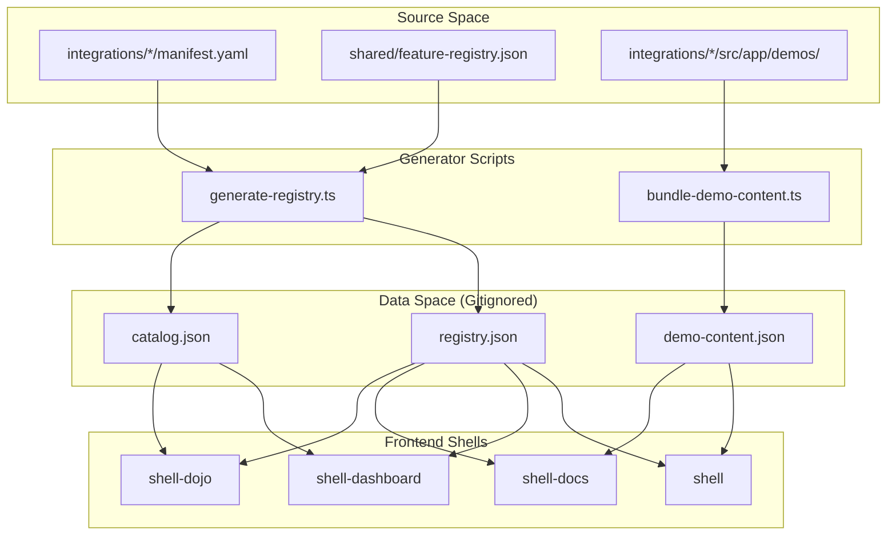
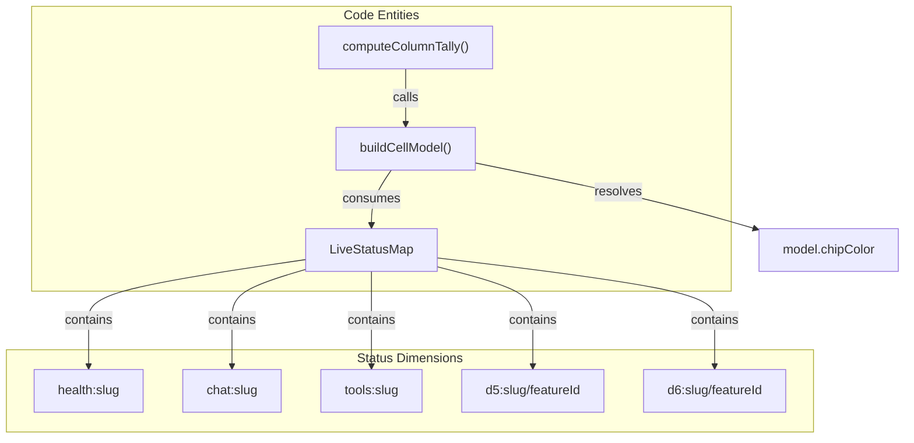
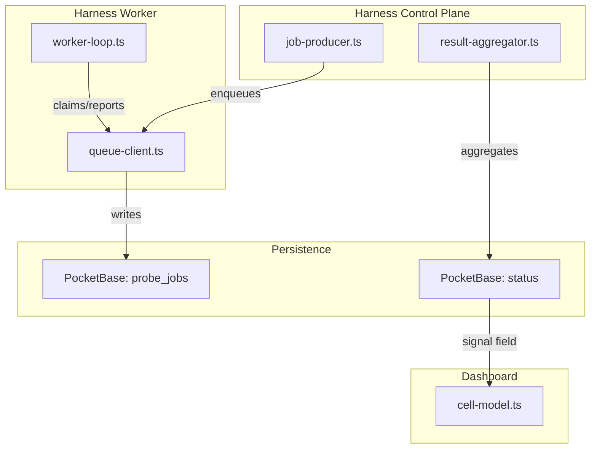

<!-- source: DeepWiki mcp.deepwiki.com · repo CopilotKit/CopilotKit · page 11.3 Showcase Platform · fetched 2026-10-30 -->

# Showcase Platform

Relevant source files

The following files were used as context for generating this wiki page:

- [.github/workflows/ghcr_unlinked_packages.yml](.github/workflows/ghcr_unlinked_packages.yml)
- [.github/workflows/showcase_build.yml](.github/workflows/showcase_build.yml)
- [.github/workflows/showcase_build_check.yml](.github/workflows/showcase_build_check.yml)
- [.github/workflows/showcase_capture-previews.yml](.github/workflows/showcase_capture-previews.yml)
- [.github/workflows/showcase_deploy.yml](.github/workflows/showcase_deploy.yml)
- [.github/workflows/showcase_eval-webhook_build.yml](.github/workflows/showcase_eval-webhook_build.yml)
- [.github/workflows/showcase_eval_check.yml](.github/workflows/showcase_eval_check.yml)
- [.github/workflows/showcase_keep-alive.yml](.github/workflows/showcase_keep-alive.yml)
- [.github/workflows/showcase_promote.yml](.github/workflows/showcase_promote.yml)
- [.github/workflows/showcase_promote_notify.dry-run.sh](.github/workflows/showcase_promote_notify.dry-run.sh)
- [.github/workflows/showcase_promote_notify.yml](.github/workflows/showcase_promote_notify.yml)
- [.github/workflows/showcase_reconcile_staging.yml](.github/workflows/showcase_reconcile_staging.yml)
- [.github/workflows/showcase_validate.yml](.github/workflows/showcase_validate.yml)
- [scripts/hooks/check-binaries.sh](scripts/hooks/check-binaries.sh)
- [showcase/aimock/Dockerfile](showcase/aimock/Dockerfile)
- [showcase/eval-webhook/.dockerignore](showcase/eval-webhook/.dockerignore)
- [showcase/eval-webhook/Dockerfile](showcase/eval-webhook/Dockerfile)
- [showcase/eval-webhook/package-lock.json](showcase/eval-webhook/package-lock.json)
- [showcase/eval-webhook/package.json](showcase/eval-webhook/package.json)
- [showcase/eval-webhook/src/server.ts](showcase/eval-webhook/src/server.ts)
- [showcase/eval-webhook/tsconfig.json](showcase/eval-webhook/tsconfig.json)
- [showcase/harness/config/probes/starter_smoke.yml](showcase/harness/config/probes/starter_smoke.yml)
- [showcase/harness/src/fleet/contracts.test.ts](showcase/harness/src/fleet/contracts.test.ts)
- [showcase/harness/src/fleet/contracts.ts](showcase/harness/src/fleet/contracts.ts)
- [showcase/harness/src/fleet/control-plane/catalog-enumerator.test.ts](showcase/harness/src/fleet/control-plane/catalog-enumerator.test.ts)
- [showcase/harness/src/fleet/control-plane/catalog-enumerator.ts](showcase/harness/src/fleet/control-plane/catalog-enumerator.ts)
- [showcase/harness/src/fleet/control-plane/control-plane.test.ts](showcase/harness/src/fleet/control-plane/control-plane.test.ts)
- [showcase/harness/src/fleet/control-plane/control-plane.ts](showcase/harness/src/fleet/control-plane/control-plane.ts)
- [showcase/harness/src/fleet/control-plane/fleet-health.test.ts](showcase/harness/src/fleet/control-plane/fleet-health.test.ts)
- [showcase/harness/src/fleet/control-plane/fleet-health.ts](showcase/harness/src/fleet/control-plane/fleet-health.ts)
- [showcase/harness/src/fleet/control-plane/job-producer.test.ts](showcase/harness/src/fleet/control-plane/job-producer.test.ts)
- [showcase/harness/src/fleet/control-plane/job-producer.ts](showcase/harness/src/fleet/control-plane/job-producer.ts)
- [showcase/harness/src/fleet/control-plane/result-aggregator.test.ts](showcase/harness/src/fleet/control-plane/result-aggregator.test.ts)
- [showcase/harness/src/fleet/control-plane/result-aggregator.ts](showcase/harness/src/fleet/control-plane/result-aggregator.ts)
- [showcase/harness/src/fleet/control-plane/result-consumer.test.ts](showcase/harness/src/fleet/control-plane/result-consumer.test.ts)
- [showcase/harness/src/fleet/job-claim.test.ts](showcase/harness/src/fleet/job-claim.test.ts)
- [showcase/harness/src/fleet/job-claim.ts](showcase/harness/src/fleet/job-claim.ts)
- [showcase/harness/src/fleet/orchestrator.test.ts](showcase/harness/src/fleet/orchestrator.test.ts)
- [showcase/harness/src/fleet/orchestrator.ts](showcase/harness/src/fleet/orchestrator.ts)
- [showcase/harness/src/fleet/queue-client.test.ts](showcase/harness/src/fleet/queue-client.test.ts)
- [showcase/harness/src/fleet/queue-client.ts](showcase/harness/src/fleet/queue-client.ts)
- [showcase/harness/src/fleet/role-config.test.ts](showcase/harness/src/fleet/role-config.test.ts)
- [showcase/harness/src/fleet/role-config.ts](showcase/harness/src/fleet/role-config.ts)
- [showcase/harness/src/fleet/run-visibility.integration.test.ts](showcase/harness/src/fleet/run-visibility.integration.test.ts)
- [showcase/harness/src/fleet/worker-snapshot-wiring.test.ts](showcase/harness/src/fleet/worker-snapshot-wiring.test.ts)
- [showcase/harness/src/fleet/worker/payload-mapper.test.ts](showcase/harness/src/fleet/worker/payload-mapper.test.ts)
- [showcase/harness/src/fleet/worker/payload-mapper.ts](showcase/harness/src/fleet/worker/payload-mapper.ts)
- [showcase/harness/src/fleet/worker/registration.test.ts](showcase/harness/src/fleet/worker/registration.test.ts)
- [showcase/harness/src/fleet/worker/registration.ts](showcase/harness/src/fleet/worker/registration.ts)
- [showcase/harness/src/fleet/worker/worker-health.test.ts](showcase/harness/src/fleet/worker/worker-health.test.ts)
- [showcase/harness/src/fleet/worker/worker-health.ts](showcase/harness/src/fleet/worker/worker-health.ts)
- [showcase/harness/src/fleet/worker/worker-loop.test.ts](showcase/harness/src/fleet/worker/worker-loop.test.ts)
- [showcase/harness/src/fleet/worker/worker-loop.ts](showcase/harness/src/fleet/worker/worker-loop.ts)
- [showcase/harness/src/orchestrator.test.ts](showcase/harness/src/orchestrator.test.ts)
- [showcase/harness/src/orchestrator.ts](showcase/harness/src/orchestrator.ts)
- [showcase/harness/src/probes/drivers/starter-smoke.test.ts](showcase/harness/src/probes/drivers/starter-smoke.test.ts)
- [showcase/harness/src/probes/drivers/starter-smoke.ts](showcase/harness/src/probes/drivers/starter-smoke.ts)
- [showcase/harness/src/probes/drivers/x-test-id-headers.test.ts](showcase/harness/src/probes/drivers/x-test-id-headers.test.ts)
- [showcase/harness/src/probes/helpers/browser-pool.test.ts](showcase/harness/src/probes/helpers/browser-pool.test.ts)
- [showcase/harness/src/probes/helpers/browser-pool.ts](showcase/harness/src/probes/helpers/browser-pool.ts)
- [showcase/harness/src/probes/helpers/resource-gauges.test.ts](showcase/harness/src/probes/helpers/resource-gauges.test.ts)
- [showcase/harness/src/probes/helpers/resource-gauges.ts](showcase/harness/src/probes/helpers/resource-gauges.ts)
- [showcase/harness/src/probes/helpers/starter-mapping-drift.test.ts](showcase/harness/src/probes/helpers/starter-mapping-drift.test.ts)
- [showcase/harness/src/probes/helpers/starter-mapping.ts](showcase/harness/src/probes/helpers/starter-mapping.ts)
- [showcase/harness/src/probes/loader/probe-config-parity.test.ts](showcase/harness/src/probes/loader/probe-config-parity.test.ts)
- [showcase/harness/src/probes/loader/probe-invoker.ts](showcase/harness/src/probes/loader/probe-invoker.ts)
- [showcase/harness/src/shared/cell-model/format-ts.ts](showcase/harness/src/shared/cell-model/format-ts.ts)
- [showcase/harness/src/types/dimensions.test.ts](showcase/harness/src/types/dimensions.test.ts)
- [showcase/harness/src/types/index.ts](showcase/harness/src/types/index.ts)
- [showcase/harness/test/integration/fleet/job-claim.integration.test.ts](showcase/harness/test/integration/fleet/job-claim.integration.test.ts)
- [showcase/integrations/strands-typescript/manifest.yaml](showcase/integrations/strands-typescript/manifest.yaml)
- [showcase/pocketbase/pb_hooks/fleet-claim.pb.js](showcase/pocketbase/pb_hooks/fleet-claim.pb.js)
- [showcase/pocketbase/pb_migrations/1779990000_resource_snapshots_add_worker_id.js](showcase/pocketbase/pb_migrations/1779990000_resource_snapshots_add_worker_id.js)
- [showcase/pocketbase/pb_migrations/1779990200_probe_jobs_add_run_metadata.js](showcase/pocketbase/pb_migrations/1779990200_probe_jobs_add_run_metadata.js)
- [showcase/pocketbase/pb_migrations/1779990300_probe_jobs_add_requeued_at.js](showcase/pocketbase/pb_migrations/1779990300_probe_jobs_add_requeued_at.js)
- [showcase/pocketbase/pb_migrations/1779990400_probe_jobs_add_consecutive_orphan_count.js](showcase/pocketbase/pb_migrations/1779990400_probe_jobs_add_consecutive_orphan_count.js)
- [showcase/scripts/__tests__/bundle-demo-content.test.ts](showcase/scripts/__tests__/bundle-demo-content.test.ts)
- [showcase/scripts/__tests__/deploy-to-railway.digest-pin.test.ts](showcase/scripts/__tests__/deploy-to-railway.digest-pin.test.ts)
- [showcase/scripts/__tests__/deploy-to-railway.healthcheck.test.ts](showcase/scripts/__tests__/deploy-to-railway.healthcheck.test.ts)
- [showcase/scripts/__tests__/emit-railway-envs-json.test.ts](showcase/scripts/__tests__/emit-railway-envs-json.test.ts)
- [showcase/scripts/__tests__/fixtures/railway-envs.golden.json](showcase/scripts/__tests__/fixtures/railway-envs.golden.json)
- [showcase/scripts/__tests__/generate-catalog.test.ts](showcase/scripts/__tests__/generate-catalog.test.ts)
- [showcase/scripts/__tests__/generate-registry.test.ts](showcase/scripts/__tests__/generate-registry.test.ts)
- [showcase/scripts/__tests__/lint-prod-gate.bats](showcase/scripts/__tests__/lint-prod-gate.bats)
- [showcase/scripts/__tests__/paths.ts](showcase/scripts/__tests__/paths.ts)
- [showcase/scripts/__tests__/promote-fleet.bats](showcase/scripts/__tests__/promote-fleet.bats)
- [showcase/scripts/__tests__/promote-notify.bats](showcase/scripts/__tests__/promote-notify.bats)
- [showcase/scripts/__tests__/railway-envs.golden.test.ts](showcase/scripts/__tests__/railway-envs.golden.test.ts)
- [showcase/scripts/__tests__/redeploy-env.harness-worker-prod-scope.test.ts](showcase/scripts/__tests__/redeploy-env.harness-worker-prod-scope.test.ts)
- [showcase/scripts/__tests__/redeploy-env.summary.test.ts](showcase/scripts/__tests__/redeploy-env.summary.test.ts)
- [showcase/scripts/__tests__/redeploy-env.token.test.ts](showcase/scripts/__tests__/redeploy-env.token.test.ts)
- [showcase/scripts/__tests__/resolve-promote-targets.bats](showcase/scripts/__tests__/resolve-promote-targets.bats)
- [showcase/scripts/__tests__/test-cleanup.test.ts](showcase/scripts/__tests__/test-cleanup.test.ts)
- [showcase/scripts/__tests__/test-cleanup.ts](showcase/scripts/__tests__/test-cleanup.ts)
- [showcase/scripts/__tests__/verify-deploy.drivers.test.ts](showcase/scripts/__tests__/verify-deploy.drivers.test.ts)
- [showcase/scripts/__tests__/verify-deploy.test.ts](showcase/scripts/__tests__/verify-deploy.test.ts)
- [showcase/scripts/__tests__/verify-railway-image-refs.test.ts](showcase/scripts/__tests__/verify-railway-image-refs.test.ts)
- [showcase/scripts/bundle-demo-content.ts](showcase/scripts/bundle-demo-content.ts)
- [showcase/scripts/deploy-to-railway.ts](showcase/scripts/deploy-to-railway.ts)
- [showcase/scripts/emit-railway-envs-json.test.ts](showcase/scripts/emit-railway-envs-json.test.ts)
- [showcase/scripts/emit-railway-envs-json.ts](showcase/scripts/emit-railway-envs-json.ts)
- [showcase/scripts/generate-registry.ts](showcase/scripts/generate-registry.ts)
- [showcase/scripts/lib/__tests__/railway-graphql.scan.test.ts](showcase/scripts/lib/__tests__/railway-graphql.scan.test.ts)
- [showcase/scripts/lib/__tests__/railway-graphql.test.ts](showcase/scripts/lib/__tests__/railway-graphql.test.ts)
- [showcase/scripts/lib/__tests__/railway-token.envelope.test.ts](showcase/scripts/lib/__tests__/railway-token.envelope.test.ts)
- [showcase/scripts/lib/__tests__/railway-token.test.ts](showcase/scripts/lib/__tests__/railway-token.test.ts)
- [showcase/scripts/lib/railway-graphql.ts](showcase/scripts/lib/railway-graphql.ts)
- [showcase/scripts/lib/railway-token.ts](showcase/scripts/lib/railway-token.ts)
- [showcase/scripts/lint-prod-gate.sh](showcase/scripts/lint-prod-gate.sh)
- [showcase/scripts/probe-docs.ts](showcase/scripts/probe-docs.ts)
- [showcase/scripts/promote-fleet.sh](showcase/scripts/promote-fleet.sh)
- [showcase/scripts/railway-envs.generated.json](showcase/scripts/railway-envs.generated.json)
- [showcase/scripts/railway-envs.test.ts](showcase/scripts/railway-envs.test.ts)
- [showcase/scripts/railway-envs.ts](showcase/scripts/railway-envs.ts)
- [showcase/scripts/reconcile-staging.test.ts](showcase/scripts/reconcile-staging.test.ts)
- [showcase/scripts/reconcile-staging.ts](showcase/scripts/reconcile-staging.ts)
- [showcase/scripts/redeploy-env.test.ts](showcase/scripts/redeploy-env.test.ts)
- [showcase/scripts/redeploy-env.ts](showcase/scripts/redeploy-env.ts)
- [showcase/scripts/resolve-promote-targets.sh](showcase/scripts/resolve-promote-targets.sh)
- [showcase/scripts/verify-deploy.drivers.baseline.ts](showcase/scripts/verify-deploy.drivers.baseline.ts)
- [showcase/scripts/verify-deploy.drivers.starter.ts](showcase/scripts/verify-deploy.drivers.starter.ts)
- [showcase/scripts/verify-deploy.drivers.ts](showcase/scripts/verify-deploy.drivers.ts)
- [showcase/scripts/verify-deploy.ts](showcase/scripts/verify-deploy.ts)
- [showcase/scripts/verify-railway-image-refs.test.ts](showcase/scripts/verify-railway-image-refs.test.ts)
- [showcase/scripts/verify-railway-image-refs.ts](showcase/scripts/verify-railway-image-refs.ts)
- [showcase/scripts/vitest.config.ts](showcase/scripts/vitest.config.ts)
- [showcase/shared/constraints.yaml](showcase/shared/constraints.yaml)
- [showcase/shared/feature-registry.json](showcase/shared/feature-registry.json)
- [showcase/shell-dashboard/src/app/page.tsx](showcase/shell-dashboard/src/app/page.tsx)
- [showcase/shell-dashboard/src/components/__tests__/cell-drilldown.lazy-signal.test.tsx](showcase/shell-dashboard/src/components/__tests__/cell-drilldown.lazy-signal.test.tsx)
- [showcase/shell-dashboard/src/components/__tests__/cell-drilldown.test.tsx](showcase/shell-dashboard/src/components/__tests__/cell-drilldown.test.tsx)
- [showcase/shell-dashboard/src/components/__tests__/cell-matrix.test.tsx](showcase/shell-dashboard/src/components/__tests__/cell-matrix.test.tsx)
- [showcase/shell-dashboard/src/components/__tests__/composed-cell.test.tsx](showcase/shell-dashboard/src/components/__tests__/composed-cell.test.tsx)
- [showcase/shell-dashboard/src/components/__tests__/compute-tally-detail.test.tsx](showcase/shell-dashboard/src/components/__tests__/compute-tally-detail.test.tsx)
- [showcase/shell-dashboard/src/components/__tests__/dashboard-color-matrix.test.tsx](showcase/shell-dashboard/src/components/__tests__/dashboard-color-matrix.test.tsx)
- [showcase/shell-dashboard/src/components/__tests__/depth-chip.test.tsx](showcase/shell-dashboard/src/components/__tests__/depth-chip.test.tsx)
- [showcase/shell-dashboard/src/components/__tests__/depth-utils.test.ts](showcase/shell-dashboard/src/components/__tests__/depth-utils.test.ts)
- [showcase/shell-dashboard/src/components/__tests__/overlay-selector-integration.test.tsx](showcase/shell-dashboard/src/components/__tests__/overlay-selector-integration.test.tsx)
- [showcase/shell-dashboard/src/components/__tests__/parity-badge.test.tsx](showcase/shell-dashboard/src/components/__tests__/parity-badge.test.tsx)
- [showcase/shell-dashboard/src/components/__tests__/parity-matrix.test.tsx](showcase/shell-dashboard/src/components/__tests__/parity-matrix.test.tsx)
- [showcase/shell-dashboard/src/components/__tests__/tally-breakdown.test.tsx](showcase/shell-dashboard/src/components/__tests__/tally-breakdown.test.tsx)
- [showcase/shell-dashboard/src/components/__tests__/unified-cell.test.tsx](showcase/shell-dashboard/src/components/__tests__/unified-cell.test.tsx)
- [showcase/shell-dashboard/src/components/adaptive-legend.tsx](showcase/shell-dashboard/src/components/adaptive-legend.tsx)
- [showcase/shell-dashboard/src/components/adaptive-stats-bar.tsx](showcase/shell-dashboard/src/components/adaptive-stats-bar.tsx)
- [showcase/shell-dashboard/src/components/cell-drilldown.tsx](showcase/shell-dashboard/src/components/cell-drilldown.tsx)
- [showcase/shell-dashboard/src/components/cell-matrix.tsx](showcase/shell-dashboard/src/components/cell-matrix.tsx)
- [showcase/shell-dashboard/src/components/cell-pieces.signal-degrade.test.tsx](showcase/shell-dashboard/src/components/cell-pieces.signal-degrade.test.tsx)
- [showcase/shell-dashboard/src/components/cell-pieces.test.tsx](showcase/shell-dashboard/src/components/cell-pieces.test.tsx)
- [showcase/shell-dashboard/src/components/cell-pieces.tsx](showcase/shell-dashboard/src/components/cell-pieces.tsx)
- [showcase/shell-dashboard/src/components/cells-view.tsx](showcase/shell-dashboard/src/components/cells-view.tsx)
- [showcase/shell-dashboard/src/components/composed-cell.tsx](showcase/shell-dashboard/src/components/composed-cell.tsx)
- [showcase/shell-dashboard/src/components/coverage-bar.tsx](showcase/shell-dashboard/src/components/coverage-bar.tsx)
- [showcase/shell-dashboard/src/components/dashboard-page.tsx](showcase/shell-dashboard/src/components/dashboard-page.tsx)
- [showcase/shell-dashboard/src/components/depth-chip.tsx](showcase/shell-dashboard/src/components/depth-chip.tsx)
- [showcase/shell-dashboard/src/components/depth-utils.ts](showcase/shell-dashboard/src/components/depth-utils.ts)
- [showcase/shell-dashboard/src/components/feature-grid.test.tsx](showcase/shell-dashboard/src/components/feature-grid.test.tsx)
- [showcase/shell-dashboard/src/components/feature-grid.tsx](showcase/shell-dashboard/src/components/feature-grid.tsx)
- [showcase/shell-dashboard/src/components/overlay-column-header.tsx](showcase/shell-dashboard/src/components/overlay-column-header.tsx)
- [showcase/shell-dashboard/src/components/parity-matrix.tsx](showcase/shell-dashboard/src/components/parity-matrix.tsx)
- [showcase/shell-dashboard/src/components/parity-view.tsx](showcase/shell-dashboard/src/components/parity-view.tsx)
- [showcase/shell-dashboard/src/components/ref-depth-column.tsx](showcase/shell-dashboard/src/components/ref-depth-column.tsx)
- [showcase/shell-dashboard/src/components/tally-breakdown.tsx](showcase/shell-dashboard/src/components/tally-breakdown.tsx)
- [showcase/shell-dashboard/src/components/tally-types.ts](showcase/shell-dashboard/src/components/tally-types.ts)
- [showcase/shell-dashboard/src/components/unified-cell.tsx](showcase/shell-dashboard/src/components/unified-cell.tsx)
- [showcase/shell-dashboard/src/data/catalog-types.ts](showcase/shell-dashboard/src/data/catalog-types.ts)
- [showcase/shell-dashboard/src/lib/__tests__/cell-model.test.ts](showcase/shell-dashboard/src/lib/__tests__/cell-model.test.ts)
- [showcase/shell-dashboard/src/lib/__tests__/fixtures/driver-error-rows.json](showcase/shell-dashboard/src/lib/__tests__/fixtures/driver-error-rows.json)
- [showcase/shell-dashboard/src/lib/__tests__/page-stats.test.ts](showcase/shell-dashboard/src/lib/__tests__/page-stats.test.ts)
- [showcase/shell-dashboard/src/lib/cell-model.test.ts](showcase/shell-dashboard/src/lib/cell-model.test.ts)
- [showcase/shell-dashboard/src/lib/cell-model.ts](showcase/shell-dashboard/src/lib/cell-model.ts)
- [showcase/shell-dashboard/src/lib/commError-contract-drift.test.ts](showcase/shell-dashboard/src/lib/commError-contract-drift.test.ts)
- [showcase/shell-dashboard/src/lib/docs-status.ts](showcase/shell-dashboard/src/lib/docs-status.ts)
- [showcase/shell-dashboard/src/lib/format-ts.ts](showcase/shell-dashboard/src/lib/format-ts.ts)
- [showcase/shell-dashboard/src/lib/live-status.test.ts](showcase/shell-dashboard/src/lib/live-status.test.ts)
- [showcase/shell-dashboard/src/lib/live-status.ts](showcase/shell-dashboard/src/lib/live-status.ts)
- [showcase/shell-dashboard/src/lib/page-stats.ts](showcase/shell-dashboard/src/lib/page-stats.ts)
- [showcase/shell-dashboard/src/lib/registry.ts](showcase/shell-dashboard/src/lib/registry.ts)
- [showcase/shell/src/app/integrations/[slug]/[demo]/code/page.tsx](showcase/shell/src/app/integrations/[slug]/[demo]/code/page.tsx)

The Showcase Platform is a comprehensive infrastructure within the CopilotKit repository designed to demonstrate, validate, and monitor the integration of CopilotKit across various agent frameworks (LangGraph, CrewAI, Mastra, etc.) and frontend environments. It provides a "living" catalog of features and a robust CI/CD pipeline for maintaining parity across the ecosystem.

## Architecture Overview

The platform is organized into several functional areas located in the `showcase/` directory. It follows a hub-and-spoke model where the "Shell" applications act as the hub, consuming data generated from the "Integration" spokes.

### System Components

| Component | Role | Technical Stack |
| :--- | :--- | :--- |
| **Integrations** | Per-framework demo packages (e.g., `langgraph-python`, `mastra`). | Next.js + Docker |
| **Shell** | The primary consumer-facing hub for exploring integrations and demos. | Next.js |
| **Shell-Dashboard** | Internal-only feature-by-integration matrix for monitoring health and parity. | Next.js + Tailwind |
| **Shell-Docs** | Documentation-specific shell for previewing framework-specific docs. | Next.js |
| **Shell-Dojo** | A cell-based viewer for testing specific feature manifestations. | Next.js |
| **Showcase Harness** | The probe system and CLI for testing and monitoring. | Node.js / TypeScript |
| **Aimock** | A fixture server that mocks LLM responses for deterministic E2E testing. | Node.js |

### Data Flow and Generation

The showcase platform relies on a "Build-Time Generation" pattern. Scripts in `showcase/scripts/` scan the `integrations/` directory to produce JSON data files consumed by the shell apps.

Title: Showcase Data Generation Flow

Sources: `[showcase/scripts/generate-registry.ts:1-50]()`, `[showcase/scripts/bundle-demo-content.ts:1-40]()`

## Integration Manifests and Registry

Each integration is defined by a `manifest.yaml` file that declares which features it supports and provides metadata for the registry.

*   **Feature Registry**: Defined in `showcase/shared/feature-registry.json`, this is the canonical list of categories (e.g., `chat-ui`, `agent-state`) and features (e.g., `beautiful-chat`, `hitl-in-chat`) `[showcase/shared/feature-registry.json:3-49]()`.
*   **Registry Generator**: The `generate-registry.ts` script cross-references manifests against the feature registry to build `registry.json` and `catalog.json` `[showcase/scripts/generate-registry.ts:1-20]()`.
*   **Catalog**: The `catalog.json` file represents the full cross-join of all features against all integrations. It tracks "wired" (implemented), "stub" (placeholder), and "unshipped" statuses.

## Monitoring and Live Status

The **Shell-Dashboard** provides a real-time view of the platform's health. It consumes a `LiveStatusMap` `[showcase/shell-dashboard/src/lib/live-status.ts:12-12]()` which is a merged map of connection statuses and test results across all dimensions. The dashboard code consumes this from a shared location in the harness `[showcase/shell-dashboard/src/lib/live-status.ts:1-13]()`.

### Verification Ladder (D0-D6)
The platform tracks health through a contiguous verification ladder `[showcase/shell-dashboard/src/lib/cell-model.ts:43-64]()`:

| Level | Name | Description | Driver Kind |
| :--- | :--- | :--- | :--- |
| **D2** | Liveness | Basic HTTP availability of the backend service. | `livenessDriver` `[showcase/harness/src/orchestrator.ts:42-42]()` |
| **D3** | Readiness | Page load and basic frontend asset health. | `e2e_demos` `[showcase/harness/src/orchestrator.ts:54-56]()` |
| **D4** | Real-time | Successful chat roundtrips and tool execution. | `e2e_smoke` `[showcase/harness/src/orchestrator.ts:48-51]()` |
| **D6** | Parity | Comparison of agent behavior against reference. | `e2e_d6` `[showcase/harness/src/orchestrator.ts:58-61]()` |

### Status Resolution Logic
The `CellModel` serves as the single source of truth for rendering. It computes `achievedDepth` based on a contiguous ladder: if D4 fails, D6 is automatically considered "blocked" and rendered as `null` `[showcase/shell-dashboard/src/lib/cell-model.ts:43-70]()`. The `computeColumnTally` aggregates these statuses (green/amber/red) for the dashboard headers `[showcase/shell-dashboard/src/components/feature-grid.tsx:79-130]()`.

Title: Dashboard Status Resolution Map

Sources: `[showcase/shell-dashboard/src/lib/live-status.ts:12-12]()`, `[showcase/shell-dashboard/src/lib/cell-model.ts:29-123]()`, `[showcase/shell-dashboard/src/components/feature-grid.tsx:112-127]()`

### Pool Communication Errors (REQ-B)
The dashboard distinguishes between a test failure and a communication error with the worker pool. `PoolCommError` `[showcase/harness/src/fleet/contracts.ts:66-73]()` represents issues like `worker-unreachable` or `worker-crashed-mid-job`. These are signaled via the `FLEET_COMM_ERROR_SIGNAL_KEY` `[showcase/harness/src/fleet/contracts.ts:69-71]()`.

Title: Pool Communication Error Flow

Sources: `[showcase/harness/src/fleet/control-plane/job-producer.ts:8-23]()`, `[showcase/harness/src/fleet/queue-client.ts:27-44]()`, `[showcase/harness/src/fleet/contracts.ts:69-71]()`, `[showcase/shell-dashboard/src/lib/live-status.ts:12-12]()`

## Harness and Probes

The **Showcase Harness** is the orchestration engine for probes, managed by `orchestrator.ts` which boots the HTTP server and scheduler `[showcase/harness/src/orchestrator.ts:3-23]()`. It supports different roles including `control-plane` and `worker` `[showcase/harness/src/orchestrator.ts:84-93]()`.

### Browser Pool
To prevent resource exhaustion during bursty test runs, the harness uses a `BrowserPool` `[showcase/harness/src/probes/helpers/browser-pool.ts:62-62]()`. 
*   **Launch Staggering**: Serializes launches with `DEFAULT_BROWSER_LAUNCH_STAGGER_MS = 150` to avoid `pthread_create` Resource unavailable errors `[showcase/harness/src/probes/helpers/browser-pool.ts:25-25]()`.
*   **Self-Healing**: If the set empties, it launches a background self-heal loop `[showcase/harness/src/probes/helpers/browser-pool.ts:58-68]()` with a circuit-breaker policy `[showcase/harness/src/probes/helpers/browser-pool.ts:100-101]()`.
*   **Resource Gauges**: Periodically samples PIDs and system resources via `sampleResourceGauges` `[showcase/harness/src/probes/helpers/browser-pool.ts:2-2]()`.

### Fleet Queue System
The harness implements a distributed pull-queue using PocketBase.
*   **JobClaimClient**: Atomic CAS (Compare-And-Swap) for claiming/renewing/releasing jobs `[showcase/harness/src/fleet/queue-client.ts:8-12]()`.
*   **FleetQueueClient**: Semantic layer for enqueuing `ServiceJobPayload` and reading candidates `[showcase/harness/src/fleet/queue-client.ts:1-5]()`.
*   **Sweeper**: The control-plane scans for expired leases and re-queues them as `pending` via `sweepExpired` `[showcase/harness/src/fleet/queue-client.ts:35-44]()`.
*   **Pruning**: Old terminal and zombie jobs are automatically reaped based on `PRUNE_TERMINAL_MAX_AGE_MS` (14 days) and `PRUNE_ZOMBIE_MAX_AGE_MS` (48 hours) `[showcase/harness/src/fleet/queue-client.ts:122-123]()`.

## Deployment and Pipeline

The platform uses a decoupled build and verification pipeline on Railway.

### CI/CD Workflows
*   **Showcase Build & Push**: Builds Docker images for changed services. It uses `dorny/paths-filter` to detect changes in `showcase/**`, `examples/integrations/**`, and core packages `[.github/workflows/showcase_build.yml:126-185]()`. It uses a monotonic tag advancement strategy to prevent race conditions on the `:latest` tag `[.github/workflows/showcase_build.yml:27-31]()`.
*   **Showcase Verify Deploy**: Triggered after builds conclude `[.github/workflows/showcase_deploy.yml:15-19]()`. It downloads a `redeploy-summary` artifact to determine which services actually shipped `[.github/workflows/showcase_deploy.yml:109-128]()` and performs health probes.
*   **Showcase Validate**: Enforces a baseline of E2E spec counts defined in `showcase/scripts/fail-baseline.json` `[.github/workflows/showcase_validate.yml:95-120]()`. It iterates through integrations and verifies the existence of `tests/e2e/` directories `[.github/workflows/showcase_validate.yml:130-146]()`.

Sources:
- `[showcase/harness/src/orchestrator.ts:1-160]()`
- `[showcase/harness/src/fleet/queue-client.ts:1-150]()`
- `[showcase/harness/src/fleet/control-plane/job-producer.ts:1-140]()`
- `[showcase/harness/src/probes/helpers/browser-pool.ts:1-125]()`
- `[showcase/shell-dashboard/src/lib/live-status.ts:1-13]()`
- `[showcase/shell-dashboard/src/lib/cell-model.ts:1-123]()`
- `[showcase/shell-dashboard/src/components/feature-grid.tsx:1-206]()`
- `[.github/workflows/showcase_build.yml:1-185]()`
- `[.github/workflows/showcase_deploy.yml:1-155]()`
- `[.github/workflows/showcase_validate.yml:1-165]()`
- `[showcase/harness/src/fleet/contracts.ts:31-92]()`
- `[showcase/shared/feature-registry.json:1-49]()`
- `[showcase/harness/src/fleet/job-claim.ts:1-60]()`

---

