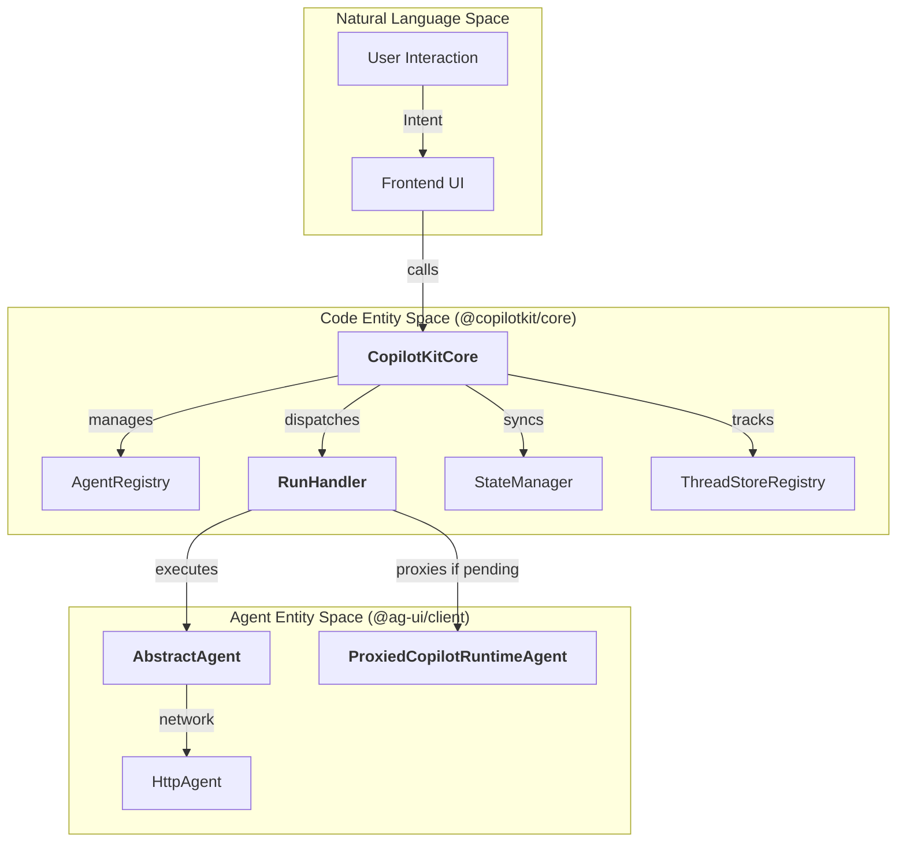
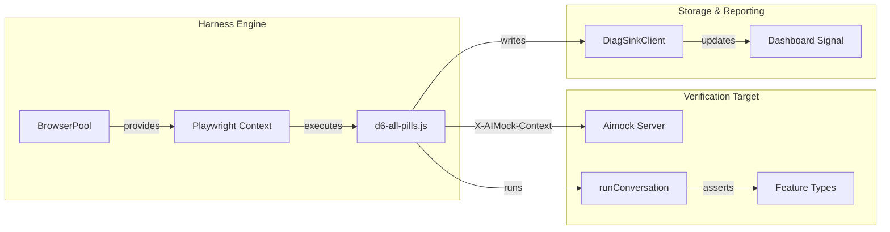

<!-- source: DeepWiki mcp.deepwiki.com · repo CopilotKit/CopilotKit · page 12 Glossary · fetched 2026-10-30 -->

# Glossary

Relevant source files

The following files were used as context for generating this wiki page:

- [README.md](README.md)
- [assets/CopilotTextarea.gif](assets/CopilotTextarea.gif)
- [assets/CopilotTextarea_old.gif](assets/CopilotTextarea_old.gif)
- [assets/demo.gif](assets/demo.gif)
- [assets/proejct-perplexity-clone.png](assets/proejct-perplexity-clone.png)
- [assets/project-canvas-demo.png](assets/project-canvas-demo.png)
- [assets/spreadsheet-demo-big-file.gif](assets/spreadsheet-demo-big-file.gif)
- [examples/canvas/gemini/agent/main.py](examples/canvas/gemini/agent/main.py)
- [examples/v1/_legacy/saas-dynamic-dashboards/agent/agent.py](examples/v1/_legacy/saas-dynamic-dashboards/agent/agent.py)
- [examples/v2/react/demo/src/app/api/copilotkit/[[...slug]]/route.ts](examples/v2/react/demo/src/app/api/copilotkit/[[...slug]]/route.ts)
- [packages/a2ui-renderer/package.json](packages/a2ui-renderer/package.json)
- [packages/angular/src/lib/agent.spec.ts](packages/angular/src/lib/agent.spec.ts)
- [packages/angular/src/lib/agent.ts](packages/angular/src/lib/agent.ts)
- [packages/angular/src/lib/config.ts](packages/angular/src/lib/config.ts)
- [packages/angular/src/lib/copilotkit.spec.ts](packages/angular/src/lib/copilotkit.spec.ts)
- [packages/angular/src/lib/directives/__tests__/copilotkit-config.directive.spec.ts](packages/angular/src/lib/directives/__tests__/copilotkit-config.directive.spec.ts)
- [packages/angular/src/lib/license-watermark.ts](packages/angular/src/lib/license-watermark.ts)
- [packages/channels-core/src/canonical-run-loop.test.ts](packages/channels-core/src/canonical-run-loop.test.ts)
- [packages/channels-core/src/create-channel.test.ts](packages/channels-core/src/create-channel.test.ts)
- [packages/channels-core/src/create-channel.ts](packages/channels-core/src/create-channel.ts)
- [packages/channels-core/src/delivery-error.ts](packages/channels-core/src/delivery-error.ts)
- [packages/channels-core/src/index.ts](packages/channels-core/src/index.ts)
- [packages/channels-core/src/platform-adapter.test.ts](packages/channels-core/src/platform-adapter.test.ts)
- [packages/channels-core/src/platform-adapter.ts](packages/channels-core/src/platform-adapter.ts)
- [packages/channels-core/src/run-loop.test.ts](packages/channels-core/src/run-loop.test.ts)
- [packages/channels-core/src/run-loop.ts](packages/channels-core/src/run-loop.ts)
- [packages/channels-core/src/testing/fake-adapter.ts](packages/channels-core/src/testing/fake-adapter.ts)
- [packages/channels-core/src/thread.ts](packages/channels-core/src/thread.ts)
- [packages/channels-core/src/welcome.test.ts](packages/channels-core/src/welcome.test.ts)
- [packages/channels-slack/src/__tests__/assistant.test.ts](packages/channels-slack/src/__tests__/assistant.test.ts)
- [packages/channels-slack/src/adapter.test.ts](packages/channels-slack/src/adapter.test.ts)
- [packages/core/package.json](packages/core/package.json)
- [packages/core/src/__tests__/core-credentials.test.ts](packages/core/src/__tests__/core-credentials.test.ts)
- [packages/core/src/__tests__/core-headers.test.ts](packages/core/src/__tests__/core-headers.test.ts)
- [packages/core/src/__tests__/core-register-proxied-agent.test.ts](packages/core/src/__tests__/core-register-proxied-agent.test.ts)
- [packages/core/src/__tests__/core-subscribe-to-agent.test.ts](packages/core/src/__tests__/core-subscribe-to-agent.test.ts)
- [packages/core/src/__tests__/proxied-runtime-transport.test.ts](packages/core/src/__tests__/proxied-runtime-transport.test.ts)
- [packages/core/src/agent.ts](packages/core/src/agent.ts)
- [packages/core/src/core/agent-registry.ts](packages/core/src/core/agent-registry.ts)
- [packages/core/src/core/core.ts](packages/core/src/core/core.ts)
- [packages/react-core/package.json](packages/react-core/package.json)
- [packages/react-core/src/__tests__/threadid-propagation.contract.test.tsx](packages/react-core/src/__tests__/threadid-propagation.contract.test.tsx)
- [packages/react-core/src/hooks/use-agent-nodename.ts](packages/react-core/src/hooks/use-agent-nodename.ts)
- [packages/react-core/src/v2/components/chat/__tests__/CopilotChatActivityRendering.e2e.test.tsx](packages/react-core/src/v2/components/chat/__tests__/CopilotChatActivityRendering.e2e.test.tsx)
- [packages/react-core/src/v2/components/chat/__tests__/copilot-chat-throttle.test.tsx](packages/react-core/src/v2/components/chat/__tests__/copilot-chat-throttle.test.tsx)
- [packages/react-core/src/v2/hooks/__tests__/use-agent-provider-headers.e2e.test.tsx](packages/react-core/src/v2/hooks/__tests__/use-agent-provider-headers.e2e.test.tsx)
- [packages/react-core/src/v2/hooks/__tests__/use-agent-stability.test.tsx](packages/react-core/src/v2/hooks/__tests__/use-agent-stability.test.tsx)
- [packages/react-core/src/v2/hooks/__tests__/use-agent-throttle.test.tsx](packages/react-core/src/v2/hooks/__tests__/use-agent-throttle.test.tsx)
- [packages/react-core/src/v2/hooks/__tests__/use-agent-types.test.tsx](packages/react-core/src/v2/hooks/__tests__/use-agent-types.test.tsx)
- [packages/react-core/src/v2/hooks/__tests__/use-capabilities.test.tsx](packages/react-core/src/v2/hooks/__tests__/use-capabilities.test.tsx)
- [packages/react-core/src/v2/hooks/use-agent.tsx](packages/react-core/src/v2/hooks/use-agent.tsx)
- [packages/react-core/src/v2/hooks/use-capabilities.tsx](packages/react-core/src/v2/hooks/use-capabilities.tsx)
- [packages/react-core/src/v2/hooks/use-render-activity-message.tsx](packages/react-core/src/v2/hooks/use-render-activity-message.tsx)
- [packages/react-core/src/v2/providers/CopilotKitProvider.tsx](packages/react-core/src/v2/providers/CopilotKitProvider.tsx)
- [packages/react-core/src/v2/providers/__tests__/CopilotKitProvider.stability.test.tsx](packages/react-core/src/v2/providers/__tests__/CopilotKitProvider.stability.test.tsx)
- [packages/react-textarea/package.json](packages/react-textarea/package.json)
- [packages/react-ui/package.json](packages/react-ui/package.json)
- [packages/runtime-client-gql/package.json](packages/runtime-client-gql/package.json)
- [packages/runtime/package.json](packages/runtime/package.json)
- [packages/runtime/src/agents/langgraph/__tests__/event-source.test.ts](packages/runtime/src/agents/langgraph/__tests__/event-source.test.ts)
- [packages/runtime/src/lib/runtime/agent-integrations/langgraph/__tests__/dispatch-event-filtering.test.ts](packages/runtime/src/lib/runtime/agent-integrations/langgraph/__tests__/dispatch-event-filtering.test.ts)
- [packages/runtime/src/v2/runtime/core/__tests__/channel-canonical-run.test.ts](packages/runtime/src/v2/runtime/core/__tests__/channel-canonical-run.test.ts)
- [packages/sdk-js/package.json](packages/sdk-js/package.json)
- [packages/sdk-js/src/__tests__/error-handling.test.ts](packages/sdk-js/src/__tests__/error-handling.test.ts)
- [packages/sdk-js/src/langgraph/__tests__/middleware.a2ui-params.test.ts](packages/sdk-js/src/langgraph/__tests__/middleware.a2ui-params.test.ts)
- [packages/sdk-js/src/langgraph/__tests__/middleware.test.ts](packages/sdk-js/src/langgraph/__tests__/middleware.test.ts)
- [packages/sdk-js/src/langgraph/__tests__/utils.test.ts](packages/sdk-js/src/langgraph/__tests__/utils.test.ts)
- [packages/sdk-js/src/langgraph/middleware.ts](packages/sdk-js/src/langgraph/middleware.ts)
- [packages/sdk-js/src/langgraph/utils.ts](packages/sdk-js/src/langgraph/utils.ts)
- [packages/shared/package.json](packages/shared/package.json)
- [packages/sqlite-runner/package.json](packages/sqlite-runner/package.json)
- [packages/voice/package.json](packages/voice/package.json)
- [packages/web-inspector/package.json](packages/web-inspector/package.json)
- [sdk-python/copilotkit/copilotkit_lg_middleware.py](sdk-python/copilotkit/copilotkit_lg_middleware.py)
- [sdk-python/copilotkit/crewai/crewai_sdk.py](sdk-python/copilotkit/crewai/crewai_sdk.py)
- [sdk-python/copilotkit/exc.py](sdk-python/copilotkit/exc.py)
- [sdk-python/copilotkit/langchain.py](sdk-python/copilotkit/langchain.py)
- [sdk-python/copilotkit/langgraph.py](sdk-python/copilotkit/langgraph.py)
- [sdk-python/copilotkit/langgraph_agui_agent.py](sdk-python/copilotkit/langgraph_agui_agent.py)
- [sdk-python/poetry.lock](sdk-python/poetry.lock)
- [sdk-python/pyproject.toml](sdk-python/pyproject.toml)
- [sdk-python/tests/test_agui_agent.py](sdk-python/tests/test_agui_agent.py)
- [sdk-python/tests/test_copilotkit_lg_middleware.py](sdk-python/tests/test_copilotkit_lg_middleware.py)
- [sdk-python/tests/test_crewai_import_compat.py](sdk-python/tests/test_crewai_import_compat.py)
- [sdk-python/tests/test_emit_filtering.py](sdk-python/tests/test_emit_filtering.py)
- [sdk-python/tests/test_emit_tool_call_optional_id.py](sdk-python/tests/test_emit_tool_call_optional_id.py)
- [sdk-python/uv.lock](sdk-python/uv.lock)
- [showcase/angular/src/app/features/mastra/mastra-cards.ts](showcase/angular/src/app/features/mastra/mastra-cards.ts)
- [showcase/angular/src/app/features/mastra/mastra-feature.component.ts](showcase/angular/src/app/features/mastra/mastra-feature.component.ts)
- [showcase/shell-dashboard/src/app/page.tsx](showcase/shell-dashboard/src/app/page.tsx)
- [showcase/shell-dashboard/src/components/__tests__/cell-drilldown.lazy-signal.test.tsx](showcase/shell-dashboard/src/components/__tests__/cell-drilldown.lazy-signal.test.tsx)
- [showcase/shell-dashboard/src/components/__tests__/cell-drilldown.test.tsx](showcase/shell-dashboard/src/components/__tests__/cell-drilldown.test.tsx)
- [showcase/shell-dashboard/src/components/__tests__/cell-matrix.test.tsx](showcase/shell-dashboard/src/components/__tests__/cell-matrix.test.tsx)
- [showcase/shell-dashboard/src/components/__tests__/composed-cell.test.tsx](showcase/shell-dashboard/src/components/__tests__/composed-cell.test.tsx)
- [showcase/shell-dashboard/src/components/__tests__/compute-tally-detail.test.tsx](showcase/shell-dashboard/src/components/__tests__/compute-tally-detail.test.tsx)
- [showcase/shell-dashboard/src/components/__tests__/dashboard-color-matrix.test.tsx](showcase/shell-dashboard/src/components/__tests__/dashboard-color-matrix.test.tsx)
- [showcase/shell-dashboard/src/components/__tests__/depth-chip.test.tsx](showcase/shell-dashboard/src/components/__tests__/depth-chip.test.tsx)
- [showcase/shell-dashboard/src/components/__tests__/depth-utils.test.ts](showcase/shell-dashboard/src/components/__tests__/depth-utils.test.ts)
- [showcase/shell-dashboard/src/components/__tests__/overlay-selector-integration.test.tsx](showcase/shell-dashboard/src/components/__tests__/overlay-selector-integration.test.tsx)
- [showcase/shell-dashboard/src/components/__tests__/parity-badge.test.tsx](showcase/shell-dashboard/src/components/__tests__/parity-badge.test.tsx)
- [showcase/shell-dashboard/src/components/__tests__/parity-matrix.test.tsx](showcase/shell-dashboard/src/components/__tests__/parity-matrix.test.tsx)
- [showcase/shell-dashboard/src/components/__tests__/tally-breakdown.test.tsx](showcase/shell-dashboard/src/components/__tests__/tally-breakdown.test.tsx)
- [showcase/shell-dashboard/src/components/__tests__/unified-cell.test.tsx](showcase/shell-dashboard/src/components/__tests__/unified-cell.test.tsx)
- [showcase/shell-dashboard/src/components/adaptive-legend.tsx](showcase/shell-dashboard/src/components/adaptive-legend.tsx)
- [showcase/shell-dashboard/src/components/adaptive-stats-bar.tsx](showcase/shell-dashboard/src/components/adaptive-stats-bar.tsx)
- [showcase/shell-dashboard/src/components/cell-drilldown.tsx](showcase/shell-dashboard/src/components/cell-drilldown.tsx)
- [showcase/shell-dashboard/src/components/cell-matrix.tsx](showcase/shell-dashboard/src/components/cell-matrix.tsx)
- [showcase/shell-dashboard/src/components/cell-pieces.signal-degrade.test.tsx](showcase/shell-dashboard/src/components/cell-pieces.signal-degrade.test.tsx)
- [showcase/shell-dashboard/src/components/cell-pieces.test.tsx](showcase/shell-dashboard/src/components/cell-pieces.test.tsx)
- [showcase/shell-dashboard/src/components/cell-pieces.tsx](showcase/shell-dashboard/src/components/cell-pieces.tsx)
- [showcase/shell-dashboard/src/components/cells-view.tsx](showcase/shell-dashboard/src/components/cells-view.tsx)
- [showcase/shell-dashboard/src/components/composed-cell.tsx](showcase/shell-dashboard/src/components/composed-cell.tsx)
- [showcase/shell-dashboard/src/components/coverage-bar.tsx](showcase/shell-dashboard/src/components/coverage-bar.tsx)
- [showcase/shell-dashboard/src/components/dashboard-page.tsx](showcase/shell-dashboard/src/components/dashboard-page.tsx)
- [showcase/shell-dashboard/src/components/depth-chip.tsx](showcase/shell-dashboard/src/components/depth-chip.tsx)
- [showcase/shell-dashboard/src/components/depth-utils.ts](showcase/shell-dashboard/src/components/depth-utils.ts)
- [showcase/shell-dashboard/src/components/feature-grid.test.tsx](showcase/shell-dashboard/src/components/feature-grid.test.tsx)
- [showcase/shell-dashboard/src/components/feature-grid.tsx](showcase/shell-dashboard/src/components/feature-grid.tsx)
- [showcase/shell-dashboard/src/components/overlay-column-header.tsx](showcase/shell-dashboard/src/components/overlay-column-header.tsx)
- [showcase/shell-dashboard/src/components/parity-matrix.tsx](showcase/shell-dashboard/src/components/parity-matrix.tsx)
- [showcase/shell-dashboard/src/components/parity-view.tsx](showcase/shell-dashboard/src/components/parity-view.tsx)
- [showcase/shell-dashboard/src/components/ref-depth-column.tsx](showcase/shell-dashboard/src/components/ref-depth-column.tsx)
- [showcase/shell-dashboard/src/components/tally-breakdown.tsx](showcase/shell-dashboard/src/components/tally-breakdown.tsx)
- [showcase/shell-dashboard/src/components/tally-types.ts](showcase/shell-dashboard/src/components/tally-types.ts)
- [showcase/shell-dashboard/src/components/unified-cell.tsx](showcase/shell-dashboard/src/components/unified-cell.tsx)
- [showcase/shell-dashboard/src/lib/__tests__/cell-model.test.ts](showcase/shell-dashboard/src/lib/__tests__/cell-model.test.ts)
- [showcase/shell-dashboard/src/lib/__tests__/fixtures/driver-error-rows.json](showcase/shell-dashboard/src/lib/__tests__/fixtures/driver-error-rows.json)
- [showcase/shell-dashboard/src/lib/__tests__/page-stats.test.ts](showcase/shell-dashboard/src/lib/__tests__/page-stats.test.ts)
- [showcase/shell-dashboard/src/lib/cell-model.test.ts](showcase/shell-dashboard/src/lib/cell-model.test.ts)
- [showcase/shell-dashboard/src/lib/cell-model.ts](showcase/shell-dashboard/src/lib/cell-model.ts)
- [showcase/shell-dashboard/src/lib/live-status.test.ts](showcase/shell-dashboard/src/lib/live-status.test.ts)
- [showcase/shell-dashboard/src/lib/live-status.ts](showcase/shell-dashboard/src/lib/live-status.ts)
- [showcase/shell-dashboard/src/lib/page-stats.ts](showcase/shell-dashboard/src/lib/page-stats.ts)
- [showcase/shell-docs/src/content/docs/(other)/contributing/code-contributions/package-linking.mdx](showcase/shell-docs/src/content/docs/(other)/contributing/code-contributions/package-linking.mdx)
- [showcase/shell-docs/src/content/docs/(other)/contributing/meta.json](showcase/shell-docs/src/content/docs/(other)/contributing/meta.json)
- [showcase/shell-docs/src/content/docs/agentic-protocols/a2a.mdx](showcase/shell-docs/src/content/docs/agentic-protocols/a2a.mdx)
- [showcase/shell-docs/src/content/docs/integrations/adk/shared-state/workflow-execution.mdx](showcase/shell-docs/src/content/docs/integrations/adk/shared-state/workflow-execution.mdx)
- [showcase/shell-docs/src/content/docs/integrations/deepagents/shared-state/workflow-execution.mdx](showcase/shell-docs/src/content/docs/integrations/deepagents/shared-state/workflow-execution.mdx)
- [showcase/shell-docs/src/content/docs/integrations/langgraph/tutorials/ai-travel-app/step-5-stream-progress.mdx](showcase/shell-docs/src/content/docs/integrations/langgraph/tutorials/ai-travel-app/step-5-stream-progress.mdx)
- [showcase/shell-docs/src/content/docs/integrations/langgraph/tutorials/ai-travel-app/step-6-human-in-the-loop.mdx](showcase/shell-docs/src/content/docs/integrations/langgraph/tutorials/ai-travel-app/step-6-human-in-the-loop.mdx)

This page defines codebase-specific terms, jargon, and domain concepts used throughout the CopilotKit repository. It serves as a technical reference for onboarding engineers to understand the underlying abstractions and implementation details of the agentic application platform.

## Core Concepts

### AG-UI Protocol
The **Agent-User Interaction (AG-UI) Protocol** is the standardized communication layer between agents (backends) and user interfaces (frontends). It is designed to handle the unique requirements of agentic workflows, such as streaming tool calls, partial state updates, and human-in-the-loop interruptions [packages/core/src/core/core.ts:1-2]().

- **Implementation**: Managed via `@ag-ui/core` and `@ag-ui/client` packages, integrated into the core runtime [packages/runtime/package.json:81-84]().
- **Events**: The protocol uses specific event types to synchronize the interaction loop, including `RUN_STARTED`, `TEXT_MESSAGE_CHUNK`, `TOOL_CALL_START`, `STATE_SNAPSHOT`, and `STATE_DELTA` [packages/core/src/core/core.ts:1-2]().

### Agent-Native Application
An application built from the ground up to integrate AI agents as core functional components. These apps feature shared state between the UI and the agent, generative UI components, and the ability for agents to perform actions on behalf of the user [README.md:16-18]().

### Generative UI
A pattern where the AI agent dynamically selects and renders UI components at runtime. CopilotKit supports three levels of Generative UI [README.md:90-92]():
1. **Static (AG-UI Protocol)**: Pre-defined components mapped to tool calls.
2. **Declarative (A2UI)**: High-level UI descriptions using the `@copilotkit/a2ui-renderer` package [packages/a2ui-renderer/package.json:2-5]().
3. **Open-Ended (MCP Apps)**: Dynamic discovery of UI capabilities via the Model Context Protocol [packages/runtime/package.json:85-86]().

**Sources:**
- [README.md:16-18]()
- [README.md:90-92]()
- [packages/core/src/core/core.ts:1-2]()
- [packages/runtime/package.json:81-86]()
- [packages/a2ui-renderer/package.json:2-5]()

---

## Technical Terms & Abbreviations

| Term | Definition | Code Pointer |
| :--- | :--- | :--- |
| **CopilotKitCore** | The central TypeScript class managing agent registry, state, and tool execution. | [packages/core/src/core/core.ts:38-71]() |
| **CopilotRuntime** | The backend component that processes agent requests and manages LLM interactions. | [packages/runtime/package.json:2-3]() |
| **ProxiedCopilotRuntimeAgent** | A client-side proxy for a backend agent that handles communication with the runtime. | [packages/react-core/src/v2/hooks/use-agent.tsx:7-9]() |
| **AbstractAgent** | An abstract class defining the interface for all agents, whether local or remote. | [packages/core/src/core/core.ts:1-2]() |
| **HttpAgent** | A concrete implementation of `AbstractAgent` that communicates over HTTP. | [packages/react-core/src/v2/hooks/use-agent.tsx:5-6]() |
| **BuiltInAgent** | A default agent implementation provided by CopilotKit (Vercel AI SDK based). | [packages/react-core/src/v2/providers/CopilotKitProvider.tsx:100-101]() |
| **LangGraphAGUIAgent** | An agent designed to integrate LangGraph with the AG-UI Protocol. | [sdk-python/copilotkit/langgraph_agui_agent.py:1-20]() |
| **AgentRunner** | Server-side component responsible for executing agent logic and state. | [packages/core/src/core/core.ts:1-2]() |
| **InMemoryAgentRunner** | A default `AgentRunner` that stores conversation state in memory. | [packages/core/src/core/core.ts:37-38]() |
| **SqliteAgentRunner** | An `AgentRunner` that persists conversation state to an SQLite database. | [packages/sqlite-runner/package.json:2-3]() |
| **AgentCoreRunner** | An `AgentRunner` implementation for integration with AWS AgentCore. | [packages/core/package.json:1-2]() |
| **CopilotKitSDK** | The overarching SDK including client libraries, hooks, and components. | [README.md:52-58]() |
| **useAgent** | A React hook providing programmatic access to an `AbstractAgent` instance. | [packages/react-core/src/v2/hooks/use-agent.tsx:57-171]() |
| **useFrontendTool** | A hook for defining tools that agents can call from the frontend. | [packages/react-core/src/v2/providers/CopilotKitProvider.tsx:100-101]() |
| **useRenderTool** | A hook that allows agents to render dynamic UI components. | [packages/react-core/src/v2/providers/CopilotKitProvider.tsx:100-101]() |
| **useHumanInTheLoop** | A hook enabling agents to pause execution for user confirmation. | [packages/react-core/src/v2/providers/CopilotKitProvider.tsx:100-101]() |
| **useCoAgent** | A hook for accessing shared state synchronized between frontend and agent. | [packages/core/src/core/core.ts:1-2]() |
| **HITL** | **Human-in-the-Loop**: Workflow pattern where execution pauses for human input. | [README.md:94-95]() |
| **A2UI** | **Agent-to-UI**: Declarative Generative UI approach. | [packages/core/src/core/agent-registry.ts:144-154]() |
| **MCP** | **Model Context Protocol**: Used for dynamic tool discovery and context. | [packages/runtime/package.json:98-98]() |
| **SSE** | **Server-Sent Events**: Streaming protocol for real-time communication. | [packages/core/src/core/core.ts:8-9]() |
| **Intelligence Mode** | Configuration enabling advanced capabilities like continuous learning. | [packages/core/src/core/core.ts:11-12]() |
| **Provisional Agent** | A temporary agent instance returned while the runtime is connecting. | [packages/react-core/src/v2/hooks/use-agent.tsx:82-123]() |
| **CopilotSseRuntime** | A `CopilotRuntime` implementation focused on SSE transport. | [packages/core/src/core/core.ts:8-9]() |
| **CopilotIntelligenceRuntime** | A runtime supporting advanced Intelligence Platform features. | [packages/core/src/core/core.ts:8-9]() |
| **createChannel** | API for instantiating messaging channels (Slack, etc) in `@copilotkit/channels`. | [packages/channels-core/src/create-channel.ts:1-10]() |
| **Thread (Channels)** | Abstraction for a messaging thread within the Channels framework. | [packages/channels-core/src/thread.ts:1-10]() |
| **PlatformAdapter** | Interface for connecting Channels to platforms like Slack or Teams. | [packages/runtime/package.json:92-93]() |
| **IngressSink** | Component in Channels that handles incoming platform events. | [packages/runtime/package.json:92-93]() |
| **Umbrella Package** | The `@copilotkit/channels` package bundling multiple platform adapters. | [packages/runtime/package.json:126-126]() |

**Sources:**
- [README.md:52-58]()
- [packages/core/src/core/core.ts:1-71]()
- [packages/react-core/src/v2/hooks/use-agent.tsx:1-171]()
- [packages/runtime/package.json:81-126]()
- [packages/channels-core/src/create-channel.ts:1-10]()

---

## System Architecture Diagrams

### Interaction Loop Implementation
This diagram bridges high-level concepts with the specific classes and files that implement them.

**Diagram: Interaction Loop Entity Mapping**

**Sources:** [packages/core/src/core/core.ts:1-32](), [packages/core/src/core/agent-registry.ts:1-16](), [packages/react-core/src/v2/hooks/use-agent.tsx:5-9]()

### Verification Ladder (D0-D6)
The showcase platform uses a "Ladder Gating" system to verify integration quality across different frameworks.

**Diagram: D6 Verification Data Flow**

**Sources:** [showcase/shell-dashboard/src/lib/live-status.ts:12-12](), [showcase/shell-dashboard/src/lib/cell-model.ts:12-15](), [showcase/shell-dashboard/src/components/feature-grid.tsx:79-130]()

---

## Showcase & Dashboard Terms

- **Ladder Gating (D0-D6)**: A contiguous verification system. Each "rung" (D0-D6) represents an increasing level of integration depth. D6 (e2e-full) iterates all feature types declared by an integration to ensure parity [showcase/shell-dashboard/src/components/feature-grid.tsx:200-205]().
- **Parity Tier**: A classification indicating how closely an integration matches reference behavior [showcase/shell-dashboard/src/components/feature-grid.tsx:30-34]().
- **Wired/Stub/Unshipped/Unsupported**: Describe feature status:
    - `Wired`: Feature is implemented and tested [showcase/shell-dashboard/src/components/feature-grid.tsx:110-110]().
    - `Unsupported`: Feature is intentionally not supported [showcase/shell-dashboard/src/components/feature-grid.tsx:107-109]().
- **Aimock**: An LLM fixture server used for deterministic testing in the showcase harness [packages/runtime/package.json:125-125]().
- **Dojo**: A specialized frontend environment within the showcase platform for interactive training or debugging.
- **Named Regions**: Logical groupings of components or functionality within the showcase dashboard (e.g., Coverage tab, Parity matrix).

**Sources:**
- [showcase/shell-dashboard/src/components/feature-grid.tsx:1-130]()
- [showcase/shell-dashboard/src/lib/cell-model.ts:1-16]()
- [packages/runtime/package.json:125-125]()

## Package & Deployment Terms

- **Ratchet Gate**: CI/CD mechanism enforcing non-regressing quality standards.
- **Canary/Prerelease**: Deployment strategy for testing unstable versions.
- **OIDC Trusted Publisher**: Configuration for secure package publishing via GitHub Actions.
- **Skill (Claude Code plugin)**: Plugins for AI coding assistants teaching them how to interact with the repo [README.md:72-81]().
- **shell-docs**: The active Next.js source for documentation (docs.copilotkit.ai) located in `showcase/shell-docs/`.
- **docs/**: The retired top-level documentation folder.

**Sources:**
- [README.md:72-81]()
- [packages/core/package.json:1-10]()