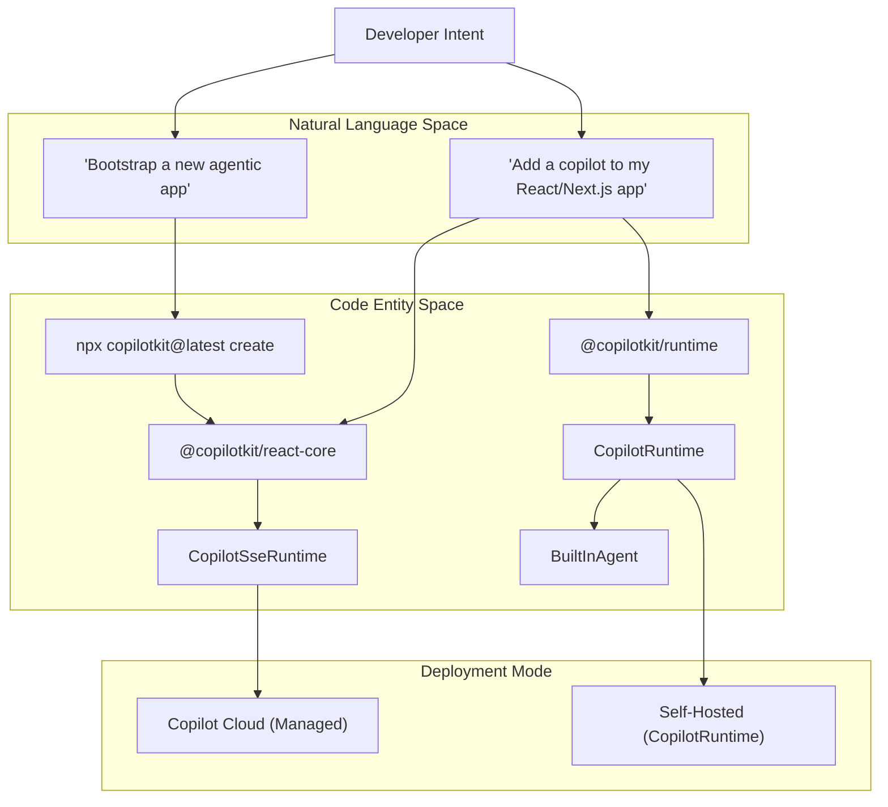
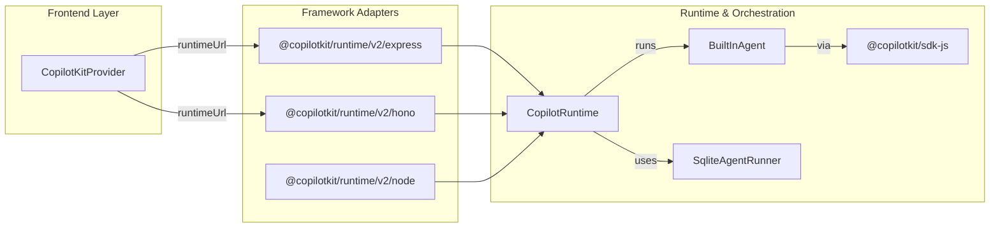

<!-- source: DeepWiki mcp.deepwiki.com · repo CopilotKit/CopilotKit · page 2 Getting Started · fetched 2026-10-30 -->

# Getting Started

<details>
<summary>Relevant source files</summary>

The following files were used as context for generating this wiki page:

- [.mcp.json](.mcp.json)
- [packages/a2ui-renderer/package.json](packages/a2ui-renderer/package.json)
- [packages/core/package.json](packages/core/package.json)
- [packages/react-core/package.json](packages/react-core/package.json)
- [packages/react-textarea/package.json](packages/react-textarea/package.json)
- [packages/react-ui/package.json](packages/react-ui/package.json)
- [packages/runtime-client-gql/package.json](packages/runtime-client-gql/package.json)
- [packages/runtime/package.json](packages/runtime/package.json)
- [packages/sdk-js/package.json](packages/sdk-js/package.json)
- [packages/shared/package.json](packages/shared/package.json)
- [packages/sqlite-runner/package.json](packages/sqlite-runner/package.json)
- [packages/voice/package.json](packages/voice/package.json)
- [packages/web-inspector/package.json](packages/web-inspector/package.json)
- [scripts/__tests__/sync-plugin-skills.test.ts](scripts/__tests__/sync-plugin-skills.test.ts)
- [scripts/sync-plugin-skills.ts](scripts/sync-plugin-skills.ts)
- [skills/channels-setup/SKILL.md](skills/channels-setup/SKILL.md)
- [skills/copilotkit-agui/references/event-flow-diagrams.md](skills/copilotkit-agui/references/event-flow-diagrams.md)
- [skills/copilotkit-agui/sources.md](skills/copilotkit-agui/sources.md)
- [skills/copilotkit-channels/SKILL.md](skills/copilotkit-channels/SKILL.md)
- [skills/copilotkit-channels/sources.md](skills/copilotkit-channels/sources.md)
- [skills/copilotkit-setup/SKILL.md](skills/copilotkit-setup/SKILL.md)
- [skills/copilotkit-setup/assets/express-runtime.ts](skills/copilotkit-setup/assets/express-runtime.ts)
- [skills/copilotkit-setup/assets/nextjs-app-router-page.tsx](skills/copilotkit-setup/assets/nextjs-app-router-page.tsx)
- [skills/copilotkit-setup/assets/nextjs-app-router-route.ts](skills/copilotkit-setup/assets/nextjs-app-router-route.ts)
- [skills/copilotkit-setup/eval.yaml](skills/copilotkit-setup/eval.yaml)
- [skills/copilotkit-setup/references/framework-detection.md](skills/copilotkit-setup/references/framework-detection.md)
- [skills/copilotkit-setup/references/runtime-architecture.md](skills/copilotkit-setup/references/runtime-architecture.md)
- [skills/copilotkit-setup/references/telemetry-setup.md](skills/copilotkit-setup/references/telemetry-setup.md)
- [skills/copilotkit-setup/sources.md](skills/copilotkit-setup/sources.md)

</details>


This document provides a high-level overview of getting started with CopilotKit, including available development paths, the package ecosystem, and basic setup flows. For detailed installation instructions, see [Installation](#2.1). For a step-by-step walkthrough, see [Quick Start Guide](#2.2).

CopilotKit is a best-in-class SDK for building full-stack **agent-native applications**, Generative UI, and chat applications. It enables a synchronized interaction loop between UI components and AI agents using the **AG-UI Protocol**.

Sources: [packages/runtime/package.json:80-84](), [packages/react-core/package.json:77-78]()

## Development Paths

CopilotKit offers automated and manual paths to integration, supporting React, Angular, Vue, and React Native.

### CLI-Based Setup (Recommended)

The CopilotKit CLI automates package installation and runtime configuration.

*   **New Projects:** Creates a fresh application with pre-configured agent backends.
    ```bash
    npx copilotkit@latest create
    ```
*   **Existing Projects:** Initializes CopilotKit in an existing codebase, detecting the framework and installing necessary dependencies like `@copilotkit/react-core` [packages/react-core/package.json:2]() or `@copilotkit/runtime` [packages/runtime/package.json:2]().
    ```bash
    npx copilotkit@latest init
    ```

### Agent Skills for Coding Assistants

The repository includes a dedicated `skills/` directory containing configurations to teach coding agents (like Claude Code or Cursor) how to work with the CopilotKit codebase. [packages/runtime/package.json:26](), [packages/react-core/package.json:26]()
```bash
npx copilotkit@latest skills install
```

Sources: [packages/runtime/package.json:24-27](), [packages/react-core/package.json:24-27]()

## Setup Flow Overview

The following diagram bridges the "Natural Language Space" (developer intent) to the "Code Entity Space" (specific classes and packages).



**Title:** Bridging Developer Intent to CopilotKit Code Entities

Sources: [packages/runtime/package.json:2](), [packages/react-core/package.json:2](), [packages/runtime-client-gql/package.json:2]()

## Key Architectural Decisions

### Backend Runtime & Agents

The `@copilotkit/runtime` [packages/runtime/package.json:2]() is the core orchestration engine. It manages agents via specialized runners such as the default `InMemoryAgentRunner` or the persistent `SqliteAgentRunner` [packages/sqlite-runner/package.json:2-4](). 



**Title:** Runtime Configuration and Endpoint Entities

Sources: [packages/runtime/package.json:46-61](), [packages/sqlite-runner/package.json:2-4](), [packages/sdk-js/package.json:2]()

### UI Integration & Frameworks

CopilotKit provides framework-specific packages to manage shared state and Generative UI.

| Framework | Core Package | UI Components |
|-----------|--------------|---------------|
| **React** | `@copilotkit/react-core` [packages/react-core/package.json:2]() | `CopilotChat`, `CopilotPopup`, `CopilotSidebar` |
| **Angular** | `@copilotkit/angular` | `CopilotKit` service, `AgentStore` signals |
| **Vue** | `@copilotkit/vue` | `CopilotKitProvider.vue`, `useAgent` |
| **Mobile** | `React Native` | Polyfills + `@copilotkit/react-core` |

Sources: [packages/react-core/package.json:2](), [packages/react-ui/package.json:2](), [packages/react-textarea/package.json:2]()

## Basic Configuration Pattern

For a React application, you typically import the v2 styles and wrap your application in the `CopilotKit` provider (from `@copilotkit/react-core/v2`). [packages/react-core/package.json:42-55]()

```tsx
// Example layout.tsx / App.tsx
import "@copilotkit/react-core/v2/styles.css";
import { CopilotKit } from "@copilotkit/react-core/v2";

export default function RootLayout({ children }: { children: React.ReactNode }) {
  return (
    <CopilotKit runtimeUrl="/api/copilotkit">
      {children}
    </CopilotKit>
  );
}
```

Sources: [packages/react-core/package.json:42-55](), [packages/react-ui/package.json:39]()

## Next Steps

- **[Installation](#2.1)**: Detailed instructions for CLI and manual setup across different frameworks, including provider wiring.
- **[Quick Start Guide](#2.2)**: A hands-on tutorial covering the `BuiltInAgent` + `CopilotRuntime` pattern.

---

