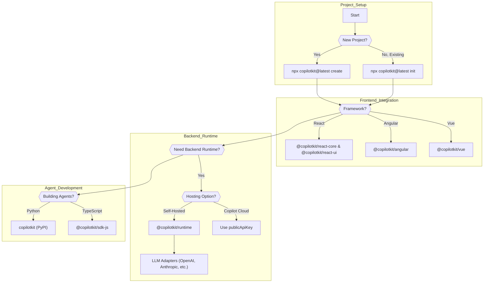
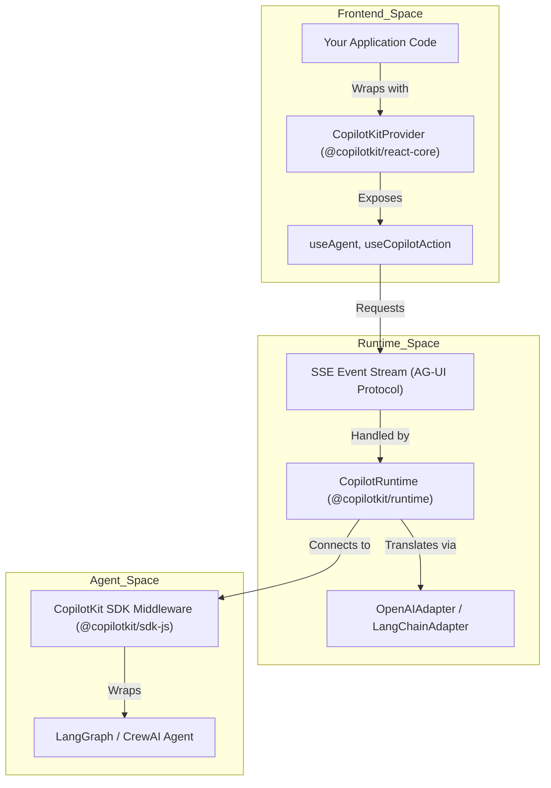

<!-- source: DeepWiki mcp.deepwiki.com · repo CopilotKit/CopilotKit · page 2.1 Installation · fetched 2026-10-30 -->

# Installation

<details>
<summary>Relevant source files</summary>

The following files were used as context for generating this wiki page:

- [.github/workflows/plugin-skills-check.yml](.github/workflows/plugin-skills-check.yml)
- [.mcp.json](.mcp.json)
- [examples/v2/react/demo/tsconfig.json](examples/v2/react/demo/tsconfig.json)
- [lefthook.yml](lefthook.yml)
- [migrations.json](migrations.json)
- [nx.json](nx.json)
- [packages/a2ui-renderer/package.json](packages/a2ui-renderer/package.json)
- [packages/core/package.json](packages/core/package.json)
- [packages/react-core/package.json](packages/react-core/package.json)
- [packages/react-core/src/v2/components/chat/__tests__/CopilotChatPerf.e2e.test.tsx](packages/react-core/src/v2/components/chat/__tests__/CopilotChatPerf.e2e.test.tsx)
- [packages/react-textarea/package.json](packages/react-textarea/package.json)
- [packages/react-ui/package.json](packages/react-ui/package.json)
- [packages/runtime-client-gql/package.json](packages/runtime-client-gql/package.json)
- [packages/runtime/package.json](packages/runtime/package.json)
- [packages/sdk-js/package.json](packages/sdk-js/package.json)
- [packages/shared/package.json](packages/shared/package.json)
- [packages/sqlite-runner/package.json](packages/sqlite-runner/package.json)
- [packages/voice/package.json](packages/voice/package.json)
- [packages/web-inspector/package.json](packages/web-inspector/package.json)
- [scripts/__tests__/sync-plugin-skills.test.ts](scripts/__tests__/sync-plugin-skills.test.ts)
- [scripts/sync-plugin-skills.ts](scripts/sync-plugin-skills.ts)
- [showcase/scripts/__tests__/sync-promote-service-options.test.ts](showcase/scripts/__tests__/sync-promote-service-options.test.ts)
- [showcase/scripts/sync-promote-service-options.ts](showcase/scripts/sync-promote-service-options.ts)
- [skills/channels-setup/SKILL.md](skills/channels-setup/SKILL.md)
- [skills/copilotkit-agui/references/event-flow-diagrams.md](skills/copilotkit-agui/references/event-flow-diagrams.md)
- [skills/copilotkit-agui/sources.md](skills/copilotkit-agui/sources.md)
- [skills/copilotkit-channels/SKILL.md](skills/copilotkit-channels/SKILL.md)
- [skills/copilotkit-channels/sources.md](skills/copilotkit-channels/sources.md)
- [skills/copilotkit-setup/SKILL.md](skills/copilotkit-setup/SKILL.md)
- [skills/copilotkit-setup/assets/express-runtime.ts](skills/copilotkit-setup/assets/express-runtime.ts)
- [skills/copilotkit-setup/assets/nextjs-app-router-page.tsx](skills/copilotkit-setup/assets/nextjs-app-router-page.tsx)
- [skills/copilotkit-setup/assets/nextjs-app-router-route.ts](skills/copilotkit-setup/assets/nextjs-app-router-route.ts)
- [skills/copilotkit-setup/eval.yaml](skills/copilotkit-setup/eval.yaml)
- [skills/copilotkit-setup/references/framework-detection.md](skills/copilotkit-setup/references/framework-detection.md)
- [skills/copilotkit-setup/references/runtime-architecture.md](skills/copilotkit-setup/references/runtime-architecture.md)
- [skills/copilotkit-setup/references/telemetry-setup.md](skills/copilotkit-setup/references/telemetry-setup.md)
- [skills/copilotkit-setup/sources.md](skills/copilotkit-setup/sources.md)
- [skills/setup-slack-channel/SKILL.md](skills/setup-slack-channel/SKILL.md)
- [skills/setup-slack-channel/assets/slack-app-manifest.yaml](skills/setup-slack-channel/assets/slack-app-manifest.yaml)
- [skills/setup-slack-channel/references/intelligence-channel.md](skills/setup-slack-channel/references/intelligence-channel.md)
- [skills/setup-slack-channel/references/local-runtime.md](skills/setup-slack-channel/references/local-runtime.md)
- [skills/setup-slack-channel/references/optional-e2e.md](skills/setup-slack-channel/references/optional-e2e.md)
- [skills/setup-slack-channel/references/secrets-and-credentials.md](skills/setup-slack-channel/references/secrets-and-credentials.md)
- [skills/setup-slack-channel/references/slack-workspace-and-app.md](skills/setup-slack-channel/references/slack-workspace-and-app.md)
- [skills/setup-slack-channel/references/troubleshooting.md](skills/setup-slack-channel/references/troubleshooting.md)

</details>


## Purpose and Scope

This document provides detailed installation instructions for all CopilotKit components across the full stack. It covers the CLI bootstrap tool for new projects, manual integration for existing projects (TypeScript/React frontends, Node.js backends), and the SDKs for agent development. CopilotKit facilitates the creation of **agent-native applications** by providing a synchronized state layer and UI components that interact via the **AG-UI Protocol** [packages/runtime/package.json:81-82]().

---

## CLI Bootstrap (Recommended)

The fastest way to start with CopilotKit is using the CLI, which handles framework detection, package installation, and initial runtime wiring.

### Create a New Project
```bash
npx copilotkit@latest create
```
This command scaffolds a full-stack agent application from scratch, including frontend components and a backend runtime.

### Initialize in Existing Project
```bash
npx copilotkit@latest init
```
The `init` command integrates CopilotKit into an existing codebase. It performs a "skill-like" workflow orchestrated by the `copilotkit-setup` skill:
1.  **Framework Detection**: Identifies the project environment (e.g., Next.js App Router vs. Pages Router, Express, or Hono) [skills/copilotkit-setup/references/framework-detection.md]().
2.  **Package Installation**: Adds necessary dependencies based on detection (e.g., `@copilotkit/react-core`, `@copilotkit/runtime`) [packages/runtime/package.json:1-123]().
3.  **Runtime Wiring**: Scaffolds a runtime endpoint using templates like `nextjs-app-router-route.ts` or `express-runtime.ts` [skills/copilotkit-setup/assets/nextjs-app-router-route.ts](), [skills/copilotkit-setup/assets/express-runtime.ts]().
4.  **Provider Setup**: Wraps the application root with the `CopilotKit` provider [skills/copilotkit-setup/assets/nextjs-app-router-page.tsx]().

Sources: [packages/runtime/package.json:1-20](), [skills/copilotkit-setup/SKILL.md](), [skills/copilotkit-setup/references/framework-detection.md]()

---

## Package Overview and Monorepo Structure

CopilotKit is organized as a monorepo with a flat package structure under `packages/`.

### Core Package Map

| Package | Role | Key Dependencies |
|---------|------|------------------|
| `@copilotkit/react-core` | Foundational React hooks and provider | `@ag-ui/client`, `@copilotkit/core`, `@copilotkit/shared` [packages/react-core/package.json:77-82]() |
| `@copilotkit/runtime` | Backend orchestration and LLM adapters | `hono`, `express`, `ai`, `@ag-ui/core` [packages/runtime/package.json:82,102,111]() |
| `@copilotkit/sdk-js` | TypeScript SDK for agent framework integration | `@ag-ui/langgraph`, `@copilotkit/shared` [packages/sdk-js/package.json:61-63]() |
| `@copilotkit/shared` | Shared types and utilities across packages | `zod`, `uuid`, `@ag-ui/client` [packages/shared/package.json:53-61]() |
| `@copilotkit/react-ui` | Pre-built chat, sidebar, and popup components | `@copilotkit/react-core`, `react-markdown` [packages/react-ui/package.json:59,63]() |
| `@copilotkit/a2ui-renderer` | Generative UI (A2UI) rendering engine | `@a2ui/web_core`, `lit` [packages/a2ui-renderer/package.json:79-81]() |

Sources: [packages/react-core/package.json:77-80](), [packages/runtime/package.json:1-15](), [packages/sdk-js/package.json:61-63]()

---

## Installation Decision Tree

The following diagram illustrates the path from project initiation to specific package selection based on your stack.



Sources: [packages/runtime/package.json:1-15](), [packages/sdk-js/package.json:1-15]()

---

## Prerequisites

### Environment Requirements

| Environment | Minimum Version | Notes |
|-------------|-----------------|-------|
| **Node.js** | 18.x | Required for all JS/TS packages [packages/core/package.json:60]() |
| **React** | 18.x / 19.x | Supported versions for UI packages [packages/react-core/package.json:137]() |
| **TypeScript** | 5.2.x | Required for type safety [packages/sdk-js/package.json:86]() |
| **Python** | 3.10 | Required for `copilotkit` Python SDK |

Sources: [packages/core/package.json:59-61](), [packages/react-core/package.json:136-140]()

---

## Frontend Installation (React)

### 1. Install Packages
Install the foundational provider and the UI component library.

```bash
pnpm add @copilotkit/react-core @copilotkit/react-ui
```

### 2. Styles Import
Import the default styles in your root layout (e.g., `layout.tsx`) to render components correctly.

```tsx
import "@copilotkit/react-ui/styles.css";
```
*Note: v2 components require `@copilotkit/react-ui/v2/styles.css` [packages/react-ui/package.json:39]().*

### 3. Provider Configuration
Wrap your application in the `CopilotKit` provider. Specify the `runtimeUrl` for your backend endpoint.

```tsx
import { CopilotKit } from "@copilotkit/react-core";

export default function RootLayout({ children }: { children: React.ReactNode }) {
  return (
    <CopilotKit runtimeUrl="/api/copilotkit"> 
      {children}
    </CopilotKit>
  );
}
```

Sources: [packages/react-core/package.json:2-10](), [packages/react-ui/package.json:32-40]()

---

## Backend Runtime Installation

The `CopilotRuntime` processes agent requests and manages LLM interactions.

### 1. Install Runtime
```bash
pnpm add @copilotkit/runtime
```

### 2. Setup Runtime Endpoint
The runtime can be integrated into various Node.js environments including Express, Hono, and Next.js [packages/runtime/package.json:50-61]().

```ts
import { CopilotRuntime, OpenAIAdapter } from '@copilotkit/runtime';

const serviceAdapter = new OpenAIAdapter();
const runtime = new CopilotRuntime();

// Use framework-specific handler
```

Sources: [packages/runtime/package.json:37-63](), [packages/runtime/package.json:102-112]()

---

## Agent SDK Installation

To build agents that synchronize state with the UI via the AG-UI protocol, use the framework-specific SDKs.

### TypeScript SDK
Used for building agents with LangGraph JS or custom TypeScript logic.
```bash
pnpm add @copilotkit/sdk-js
```
The SDK provides `langgraph` and `langchain` entry points [packages/sdk-js/package.json:33-40]().

### Python SDK
Used for building agents with LangGraph Python, CrewAI, or PydanticAI.
```bash
pip install copilotkit
```

Sources: [packages/sdk-js/package.json:1-45](), [packages/runtime/package.json:84]()

---

## Implementation Architecture

This diagram associates installation components with specific code entities and their communication paths.



**Code Entity Mapping**

| Entity | Implementation | Package |
|--------|----------------|---------|
| Interaction Protocol | `AG-UI Protocol` | `@ag-ui/core` [packages/runtime/package.json:82]() |
| Runtime Orchestrator | `CopilotRuntime` | `@copilotkit/runtime` [packages/runtime/package.json:2]() |
| State Management | `AgentStore` | `@copilotkit/react-core` [packages/react-core/package.json:2]() |
| UI Rendering | `A2UI-Renderer` | `@copilotkit/a2ui-renderer` [packages/a2ui-renderer/package.json:2]() |

Sources: [packages/react-core/package.json:77-80](), [packages/runtime/package.json:81-84](), [packages/sdk-js/package.json:61-64]()

---

## Verification

To verify your installation, ensure the following are present and functional:

1.  **Dependencies**: Check `package.json` for `@copilotkit/react-core` and `@copilotkit/runtime` [packages/react-core/package.json:2-3]().
2.  **Runtime**: Ensure your runtime endpoint is reachable and configured with a valid `serviceAdapter` (e.g., `OpenAIAdapter`) [packages/runtime/package.json:91,112]().
3.  **Build**: Run your project's build command to ensure all TypeScript types resolve correctly [packages/runtime/package.json:68]().

Sources: [packages/runtime/package.json:1-123](), [packages/react-core/package.json:1-105]()

---

