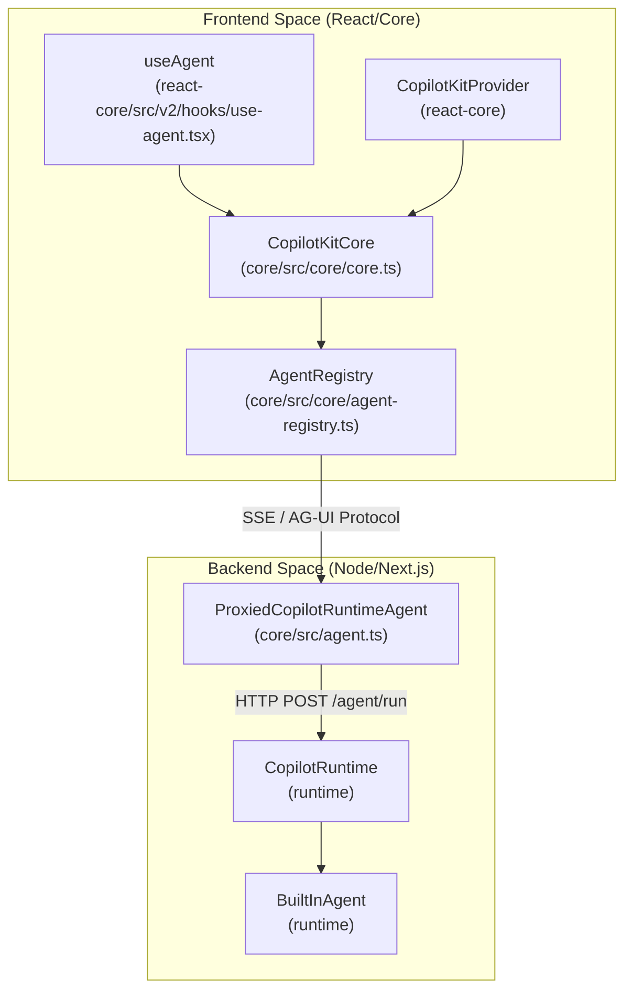
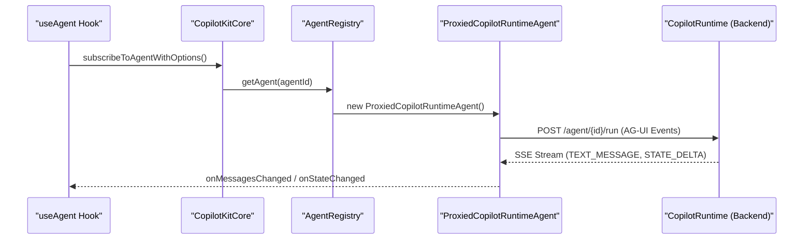

<!-- source: DeepWiki mcp.deepwiki.com · repo CopilotKit/CopilotKit · page 2.2 Quick Start Guide · fetched 2026-10-30 -->

# Quick Start Guide

<details>
<summary>Relevant source files</summary>

The following files were used as context for generating this wiki page:

- [README.md](README.md)
- [assets/CopilotTextarea.gif](assets/CopilotTextarea.gif)
- [assets/CopilotTextarea_old.gif](assets/CopilotTextarea_old.gif)
- [assets/demo.gif](assets/demo.gif)
- [assets/proejct-perplexity-clone.png](assets/proejct-perplexity-clone.png)
- [assets/project-canvas-demo.png](assets/project-canvas-demo.png)
- [assets/spreadsheet-demo-big-file.gif](assets/spreadsheet-demo-big-file.gif)
- [examples/v2/react/demo/src/app/api/copilotkit/[[...slug]]/route.ts](examples/v2/react/demo/src/app/api/copilotkit/[[...slug]]/route.ts)
- [packages/angular/src/lib/agent.spec.ts](packages/angular/src/lib/agent.spec.ts)
- [packages/angular/src/lib/agent.ts](packages/angular/src/lib/agent.ts)
- [packages/angular/src/lib/config.ts](packages/angular/src/lib/config.ts)
- [packages/angular/src/lib/copilotkit.spec.ts](packages/angular/src/lib/copilotkit.spec.ts)
- [packages/angular/src/lib/directives/__tests__/copilotkit-config.directive.spec.ts](packages/angular/src/lib/directives/__tests__/copilotkit-config.directive.spec.ts)
- [packages/angular/src/lib/license-watermark.ts](packages/angular/src/lib/license-watermark.ts)
- [packages/core/src/__tests__/core-credentials.test.ts](packages/core/src/__tests__/core-credentials.test.ts)
- [packages/core/src/__tests__/core-headers.test.ts](packages/core/src/__tests__/core-headers.test.ts)
- [packages/core/src/__tests__/core-register-proxied-agent.test.ts](packages/core/src/__tests__/core-register-proxied-agent.test.ts)
- [packages/core/src/__tests__/core-subscribe-to-agent.test.ts](packages/core/src/__tests__/core-subscribe-to-agent.test.ts)
- [packages/core/src/__tests__/proxied-runtime-transport.test.ts](packages/core/src/__tests__/proxied-runtime-transport.test.ts)
- [packages/core/src/agent.ts](packages/core/src/agent.ts)
- [packages/core/src/core/agent-registry.ts](packages/core/src/core/agent-registry.ts)
- [packages/core/src/core/core.ts](packages/core/src/core/core.ts)
- [packages/react-core/src/__tests__/threadid-propagation.contract.test.tsx](packages/react-core/src/__tests__/threadid-propagation.contract.test.tsx)
- [packages/react-core/src/hooks/use-agent-nodename.ts](packages/react-core/src/hooks/use-agent-nodename.ts)
- [packages/react-core/src/v2/components/chat/__tests__/CopilotChatActivityRendering.e2e.test.tsx](packages/react-core/src/v2/components/chat/__tests__/CopilotChatActivityRendering.e2e.test.tsx)
- [packages/react-core/src/v2/components/chat/__tests__/copilot-chat-throttle.test.tsx](packages/react-core/src/v2/components/chat/__tests__/copilot-chat-throttle.test.tsx)
- [packages/react-core/src/v2/hooks/__tests__/use-agent-provider-headers.e2e.test.tsx](packages/react-core/src/v2/hooks/__tests__/use-agent-provider-headers.e2e.test.tsx)
- [packages/react-core/src/v2/hooks/__tests__/use-agent-stability.test.tsx](packages/react-core/src/v2/hooks/__tests__/use-agent-stability.test.tsx)
- [packages/react-core/src/v2/hooks/__tests__/use-agent-throttle.test.tsx](packages/react-core/src/v2/hooks/__tests__/use-agent-throttle.test.tsx)
- [packages/react-core/src/v2/hooks/__tests__/use-agent-types.test.tsx](packages/react-core/src/v2/hooks/__tests__/use-agent-types.test.tsx)
- [packages/react-core/src/v2/hooks/__tests__/use-capabilities.test.tsx](packages/react-core/src/v2/hooks/__tests__/use-capabilities.test.tsx)
- [packages/react-core/src/v2/hooks/use-agent.tsx](packages/react-core/src/v2/hooks/use-agent.tsx)
- [packages/react-core/src/v2/hooks/use-capabilities.tsx](packages/react-core/src/v2/hooks/use-capabilities.tsx)
- [packages/react-core/src/v2/hooks/use-render-activity-message.tsx](packages/react-core/src/v2/hooks/use-render-activity-message.tsx)
- [packages/react-core/src/v2/providers/CopilotKitProvider.tsx](packages/react-core/src/v2/providers/CopilotKitProvider.tsx)
- [packages/react-core/src/v2/providers/__tests__/CopilotKitProvider.stability.test.tsx](packages/react-core/src/v2/providers/__tests__/CopilotKitProvider.stability.test.tsx)
- [showcase/angular/src/app/features/mastra/mastra-cards.ts](showcase/angular/src/app/features/mastra/mastra-cards.ts)
- [showcase/angular/src/app/features/mastra/mastra-feature.component.ts](showcase/angular/src/app/features/mastra/mastra-feature.component.ts)
- [showcase/shell-docs/src/content/docs/(other)/contributing/code-contributions/package-linking.mdx](showcase/shell-docs/src/content/docs/(other)/contributing/code-contributions/package-linking.mdx)
- [showcase/shell-docs/src/content/docs/(other)/contributing/meta.json](showcase/shell-docs/src/content/docs/(other)/contributing/meta.json)
- [showcase/shell-docs/src/content/docs/agentic-protocols/a2a.mdx](showcase/shell-docs/src/content/docs/agentic-protocols/a2a.mdx)
- [showcase/shell-docs/src/content/docs/integrations/a2a/quickstart.mdx](showcase/shell-docs/src/content/docs/integrations/a2a/quickstart.mdx)
- [showcase/shell-docs/src/content/docs/integrations/adk/quickstart.mdx](showcase/shell-docs/src/content/docs/integrations/adk/quickstart.mdx)
- [showcase/shell-docs/src/content/docs/integrations/adk/shared-state/workflow-execution.mdx](showcase/shell-docs/src/content/docs/integrations/adk/shared-state/workflow-execution.mdx)
- [showcase/shell-docs/src/content/docs/integrations/ag2/quickstart.mdx](showcase/shell-docs/src/content/docs/integrations/ag2/quickstart.mdx)
- [showcase/shell-docs/src/content/docs/integrations/agent-spec/quickstart.mdx](showcase/shell-docs/src/content/docs/integrations/agent-spec/quickstart.mdx)
- [showcase/shell-docs/src/content/docs/integrations/agno/quickstart.mdx](showcase/shell-docs/src/content/docs/integrations/agno/quickstart.mdx)
- [showcase/shell-docs/src/content/docs/integrations/aws-strands/quickstart.mdx](showcase/shell-docs/src/content/docs/integrations/aws-strands/quickstart.mdx)
- [showcase/shell-docs/src/content/docs/integrations/built-in-agent/quickstart.mdx](showcase/shell-docs/src/content/docs/integrations/built-in-agent/quickstart.mdx)
- [showcase/shell-docs/src/content/docs/integrations/crewai-flows/quickstart.mdx](showcase/shell-docs/src/content/docs/integrations/crewai-flows/quickstart.mdx)
- [showcase/shell-docs/src/content/docs/integrations/deepagents/shared-state/workflow-execution.mdx](showcase/shell-docs/src/content/docs/integrations/deepagents/shared-state/workflow-execution.mdx)
- [showcase/shell-docs/src/content/docs/integrations/langgraph/doctest.json](showcase/shell-docs/src/content/docs/integrations/langgraph/doctest.json)
- [showcase/shell-docs/src/content/docs/integrations/langgraph/prebuilt-components.mdx](showcase/shell-docs/src/content/docs/integrations/langgraph/prebuilt-components.mdx)
- [showcase/shell-docs/src/content/docs/integrations/langgraph/quickstart.mdx](showcase/shell-docs/src/content/docs/integrations/langgraph/quickstart.mdx)
- [showcase/shell-docs/src/content/docs/integrations/langgraph/tutorials/ai-travel-app/step-5-stream-progress.mdx](showcase/shell-docs/src/content/docs/integrations/langgraph/tutorials/ai-travel-app/step-5-stream-progress.mdx)
- [showcase/shell-docs/src/content/docs/integrations/langgraph/tutorials/ai-travel-app/step-6-human-in-the-loop.mdx](showcase/shell-docs/src/content/docs/integrations/langgraph/tutorials/ai-travel-app/step-6-human-in-the-loop.mdx)
- [showcase/shell-docs/src/content/docs/integrations/llamaindex/quickstart.mdx](showcase/shell-docs/src/content/docs/integrations/llamaindex/quickstart.mdx)
- [showcase/shell-docs/src/content/docs/integrations/mastra/quickstart.mdx](showcase/shell-docs/src/content/docs/integrations/mastra/quickstart.mdx)
- [showcase/shell-docs/src/content/docs/integrations/microsoft-agent-framework/quickstart.mdx](showcase/shell-docs/src/content/docs/integrations/microsoft-agent-framework/quickstart.mdx)
- [showcase/shell-docs/src/content/docs/integrations/pydantic-ai/quickstart.mdx](showcase/shell-docs/src/content/docs/integrations/pydantic-ai/quickstart.mdx)

</details>


This guide walks through creating your first CopilotKit application with minimal configuration. It covers the fastest paths to get a working AI-powered application running, including the **BuiltInAgent + CopilotRuntime + CopilotKitProvider** pattern and endpoint styles.

## Overview

A minimal CopilotKit application requires three components:
1.  **Frontend Provider**: The `CopilotKitProvider` component wrapping your application to manage context and communication [packages/react-core/src/v2/providers/CopilotKitProvider.tsx:114-142]().
2.  **Backend Runtime**: A `CopilotRuntime` instance handling agent requests and bridging to LLMs [packages/core/src/core/core.ts:42-45]().
3.  **Agent**: A `BuiltInAgent` (Simple Mode) or a remote agent (e.g., LangGraph) that processes logic [packages/core/src/core/agent-registry.ts:56-60]().

Two setup approaches are available:
*   **Copilot Cloud**: Managed backend with `publicApiKey` configuration [packages/react-core/src/v2/providers/CopilotKitProvider.tsx:81-82]().
*   **Self-Hosted**: Custom runtime endpoint with `runtimeUrl` configuration [packages/core/src/core/core.ts:42-43]().

## Quick Start with CLI

The fastest path to a working application uses the CopilotKit CLI, which scaffolds a complete full-stack agent application [README.md:62-68]().

```bash
npx copilotkit@latest create
```

This command bootstraps a project with a pre-configured frontend provider, backend runtime endpoint, and example UI components [README.md:143-146]().

## Application Architecture Flow

The diagram below bridges the natural language space to code entities, showing how React components interact with the backend runtime classes via the AG-UI protocol.

**Diagram: Frontend to Backend Code Entity Mapping**

Sources: [packages/core/src/core/core.ts:19-22](), [packages/react-core/src/v2/hooks/use-agent.tsx:6-9](), [packages/core/src/agent.ts:100-110](), [packages/core/src/core/agent-registry.ts:56-60]()

## Manual Setup: Copilot Cloud (Fastest)

Copilot Cloud provides a managed backend runtime, eliminating the need to configure server endpoints manually.

### Step 1: Configure Provider

Wrap your application with the `CopilotKitProvider`. For Cloud, use a `publicApiKey` or `publicLicenseKey`.

```tsx
import { CopilotKitProvider } from "@copilotkit/react-core";

export default function RootLayout({ children }) {
  return (
    <CopilotKitProvider publicApiKey="YOUR_KEY">
      {children}
    </CopilotKitProvider>
  );
}
```
Sources: [packages/react-core/src/v2/providers/CopilotKitProvider.tsx:81-82](), [packages/react-core/src/v2/providers/CopilotKitProvider.tsx:122-125]()

## Manual Setup: Self-Hosted Runtime

Self-hosting gives you control over the `CopilotRuntime` and the agents it runs.

### Step 1: Create Runtime Endpoint

The runtime endpoint processes requests via the AG-UI protocol. You can use the `CopilotRuntime` class to manage agents. The frontend connects to this via the `runtimeUrl` prop on the provider [packages/core/src/core/core.ts:42-43]().

#### Next.js App Router (Single Route Style)
Next.js applications typically use a single endpoint to handle all agent interactions by setting `useSingleEndpoint` to `true` [packages/react-core/src/v2/providers/CopilotKitProvider.tsx:132-132]().

```ts
// Example single route endpoint structure
export const POST = async (req: Request) => {
  // Logic to handle agent/run, agent/info, and agent/stop
};
```
Sources: [packages/core/src/agent.ts:216-234](), [packages/core/src/core/agent-registry.ts:69-75]()

## BuiltInAgent Pattern

The `BuiltInAgent` is the default agent implementation. It supports Model Context Protocol (MCP) tools and various LLM providers. In the frontend, the `useAgent` hook connects to these agents by their `agentId` [packages/react-core/src/v2/hooks/use-agent.tsx:111-121]().

**Diagram: BuiltInAgent Execution Flow**

Sources: [packages/react-core/src/v2/hooks/use-agent.tsx:142-160](), [packages/core/src/core/core.ts:134-167](), [packages/core/src/agent.ts:100-110](), [packages/core/src/core/agent-registry.ts:155-166]()

## Multi-Route vs Single-Route Endpoints

CopilotKit supports two architectural styles for backend endpoints, controlled by the `runtimeTransport` setting in `CopilotKitCore` [packages/core/src/core/agent-registry.ts:69-75]():

1.  **Single-Route (`runtimeTransport: "single"`)**:
    *   The frontend communicates with one URL (the `runtimeUrl`).
    *   The payload includes a `method` (e.g., `agent/run`) and `params` (including `agentId`) [packages/core/src/agent.ts:225-234]().
    *   Simplifies deployment by requiring only one backend route.

2.  **Multi-Route (`runtimeTransport: "rest"`)**:
    *   Exposes specific RESTful paths for different agents: `/agent/{agentId}/run` [packages/core/src/agent.ts:122-125]().
    *   Allows for standard HTTP load balancing and path-based middleware.

## Next Steps

*   **Shared State**: Use `useAgent` to access the `state` signal which is synchronized between the frontend and the agent [packages/angular/src/lib/agent.ts:36-41]().
*   **Throttling**: For high-frequency streaming, use the `throttleMs` prop in `useAgent` to coalesce UI updates [packages/react-core/src/v2/hooks/use-agent.tsx:28-40]().
*   **Custom Agents**: Register remote agents (like LangGraph) in your backend `CopilotRuntime` to handle complex multi-step reasoning [showcase/shell-docs/src/content/docs/integrations/langgraph/quickstart.mdx:135-139]().

Sources: [packages/core/src/core/core.ts:208-215](), [packages/react-core/src/v2/hooks/use-agent.tsx:42-49](), [packages/angular/src/lib/agent.ts:59-67]()

---

