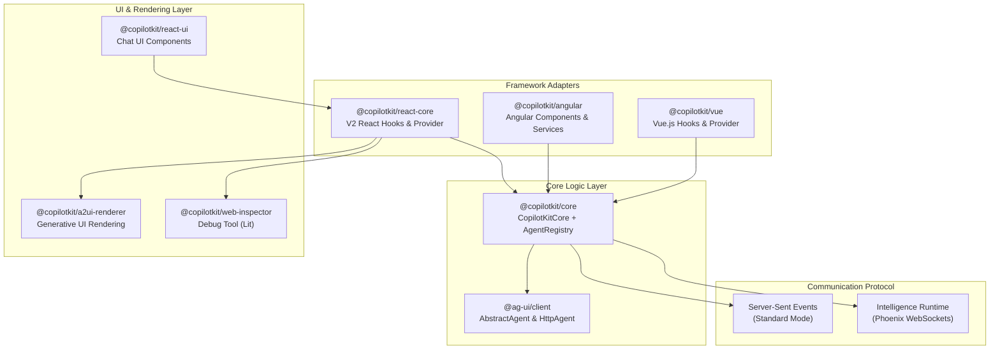
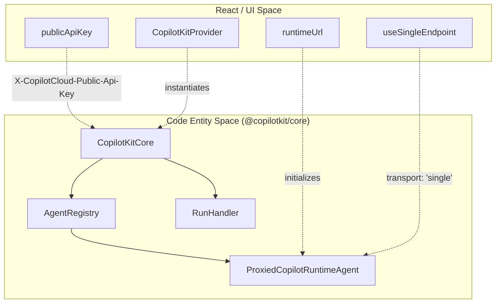
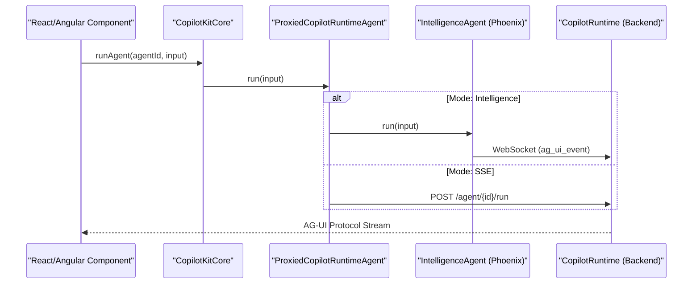

<!-- source: DeepWiki mcp.deepwiki.com · repo CopilotKit/CopilotKit · page 3 Frontend Integration · fetched 2026-10-30 -->

# Frontend Integration

Relevant source files

The following files were used as context for generating this wiki page:

- [examples/v2/react/demo/src/app/api/copilotkit/[[...slug]]/route.ts](examples/v2/react/demo/src/app/api/copilotkit/[[...slug]]/route.ts)
- [packages/a2ui-renderer/package.json](packages/a2ui-renderer/package.json)
- [packages/angular/src/lib/agent.spec.ts](packages/angular/src/lib/agent.spec.ts)
- [packages/angular/src/lib/agent.ts](packages/angular/src/lib/agent.ts)
- [packages/angular/src/lib/config.ts](packages/angular/src/lib/config.ts)
- [packages/angular/src/lib/copilotkit.spec.ts](packages/angular/src/lib/copilotkit.spec.ts)
- [packages/angular/src/lib/directives/__tests__/copilotkit-config.directive.spec.ts](packages/angular/src/lib/directives/__tests__/copilotkit-config.directive.spec.ts)
- [packages/angular/src/lib/license-watermark.ts](packages/angular/src/lib/license-watermark.ts)
- [packages/core/package.json](packages/core/package.json)
- [packages/core/src/__tests__/core-credentials.test.ts](packages/core/src/__tests__/core-credentials.test.ts)
- [packages/core/src/__tests__/core-headers.test.ts](packages/core/src/__tests__/core-headers.test.ts)
- [packages/core/src/__tests__/core-register-proxied-agent.test.ts](packages/core/src/__tests__/core-register-proxied-agent.test.ts)
- [packages/core/src/__tests__/core-subscribe-to-agent.test.ts](packages/core/src/__tests__/core-subscribe-to-agent.test.ts)
- [packages/core/src/__tests__/proxied-runtime-transport.test.ts](packages/core/src/__tests__/proxied-runtime-transport.test.ts)
- [packages/core/src/agent.ts](packages/core/src/agent.ts)
- [packages/core/src/core/agent-registry.ts](packages/core/src/core/agent-registry.ts)
- [packages/core/src/core/core.ts](packages/core/src/core/core.ts)
- [packages/react-core/package.json](packages/react-core/package.json)
- [packages/react-core/src/__tests__/threadid-propagation.contract.test.tsx](packages/react-core/src/__tests__/threadid-propagation.contract.test.tsx)
- [packages/react-core/src/hooks/use-agent-nodename.ts](packages/react-core/src/hooks/use-agent-nodename.ts)
- [packages/react-core/src/v2/components/chat/__tests__/CopilotChatActivityRendering.e2e.test.tsx](packages/react-core/src/v2/components/chat/__tests__/CopilotChatActivityRendering.e2e.test.tsx)
- [packages/react-core/src/v2/components/chat/__tests__/copilot-chat-throttle.test.tsx](packages/react-core/src/v2/components/chat/__tests__/copilot-chat-throttle.test.tsx)
- [packages/react-core/src/v2/hooks/__tests__/use-agent-provider-headers.e2e.test.tsx](packages/react-core/src/v2/hooks/__tests__/use-agent-provider-headers.e2e.test.tsx)
- [packages/react-core/src/v2/hooks/__tests__/use-agent-stability.test.tsx](packages/react-core/src/v2/hooks/__tests__/use-agent-stability.test.tsx)
- [packages/react-core/src/v2/hooks/__tests__/use-agent-throttle.test.tsx](packages/react-core/src/v2/hooks/__tests__/use-agent-throttle.test.tsx)
- [packages/react-core/src/v2/hooks/__tests__/use-agent-types.test.tsx](packages/react-core/src/v2/hooks/__tests__/use-agent-types.test.tsx)
- [packages/react-core/src/v2/hooks/__tests__/use-capabilities.test.tsx](packages/react-core/src/v2/hooks/__tests__/use-capabilities.test.tsx)
- [packages/react-core/src/v2/hooks/use-agent.tsx](packages/react-core/src/v2/hooks/use-agent.tsx)
- [packages/react-core/src/v2/hooks/use-capabilities.tsx](packages/react-core/src/v2/hooks/use-capabilities.tsx)
- [packages/react-core/src/v2/hooks/use-render-activity-message.tsx](packages/react-core/src/v2/hooks/use-render-activity-message.tsx)
- [packages/react-core/src/v2/providers/CopilotKitProvider.tsx](packages/react-core/src/v2/providers/CopilotKitProvider.tsx)
- [packages/react-core/src/v2/providers/__tests__/CopilotKitProvider.stability.test.tsx](packages/react-core/src/v2/providers/__tests__/CopilotKitProvider.stability.test.tsx)
- [packages/react-textarea/package.json](packages/react-textarea/package.json)
- [packages/react-ui/package.json](packages/react-ui/package.json)
- [packages/runtime-client-gql/package.json](packages/runtime-client-gql/package.json)
- [packages/runtime/package.json](packages/runtime/package.json)
- [packages/sdk-js/package.json](packages/sdk-js/package.json)
- [packages/shared/package.json](packages/shared/package.json)
- [packages/sqlite-runner/package.json](packages/sqlite-runner/package.json)
- [packages/voice/package.json](packages/voice/package.json)
- [packages/web-inspector/package.json](packages/web-inspector/package.json)

## Purpose and Scope

This document covers the frontend integration layer of CopilotKit, detailing how React, Angular, Vue, and React Native applications connect to CopilotKit's agent runtime system. It explains the available UI components, hooks, services, and provider configuration patterns that enable applications to interact with AI agents through the AG-UI Protocol.

For provider configuration details, see [CopilotKit Provider Configuration](#3.1). For React-specific components and hooks, see [React Components and Hooks](#3.2). For Angular integration, see [Angular Components and Services](#3.3). For Vue and React Native, see [Vue and React Native Integration](#3.4). For defining frontend actions that agents can call, see [Frontend Actions and Tools](#3.5).

---

## Frontend Package Architecture

The frontend integration layer consists of a core engine, `@copilotkit/core`, which is framework-agnostic and built on top of the `@ag-ui/client` library. This core manages the `AgentRegistry`, `RunHandler`, and `ContextStore` to facilitate communication between the UI and AI agents using the AG-UI Protocol.

### Package Structure Overview

**Sources:** [packages/core/src/core/core.ts:1-36](), [packages/react-core/src/v2/providers/CopilotKitProvider.tsx:49-54](), [packages/core/src/agent.ts:100-115]()

---

## Provider Configuration Patterns

All CopilotKit applications require wrapping components with a provider that configures the connection to the agent runtime. The `CopilotKitProvider` initializes a `CopilotKitCore` instance, which manages the lifecycle of `AbstractAgent` instances.

### Provider to Core Mapping

**Sources:** [packages/react-core/src/v2/providers/CopilotKitProvider.tsx:114-150](), [packages/core/src/core/core.ts:39-71](), [packages/core/src/core/agent-registry.ts:56-100]()

---

## React Integration Components

React applications utilize hooks like `useAgent` and components like `CopilotChat` to build agentic interfaces. The `useAgent` hook is the primary mechanism for binding a component to a specific agent's state and message stream.

| Component/Hook | Purpose | Key Code Reference |
|-----------|---------|-------------|
| `CopilotKitProvider` | Root configuration and context provider | [packages/react-core/src/v2/providers/CopilotKitProvider.tsx:114]() |
| `CopilotChat` | Stateful chat component with message history | [packages/react-core/package.json:64]() |
| `useAgent` | Hook to subscribe to agent messages and state | [packages/react-core/src/v2/hooks/use-agent.tsx:57]() |
| `useFrontendTool` | Hook to register UI-side functions for agents | [packages/core/src/core/run-handler.ts:195]() |

**Sources:** [packages/react-core/src/v2/hooks/use-agent.tsx:86-125](), [packages/core/src/core/core.ts:67-73]()

---

## Agent and Runtime Communication

The frontend communicates with agents through the `ProxiedCopilotRuntimeAgent`. This class abstracts the transport layer, supporting both standard SSE (Server-Sent Events) and the Phoenix-based `IntelligenceAgent` for persistent WebSocket connections.

### Runtime Connection Flow

**Sources:** [packages/core/src/agent.ts:187-232](), [packages/core/src/core/run-handler.ts:17-30](), [packages/core/src/core/core.ts:98-132]()

---

## Generative UI and Tool Rendering

CopilotKit enables agents to render custom UI components directly in the chat via `renderToolCalls`. This is powered by the `A2UI` (Agent-to-UI) system, which maps backend tool calls to frontend React components or sandboxed HTML/JS.

- **Declarative Rendering:** Components registered via `renderToolCalls` prop on the provider.
- **Open Generative UI:** Agents generate sandboxed UI code (HTML/CSS/JS) rendered in an iframe using `@copilotkit/a2ui-renderer`.
- **Human-in-the-Loop:** Agents can pause for user confirmation or input via `useHumanInTheLoop`.

**Sources:** [packages/react-core/src/v2/providers/CopilotKitProvider.tsx:135-148](), [packages/a2ui-renderer/package.json:1-13](), [packages/core/src/core/run-handler.ts:28-30]()

---

