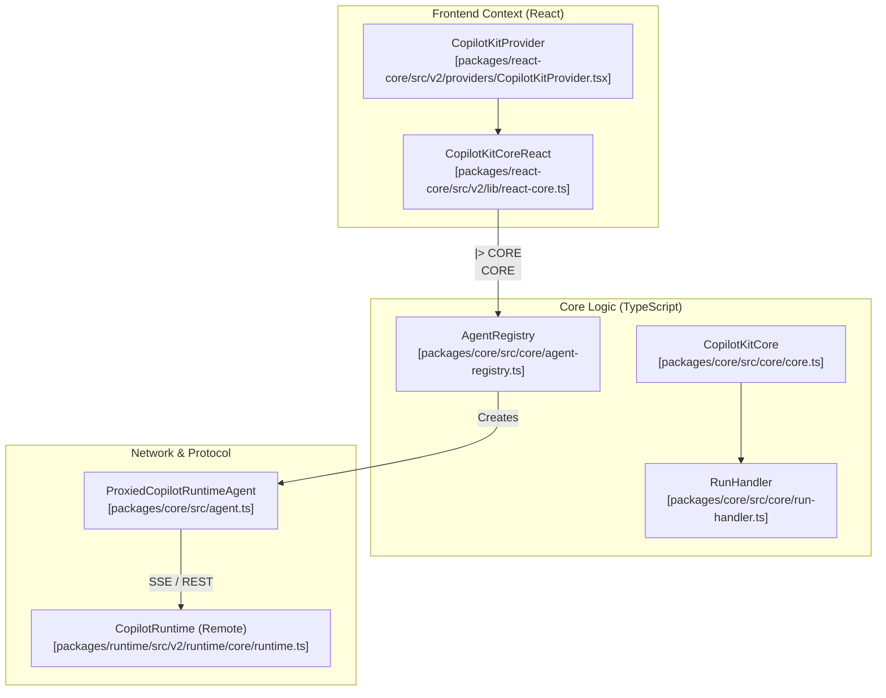
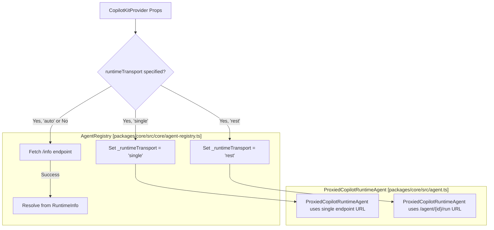
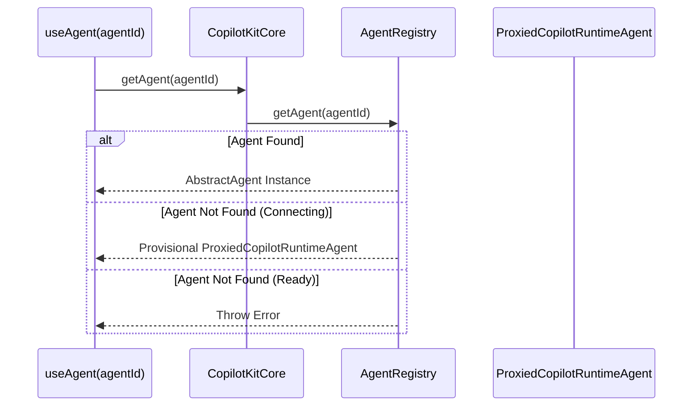

<!-- source: DeepWiki mcp.deepwiki.com · repo CopilotKit/CopilotKit · page 3.1 CopilotKit Provider Configuration · fetched 2026-10-30 -->

# CopilotKit Provider Configuration

<details>
<summary>Relevant source files</summary>

The following files were used as context for generating this wiki page:

- [examples/v2/react/demo/src/app/api/copilotkit/[[...slug]]/route.ts](examples/v2/react/demo/src/app/api/copilotkit/[[...slug]]/route.ts)
- [packages/angular/src/lib/agent.spec.ts](packages/angular/src/lib/agent.spec.ts)
- [packages/angular/src/lib/agent.ts](packages/angular/src/lib/agent.ts)
- [packages/angular/src/lib/config.ts](packages/angular/src/lib/config.ts)
- [packages/angular/src/lib/copilotkit.spec.ts](packages/angular/src/lib/copilotkit.spec.ts)
- [packages/angular/src/lib/directives/__tests__/copilotkit-config.directive.spec.ts](packages/angular/src/lib/directives/__tests__/copilotkit-config.directive.spec.ts)
- [packages/angular/src/lib/license-watermark.ts](packages/angular/src/lib/license-watermark.ts)
- [packages/core/src/__tests__/core-credentials.test.ts](packages/core/src/__tests__/core-credentials.test.ts)
- [packages/core/src/__tests__/core-headers.test.ts](packages/core/src/__tests__/core-headers.test.ts)
- [packages/core/src/__tests__/core-register-proxied-agent.test.ts](packages/core/src/__tests__/core-register-proxied-agent.test.ts)
- [packages/core/src/__tests__/core-subscribe-to-agent.test.ts](packages/core/src/__tests__/core-subscribe-to-agent.test.ts)
- [packages/core/src/__tests__/core-suggestions-capability.test.ts](packages/core/src/__tests__/core-suggestions-capability.test.ts)
- [packages/core/src/__tests__/core-suggestions-stateless.test.ts](packages/core/src/__tests__/core-suggestions-stateless.test.ts)
- [packages/core/src/__tests__/proxied-runtime-transport.test.ts](packages/core/src/__tests__/proxied-runtime-transport.test.ts)
- [packages/core/src/agent.ts](packages/core/src/agent.ts)
- [packages/core/src/core/agent-registry.ts](packages/core/src/core/agent-registry.ts)
- [packages/core/src/core/core.ts](packages/core/src/core/core.ts)
- [packages/core/src/core/suggestion-engine.ts](packages/core/src/core/suggestion-engine.ts)
- [packages/react-core/src/__tests__/threadid-propagation.contract.test.tsx](packages/react-core/src/__tests__/threadid-propagation.contract.test.tsx)
- [packages/react-core/src/hooks/use-agent-nodename.ts](packages/react-core/src/hooks/use-agent-nodename.ts)
- [packages/react-core/src/v2/components/chat/__tests__/CopilotChatActivityRendering.e2e.test.tsx](packages/react-core/src/v2/components/chat/__tests__/CopilotChatActivityRendering.e2e.test.tsx)
- [packages/react-core/src/v2/components/chat/__tests__/copilot-chat-throttle.test.tsx](packages/react-core/src/v2/components/chat/__tests__/copilot-chat-throttle.test.tsx)
- [packages/react-core/src/v2/hooks/__tests__/use-agent-provider-headers.e2e.test.tsx](packages/react-core/src/v2/hooks/__tests__/use-agent-provider-headers.e2e.test.tsx)
- [packages/react-core/src/v2/hooks/__tests__/use-agent-stability.test.tsx](packages/react-core/src/v2/hooks/__tests__/use-agent-stability.test.tsx)
- [packages/react-core/src/v2/hooks/__tests__/use-agent-throttle.test.tsx](packages/react-core/src/v2/hooks/__tests__/use-agent-throttle.test.tsx)
- [packages/react-core/src/v2/hooks/__tests__/use-agent-types.test.tsx](packages/react-core/src/v2/hooks/__tests__/use-agent-types.test.tsx)
- [packages/react-core/src/v2/hooks/__tests__/use-capabilities.test.tsx](packages/react-core/src/v2/hooks/__tests__/use-capabilities.test.tsx)
- [packages/react-core/src/v2/hooks/use-agent.tsx](packages/react-core/src/v2/hooks/use-agent.tsx)
- [packages/react-core/src/v2/hooks/use-capabilities.tsx](packages/react-core/src/v2/hooks/use-capabilities.tsx)
- [packages/react-core/src/v2/hooks/use-render-activity-message.tsx](packages/react-core/src/v2/hooks/use-render-activity-message.tsx)
- [packages/react-core/src/v2/providers/CopilotKitProvider.tsx](packages/react-core/src/v2/providers/CopilotKitProvider.tsx)
- [packages/react-core/src/v2/providers/__tests__/CopilotKitProvider.stability.test.tsx](packages/react-core/src/v2/providers/__tests__/CopilotKitProvider.stability.test.tsx)
- [packages/runtime/src/v2/runtime/__tests__/fetch-handler.test.ts](packages/runtime/src/v2/runtime/__tests__/fetch-handler.test.ts)
- [packages/runtime/src/v2/runtime/__tests__/fetch-router.test.ts](packages/runtime/src/v2/runtime/__tests__/fetch-router.test.ts)
- [packages/runtime/src/v2/runtime/__tests__/handle-memories.test.ts](packages/runtime/src/v2/runtime/__tests__/handle-memories.test.ts)
- [packages/runtime/src/v2/runtime/__tests__/integration/node-servers.integration.test.ts](packages/runtime/src/v2/runtime/__tests__/integration/node-servers.integration.test.ts)
- [packages/runtime/src/v2/runtime/__tests__/integration/suites/debug-events.suite.ts](packages/runtime/src/v2/runtime/__tests__/integration/suites/debug-events.suite.ts)
- [packages/runtime/src/v2/runtime/core/fetch-handler.ts](packages/runtime/src/v2/runtime/core/fetch-handler.ts)
- [packages/runtime/src/v2/runtime/core/fetch-router.ts](packages/runtime/src/v2/runtime/core/fetch-router.ts)
- [packages/runtime/src/v2/runtime/core/hooks.ts](packages/runtime/src/v2/runtime/core/hooks.ts)
- [packages/runtime/src/v2/runtime/handlers/__tests__/handle-debug-events.test.ts](packages/runtime/src/v2/runtime/handlers/__tests__/handle-debug-events.test.ts)
- [packages/runtime/src/v2/runtime/handlers/__tests__/handle-suggest.test.ts](packages/runtime/src/v2/runtime/handlers/__tests__/handle-suggest.test.ts)
- [packages/runtime/src/v2/runtime/handlers/__tests__/suggest-no-leak.test.ts](packages/runtime/src/v2/runtime/handlers/__tests__/suggest-no-leak.test.ts)
- [packages/runtime/src/v2/runtime/handlers/handle-debug-events.ts](packages/runtime/src/v2/runtime/handlers/handle-debug-events.ts)
- [packages/runtime/src/v2/runtime/handlers/handle-memories.ts](packages/runtime/src/v2/runtime/handlers/handle-memories.ts)
- [packages/runtime/src/v2/runtime/handlers/handle-suggest.ts](packages/runtime/src/v2/runtime/handlers/handle-suggest.ts)
- [packages/runtime/src/v2/runtime/handlers/intelligence/memories.ts](packages/runtime/src/v2/runtime/handlers/intelligence/memories.ts)
- [packages/runtime/src/v2/runtime/intelligence-platform/__tests__/client.test.ts](packages/runtime/src/v2/runtime/intelligence-platform/__tests__/client.test.ts)
- [packages/runtime/src/v2/runtime/intelligence-platform/client.ts](packages/runtime/src/v2/runtime/intelligence-platform/client.ts)

</details>


## Purpose and Scope

The `CopilotKitProvider` is the central configuration hub for the CopilotKit SDK. It establishes the communication channel between the frontend application and the **Copilot Runtime**, manages the lifecycle of AI agents, and synchronizes state via the **AG-UI Protocol**. This page details the configuration for both self-hosted and Copilot Cloud scenarios, including runtime URLs, authentication headers, license management, and advanced properties.

## Provider Architecture

The `CopilotKitProvider` initializes an instance of `CopilotKitCoreReact`, which extends the core logic to handle React-specific lifecycles [packages/react-core/src/v2/providers/CopilotKitProvider.tsx:49](). It manages a registry of agents and tracks the execution status of tool calls across the component tree [packages/react-core/src/v2/providers/CopilotKitProvider.tsx:181-193]().

### System Entity Mapping

The following diagram maps high-level configuration concepts to the specific classes and interfaces in the codebase.

**Diagram: Provider to Code Entity Mapping**

**Sources:** [packages/react-core/src/v2/providers/CopilotKitProvider.tsx:49-193](), [packages/core/src/core/core.ts:39-71](), [packages/core/src/core/agent-registry.ts:56-86](), [packages/core/src/agent.ts:100-150]()

## Configuration Scenarios

### 1. Self-Hosted Scenario
In a self-hosted setup, you point the provider to your own deployment of the Copilot Runtime. This is typically an endpoint in a Next.js, Express, or Hono application [examples/v2/react/demo/src/app/api/copilotkit/[[...slug]]/route.ts:77-80]().

```tsx
<CopilotKitProvider runtimeUrl="/api/copilotkit">
  {children}
</CopilotKitProvider>
```

### 2. Copilot Cloud Scenario
When using Copilot Cloud, you provide a `publicApiKey` or `publicLicenseKey`. The provider automatically routes requests to the managed cloud endpoint at `https://api.cloud.copilotkit.ai/copilotkit/v1` [packages/react-core/src/v2/providers/CopilotKitProvider.tsx:82]().

```tsx
<CopilotKitProvider publicApiKey="your_cloud_api_key">
  {children}
</CopilotKitProvider>
```

## Core Properties Reference

The `CopilotKitProviderProps` interface defines the available configuration options [packages/react-core/src/v2/providers/CopilotKitProvider.tsx:114-154]():

| Property | Type | Description |
|----------|------|-------------|
| `runtimeUrl` | `string` | The endpoint of your Copilot Runtime [packages/core/src/core/core.ts:43](). |
| `publicApiKey` | `string` | Public API key for Copilot Cloud [packages/react-core/src/v2/providers/CopilotKitProvider.tsx:123](). |
| `headers` | `Record<string, string> \| () => ...` | Headers appended to every HTTP request [packages/core/src/core/core.ts:62](). |
| `properties` | `Record<string, unknown>` | Metadata sent as `forwardedProps` to agents [packages/core/src/core/core.ts:66](). |
| `credentials` | `RequestCredentials` | Fetch credentials mode (e.g., `"include"` for cookies) [packages/core/src/core/core.ts:64](). |
| `licenseToken` | `string` | Signed token for offline verification of premium features [packages/react-core/src/v2/providers/CopilotKitProvider.tsx:130](). |
| `runtimeTransport` | `"rest" \| "single" \| "auto"` | Transport style for CopilotRuntime endpoints [packages/core/src/core/core.ts:45](). |
| `useSingleEndpoint` | `boolean` | If `true`, forces the runtime to use a single endpoint for all agent interactions [packages/react-core/src/v2/providers/CopilotKitProvider.tsx:132](). |
| `agents__unsafe_dev_only` | `Record<string, AbstractAgent>` | For development only: a map of agent names to `AbstractAgent` instances [packages/core/src/core/core.ts:56](). |
| `debug` | `DebugConfig` | Enables debug logging for the client-side event pipeline [packages/core/src/core/core.ts:72](). |

**Sources:** [packages/react-core/src/v2/providers/CopilotKitProvider.tsx:114-154](), [packages/core/src/core/core.ts:41-73]()

### `runtimeTransport` and `useSingleEndpoint`

The `runtimeTransport` property [packages/core/src/core/core.ts:45]() determines how the frontend communicates with the Copilot Runtime.

- **`"auto"` (default)**: The provider attempts to auto-detect the runtime's capabilities by fetching the `/info` endpoint [packages/core/src/core/agent-registry.ts:69]().
- **`"rest"`**: Forces the use of REST-based communication, typically with separate endpoints like `/agent/{id}/run` [packages/core/src/agent.ts:125]().
- **`"single"`**: Forces the use of a single endpoint for all agent interactions. This is often used with serverless functions [packages/core/src/agent.ts:124]().

The `AgentRegistry` manages the resolution of the `runtimeTransport` and updates the `_runtimeTransport` and `_requestedTransport` properties accordingly [packages/core/src/core/agent-registry.ts:69-75]().

**Diagram: Runtime Transport Resolution**

**Sources:** [packages/core/src/core/core.ts:45](), [packages/react-core/src/v2/providers/CopilotKitProvider.tsx:132](), [packages/core/src/core/agent-registry.ts:69-75](), [packages/core/src/agent.ts:120-126]()

## Implementation Details: Agent Management

The provider coordinates how agents are instantiated. In v2, the `useAgent` hook manages the lifecycle of agents, including **provisional agents** (`ProxiedCopilotRuntimeAgent`) that exist while the runtime is connecting [packages/react-core/src/v2/hooks/use-agent.tsx:7-9]().

### Proxied Agent Registration
For scenarios requiring multiple frontend agents to route to a single runtime agent, the `AgentRegistry` provides `registerProxiedAgent`. This allows a distinct local `agentId` to proxy outbound requests to a different `runtimeAgentId` [packages/core/src/core/agent-registry.ts:32-45]().

**Diagram: Agent Instance Resolution**

**Sources:** [packages/react-core/src/v2/hooks/use-agent.tsx:142-200](), [packages/core/src/core/agent-registry.ts:32-45](), [packages/core/src/agent.ts:100-115]()

## Throttling and Performance

To handle high-frequency streaming updates (e.g., token-by-token text generation), the provider supports throttling via `subscribeToAgentWithOptions`. This reduces re-render frequency by coalescing notifications within a specified window [packages/react-core/src/v2/hooks/use-agent.tsx:33-50]().

- **Leading Edge**: The first update in a window fires immediately for responsiveness [packages/core/src/__tests__/core-subscribe-to-agent.test.ts:144-157]().
- **Trailing Edge**: A final update fires after the window expires to ensure the UI reflects the final state [packages/core/src/__tests__/core-subscribe-to-agent.test.ts:163-187]().

**Sources:** [packages/react-core/src/v2/hooks/use-agent.tsx:33-50](), [packages/core/src/__tests__/core-subscribe-to-agent.test.ts:144-235](), [packages/react-core/src/v2/hooks/__tests__/use-agent-throttle.test.tsx:212-227]()

## Intelligence Runtime Selection

The SDK supports two primary runtime modes: `CopilotSseRuntime` and `CopilotIntelligenceRuntime` [packages/runtime/src/v2/runtime/core/fetch-handler.ts:60-65]().

- **`CopilotSseRuntime`**: The standard runtime for streaming agent responses via Server-Sent Events (SSE).
- **`CopilotIntelligenceRuntime`**: A specialized runtime for applications leveraging the CopilotKit Intelligence Platform, supporting advanced features like long-term memory, thread persistence, and managed channels [packages/runtime/src/v2/runtime/intelligence-platform/client.ts:83-137]().

The `AgentRegistry` detects the `runtimeMode` during the `/info` handshake and configures `ProxiedCopilotRuntimeAgent` instances to use either standard SSE or the Intelligence delegate [packages/core/src/core/agent-registry.ts:128-131]().

**Sources:** [packages/runtime/src/v2/runtime/core/fetch-handler.ts:60-65](), [packages/core/src/core/agent-registry.ts:128-131](), [packages/runtime/src/v2/runtime/intelligence-platform/client.ts:83-137]()

## License Management
The provider includes a `LicenseWarningBanner` and `LicenseContext` to manage premium feature access [packages/react-core/src/v2/providers/CopilotKitProvider.tsx:16-24](). The `licenseStatus` is synchronized from the `AgentRegistry` [packages/core/src/core/agent-registry.ts:160-162](). If a `publicApiKey` or `licenseToken` is missing when premium features are used, the provider emits warnings [packages/react-core/src/v2/providers/CopilotKitProvider.tsx:23]().

**Sources:** [packages/react-core/src/v2/providers/CopilotKitProvider.tsx:16-24](), [packages/core/src/core/agent-registry.ts:160-162]()

---

