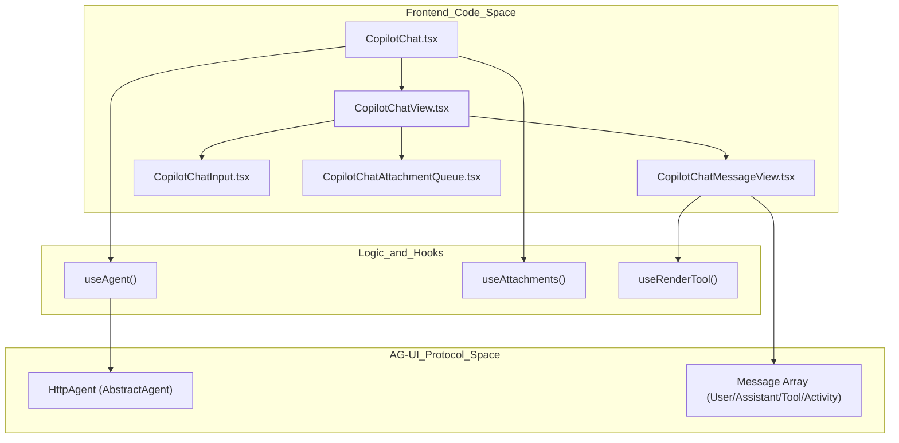
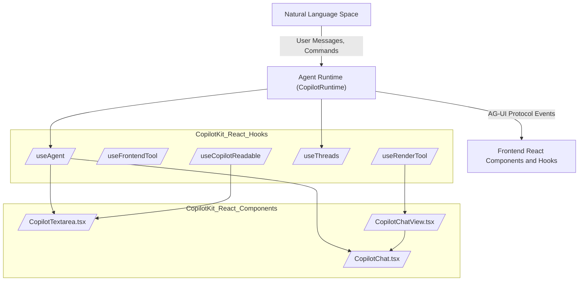

<!-- source: DeepWiki mcp.deepwiki.com · repo CopilotKit/CopilotKit · page 3.2 React Components and Hooks · fetched 2026-10-30 -->

# React Components and Hooks

<details>
<summary>Relevant source files</summary>

The following files were used as context for generating this wiki page:

- [codemods/__tests__/migrate-attachments.test.ts](codemods/__tests__/migrate-attachments.test.ts)
- [codemods/migrate-attachments.ts](codemods/migrate-attachments.ts)
- [examples/v2/react/storybook/stories/CopilotChatView.stories.tsx](examples/v2/react/storybook/stories/CopilotChatView.stories.tsx)
- [examples/v2/react/storybook/stories/IntelligenceIndicator.stories.tsx](examples/v2/react/storybook/stories/IntelligenceIndicator.stories.tsx)
- [packages/angular/src/lib/components/a2ui/__tests__/a2ui-activity-renderer.spec.ts](packages/angular/src/lib/components/a2ui/__tests__/a2ui-activity-renderer.spec.ts)
- [packages/angular/src/lib/components/chat/copilot-chat-suggestion-view.ts](packages/angular/src/lib/components/chat/copilot-chat-suggestion-view.ts)
- [packages/angular/src/lib/components/chat/copilot-chat-view-input-container.ts](packages/angular/src/lib/components/chat/copilot-chat-view-input-container.ts)
- [packages/core/src/__tests__/core-connect-thread-switch.test.ts](packages/core/src/__tests__/core-connect-thread-switch.test.ts)
- [packages/core/src/__tests__/core-edge-cases.test.ts](packages/core/src/__tests__/core-edge-cases.test.ts)
- [packages/core/src/__tests__/core-follow-up.test.ts](packages/core/src/__tests__/core-follow-up.test.ts)
- [packages/core/src/__tests__/core-frontend-tool-placeholder.test.ts](packages/core/src/__tests__/core-frontend-tool-placeholder.test.ts)
- [packages/core/src/__tests__/core-parallel-tool-order.test.ts](packages/core/src/__tests__/core-parallel-tool-order.test.ts)
- [packages/core/src/__tests__/core-run-agent-resume.test.ts](packages/core/src/__tests__/core-run-agent-resume.test.ts)
- [packages/core/src/__tests__/intelligence-agent.test.ts](packages/core/src/__tests__/intelligence-agent.test.ts)
- [packages/core/src/__tests__/state-manager.test.ts](packages/core/src/__tests__/state-manager.test.ts)
- [packages/core/src/core/run-handler.ts](packages/core/src/core/run-handler.ts)
- [packages/core/src/core/state-manager.ts](packages/core/src/core/state-manager.ts)
- [packages/core/src/intelligence-agent.ts](packages/core/src/intelligence-agent.ts)
- [packages/react-core/src/hooks/__tests__/use-copilot-action.e2e.test.tsx](packages/react-core/src/hooks/__tests__/use-copilot-action.e2e.test.tsx)
- [packages/react-core/src/v2/__tests__/utils/test-helpers.tsx](packages/react-core/src/v2/__tests__/utils/test-helpers.tsx)
- [packages/react-core/src/v2/components/chat/CopilotChat.tsx](packages/react-core/src/v2/components/chat/CopilotChat.tsx)
- [packages/react-core/src/v2/components/chat/CopilotChatAttachmentQueue.tsx](packages/react-core/src/v2/components/chat/CopilotChatAttachmentQueue.tsx)
- [packages/react-core/src/v2/components/chat/CopilotChatAttachmentRenderer.tsx](packages/react-core/src/v2/components/chat/CopilotChatAttachmentRenderer.tsx)
- [packages/react-core/src/v2/components/chat/CopilotChatInput.tsx](packages/react-core/src/v2/components/chat/CopilotChatInput.tsx)
- [packages/react-core/src/v2/components/chat/CopilotChatMessageView.tsx](packages/react-core/src/v2/components/chat/CopilotChatMessageView.tsx)
- [packages/react-core/src/v2/components/chat/CopilotChatSuggestionView.tsx](packages/react-core/src/v2/components/chat/CopilotChatSuggestionView.tsx)
- [packages/react-core/src/v2/components/chat/CopilotChatView.tsx](packages/react-core/src/v2/components/chat/CopilotChatView.tsx)
- [packages/react-core/src/v2/components/chat/Lightbox.tsx](packages/react-core/src/v2/components/chat/Lightbox.tsx)
- [packages/react-core/src/v2/components/chat/__tests__/CopilotChat.attachments.test.tsx](packages/react-core/src/v2/components/chat/__tests__/CopilotChat.attachments.test.tsx)
- [packages/react-core/src/v2/components/chat/__tests__/CopilotChat.e2e.test.tsx](packages/react-core/src/v2/components/chat/__tests__/CopilotChat.e2e.test.tsx)
- [packages/react-core/src/v2/components/chat/__tests__/CopilotChat.runActivityReconnect.test.tsx](packages/react-core/src/v2/components/chat/__tests__/CopilotChat.runActivityReconnect.test.tsx)
- [packages/react-core/src/v2/components/chat/__tests__/CopilotChatInput.test.tsx](packages/react-core/src/v2/components/chat/__tests__/CopilotChatInput.test.tsx)
- [packages/react-core/src/v2/components/chat/__tests__/CopilotChatMessageView.test.tsx](packages/react-core/src/v2/components/chat/__tests__/CopilotChatMessageView.test.tsx)
- [packages/react-core/src/v2/components/chat/__tests__/CopilotChatView.inputOverlay.test.tsx](packages/react-core/src/v2/components/chat/__tests__/CopilotChatView.inputOverlay.test.tsx)
- [packages/react-core/src/v2/components/chat/__tests__/CopilotChatView.pinToSend.test.tsx](packages/react-core/src/v2/components/chat/__tests__/CopilotChatView.pinToSend.test.tsx)
- [packages/react-core/src/v2/components/chat/__tests__/normalize-auto-scroll.test.ts](packages/react-core/src/v2/components/chat/__tests__/normalize-auto-scroll.test.ts)
- [packages/react-core/src/v2/components/chat/last-user-message-context.ts](packages/react-core/src/v2/components/chat/last-user-message-context.ts)
- [packages/react-core/src/v2/components/chat/normalize-auto-scroll.ts](packages/react-core/src/v2/components/chat/normalize-auto-scroll.ts)
- [packages/react-core/src/v2/components/chat/scroll-element-context.ts](packages/react-core/src/v2/components/chat/scroll-element-context.ts)
- [packages/react-core/src/v2/components/index.ts](packages/react-core/src/v2/components/index.ts)
- [packages/react-core/src/v2/components/intelligence-indicator/IntelligenceIndicator.tsx](packages/react-core/src/v2/components/intelligence-indicator/IntelligenceIndicator.tsx)
- [packages/react-core/src/v2/components/intelligence-indicator/IntelligenceIndicatorView.tsx](packages/react-core/src/v2/components/intelligence-indicator/IntelligenceIndicatorView.tsx)
- [packages/react-core/src/v2/components/intelligence-indicator/__tests__/IntelligenceIndicator.e2e.test.tsx](packages/react-core/src/v2/components/intelligence-indicator/__tests__/IntelligenceIndicator.e2e.test.tsx)
- [packages/react-core/src/v2/components/intelligence-indicator/__tests__/intelligence-indicator-logic.test.ts](packages/react-core/src/v2/components/intelligence-indicator/__tests__/intelligence-indicator-logic.test.ts)
- [packages/react-core/src/v2/components/intelligence-indicator/index.ts](packages/react-core/src/v2/components/intelligence-indicator/index.ts)
- [packages/react-core/src/v2/headless.ts](packages/react-core/src/v2/headless.ts)
- [packages/react-core/src/v2/hooks/__tests__/use-attachments.test.tsx](packages/react-core/src/v2/hooks/__tests__/use-attachments.test.tsx)
- [packages/react-core/src/v2/hooks/__tests__/use-interrupt.test.tsx](packages/react-core/src/v2/hooks/__tests__/use-interrupt.test.tsx)
- [packages/react-core/src/v2/hooks/__tests__/use-pin-to-send.test.tsx](packages/react-core/src/v2/hooks/__tests__/use-pin-to-send.test.tsx)
- [packages/react-core/src/v2/hooks/use-attachments.tsx](packages/react-core/src/v2/hooks/use-attachments.tsx)
- [packages/react-core/src/v2/hooks/use-interrupt.tsx](packages/react-core/src/v2/hooks/use-interrupt.tsx)
- [packages/react-core/src/v2/hooks/use-pin-to-send.ts](packages/react-core/src/v2/hooks/use-pin-to-send.ts)
- [packages/react-core/src/v2/styles/__tests__/streamdown-styles.test.ts](packages/react-core/src/v2/styles/__tests__/streamdown-styles.test.ts)
- [packages/react-core/src/v2/styles/__tests__/streamdown-table-controls.test.tsx](packages/react-core/src/v2/styles/__tests__/streamdown-table-controls.test.tsx)
- [packages/react-core/src/v2/styles/globals.css](packages/react-core/src/v2/styles/globals.css)
- [packages/react-core/src/v2/types/interrupt.ts](packages/react-core/src/v2/types/interrupt.ts)
- [packages/react-core/tsdown.config.ts](packages/react-core/tsdown.config.ts)
- [packages/react-textarea/src/components/copilot-textarea/copilot-textarea.tsx](packages/react-textarea/src/components/copilot-textarea/copilot-textarea.tsx)
- [packages/react-textarea/src/hooks/make-autosuggestions-function/use-make-standard-autosuggestions-function.tsx](packages/react-textarea/src/hooks/make-autosuggestions-function/use-make-standard-autosuggestions-function.tsx)
- [packages/react-textarea/src/lib/editor-to-text.ts](packages/react-textarea/src/lib/editor-to-text.ts)
- [packages/react-textarea/src/lib/get-text-around-cursor.ts](packages/react-textarea/src/lib/get-text-around-cursor.ts)
- [packages/react-textarea/src/types/index.ts](packages/react-textarea/src/types/index.ts)
- [packages/react-textarea/tsdown.config.ts](packages/react-textarea/tsdown.config.ts)
- [packages/react-ui/src/components/chat/AttachmentQueue.tsx](packages/react-ui/src/components/chat/AttachmentQueue.tsx)
- [packages/react-ui/src/components/chat/AttachmentRenderer.tsx](packages/react-ui/src/components/chat/AttachmentRenderer.tsx)
- [packages/react-ui/src/components/chat/Chat.tsx](packages/react-ui/src/components/chat/Chat.tsx)
- [packages/react-ui/src/components/chat/attachment-utils.ts](packages/react-ui/src/components/chat/attachment-utils.ts)
- [packages/react-ui/src/components/chat/messages/ImageRenderer.tsx](packages/react-ui/src/components/chat/messages/ImageRenderer.tsx)
- [packages/react-ui/src/components/chat/messages/UserMessage.tsx](packages/react-ui/src/components/chat/messages/UserMessage.tsx)
- [packages/react-ui/src/components/chat/props.ts](packages/react-ui/src/components/chat/props.ts)
- [packages/react-ui/src/css/attachments.css](packages/react-ui/src/css/attachments.css)
- [packages/react-ui/src/css/messages.css](packages/react-ui/src/css/messages.css)
- [packages/react-ui/src/styles.css](packages/react-ui/src/styles.css)
- [packages/react-ui/tsdown.config.ts](packages/react-ui/tsdown.config.ts)
- [packages/runtime/src/agent/__tests__/capabilities.test.ts](packages/runtime/src/agent/__tests__/capabilities.test.ts)
- [packages/runtime/src/agent/__tests__/factory-native-interrupt.test.ts](packages/runtime/src/agent/__tests__/factory-native-interrupt.test.ts)
- [packages/runtime/src/agent/__tests__/multimodal.test.ts](packages/runtime/src/agent/__tests__/multimodal.test.ts)
- [packages/runtime/src/v2/runtime/core/debug-event-bus.ts](packages/runtime/src/v2/runtime/core/debug-event-bus.ts)
- [packages/shared/src/attachments/__tests__/utils.test.ts](packages/shared/src/attachments/__tests__/utils.test.ts)
- [packages/shared/src/attachments/index.ts](packages/shared/src/attachments/index.ts)
- [packages/shared/src/attachments/types.ts](packages/shared/src/attachments/types.ts)
- [packages/shared/src/attachments/utils.ts](packages/shared/src/attachments/utils.ts)
- [packages/shared/src/debug-event-envelope.ts](packages/shared/src/debug-event-envelope.ts)
- [packages/shared/src/index.ts](packages/shared/src/index.ts)
- [packages/shared/src/types/__tests__/message.test.ts](packages/shared/src/types/__tests__/message.test.ts)
- [packages/shared/src/types/message.ts](packages/shared/src/types/message.ts)
- [packages/vue/src/v2/components/chat/CopilotChat.vue](packages/vue/src/v2/components/chat/CopilotChat.vue)
- [packages/vue/src/v2/components/chat/CopilotChatAssistantMessage.vue](packages/vue/src/v2/components/chat/CopilotChatAssistantMessage.vue)
- [packages/vue/src/v2/components/chat/CopilotChatAttachmentQueue.vue](packages/vue/src/v2/components/chat/CopilotChatAttachmentQueue.vue)
- [packages/vue/src/v2/components/chat/CopilotChatAttachmentRenderer.vue](packages/vue/src/v2/components/chat/CopilotChatAttachmentRenderer.vue)
- [packages/vue/src/v2/components/chat/CopilotChatAudioRecorder.vue](packages/vue/src/v2/components/chat/CopilotChatAudioRecorder.vue)
- [packages/vue/src/v2/components/chat/CopilotChatInput.vue](packages/vue/src/v2/components/chat/CopilotChatInput.vue)
- [packages/vue/src/v2/components/chat/CopilotChatReasoningMessage.vue](packages/vue/src/v2/components/chat/CopilotChatReasoningMessage.vue)
- [packages/vue/src/v2/components/chat/CopilotChatSuggestionPill.vue](packages/vue/src/v2/components/chat/CopilotChatSuggestionPill.vue)
- [packages/vue/src/v2/components/chat/CopilotChatSuggestionView.vue](packages/vue/src/v2/components/chat/CopilotChatSuggestionView.vue)
- [packages/vue/src/v2/components/chat/CopilotChatToggleButton.vue](packages/vue/src/v2/components/chat/CopilotChatToggleButton.vue)
- [packages/vue/src/v2/components/chat/CopilotChatView.vue](packages/vue/src/v2/components/chat/CopilotChatView.vue)
- [packages/vue/src/v2/hooks/__tests__/use-human-in-the-loop.e2e.test.ts](packages/vue/src/v2/hooks/__tests__/use-human-in-the-loop.e2e.test.ts)

</details>


This page documents the React-specific components and hooks provided by CopilotKit for building agent-native user interfaces. These components enable direct integration with agents, provide intelligent text editing, and render generative UI through the AG-UI Protocol.

## UI Components

### CopilotChat Component

The `CopilotChat` component provides a full conversational interface. It follows a modular design, separating logic, state management, and UI layout to enhance maintainability and extensibility.

Title: CopilotChat Architecture and Data Flow


#### Implementation and Data Flow

- `CopilotChat.tsx` uses the `useAgent` hook to subscribe to the agent identified by `agentId` and manages message streams and agent runs [packages/react-core/src/v2/components/chat/CopilotChat.tsx:123-126]().
- It uses `useAttachments` to manage multimodal attachment states such as images, audio, video, and document uploads [packages/react-core/src/v2/components/chat/CopilotChat.tsx:183-195]().
- The core UI is rendered via `CopilotChatView`, which internally composes `CopilotChatMessageView` (displaying the message list, including tool call results), `CopilotChatInput` (user input area), and `CopilotChatAttachmentQueue` (for previews and management of attachments) [packages/react-core/src/v2/components/chat/CopilotChatView.tsx:139-178]().
- `CopilotChatMessageView` optimizes rendering with memoized components to prevent unnecessary re-renders during streaming updates [packages/react-core/src/v2/components/chat/CopilotChatMessageView.tsx:66-152]().
- Assistant messages are specifically memoized to detect changes in tool calls and tool results without re-rendering the entire message list [packages/react-core/src/v2/components/chat/CopilotChatMessageView.tsx:91-151]().
- The component integrates the `IntelligenceIndicator` to visually mark turns where specific knowledge base tools are executing [packages/react-core/src/v2/components/chat/CopilotChatMessageView.tsx:28-32]().
- `CopilotChat` subscribes to errors scoped by agent and optionally throttles UI updates via the `throttleMs` option [packages/react-core/src/v2/components/chat/CopilotChat.tsx:147-169]().

**Key Features:**

- **Message Deduplication:** Assistant messages with identical IDs and different partial content/tool calls are handled to maintain coherent UI during streaming [packages/react-core/src/v2/components/chat/CopilotChatMessageView.tsx:93-108]().
- **Audio Transcription:** Integrates `transcribeAudio` for voice-to-text input if enabled in the provider [packages/react-core/src/v2/components/chat/CopilotChat.tsx:207-210]().
- **Pin to Send:** Includes logic to "pin" the input to the bottom during active runs to ensure the user can always see their draft message [packages/react-core/src/v2/components/chat/CopilotChatView.tsx:41]().
- **Slot-based UI Composition:** `CopilotChatView` supports slot overrides to replace subcomponents like `messageView`, `input`, and `suggestionView` [packages/react-core/src/v2/components/chat/CopilotChatView.tsx:57-63]().

**Sources:** [packages/react-core/src/v2/components/chat/CopilotChat.tsx](), [packages/react-core/src/v2/components/chat/CopilotChatView.tsx](), [packages/react-core/src/v2/components/chat/CopilotChatMessageView.tsx](), [packages/react-core/src/v2/components/chat/CopilotChatInput.tsx]()

---

### CopilotTextarea Component

`<CopilotTextarea>` is a drop-in replacement for the standard HTML `<textarea>`, augmented with AI-powered autocomplete and contextual suggestions. It integrates tightly with the CopilotKit context and autosuggestion framework.

#### Implementation Highlights

- The `CopilotTextarea` component wraps a core `BaseCopilotTextarea` and injects an autosuggestion function generated by `useMakeStandardAutosuggestionFunction` [packages/react-textarea/src/components/copilot-textarea/copilot-textarea.tsx:173-176]().
- It leverages `useMakeStandardInsertionOrEditingFunction` to handle text transformations and summarizes [packages/react-textarea/src/components/copilot-textarea/copilot-textarea.tsx:98]().
- The component supports a hovering editor window triggered by the keyboard shortcut `Cmd+K` (Mac) or `Ctrl+K` (Windows), enabling users to suggest changes to the text [packages/react-textarea/src/components/copilot-textarea/copilot-textarea.tsx:9-10]().
- Autosuggestion and insertion API configurations can be customized via the `autosuggestionsConfig` prop, including parameters like `maxTokens` and stopping characters [packages/react-textarea/src/components/copilot-textarea/copilot-textarea.tsx:112-129]().
- Styling is provided via `@copilotkit/react-textarea/styles.css`, which should be imported at the root of the project [packages/react-textarea/src/components/copilot-textarea/copilot-textarea.tsx:74-77]().

```tsx
import { CopilotTextarea } from '@copilotkit/react-textarea';
import "@copilotkit/react-textarea/styles.css";

<CopilotTextarea
  autosuggestionsConfig={{
    textareaPurpose: "the body of an email message",
    chatApiConfigs: {
      suggestionsApiConfig: {
        maxTokens: 20,
        stop: [".", "?", "!"],
      },
    },
  }}
/>
```

**Sources:** [packages/react-textarea/src/components/copilot-textarea/copilot-textarea.tsx](), [packages/react-textarea/src/hooks/make-autosuggestions-function/use-make-standard-autosuggestions-function.tsx]()

---

## React Hooks

CopilotKit offers a set of React hooks tailored for agent integration, UI state management, and rendering generative UI.

### useAgent

- The primary hook to access an agent's state and messages by `agentId` and optionally `threadId`.
- Internally, it connects to the `HttpAgent` instance and subscribes to real-time updates via the AG-UI protocol [packages/react-core/src/v2/components/chat/CopilotChat.tsx:123-126]().
- Supports throttling via `throttleMs` to control re-render frequency on message updates [packages/react-core/src/v2/components/chat/CopilotChat.tsx:89-90]().

**Sources:** [packages/react-core/src/v2/components/chat/CopilotChat.tsx](), [packages/react-core/src/v2/hooks/use-agent.tsx]()

---

### useRenderTool

- Registers a React rendering component for specific tools invoked by agents.
- `CopilotChatMessageView` uses `useRenderActivityMessage` and `useRenderCustomMessages` to determine how to display tool-related activities [packages/react-core/src/v2/components/chat/CopilotChatMessageView.tsx:25]().
- Tool results are rendered as separate messages with `role="tool"` that reference tool call IDs [packages/react-core/src/v2/components/chat/CopilotChatMessageView.tsx:111-112]().

**Sources:** [packages/react-core/src/v2/components/chat/CopilotChatMessageView.tsx](), [packages/react-core/src/v2/hooks/index.ts]()

---

### useThreads

- Manages and subscribes to multiple chat threads for a given agent.
- Interacts with the runtime to manage thread lifecycle.
- In v2, `ɵcreateThreadStore` is used to manage the thread state and subscription to run activities [packages/react-core/src/v2/components/chat/CopilotChat.tsx:22]().

**Sources:** [packages/react-core/src/v2/components/chat/CopilotChat.tsx](), [packages/core/src/core/core.ts]()

---

### useCopilotReadable

- Shares frontend application state with the agent as a readable context.
- Used by `CopilotTextarea` to provide intelligent suggestions based on the application context [packages/react-textarea/src/components/copilot-textarea/copilot-textarea.tsx:6-7]().

---

### useHumanInTheLoop

- Implements the Human-In-The-Loop (HITL) pattern where the agent pauses execution awaiting user input or confirmation.
- The `RunHandler` in the core package manages the standard `resume` array which addresses open AG-UI interrupts [packages/core/src/core/run-handler.ts:28-30]().

**Sources:** [packages/core/src/core/run-handler.ts]()

---

## Summary Diagram: From Natural Language Space to React Components and Hooks

Title: Mapping Natural Language Space to React Code Entities


---

## Summary Table of Main React Components and Hooks

| Component / Hook      | Purpose | Key Files |
|----------------------|---------|-----------|
| **CopilotChat**      | Full chatbot UI panel with message rendering, input, and attachments. | [packages/react-core/src/v2/components/chat/CopilotChat.tsx]() |
| **CopilotTextarea**  | AI-enhanced, context-aware enriched textarea with autosuggestions. | [packages/react-textarea/src/components/copilot-textarea/copilot-textarea.tsx]() |
| **CopilotChatView**  | Layout component for chat, handling scroll, input, and message views. | [packages/react-core/src/v2/components/chat/CopilotChatView.tsx]() |
| **useAgent**         | Subscribes to a specific agent and thread, manages message and run state. | [packages/react-core/src/v2/hooks/use-agent.tsx]() |
| **useRenderTool**    | Registers React components to render agent tool calls. | [packages/react-core/src/v2/hooks/index.ts]() |
| **useThreads**       | Manages and subscribes to multiple chat threads. | [packages/react-core/src/v2/components/chat/CopilotChat.tsx]() |
| **useCopilotReadable** | Provides application context to the agent. | [packages/react-textarea/src/components/copilot-textarea/copilot-textarea.tsx]() |
| **useAttachments**   | Manages file uploads and attachment state for chat. | [packages/react-core/src/v2/hooks/use-attachments.tsx]() |

---

# Conclusion

CopilotKit's React components and hooks form a comprehensive ecosystem for embedding agent-driven interactions into React applications. The `CopilotChat` and `CopilotTextarea` components offer sophisticated, context-aware UIs wired to the agent runtime via `useAgent`. The modular design with slots, memoization, and specialized hooks enables developers to build highly customized, real-time agentic experiences.

---

**Sources:**  
- [packages/react-core/src/v2/components/chat/CopilotChat.tsx]()
- [packages/react-core/src/v2/components/chat/CopilotChatView.tsx]()
- [packages/react-core/src/v2/components/chat/CopilotChatMessageView.tsx]()
- [packages/react-textarea/src/components/copilot-textarea/copilot-textarea.tsx]()
- [packages/core/src/core/run-handler.ts]()
- [packages/react-core/src/v2/hooks/use-attachments.tsx]()

---

