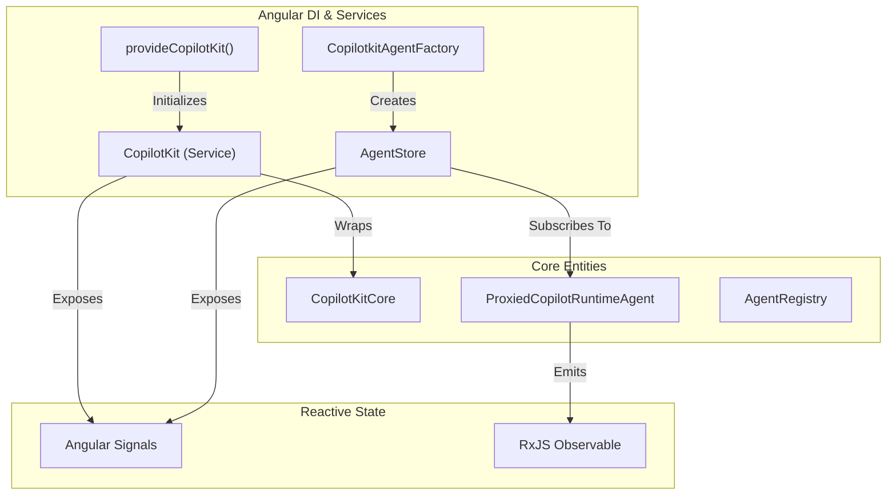
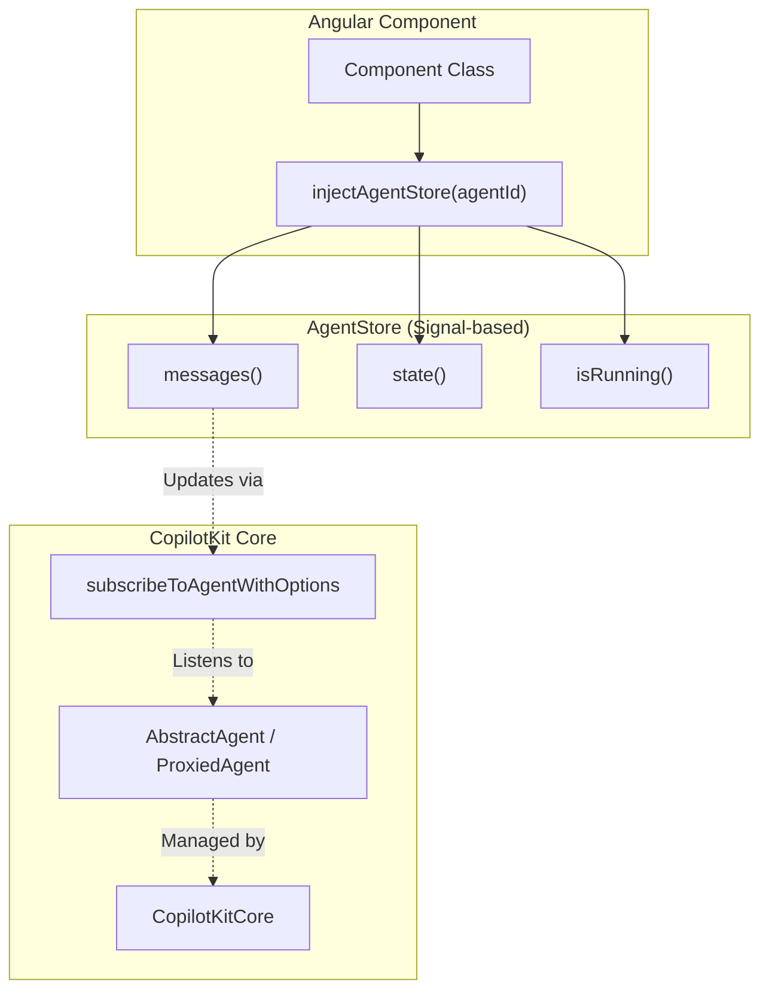

<!-- source: DeepWiki mcp.deepwiki.com · repo CopilotKit/CopilotKit · page 3.3 Angular Components and Services · fetched 2026-10-30 -->

# Angular Components and Services

Relevant source files

The following files were used as context for generating this wiki page:

- [packages/angular/package.json](packages/angular/package.json)
- [packages/angular/src/lib/components/chat/__tests__/copilot-threads-drawer.spec.ts](packages/angular/src/lib/components/chat/__tests__/copilot-threads-drawer.spec.ts)
- [packages/angular/src/lib/components/chat/copilot-threads-drawer.ts](packages/angular/src/lib/components/chat/copilot-threads-drawer.ts)
- [packages/demo-agents/package.json](packages/demo-agents/package.json)
- [packages/react-core/src/v2/components/chat/CopilotThreadsDrawer.tsx](packages/react-core/src/v2/components/chat/CopilotThreadsDrawer.tsx)
- [packages/react-core/src/v2/components/chat/__tests__/CopilotThreadsDrawer.test.tsx](packages/react-core/src/v2/components/chat/__tests__/CopilotThreadsDrawer.test.tsx)
- [packages/vue/src/v2/components/chat/CopilotThreadsDrawer.vue](packages/vue/src/v2/components/chat/CopilotThreadsDrawer.vue)
- [packages/vue/src/v2/components/chat/__tests__/CopilotThreadsDrawer.ssr.test.ts](packages/vue/src/v2/components/chat/__tests__/CopilotThreadsDrawer.ssr.test.ts)
- [packages/vue/src/v2/components/chat/__tests__/CopilotThreadsDrawer.test.ts](packages/vue/src/v2/components/chat/__tests__/CopilotThreadsDrawer.test.ts)
- [packages/web-components/src/threads-drawer/__tests__/copilotkit-drawer.test.ts](packages/web-components/src/threads-drawer/__tests__/copilotkit-drawer.test.ts)
- [packages/web-components/src/threads-drawer/copilotkit-threads-drawer.ts](packages/web-components/src/threads-drawer/copilotkit-threads-drawer.ts)
- [packages/web-components/src/threads-drawer/index.ts](packages/web-components/src/threads-drawer/index.ts)
- [packages/web-components/src/threads-drawer/styles.ts](packages/web-components/src/threads-drawer/styles.ts)
- [packages/web-components/src/threads-drawer/types.ts](packages/web-components/src/threads-drawer/types.ts)

This document covers the Angular-specific components, services, and integration patterns provided by the `@copilotkit/angular` package. This package enables Angular applications to integrate with CopilotKit's architecture using native Angular constructs, including Dependency Injection (DI) tokens, services, and signals.

## Package Overview

The `@copilotkit/angular` package provides Angular 20+ components and services that wrap the framework-agnostic `@copilotkit/core` utilities. It follows Angular's dependency injection patterns and component lifecycle while maintaining compatibility with the AG-UI Protocol.

**Package Information:**
- **Package Name:** `@copilotkit/angular` [packages/angular/package.json:2-2]()
- **Minimum Angular Version:** 20.3.26 [packages/angular/package.json:98-98]()
- **Reactive Primitive:** Angular Signals

### Natural Language to Code Entity Mapping (Angular Integration)

The following diagram bridges high-level Angular integration concepts to their specific code entities and file locations.

Sources: `packages/angular/package.json`, `packages/angular/src/lib/agent.ts`, `packages/angular/src/lib/copilotkit.ts`

## Service Layer and Dependency Injection

Angular services provide the bridge between Angular's DI system and the framework-agnostic core utilities.

### provideCopilotKit and CopilotKit Service
The `provideCopilotKit` DI token is the primary entry point for configuring the CopilotKit instance. It initializes the service layer which maintains a reference to the core runtime logic.

- **CopilotKit Service**: Acts as the central registry for agents and tools. It facilitates communication between the Angular UI and the backend runtime.
- **Signal-based Reactivity**: The service layer leverages Angular Signals for properties like connection status (`runtimeConnectionStatus`), headers, and the runtime URL [packages/angular/src/lib/agent.spec.ts:147-160]().

### injectAgentStore and AgentStore Signals
The `injectAgentStore` function allows components to access the synchronized state of a specific agent. This state is exposed via **Angular Signals**, providing fine-grained reactivity for UI updates.

- **AgentStore**: Encapsulates the state of a specific agent, including `messages`, `state`, and `isRunning` status [packages/angular/src/lib/agent.ts:39-41]().
- **Lifecycle Management**: It ensures that subscriptions are cleaned up when components are destroyed using `DestroyRef.onDestroy` [packages/angular/src/lib/agent.ts:84-86]().
- **Provisional Agents**: The system handles scenarios where an agent is requested before the runtime connection is fully established by using a `ProxiedCopilotRuntimeAgent` [packages/angular/src/lib/agent.ts:155-160]().

Sources: `packages/angular/src/lib/agent.ts`, `packages/angular/src/lib/agent.spec.ts`

## UI Components and Rendering

The Angular package includes a suite of components for rendering chat interfaces, message bubbles, and thread management.

### CopilotThreadsDrawer
The `CopilotThreadsDrawer` is an Angular wrapper around the framework-agnostic `<copilotkit-threads-drawer>` web component [packages/angular/src/lib/components/chat/copilot-threads-drawer.ts:148-184]().

- **Web Component Integration**: It uses `CUSTOM_ELEMENTS_SCHEMA` to host the Lit-based drawer [packages/angular/src/lib/components/chat/copilot-threads-drawer.ts:152-152]().
- **Thread Synchronization**: It fetches thread list state via `injectThreads` and pushes data to the element's properties via Angular `effect` [packages/angular/src/lib/components/chat/copilot-threads-drawer.ts:135-141]().
- **Custom Row Rendering**: Supports a structural directive `copilotThreadsDrawerRow` to project custom Angular templates into thread list rows using `slot="row:{id}"` [packages/angular/src/lib/components/chat/copilot-threads-drawer.ts:122-126]().
- **Focus Management**: Implements `findChatInput` to ensure that selecting a thread returns focus to the correct `textarea[copilotChatTextarea]` within a `copilot-chat-view` container [packages/angular/src/lib/components/chat/copilot-threads-drawer.ts:94-102]().

### Message Rendering
CopilotKit provides specialized renderers for assistant and user messages, supporting Markdown, code highlighting, and LaTeX math equations.

- **Markdown & Code**: The system uses `marked` for Markdown parsing, `highlight.js` for code blocks, and `katex` for mathematical formulas [packages/angular/package.json:81-83]().
- **Reactivity**: `AgentStore` uses `WritableSignal` to update `messages` and `state` whenever the underlying agent emits changes via `onMessagesChanged` or `onStateChanged` [packages/angular/src/lib/agent.ts:60-67]().

## Frontend Tool and UI Registration

Angular integration supports registering tools that the agent can call to perform actions or render UI directly.

### registerFrontendTool
Used to define client-side logic that the agent can execute. In Angular, this is handled via the CopilotKit service, which interacts with the `AgentRegistry` in the core [packages/core/src/core/agent-registry.ts:56-56]().

### registerRenderToolCall and RenderToolCalls Component
The `RenderToolCalls` component orchestrates the display of tool-driven UI.
- **Dynamic Rendering**: Registered components receive tool call data via Angular inputs, allowing them to render agent-requested UI.
- **Generative UI**: This enables scenarios where the agent "chooses" which Angular component to display to the user based on the tool call.

### registerHumanInTheLoop
Enables Human-in-the-Loop (HITL) workflows. This allows agents to pause execution and request user input or confirmation before proceeding, synchronized via the `onRunStatusChanged` updates [packages/react-core/src/v2/hooks/use-agent.tsx:16-16]().

## Implementation Details

### Reactive Data Flow
The Angular implementation heavily utilizes `computed` signals to resolve agents and manage the `AgentStore` lifecycle [packages/angular/src/lib/agent.ts:181-186]().

### Styling and Theme Support
Components use Tailwind CSS for styling and support both light and dark modes.
- **Scoped Styles**: Global styles are processed and scoped to prevent conflicts with the host application [packages/angular/package.json:63-63]().
- **Tailwind Integration**: The package includes a `styles.css` export for easy integration into Angular projects [packages/angular/package.json:29-29]().

| Feature | Code Entity | Description |
| :--- | :--- | :--- |
| **Agent State** | `AgentStore` | Encapsulates signals for `messages`, `state`, and `isRunning` [packages/angular/src/lib/agent.ts:30-30](). |
| **Agent Resolution** | `CopilotkitAgentFactory` | Resolves real or provisional agents based on runtime status [packages/angular/src/lib/agent.ts:103-103](). |
| **Thread Drawer** | `CopilotThreadsDrawer` | Angular wrapper for thread history and management [packages/angular/src/lib/components/chat/copilot-threads-drawer.ts:184-184](). |
| **Runtime Connection** | `CopilotKitCoreRuntimeConnectionStatus` | Enum tracking `Disconnected`, `Connecting`, `Connected`, and `Error` states [packages/core/src/core/core.ts:132-135](). |
| **Tool Registry** | `AgentRegistry` | Manages local and remote agent registration and lifecycle [packages/core/src/core/agent-registry.ts:56-56](). |

Sources: `packages/angular/package.json`, `packages/angular/src/lib/agent.ts`, `packages/angular/src/lib/components/chat/copilot-threads-drawer.ts`, `packages/core/src/core/core.ts`, `packages/core/src/core/agent-registry.ts`, `packages/react-core/src/v2/hooks/use-agent.tsx`

---

