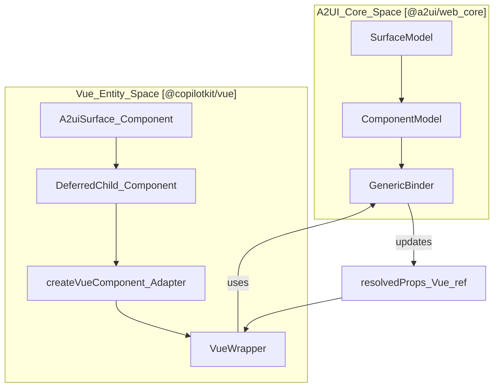
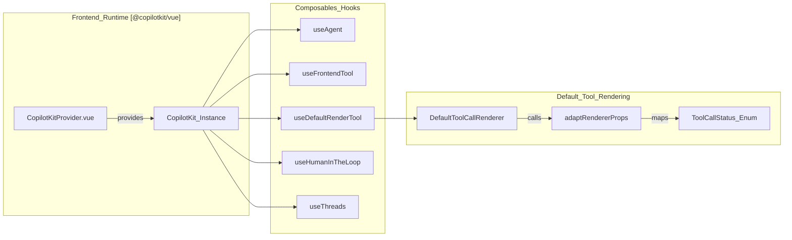

<!-- source: DeepWiki mcp.deepwiki.com · repo CopilotKit/CopilotKit · page 3.4 Vue and React Native Integration · fetched 2026-10-30 -->

# Vue and React Native Integration

Relevant source files

The following files were used as context for generating this wiki page:

- [examples/v2/react/storybook/stories/CopilotChatMessageView.stories.tsx](examples/v2/react/storybook/stories/CopilotChatMessageView.stories.tsx)
- [packages/agentcore-runner/package.json](packages/agentcore-runner/package.json)
- [packages/react-core/src/v2/hooks/__tests__/use-default-render-tool.test.tsx](packages/react-core/src/v2/hooks/__tests__/use-default-render-tool.test.tsx)
- [packages/react-core/src/v2/hooks/__tests__/use-render-tool-call.test.tsx](packages/react-core/src/v2/hooks/__tests__/use-render-tool-call.test.tsx)
- [packages/react-core/src/v2/hooks/use-default-render-tool.tsx](packages/react-core/src/v2/hooks/use-default-render-tool.tsx)
- [packages/react-core/src/v2/hooks/use-render-tool-call.tsx](packages/react-core/src/v2/hooks/use-render-tool-call.tsx)
- [packages/react-native/package.json](packages/react-native/package.json)
- [packages/vue/package.json](packages/vue/package.json)
- [showcase/integrations/langgraph-python/src/agents/a2ui_fixed.py](showcase/integrations/langgraph-python/src/agents/a2ui_fixed.py)
- [showcase/integrations/langgraph-python/src/agents/tool_rendering_agent.py](showcase/integrations/langgraph-python/src/agents/tool_rendering_agent.py)
- [showcase/integrations/langgraph-python/src/app/demos/a2ui-fixed-schema/a2ui/catalog.ts](showcase/integrations/langgraph-python/src/app/demos/a2ui-fixed-schema/a2ui/catalog.ts)
- [showcase/integrations/langgraph-python/src/app/demos/a2ui-fixed-schema/a2ui/definitions.ts](showcase/integrations/langgraph-python/src/app/demos/a2ui-fixed-schema/a2ui/definitions.ts)
- [showcase/integrations/langgraph-python/src/app/demos/declarative-gen-ui/a2ui/catalog.ts](showcase/integrations/langgraph-python/src/app/demos/declarative-gen-ui/a2ui/catalog.ts)
- [showcase/integrations/langgraph-python/src/app/demos/declarative-gen-ui/page.tsx](showcase/integrations/langgraph-python/src/app/demos/declarative-gen-ui/page.tsx)
- [showcase/integrations/langgraph-python/src/app/demos/gen-ui-tool-based/page.tsx](showcase/integrations/langgraph-python/src/app/demos/gen-ui-tool-based/page.tsx)
- [showcase/integrations/langgraph-python/src/app/demos/tool-rendering-custom-catchall/custom-catchall-renderer.tsx](showcase/integrations/langgraph-python/src/app/demos/tool-rendering-custom-catchall/custom-catchall-renderer.tsx)
- [showcase/integrations/langgraph-python/src/app/demos/tool-rendering-default-catchall/page.tsx](showcase/integrations/langgraph-python/src/app/demos/tool-rendering-default-catchall/page.tsx)
- [showcase/integrations/langgraph-python/src/app/demos/tool-rendering/d20-card.tsx](showcase/integrations/langgraph-python/src/app/demos/tool-rendering/d20-card.tsx)
- [showcase/integrations/langgraph-python/src/app/demos/tool-rendering/flight-list-card.tsx](showcase/integrations/langgraph-python/src/app/demos/tool-rendering/flight-list-card.tsx)
- [showcase/integrations/langgraph-python/src/app/demos/tool-rendering/page.tsx](showcase/integrations/langgraph-python/src/app/demos/tool-rendering/page.tsx)
- [showcase/integrations/langgraph-python/src/app/demos/tool-rendering/stock-card.tsx](showcase/integrations/langgraph-python/src/app/demos/tool-rendering/stock-card.tsx)
- [showcase/integrations/langgraph-python/tests/e2e/frontend-tools.spec.ts](showcase/integrations/langgraph-python/tests/e2e/frontend-tools.spec.ts)

CopilotKit provides first-class support for Vue.js and React Native applications, offering a set of hooks and components that mirror the React API while respecting the idiomatic patterns of each platform. This includes Vue's reactivity system (Composables) and React Native's specific networking and polyfill requirements for mobile environments.

## Vue.js Integration

The Vue integration is built on top of the `@copilotkit/core` and `@ag-ui/core` packages, providing a native Vue experience through Composables and the `CopilotKitProvider.vue` component.

### CopilotKitProvider

The `CopilotKitProvider` is the root component for any Vue-based CopilotKit application. It initializes the Copilot engine and provides context to all child components.

*   **V1 Compatibility**: The `CopilotKit.vue` component acts as a compatibility wrapper for `CopilotKitProvider.vue`, accepting legacy props like `publicApiKey` and `publicLicenseKey` [packages/vue/src/components/copilot-provider/CopilotKit.vue:1-18]().
*   **V2 Provider**: The core logic resides in `CopilotKitProvider.vue`, which manages the connection to the `runtimeUrl` and handles the lifecycle of the agentic interaction [packages/vue/src/v2/providers/CopilotKitProvider.vue:1-10]().

### Vue Composables (Hooks)

Vue integration utilizes Composables (functions prefixed with `use`) to interact with the Copilot engine. These functions leverage Vue's `computed`, `ref`, and `watch` for reactivity.

| Composable | Description | Code Reference |
| :--- | :--- | :--- |
| `useAgent` | Accesses a specific agent's state and methods. | [packages/vue/src/v2/hooks/use-agent.ts:4-4]() |
| `useAgentContext` | Registers reactive contextual data sent with agent runs. | [packages/vue/src/v2/hooks/use-agent-context.ts:32-55]() |
| `useFrontendTool` | Registers a tool and optional renderer with CopilotKit core. | [packages/vue/src/v2/hooks/use-frontend-tool.ts:24-68]() |
| `useComponent` | Higher-level wrapper to display a Vue component in the chat. | [packages/vue/src/v2/hooks/use-component.ts:11-46]() |
| `useRenderTool` | Registers a UI component to be rendered for a specific tool call. | [packages/vue/src/v2/hooks/use-render-tool.ts:1-1]() |
| `useDefaultRenderTool` | Registers a wildcard (`*`) renderer for unhandled tool calls. | [packages/vue/src/v2/hooks/use-default-render-tool.ts:1-1]() |
| `useHumanInTheLoop` | Pauses execution until `respond` is called from the UI. | [packages/vue/src/v2/hooks/use-human-in-the-loop.ts:28-90]() |
| `useConfigureSuggestions` | Manages dynamic or static chat suggestions. | [packages/vue/src/v2/hooks/use-configure-suggestions.ts:56-250]() |
| `useAttachments` | Handles file uploads, drag-and-drop, and pasting. | [packages/vue/src/v2/hooks/use-attachments.ts:37-212]() |
| `useThreads` | Manages conversation threads and history. | [packages/vue/src/v2/hooks/use-threads.ts:1-10]() |

Sources: [packages/vue/src/v2/hooks/index.ts:1-30](), [packages/vue/src/v2/hooks/use-frontend-tool.ts:24-68](), [packages/vue/src/v2/hooks/use-agent-context.ts:32-55](), [packages/vue/src/v2/hooks/use-human-in-the-loop.ts:28-90](), [packages/vue/src/v2/hooks/use-threads.ts:1-10]()

### Threads Management and Drawer

The Vue integration includes a native implementation of the `CopilotThreadsDrawer`, which utilizes the framework-agnostic `<copilotkit-threads-drawer>` Lit web component [packages/vue/src/v2/components/chat/CopilotThreadsDrawer.vue:3-10]().

*   **SSR Safety**: The Lit custom element is imported lazily inside `onMounted` to ensure compatibility with SSR frameworks like Nuxt [packages/vue/src/v2/components/chat/CopilotThreadsDrawer.vue:5-8]().
*   **Property Mapping**: Reactive Vue state is pushed to the element's DOM properties via `watchEffect` [packages/vue/src/v2/components/chat/CopilotThreadsDrawer.vue:139-167]().
*   **Event Routing**: Events from the drawer (e.g., `thread-selected`, `archive`, `delete`) are routed back to the `useThreads` composable and the ambient chat configuration [packages/vue/src/v2/components/chat/CopilotThreadsDrawer.vue:185-230]().

### Default Tool Rendering

The `useDefaultRenderTool` composable allows developers to register a "wildcard" renderer that handles any tool call not explicitly covered by a specific `useRenderTool` registration. This prevents tool calls from being invisible when no specific renderer is found [packages/react-core/src/v2/hooks/use-render-tool-call.tsx:162-164]().

**Data Flow: Tool Call to Vue Component**

The system adapts internal raw renderer props (like `args` and enum-based statuses) into a documented `DefaultRenderProps` shape for the UI [packages/react-core/src/v2/hooks/use-default-render-tool.tsx:80-90]().

1.  **Status Mapping**: The internal `ToolCallStatus` enum is mapped to string literals: `inProgress`, `executing`, or `complete` [packages/react-core/src/v2/hooks/use-default-render-tool.tsx:48-73]().
2.  **Prop Adaptation**: The `adaptRendererProps` function ensures that whether the agent sends `args` or `parameters`, the Vue component receives a consistent `parameters` prop [packages/react-core/src/v2/hooks/use-default-render-tool.tsx:80-90]().
3.  **Safe Stringification**: To prevent Vue render crashes from circular references in agent payloads, the `safeStringifyForPre` utility is used for `<pre>` blocks [packages/react-core/src/v2/hooks/use-default-render-tool.tsx:160-178]().

Sources: [packages/react-core/src/v2/hooks/use-default-render-tool.tsx:1-154](), [packages/react-core/src/v2/hooks/use-render-tool-call.tsx:111-185]()

### A2UI and Generative UI in Vue

Vue supports the **Agent-to-UI (A2UI)** protocol through a native implementation of the A2UI Surface.

*   **VueSurface**: Replaces the React island pattern with Vue components that use framework-agnostic primitives from `@a2ui/web_core` [packages/vue/package.json:80-80]().
*   **GenericBinder**: Used within `createVueComponent` to create a reactive bridge between the A2UI state and Vue's `ref` system.
*   **DeferredChild**: A component that subscribes to `onCreated` and `onDeleted` events from the A2UI `SurfaceModel` to dynamically render components as the agent generates them.

**Diagram: Vue A2UI Adapter Architecture**

Sources: [packages/vue/package.json:79-82](), [packages/vue/src/v2/hooks/use-component.ts:11-46]()

## React Native Integration

The React Native integration is provided via the `@copilotkit/react-native` package. While it shares the same hook-based API as the React integration, it includes specific modifications for the mobile environment.

### Core Differences from React Web
1.  **Polyfills**: React Native requires polyfills for standard web APIs like `web-streams-polyfill` and `text-encoding` [packages/react-native/package.json:86-87](). The package exports specific polyfill entry points for `streams`, `encoding`, `crypto`, `dom`, and `location` [packages/react-native/package.json:38-61]().
2.  **Streaming Fetch**: The `CopilotKitProvider` for Native is optimized to handle Server-Sent Events (SSE) via `react-native-streamdown` [packages/react-native/package.json:107-107]().
3.  **Native UI Components**: The package provides mobile-optimized components, often leveraging `@gorhom/bottom-sheet` and `react-native-reanimated` for native feel [packages/react-native/package.json:100-106]().

### Activity Rendering and MCP
React Native integration supports the Model Context Protocol (MCP) and Activity Rendering. The `MCPAppsActivityRenderer` allows agents to push complex mobile activities or screens to the user, utilizing native navigation and gesture patterns. This is often paired with `AgentCoreRunner` for AWS Bedrock AgentCore-compatible workflows [packages/agentcore-runner/package.json:2-4]().

## Implementation Comparison

| Feature | React (Web) | Vue.js | React Native |
| :--- | :--- | :--- | :--- |
| **Provider** | `CopilotKitProvider` | `CopilotKitProvider.vue` | `CopilotKitProvider` (Native) |
| **State** | React Context / Hooks | Vue Provide/Inject / Composables | React Context / Hooks |
| **Reactivity** | `useState` / `useEffect` | `ref` / `computed` / `watch` | `useState` / `useEffect` |
| **UI Protocol** | A2UI (React) | A2UI (Vue Adapter) | Native UI Components |
| **Threads UI** | `CopilotThreadsDrawer` | `CopilotThreadsDrawer.vue` | Custom Native Drawer |

**Diagram: Vue Integration Data Flow**

Sources: [packages/react-core/src/v2/hooks/use-default-render-tool.tsx:28-81](), [packages/vue/src/v2/hooks/use-agent-context.ts:32-55](), [packages/vue/src/v2/hooks/use-frontend-tool.ts:24-68](), [packages/vue/src/v2/hooks/use-human-in-the-loop.ts:28-90](), [packages/vue/src/v2/hooks/use-threads.ts:1-10]()

## Technical Details

### Component Lifecycle in Vue
In the A2UI implementation, the `GenericBinder` is initialized in the `setup` function of the Vue wrapper. It subscribes to updates and is explicitly disposed of during the `onUnmounted` lifecycle hook to prevent memory leaks. Composables like `useFrontendTool` and `useAgentContext` utilize `onCleanup` within a `watch` or `onScopeDispose` to remove tools/context from the core when the component is destroyed [packages/vue/src/v2/hooks/use-frontend-tool.ts:62-64](), [packages/vue/src/v2/hooks/use-agent-context.ts:51-51]().

### React Native Polyfills
React Native integration requires explicit polyfill imports before using CopilotKit:
*   `@copilotkit/react-native/polyfills`
*   `@copilotkit/react-native/polyfills/streams`
*   `@copilotkit/react-native/polyfills/encoding`

These ensure that the `@copilotkit/core` logic, which expects standard web environment globals like `TextEncoder` and `ReadableStream`, can function correctly in the Hermes or JSC runtimes [packages/react-native/package.json:20-61]().

Sources: [packages/vue/src/v2/hooks/use-frontend-tool.ts:62-64](), [packages/vue/src/v2/hooks/use-agent-context.ts:51-51](), [packages/react-native/package.json:20-61]()

---

