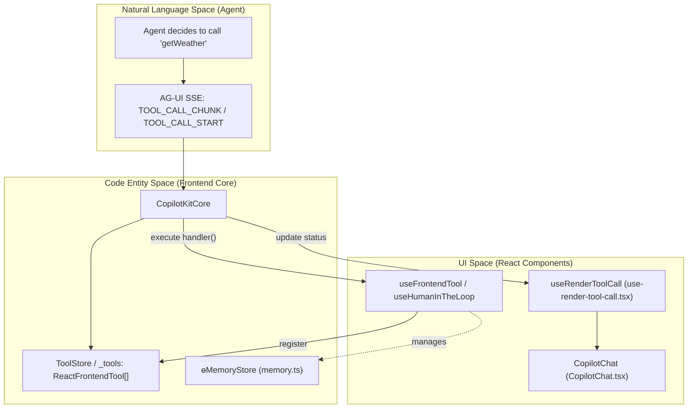
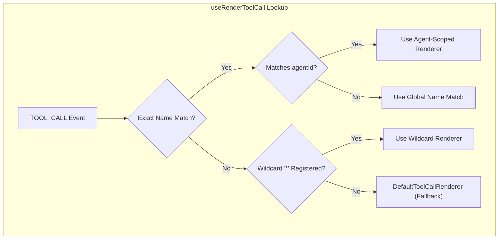

<!-- source: DeepWiki mcp.deepwiki.com · repo CopilotKit/CopilotKit · page 3.5 Frontend Actions and Tools · fetched 2026-10-30 -->

# Frontend Actions and Tools

<details>
<summary>Relevant source files</summary>

The following files were used as context for generating this wiki page:

- [examples/v2/react/storybook/stories/CopilotChatMessageView.stories.tsx](examples/v2/react/storybook/stories/CopilotChatMessageView.stories.tsx)
- [packages/angular/src/lib/memories.spec.ts](packages/angular/src/lib/memories.spec.ts)
- [packages/angular/src/lib/memories.ts](packages/angular/src/lib/memories.ts)
- [packages/core/src/__tests__/core-connect-passive-replay.test.ts](packages/core/src/__tests__/core-connect-passive-replay.test.ts)
- [packages/core/src/__tests__/memory.test.ts](packages/core/src/__tests__/memory.test.ts)
- [packages/core/src/memory-errors.ts](packages/core/src/memory-errors.ts)
- [packages/core/src/memory.ts](packages/core/src/memory.ts)
- [packages/react-core/src/components/CopilotListeners.tsx](packages/react-core/src/components/CopilotListeners.tsx)
- [packages/react-core/src/components/__tests__/CopilotListeners.defaultAgentAbsent.test.tsx](packages/react-core/src/components/__tests__/CopilotListeners.defaultAgentAbsent.test.tsx)
- [packages/react-core/src/components/__tests__/CopilotListeners.test.tsx](packages/react-core/src/components/__tests__/CopilotListeners.test.tsx)
- [packages/react-core/src/test-helpers/stub-window-location.ts](packages/react-core/src/test-helpers/stub-window-location.ts)
- [packages/react-core/src/v2/__tests__/A2UIMessageRenderer.test.tsx](packages/react-core/src/v2/__tests__/A2UIMessageRenderer.test.tsx)
- [packages/react-core/src/v2/__tests__/A2UIRecoveryStates.test.tsx](packages/react-core/src/v2/__tests__/A2UIRecoveryStates.test.tsx)
- [packages/react-core/src/v2/a2ui/A2UICatalogContext.tsx](packages/react-core/src/v2/a2ui/A2UICatalogContext.tsx)
- [packages/react-core/src/v2/a2ui/A2UIMessageRenderer.tsx](packages/react-core/src/v2/a2ui/A2UIMessageRenderer.tsx)
- [packages/react-core/src/v2/a2ui/A2UIRecoveryStates.tsx](packages/react-core/src/v2/a2ui/A2UIRecoveryStates.tsx)
- [packages/react-core/src/v2/a2ui/A2UIToolCallRenderer.tsx](packages/react-core/src/v2/a2ui/A2UIToolCallRenderer.tsx)
- [packages/react-core/src/v2/components/CopilotKitInspector.tsx](packages/react-core/src/v2/components/CopilotKitInspector.tsx)
- [packages/react-core/src/v2/components/OpenGenerativeUIRenderer.tsx](packages/react-core/src/v2/components/OpenGenerativeUIRenderer.tsx)
- [packages/react-core/src/v2/components/__tests__/OpenGenerativeUIRenderer.test.tsx](packages/react-core/src/v2/components/__tests__/OpenGenerativeUIRenderer.test.tsx)
- [packages/react-core/src/v2/components/chat/__tests__/CopilotChat.suggestionsAlways.test.tsx](packages/react-core/src/v2/components/chat/__tests__/CopilotChat.suggestionsAlways.test.tsx)
- [packages/react-core/src/v2/context.ts](packages/react-core/src/v2/context.ts)
- [packages/react-core/src/v2/hooks/__tests__/use-agent-error-state.test.tsx](packages/react-core/src/v2/hooks/__tests__/use-agent-error-state.test.tsx)
- [packages/react-core/src/v2/hooks/__tests__/use-default-render-tool.test.tsx](packages/react-core/src/v2/hooks/__tests__/use-default-render-tool.test.tsx)
- [packages/react-core/src/v2/hooks/__tests__/use-human-in-the-loop.e2e.test.tsx](packages/react-core/src/v2/hooks/__tests__/use-human-in-the-loop.e2e.test.tsx)
- [packages/react-core/src/v2/hooks/__tests__/use-learning-containers.test.tsx](packages/react-core/src/v2/hooks/__tests__/use-learning-containers.test.tsx)
- [packages/react-core/src/v2/hooks/__tests__/use-memories.test.tsx](packages/react-core/src/v2/hooks/__tests__/use-memories.test.tsx)
- [packages/react-core/src/v2/hooks/__tests__/use-render-tool-call.test.tsx](packages/react-core/src/v2/hooks/__tests__/use-render-tool-call.test.tsx)
- [packages/react-core/src/v2/hooks/__tests__/use-threads-provider-headers.e2e.test.tsx](packages/react-core/src/v2/hooks/__tests__/use-threads-provider-headers.e2e.test.tsx)
- [packages/react-core/src/v2/hooks/index.ts](packages/react-core/src/v2/hooks/index.ts)
- [packages/react-core/src/v2/hooks/use-agent-context.tsx](packages/react-core/src/v2/hooks/use-agent-context.tsx)
- [packages/react-core/src/v2/hooks/use-configure-suggestions.tsx](packages/react-core/src/v2/hooks/use-configure-suggestions.tsx)
- [packages/react-core/src/v2/hooks/use-default-render-tool.tsx](packages/react-core/src/v2/hooks/use-default-render-tool.tsx)
- [packages/react-core/src/v2/hooks/use-frontend-tool.tsx](packages/react-core/src/v2/hooks/use-frontend-tool.tsx)
- [packages/react-core/src/v2/hooks/use-human-in-the-loop.tsx](packages/react-core/src/v2/hooks/use-human-in-the-loop.tsx)
- [packages/react-core/src/v2/hooks/use-learning-containers-in-current-thread.tsx](packages/react-core/src/v2/hooks/use-learning-containers-in-current-thread.tsx)
- [packages/react-core/src/v2/hooks/use-learning-containers.tsx](packages/react-core/src/v2/hooks/use-learning-containers.tsx)
- [packages/react-core/src/v2/hooks/use-memories.tsx](packages/react-core/src/v2/hooks/use-memories.tsx)
- [packages/react-core/src/v2/hooks/use-render-tool-call.tsx](packages/react-core/src/v2/hooks/use-render-tool-call.tsx)
- [packages/react-core/src/v2/index.ts](packages/react-core/src/v2/index.ts)
- [packages/react-core/src/v2/providers/__tests__/CopilotKitProvider.onError.test.tsx](packages/react-core/src/v2/providers/__tests__/CopilotKitProvider.onError.test.tsx)
- [packages/react-core/src/v2/providers/__tests__/CopilotKitProvider.renderCustomMessages.e2e.test.tsx](packages/react-core/src/v2/providers/__tests__/CopilotKitProvider.renderCustomMessages.e2e.test.tsx)
- [packages/react-core/src/v2/providers/__tests__/CopilotKitProvider.test.tsx](packages/react-core/src/v2/providers/__tests__/CopilotKitProvider.test.tsx)
- [packages/react-core/src/v2/types/human-in-the-loop.ts](packages/react-core/src/v2/types/human-in-the-loop.ts)
- [showcase/integrations/langgraph-python/src/agents/a2ui_fixed.py](showcase/integrations/langgraph-python/src/agents/a2ui_fixed.py)
- [showcase/integrations/langgraph-python/src/agents/tool_rendering_agent.py](showcase/integrations/langgraph-python/src/agents/tool_rendering_agent.py)
- [showcase/integrations/langgraph-python/src/app/demos/a2ui-fixed-schema/a2ui/catalog.ts](showcase/integrations/langgraph-python/src/app/demos/a2ui-fixed-schema/a2ui/catalog.ts)
- [showcase/integrations/langgraph-python/src/app/demos/a2ui-fixed-schema/a2ui/definitions.ts](showcase/integrations/langgraph-python/src/app/demos/a2ui-fixed-schema/a2ui/definitions.ts)
- [showcase/integrations/langgraph-python/src/app/demos/declarative-gen-ui/a2ui/catalog.ts](showcase/integrations/langgraph-python/src/app/demos/declarative-gen-ui/a2ui/catalog.ts)
- [showcase/integrations/langgraph-python/src/app/demos/declarative-gen-ui/page.tsx](showcase/integrations/langgraph-python/src/app/demos/declarative-gen-ui/page.tsx)
- [showcase/integrations/langgraph-python/src/app/demos/gen-ui-tool-based/page.tsx](showcase/integrations/langgraph-python/src/app/demos/gen-ui-tool-based/page.tsx)
- [showcase/integrations/langgraph-python/src/app/demos/tool-rendering-custom-catchall/custom-catchall-renderer.tsx](showcase/integrations/langgraph-python/src/app/demos/tool-rendering-custom-catchall/custom-catchall-renderer.tsx)
- [showcase/integrations/langgraph-python/src/app/demos/tool-rendering-default-catchall/page.tsx](showcase/integrations/langgraph-python/src/app/demos/tool-rendering-default-catchall/page.tsx)
- [showcase/integrations/langgraph-python/src/app/demos/tool-rendering/d20-card.tsx](showcase/integrations/langgraph-python/src/app/demos/tool-rendering/d20-card.tsx)
- [showcase/integrations/langgraph-python/src/app/demos/tool-rendering/flight-list-card.tsx](showcase/integrations/langgraph-python/src/app/demos/tool-rendering/flight-list-card.tsx)
- [showcase/integrations/langgraph-python/src/app/demos/tool-rendering/page.tsx](showcase/integrations/langgraph-python/src/app/demos/tool-rendering/page.tsx)
- [showcase/integrations/langgraph-python/src/app/demos/tool-rendering/stock-card.tsx](showcase/integrations/langgraph-python/src/app/demos/tool-rendering/stock-card.tsx)
- [showcase/integrations/langgraph-python/tests/e2e/frontend-tools.spec.ts](showcase/integrations/langgraph-python/tests/e2e/frontend-tools.spec.ts)

</details>


**Purpose**: This document explains how to define and use frontend tools that render UI components and execute client-side logic when called by AI agents. Frontend tools enable agents to generate interactive user interfaces dynamically as part of their execution flow using the AG-UI Protocol.

For backend runtime configuration and server-side tools, see [CopilotRuntime Setup](#4.1). For React-specific hooks and components, see [React Components and Hooks](#3.2).

---

## Overview

CopilotKit provides several hooks to define frontend tools and actions that agents can invoke. These tools are registered within the `CopilotKitCore` and synchronized with the agent during connection.

| Tool Type | Hook / Function | Primary Use Case |
|-----------|-----------------|-------------------|
| **Frontend Tool** | `useFrontendTool` | General purpose client-side tool with logic (`handler`) and optional UI (`render`). |
| **Render Tool** | `useRenderTool` | Specialized for Generative UI; defines UI for a specific tool call without execution logic. |
| **Default Render Tool**| `useDefaultRenderTool`| Registers a wildcard (`"*"`) renderer for any tool without a specific UI. |
| **Human-in-the-Loop** | `useHumanInTheLoop` | Pauses agent execution to request user confirmation or input via a promise-based `respond` callback. |
| **Memories** | `useMemories` | Allows the UI to manage persistent user memories (topical, episodic, operational). |

**Sources**: [packages/react-core/src/v2/hooks/index.ts:5-9](), [packages/react-core/src/v2/hooks/use-memories.tsx:149-188](), [packages/react-core/src/v2/hooks/use-human-in-the-loop.tsx:10-122]()

---

## Frontend Tool Architecture

### Diagram: Tool Registration and Execution

The interaction loop bridges the Natural Language Space (agent intent) to the Code Entity Space (frontend implementation).



**Sources**: [packages/react-core/src/v2/hooks/use-render-tool-call.tsx:115-136](), [packages/react-core/src/v2/hooks/use-human-in-the-loop.tsx:107-113](), [packages/core/src/memory.ts:186-197]()

---

## Defining Frontend Tools

### useFrontendTool

The `useFrontendTool` hook registers a tool that the agent can invoke. It combines logic (`handler`) and presentation (`render`). Tools are defined with Zod schemas for parameter validation.

```typescript
import { useFrontendTool } from "@copilotkit/react-core";
import { z } from "zod";

useFrontendTool({
  name: "getWeather",
  description: "Get the current weather for a location",
  parameters: z.object({
    location: z.string(),
  }),
  handler: async ({ location }) => {
    const data = await fetchWeather(location);
    return JSON.stringify(data); // Result sent back to agent via AG-UI
  },
  render: ({ args, status, result }) => (
    <div>
      <h3>Weather in {args.location}</h3>
      {status === "executing" && <p>Fetching...</p>}
      {result && <p>Temperature: {result.temp}°</p>}
    </div>
  ),
});
```

**Sources**: [packages/react-core/src/v2/hooks/use-frontend-tool.tsx:1-20](), [packages/react-core/src/v2/providers/__tests__/CopilotKitProvider.test.tsx:104-129]()

### useRenderTool and Wildcards

The `useRenderTool` hook defines the UI for a tool call without providing execution logic. This is essential for backend-driven tools.

- **Wildcard Tools**: Using `name: "*"` allows catching all tool calls that don't have a specific renderer [packages/react-core/src/v2/hooks/use-default-render-tool.test.tsx:22-45]().
- **useDefaultRenderTool**: Registers the built-in `DefaultToolCallRenderer` under the `*` name [packages/react-core/src/v2/hooks/use-default-render-tool.tsx:128-154](). This renderer provides a standard card with status pills and collapsible JSON views for arguments and results [packages/react-core/src/v2/hooks/use-default-render-tool.test.tsx:141-162]().

**Sources**: [packages/react-core/src/v2/hooks/use-render-tool-call.tsx:2-10](), [packages/react-core/src/v2/hooks/use-default-render-tool.tsx:180-212]()

---

## Tool Lifecycle and Execution

### Render Call Logic

When an agent emits a `TOOL_CALL`, the `useRenderToolCall` hook determines which component to display using a priority lookup:
1. Exact match by name and `agentId`.
2. Exact match by name (global).
3. Wildcard (`*`) renderer.
4. Framework built-in fallback (`DefaultToolCallRenderer`).



**Sources**: [packages/react-core/src/v2/hooks/use-render-tool-call.tsx:115-136](), [packages/react-core/src/v2/hooks/use-default-render-tool.test.tsx:22-45]()

---

## Human-in-the-Loop (HITL)

The `useHumanInTheLoop` hook allows agents to pause and request user interaction. It wraps a standard frontend tool but provides a `respond` callback to the `render` function to resolve the agent's pending promise.

### Interaction Flow

1. **Agent Request**: The agent triggers a tool call registered via `useHumanInTheLoop` [packages/react-core/src/v2/hooks/use-human-in-the-loop.tsx:107-111]().
2. **Execution Pause**: The `handler` returns a `Promise` that stays pending until `respond()` is called [packages/react-core/src/v2/hooks/use-human-in-the-loop.tsx:32-54]().
3. **UI Interruption**: The `render` component receives a `respond` function when `status` is `Executing` [packages/react-core/src/v2/hooks/use-human-in-the-loop.tsx:77-85]().
4. **User Resolution**: The user interacts with the UI (e.g., clicks "Approve"). The UI calls `respond(result)`, which resolves the promise and sends the data back to the agent [packages/react-core/src/v2/hooks/__tests__/use-human-in-the-loop.e2e.test.tsx:52-59]().

**Sources**: [packages/react-core/src/v2/hooks/use-human-in-the-loop.tsx:20-27](), [packages/react-core/src/v2/hooks/__tests__/use-human-in-the-loop.e2e.test.tsx:114-127]()

---

## Memory Management

Frontend actions can interact with the platform's memory system via `useMemories`. This allows agents to recall or persist information across sessions.

- **Realtime Sync**: The `ɵMemoryStore` opens a Phoenix socket to the `user_meta:memories` topic to receive live `memory_metadata` deltas [packages/core/src/memory.ts:56-60](), [packages/core/src/memory.ts:164-165]().
- **Operations**: Supports `addMemory`, `updateMemory` (supersede), and `removeMemory` (retire) [packages/react-core/src/v2/hooks/use-memories.tsx:65-85]().
- **Availability**: The `isAvailable` flag indicates if the runtime configuration supports memory (404/501/422 status codes) [packages/core/src/memory.ts:68-73]().

**Sources**: [packages/core/src/memory.ts:156-165](), [packages/react-core/src/v2/hooks/use-memories.tsx:177-188](), [packages/angular/src/lib/memories.spec.ts:170-192]()

---

## Error Handling and Status

Tools transition through several statuses during their lifecycle, which are mapped to user-friendly labels in the default renderer.

| ToolCallStatus | Default Label | Description |
|----------------|---------------|-------------|
| `InProgress`   | `Running`     | The tool call is being streamed (arguments are arriving). |
| `Executing`    | `Running`     | The frontend handler is currently running or waiting for user input. |
| `Complete`     | `Done`        | The tool has returned a result and the agent has received it. |

**Sources**: [packages/react-core/src/v2/hooks/use-default-render-tool.tsx:192-202](), [packages/react-core/src/v2/hooks/__tests__/use-human-in-the-loop.e2e.test.tsx:103-134]()

---

