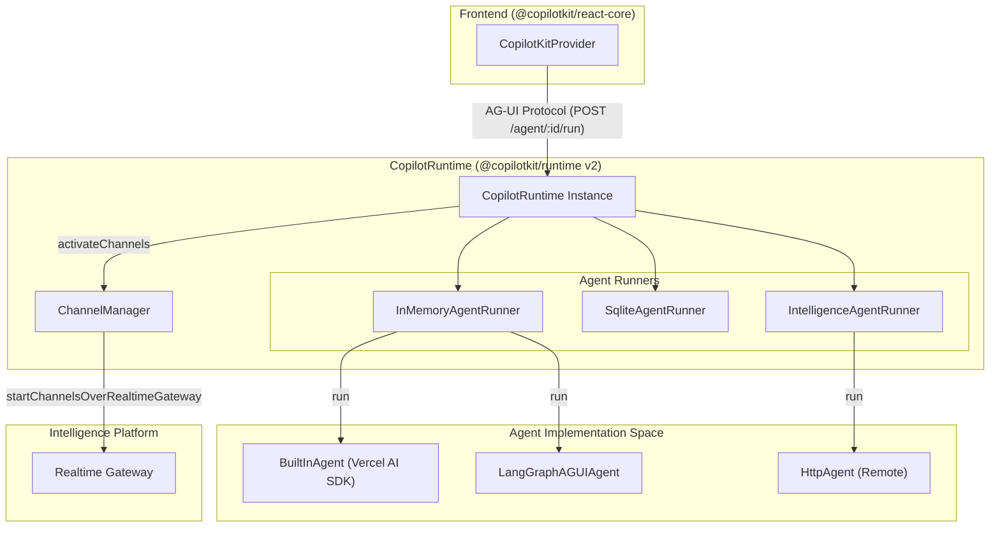
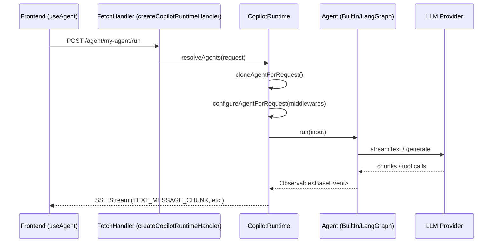

<!-- source: DeepWiki mcp.deepwiki.com · repo CopilotKit/CopilotKit · page 4 Backend Runtime · fetched 2026-10-30 -->

# Backend Runtime

Relevant source files

The following files were used as context for generating this wiki page:

- [.claude/docs/architecture.md](.claude/docs/architecture.md)
- [packages/a2ui-renderer/package.json](packages/a2ui-renderer/package.json)
- [packages/core/package.json](packages/core/package.json)
- [packages/core/src/__tests__/debug-config-threading.test.ts](packages/core/src/__tests__/debug-config-threading.test.ts)
- [packages/react-core/package.json](packages/react-core/package.json)
- [packages/react-textarea/package.json](packages/react-textarea/package.json)
- [packages/react-ui/package.json](packages/react-ui/package.json)
- [packages/runtime-client-gql/package.json](packages/runtime-client-gql/package.json)
- [packages/runtime/package.json](packages/runtime/package.json)
- [packages/runtime/src/v2/runtime/__tests__/agent-header-precedence.test.ts](packages/runtime/src/v2/runtime/__tests__/agent-header-precedence.test.ts)
- [packages/runtime/src/v2/runtime/__tests__/agent-utils-header-forwarding.test.ts](packages/runtime/src/v2/runtime/__tests__/agent-utils-header-forwarding.test.ts)
- [packages/runtime/src/v2/runtime/__tests__/agents-factory.test.ts](packages/runtime/src/v2/runtime/__tests__/agents-factory.test.ts)
- [packages/runtime/src/v2/runtime/__tests__/debug-sse-response.test.ts](packages/runtime/src/v2/runtime/__tests__/debug-sse-response.test.ts)
- [packages/runtime/src/v2/runtime/__tests__/handle-connect.test.ts](packages/runtime/src/v2/runtime/__tests__/handle-connect.test.ts)
- [packages/runtime/src/v2/runtime/__tests__/handle-run.test.ts](packages/runtime/src/v2/runtime/__tests__/handle-run.test.ts)
- [packages/runtime/src/v2/runtime/__tests__/header-utils.test.ts](packages/runtime/src/v2/runtime/__tests__/header-utils.test.ts)
- [packages/runtime/src/v2/runtime/__tests__/intelligence-lock-heartbeat.test.ts](packages/runtime/src/v2/runtime/__tests__/intelligence-lock-heartbeat.test.ts)
- [packages/runtime/src/v2/runtime/__tests__/intelligence-run-telemetry.test.ts](packages/runtime/src/v2/runtime/__tests__/intelligence-run-telemetry.test.ts)
- [packages/runtime/src/v2/runtime/__tests__/thread-names.test.ts](packages/runtime/src/v2/runtime/__tests__/thread-names.test.ts)
- [packages/runtime/src/v2/runtime/core/runtime.ts](packages/runtime/src/v2/runtime/core/runtime.ts)
- [packages/runtime/src/v2/runtime/handlers/handle-connect.ts](packages/runtime/src/v2/runtime/handlers/handle-connect.ts)
- [packages/runtime/src/v2/runtime/handlers/handle-run.ts](packages/runtime/src/v2/runtime/handlers/handle-run.ts)
- [packages/runtime/src/v2/runtime/handlers/handle-stop.ts](packages/runtime/src/v2/runtime/handlers/handle-stop.ts)
- [packages/runtime/src/v2/runtime/handlers/header-utils.ts](packages/runtime/src/v2/runtime/handlers/header-utils.ts)
- [packages/runtime/src/v2/runtime/handlers/intelligence/connect.ts](packages/runtime/src/v2/runtime/handlers/intelligence/connect.ts)
- [packages/runtime/src/v2/runtime/handlers/intelligence/run.ts](packages/runtime/src/v2/runtime/handlers/intelligence/run.ts)
- [packages/runtime/src/v2/runtime/handlers/intelligence/thread-names.ts](packages/runtime/src/v2/runtime/handlers/intelligence/thread-names.ts)
- [packages/runtime/src/v2/runtime/handlers/shared/agent-utils.ts](packages/runtime/src/v2/runtime/handlers/shared/agent-utils.ts)
- [packages/runtime/src/v2/runtime/handlers/shared/sse-response.ts](packages/runtime/src/v2/runtime/handlers/shared/sse-response.ts)
- [packages/runtime/src/v2/runtime/handlers/sse/__tests__/sse-connect-agent-id.test.ts](packages/runtime/src/v2/runtime/handlers/sse/__tests__/sse-connect-agent-id.test.ts)
- [packages/runtime/src/v2/runtime/handlers/sse/connect.ts](packages/runtime/src/v2/runtime/handlers/sse/connect.ts)
- [packages/runtime/src/v2/runtime/handlers/sse/run.ts](packages/runtime/src/v2/runtime/handlers/sse/run.ts)
- [packages/runtime/src/v2/runtime/runner/__tests__/bounded-thread-store.test.ts](packages/runtime/src/v2/runtime/runner/__tests__/bounded-thread-store.test.ts)
- [packages/runtime/src/v2/runtime/runner/agent-runner.ts](packages/runtime/src/v2/runtime/runner/agent-runner.ts)
- [packages/sdk-js/package.json](packages/sdk-js/package.json)
- [packages/shared/package.json](packages/shared/package.json)
- [packages/shared/src/__tests__/debug.test.ts](packages/shared/src/__tests__/debug.test.ts)
- [packages/shared/src/debug.ts](packages/shared/src/debug.ts)
- [packages/sqlite-runner/package.json](packages/sqlite-runner/package.json)
- [packages/voice/package.json](packages/voice/package.json)
- [packages/web-inspector/package.json](packages/web-inspector/package.json)

The Backend Runtime is the server-side orchestration layer of CopilotKit, responsible for managing LLM interactions, routing requests to appropriate providers or agent frameworks, and streaming responses back to the frontend. It provides a unified interface for integrating with various LLM providers (OpenAI, Anthropic, Google, etc.) and agent frameworks (LangGraph, CrewAI, Mastra, PydanticAI) through the AG-UI Protocol.

For frontend integration details, see [Frontend Integration](#3). For Python-based agent development, see [Python SDK](#5).

## Package Structure and Exports

The backend runtime is distributed across packages supporting both legacy (v1) and modern (v2) architectural patterns.

### V1 Runtime: @copilotkit/runtime
The `CopilotRuntime` class in `@copilotkit/runtime` acts as a high-level wrapper that provides backward compatibility for v1 features while delegating modern agent execution to the v2 core.

| Class / Export | Purpose | Key File |
|-------------|---------|----------|
| `CopilotRuntime` | Main entry point; manages actions, remote endpoints, and agent mapping. | [packages/runtime/src/v2/runtime/core/runtime.ts:131-168]() |
| `BuiltInAgent` | A Vercel AI SDK-powered agent with MCP support. | [packages/runtime/src/agent/index.ts:251-260]() |
| `resolveModel` | Utility to convert model strings (e.g., `openai/gpt-4o`) to AI SDK instances. | [packages/runtime/src/agent/index.ts:168-182]() |

### V2 Runtime Core
The v2 core introduces specialized execution modes and a new fetch-based handler architecture.

| Mode | Class / Interface | Communication Protocol |
|------|-------------------|------------------------|
| **SSE Mode** | `CopilotSseRuntimeOptions` | Standard Server-Sent Events (SSE) via `InMemoryAgentRunner`. |
| **Intelligence Mode** | `CopilotIntelligenceRuntimeOptions` | Durable threads and real-time events via `IntelligenceAgentRunner`. |

**Sources:** [packages/runtime/package.json:2-63](), [packages/runtime/src/v2/runtime/core/runtime.ts:179-204](), [packages/runtime/src/agent/index.ts:83-108](), [packages/runtime/src/v2/runtime/core/fetch-handler.ts:1-51]()

## System Architecture

### Runtime Logic & Agent Interaction

The runtime bridges "Natural Language Space" (messages) to "Code Entity Space" by mapping incoming requests to specific `AbstractAgent` implementations and managing persistent communication channels via `ChannelManager`.

**Sources:** [packages/runtime/src/v2/runtime/core/runtime.ts:131-168](), [packages/runtime/src/v2/runtime/core/channel-manager.ts:158-180](), [packages/runtime/src/agent/index.ts:251-260](), [packages/runtime/src/v2/runtime/core/fetch-handler.ts:53-109]()

## Key Components

### CopilotRuntime (V2 Core)
The core engine that manages the lifecycle of a request. It supports middleware for A2UI (Generative UI) and MCP (Model Context Protocol).
*   **`agents`**: Can be a static map or an `AgentsFactory` for per-request agent resolution (e.g., multi-tenant setups). [packages/runtime/src/v2/runtime/core/runtime.ts:97-109]()
*   **`middleware`**: Supports `beforeRequestMiddleware` and `afterRequestMiddleware` for observability and HITL. [packages/runtime/src/v2/runtime/core/runtime.ts:151-154]()

### Channel Manager
The `ChannelManager` handles the lifecycle of managed Channels (e.g., Slack, Teams) for Intelligence runtimes via `@copilotkit/channels-core`.
*   **Lazy Activation**: Channels are only activated when `handler.channels.ready()` is called, preventing unnecessary connections in serverless environments. [packages/runtime/src/v2/runtime/core/fetch-handler.ts:28-44]()
*   **Status Tracking**: Monitors channel health through states like `connecting`, `online`, `reconnecting`, and `setup_required`. [packages/runtime/src/v2/runtime/core/channel-manager.ts:36-43]()

### Built-in Agent System
The `BuiltInAgent` leverages the Vercel AI SDK and `ai` package to provide a robust, tool-calling agent out of the box.
*   **Model Resolution**: Uses `resolveModel` to dynamically load providers based on strings like `anthropic/claude-3.7-sonnet`. [packages/runtime/src/agent/index.ts:168-216]()
*   **MCP Support**: Integrates with Model Context Protocol servers via `MCPClientConfig` to dynamically fetch tools. [packages/runtime/src/agent/index.ts:118-147]()

**Sources:** [packages/runtime/package.json:79-123](), [packages/runtime/src/v2/runtime/core/runtime.ts:85-130](), [packages/runtime/src/v2/runtime/core/channel-manager.ts:13-35](), [packages/runtime/src/v2/runtime/core/channel-activation-config.ts:22-46]()

## Request Handling Flow

1.  **Routing**: The `matchRoute` utility strips the `basePath` and identifies the requested operation (e.g., `agent/run`, `info`, `threads/list`). [packages/runtime/src/v2/runtime/core/fetch-router.ts:1-20]()
2.  **Cloning**: Every request uses a cloned agent instance via `cloneAgentForRequest` to ensure thread safety and isolation. [packages/runtime/src/v2/runtime/handlers/shared/agent-utils.ts:52-73]()
3.  **Configuration**: Middlewares like `A2UIMiddleware` or `MCPAppsMiddleware` are injected into the agent instance before execution. [packages/runtime/src/v2/runtime/handlers/shared/agent-utils.ts:75-133]()
4.  **Execution**: The `handleRunAgent` function determines whether to use `handleIntelligenceRun` or `handleSseRun` based on the runtime mode. [packages/runtime/src/v2/runtime/handlers/handle-run.ts:79-97]()

**Sources:** [packages/runtime/src/v2/runtime/core/fetch-handler.ts:71-100](), [packages/runtime/src/v2/runtime/handlers/handle-run.ts:13-31](), [packages/runtime/src/v2/runtime/handlers/shared/agent-utils.ts:164-180]()

## Persistence and Specialized Runners

CopilotKit provides several runners for different persistence and deployment needs:

| Runner | Package | Purpose |
|--------|---------|---------|
| `InMemoryAgentRunner` | `@copilotkit/runtime` | Default transient state runner. |
| `SqliteAgentRunner` | `@copilotkit/sqlite-runner` | Local persistence using `better-sqlite3`. |
| `AgentCoreRunner` | `@copilotkit/agentcore-runner` | Integration with AWS AgentCore services. |

**Sources:** [packages/sqlite-runner/package.json:2-37](), [packages/runtime/src/v2/runtime/runner/agent-runner.ts:1-30]()

## Setup and Integration

For detailed instructions on setting up the runtime across different environments, see the following child pages:

*   **[CopilotRuntime Setup](#4.1)**: Detail how to create and configure `CopilotRuntime` instances across Express, Hono, and Next.js, including the `/info` and `/agent/{id}/run` endpoints and the fetch-router architecture.
*   **[LLM Service Adapters](#4.2)**: Document the service adapter pattern for connecting to OpenAI, Anthropic, Google, Groq, Bedrock, and LangChain.
*   **[Agent Framework Integrations](#4.3)**: Explain integrations with LangGraph (JS/Python), CrewAI, Mastra, LlamaIndex, Agno, PydanticAI, and others via the AG-UI protocol.
*   **[Real-time Event Streaming](#4.4)**: Document the SSE-based architecture, the `IntelligenceRunner`, and AG-UI event types like `STATE_SNAPSHOT` and `TOOL_CALL_START`.
*   **[Built-in Agent and Persistence](#4.5)**: Document the `BuiltInAgent` (Factory vs Simple mode), `SqliteAgentRunner`, `AgentCoreRunner`, and `TranscriptionServiceOpenAI`.

## Intelligence Platform Client
The `CopilotKitIntelligence` client provides direct access to the Intelligence Platform REST API for thread and memory management.
*   **Thread Management**: Methods for `listThreads`, `getThreadMessages`, and `updateThread`. [packages/runtime/src/v2/runtime/intelligence-platform/client.ts:116-150]()
*   **Memory Management**: Methods for `listMemories`, `createMemory`, and `removeMemory`. [packages/runtime/src/v2/runtime/intelligence-platform/client.ts:151-186]()

**Sources:** [packages/runtime/src/v2/runtime/intelligence-platform/client.ts:44-64](), [packages/runtime/src/v2/runtime/intelligence-platform/client.ts:187-200]()

---

