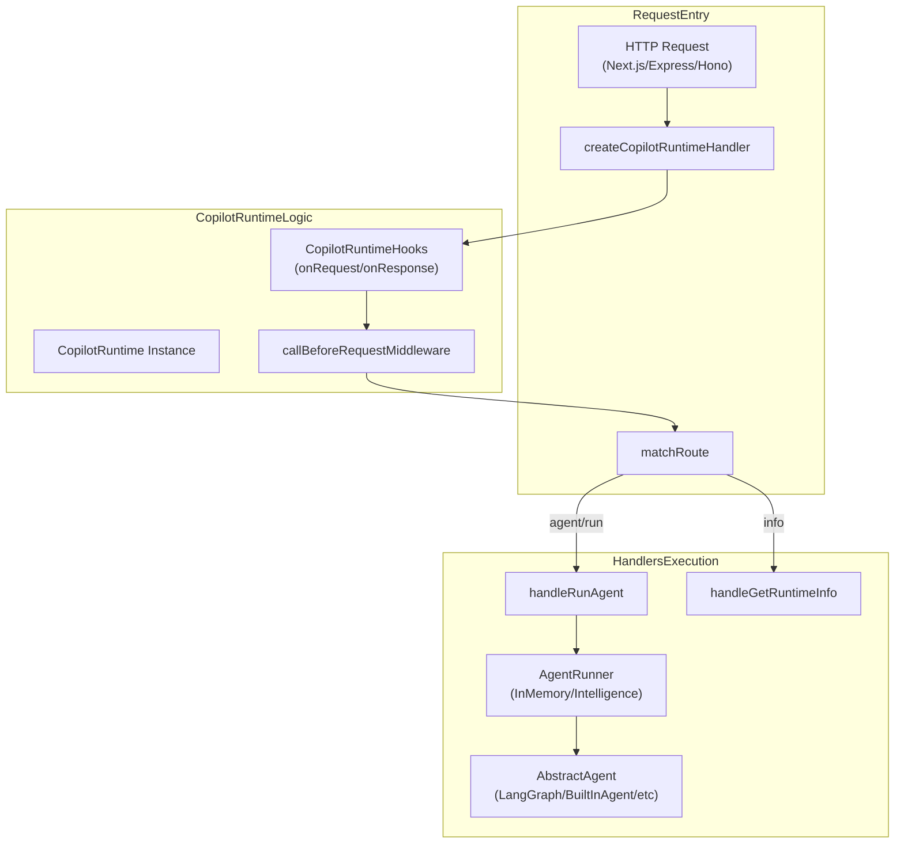
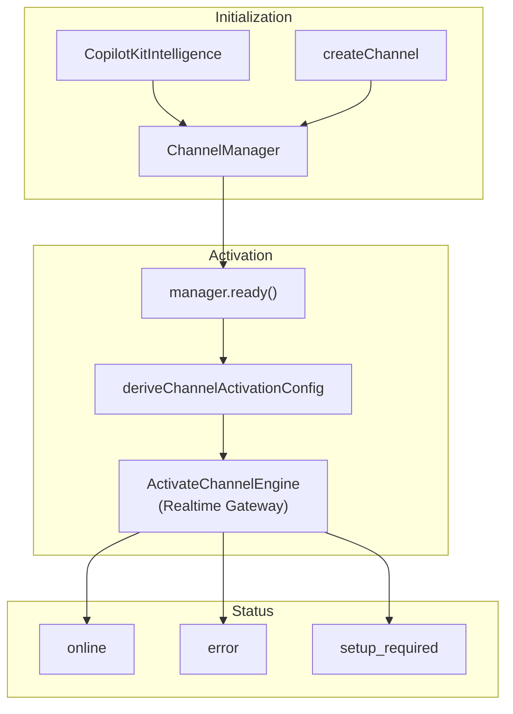
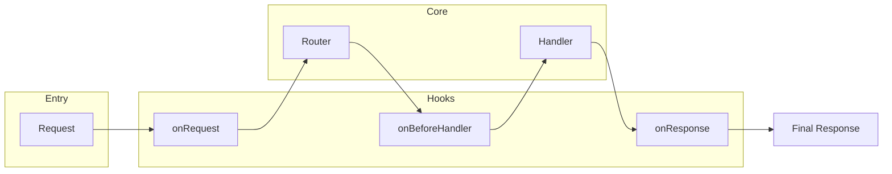

<!-- source: DeepWiki mcp.deepwiki.com · repo CopilotKit/CopilotKit · page 4.1 CopilotRuntime Setup · fetched 2026-10-30 -->

# CopilotRuntime Setup

<details>
<summary>Relevant source files</summary>

The following files were used as context for generating this wiki page:

- [.claude/docs/architecture.md](.claude/docs/architecture.md)
- [packages/angular/README.md](packages/angular/README.md)
- [packages/core/src/__tests__/core-suggestions-capability.test.ts](packages/core/src/__tests__/core-suggestions-capability.test.ts)
- [packages/core/src/__tests__/core-suggestions-stateless.test.ts](packages/core/src/__tests__/core-suggestions-stateless.test.ts)
- [packages/core/src/__tests__/debug-config-threading.test.ts](packages/core/src/__tests__/debug-config-threading.test.ts)
- [packages/core/src/core/suggestion-engine.ts](packages/core/src/core/suggestion-engine.ts)
- [packages/react-core/src/components/copilot-provider/copilotkit-props.tsx](packages/react-core/src/components/copilot-provider/copilotkit-props.tsx)
- [packages/react-core/src/context/copilot-context.tsx](packages/react-core/src/context/copilot-context.tsx)
- [packages/react-core/src/hooks/use-copilot-authenticated-action.ts](packages/react-core/src/hooks/use-copilot-authenticated-action.ts)
- [packages/react-core/src/hooks/use-copilot-chat-headless_c.ts](packages/react-core/src/hooks/use-copilot-chat-headless_c.ts)
- [packages/react-core/src/hooks/use-tree.ts](packages/react-core/src/hooks/use-tree.ts)
- [packages/react-ui/src/components/chat/Popup.tsx](packages/react-ui/src/components/chat/Popup.tsx)
- [packages/react-ui/src/components/chat/Sidebar.tsx](packages/react-ui/src/components/chat/Sidebar.tsx)
- [packages/runtime/src/lib/runtime/__tests__/on-after-request.test.ts](packages/runtime/src/lib/runtime/__tests__/on-after-request.test.ts)
- [packages/runtime/src/lib/runtime/__tests__/v1-agent-factory.test.ts](packages/runtime/src/lib/runtime/__tests__/v1-agent-factory.test.ts)
- [packages/runtime/src/lib/runtime/copilot-runtime.ts](packages/runtime/src/lib/runtime/copilot-runtime.ts)
- [packages/runtime/src/v2/runtime/__tests__/agent-header-precedence.test.ts](packages/runtime/src/v2/runtime/__tests__/agent-header-precedence.test.ts)
- [packages/runtime/src/v2/runtime/__tests__/agent-utils-header-forwarding.test.ts](packages/runtime/src/v2/runtime/__tests__/agent-utils-header-forwarding.test.ts)
- [packages/runtime/src/v2/runtime/__tests__/agents-factory.test.ts](packages/runtime/src/v2/runtime/__tests__/agents-factory.test.ts)
- [packages/runtime/src/v2/runtime/__tests__/debug-sse-response.test.ts](packages/runtime/src/v2/runtime/__tests__/debug-sse-response.test.ts)
- [packages/runtime/src/v2/runtime/__tests__/fetch-handler.test.ts](packages/runtime/src/v2/runtime/__tests__/fetch-handler.test.ts)
- [packages/runtime/src/v2/runtime/__tests__/fetch-router.test.ts](packages/runtime/src/v2/runtime/__tests__/fetch-router.test.ts)
- [packages/runtime/src/v2/runtime/__tests__/handle-connect.test.ts](packages/runtime/src/v2/runtime/__tests__/handle-connect.test.ts)
- [packages/runtime/src/v2/runtime/__tests__/handle-memories.test.ts](packages/runtime/src/v2/runtime/__tests__/handle-memories.test.ts)
- [packages/runtime/src/v2/runtime/__tests__/handle-run.test.ts](packages/runtime/src/v2/runtime/__tests__/handle-run.test.ts)
- [packages/runtime/src/v2/runtime/__tests__/header-utils.test.ts](packages/runtime/src/v2/runtime/__tests__/header-utils.test.ts)
- [packages/runtime/src/v2/runtime/__tests__/integration/node-servers.integration.test.ts](packages/runtime/src/v2/runtime/__tests__/integration/node-servers.integration.test.ts)
- [packages/runtime/src/v2/runtime/__tests__/integration/suites/debug-events.suite.ts](packages/runtime/src/v2/runtime/__tests__/integration/suites/debug-events.suite.ts)
- [packages/runtime/src/v2/runtime/__tests__/intelligence-lock-heartbeat.test.ts](packages/runtime/src/v2/runtime/__tests__/intelligence-lock-heartbeat.test.ts)
- [packages/runtime/src/v2/runtime/__tests__/intelligence-run-telemetry.test.ts](packages/runtime/src/v2/runtime/__tests__/intelligence-run-telemetry.test.ts)
- [packages/runtime/src/v2/runtime/__tests__/thread-names.test.ts](packages/runtime/src/v2/runtime/__tests__/thread-names.test.ts)
- [packages/runtime/src/v2/runtime/core/fetch-handler.ts](packages/runtime/src/v2/runtime/core/fetch-handler.ts)
- [packages/runtime/src/v2/runtime/core/fetch-router.ts](packages/runtime/src/v2/runtime/core/fetch-router.ts)
- [packages/runtime/src/v2/runtime/core/hooks.ts](packages/runtime/src/v2/runtime/core/hooks.ts)
- [packages/runtime/src/v2/runtime/core/runtime.ts](packages/runtime/src/v2/runtime/core/runtime.ts)
- [packages/runtime/src/v2/runtime/handlers/__tests__/handle-debug-events.test.ts](packages/runtime/src/v2/runtime/handlers/__tests__/handle-debug-events.test.ts)
- [packages/runtime/src/v2/runtime/handlers/__tests__/handle-suggest.test.ts](packages/runtime/src/v2/runtime/handlers/__tests__/handle-suggest.test.ts)
- [packages/runtime/src/v2/runtime/handlers/__tests__/suggest-no-leak.test.ts](packages/runtime/src/v2/runtime/handlers/__tests__/suggest-no-leak.test.ts)
- [packages/runtime/src/v2/runtime/handlers/handle-connect.ts](packages/runtime/src/v2/runtime/handlers/handle-connect.ts)
- [packages/runtime/src/v2/runtime/handlers/handle-debug-events.ts](packages/runtime/src/v2/runtime/handlers/handle-debug-events.ts)
- [packages/runtime/src/v2/runtime/handlers/handle-memories.ts](packages/runtime/src/v2/runtime/handlers/handle-memories.ts)
- [packages/runtime/src/v2/runtime/handlers/handle-run.ts](packages/runtime/src/v2/runtime/handlers/handle-run.ts)
- [packages/runtime/src/v2/runtime/handlers/handle-stop.ts](packages/runtime/src/v2/runtime/handlers/handle-stop.ts)
- [packages/runtime/src/v2/runtime/handlers/handle-suggest.ts](packages/runtime/src/v2/runtime/handlers/handle-suggest.ts)
- [packages/runtime/src/v2/runtime/handlers/header-utils.ts](packages/runtime/src/v2/runtime/handlers/header-utils.ts)
- [packages/runtime/src/v2/runtime/handlers/intelligence/connect.ts](packages/runtime/src/v2/runtime/handlers/intelligence/connect.ts)
- [packages/runtime/src/v2/runtime/handlers/intelligence/memories.ts](packages/runtime/src/v2/runtime/handlers/intelligence/memories.ts)
- [packages/runtime/src/v2/runtime/handlers/intelligence/run.ts](packages/runtime/src/v2/runtime/handlers/intelligence/run.ts)
- [packages/runtime/src/v2/runtime/handlers/intelligence/thread-names.ts](packages/runtime/src/v2/runtime/handlers/intelligence/thread-names.ts)
- [packages/runtime/src/v2/runtime/handlers/shared/agent-utils.ts](packages/runtime/src/v2/runtime/handlers/shared/agent-utils.ts)
- [packages/runtime/src/v2/runtime/handlers/shared/sse-response.ts](packages/runtime/src/v2/runtime/handlers/shared/sse-response.ts)
- [packages/runtime/src/v2/runtime/handlers/sse/__tests__/sse-connect-agent-id.test.ts](packages/runtime/src/v2/runtime/handlers/sse/__tests__/sse-connect-agent-id.test.ts)
- [packages/runtime/src/v2/runtime/handlers/sse/connect.ts](packages/runtime/src/v2/runtime/handlers/sse/connect.ts)
- [packages/runtime/src/v2/runtime/handlers/sse/run.ts](packages/runtime/src/v2/runtime/handlers/sse/run.ts)
- [packages/runtime/src/v2/runtime/intelligence-platform/__tests__/client.test.ts](packages/runtime/src/v2/runtime/intelligence-platform/__tests__/client.test.ts)
- [packages/runtime/src/v2/runtime/intelligence-platform/client.ts](packages/runtime/src/v2/runtime/intelligence-platform/client.ts)
- [packages/runtime/src/v2/runtime/runner/__tests__/bounded-thread-store.test.ts](packages/runtime/src/v2/runtime/runner/__tests__/bounded-thread-store.test.ts)
- [packages/runtime/src/v2/runtime/runner/agent-runner.ts](packages/runtime/src/v2/runtime/runner/agent-runner.ts)
- [packages/shared/src/__tests__/debug.test.ts](packages/shared/src/__tests__/debug.test.ts)
- [packages/shared/src/debug.ts](packages/shared/src/debug.ts)
- [packages/shared/src/utils/console-styling.ts](packages/shared/src/utils/console-styling.ts)
- [packages/vue/src/components/copilot-provider/types.ts](packages/vue/src/components/copilot-provider/types.ts)

</details>


## Overview

`CopilotRuntime` is the central server-side orchestrator of CopilotKit. It serves as the bridge between the frontend UI (via the AG-UI Protocol) and the backend intelligence layer, which includes LLM adapters and external agent frameworks like LangGraph, CrewAI, or Mastra. It handles request routing, agent lifecycle management, state synchronization, and real-time event streaming.

The runtime is designed with a "Fetch-native" core, allowing it to run on any standard web environment (Node.js, Bun, Deno, Cloudflare Workers) while providing specialized adapters for frameworks like Next.js, Express, and Hono.

---

## Runtime Architecture and Core Classes

The runtime logic is encapsulated in the `CopilotRuntime` class. It manages a registry of agents and provides the execution context for processing AI interactions.

### Key Runtime Entities

| Class / Type | Role |
| :--- | :--- |
| `CopilotRuntime` | The main container for backend logic, managing `AgentsConfig` and transcription services [packages/runtime/src/v2/runtime/core/runtime.ts:132-151](). |
| `createCopilotRuntimeHandler` | A framework-agnostic factory that returns a standard `(Request) => Promise<Response>` fetch handler [packages/runtime/src/v2/runtime/core/fetch-handler.ts:185-200](). |
| `AgentRunner` | Interface for executing agent logic. Defaults to `InMemoryAgentRunner` or `IntelligenceAgentRunner` [packages/runtime/src/v2/runtime/core/runtime.ts:32-34](). |
| `BuiltInAgent` | A pre-configured agent using the Vercel AI SDK, supporting multiple LLM providers and MCP tools [packages/runtime/src/lib/runtime/copilot-runtime.ts:74-75](). |
| `ChannelManager` | Manages the lifecycle of persistent communication channels (e.g., Slack, Teams) via the Intelligence Platform [packages/runtime/src/v2/runtime/core/channel-manager.ts:50-60](). |

### Data Flow: Request to Execution

The runtime uses a `fetch-router` to map incoming HTTP requests to specific handler functions.

**Diagram: CopilotRuntime Internal Component Mapping**


Sources: [packages/runtime/src/v2/runtime/core/fetch-handler.ts:60-117](), [packages/runtime/src/v2/runtime/core/fetch-router.ts:20-51](), [packages/runtime/src/v2/runtime/core/runtime.ts:132-155]()

---

## Endpoint Configuration

The runtime supports two primary modes for exposing endpoints: `multi-route` (standard RESTful paths) and `single-route` (a single POST endpoint with a JSON envelope) [packages/runtime/src/v2/runtime/core/fetch-handler.ts:137-141]().

### Core Endpoints (Multi-Route)

| Endpoint | Method | Description |
| :--- | :--- | :--- |
| `/info` | `GET` | Returns runtime metadata and agent capabilities [packages/runtime/src/v2/runtime/core/fetch-router.ts:68-70](). |
| `/agent/:agentId/run` | `POST` | Primary execution endpoint for a specific agent [packages/runtime/src/v2/runtime/core/fetch-router.ts:89-97](). |
| `/agent/:agentId/connect` | `POST` | Establishes a connection context for an agent [packages/runtime/src/v2/runtime/core/fetch-router.ts:110-119](). |
| `/threads` | `GET` | Lists available threads [packages/runtime/src/v2/runtime/core/fetch-router.ts:209-211](). |
| `/memories` | `GET/POST` | Manages persistent user memories [packages/runtime/src/v2/runtime/core/fetch-router.ts:234-237](). |
| `/transcribe` | `POST` | Audio-to-text processing [packages/runtime/src/v2/runtime/core/fetch-router.ts:73-75](). |

### Single-Route Mode
In `single-route` mode, all calls are funneled through a single POST endpoint. The handler uses `parseMethodCall` to extract the target action from the JSON body [packages/runtime/src/v2/runtime/core/fetch-handler.ts:110-113]().

### Framework Implementation Examples

#### Next.js App Router
Next.js integration utilizes the framework-agnostic fetch handler directly.

```typescript
// app/api/copilotkit/route.ts
import { CopilotRuntime, createCopilotRuntimeHandler } from "@copilotkit/runtime/v2";

const runtime = new CopilotRuntime({ agents: { ... } });
const handler = createCopilotRuntimeHandler({
  runtime,
  basePath: "/api/copilotkit",
});

export const POST = handler;
export const GET = handler;
```
Sources: [packages/runtime/src/v2/runtime/core/fetch-handler.ts:9-26]()

---

## Managed Channels Setup

For long-running hosts, the runtime can manage persistent connections to external platforms like Slack or Teams via the `ChannelManager` [packages/runtime/src/v2/runtime/core/channel-manager.ts:49-60]().

### Channel Activation
Activation is lazy and must be explicitly triggered on long-running hosts [packages/runtime/src/v2/runtime/core/fetch-handler.ts:28-51]().

```typescript
const handler = createCopilotRuntimeHandler({ runtime });

// On a long-running Node.js server:
await handler.channels.ready(); 
```

**Diagram: Channel Manager Activation Flow**


Sources: [packages/runtime/src/v2/runtime/core/channel-manager.ts:121-141](), [packages/runtime/src/v2/runtime/core/fetch-handler.ts:45-50]()

---

## Middleware and Lifecycle Hooks

The runtime provides extensibility via `CopilotRuntimeHooks` to intercept the request pipeline [packages/runtime/src/v2/runtime/core/hooks.ts:1-27]().

### Agent Middleware Configuration
Runtimes automatically apply middleware like `A2UIMiddleware` and `MCPAppsMiddleware` during agent initialization [packages/runtime/src/v2/runtime/handlers/shared/agent-utils.ts:81-142]().

### Lifecycle Hooks
- `onRequest`: Executed before routing [packages/runtime/src/v2/runtime/core/hooks.ts:94-101]().
- `onBeforeHandler`: Executed after routing but before execution [packages/runtime/src/v2/runtime/core/hooks.ts:103-111]().
- `onResponse`: Executed after the handler produces a response [packages/runtime/src/v2/runtime/core/hooks.ts:113-120]().
- `onError`: Executed when an error occurs [packages/runtime/src/v2/runtime/core/hooks.ts:122-125]().

**Diagram: Hook Execution Pipeline**


Sources: [packages/runtime/src/v2/runtime/core/hooks.ts:132-165](), [packages/runtime/src/v2/runtime/core/fetch-handler.ts:68-74]()

---

## Routing Strategies

The `fetch-router` supports two matching strategies based on the presence of `basePath` [packages/runtime/src/v2/runtime/core/fetch-router.ts:1-9]().

| Strategy | Description |
| :--- | :--- |
| **Strict Prefix** | If `basePath` is provided, the router strips the prefix and matches the remainder [packages/runtime/src/v2/runtime/core/fetch-router.ts:26-44](). |
| **Suffix Matching** | If `basePath` is omitted, the router scans the end of the pathname for known patterns [packages/runtime/src/v2/runtime/core/fetch-router.ts:45-48](). |

Sources: [packages/runtime/src/v2/runtime/core/fetch-handler.ts:122-178](), [packages/runtime/src/v2/runtime/core/fetch-router.ts:20-60](), [packages/runtime/src/v2/runtime/core/runtime.ts:132-180](), [packages/runtime/src/v2/runtime/handlers/shared/agent-utils.ts:58-79]().

---

