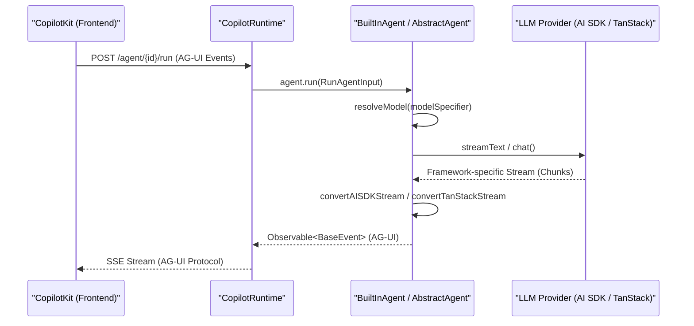
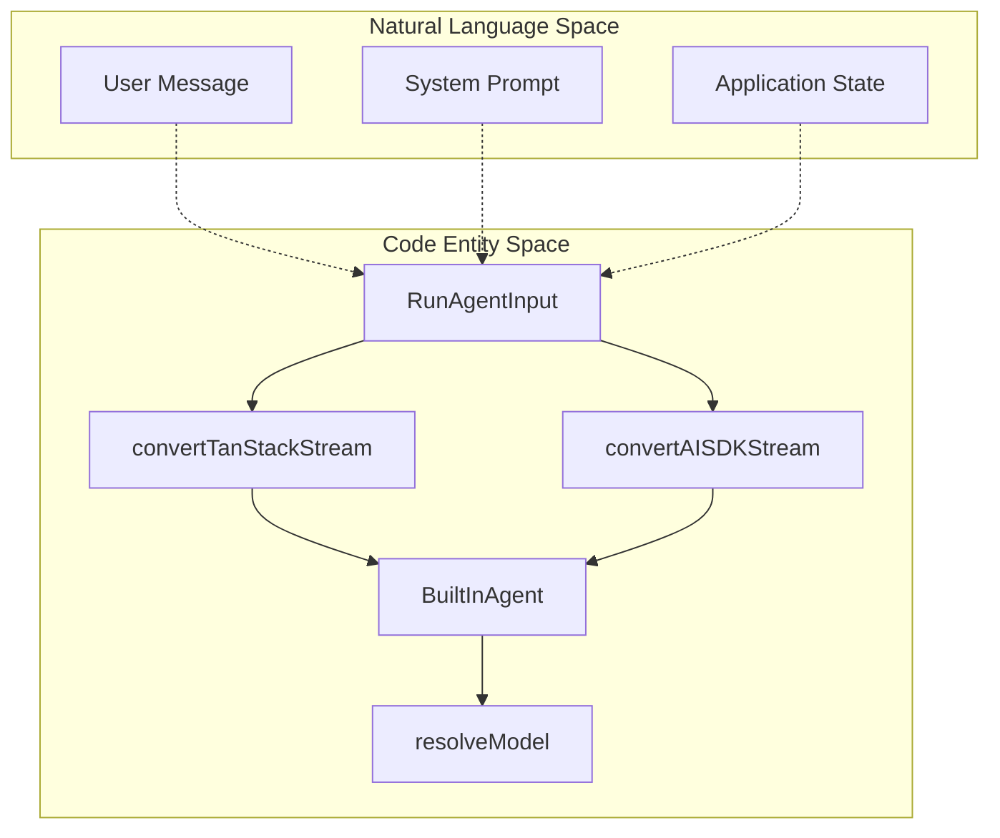
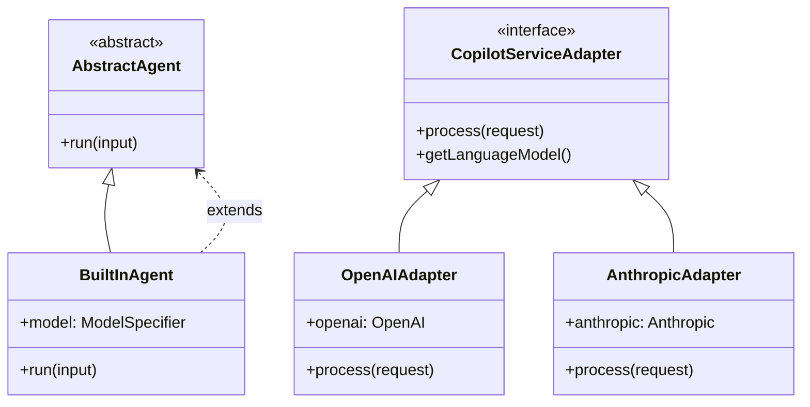

<!-- source: DeepWiki mcp.deepwiki.com · repo CopilotKit/CopilotKit · page 4.2 LLM Service Adapters · fetched 2026-10-30 -->

# LLM Service Adapters

Relevant source files

The following files were used as context for generating this wiki page:

- [packages/runtime/src/agent/__tests__/agent-test-helpers.ts](packages/runtime/src/agent/__tests__/agent-test-helpers.ts)
- [packages/runtime/src/agent/__tests__/agent.test.ts](packages/runtime/src/agent/__tests__/agent.test.ts)
- [packages/runtime/src/agent/__tests__/basic-agent.test.ts](packages/runtime/src/agent/__tests__/basic-agent.test.ts)
- [packages/runtime/src/agent/__tests__/converter-aisdk.test.ts](packages/runtime/src/agent/__tests__/converter-aisdk.test.ts)
- [packages/runtime/src/agent/__tests__/converter-custom.test.ts](packages/runtime/src/agent/__tests__/converter-custom.test.ts)
- [packages/runtime/src/agent/__tests__/converter-tanstack-input.test.ts](packages/runtime/src/agent/__tests__/converter-tanstack-input.test.ts)
- [packages/runtime/src/agent/__tests__/converter-tanstack.test.ts](packages/runtime/src/agent/__tests__/converter-tanstack.test.ts)
- [packages/runtime/src/agent/__tests__/state-tools.test.ts](packages/runtime/src/agent/__tests__/state-tools.test.ts)
- [packages/runtime/src/agent/__tests__/test-helpers.ts](packages/runtime/src/agent/__tests__/test-helpers.ts)
- [packages/runtime/src/agent/__tests__/utils.test.ts](packages/runtime/src/agent/__tests__/utils.test.ts)
- [packages/runtime/src/agent/converters/aisdk.ts](packages/runtime/src/agent/converters/aisdk.ts)
- [packages/runtime/src/agent/converters/index.ts](packages/runtime/src/agent/converters/index.ts)
- [packages/runtime/src/agent/converters/tanstack.ts](packages/runtime/src/agent/converters/tanstack.ts)
- [packages/runtime/src/agent/index.ts](packages/runtime/src/agent/index.ts)
- [packages/runtime/src/agent/state-delta.ts](packages/runtime/src/agent/state-delta.ts)
- [packages/runtime/src/service-adapters/anthropic/anthropic-adapter.ts](packages/runtime/src/service-adapters/anthropic/anthropic-adapter.ts)
- [packages/runtime/src/service-adapters/anthropic/utils.ts](packages/runtime/src/service-adapters/anthropic/utils.ts)
- [packages/runtime/src/service-adapters/openai/__tests__/openai-v5-compat.test.ts](packages/runtime/src/service-adapters/openai/__tests__/openai-v5-compat.test.ts)
- [packages/runtime/src/service-adapters/openai/openai-adapter.ts](packages/runtime/src/service-adapters/openai/openai-adapter.ts)
- [packages/runtime/src/service-adapters/openai/openai-assistant-adapter.ts](packages/runtime/src/service-adapters/openai/openai-assistant-adapter.ts)
- [packages/runtime/src/service-adapters/openai/utils.ts](packages/runtime/src/service-adapters/openai/utils.ts)
- [packages/runtime/tests/service-adapters/anthropic/anthropic-adapter.test.ts](packages/runtime/tests/service-adapters/anthropic/anthropic-adapter.test.ts)
- [packages/runtime/tests/service-adapters/anthropic/utils-token-trimming.test.ts](packages/runtime/tests/service-adapters/anthropic/utils-token-trimming.test.ts)

LLM Service Adapters serve as the critical integration layer between the **Copilot Runtime** and various Large Language Model (LLM) providers. They encapsulate the diverse APIs and SDKs of these providers, presenting a standardized interface for the runtime to perform chat completions, manage tool calls, and stream responses seamlessly.

This page details the service adapter pattern, adapter configuration, and implementation specifics for connecting to supported LLM providers such as OpenAI, Anthropic, Google, and others. It also covers the `EmptyAdapter` for agent-only setups and the factory-mode converters for Vercel AI SDK and TanStack AI.

---

## Overview

The core interface implemented by each adapter defines how the runtime processes chat completion requests. In the v2 architecture, this pattern has evolved into the `BuiltInAgent` and specialized `AgentRunner` implementations that manage model interactions through the **AG-UI Protocol**.

### Runtime Request Flow

The diagram below shows the interaction flow from the CopilotKit frontend through the runtime to a concrete agent/adapter, and onward to the corresponding LLM provider:

Sources: [packages/runtime/src/agent/index.ts:166-171](), [packages/runtime/src/agent/converters/aisdk.ts:35-40](), [packages/runtime/src/agent/converters/tanstack.ts:18-20]()

---

## Supported Providers and Model Resolution

CopilotKit utilizes the `resolveModel` function to dynamically instantiate LLM providers based on a string specifier (e.g., `"openai/gpt-4o"`) or a direct `LanguageModel` instance [packages/runtime/src/agent/index.ts:166-174]().

### OpenAI
- **Provider Key:** `openai` [packages/runtime/src/agent/index.ts:196]()
- **Supported Models:** Includes `gpt-4o`, `gpt-4o-mini`, and reasoning models like `o3-mini` [packages/runtime/src/agent/index.ts:88-93]().
- **Configuration:** Uses `OPENAI_API_KEY` environment variable by default [packages/runtime/src/agent/index.ts:201](). Supports `OPENAI_BASE_URL` for compatible endpoints [packages/runtime/src/agent/index.ts:205]().

### Anthropic
- **Provider Key:** `anthropic` [packages/runtime/src/agent/index.ts:212]()
- **Supported Models:** Claude series including `claude-3.7-sonnet` and `claude-3.5-haiku` [packages/runtime/src/agent/index.ts:95-100]().
- **Configuration:** Uses `ANTHROPIC_API_KEY` environment variable [packages/runtime/src/agent/index.ts:216](). Supports `ANTHROPIC_BASE_URL` [packages/runtime/src/agent/index.ts:218]().

### Google Gemini
- **Provider Keys:** `google`, `gemini`, `google-gemini` [packages/runtime/src/agent/index.ts:224-226]()
- **Supported Models:** `gemini-2.5-pro`, `gemini-2.5-flash` [packages/runtime/src/agent/index.ts:102-104]().
- **Configuration:** Uses `GOOGLE_API_KEY` environment variable [packages/runtime/src/agent/index.ts:230]().

### Groq and Bedrock
- **Groq:** Supported via the `groq` provider key [packages/runtime/src/agent/index.ts:244]().
- **AWS Bedrock:** Supported via the `bedrock` provider key [packages/runtime/src/agent/index.ts:252]().

---

## BuiltInAgent and Factory Converters

The `BuiltInAgent` allows for "Factory Mode" where developers can provide their own LLM calls using frameworks like Vercel AI SDK or TanStack AI. CopilotKit provides specialized converters to bridge these framework-specific streams to the AG-UI protocol.

### TanStack AI Converter
The `convertTanStackStream` function transforms chunks from TanStack AI's `chat()` (like `TEXT_MESSAGE_CONTENT` and `TOOL_CALL_START`) into AG-UI `BaseEvent` objects [packages/runtime/src/agent/converters/tanstack.ts:18-20](). It handles complex mappings like closing open JSON schemas for OpenAI strict mode compatibility [packages/runtime/src/agent/converters/tanstack.ts:197-210]().

### AI SDK Converter
The `convertAISDKStream` generator transforms a Vercel AI SDK `fullStream` into AG-UI events. It handles the mapping of `text-delta`, `tool-call`, and `reasoning-delta` events while managing unique `messageId` generation [packages/runtime/src/agent/converters/aisdk.ts:35-54](). It also handles `tool-approval-request` for human-in-the-loop workflows [packages/runtime/src/agent/converters/aisdk.ts:236-240]().

Sources: [packages/runtime/src/agent/converters/tanstack.ts:79-91](), [packages/runtime/src/agent/converters/aisdk.ts:35-40](), [packages/runtime/src/agent/index.ts:166-171]()

---

## Service Adapters (Legacy/Compatibility)

While the v2 architecture moves toward the `Agent` abstraction, the `CopilotServiceAdapter` interface remains for backward compatibility and direct runtime integration.

### OpenAIAdapter
The `OpenAIAdapter` handles communication with OpenAI models. It includes logic to filter and deduplicate tool result messages to prevent infinite loops [packages/runtime/src/service-adapters/openai/openai-adapter.ts:173-198]().
- **Parallel Tool Calls:** Can be disabled via `disableParallelToolCalls` to ensure sequential execution [packages/runtime/src/service-adapters/openai/openai-adapter.ts:91]().
- **Token Trimming:** Uses `limitMessagesToTokenCount` to fit within model context windows [packages/runtime/src/service-adapters/openai/openai-adapter.ts:203-208]().

### AnthropicAdapter
The `AnthropicAdapter` supports Claude models and includes specific optimizations for Anthropic's API.
- **Prompt Caching:** Supports `ephemeral` cache control for system prompts and incremental messages [packages/runtime/src/service-adapters/anthropic/anthropic-adapter.ts:132-161]().
- **Message Coalescing:** Coalesces consecutive messages with the same role as required by the Anthropic API [packages/runtime/src/service-adapters/anthropic/anthropic-adapter.ts:36]().

---

## Configuration and Overrides

Adapters and Agents support forwarding specific LLM parameters directly to the underlying provider via `forwardedProps`. These match the parameter names in standard SDKs like Vercel AI `streamText` [packages/runtime/src/agent/index.ts:63-76]().

| Property | Description |
| :--- | :--- |
| `temperature` | Controls randomness (0.0 to 2.0) |
| `maxOutputTokens` | Limits the length of the generated response |
| `toolChoice` | Forces the model to use a specific tool or no tool |
| `presencePenalty` | Penalizes new tokens based on whether they appear in the text so far |
| `frequencyPenalty` | Penalizes new tokens based on their existing frequency in the text |

Sources: [packages/runtime/src/agent/index.ts:63-76]()

---

## Serverless Timeout and EmptyAdapter

When deploying in serverless environments (e.g., Vercel, AWS Lambda), long-running streaming operations can be terminated by platform timeouts.

- **Timeout Considerations:** Multi-step agent runs (loops) or reasoning models (like OpenAI `o3`) may exceed default 10-15s timeouts. Developers should configure `maxDuration` to 60s+ in their serverless config.
- **EmptyAdapter / Agent-Only Setups:** In scenarios where only external agents (e.g., LangGraph via `HttpAgent`) are used, the runtime does not require a local LLM adapter. The `BuiltInAgent` acts as the primary local runner, while remote agents are accessed via HTTP protocols [packages/runtime/src/agent/index.ts:111]().

---

## Entity Mapping

Sources: [packages/runtime/src/agent/index.ts:21](), [packages/runtime/src/service-adapters/service-adapter.ts:29-32](), [packages/runtime/src/service-adapters/openai/openai-adapter.ts:108](), [packages/runtime/src/service-adapters/anthropic/anthropic-adapter.ts:82]()

---

# Summary

LLM Service Adapters in CopilotKit v2 are implemented through the `BuiltInAgent` and `resolveModel` architecture, complemented by legacy `ServiceAdapter` classes for direct provider control. By abstracting provider-specific logic into converters (AI SDK, TanStack) and providing a unified model resolution strategy, CopilotKit ensures that agent logic remains decoupled from specific LLM provider implementations while maintaining full support for advanced features like streaming, tool calling, reasoning, and prompt caching.

---

