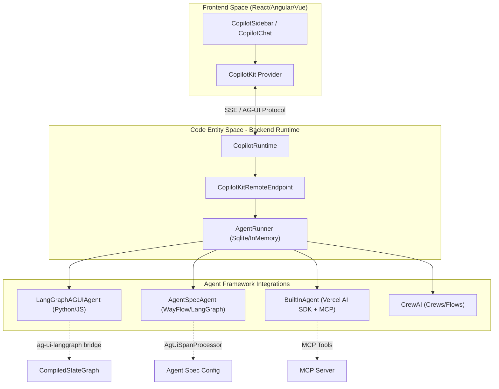
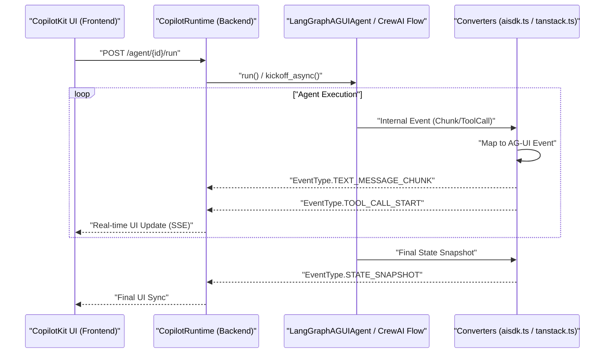

<!-- source: DeepWiki mcp.deepwiki.com · repo CopilotKit/CopilotKit · page 4.3 Agent Framework Integrations · fetched 2026-10-30 -->

# Agent Framework Integrations

Relevant source files

The following files were used as context for generating this wiki page:

- [examples/canvas/gemini/agent/main.py](examples/canvas/gemini/agent/main.py)
- [examples/v1/_legacy/saas-dynamic-dashboards/agent/agent.py](examples/v1/_legacy/saas-dynamic-dashboards/agent/agent.py)
- [packages/runtime/src/agents/langgraph/__tests__/event-source.test.ts](packages/runtime/src/agents/langgraph/__tests__/event-source.test.ts)
- [packages/runtime/src/lib/runtime/agent-integrations/langgraph/__tests__/dispatch-event-filtering.test.ts](packages/runtime/src/lib/runtime/agent-integrations/langgraph/__tests__/dispatch-event-filtering.test.ts)
- [packages/sdk-js/src/__tests__/error-handling.test.ts](packages/sdk-js/src/__tests__/error-handling.test.ts)
- [packages/sdk-js/src/langgraph/__tests__/middleware.a2ui-params.test.ts](packages/sdk-js/src/langgraph/__tests__/middleware.a2ui-params.test.ts)
- [packages/sdk-js/src/langgraph/__tests__/middleware.test.ts](packages/sdk-js/src/langgraph/__tests__/middleware.test.ts)
- [packages/sdk-js/src/langgraph/__tests__/utils.test.ts](packages/sdk-js/src/langgraph/__tests__/utils.test.ts)
- [packages/sdk-js/src/langgraph/middleware.ts](packages/sdk-js/src/langgraph/middleware.ts)
- [packages/sdk-js/src/langgraph/utils.ts](packages/sdk-js/src/langgraph/utils.ts)
- [sdk-python/copilotkit/copilotkit_lg_middleware.py](sdk-python/copilotkit/copilotkit_lg_middleware.py)
- [sdk-python/copilotkit/crewai/crewai_sdk.py](sdk-python/copilotkit/crewai/crewai_sdk.py)
- [sdk-python/copilotkit/exc.py](sdk-python/copilotkit/exc.py)
- [sdk-python/copilotkit/langchain.py](sdk-python/copilotkit/langchain.py)
- [sdk-python/copilotkit/langgraph.py](sdk-python/copilotkit/langgraph.py)
- [sdk-python/copilotkit/langgraph_agui_agent.py](sdk-python/copilotkit/langgraph_agui_agent.py)
- [sdk-python/poetry.lock](sdk-python/poetry.lock)
- [sdk-python/pyproject.toml](sdk-python/pyproject.toml)
- [sdk-python/tests/test_agui_agent.py](sdk-python/tests/test_agui_agent.py)
- [sdk-python/tests/test_copilotkit_lg_middleware.py](sdk-python/tests/test_copilotkit_lg_middleware.py)
- [sdk-python/tests/test_crewai_import_compat.py](sdk-python/tests/test_crewai_import_compat.py)
- [sdk-python/tests/test_emit_filtering.py](sdk-python/tests/test_emit_filtering.py)
- [sdk-python/tests/test_emit_tool_call_optional_id.py](sdk-python/tests/test_emit_tool_call_optional_id.py)
- [sdk-python/uv.lock](sdk-python/uv.lock)
- [showcase/aimock/d4/mastra/chat.json](showcase/aimock/d4/mastra/chat.json)
- [showcase/aimock/d6/google-adk/threadid-frontend-tool-roundtrip.json](showcase/aimock/d6/google-adk/threadid-frontend-tool-roundtrip.json)
- [showcase/aimock/d6/mastra/beautiful-chat.json](showcase/aimock/d6/mastra/beautiful-chat.json)
- [showcase/aimock/d6/mastra/gen-ui-headless-complete.json](showcase/aimock/d6/mastra/gen-ui-headless-complete.json)
- [showcase/aimock/d6/mastra/headless-complete.json](showcase/aimock/d6/mastra/headless-complete.json)
- [showcase/aimock/d6/mastra/shared-state-streaming.json](showcase/aimock/d6/mastra/shared-state-streaming.json)
- [showcase/aimock/d6/mastra/tool-rendering-reasoning-chain.json](showcase/aimock/d6/mastra/tool-rendering-reasoning-chain.json)
- [showcase/aimock/d6/mastra/tool-rendering.json](showcase/aimock/d6/mastra/tool-rendering.json)
- [showcase/aimock/d6/ms-agent-python/chat-slots.json](showcase/aimock/d6/ms-agent-python/chat-slots.json)
- [showcase/integrations/ag2/manifest.yaml](showcase/integrations/ag2/manifest.yaml)
- [showcase/integrations/ag2/src/agent_server.py](showcase/integrations/ag2/src/agent_server.py)
- [showcase/integrations/ag2/src/agents/agent_config_agent.py](showcase/integrations/ag2/src/agents/agent_config_agent.py)
- [showcase/integrations/ag2/src/app/api/copilotkit-auth/[[...slug]]/route.ts](showcase/integrations/ag2/src/app/api/copilotkit-auth/[[...slug]]/route.ts)
- [showcase/integrations/ag2/src/app/api/copilotkit-beautiful-chat/route.ts](showcase/integrations/ag2/src/app/api/copilotkit-beautiful-chat/route.ts)
- [showcase/integrations/ag2/src/app/api/copilotkit-mcp-apps/route.ts](showcase/integrations/ag2/src/app/api/copilotkit-mcp-apps/route.ts)
- [showcase/integrations/ag2/src/app/api/copilotkit/route.ts](showcase/integrations/ag2/src/app/api/copilotkit/route.ts)
- [showcase/integrations/agno/manifest.yaml](showcase/integrations/agno/manifest.yaml)
- [showcase/integrations/agno/src/app/api/copilotkit-byoc-hashbrown/route.ts](showcase/integrations/agno/src/app/api/copilotkit-byoc-hashbrown/route.ts)
- [showcase/integrations/agno/src/app/api/copilotkit/route.ts](showcase/integrations/agno/src/app/api/copilotkit/route.ts)
- [showcase/integrations/claude-sdk-python/manifest.yaml](showcase/integrations/claude-sdk-python/manifest.yaml)
- [showcase/integrations/claude-sdk-python/src/agent_server.py](showcase/integrations/claude-sdk-python/src/agent_server.py)
- [showcase/integrations/claude-sdk-python/src/app/api/copilotkit-declarative-gen-ui/route.ts](showcase/integrations/claude-sdk-python/src/app/api/copilotkit-declarative-gen-ui/route.ts)
- [showcase/integrations/claude-sdk-python/src/app/api/copilotkit/route.ts](showcase/integrations/claude-sdk-python/src/app/api/copilotkit/route.ts)
- [showcase/integrations/claude-sdk-python/tests/python/conftest.py](showcase/integrations/claude-sdk-python/tests/python/conftest.py)
- [showcase/integrations/claude-sdk-python/tests/python/test_cvdiag_boundaries.py](showcase/integrations/claude-sdk-python/tests/python/test_cvdiag_boundaries.py)
- [showcase/integrations/claude-sdk-typescript/manifest.yaml](showcase/integrations/claude-sdk-typescript/manifest.yaml)
- [showcase/integrations/claude-sdk-typescript/src/app/api/copilotkit-beautiful-chat/route.ts](showcase/integrations/claude-sdk-typescript/src/app/api/copilotkit-beautiful-chat/route.ts)
- [showcase/integrations/claude-sdk-typescript/src/app/api/copilotkit/route.ts](showcase/integrations/claude-sdk-typescript/src/app/api/copilotkit/route.ts)
- [showcase/integrations/crewai-crews/manifest.yaml](showcase/integrations/crewai-crews/manifest.yaml)
- [showcase/integrations/crewai-crews/src/agent_server.py](showcase/integrations/crewai-crews/src/agent_server.py)
- [showcase/integrations/crewai-crews/src/agents/tool_rendering.py](showcase/integrations/crewai-crews/src/agents/tool_rendering.py)
- [showcase/integrations/crewai-crews/src/app/api/copilotkit-beautiful-chat/route.ts](showcase/integrations/crewai-crews/src/app/api/copilotkit-beautiful-chat/route.ts)
- [showcase/integrations/crewai-crews/src/app/api/copilotkit/route.ts](showcase/integrations/crewai-crews/src/app/api/copilotkit/route.ts)
- [showcase/integrations/google-adk/manifest.yaml](showcase/integrations/google-adk/manifest.yaml)
- [showcase/integrations/google-adk/src/agents/interrupt_agent.py](showcase/integrations/google-adk/src/agents/interrupt_agent.py)
- [showcase/integrations/google-adk/src/agents/registry.py](showcase/integrations/google-adk/src/agents/registry.py)
- [showcase/integrations/google-adk/src/app/api/copilotkit/route.ts](showcase/integrations/google-adk/src/app/api/copilotkit/route.ts)
- [showcase/integrations/google-adk/src/app/demos/gen-ui-interrupt/page.tsx](showcase/integrations/google-adk/src/app/demos/gen-ui-interrupt/page.tsx)
- [showcase/integrations/google-adk/src/app/demos/threadid-frontend-tool-roundtrip/page.tsx](showcase/integrations/google-adk/src/app/demos/threadid-frontend-tool-roundtrip/page.tsx)
- [showcase/integrations/langgraph-fastapi/manifest.yaml](showcase/integrations/langgraph-fastapi/manifest.yaml)
- [showcase/integrations/langgraph-fastapi/src/app/api/copilotkit-beautiful-chat/route.ts](showcase/integrations/langgraph-fastapi/src/app/api/copilotkit-beautiful-chat/route.ts)
- [showcase/integrations/langgraph-python/manifest.yaml](showcase/integrations/langgraph-python/manifest.yaml)
- [showcase/integrations/langgraph-typescript/manifest.yaml](showcase/integrations/langgraph-typescript/manifest.yaml)
- [showcase/integrations/langroid/manifest.yaml](showcase/integrations/langroid/manifest.yaml)
- [showcase/integrations/langroid/src/app/api/copilotkit/route.ts](showcase/integrations/langroid/src/app/api/copilotkit/route.ts)
- [showcase/integrations/llamaindex/manifest.yaml](showcase/integrations/llamaindex/manifest.yaml)
- [showcase/integrations/llamaindex/src/agent_server.py](showcase/integrations/llamaindex/src/agent_server.py)
- [showcase/integrations/llamaindex/src/agents/frontend_tools_async_agent.py](showcase/integrations/llamaindex/src/agents/frontend_tools_async_agent.py)
- [showcase/integrations/llamaindex/src/app/api/copilotkit/route.ts](showcase/integrations/llamaindex/src/app/api/copilotkit/route.ts)
- [showcase/integrations/llamaindex/tests/python/conftest.py](showcase/integrations/llamaindex/tests/python/conftest.py)
- [showcase/integrations/llamaindex/tests/python/test_cvdiag_boundaries.py](showcase/integrations/llamaindex/tests/python/test_cvdiag_boundaries.py)
- [showcase/integrations/mastra/manifest.yaml](showcase/integrations/mastra/manifest.yaml)
- [showcase/integrations/mastra/qa/reasoning-custom.md](showcase/integrations/mastra/qa/reasoning-custom.md)
- [showcase/integrations/mastra/qa/reasoning-default.md](showcase/integrations/mastra/qa/reasoning-default.md)
- [showcase/integrations/mastra/qa/tool-rendering-reasoning-chain.md](showcase/integrations/mastra/qa/tool-rendering-reasoning-chain.md)
- [showcase/integrations/mastra/src/app/api/copilotkit-auth/[[...slug]]/route.ts](showcase/integrations/mastra/src/app/api/copilotkit-auth/[[...slug]]/route.ts)
- [showcase/integrations/mastra/src/app/api/copilotkit-beautiful-chat/route.ts](showcase/integrations/mastra/src/app/api/copilotkit-beautiful-chat/route.ts)
- [showcase/integrations/mastra/src/app/api/copilotkit-byoc-hashbrown/route.ts](showcase/integrations/mastra/src/app/api/copilotkit-byoc-hashbrown/route.ts)
- [showcase/integrations/mastra/src/app/api/copilotkit-byoc-json-render/route.ts](showcase/integrations/mastra/src/app/api/copilotkit-byoc-json-render/route.ts)
- [showcase/integrations/mastra/src/app/api/copilotkit-multimodal/route.ts](showcase/integrations/mastra/src/app/api/copilotkit-multimodal/route.ts)
- [showcase/integrations/mastra/src/app/api/copilotkit-ogui/route.ts](showcase/integrations/mastra/src/app/api/copilotkit-ogui/route.ts)
- [showcase/integrations/mastra/src/app/api/copilotkit-voice/[[...slug]]/route.ts](showcase/integrations/mastra/src/app/api/copilotkit-voice/[[...slug]]/route.ts)
- [showcase/integrations/mastra/src/app/api/copilotkit/route.ts](showcase/integrations/mastra/src/app/api/copilotkit/route.ts)
- [showcase/integrations/mastra/src/mastra/agents/index.ts](showcase/integrations/mastra/src/mastra/agents/index.ts)
- [showcase/integrations/mastra/src/mastra/index.ts](showcase/integrations/mastra/src/mastra/index.ts)
- [showcase/integrations/mastra/src/mastra/tools/a2ui-context.ts](showcase/integrations/mastra/src/mastra/tools/a2ui-context.ts)
- [showcase/integrations/mastra/src/mastra/tools/index.ts](showcase/integrations/mastra/src/mastra/tools/index.ts)
- [showcase/integrations/mastra/src/mastra/tools/working-memory.ts](showcase/integrations/mastra/src/mastra/tools/working-memory.ts)
- [showcase/integrations/mastra/tests/e2e/tool-rendering.spec.ts](showcase/integrations/mastra/tests/e2e/tool-rendering.spec.ts)
- [showcase/integrations/mastra/tests/vitest/a2ui-context.test.ts](showcase/integrations/mastra/tests/vitest/a2ui-context.test.ts)
- [showcase/integrations/mastra/tests/vitest/demoAgentNames.parity.test.ts](showcase/integrations/mastra/tests/vitest/demoAgentNames.parity.test.ts)
- [showcase/integrations/mastra/vitest.config.ts](showcase/integrations/mastra/vitest.config.ts)
- [showcase/integrations/ms-agent-dotnet/manifest.yaml](showcase/integrations/ms-agent-dotnet/manifest.yaml)
- [showcase/integrations/ms-agent-python/manifest.yaml](showcase/integrations/ms-agent-python/manifest.yaml)
- [showcase/integrations/ms-agent-python/src/agent_server.py](showcase/integrations/ms-agent-python/src/agent_server.py)
- [showcase/integrations/ms-agent-python/src/agents/reasoning_agent.py](showcase/integrations/ms-agent-python/src/agents/reasoning_agent.py)
- [showcase/integrations/ms-agent-python/src/app/api/copilotkit/route.ts](showcase/integrations/ms-agent-python/src/app/api/copilotkit/route.ts)
- [showcase/integrations/ms-agent-python/tests/python/conftest.py](showcase/integrations/ms-agent-python/tests/python/conftest.py)
- [showcase/integrations/ms-agent-python/tests/python/test_cvdiag_boundaries.py](showcase/integrations/ms-agent-python/tests/python/test_cvdiag_boundaries.py)
- [showcase/integrations/pydantic-ai/manifest.yaml](showcase/integrations/pydantic-ai/manifest.yaml)
- [showcase/integrations/pydantic-ai/src/agent_server.py](showcase/integrations/pydantic-ai/src/agent_server.py)
- [showcase/integrations/pydantic-ai/src/app/api/copilotkit/route.ts](showcase/integrations/pydantic-ai/src/app/api/copilotkit/route.ts)
- [showcase/integrations/spring-ai/manifest.yaml](showcase/integrations/spring-ai/manifest.yaml)
- [showcase/integrations/spring-ai/src/app/api/copilotkit/route.ts](showcase/integrations/spring-ai/src/app/api/copilotkit/route.ts)
- [showcase/integrations/strands/manifest.yaml](showcase/integrations/strands/manifest.yaml)
- [showcase/integrations/strands/src/agent_server.py](showcase/integrations/strands/src/agent_server.py)
- [showcase/integrations/strands/src/app/api/copilotkit/route.ts](showcase/integrations/strands/src/app/api/copilotkit/route.ts)
- [showcase/shell-docs/src/content/docs/integrations/mastra/shared-state/meta.json](showcase/shell-docs/src/content/docs/integrations/mastra/shared-state/meta.json)
- [showcase/shell-docs/src/content/docs/integrations/mastra/shared-state/predictive-state-updates.mdx](showcase/shell-docs/src/content/docs/integrations/mastra/shared-state/predictive-state-updates.mdx)

This document explains how CopilotKit integrates with major agent frameworks through the AG-UI Protocol. This standardized interface allows agents from LangGraph (Python and JS), CrewAI, Mastra, LlamaIndex, Agno, PydanticAI, ADK, AG2, Spring AI, Langroid, and others to communicate with React frontends for real-time state synchronization, generative UI, and human-in-the-loop workflows.

## Integration Architecture

CopilotKit provides a unified integration pattern where backend agent frameworks expose standardized endpoints that the `CopilotRuntime` consumes.

### High-Level Integration Pattern

The following diagram bridges the Natural Language Space (User Intent) to the Code Entity Space by showing how framework-specific agents are wrapped and exposed via the AG-UI protocol.

Title: Bridge from UI to Framework Agents

**Sources:** [sdk-python/copilotkit/langgraph_agui_agent.py:20-65](), [sdk-python/copilotkit/crewai/crewai_sdk.py:19-76]()

### Agent-User Interaction (AG-UI) Flow

The AG-UI protocol bridges the gap between the agent's internal execution steps and the user's interface by converting framework-specific events into a unified event stream.

Title: Event Conversion and Data Flow

**Sources:** [sdk-python/copilotkit/langgraph_agui_agent.py:72-185]()

## Supported Frameworks

CopilotKit provides deep integration for a variety of agent frameworks, enabling features like Shared State, Generative UI, and Human-in-the-Loop (HITL).

### Framework Support Matrix

| Framework | Language | Key Integration Entity | Implementation Pattern |
| :--- | :--- | :--- | :--- |
| **LangGraph** | Python | `LangGraphAGUIAgent` | Uses `ag-ui-langgraph` bridge and `CopilotKitMiddleware` [sdk-python/copilotkit/langgraph_agui_agent.py:60-69]() |
| **LangGraph** | JS | `CopilotKitMiddleware` | Higher-order model wrapper for tool injection [packages/sdk-js/src/langgraph/middleware.ts:1-27]() |
| **CrewAI** | Python | `crewai_flow_async_runner` | Event bus subscriber for FlowStarted/MethodExecution [sdk-python/copilotkit/crewai/crewai_sdk.py:77-128]() |
| **Mastra** | TypeScript | `Agent` | AG-UI protocol adapter for Mastra workflows [showcase/integrations/mastra/src/mastra/agents/index.ts:181-192]() |
| **Agno** | Python | `AgnoAgent` | Sub-agents and per-token state delta streaming |
| **PydanticAI** | Python | `PydanticAIAgent` | Type-safe state synchronization |
| **Google ADK** | Python | `ADK LlmAgent` | Gemini-powered agents via `ag-ui-adk` middleware [showcase/integrations/google-adk/manifest.yaml:6-10]() |
| **Spring AI** | Java | `AgentController` | Java-based backend with per-token state streaming [showcase/integrations/spring-ai/manifest.yaml:6-13]() |
| **Langroid** | Python | `LangroidAgent` | Multi-agent orchestration and HITL support [showcase/integrations/langroid/manifest.yaml:6-9]() |

**Sources:** [sdk-python/copilotkit/langgraph_agui_agent.py:8-19](), [showcase/integrations/google-adk/manifest.yaml:1-10](), [showcase/integrations/spring-ai/manifest.yaml:1-13](), [packages/sdk-js/src/langgraph/middleware.ts:1-27](), [showcase/integrations/mastra/src/mastra/agents/index.ts:181-192]()

## Framework Specifics

### LangGraph (Python)
The Python integration utilizes `CopilotKitMiddleware` and `LangGraphAGUIAgent` to handle frontend tool injection and state exposure.
*   **Manual Event Emission:** Supports `copilotkit_manually_emit_message`, `copilotkit_manually_emit_tool_call`, and `copilotkit_manually_emit_intermediate_state` via custom events dispatched to the graph [sdk-python/copilotkit/langgraph_agui_agent.py:33-40]().
*   **Message Conversion:** `langchain_messages_to_copilotkit` handles mapping complex LangChain message types (Human, System, AI, Tool) to standardized CopilotKit roles, including extraction of text parts from multimodal content blocks [sdk-python/copilotkit/langgraph.py:56-140]().
*   **State Management:** Uses `CopilotKitState` which extends `MessagesState` to include `copilotkit` properties for actions and context items [sdk-python/copilotkit/langgraph.py:50-54]().
*   **Header Propagation:** `CopilotKitMiddleware` extracts `x-*` headers from the LangGraph config and pushes them into the header-propagation ContextVar to forward them to outgoing LLM requests [sdk-python/copilotkit/copilotkit_lg_middleware.py:80-164]().

### LangGraph (JS/TS)
The JS SDK provides middleware for configuring how LangGraph interacts with the CopilotKit frontend.
*   **Auto-A2UI:** Bridges inferred models from `wrapModelCall` to `wrapToolCall` using a thread-id keyed map to inject A2UI subagent tools [packages/sdk-js/src/langgraph/middleware.ts:12-59]().
*   **Zod State:** The `zodState` utility augments schemas with a `~standard.jsonSchema.input` hook to ensure state fields are correctly serialized into the graph's `output_schema` and sent to the frontend [packages/sdk-js/src/langgraph/middleware.ts:106-136]().
*   **Expose State:** Allows explicit control over which state keys are surfaced to the LLM prompt via `ExposeStateOption` [packages/sdk-js/src/langgraph/middleware.ts:165-187]().

### CrewAI (Python)
Supports both **Crews** and **Flows** through the `copilotkit` Python package.
*   **Event Integration:** `crewai_flow_async_runner` hooks into the `crewai_event_bus` to capture `FlowStartedEvent`, `MethodExecutionStartedEvent`, and `FlowFinishedEvent`, translating them into AG-UI protocol events like `RunStarted` and `NodeStarted` [sdk-python/copilotkit/crewai/crewai_sdk.py:83-128]().
*   **State Emission:** `copilotkit_emit_state` allows nodes to update the user with intermediate progress by putting `agent_state_message` into the execution queue [sdk-python/copilotkit/crewai/crewai_sdk.py:135-187]().
*   **Manual Messaging:** `copilotkit_emit_message` generates a UUID and emits `text_message_start`, `content`, and `end` events [sdk-python/copilotkit/crewai/crewai_sdk.py:190-227]().
*   **Tool Call Emission:** `copilotkit_emit_tool_call` allows manual triggering of frontend or backend tools with optional `tool_call_id`. If no ID is provided, a UUID is automatically generated [sdk-python/copilotkit/crewai/crewai_sdk.py:230-241]().

### Mastra (TypeScript)
Mastra agents are integrated using the `@ag-ui/mastra` adapter.
*   **Shared State Schema:** State is defined using Zod schemas (e.g., `SharedStateRWAgentState`, `GenUiAgentState`) which are synchronized between the agent's working memory and the UI [showcase/integrations/mastra/src/mastra/agents/index.ts:91-160]().
*   **A2UI Support:** Uses `getA2UITools` from `@ag-ui/mastra/a2ui` to provide backend-owned generative UI with validation-retry recovery loops [showcase/integrations/mastra/src/mastra/agents/index.ts:39]().
*   **Header Forwarding:** Includes a shim to propagate inbound `x-*` headers (like `x-aimock-context`) to outbound LLM calls via a fetch wrapper [showcase/integrations/mastra/src/mastra/agents/index.ts:1-7]().

### Google ADK
The ADK integration exposes distinct `LlmAgent` instances powered by Gemini.
*   **Middleware:** Uses `ag-ui-adk` to bridge ADK agents with React-side CopilotKit components [showcase/integrations/google-adk/manifest.yaml:6-10]().
*   **Features:** Supports full generative UI capabilities, including `useDefaultRenderTool` for branded wildcard renderers and `useHumanInTheLoop` for inline chat interaction [showcase/integrations/google-adk/manifest.yaml:121-168]().

### Spring AI
A Java-based integration that provides enterprise-grade agent capabilities.
*   **State Streaming:** Implements per-token state delta streaming from the Java backend to the React UI [showcase/integrations/spring-ai/manifest.yaml:59]().
*   **HITL Patterns:** Supports both in-chat (inline cards) and in-app (modals) human-in-the-loop workflows [showcase/integrations/spring-ai/manifest.yaml:46-48]().

**Sources:** [sdk-python/copilotkit/langgraph_agui_agent.py:72-108](), [packages/sdk-js/src/langgraph/middleware.ts:12-187](), [sdk-python/copilotkit/langgraph.py:56-140](), [sdk-python/copilotkit/crewai/crewai_sdk.py:77-128](), [showcase/integrations/google-adk/manifest.yaml:6-10](), [showcase/integrations/spring-ai/manifest.yaml:6-13](), [sdk-python/copilotkit/copilotkit_lg_middleware.py:80-164](), [showcase/integrations/mastra/src/mastra/agents/index.ts:1-160]()

---

