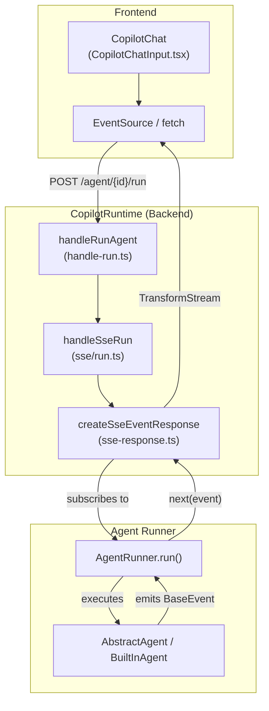
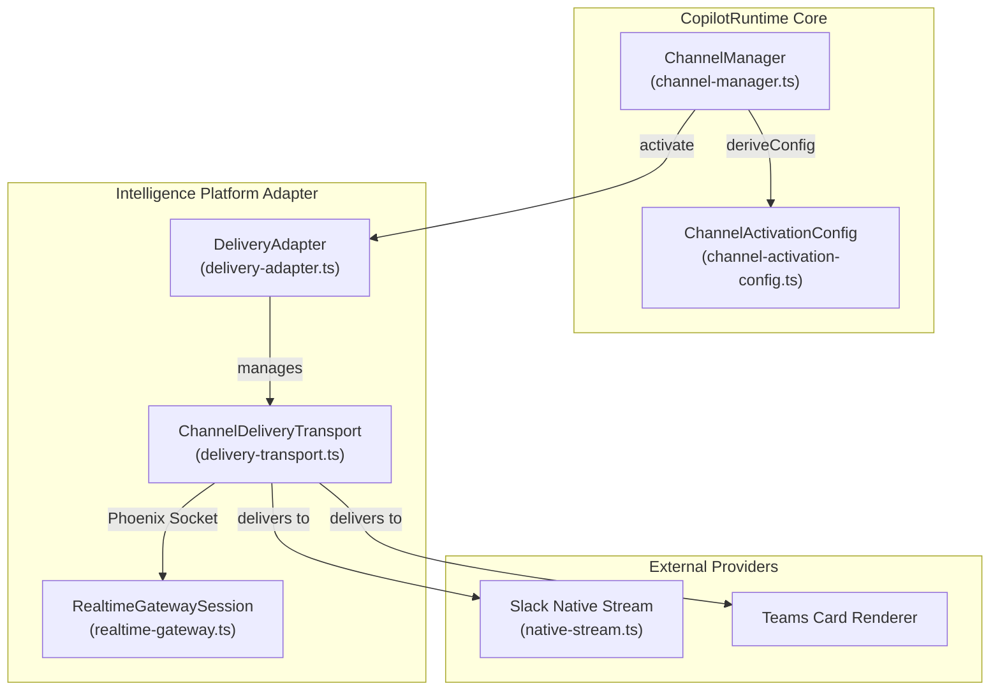

<!-- source: DeepWiki mcp.deepwiki.com · repo CopilotKit/CopilotKit · page 4.4 Real-time Event Streaming · fetched 2026-10-30 -->

# Real-time Event Streaming

Relevant source files

The following files were used as context for generating this wiki page:

- [.claude/docs/architecture.md](.claude/docs/architecture.md)
- [packages/channels-intelligence/src/content-parts.ts](packages/channels-intelligence/src/content-parts.ts)
- [packages/channels-intelligence/src/delivery-adapter-final.test.ts](packages/channels-intelligence/src/delivery-adapter-final.test.ts)
- [packages/channels-intelligence/src/delivery-adapter-postfile.test.ts](packages/channels-intelligence/src/delivery-adapter-postfile.test.ts)
- [packages/channels-intelligence/src/delivery-adapter-slack-stream.test.ts](packages/channels-intelligence/src/delivery-adapter-slack-stream.test.ts)
- [packages/channels-intelligence/src/delivery-adapter.concurrency.test.ts](packages/channels-intelligence/src/delivery-adapter.concurrency.test.ts)
- [packages/channels-intelligence/src/delivery-adapter.ts](packages/channels-intelligence/src/delivery-adapter.ts)
- [packages/channels-intelligence/src/delivery-channel-name.test.ts](packages/channels-intelligence/src/delivery-channel-name.test.ts)
- [packages/channels-intelligence/src/delivery-charge.test.ts](packages/channels-intelligence/src/delivery-charge.test.ts)
- [packages/channels-intelligence/src/delivery-contracts.test.ts](packages/channels-intelligence/src/delivery-contracts.test.ts)
- [packages/channels-intelligence/src/delivery-contracts.ts](packages/channels-intelligence/src/delivery-contracts.ts)
- [packages/channels-intelligence/src/delivery-history.test.ts](packages/channels-intelligence/src/delivery-history.test.ts)
- [packages/channels-intelligence/src/delivery-test-gateway.ts](packages/channels-intelligence/src/delivery-test-gateway.ts)
- [packages/channels-intelligence/src/delivery-transcript.test.ts](packages/channels-intelligence/src/delivery-transcript.test.ts)
- [packages/channels-intelligence/src/delivery-transcript.ts](packages/channels-intelligence/src/delivery-transcript.ts)
- [packages/channels-intelligence/src/delivery-transport.test.ts](packages/channels-intelligence/src/delivery-transport.test.ts)
- [packages/channels-intelligence/src/delivery-transport.ts](packages/channels-intelligence/src/delivery-transport.ts)
- [packages/channels-intelligence/src/delivery-typing.test.ts](packages/channels-intelligence/src/delivery-typing.test.ts)
- [packages/channels-intelligence/src/index.ts](packages/channels-intelligence/src/index.ts)
- [packages/channels-intelligence/src/realtime-gateway-launcher-provider-seam.test.ts](packages/channels-intelligence/src/realtime-gateway-launcher-provider-seam.test.ts)
- [packages/channels-intelligence/src/realtime-gateway-launcher.ts](packages/channels-intelligence/src/realtime-gateway-launcher.ts)
- [packages/channels-intelligence/src/realtime-gateway-project-join.test.ts](packages/channels-intelligence/src/realtime-gateway-project-join.test.ts)
- [packages/channels-intelligence/src/realtime-gateway-provider-states.test.ts](packages/channels-intelligence/src/realtime-gateway-provider-states.test.ts)
- [packages/channels-intelligence/src/realtime-gateway-retryability.test.ts](packages/channels-intelligence/src/realtime-gateway-retryability.test.ts)
- [packages/channels-intelligence/src/realtime-gateway.test.ts](packages/channels-intelligence/src/realtime-gateway.test.ts)
- [packages/channels-intelligence/src/realtime-gateway.ts](packages/channels-intelligence/src/realtime-gateway.ts)
- [packages/channels-intelligence/src/runtime.ts](packages/channels-intelligence/src/runtime.ts)
- [packages/channels-slack/src/__tests__/chunked-message-stream.test.ts](packages/channels-slack/src/__tests__/chunked-message-stream.test.ts)
- [packages/channels-slack/src/__tests__/event-renderer.test.ts](packages/channels-slack/src/__tests__/event-renderer.test.ts)
- [packages/channels-slack/src/__tests__/native-renderer.test.ts](packages/channels-slack/src/__tests__/native-renderer.test.ts)
- [packages/channels-slack/src/__tests__/native-stream.test.ts](packages/channels-slack/src/__tests__/native-stream.test.ts)
- [packages/channels-slack/src/adapter.ts](packages/channels-slack/src/adapter.ts)
- [packages/channels-slack/src/chunked-message-stream.ts](packages/channels-slack/src/chunked-message-stream.ts)
- [packages/channels-slack/src/event-renderer.ts](packages/channels-slack/src/event-renderer.ts)
- [packages/channels-slack/src/native-stream.ts](packages/channels-slack/src/native-stream.ts)
- [packages/channels-ui/src/types.ts](packages/channels-ui/src/types.ts)
- [packages/core/src/__tests__/debug-config-threading.test.ts](packages/core/src/__tests__/debug-config-threading.test.ts)
- [packages/core/src/__tests__/test-utils.ts](packages/core/src/__tests__/test-utils.ts)
- [packages/runtime/src/v2/runtime/__tests__/agent-header-precedence.test.ts](packages/runtime/src/v2/runtime/__tests__/agent-header-precedence.test.ts)
- [packages/runtime/src/v2/runtime/__tests__/agent-utils-header-forwarding.test.ts](packages/runtime/src/v2/runtime/__tests__/agent-utils-header-forwarding.test.ts)
- [packages/runtime/src/v2/runtime/__tests__/agents-factory.test.ts](packages/runtime/src/v2/runtime/__tests__/agents-factory.test.ts)
- [packages/runtime/src/v2/runtime/__tests__/channels-integration.test.ts](packages/runtime/src/v2/runtime/__tests__/channels-integration.test.ts)
- [packages/runtime/src/v2/runtime/__tests__/debug-sse-response.test.ts](packages/runtime/src/v2/runtime/__tests__/debug-sse-response.test.ts)
- [packages/runtime/src/v2/runtime/__tests__/handle-connect.test.ts](packages/runtime/src/v2/runtime/__tests__/handle-connect.test.ts)
- [packages/runtime/src/v2/runtime/__tests__/handle-run.test.ts](packages/runtime/src/v2/runtime/__tests__/handle-run.test.ts)
- [packages/runtime/src/v2/runtime/__tests__/handler-channels-types.test.ts](packages/runtime/src/v2/runtime/__tests__/handler-channels-types.test.ts)
- [packages/runtime/src/v2/runtime/__tests__/handler-channels.test.ts](packages/runtime/src/v2/runtime/__tests__/handler-channels.test.ts)
- [packages/runtime/src/v2/runtime/__tests__/header-utils.test.ts](packages/runtime/src/v2/runtime/__tests__/header-utils.test.ts)
- [packages/runtime/src/v2/runtime/__tests__/intelligence-lock-heartbeat.test.ts](packages/runtime/src/v2/runtime/__tests__/intelligence-lock-heartbeat.test.ts)
- [packages/runtime/src/v2/runtime/__tests__/intelligence-run-telemetry.test.ts](packages/runtime/src/v2/runtime/__tests__/intelligence-run-telemetry.test.ts)
- [packages/runtime/src/v2/runtime/__tests__/thread-names.test.ts](packages/runtime/src/v2/runtime/__tests__/thread-names.test.ts)
- [packages/runtime/src/v2/runtime/core/__tests__/channel-activation-config.test.ts](packages/runtime/src/v2/runtime/core/__tests__/channel-activation-config.test.ts)
- [packages/runtime/src/v2/runtime/core/__tests__/channel-manager-provider-leg.test.ts](packages/runtime/src/v2/runtime/core/__tests__/channel-manager-provider-leg.test.ts)
- [packages/runtime/src/v2/runtime/core/__tests__/channel-manager-reconnect.test.ts](packages/runtime/src/v2/runtime/core/__tests__/channel-manager-reconnect.test.ts)
- [packages/runtime/src/v2/runtime/core/__tests__/channel-manager-recovery.test.ts](packages/runtime/src/v2/runtime/core/__tests__/channel-manager-recovery.test.ts)
- [packages/runtime/src/v2/runtime/core/__tests__/channel-manager.test.ts](packages/runtime/src/v2/runtime/core/__tests__/channel-manager.test.ts)
- [packages/runtime/src/v2/runtime/core/channel-activation-config.ts](packages/runtime/src/v2/runtime/core/channel-activation-config.ts)
- [packages/runtime/src/v2/runtime/core/channel-manager.ts](packages/runtime/src/v2/runtime/core/channel-manager.ts)
- [packages/runtime/src/v2/runtime/core/fetch-cors.ts](packages/runtime/src/v2/runtime/core/fetch-cors.ts)
- [packages/runtime/src/v2/runtime/core/runtime.ts](packages/runtime/src/v2/runtime/core/runtime.ts)
- [packages/runtime/src/v2/runtime/handlers/handle-connect.ts](packages/runtime/src/v2/runtime/handlers/handle-connect.ts)
- [packages/runtime/src/v2/runtime/handlers/handle-run.ts](packages/runtime/src/v2/runtime/handlers/handle-run.ts)
- [packages/runtime/src/v2/runtime/handlers/handle-stop.ts](packages/runtime/src/v2/runtime/handlers/handle-stop.ts)
- [packages/runtime/src/v2/runtime/handlers/header-utils.ts](packages/runtime/src/v2/runtime/handlers/header-utils.ts)
- [packages/runtime/src/v2/runtime/handlers/intelligence/connect.ts](packages/runtime/src/v2/runtime/handlers/intelligence/connect.ts)
- [packages/runtime/src/v2/runtime/handlers/intelligence/run.ts](packages/runtime/src/v2/runtime/handlers/intelligence/run.ts)
- [packages/runtime/src/v2/runtime/handlers/intelligence/thread-names.ts](packages/runtime/src/v2/runtime/handlers/intelligence/thread-names.ts)
- [packages/runtime/src/v2/runtime/handlers/shared/agent-utils.ts](packages/runtime/src/v2/runtime/handlers/shared/agent-utils.ts)
- [packages/runtime/src/v2/runtime/handlers/shared/json-response.ts](packages/runtime/src/v2/runtime/handlers/shared/json-response.ts)
- [packages/runtime/src/v2/runtime/handlers/shared/sse-response.ts](packages/runtime/src/v2/runtime/handlers/shared/sse-response.ts)
- [packages/runtime/src/v2/runtime/handlers/sse/__tests__/sse-connect-agent-id.test.ts](packages/runtime/src/v2/runtime/handlers/sse/__tests__/sse-connect-agent-id.test.ts)
- [packages/runtime/src/v2/runtime/handlers/sse/connect.ts](packages/runtime/src/v2/runtime/handlers/sse/connect.ts)
- [packages/runtime/src/v2/runtime/handlers/sse/run.ts](packages/runtime/src/v2/runtime/handlers/sse/run.ts)
- [packages/runtime/src/v2/runtime/index.ts](packages/runtime/src/v2/runtime/index.ts)
- [packages/runtime/src/v2/runtime/runner/__tests__/bounded-thread-store.test.ts](packages/runtime/src/v2/runtime/runner/__tests__/bounded-thread-store.test.ts)
- [packages/runtime/src/v2/runtime/runner/__tests__/integration/kind-gateway-drain-runner.ts](packages/runtime/src/v2/runtime/runner/__tests__/integration/kind-gateway-drain-runner.ts)
- [packages/runtime/src/v2/runtime/runner/__tests__/intelligence-runner.test.ts](packages/runtime/src/v2/runtime/runner/__tests__/intelligence-runner.test.ts)
- [packages/runtime/src/v2/runtime/runner/agent-runner.ts](packages/runtime/src/v2/runtime/runner/agent-runner.ts)
- [packages/runtime/src/v2/runtime/runner/intelligence.ts](packages/runtime/src/v2/runtime/runner/intelligence.ts)
- [packages/shared/src/__tests__/debug.test.ts](packages/shared/src/__tests__/debug.test.ts)
- [packages/shared/src/debug.ts](packages/shared/src/debug.ts)

This page documents the event streaming architecture used to relay AG-UI protocol events between backend agents and frontend subscribers in real time. The system supports standard SSE (Server-Sent Events) for request-scoped communication and Phoenix WebSocket-based streaming for persistent agent interactions and managed external channels (Slack, Teams).

---

## Overview

CopilotKit utilizes a real-time event stream to provide a responsive agentic experience. When an agent runs, it emits a sequence of events (text deltas, tool calls, state updates) that are streamed to the frontend.

The runtime supports two primary streaming modes:
1.  **SSE (Server-Sent Events)**: The default for standard LLM adapters and stateless agent runs, handled via `handleSseRun` [packages/runtime/src/v2/runtime/handlers/sse/run.ts:1]().
2.  **Intelligence Streaming (WebSockets)**: Used by the v2 architecture for persistent threads and managed channels, providing bidirectional capabilities and robust re-connection via `IntelligenceAgentRunner` [packages/runtime/src/v2/runtime/runner/intelligence.ts:73-81]().

**Key Event Types**:
- `RUN_STARTED` / `RUN_FINISHED`: Lifecycle markers for an agent execution [packages/runtime/src/v2/runtime/handlers/shared/sse-response.ts:85-158]().
- `TEXT_MESSAGE_START` / `TEXT_MESSAGE_CONTENT` / `TEXT_MESSAGE_END`: Incremental text updates [packages/runtime/src/v2/runtime/runner/__tests__/intelligence-runner.test.ts:9-11]().
- `TOOL_CALL_START` / `TOOL_CALL_ARGS` / `TOOL_CALL_END`: Incremental tool execution progress [packages/runtime/src/v2/runtime/handlers/shared/sse-response.ts:194-204]().
- `STATE_SNAPSHOT` / `STATE_DELTA`: Synchronization of agent and frontend state [packages/runtime/src/v2/runtime/handlers/shared/sse-response.ts:205-207]().

Sources: [packages/runtime/src/v2/runtime/handlers/shared/sse-response.ts:1-212](), [packages/runtime/src/v2/runtime/runner/intelligence.ts:1-18]()

---

## SSE Architecture

For standard agent runs, the `CopilotRuntime` utilizes a `TransformStream` to pipe events from an RxJS `Observable` (provided by the `AgentRunner`) into a standard HTTP response with the `text/event-stream` content type.

### Data Flow Diagram

Title: SSE Agent Run Data Flow

Sources: [packages/runtime/src/v2/runtime/handlers/shared/sse-response.ts:24-34](), [packages/runtime/src/v2/runtime/handlers/handle-run.ts:89-97](), [packages/runtime/src/v2/runtime/handlers/shared/sse-response.ts:115-129]()

### Implementation Details
- **Encoding**: Events are encoded and written to the `TransformStream` in `createSseEventResponse` [packages/runtime/src/v2/runtime/handlers/shared/sse-response.ts:115-140]().
- **Lifecycle**: The stream remains open until the `Observable` completes or the client aborts the request. `RUN_FINISHED` or `RUN_ERROR` typically trigger the completion [packages/runtime/src/v2/runtime/handlers/shared/sse-response.ts:145-168]().
- **Telemetry**: The runtime captures telemetry events to track request volume and configuration [packages/runtime/src/v2/runtime/core/runtime.ts:41]().

---

## Managed Channels and WebSocket Streaming

The Intelligence mode supports long-lived, managed channels (e.g., Slack, Teams) via the `ChannelManager`. This system handles lazy activation of persistent listeners through a Realtime Gateway.

### Component Map

Title: Managed Channel Activation and Transport

Sources: [packages/runtime/src/v2/runtime/core/channel-manager.ts:33-55](), [packages/channels-intelligence/src/delivery-adapter.ts:135-151](), [packages/channels-intelligence/src/delivery-transport.ts:147-171](), [packages/channels-slack/src/native-stream.ts:60-75]()

### Managed Channel Lifecycle
- **Lazy Activation**: Activation is triggered by the `ChannelManager.activate()` method [packages/runtime/src/v2/runtime/core/channel-manager.ts:78-84]().
- **Status Tracking**: The manager tracks statuses including `connecting`, `online`, `setup_required`, and `reconnecting`. `setup_required` indicates a declared channel has no managed provider (e.g., Slack App) bound yet [packages/runtime/src/v2/runtime/core/channel-manager.ts:40-44]().
- **Transport Legs**: The system distinguishes between the `transport` leg (socket health) and the `provider` leg (external app health) to provide accurate status reporting [packages/runtime/src/v2/runtime/core/channel-manager.ts:100-107]().
- **Native Streaming**: For Slack, the runtime supports the `chat.startStream` API, allowing raw markdown deltas and structured chunks [packages/channels-slack/src/native-stream.ts:7-12]().

---

## AG-UI Event Types

The stream transmits `BaseEvent` objects. Key event types handled by the runtime and agents include:

| Event Type | Purpose | Implementation Detail |
| :--- | :--- | :--- |
| `RUN_STARTED` | Signals the start of agent execution | Contains `threadId` and `runId` [packages/runtime/src/v2/runtime/handlers/shared/sse-response.ts:85-89](). |
| `TEXT_MESSAGE_START` | Signals beginning of a text response | Triggers UI typing indicators [packages/runtime/src/v2/runtime/runner/__tests__/intelligence-runner.test.ts:9](). |
| `TEXT_MESSAGE_CONTENT` | Incremental text deltas | Contains the `content` or `delta` [packages/runtime/src/v2/runtime/runner/__tests__/intelligence-runner.test.ts:10](). |
| `STATE_SNAPSHOT` | Synchronizes full agent state | Used for generative UI synchronization [packages/runtime/src/v2/runtime/handlers/shared/sse-response.ts:205-206](). |
| `STATE_DELTA` | Incremental state changes | Efficient updates for large state objects [packages/runtime/src/v2/runtime/handlers/shared/sse-response.ts:207](). |
| `RUN_FINISHED` | Signals successful completion | Closes the stream and releases resources [packages/runtime/src/v2/runtime/handlers/shared/sse-response.ts:158-167](). |

Sources: [packages/runtime/src/v2/runtime/handlers/shared/sse-response.ts:194-212](), [packages/runtime/src/v2/runtime/runner/intelligence.ts:10-15]()

---

## Intelligence Runner and Thread Management

The `IntelligenceAgentRunner` manages WebSocket-based agent execution, particularly for persistent threads.

- **Socket Isolation**: Each run/connect gets its own Phoenix socket to ensure that failures on one thread do not affect others [packages/runtime/src/v2/runtime/runner/intelligence.ts:84-89]().
- **Exponential Backoff**: The runner implements custom backoff for both WebSocket reconnection and channel rejoining [packages/runtime/src/v2/runtime/runner/intelligence.ts:104-118]().
- **Event Sequencing**: Every event is stamped with `cpki_event_id` and `cpki_event_seq` to ensure reliable ordering and deduplication at the gateway [packages/runtime/src/v2/runtime/runner/intelligence.ts:151-177]().
- **Batching**: The runner supports `runner_event_batch_v1`, allowing multiple events to be flushed in a single push for efficiency [packages/runtime/src/v2/runtime/runner/intelligence.ts:68-70]().

Sources: [packages/runtime/src/v2/runtime/runner/intelligence.ts:73-177]()

---

## Error Handling and Recovery

Streaming errors are handled at multiple levels:
- **SSE Level**: If a write fails (e.g., client disconnect), the `TransformStream` writer is closed and the RxJS subscription is cancelled [packages/runtime/src/v2/runtime/handlers/shared/sse-response.ts:130-143]().
- **Agent Level**: If an agent throws during execution, the runner catches the error and emits it through the observable, which the SSE handler logs and uses to close the stream [packages/runtime/src/v2/runtime/handlers/shared/sse-response.ts:145-157]().
- **Channel Recovery**: The `ChannelManager` reflects the health status via `onStateChange`, delegating actual reconnection to the underlying Phoenix socket [packages/runtime/src/v2/runtime/core/channel-manager.ts:51-54]().
- **Delivery Failures**: In managed channels, if a provider call fails (e.g., Slack API error), the `ChannelProviderDeliveryError` records the terminal state and notifies the gateway [packages/channels-intelligence/src/delivery-transport.ts:140-159]().

Sources: [packages/runtime/src/v2/runtime/handlers/shared/sse-response.ts:130-182](), [packages/runtime/src/v2/runtime/core/channel-manager.ts:33-70](), [packages/channels-intelligence/src/delivery-transport.ts:140-171]()

---

