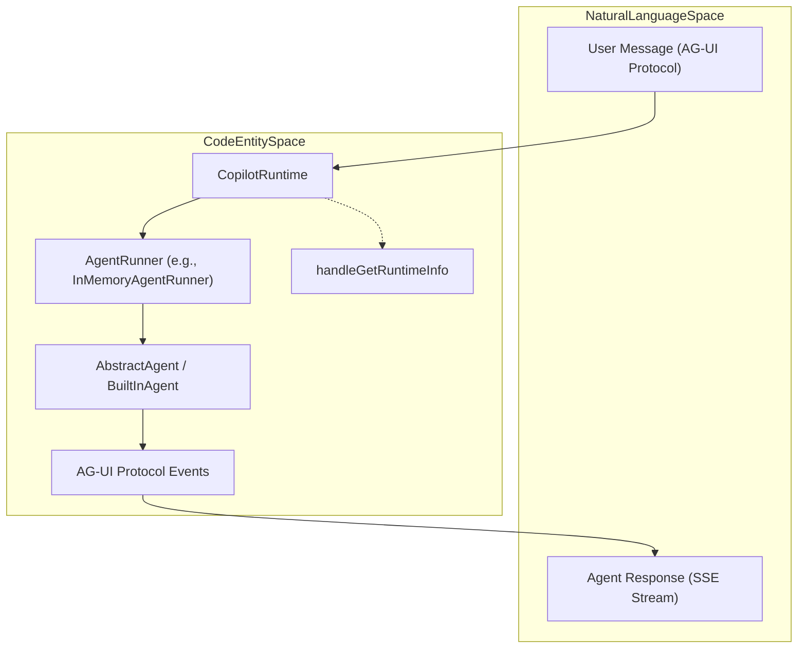
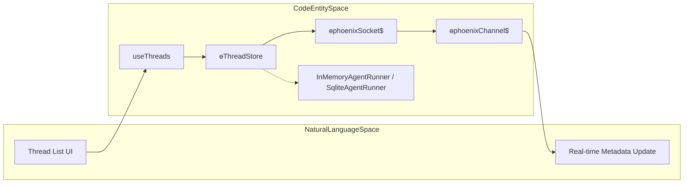

<!-- source: DeepWiki mcp.deepwiki.com · repo CopilotKit/CopilotKit · page 4.5 Built-in Agent and Persistence · fetched 2026-10-30 -->

# Built-in Agent and Persistence

Relevant source files

The following files were used as context for generating this wiki page:

- [packages/angular/src/lib/chat-configuration.spec.ts](packages/angular/src/lib/chat-configuration.spec.ts)
- [packages/angular/src/lib/chat-configuration.ts](packages/angular/src/lib/chat-configuration.ts)
- [packages/core/src/__tests__/core-thread-store-auto-unregister.test.ts](packages/core/src/__tests__/core-thread-store-auto-unregister.test.ts)
- [packages/core/src/__tests__/thread-store-registry.test.ts](packages/core/src/__tests__/thread-store-registry.test.ts)
- [packages/core/src/__tests__/threads.test.ts](packages/core/src/__tests__/threads.test.ts)
- [packages/core/src/core/thread-store-registry.ts](packages/core/src/core/thread-store-registry.ts)
- [packages/core/src/threads.ts](packages/core/src/threads.ts)
- [packages/core/src/types.ts](packages/core/src/types.ts)
- [packages/react-core/src/v2/hooks/__tests__/use-threads.test.tsx](packages/react-core/src/v2/hooks/__tests__/use-threads.test.tsx)
- [packages/react-core/src/v2/hooks/use-threads.tsx](packages/react-core/src/v2/hooks/use-threads.tsx)
- [packages/runtime/src/lib/__tests__/telemetry-disclosure.test.ts](packages/runtime/src/lib/__tests__/telemetry-disclosure.test.ts)
- [packages/runtime/src/lib/telemetry-disclosure.ts](packages/runtime/src/lib/telemetry-disclosure.ts)
- [packages/runtime/src/v2/runtime/__tests__/get-runtime-info.test.ts](packages/runtime/src/v2/runtime/__tests__/get-runtime-info.test.ts)
- [packages/runtime/src/v2/runtime/__tests__/handle-threads.test.ts](packages/runtime/src/v2/runtime/__tests__/handle-threads.test.ts)
- [packages/runtime/src/v2/runtime/handlers/get-runtime-info.ts](packages/runtime/src/v2/runtime/handlers/get-runtime-info.ts)
- [packages/runtime/src/v2/runtime/handlers/handle-threads.ts](packages/runtime/src/v2/runtime/handlers/handle-threads.ts)
- [packages/runtime/src/v2/runtime/handlers/intelligence/threads.ts](packages/runtime/src/v2/runtime/handlers/intelligence/threads.ts)
- [packages/runtime/src/v2/runtime/runner/__tests__/finalize-events.test.ts](packages/runtime/src/v2/runtime/runner/__tests__/finalize-events.test.ts)
- [packages/runtime/src/v2/runtime/runner/__tests__/in-memory-runner.test.ts](packages/runtime/src/v2/runtime/runner/__tests__/in-memory-runner.test.ts)
- [packages/runtime/src/v2/runtime/runner/in-memory.ts](packages/runtime/src/v2/runtime/runner/in-memory.ts)
- [packages/shared/src/finalize-events.ts](packages/shared/src/finalize-events.ts)
- [packages/shared/src/utils/types.ts](packages/shared/src/utils/types.ts)
- [packages/web-inspector/src/__tests__/web-inspector.spec.ts](packages/web-inspector/src/__tests__/web-inspector.spec.ts)
- [packages/web-inspector/src/index.ts](packages/web-inspector/src/index.ts)
- [packages/web-inspector/src/lib/__tests__/telemetry.test.ts](packages/web-inspector/src/lib/__tests__/telemetry.test.ts)
- [packages/web-inspector/src/lib/persistence.ts](packages/web-inspector/src/lib/persistence.ts)
- [packages/web-inspector/src/lib/telemetry.ts](packages/web-inspector/src/lib/telemetry.ts)
- [packages/web-inspector/src/styles/generated.css](packages/web-inspector/src/styles/generated.css)
- [showcase/aimock/d6/built-in-agent/a2ui-recovery.json](showcase/aimock/d6/built-in-agent/a2ui-recovery.json)
- [showcase/aimock/d6/built-in-agent/gen-ui-a2ui-fixed.json](showcase/aimock/d6/built-in-agent/gen-ui-a2ui-fixed.json)
- [showcase/aimock/d6/built-in-agent/gen-ui-declarative.json](showcase/aimock/d6/built-in-agent/gen-ui-declarative.json)
- [showcase/aimock/d6/built-in-agent/shared-state-read.json](showcase/aimock/d6/built-in-agent/shared-state-read.json)
- [showcase/aimock/d6/ms-agent-dotnet/a2ui-recovery.json](showcase/aimock/d6/ms-agent-dotnet/a2ui-recovery.json)
- [showcase/harness/src/probes/scripts/d5-a2ui-recovery.ts](showcase/harness/src/probes/scripts/d5-a2ui-recovery.ts)
- [showcase/integrations/built-in-agent/PARITY_NOTES.md](showcase/integrations/built-in-agent/PARITY_NOTES.md)
- [showcase/integrations/built-in-agent/manifest.yaml](showcase/integrations/built-in-agent/manifest.yaml)
- [showcase/integrations/built-in-agent/src/app/api/copilotkit-reasoning/route.ts](showcase/integrations/built-in-agent/src/app/api/copilotkit-reasoning/route.ts)
- [showcase/integrations/built-in-agent/src/app/api/copilotkit/route.ts](showcase/integrations/built-in-agent/src/app/api/copilotkit/route.ts)
- [showcase/integrations/built-in-agent/src/app/api/smoke/route.ts](showcase/integrations/built-in-agent/src/app/api/smoke/route.ts)
- [showcase/integrations/built-in-agent/src/app/demos/gen-ui-tool-based/page.tsx](showcase/integrations/built-in-agent/src/app/demos/gen-ui-tool-based/page.tsx)
- [showcase/integrations/built-in-agent/src/app/demos/hitl-in-chat/page.tsx](showcase/integrations/built-in-agent/src/app/demos/hitl-in-chat/page.tsx)
- [showcase/integrations/built-in-agent/src/app/demos/subagents/delegation-log.tsx](showcase/integrations/built-in-agent/src/app/demos/subagents/delegation-log.tsx)
- [showcase/integrations/built-in-agent/src/app/demos/subagents/page.tsx](showcase/integrations/built-in-agent/src/app/demos/subagents/page.tsx)
- [showcase/integrations/built-in-agent/src/app/demos/subagents/subagent-activity-card.tsx](showcase/integrations/built-in-agent/src/app/demos/subagents/subagent-activity-card.tsx)
- [showcase/integrations/built-in-agent/src/app/demos/subagents/supervisor-activity-banner.tsx](showcase/integrations/built-in-agent/src/app/demos/subagents/supervisor-activity-banner.tsx)
- [showcase/integrations/built-in-agent/src/lib/factory/a2ui-factory.ts](showcase/integrations/built-in-agent/src/lib/factory/a2ui-factory.ts)
- [showcase/integrations/built-in-agent/src/lib/factory/a2ui-fixed-schema-factory.ts](showcase/integrations/built-in-agent/src/lib/factory/a2ui-fixed-schema-factory.ts)
- [showcase/integrations/built-in-agent/src/lib/factory/agentic-chat-factory.ts](showcase/integrations/built-in-agent/src/lib/factory/agentic-chat-factory.ts)
- [showcase/integrations/built-in-agent/src/lib/factory/byoc-hashbrown-factory.ts](showcase/integrations/built-in-agent/src/lib/factory/byoc-hashbrown-factory.ts)
- [showcase/integrations/built-in-agent/src/lib/factory/byoc-json-render-factory.ts](showcase/integrations/built-in-agent/src/lib/factory/byoc-json-render-factory.ts)
- [showcase/integrations/built-in-agent/src/lib/factory/demo-prompts.ts](showcase/integrations/built-in-agent/src/lib/factory/demo-prompts.ts)
- [showcase/integrations/built-in-agent/src/lib/factory/mcp-apps-factory.ts](showcase/integrations/built-in-agent/src/lib/factory/mcp-apps-factory.ts)
- [showcase/integrations/built-in-agent/src/lib/factory/ogui-factory.ts](showcase/integrations/built-in-agent/src/lib/factory/ogui-factory.ts)
- [showcase/integrations/built-in-agent/src/lib/factory/reasoning-factory.ts](showcase/integrations/built-in-agent/src/lib/factory/reasoning-factory.ts)
- [showcase/integrations/built-in-agent/src/lib/factory/subagent-tools.ts](showcase/integrations/built-in-agent/src/lib/factory/subagent-tools.ts)
- [showcase/integrations/built-in-agent/src/lib/factory/tanstack-factory.test.ts](showcase/integrations/built-in-agent/src/lib/factory/tanstack-factory.test.ts)
- [showcase/integrations/built-in-agent/src/lib/factory/tanstack-factory.ts](showcase/integrations/built-in-agent/src/lib/factory/tanstack-factory.ts)
- [showcase/integrations/built-in-agent/vitest.config.ts](showcase/integrations/built-in-agent/vitest.config.ts)
- [showcase/integrations/ms-agent-dotnet/agent/RecoveryAgent.cs](showcase/integrations/ms-agent-dotnet/agent/RecoveryAgent.cs)
- [showcase/integrations/ms-agent-dotnet/src/app/api/copilotkit-a2ui-recovery/route.ts](showcase/integrations/ms-agent-dotnet/src/app/api/copilotkit-a2ui-recovery/route.ts)
- [showcase/integrations/ms-agent-dotnet/src/app/demos/a2ui-recovery/chat.tsx](showcase/integrations/ms-agent-dotnet/src/app/demos/a2ui-recovery/chat.tsx)
- [showcase/integrations/ms-agent-dotnet/src/app/demos/a2ui-recovery/page.tsx](showcase/integrations/ms-agent-dotnet/src/app/demos/a2ui-recovery/page.tsx)
- [showcase/integrations/ms-agent-dotnet/src/app/demos/a2ui-recovery/suggestions.ts](showcase/integrations/ms-agent-dotnet/src/app/demos/a2ui-recovery/suggestions.ts)

This section documents the built-in agent capabilities provided by `@copilotkit/runtime`, which leverages the Vercel AI SDK and Model Context Protocol (MCP). It also details the persistence layer, including `SqliteAgentRunner` and `InMemoryAgentRunner` for conversation state management, the `AgentCoreRunner` for AWS integration, and voice transcription services.

## Overview

CopilotKit provides a high-performance, built-in agent that implements the AG-UI Protocol. This agent is designed to bridge the gap between Large Language Models (LLMs) and application-specific tools, supporting real-time streaming, generative UI, and persistent conversation threads.

### Key Components
- **BuiltInAgent**: A flexible agent implementation that supports multiple LLM backends and custom streaming logic. It can operate in "Factory Mode" for full control or "Simple Mode" for quick model swapping.
- **MCP Integration**: Support for Model Context Protocol (MCP) clients to dynamically pull tools from external servers [packages/runtime/src/v2/runtime/handlers/get-runtime-info.ts:49-49]().
- **InMemoryAgentRunner**: The default runner that maintains conversation state in volatile memory using a process-global store [packages/runtime/src/v2/runtime/runner/in-memory.ts:3-6]().
- **SqliteAgentRunner**: A persistence provider that stores conversation state and history in a SQLite database, enabling state recovery across sessions.
- **AgentCoreRunner**: Integration for AWS Bedrock AgentCore, allowing CopilotKit to orchestrate agents hosted on AWS infrastructure.
- **TranscriptionServiceOpenAI**: A service for converting voice input to text using OpenAI's models [packages/runtime/src/v2/runtime/handlers/get-runtime-info.ts:10-10]().

---

## Built-in Agent Implementation

The built-in agent serves as the default intelligence engine. It is often used in a **named-agent registry** pattern where each frontend demo targets a specific agent ID [showcase/integrations/built-in-agent/PARITY_NOTES.md:34-38]().

### Model Support and Factory Mode
In "Factory Mode," developers define how the LLM is called. CopilotKit provides factories for various use cases:
- **Agentic Chat**: Standard conversational logic [showcase/integrations/built-in-agent/manifest.yaml:102-111]().
- **Reasoning**: Support for reasoning-capable models that emit reasoning events [showcase/integrations/built-in-agent/PARITY_NOTES.md:82-86]().
- **Generative UI**: Agents that return tool calls to render frontend components [showcase/integrations/built-in-agent/manifest.yaml:123-133]().

### Data Flow: Run Execution
Title: "Built-in Agent Run Execution Flow"

Sources: [packages/runtime/src/v2/runtime/runner/in-memory.ts:6-20](), [packages/runtime/src/v2/runtime/handlers/get-runtime-info.ts:1-20]()

---

## Persistence and Agent Runners

Agent Runners manage the lifecycle of an agent's execution and its state persistence.

### InMemoryAgentRunner
The `InMemoryAgentRunner` is the default runner. It manages threads in a process-global store with configurable limits to prevent memory exhaustion [packages/runtime/src/v2/runtime/runner/in-memory.ts:61-66]().

- **Concurrency**: Can be configured to `throw` or `supersede` when a concurrent run is requested on the same thread [packages/runtime/src/v2/runtime/runner/in-memory.ts:53-60]().
- **Memory Management**: Implements LRU eviction for threads and FIFO caps for runs per thread [packages/runtime/src/v2/runtime/runner/in-memory.ts:20-24](). It also supports a `maxBytes` ceiling to bound the total memory footprint of retained history [packages/runtime/src/v2/runtime/runner/in-memory.ts:42-42]().
- **Event Compaction**: Uses `compactEvents` from `@ag-ui/client` to manage the event history stored for each thread [packages/runtime/src/v2/runtime/runner/in-memory.ts:17-17]().

### SqliteAgentRunner
The `SqliteAgentRunner` provides a persistent storage backend using SQLite. It is designed to store conversation history and state snapshots, allowing agents to maintain context across multiple user sessions.

### AgentCoreRunner
The `AgentCoreRunner` integrates with AWS Bedrock AgentCore. It allows the `CopilotRuntime` to forward requests to agents hosted on AWS, managing the translation between AG-UI Protocol events and the AWS AgentCore communication format.

---

## Thread Management and Real-time Sync

Conversation threads are managed via the `useThreads` hook on the frontend, which interacts with the Intelligence platform or a local runtime.

### Thread Synchronization
Threads are kept in sync via a realtime WebSocket subscription using Phoenix channels [packages/core/src/threads.ts:31-37]().

- **Metadata Events**: The system listens for `thread_metadata` events (created, renamed, archived, deleted) to update the local thread list [packages/core/src/threads.ts:40-40]().
- **Activity Notifications**: `thread_run_activity` events notify the UI when an agent is active on a thread without necessarily changing its metadata [packages/core/src/threads.ts:41-41]().

### Data Flow: Thread Persistence
Title: "Thread State Persistence and Sync"

Sources: [packages/react-core/src/v2/hooks/use-threads.tsx:4-12](), [packages/core/src/threads.ts:31-41](), [packages/runtime/src/v2/runtime/runner/in-memory.ts:163-169]()

---

## Voice and Transcription

CopilotKit includes built-in support for voice interactions via the `TranscriptionService`.

### Transcription Service
The `TranscriptionService` (and its implementation `TranscriptionServiceOpenAI`) allows the runtime to process audio files and return text transcripts [packages/runtime/src/v2/runtime/handlers/get-runtime-info.test.ts:15-19]().

- **Runtime Advertisement**: The runtime info endpoint (`/info`) advertises whether transcription is enabled based on the service configuration [packages/runtime/src/v2/runtime/handlers/get-runtime-info.ts:104-104]().
- **Integration**: Audio files are sent to the transcription service, which typically wraps a provider like OpenAI Whisper, and the resulting text is fed back into the agent interaction loop.

| Component | Role | Source |
| :--- | :--- | :--- |
| `TranscriptionService` | Abstract base class for transcription providers | [packages/runtime/src/v2/runtime/handlers/get-runtime-info.ts:10-10]() |
| `handleGetRuntimeInfo` | Reports `audioFileTranscriptionEnabled` status | [packages/runtime/src/v2/runtime/handlers/get-runtime-info.ts:93-112]() |
| `CopilotRuntime` | Orchestrates the transcription service within the backend | [packages/runtime/src/v2/runtime/handlers/get-runtime-info.ts:148-153]() |

Sources: [packages/runtime/src/v2/runtime/runner/in-memory.ts:1-169](), [packages/core/src/threads.ts:1-118](), [packages/runtime/src/v2/runtime/handlers/get-runtime-info.ts:1-180](), [showcase/integrations/built-in-agent/PARITY_NOTES.md:1-60]()

---

