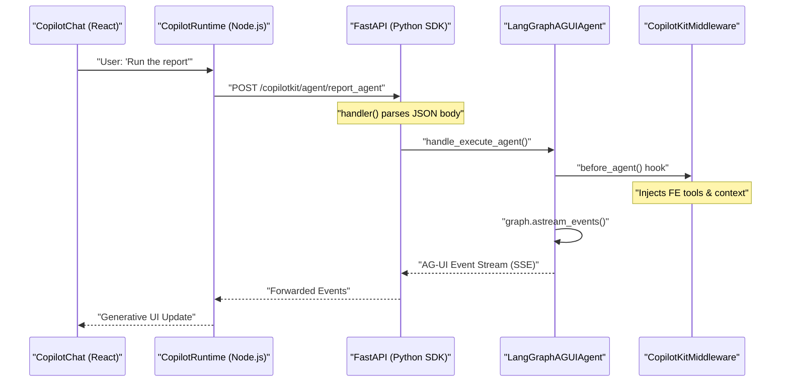

<!-- source: DeepWiki mcp.deepwiki.com · repo CopilotKit/CopilotKit · page 5 Python SDK · fetched 2026-10-30 -->

# Python SDK

<details>
<summary>Relevant source files</summary>

The following files were used as context for generating this wiki page:

- [examples/canvas/gemini/agent/main.py](examples/canvas/gemini/agent/main.py)
- [examples/v1/_legacy/saas-dynamic-dashboards/agent/agent.py](examples/v1/_legacy/saas-dynamic-dashboards/agent/agent.py)
- [packages/runtime/src/agents/langgraph/__tests__/event-source.test.ts](packages/runtime/src/agents/langgraph/__tests__/event-source.test.ts)
- [packages/runtime/src/lib/runtime/agent-integrations/langgraph/__tests__/dispatch-event-filtering.test.ts](packages/runtime/src/lib/runtime/agent-integrations/langgraph/__tests__/dispatch-event-filtering.test.ts)
- [packages/sdk-js/src/__tests__/error-handling.test.ts](packages/sdk-js/src/__tests__/error-handling.test.ts)
- [packages/sdk-js/src/__tests__/header-propagation.test.ts](packages/sdk-js/src/__tests__/header-propagation.test.ts)
- [packages/sdk-js/src/header-propagation.ts](packages/sdk-js/src/header-propagation.ts)
- [packages/sdk-js/src/index.ts](packages/sdk-js/src/index.ts)
- [packages/sdk-js/src/langgraph/__tests__/middleware.a2ui-params.test.ts](packages/sdk-js/src/langgraph/__tests__/middleware.a2ui-params.test.ts)
- [packages/sdk-js/src/langgraph/__tests__/middleware.test.ts](packages/sdk-js/src/langgraph/__tests__/middleware.test.ts)
- [packages/sdk-js/src/langgraph/__tests__/utils.test.ts](packages/sdk-js/src/langgraph/__tests__/utils.test.ts)
- [packages/sdk-js/src/langgraph/middleware.ts](packages/sdk-js/src/langgraph/middleware.ts)
- [packages/sdk-js/src/langgraph/utils.ts](packages/sdk-js/src/langgraph/utils.ts)
- [sdk-python/copilotkit/__init__.py](sdk-python/copilotkit/__init__.py)
- [sdk-python/copilotkit/agent.py](sdk-python/copilotkit/agent.py)
- [sdk-python/copilotkit/copilotkit_lg_middleware.py](sdk-python/copilotkit/copilotkit_lg_middleware.py)
- [sdk-python/copilotkit/crewai/crewai_sdk.py](sdk-python/copilotkit/crewai/crewai_sdk.py)
- [sdk-python/copilotkit/exc.py](sdk-python/copilotkit/exc.py)
- [sdk-python/copilotkit/header_propagation.py](sdk-python/copilotkit/header_propagation.py)
- [sdk-python/copilotkit/integrations/fastapi.py](sdk-python/copilotkit/integrations/fastapi.py)
- [sdk-python/copilotkit/langchain.py](sdk-python/copilotkit/langchain.py)
- [sdk-python/copilotkit/langgraph.py](sdk-python/copilotkit/langgraph.py)
- [sdk-python/copilotkit/langgraph_agui_agent.py](sdk-python/copilotkit/langgraph_agui_agent.py)
- [sdk-python/copilotkit/sdk.py](sdk-python/copilotkit/sdk.py)
- [sdk-python/poetry.lock](sdk-python/poetry.lock)
- [sdk-python/pyproject.toml](sdk-python/pyproject.toml)
- [sdk-python/tests/test_agui_agent.py](sdk-python/tests/test_agui_agent.py)
- [sdk-python/tests/test_copilotkit_lg_middleware.py](sdk-python/tests/test_copilotkit_lg_middleware.py)
- [sdk-python/tests/test_crewai_import_compat.py](sdk-python/tests/test_crewai_import_compat.py)
- [sdk-python/tests/test_emit_filtering.py](sdk-python/tests/test_emit_filtering.py)
- [sdk-python/tests/test_emit_tool_call_optional_id.py](sdk-python/tests/test_emit_tool_call_optional_id.py)
- [sdk-python/tests/test_header_propagation.py](sdk-python/tests/test_header_propagation.py)
- [sdk-python/uv.lock](sdk-python/uv.lock)
- [showcase/integrations/ms-agent-dotnet/agent/AimockHeaderContext.cs](showcase/integrations/ms-agent-dotnet/agent/AimockHeaderContext.cs)
- [showcase/integrations/ms-agent-dotnet/agent/AimockHeaderMiddleware.cs](showcase/integrations/ms-agent-dotnet/agent/AimockHeaderMiddleware.cs)
- [showcase/integrations/ms-agent-dotnet/agent/AimockHeaderPolicy.cs](showcase/integrations/ms-agent-dotnet/agent/AimockHeaderPolicy.cs)
- [showcase/integrations/ms-agent-dotnet/agent/tests/AimockHeaderPropagationTests.cs](showcase/integrations/ms-agent-dotnet/agent/tests/AimockHeaderPropagationTests.cs)
- [showcase/integrations/ms-agent-dotnet/agent/tests/SharedStateAgent.Tests.csproj](showcase/integrations/ms-agent-dotnet/agent/tests/SharedStateAgent.Tests.csproj)
- [showcase/integrations/spring-ai/src/main/java/com/copilotkit/showcase/springai/AimockHeaderContext.java](showcase/integrations/spring-ai/src/main/java/com/copilotkit/showcase/springai/AimockHeaderContext.java)
- [showcase/integrations/spring-ai/src/main/java/com/copilotkit/showcase/springai/AimockHeaderInterceptor.java](showcase/integrations/spring-ai/src/main/java/com/copilotkit/showcase/springai/AimockHeaderInterceptor.java)
- [showcase/integrations/spring-ai/src/main/java/com/copilotkit/showcase/springai/AimockHeaderRequestInterceptor.java](showcase/integrations/spring-ai/src/main/java/com/copilotkit/showcase/springai/AimockHeaderRequestInterceptor.java)
- [showcase/integrations/spring-ai/src/main/java/com/copilotkit/showcase/springai/AimockWebMvcConfig.java](showcase/integrations/spring-ai/src/main/java/com/copilotkit/showcase/springai/AimockWebMvcConfig.java)
- [showcase/integrations/spring-ai/src/main/java/com/copilotkit/showcase/springai/WebClientConfig.java](showcase/integrations/spring-ai/src/main/java/com/copilotkit/showcase/springai/WebClientConfig.java)

</details>


The CopilotKit Python SDK (`copilotkit` package) provides the backend tooling needed to build Python-based AI agents and expose them to a CopilotKit frontend via an HTTP API. It serves as the primary bridge for integrating frameworks like LangGraph and CrewAI into the CopilotKit ecosystem by implementing the AG-UI protocol.

For installation and environment setup, see [Python SDK Installation and Configuration](#5.1).

---

## Package Overview

The SDK lives in `sdk-python/` and is published as the `copilotkit` PyPI package. It is designed to work with modern Python asynchronous patterns and integrates deeply with the LangChain and LangGraph ecosystems.

| Attribute | Value |
|---|---|
| Package name | `copilotkit` |
| Python versions | `>=3.10, <3.15` |
| Core dependencies | `langgraph >=0.3.25`, `langchain >=0.3.0`, `ag-ui-langgraph >=0.0.42`, `fastapi >=0.115.0` |
| Optional extras | `crewai` (installed via `pip install copilotkit[crewai]`) |
| Build system | Poetry |

Sources: [sdk-python/pyproject.toml:1-48](), [sdk-python/poetry.lock:16-38]()

---

## Architecture

The SDK bridges the "Natural Language Space" (where users interact with chat) and the "Code Entity Space" (where graphs and actions execute). It uses a registry pattern to manage agents and actions, and a transport layer to expose them via FastAPI.

**Diagram: SDK Component Relationships**

```mermaid
graph TD
    subgraph "Transport_Layer_FastAPI"
        [add_fastapi_endpoint] --> [handler]
    end

    subgraph "Registry_Space"
        ["CopilotKitRemoteEndpoint"]
        [handler] --> ["CopilotKitRemoteEndpoint"]
    end

    subgraph "Agent_Entities"
        direction LR
        ["LangGraphAGUIAgent"]
        ["CrewAIAgent"]
        ["CopilotKitRemoteEndpoint"] --> ["LangGraphAGUIAgent"]
        ["CopilotKitRemoteEndpoint"] --> ["CrewAIAgent"]
    end

    subgraph "Execution_Graphs"
        ["langgraph.graph.CompiledStateGraph"]
        ["crewai.flow.Flow"]
        ["LangGraphAGUIAgent"] --> ["langgraph.graph.CompiledStateGraph"]
        ["CrewAIAgent"] --> ["crewai.flow.Flow"]
    end

    subgraph "Action_Space"
        ["copilotkit.Action"]
        ["CopilotKitRemoteEndpoint"] --> ["copilotkit.Action"]
    end

    subgraph "Middleware_Interceptors"
        ["CopilotKitMiddleware"]
        ["CopilotKitMiddleware"] -.-> ["install_httpx_hook"]
        ["install_httpx_hook"] -.-> ["set_forwarded_headers"]
    end
```

Sources: [sdk-python/copilotkit/sdk.py:66-213](), [sdk-python/copilotkit/integrations/fastapi.py:29-67](), [sdk-python/copilotkit/copilotkit_lg_middleware.py:1-40](), [sdk-python/copilotkit/header_propagation.py:104-123](), [sdk-python/copilotkit/langgraph_agui_agent.py:60-69]()

---

## Core Components

### 1. Registry and Transport
The `CopilotKitRemoteEndpoint` acts as a central hub for all Python-side logic. It is typically mounted to a FastAPI application using `add_fastapi_endpoint`.

- **`CopilotKitRemoteEndpoint`**: Holds `actions` and `agents`. Can take static lists or factory functions that use `CopilotKitContext` to dynamically return entities based on request headers or frontend properties. [sdk-python/copilotkit/sdk.py:66-213]()
- **FastAPI Integration**: Provides the HTTP interface via `add_fastapi_endpoint`. It handles `/info` for discovery and `/agent/{name}` for execution. For details, see [CopilotKitRemoteEndpoint and FastAPI](#5.3). [sdk-python/copilotkit/integrations/fastapi.py:29-67]()

### 2. LangGraph Integration
CopilotKit provides specialized agents and state management for LangGraph.
- **`LangGraphAGUIAgent`**: The primary class for wrapping LangGraph graphs. It extends `ag_ui_langgraph.LangGraphAgent` to handle custom CopilotKit events like `ManuallyEmitMessage` and `ManuallyEmitToolCall`. [sdk-python/copilotkit/langgraph_agui_agent.py:60-108]()
- **`CopilotKitMiddleware`**: A middleware for LangGraph that automates frontend tool injection, app context surfacing, and header propagation. [sdk-python/copilotkit/copilotkit_lg_middleware.py:1-40]()
- **`copilotkit_customize_config`**: Utility to configure how messages and tool calls are emitted via LangGraph metadata (e.g., `copilotkit:emit-messages`). [sdk-python/copilotkit/langgraph.py:167-174]()
- **Header Propagation**: The `install_httpx_hook` and `set_forwarded_headers` functions ensure that `x-aimock-*` and other tracing headers are forwarded from the inbound request to outbound LLM provider calls. [sdk-python/copilotkit/header_propagation.py:1-43]()

### 3. CrewAI Integration
The SDK includes support for CrewAI, allowing both `Crew` and `Flow` objects to be served as CopilotKit agents.
- **`crewai_flow_async_runner`**: Specialized runner that executes CrewAI flows and translates `FlowStartedEvent`, `MethodExecutionStartedEvent`, etc., into AG-UI protocol events. [sdk-python/copilotkit/crewai/crewai_sdk.py:77-134]()
- **Manual Emission**: Functions like `copilotkit_emit_message` and `copilotkit_emit_tool_call` allow long-running CrewAI tasks to update the UI. [sdk-python/copilotkit/crewai/crewai_sdk.py:190-232]()
- For details, see [Python Actions and Custom Agents](#5.4).

---

## Data Flow: Natural Language to Code

The following diagram shows how a user message in the UI is transformed into a graph execution in Python.

**Diagram: Request Transformation Flow**



Sources: [sdk-python/copilotkit/integrations/fastapi.py:108-130](), [sdk-python/copilotkit/copilotkit_lg_middleware.py:1-40](), [sdk-python/copilotkit/sdk.py:185-205](), [sdk-python/tests/test_copilotkit_lg_middleware.py:1-23](), [sdk-python/copilotkit/langgraph_agui_agent.py:72-108]()

---

## Related Pages

- [Python SDK Installation and Configuration](#5.1) — Dependency management and Poetry/uv setup.
- [LangGraph Agent Integration](#5.2) — Building agents with LangGraph, `CopilotKitMiddleware`, and `ag-ui-langgraph`.
- [CopilotKitRemoteEndpoint and FastAPI](#5.3) — Serving agents and actions over HTTP with header propagation.
- [Python Actions and Custom Agents](#5.4) — Defining custom handlers and CrewAI integration.
- [Event Filtering and Metadata](#5.5) — Controlling event emission and handling manual emission events.

Sources: [sdk-python/copilotkit/sdk.py:1-30](), [sdk-python/copilotkit/copilotkit_lg_middleware.py:1-15](), [sdk-python/copilotkit/header_propagation.py:1-43](), [sdk-python/copilotkit/langgraph.py:167-216]()

---

