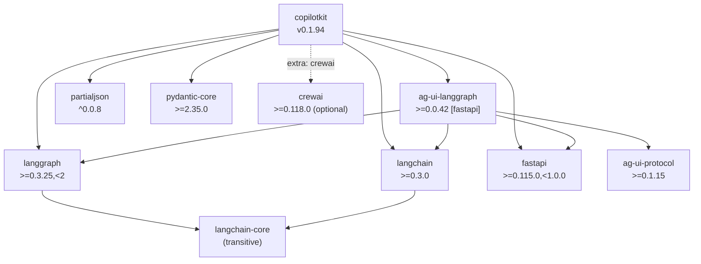
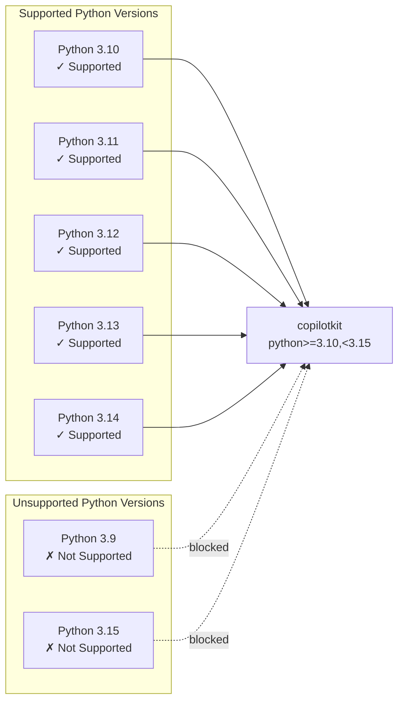
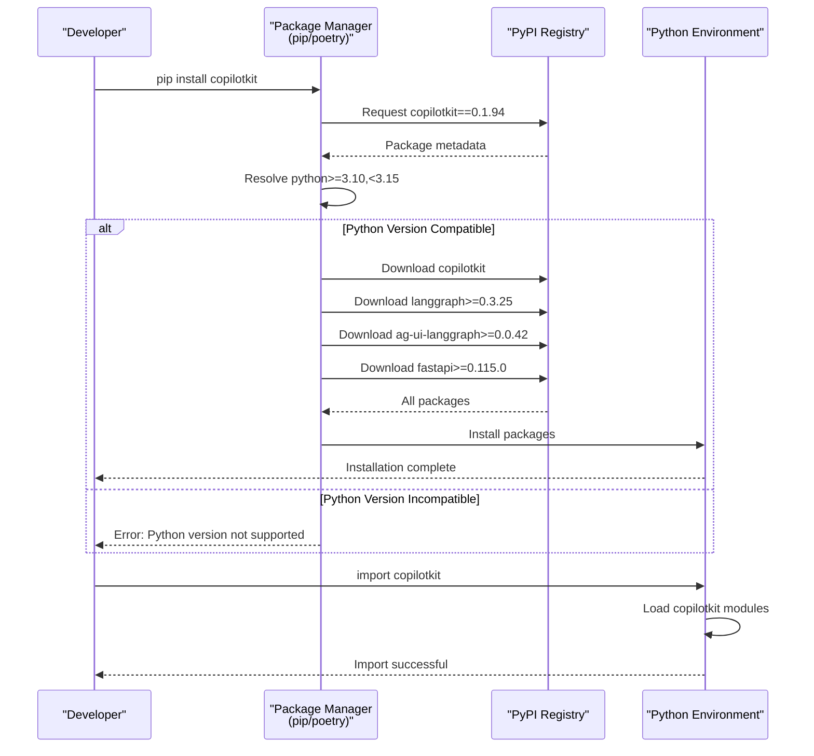
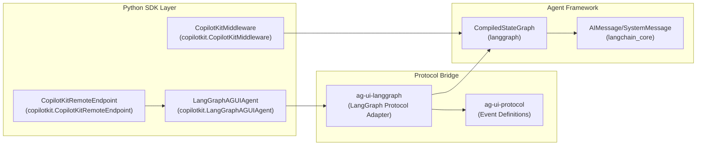
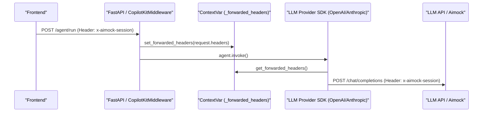

<!-- source: DeepWiki mcp.deepwiki.com · repo CopilotKit/CopilotKit · page 5.1 Python SDK Installation and Configuration · fetched 2026-10-30 -->

# Python SDK Installation and Configuration

<details>
<summary>Relevant source files</summary>

The following files were used as context for generating this wiki page:

- [examples/canvas/gemini/agent/main.py](examples/canvas/gemini/agent/main.py)
- [examples/v1/_legacy/saas-dynamic-dashboards/agent/agent.py](examples/v1/_legacy/saas-dynamic-dashboards/agent/agent.py)
- [packages/runtime/src/agents/langgraph/__tests__/event-source.test.ts](packages/runtime/src/agents/langgraph/__tests__/event-source.test.ts)
- [packages/runtime/src/lib/runtime/agent-integrations/langgraph/__tests__/dispatch-event-filtering.test.ts](packages/runtime/src/lib/runtime/agent-integrations/langgraph/__tests__/dispatch-event-filtering.test.ts)
- [packages/sdk-js/src/__tests__/error-handling.test.ts](packages/sdk-js/src/__tests__/error-handling.test.ts)
- [packages/sdk-js/src/__tests__/header-propagation.test.ts](packages/sdk-js/src/__tests__/header-propagation.test.ts)
- [packages/sdk-js/src/header-propagation.ts](packages/sdk-js/src/header-propagation.ts)
- [packages/sdk-js/src/index.ts](packages/sdk-js/src/index.ts)
- [packages/sdk-js/src/langgraph/__tests__/middleware.a2ui-params.test.ts](packages/sdk-js/src/langgraph/__tests__/middleware.a2ui-params.test.ts)
- [packages/sdk-js/src/langgraph/__tests__/middleware.test.ts](packages/sdk-js/src/langgraph/__tests__/middleware.test.ts)
- [packages/sdk-js/src/langgraph/__tests__/utils.test.ts](packages/sdk-js/src/langgraph/__tests__/utils.test.ts)
- [packages/sdk-js/src/langgraph/middleware.ts](packages/sdk-js/src/langgraph/middleware.ts)
- [packages/sdk-js/src/langgraph/utils.ts](packages/sdk-js/src/langgraph/utils.ts)
- [sdk-python/copilotkit/__init__.py](sdk-python/copilotkit/__init__.py)
- [sdk-python/copilotkit/agent.py](sdk-python/copilotkit/agent.py)
- [sdk-python/copilotkit/copilotkit_lg_middleware.py](sdk-python/copilotkit/copilotkit_lg_middleware.py)
- [sdk-python/copilotkit/crewai/crewai_sdk.py](sdk-python/copilotkit/crewai/crewai_sdk.py)
- [sdk-python/copilotkit/exc.py](sdk-python/copilotkit/exc.py)
- [sdk-python/copilotkit/header_propagation.py](sdk-python/copilotkit/header_propagation.py)
- [sdk-python/copilotkit/integrations/fastapi.py](sdk-python/copilotkit/integrations/fastapi.py)
- [sdk-python/copilotkit/langchain.py](sdk-python/copilotkit/langchain.py)
- [sdk-python/copilotkit/langgraph.py](sdk-python/copilotkit/langgraph.py)
- [sdk-python/copilotkit/langgraph_agui_agent.py](sdk-python/copilotkit/langgraph_agui_agent.py)
- [sdk-python/copilotkit/sdk.py](sdk-python/copilotkit/sdk.py)
- [sdk-python/poetry.lock](sdk-python/poetry.lock)
- [sdk-python/pyproject.toml](sdk-python/pyproject.toml)
- [sdk-python/tests/test_agui_agent.py](sdk-python/tests/test_agui_agent.py)
- [sdk-python/tests/test_copilotkit_lg_middleware.py](sdk-python/tests/test_copilotkit_lg_middleware.py)
- [sdk-python/tests/test_crewai_import_compat.py](sdk-python/tests/test_crewai_import_compat.py)
- [sdk-python/tests/test_emit_filtering.py](sdk-python/tests/test_emit_filtering.py)
- [sdk-python/tests/test_emit_tool_call_optional_id.py](sdk-python/tests/test_emit_tool_call_optional_id.py)
- [sdk-python/tests/test_header_propagation.py](sdk-python/tests/test_header_propagation.py)
- [sdk-python/uv.lock](sdk-python/uv.lock)
- [showcase/integrations/ms-agent-dotnet/agent/AimockHeaderContext.cs](showcase/integrations/ms-agent-dotnet/agent/AimockHeaderContext.cs)
- [showcase/integrations/ms-agent-dotnet/agent/AimockHeaderMiddleware.cs](showcase/integrations/ms-agent-dotnet/agent/AimockHeaderMiddleware.cs)
- [showcase/integrations/ms-agent-dotnet/agent/AimockHeaderPolicy.cs](showcase/integrations/ms-agent-dotnet/agent/AimockHeaderPolicy.cs)
- [showcase/integrations/ms-agent-dotnet/agent/tests/AimockHeaderPropagationTests.cs](showcase/integrations/ms-agent-dotnet/agent/tests/AimockHeaderPropagationTests.cs)
- [showcase/integrations/ms-agent-dotnet/agent/tests/SharedStateAgent.Tests.csproj](showcase/integrations/ms-agent-dotnet/agent/tests/SharedStateAgent.Tests.csproj)
- [showcase/integrations/spring-ai/src/main/java/com/copilotkit/showcase/springai/AimockHeaderContext.java](showcase/integrations/spring-ai/src/main/java/com/copilotkit/showcase/springai/AimockHeaderContext.java)
- [showcase/integrations/spring-ai/src/main/java/com/copilotkit/showcase/springai/AimockHeaderInterceptor.java](showcase/integrations/spring-ai/src/main/java/com/copilotkit/showcase/springai/AimockHeaderInterceptor.java)
- [showcase/integrations/spring-ai/src/main/java/com/copilotkit/showcase/springai/AimockHeaderRequestInterceptor.java](showcase/integrations/spring-ai/src/main/java/com/copilotkit/showcase/springai/AimockHeaderRequestInterceptor.java)
- [showcase/integrations/spring-ai/src/main/java/com/copilotkit/showcase/springai/AimockWebMvcConfig.java](showcase/integrations/spring-ai/src/main/java/com/copilotkit/showcase/springai/AimockWebMvcConfig.java)
- [showcase/integrations/spring-ai/src/main/java/com/copilotkit/showcase/springai/WebClientConfig.java](showcase/integrations/spring-ai/src/main/java/com/copilotkit/showcase/springai/WebClientConfig.java)

</details>


This page covers the installation and configuration of the CopilotKit Python SDK, including package managers, version requirements, core and optional dependencies, and basic setup procedures. For information about implementing LangGraph agents with the SDK, see [5.2 LangGraph Agent Integration](). For details on exposing agents via HTTP endpoints, see [5.3 CopilotKitRemoteEndpoint and FastAPI]().

---

## Overview

The CopilotKit Python SDK (`copilotkit`) enables server-side agent development with deep integration into the AG-UI Protocol. The SDK is distributed via PyPI and provides abstractions for wrapping LangGraph agents, exposing them via FastAPI endpoints, and streaming agent events to frontend applications. [sdk-python/pyproject.toml:1-28]()

The package has a focused dependency tree centered on LangGraph/LangChain for agent orchestration and FastAPI for HTTP serving. Optional integrations like CrewAI extend the SDK's capabilities for specific agent frameworks. [sdk-python/pyproject.toml:29-45]()

---

## Package Identity and Version Requirements

The Python SDK is published under the package name `copilotkit` with the current version `0.1.94`. The package enforces strict Python version compatibility: [sdk-python/pyproject.toml:2-3]()

| Requirement | Version Constraint |
|-------------|-------------------|
| **Python Version** | `>=3.10,<3.15` |
| **Supported Versions** | Python 3.10, 3.11, 3.12, 3.13, 3.14 |
| **Unsupported Versions** | Python 3.9 and earlier, Python 3.15 and later |

The Python version constraint is defined in [sdk-python/pyproject.toml:30]() and ensures compatibility with the dependency ecosystem. Note that for `crewai` support, the constraint is tighter: `>=3.10,<3.14`. [sdk-python/pyproject.toml:33]()

**Sources:** [sdk-python/pyproject.toml:2-3](), [sdk-python/pyproject.toml:30-33]()

---

## Installation Methods

### Installation via pip

The standard installation method uses `pip`:

```bash
pip install copilotkit
```

For installing with optional CrewAI integration:

```bash
pip install "copilotkit[crewai]"
```

### Installation via Poetry / uv

For projects using Poetry as the dependency manager:

```bash
poetry add copilotkit
```

With CrewAI extras:

```bash
poetry add copilotkit -E crewai
```

### Version Pinning

For production deployments, pin to a specific version:

```bash
pip install copilotkit==0.1.94
```

**Sources:** [sdk-python/pyproject.toml:1-10](), [sdk-python/pyproject.toml:43-44]()

---

## Core Dependencies

The SDK requires several core dependencies that are automatically installed:

### LangGraph and LangChain

**LangGraph** (`langgraph`) is the primary agent framework:
- Version constraint: `>=0.3.25,<2` [sdk-python/pyproject.toml:31]()
- Integrated via `CopilotKitMiddleware` to handle frontend tool injection and state surfacing. [sdk-python/copilotkit/copilotkit_lg_middleware.py:1-28]()

**LangChain** (`langchain`) provides foundational components:
- Version constraint: `>=0.3.0` [sdk-python/pyproject.toml:32]()
- Supplies message types like `AIMessage`, `SystemMessage`, and `ToolMessage`. [sdk-python/copilotkit/copilotkit_lg_middleware.py:21-27]()

### AG-UI Protocol Integration

**ag-ui-langgraph** (`ag-ui-langgraph`) bridges LangGraph to the AG-UI Protocol:
- Version constraint: `>=0.0.42` [sdk-python/pyproject.toml:34]()
- The `fastapi` extra is included to enable endpoint support. [sdk-python/pyproject.toml:34]()
- Implements the base `LangGraph` integration and `get_a2ui_tools` for Generative UI. [sdk-python/poetry.lock:16-37]()

**ag-ui-protocol** (`ag-ui-protocol`) defines the protocol specification:
- Version constraint: `>=0.1.15` [sdk-python/pyproject.toml:35]()
- Defines the core event types used for streaming (e.g., `RUN_STARTED`, `TEXT_MESSAGE_*`). [sdk-python/poetry.lock:40-52]()

### FastAPI Server

**FastAPI** (`fastapi`) enables HTTP endpoint exposure:
- Version constraint: `>=0.115.0,<1.0.0` [sdk-python/pyproject.toml:36]()
- Used to serve the agent endpoints via the `add_fastapi_endpoint` utility. [sdk-python/copilotkit/integrations/fastapi.py:29-67]()

**Sources:** [sdk-python/pyproject.toml:29-41](), [sdk-python/copilotkit/copilotkit_lg_middleware.py:1-28](), [sdk-python/copilotkit/integrations/fastapi.py:29-67]()

---

## Dependency Architecture

**Dependency relationships for `copilotkit` v0.1.94**



The `copilotkit` package declares `ag-ui-langgraph` with `extras = ["fastapi"]`, meaning the FastAPI integration within that package is always activated. [sdk-python/pyproject.toml:34]()

**Sources:** [sdk-python/pyproject.toml:29-44](), [sdk-python/poetry.lock:16-37]()

---

## Optional Dependencies

### CrewAI Integration

The SDK provides optional CrewAI support through the `crewai` extra: [sdk-python/pyproject.toml:43-44]()

**CrewAI** (`crewai`):
- Version: `>=0.118.0` [sdk-python/pyproject.toml:33]()
- Requires Python `>=3.10,<3.14`. [sdk-python/pyproject.toml:33]()
- Brings additional transitive dependencies including `aiohttp` and `aiohappyeyeballs`. [sdk-python/poetry.lock:55-74]()

**Sources:** [sdk-python/pyproject.toml:33, 43-44](), [sdk-python/poetry.lock:55-74]()

---

## Python Version Compatibility Matrix



**Python Version Compatibility Matrix**

The constraint `python = ">=3.10,<3.15"` ensures the SDK only installs on compatible Python versions. [sdk-python/pyproject.toml:30]() This version range accommodates the latest Python releases while maintaining stability for core dependencies like `pydantic-core`. [sdk-python/pyproject.toml:39-41]()

**Sources:** [sdk-python/pyproject.toml:19-25, 30, 39-41]()

---

## Installation Flow and Verification



**Verification:** After installation, verify the package is available:

```python
import copilotkit
# Verify version 0.1.94 is installed
print(copilotkit.__version__)
```

**Sources:** [sdk-python/pyproject.toml:30-36](), [sdk-python/copilotkit/sdk.py:21-28]()

---

## Integration with AG-UI Protocol

The SDK's core value proposition is seamless AG-UI Protocol integration. This is achieved through the `ag-ui-langgraph` and `ag-ui-protocol` dependencies.



**AG-UI Protocol Integration Architecture**

The `LangGraphAGUIAgent` [sdk-python/copilotkit/langgraph_agui_agent.py:63-72]() serves as the primary extension layer on top of `ag-ui-langgraph`'s base agent. It handles CopilotKit-specific orchestration, while the `CopilotKitMiddleware` ensures that frontend-provided tools and state are correctly injected into the LangGraph model calls. [sdk-python/copilotkit/copilotkit_lg_middleware.py:1-15]()

**Sources:** [sdk-python/pyproject.toml:34-35](), [sdk-python/copilotkit/copilotkit_lg_middleware.py:1-28](), [sdk-python/copilotkit/langgraph_agui_agent.py:63-72](), [sdk-python/copilotkit/sdk.py:66-150]()

---

## Header Propagation Configuration

The Python SDK includes a mechanism to forward `x-*` headers from inbound requests to outbound LLM provider calls. This is critical for request correlation and testing (e.g., using `aimock`). [sdk-python/copilotkit/header_propagation.py:1-15]()

### Implementation Detail

1. **Context Storage**: Headers are stored in a `contextvars.ContextVar` named `_forwarded_headers`. [sdk-python/copilotkit/header_propagation.py:51-53]()
2. **FastAPI Middleware**: The `handler` function in the FastAPI integration automatically extracts headers and calls `set_forwarded_headers`. [sdk-python/copilotkit/integrations/fastapi.py:85-86]()
3. **HTTPX Hook**: The `install_httpx_hook` function attaches a request event hook to `httpx.Client` or `httpx.AsyncClient` instances used by LLM SDKs (OpenAI, Anthropic). [sdk-python/copilotkit/header_propagation.py:104-123]()



**Sources:** [sdk-python/copilotkit/header_propagation.py:45-123](), [sdk-python/copilotkit/integrations/fastapi.py:85-86]()

---

## Next Steps

After installation, proceed to:

- [5.2 LangGraph Agent Integration]() to wrap a graph with `LangGraphAGUIAgent` and use `CopilotKitMiddleware`.
- [5.3 CopilotKitRemoteEndpoint and FastAPI]() to expose agents via HTTP endpoints using `add_fastapi_endpoint`.
- [5.4 Python Actions and Custom Agents]() to define custom actions or integrate CrewAI flows.

**Sources:** [sdk-python/copilotkit/copilotkit_lg_middleware.py:1-15](), [sdk-python/copilotkit/integrations/fastapi.py:29-67]()

---

