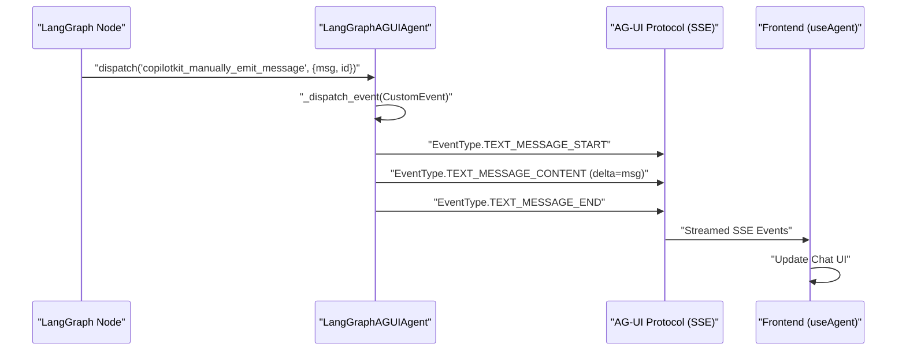

<!-- source: DeepWiki mcp.deepwiki.com · repo CopilotKit/CopilotKit · page 5.2 LangGraph Agent Integration · fetched 2026-10-30 -->

# LangGraph Agent Integration

<details>
<summary>Relevant source files</summary>

The following files were used as context for generating this wiki page:

- [examples/canvas/gemini/agent/main.py](examples/canvas/gemini/agent/main.py)
- [examples/integrations/langgraph-js/agent/package.json](examples/integrations/langgraph-js/agent/package.json)
- [examples/integrations/langgraph-js/docker/Dockerfile.agent](examples/integrations/langgraph-js/docker/Dockerfile.agent)
- [examples/integrations/mcp-apps/threejs-server/postcss.config.mjs](examples/integrations/mcp-apps/threejs-server/postcss.config.mjs)
- [examples/v1/_legacy/saas-dynamic-dashboards/agent/agent.py](examples/v1/_legacy/saas-dynamic-dashboards/agent/agent.py)
- [packages/runtime/src/agents/langgraph/__tests__/event-source.test.ts](packages/runtime/src/agents/langgraph/__tests__/event-source.test.ts)
- [packages/runtime/src/lib/runtime/agent-integrations/langgraph/__tests__/dispatch-event-filtering.test.ts](packages/runtime/src/lib/runtime/agent-integrations/langgraph/__tests__/dispatch-event-filtering.test.ts)
- [packages/sdk-js/src/__tests__/error-handling.test.ts](packages/sdk-js/src/__tests__/error-handling.test.ts)
- [packages/sdk-js/src/langgraph/__tests__/middleware.a2ui-params.test.ts](packages/sdk-js/src/langgraph/__tests__/middleware.a2ui-params.test.ts)
- [packages/sdk-js/src/langgraph/__tests__/middleware.test.ts](packages/sdk-js/src/langgraph/__tests__/middleware.test.ts)
- [packages/sdk-js/src/langgraph/__tests__/utils.test.ts](packages/sdk-js/src/langgraph/__tests__/utils.test.ts)
- [packages/sdk-js/src/langgraph/middleware.ts](packages/sdk-js/src/langgraph/middleware.ts)
- [packages/sdk-js/src/langgraph/utils.ts](packages/sdk-js/src/langgraph/utils.ts)
- [sdk-python/copilotkit/copilotkit_lg_middleware.py](sdk-python/copilotkit/copilotkit_lg_middleware.py)
- [sdk-python/copilotkit/crewai/crewai_sdk.py](sdk-python/copilotkit/crewai/crewai_sdk.py)
- [sdk-python/copilotkit/exc.py](sdk-python/copilotkit/exc.py)
- [sdk-python/copilotkit/langchain.py](sdk-python/copilotkit/langchain.py)
- [sdk-python/copilotkit/langgraph.py](sdk-python/copilotkit/langgraph.py)
- [sdk-python/copilotkit/langgraph_agui_agent.py](sdk-python/copilotkit/langgraph_agui_agent.py)
- [sdk-python/poetry.lock](sdk-python/poetry.lock)
- [sdk-python/pyproject.toml](sdk-python/pyproject.toml)
- [sdk-python/tests/test_agui_agent.py](sdk-python/tests/test_agui_agent.py)
- [sdk-python/tests/test_copilotkit_lg_middleware.py](sdk-python/tests/test_copilotkit_lg_middleware.py)
- [sdk-python/tests/test_crewai_import_compat.py](sdk-python/tests/test_crewai_import_compat.py)
- [sdk-python/tests/test_emit_filtering.py](sdk-python/tests/test_emit_filtering.py)
- [sdk-python/tests/test_emit_tool_call_optional_id.py](sdk-python/tests/test_emit_tool_call_optional_id.py)
- [sdk-python/uv.lock](sdk-python/uv.lock)
- [showcase/integrations/crewai-crews/requirements.txt](showcase/integrations/crewai-crews/requirements.txt)
- [showcase/integrations/google-adk/requirements.txt](showcase/integrations/google-adk/requirements.txt)
- [showcase/integrations/langgraph-fastapi/package-lock.json](showcase/integrations/langgraph-fastapi/package-lock.json)
- [showcase/integrations/langgraph-fastapi/package.json](showcase/integrations/langgraph-fastapi/package.json)
- [showcase/integrations/langgraph-fastapi/requirements.txt](showcase/integrations/langgraph-fastapi/requirements.txt)
- [showcase/integrations/langgraph-python/package-lock.json](showcase/integrations/langgraph-python/package-lock.json)
- [showcase/integrations/langgraph-python/package.json](showcase/integrations/langgraph-python/package.json)
- [showcase/integrations/langgraph-python/requirements.txt](showcase/integrations/langgraph-python/requirements.txt)
- [showcase/integrations/langgraph-python/tsconfig.json](showcase/integrations/langgraph-python/tsconfig.json)
- [showcase/integrations/langgraph-typescript/package-lock.json](showcase/integrations/langgraph-typescript/package-lock.json)
- [showcase/integrations/langgraph-typescript/package.json](showcase/integrations/langgraph-typescript/package.json)
- [showcase/integrations/langgraph-typescript/src/agent/package-lock.json](showcase/integrations/langgraph-typescript/src/agent/package-lock.json)
- [showcase/integrations/langgraph-typescript/src/agent/package.json](showcase/integrations/langgraph-typescript/src/agent/package.json)
- [showcase/integrations/pydantic-ai/requirements.txt](showcase/integrations/pydantic-ai/requirements.txt)
- [showcase/integrations/strands-typescript/src/agent/package-lock.json](showcase/integrations/strands-typescript/src/agent/package-lock.json)
- [showcase/integrations/strands-typescript/src/agent/package.json](showcase/integrations/strands-typescript/src/agent/package.json)
- [showcase/integrations/strands/requirements.txt](showcase/integrations/strands/requirements.txt)

</details>


This page documents how to create and configure LangGraph agents using the CopilotKit Python and JS SDKs, covering the `LangGraphAGUIAgent` class, the `CopilotKitMiddleware` pattern, state management, event streaming, and manual event emission. For how to expose these agents via a FastAPI endpoint, see [CopilotKitRemoteEndpoint and FastAPI](5.3). For event filtering via LangGraph node metadata, see [Event Filtering and Metadata](5.5).

---

## Overview

The CopilotKit SDKs provide a bridge between LangGraph's `CompiledStateGraph` and the frontend via the **AG-UI Protocol**. This integration allows agents to merge frontend state with graph state, handle human-in-the-loop interrupts, and stream structured events including text, tool calls, and state deltas.

In Python, the primary class is `LangGraphAGUIAgent` [[sdk-python/copilotkit/langgraph_agui_agent.py:63]](). In both Python and JS, a `CopilotKitMiddleware` pattern is available to automatically handle tool injection and state surfacing for existing agents [[sdk-python/copilotkit/copilotkit_lg_middleware.py:1-15]]() [[packages/sdk-js/src/langgraph/middleware.ts:1-22]]().

---

## Class Hierarchy and Entity Mapping

The following diagram bridges the Natural Language Space of "Agent Integration" to the Code Entity Space of the SDK.

**Agent Integration Entity Map:**

```mermaid
classDiagram
    class "ag_ui_langgraph.LangGraphAgent" as AGUIBase {
        +name: str
        +graph: CompiledStateGraph
        +run(input)
    }

    class LangGraphAGUIAgent {
        +active_run: dict
        +constant_schema_keys: list
        +run(input)
        #_dispatch_event(event)
    }

    class CopilotKitMiddleware {
        +wrap_model_call(request, handler)
        +before_agent(state)
        +after_model(response)
        +after_agent(state)
    }

    class "copilotkit.langgraph" as LangGraphUtils {
        +copilotkit_customize_config()
        +copilotkit_emit_state()
        +copilotkit_emit_message()
        +copilotkit_emit_tool_call()
        +langchain_messages_to_copilotkit()
    }

    AGUIBase <|-- LangGraphAGUIAgent : "Inherits core run logic"
    LangGraphAGUIAgent ..> LangGraphUtils : "Uses for conversion"
    CopilotKitMiddleware ..> LangGraphUtils : "Uses CopilotKitProperties"
```

Sources: [[sdk-python/copilotkit/langgraph_agui_agent.py:63-73]](), [[sdk-python/copilotkit/langgraph.py:32-164]](), [[sdk-python/copilotkit/copilotkit_lg_middleware.py:1-15]](), [[packages/sdk-js/src/langgraph/middleware.ts:1-22]]()

---

## Configuration and Customization

### copilotkit_customize_config
To control how a LangGraph agent interacts with CopilotKit, developers use `copilotkit_customize_config` [[sdk-python/copilotkit/langgraph.py:167]](). This function modifies the `RunnableConfig` metadata to set flags that the `LangGraphAGUIAgent` or middleware inspect during execution.

| Parameter | Type | Description |
|---|---|---|
| `emit_messages` | `bool` | Whether to stream text messages to the UI [[sdk-python/copilotkit/langgraph.py:221]](). |
| `emit_tool_calls` | `bool \| str \| list` | Filter which tool calls are visible to the user [[sdk-python/copilotkit/langgraph.py:223]](). |
| `emit_intermediate_state` | `list` | Configures streaming of tool arguments directly into UI state keys [[sdk-python/copilotkit/langgraph.py:225]](). |

**Example: Intermediate State Configuration**
```python
from copilotkit.langgraph import copilotkit_customize_config

config = copilotkit_customize_config(
    config,
    emit_intermediate_state=[
       {
            "state_key": "search_results",
            "tool": "SearchTool",
            "tool_argument": "results"
        },
    ]
)
```
Sources: [[sdk-python/copilotkit/langgraph.py:167-215]]()

---

## CopilotKitMiddleware Hooks

The `CopilotKitMiddleware` provides a plug-and-play way to integrate CopilotKit features into any LangGraph agent.

### wrap_model_call
This hook intercepts calls to the LLM to:
1. **Inject Frontend Tools**: Merges tools defined in `state["copilotkit"]["actions"]` with the agent's backend tools [[sdk-python/copilotkit/copilotkit_lg_middleware.py:105-121]]().
2. **Surface State**: If `expose_state` is enabled, it appends a "Current agent state" note to the system prompt [[sdk-python/copilotkit/copilotkit_lg_middleware.py:150-164]]().
3. **Header Propagation**: Extracts `x-*` headers from the LangGraph config (via `get_config()`) and ensures they are forwarded to the LLM provider SDK via `httpx` hooks [[sdk-python/copilotkit/copilotkit_lg_middleware.py:80-164]]().
4. **Auto-A2UI**: Injects `generate_a2ui` tools if the host environment supports it, bridging the inferred model across node boundaries using thread IDs [[sdk-python/copilotkit/copilotkit_lg_middleware.py:47-78]]() [[packages/sdk-js/src/langgraph/middleware.ts:12-60]]().

### before_agent & after_agent
- **before_agent**: Prepares the context, such as injecting App Context as a `SystemMessage` [[sdk-python/tests/test_copilotkit_lg_middleware.py:10-12]]().
- **after_agent**: Ensures frontend tool calls (which were peeled off during `after_model` to prevent execution by the backend `ToolNode`) are re-attached to the message history so the frontend can see them [[sdk-python/tests/test_copilotkit_lg_middleware.py:13-15]]().

Sources: [[sdk-python/copilotkit/copilotkit_lg_middleware.py:1-200]](), [[packages/sdk-js/src/langgraph/middleware.ts:1-180]]()

---

## Event Streaming and Dispatching

`LangGraphAGUIAgent` overrides the `_dispatch_event` method [[sdk-python/copilotkit/langgraph_agui_agent.py:76]]() to translate internal events and handle manual emissions.

### Manual Event Emission
Agents can manually trigger UI updates using custom events. This is useful for long-running nodes that need to provide feedback before completion.

| Event Name | Function | Resulting AG-UI Events |
|---|---|---|
| `copilotkit_manually_emit_message` | `copilotkit_emit_message()` | `TEXT_MESSAGE_START`, `TEXT_MESSAGE_CONTENT`, `TEXT_MESSAGE_END` [[sdk-python/copilotkit/langgraph_agui_agent.py:87-111]]() |
| `copilotkit_manually_emit_tool_call` | `copilotkit_emit_tool_call()` | `TOOL_CALL_START`, `TOOL_CALL_ARGS`, `TOOL_CALL_END` [[sdk-python/copilotkit/langgraph_agui_agent.py:114-177]]() |
| `copilotkit_manually_emit_intermediate_state` | `copilotkit_emit_state()` | `STATE_SNAPSHOT` [[sdk-python/copilotkit/langgraph_agui_agent.py:186-193]]() |

### Event Flow Diagram

This diagram shows how a `CustomEvent` within a LangGraph node becomes a sequence of AG-UI protocol events.



Sources: [[sdk-python/copilotkit/langgraph_agui_agent.py:84-112]](), [[sdk-python/tests/test_emit_tool_call_optional_id.py:68-105]]()

---

## State Management and Conversion

### Messages Conversion
The function `langchain_messages_to_copilotkit` [[sdk-python/copilotkit/langgraph.py:56]]() handles the transformation of LangChain `BaseMessage` objects into the format required by the CopilotKit frontend.

- **Content Extraction**: It handles complex content types, including lists of content blocks (common in Anthropic models) by concatenating text parts [[sdk-python/copilotkit/langgraph.py:77-86]]().
- **Orphan Prevention**: It always emits an `assistant` message even if content is empty [[sdk-python/copilotkit/langgraph.py:112-118]](). This is critical because tool calls reference a `parentMessageId`; omitting the parent would orphan the tool call in the frontend thread [[sdk-python/copilotkit/langgraph.py:110-111]]().
- **Reordering**: Tool result messages (`ToolMessage`) are reordered to immediately follow their corresponding tool calls to maintain thread integrity [[sdk-python/copilotkit/langgraph.py:148-164]]().

### Shared State (CopilotKitState)
The SDK defines `CopilotKitState` [[sdk-python/copilotkit/langgraph.py:50]]() which extends the standard LangGraph `MessagesState`. It includes a `copilotkit` property [[sdk-python/copilotkit/langgraph.py:53]]() containing:
- `actions`: List of available frontend actions [[sdk-python/copilotkit/langgraph.py:42]]().
- `context`: List of `CopilotContextItem` objects [[sdk-python/copilotkit/langgraph.py:43]]().

In TypeScript, `zodState` is provided to augment Zod schemas so they can be serialized correctly by LangGraph's `output_schema`, ensuring state fields are visible to the frontend [[packages/sdk-js/src/langgraph/middleware.ts:106-136]]().

Sources: [[sdk-python/copilotkit/langgraph.py:32-164]](), [[sdk-python/copilotkit/langgraph_agui_agent.py:70]](), [[packages/sdk-js/src/langgraph/middleware.ts:106-136]]()

---

## Validation and Error Handling

The `LangGraphAGUIAgent` performs strict validation on manually emitted events to ensure protocol compliance:
- **Tool Calls**: Validates that `id`, `name`, and `args` are present and that `args` are JSON-serializable [[sdk-python/copilotkit/langgraph_agui_agent.py:117-143]]().
- **Misuse Errors**: Both SDKs throw `CopilotKitMisuseError` when required parameters are missing or invalid [[sdk-python/copilotkit/langgraph_agui_agent.py:117-136]]() [[sdk-python/copilotkit/exc.py:1-10]]().

Sources: [[sdk-python/copilotkit/langgraph_agui_agent.py:112-143]](), [[sdk-python/tests/test_emit_tool_call_optional_id.py:143-195]]()

---

