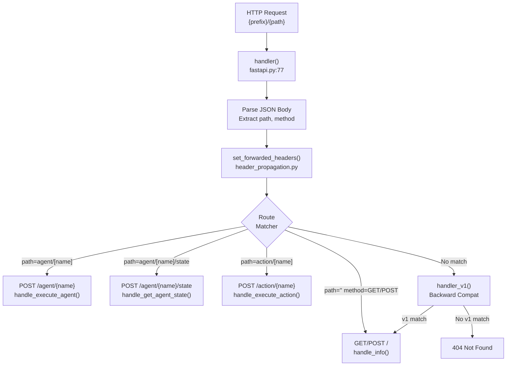
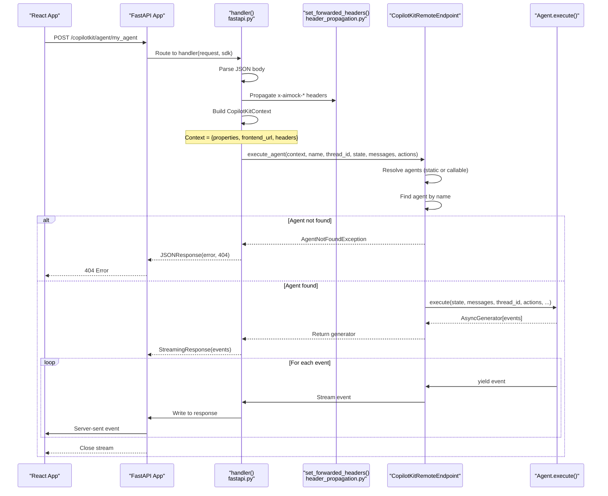
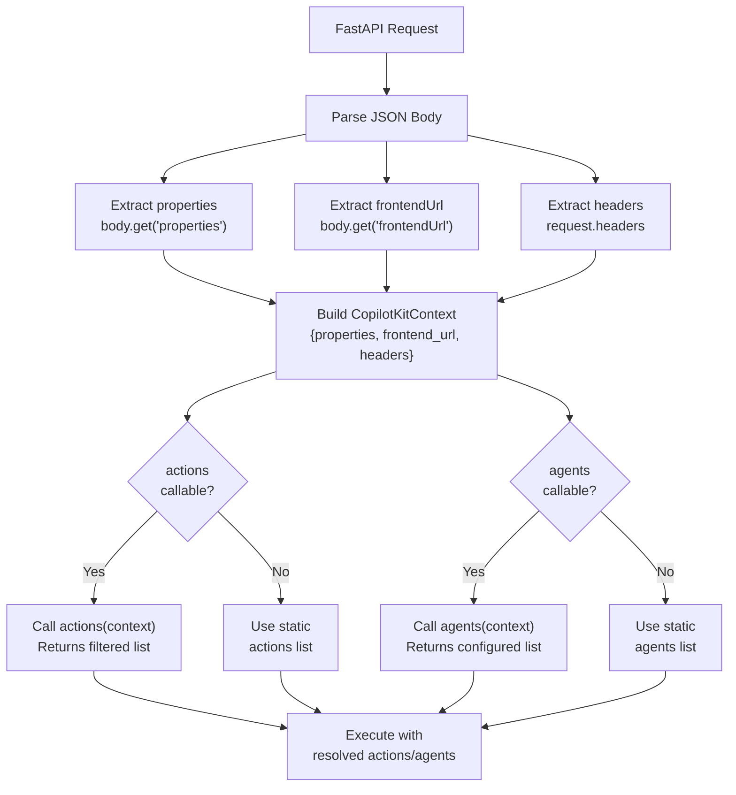

<!-- source: DeepWiki mcp.deepwiki.com · repo CopilotKit/CopilotKit · page 5.3 CopilotKitRemoteEndpoint and FastAPI · fetched 2026-10-30 -->

# CopilotKitRemoteEndpoint and FastAPI

<details>
<summary>Relevant source files</summary>

The following files were used as context for generating this wiki page:

- [packages/sdk-js/src/__tests__/header-propagation.test.ts](packages/sdk-js/src/__tests__/header-propagation.test.ts)
- [packages/sdk-js/src/header-propagation.ts](packages/sdk-js/src/header-propagation.ts)
- [packages/sdk-js/src/index.ts](packages/sdk-js/src/index.ts)
- [sdk-python/copilotkit/__init__.py](sdk-python/copilotkit/__init__.py)
- [sdk-python/copilotkit/agent.py](sdk-python/copilotkit/agent.py)
- [sdk-python/copilotkit/header_propagation.py](sdk-python/copilotkit/header_propagation.py)
- [sdk-python/copilotkit/integrations/fastapi.py](sdk-python/copilotkit/integrations/fastapi.py)
- [sdk-python/copilotkit/sdk.py](sdk-python/copilotkit/sdk.py)
- [sdk-python/tests/test_header_propagation.py](sdk-python/tests/test_header_propagation.py)
- [showcase/aimock/d6/google-adk/threadid-frontend-tool-roundtrip.json](showcase/aimock/d6/google-adk/threadid-frontend-tool-roundtrip.json)
- [showcase/aimock/d6/ms-agent-python/chat-slots.json](showcase/aimock/d6/ms-agent-python/chat-slots.json)
- [showcase/integrations/ag2/src/agent_server.py](showcase/integrations/ag2/src/agent_server.py)
- [showcase/integrations/ag2/src/agents/agent_config_agent.py](showcase/integrations/ag2/src/agents/agent_config_agent.py)
- [showcase/integrations/ag2/src/app/api/copilotkit-auth/[[...slug]]/route.ts](showcase/integrations/ag2/src/app/api/copilotkit-auth/[[...slug]]/route.ts)
- [showcase/integrations/ag2/src/app/api/copilotkit-beautiful-chat/route.ts](showcase/integrations/ag2/src/app/api/copilotkit-beautiful-chat/route.ts)
- [showcase/integrations/ag2/src/app/api/copilotkit-mcp-apps/route.ts](showcase/integrations/ag2/src/app/api/copilotkit-mcp-apps/route.ts)
- [showcase/integrations/ag2/src/app/api/copilotkit/route.ts](showcase/integrations/ag2/src/app/api/copilotkit/route.ts)
- [showcase/integrations/agno/src/app/api/copilotkit-byoc-hashbrown/route.ts](showcase/integrations/agno/src/app/api/copilotkit-byoc-hashbrown/route.ts)
- [showcase/integrations/agno/src/app/api/copilotkit/route.ts](showcase/integrations/agno/src/app/api/copilotkit/route.ts)
- [showcase/integrations/claude-sdk-python/src/agent_server.py](showcase/integrations/claude-sdk-python/src/agent_server.py)
- [showcase/integrations/claude-sdk-python/src/app/api/copilotkit-declarative-gen-ui/route.ts](showcase/integrations/claude-sdk-python/src/app/api/copilotkit-declarative-gen-ui/route.ts)
- [showcase/integrations/claude-sdk-python/src/app/api/copilotkit/route.ts](showcase/integrations/claude-sdk-python/src/app/api/copilotkit/route.ts)
- [showcase/integrations/claude-sdk-python/tests/python/conftest.py](showcase/integrations/claude-sdk-python/tests/python/conftest.py)
- [showcase/integrations/claude-sdk-python/tests/python/test_cvdiag_boundaries.py](showcase/integrations/claude-sdk-python/tests/python/test_cvdiag_boundaries.py)
- [showcase/integrations/claude-sdk-typescript/src/app/api/copilotkit-beautiful-chat/route.ts](showcase/integrations/claude-sdk-typescript/src/app/api/copilotkit-beautiful-chat/route.ts)
- [showcase/integrations/claude-sdk-typescript/src/app/api/copilotkit/route.ts](showcase/integrations/claude-sdk-typescript/src/app/api/copilotkit/route.ts)
- [showcase/integrations/crewai-crews/src/agent_server.py](showcase/integrations/crewai-crews/src/agent_server.py)
- [showcase/integrations/crewai-crews/src/agents/tool_rendering.py](showcase/integrations/crewai-crews/src/agents/tool_rendering.py)
- [showcase/integrations/crewai-crews/src/app/api/copilotkit-beautiful-chat/route.ts](showcase/integrations/crewai-crews/src/app/api/copilotkit-beautiful-chat/route.ts)
- [showcase/integrations/crewai-crews/src/app/api/copilotkit/route.ts](showcase/integrations/crewai-crews/src/app/api/copilotkit/route.ts)
- [showcase/integrations/google-adk/src/agents/interrupt_agent.py](showcase/integrations/google-adk/src/agents/interrupt_agent.py)
- [showcase/integrations/google-adk/src/agents/registry.py](showcase/integrations/google-adk/src/agents/registry.py)
- [showcase/integrations/google-adk/src/app/api/copilotkit/route.ts](showcase/integrations/google-adk/src/app/api/copilotkit/route.ts)
- [showcase/integrations/google-adk/src/app/demos/gen-ui-interrupt/page.tsx](showcase/integrations/google-adk/src/app/demos/gen-ui-interrupt/page.tsx)
- [showcase/integrations/google-adk/src/app/demos/threadid-frontend-tool-roundtrip/page.tsx](showcase/integrations/google-adk/src/app/demos/threadid-frontend-tool-roundtrip/page.tsx)
- [showcase/integrations/langgraph-fastapi/src/app/api/copilotkit-beautiful-chat/route.ts](showcase/integrations/langgraph-fastapi/src/app/api/copilotkit-beautiful-chat/route.ts)
- [showcase/integrations/langroid/src/app/api/copilotkit/route.ts](showcase/integrations/langroid/src/app/api/copilotkit/route.ts)
- [showcase/integrations/llamaindex/src/agent_server.py](showcase/integrations/llamaindex/src/agent_server.py)
- [showcase/integrations/llamaindex/src/agents/frontend_tools_async_agent.py](showcase/integrations/llamaindex/src/agents/frontend_tools_async_agent.py)
- [showcase/integrations/llamaindex/src/app/api/copilotkit/route.ts](showcase/integrations/llamaindex/src/app/api/copilotkit/route.ts)
- [showcase/integrations/llamaindex/tests/python/conftest.py](showcase/integrations/llamaindex/tests/python/conftest.py)
- [showcase/integrations/llamaindex/tests/python/test_cvdiag_boundaries.py](showcase/integrations/llamaindex/tests/python/test_cvdiag_boundaries.py)
- [showcase/integrations/ms-agent-dotnet/agent/AimockHeaderContext.cs](showcase/integrations/ms-agent-dotnet/agent/AimockHeaderContext.cs)
- [showcase/integrations/ms-agent-dotnet/agent/AimockHeaderMiddleware.cs](showcase/integrations/ms-agent-dotnet/agent/AimockHeaderMiddleware.cs)
- [showcase/integrations/ms-agent-dotnet/agent/AimockHeaderPolicy.cs](showcase/integrations/ms-agent-dotnet/agent/AimockHeaderPolicy.cs)
- [showcase/integrations/ms-agent-dotnet/agent/tests/AimockHeaderPropagationTests.cs](showcase/integrations/ms-agent-dotnet/agent/tests/AimockHeaderPropagationTests.cs)
- [showcase/integrations/ms-agent-dotnet/agent/tests/SharedStateAgent.Tests.csproj](showcase/integrations/ms-agent-dotnet/agent/tests/SharedStateAgent.Tests.csproj)
- [showcase/integrations/ms-agent-python/src/agent_server.py](showcase/integrations/ms-agent-python/src/agent_server.py)
- [showcase/integrations/ms-agent-python/src/agents/reasoning_agent.py](showcase/integrations/ms-agent-python/src/agents/reasoning_agent.py)
- [showcase/integrations/ms-agent-python/src/app/api/copilotkit/route.ts](showcase/integrations/ms-agent-python/src/app/api/copilotkit/route.ts)
- [showcase/integrations/ms-agent-python/tests/python/conftest.py](showcase/integrations/ms-agent-python/tests/python/conftest.py)
- [showcase/integrations/ms-agent-python/tests/python/test_cvdiag_boundaries.py](showcase/integrations/ms-agent-python/tests/python/test_cvdiag_boundaries.py)
- [showcase/integrations/pydantic-ai/src/agent_server.py](showcase/integrations/pydantic-ai/src/agent_server.py)
- [showcase/integrations/pydantic-ai/src/app/api/copilotkit/route.ts](showcase/integrations/pydantic-ai/src/app/api/copilotkit/route.ts)
- [showcase/integrations/spring-ai/src/app/api/copilotkit/route.ts](showcase/integrations/spring-ai/src/app/api/copilotkit/route.ts)
- [showcase/integrations/spring-ai/src/main/java/com/copilotkit/showcase/springai/AimockHeaderContext.java](showcase/integrations/spring-ai/src/main/java/com/copilotkit/showcase/springai/AimockHeaderContext.java)
- [showcase/integrations/spring-ai/src/main/java/com/copilotkit/showcase/springai/AimockHeaderInterceptor.java](showcase/integrations/spring-ai/src/main/java/com/copilotkit/showcase/springai/AimockHeaderInterceptor.java)
- [showcase/integrations/spring-ai/src/main/java/com/copilotkit/showcase/springai/AimockHeaderRequestInterceptor.java](showcase/integrations/spring-ai/src/main/java/com/copilotkit/showcase/springai/AimockHeaderRequestInterceptor.java)
- [showcase/integrations/spring-ai/src/main/java/com/copilotkit/showcase/springai/AimockWebMvcConfig.java](showcase/integrations/spring-ai/src/main/java/com/copilotkit/showcase/springai/AimockWebMvcConfig.java)
- [showcase/integrations/spring-ai/src/main/java/com/copilotkit/showcase/springai/WebClientConfig.java](showcase/integrations/spring-ai/src/main/java/com/copilotkit/showcase/springai/WebClientConfig.java)
- [showcase/integrations/strands/src/agent_server.py](showcase/integrations/strands/src/agent_server.py)
- [showcase/integrations/strands/src/app/api/copilotkit/route.ts](showcase/integrations/strands/src/app/api/copilotkit/route.ts)

</details>


## Purpose and Scope

This page documents the `CopilotKitRemoteEndpoint` class and its integration with FastAPI for serving CopilotKit agents and actions over HTTP. The `CopilotKitRemoteEndpoint` class provides the core SDK interface for registering and executing actions and agents, while the FastAPI integration exposes these capabilities as HTTP endpoints. It also details the header propagation middleware that ensures context continuity between inbound requests and outbound LLM calls.

For information about the LangGraph-specific agent implementation, see [LangGraph Agent Integration](5.2). For details on defining custom actions and agent types, see [Python Actions and Custom Agents](5.4).

Sources: [sdk-python/copilotkit/sdk.py:66-69](), [sdk-python/copilotkit/integrations/fastapi.py:1-24]()

---

## CopilotKitRemoteEndpoint Class

### Overview

The `CopilotKitRemoteEndpoint` class serves as the main entry point for the Python SDK. It maintains registries of actions and agents and provides methods for executing them. The class supports both static and dynamic configuration through callable factories.

**Class Definition and Constructor**

```python
CopilotKitRemoteEndpoint(
    actions: Optional[Union[List[Action], Callable[[CopilotKitContext], List[Action]]]] = None,
    agents: Optional[Union[List[Agent], Callable[[CopilotKitContext], List[Agent]]]] = None
)
```

| Parameter | Type | Description |
|-----------|------|-------------|
| `actions` | `List[Action]` or callable | Static list or dynamic factory for actions |
| `agents` | `List[Agent]` or callable | Static list or dynamic factory for agents |

The constructor accepts either static lists of actions/agents or callable factories that receive a `CopilotKitContext` and return lists dynamically. This enables request-specific configuration, authentication-based filtering, and context-aware action/agent registration. [sdk-python/copilotkit/sdk.py:215-224]()

**Key Methods**

| Method | Purpose | Return Type |
|--------|---------|-------------|
| `info(context)` | Returns metadata about available actions and agents | `InfoDict` |
| `execute_action(context, name, arguments)` | Executes a named action with arguments | `Coroutine[ActionResultDict]` |
| `execute_agent(...)` | Executes an agent with state and messages | `AsyncGenerator` |
| `get_agent_state(context, thread_id, name)` | Retrieves current state of an agent thread | `dict` |

Sources: [sdk-python/copilotkit/sdk.py:66-224](), [sdk-python/copilotkit/sdk.py:228-258]()

---

### CopilotKitContext Structure

The `CopilotKitContext` TypedDict provides request context to actions and agents:

```python
class CopilotKitContext(TypedDict):
    properties: Any                    # From <CopilotKit properties={...} />
    frontend_url: Optional[str]        # Current frontend URL
    headers: Mapping[str, str]         # HTTP request headers
```

This context enables actions and agents to access:
- **Properties**: Custom data passed from the React `<CopilotKit>` provider. [sdk-python/copilotkit/sdk.py:57-57]()
- **Frontend URL**: The originating page URL for context-aware responses. [sdk-python/copilotkit/sdk.py:58-58]()
- **Headers**: Authentication tokens, user agents, and other HTTP metadata. [sdk-python/copilotkit/sdk.py:59-59]()

Sources: [sdk-python/copilotkit/sdk.py:43-60]()

---

### Static vs Dynamic Configuration

#### Static Configuration

Actions and agents are provided as fixed lists:

```python
sdk = CopilotKitRemoteEndpoint(
    actions=[action_a, action_b],
    agents=[agent_x, agent_y]
)
```

All requests receive the same set of actions and agents regardless of context. [sdk-python/copilotkit/sdk.py:86-102]()

#### Dynamic Configuration

Callables receive the `CopilotKitContext` and return lists based on request properties:

```python
sdk = CopilotKitRemoteEndpoint(
    actions=lambda context: (
        [admin_action, user_action] 
        if is_admin(context["properties"]["token"]) 
        else [user_action]
    ),
    agents=lambda context: [
        LangGraphAGUIAgent(
            name="email_agent",
            graph=graph,
            langgraph_config={"user_id": context["properties"]["user_id"]}
        )
    ]
)
```

This pattern enables:
- **Authentication-based filtering**: Different actions/agents per user role. [sdk-python/copilotkit/sdk.py:121-131]()
- **Multi-tenancy**: Agent configuration varies by tenant ID. [sdk-python/copilotkit/sdk.py:158-170]()
- **Context injection**: Pass frontend properties into agent configuration.

Sources: [sdk-python/copilotkit/sdk.py:104-183]()

---

## FastAPI Integration

### add_fastapi_endpoint Function

The `add_fastapi_endpoint()` function registers CopilotKit routes with a FastAPI application:

```python
def add_fastapi_endpoint(
    fastapi_app: FastAPI,
    sdk: CopilotKitRemoteEndpoint,
    prefix: str,
    *,
    use_thread_pool: bool = False,     # Deprecated
    max_workers: int = 10              # Deprecated
)
```

| Parameter | Purpose |
|-----------|---------|
| `fastapi_app` | The FastAPI application instance |
| `sdk` | Configured `CopilotKitRemoteEndpoint` instance |
| `prefix` | URL prefix for all routes (e.g., `"/copilotkit"`) |

The function registers a catch-all route at `{prefix}/{path:path}` that handles all HTTP methods. [sdk-python/copilotkit/integrations/fastapi.py:62-66](). The prefix is normalized to start with `/` and have no trailing slash. [sdk-python/copilotkit/integrations/fastapi.py:60-60]()

**Example Usage**

```python
from fastapi import FastAPI
from copilotkit import CopilotKitRemoteEndpoint
from copilotkit.integrations.fastapi import add_fastapi_endpoint

app = FastAPI()
sdk = CopilotKitRemoteEndpoint(agents=[my_agent])
add_fastapi_endpoint(app, sdk, "/copilotkit")
```

Sources: [sdk-python/copilotkit/integrations/fastapi.py:29-66]()

---

### Request Handler Architecture

**Handler Function Routing**



Sources: [sdk-python/copilotkit/integrations/fastapi.py:77-170](), [sdk-python/copilotkit/integrations/fastapi.py:173-230](), [sdk-python/copilotkit/header_propagation.py:68-75]()

---

## HTTP API Specification

### Route Table

| Route | Method | Purpose | Handler Function |
|-------|--------|---------|------------------|
| `/` | GET, POST | Returns SDK info (actions/agents) | `handle_info()` |
| `/agent/{name}` | POST | Execute agent with messages and state | `handle_execute_agent()` |
| `/agent/{name}/state` | POST | Get current agent state | `handle_get_agent_state()` |
| `/action/{name}` | POST | Execute action with arguments | `handle_execute_action()` |

**Backward Compatibility Routes (v1)**

| Route | Method | Purpose |
|-------|--------|---------|
| `/info` | POST | Legacy info endpoint |
| `/actions/execute` | POST | Legacy action execution |
| `/agents/execute` | POST | Legacy agent execution |
| `/agents/state` | POST | Legacy state retrieval |

Sources: [sdk-python/copilotkit/integrations/fastapi.py:99-223]()

---

### Info Endpoint

**Request**
```
GET /copilotkit
Accept: application/json  (or text/html for HTML response)
```

**Response (JSON)**
```json
{
  "sdkVersion": "0.1.94",
  "actions": [
    {
      "name": "action_name",
      "description": "Action description",
      "parameters": [...]
    }
  ],
  "agents": [
    {
      "name": "agent_name",
      "description": "Agent description"
    }
  ]
}
```

The endpoint supports both JSON and HTML responses. When `Accept: text/html` is specified, it returns a formatted HTML page displaying the SDK information via `generate_info_html`. [sdk-python/copilotkit/integrations/fastapi.py:102-106]()

Sources: [sdk-python/copilotkit/integrations/fastapi.py:99-106](), [sdk-python/copilotkit/integrations/fastapi.py:233-243](), [sdk-python/copilotkit/sdk.py:22-28]()

---

### Agent Execution Endpoint

**Request**
```
POST /copilotkit/agent/{agent_name}
Content-Type: application/json

{
  "threadId": "thread-uuid",
  "nodeName": "node_1",           // LangGraph-specific
  "state": { "key": "value" },
  "messages": [
    {
      "role": "user",
      "content": "Hello"
    }
  ],
  "actions": [
    {
      "name": "action_name",
      "description": "...",
      "parameters": [...]
    }
  ]
}
```

**Response**

The response is a `StreamingResponse` with `media_type="application/json"`. [sdk-python/copilotkit/integrations/fastapi.py:270-305](). Events are streamed as newline-delimited JSON. The execution handles both standard `Agent` implementations and specialized `LangGraphAGUIAgent` instances. [sdk-python/copilotkit/integrations/fastapi.py:109-130]()

Sources: [sdk-python/copilotkit/integrations/fastapi.py:109-130](), [sdk-python/copilotkit/integrations/fastapi.py:270-305]()

---

### Agent State Endpoint

**Request**
```
POST /copilotkit/agent/{agent_name}/state
Content-Type: application/json

{
  "threadId": "thread-uuid"
}
```

**Response**
```json
{
  "threadId": "thread-uuid",
  "threadExists": true,
  "state": {
    "key": "value"
  },
  "messages": [
    {
      "role": "assistant",
      "content": "Previous message"
    }
  ]
}
```

Sources: [sdk-python/copilotkit/integrations/fastapi.py:133-142](), [sdk-python/copilotkit/integrations/fastapi.py:307-327]()

---

### Action Execution Endpoint

**Request**
```
POST /copilotkit/action/{action_name}
Content-Type: application/json

{
  "arguments": {
    "param1": "value1",
    "param2": "value2"
  }
}
```

**Response**
```json
{
  "result": "action result value"
}
```

Error responses return appropriate HTTP status codes:
- `404`: Action not found (`ActionNotFoundException`) [sdk-python/copilotkit/integrations/fastapi.py:261-263]()
- `500`: Action execution error (`ActionExecutionException`) [sdk-python/copilotkit/integrations/fastapi.py:264-266]()

Sources: [sdk-python/copilotkit/integrations/fastapi.py:145-154](), [sdk-python/copilotkit/integrations/fastapi.py:245-268]()

---

## Request Processing Flow

### Complete Request Lifecycle



Sources: [sdk-python/copilotkit/integrations/fastapi.py:77-170](), [sdk-python/copilotkit/sdk.py:310-357](), [sdk-python/copilotkit/header_propagation.py:68-75]()

---

### Header Propagation

On each inbound request, the FastAPI integration extracts `x-*` prefixed headers (e.g., `x-aimock-context`, `x-request-id`) and stores them in a `contextvars.ContextVar`. [sdk-python/copilotkit/header_propagation.py:8-14](), [sdk-python/copilotkit/integrations/fastapi.py:86-86]().

When the agent later makes outbound calls to an LLM provider (OpenAI, Anthropic), these headers are automatically injected into the outbound request via an `httpx` event hook. [sdk-python/copilotkit/header_propagation.py:31-39](). This ensures that downstream services like the `aimock` test server can correlate the outbound call with the original inbound request. [sdk-python/copilotkit/header_propagation.py:1-4]().

**Key Functions in `header_propagation.py`**:
- `set_forwarded_headers(headers)`: Filters input headers to `x-*` prefixed keys and stores them in the `_forwarded_headers` ContextVar. [sdk-python/copilotkit/header_propagation.py:68-76]()
- `get_forwarded_headers()`: Retrieves the stored headers from the current request context. [sdk-python/copilotkit/header_propagation.py:78-81]()
- `install_httpx_hook(client)`: Attaches a request event hook to an `httpx` client or SDK wrapper (OpenAI/Anthropic) to perform the injection. [sdk-python/copilotkit/header_propagation.py:104-168]()

**LangGraph Integration**:
The `CopilotKitMiddleware` for LangGraph automatically extracts forwarded headers from the `RunnableConfig` (via `_extract_forwarded_headers_from_config`) and ensures they are pushed into the `header_propagation` ContextVar before model calls. [sdk-python/copilotkit/copilotkit_lg_middleware.py:80-159](). It also ensures the `httpx` hook is installed on the model client. [sdk-python/copilotkit/copilotkit_lg_middleware.py:173-181]().

Sources: [sdk-python/copilotkit/integrations/fastapi.py:86-86](), [sdk-python/copilotkit/header_propagation.py:1-168](), [sdk-python/copilotkit/copilotkit_lg_middleware.py:80-181]()

---

### Context Building and Dynamic Configuration

**Context Extraction Flow**



Sources: [sdk-python/copilotkit/integrations/fastapi.py:90-97](), [sdk-python/copilotkit/sdk.py:233-248](), [sdk-python/copilotkit/sdk.py:326-329]()

---

## Error Handling

### Exception Types and HTTP Status Codes

| Exception | HTTP Status | Usage |
|-----------|-------------|-------|
| `ActionNotFoundException` | 404 | Action name not found in registry |
| `ActionExecutionException` | 500 | Action handler raised an exception |
| `AgentNotFoundException` | 404 | Agent name not found in registry |
| `AgentExecutionException` | 500 | Agent execution failed |
| `HTTPException` | 400 | Invalid request body or parameters |

**Error Response Format**

```json
{
  "error": "Error message describing the failure"
}
```

All handler functions wrap SDK method calls in try-except blocks and convert exceptions to appropriate JSON responses with status codes. [sdk-python/copilotkit/integrations/fastapi.py:260-268](), [sdk-python/copilotkit/integrations/fastapi.py:297-305]()

Sources: [sdk-python/copilotkit/exc.py:10-17](), [sdk-python/copilotkit/integrations/fastapi.py:260-268](), [sdk-python/copilotkit/integrations/fastapi.py:297-305]()

---

## Implementation Details

### Request Body Validation

The `body_get_or_raise()` utility function ensures required fields are present in the request body:

```python
def body_get_or_raise(body: Any, key: str):
    value = body.get(key)
    if value is None:
        raise HTTPException(status_code=400, detail=f"{key} is required")
    return value
```

Used primarily for mandatory fields like `threadId` and `name` in v1/v2 routes. [sdk-python/copilotkit/integrations/fastapi.py:135-135](), [sdk-python/copilotkit/integrations/fastapi.py:189-189]().

Sources: [sdk-python/copilotkit/integrations/fastapi.py:69-74]()

---

### Thread Pool Executor (Deprecated)

The `use_thread_pool` and `max_workers` parameters in `add_fastapi_endpoint()` are deprecated. [sdk-python/copilotkit/integrations/fastapi.py:38-43](). They previously enabled running handlers in separate threads via `ThreadPoolExecutor`, but this pattern is no longer recommended for modern async FastAPI usage. [sdk-python/copilotkit/integrations/fastapi.py:52-56]()

Sources: [sdk-python/copilotkit/integrations/fastapi.py:34-43]()

---

## Backward Compatibility

The FastAPI integration maintains backward compatibility with v1 routes through the `handler_v1()` function. [sdk-python/copilotkit/integrations/fastapi.py:173-180](). Legacy routes are automatically mapped to new endpoints:

| Legacy Route | New Route |
|--------------|-----------|
| `POST /info` | `GET /` or `POST /` |
| `POST /actions/execute` | `POST /action/{name}` |
| `POST /agents/execute` | `POST /agent/{name}` |
| `POST /agents/state` | `POST /agent/{name}/state` |

The v1 handler is invoked as a fallback when no v2 route matches, ensuring existing integrations continue to work without modification. [sdk-python/copilotkit/integrations/fastapi.py:159-168]()

Sources: [sdk-python/copilotkit/integrations/fastapi.py:159-168](), [sdk-python/copilotkit/integrations/fastapi.py:173-230]()

---

