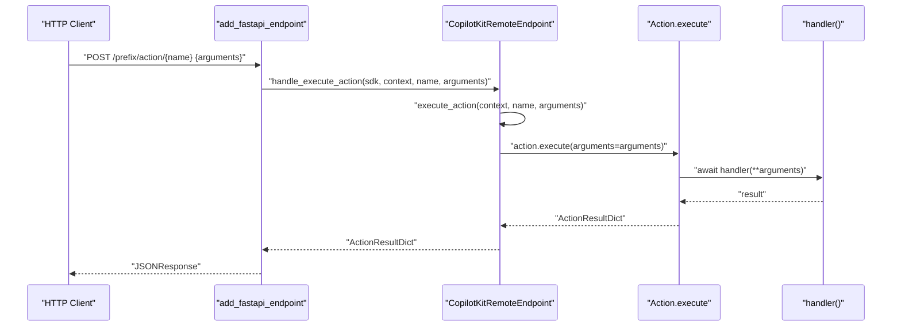
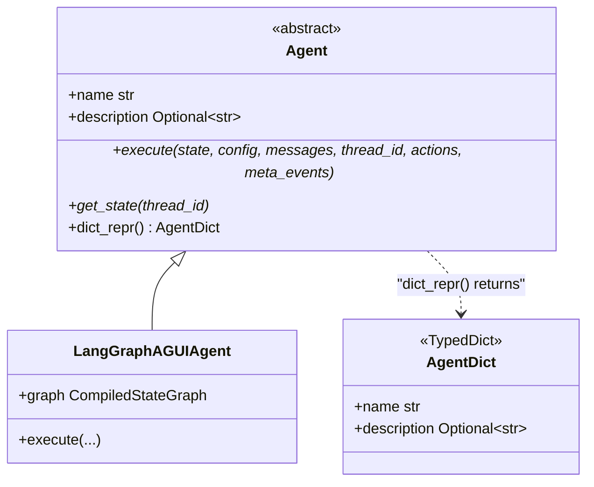
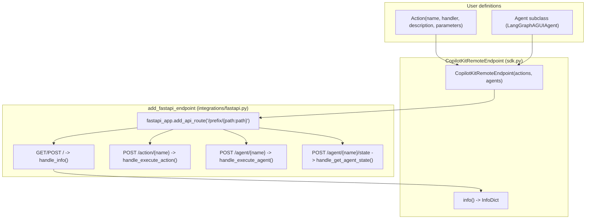

<!-- source: DeepWiki mcp.deepwiki.com · repo CopilotKit/CopilotKit · page 5.4 Python Actions and Custom Agents · fetched 2026-10-30 -->

# Python Actions and Custom Agents

<details>
<summary>Relevant source files</summary>

The following files were used as context for generating this wiki page:

- [examples/canvas/gemini/agent/main.py](examples/canvas/gemini/agent/main.py)
- [examples/v1/_legacy/saas-dynamic-dashboards/agent/agent.py](examples/v1/_legacy/saas-dynamic-dashboards/agent/agent.py)
- [packages/runtime/src/agents/langgraph/__tests__/event-source.test.ts](packages/runtime/src/agents/langgraph/__tests__/event-source.test.ts)
- [packages/runtime/src/lib/runtime/agent-integrations/langgraph/__tests__/dispatch-event-filtering.test.ts](packages/runtime/src/lib/runtime/agent-integrations/langgraph/__tests__/dispatch-event-filtering.test.ts)
- [packages/sdk-js/src/__tests__/error-handling.test.ts](packages/sdk-js/src/__tests__/error-handling.test.ts)
- [packages/sdk-js/src/__tests__/header-propagation.test.ts](packages/sdk-js/src/__tests__/header-propagation.test.ts)
- [packages/sdk-js/src/header-propagation.ts](packages/sdk-js/src/header-propagation.ts)
- [packages/sdk-js/src/index.ts](packages/sdk-js/src/index.ts)
- [packages/sdk-js/src/langgraph/__tests__/middleware.a2ui-params.test.ts](packages/sdk-js/src/langgraph/__tests__/middleware.a2ui-params.test.ts)
- [packages/sdk-js/src/langgraph/__tests__/middleware.test.ts](packages/sdk-js/src/langgraph/__tests__/middleware.test.ts)
- [packages/sdk-js/src/langgraph/__tests__/utils.test.ts](packages/sdk-js/src/langgraph/__tests__/utils.test.ts)
- [packages/sdk-js/src/langgraph/middleware.ts](packages/sdk-js/src/langgraph/middleware.ts)
- [packages/sdk-js/src/langgraph/utils.ts](packages/sdk-js/src/langgraph/utils.ts)
- [sdk-python/copilotkit/__init__.py](sdk-python/copilotkit/__init__.py)
- [sdk-python/copilotkit/agent.py](sdk-python/copilotkit/agent.py)
- [sdk-python/copilotkit/copilotkit_lg_middleware.py](sdk-python/copilotkit/copilotkit_lg_middleware.py)
- [sdk-python/copilotkit/crewai/crewai_sdk.py](sdk-python/copilotkit/crewai/crewai_sdk.py)
- [sdk-python/copilotkit/exc.py](sdk-python/copilotkit/exc.py)
- [sdk-python/copilotkit/header_propagation.py](sdk-python/copilotkit/header_propagation.py)
- [sdk-python/copilotkit/integrations/fastapi.py](sdk-python/copilotkit/integrations/fastapi.py)
- [sdk-python/copilotkit/langchain.py](sdk-python/copilotkit/langchain.py)
- [sdk-python/copilotkit/langgraph.py](sdk-python/copilotkit/langgraph.py)
- [sdk-python/copilotkit/langgraph_agui_agent.py](sdk-python/copilotkit/langgraph_agui_agent.py)
- [sdk-python/copilotkit/sdk.py](sdk-python/copilotkit/sdk.py)
- [sdk-python/poetry.lock](sdk-python/poetry.lock)
- [sdk-python/pyproject.toml](sdk-python/pyproject.toml)
- [sdk-python/tests/test_agui_agent.py](sdk-python/tests/test_agui_agent.py)
- [sdk-python/tests/test_copilotkit_lg_middleware.py](sdk-python/tests/test_copilotkit_lg_middleware.py)
- [sdk-python/tests/test_crewai_import_compat.py](sdk-python/tests/test_crewai_import_compat.py)
- [sdk-python/tests/test_emit_filtering.py](sdk-python/tests/test_emit_filtering.py)
- [sdk-python/tests/test_emit_tool_call_optional_id.py](sdk-python/tests/test_emit_tool_call_optional_id.py)
- [sdk-python/tests/test_header_propagation.py](sdk-python/tests/test_header_propagation.py)
- [sdk-python/uv.lock](sdk-python/uv.lock)
- [showcase/integrations/ms-agent-dotnet/agent/AimockHeaderContext.cs](showcase/integrations/ms-agent-dotnet/agent/AimockHeaderContext.cs)
- [showcase/integrations/ms-agent-dotnet/agent/AimockHeaderMiddleware.cs](showcase/integrations/ms-agent-dotnet/agent/AimockHeaderMiddleware.cs)
- [showcase/integrations/ms-agent-dotnet/agent/AimockHeaderPolicy.cs](showcase/integrations/ms-agent-dotnet/agent/AimockHeaderPolicy.cs)
- [showcase/integrations/ms-agent-dotnet/agent/tests/AimockHeaderPropagationTests.cs](showcase/integrations/ms-agent-dotnet/agent/tests/AimockHeaderPropagationTests.cs)
- [showcase/integrations/ms-agent-dotnet/agent/tests/SharedStateAgent.Tests.csproj](showcase/integrations/ms-agent-dotnet/agent/tests/SharedStateAgent.Tests.csproj)
- [showcase/integrations/spring-ai/src/main/java/com/copilotkit/showcase/springai/AimockHeaderContext.java](showcase/integrations/spring-ai/src/main/java/com/copilotkit/showcase/springai/AimockHeaderContext.java)
- [showcase/integrations/spring-ai/src/main/java/com/copilotkit/showcase/springai/AimockHeaderInterceptor.java](showcase/integrations/spring-ai/src/main/java/com/copilotkit/showcase/springai/AimockHeaderInterceptor.java)
- [showcase/integrations/spring-ai/src/main/java/com/copilotkit/showcase/springai/AimockHeaderRequestInterceptor.java](showcase/integrations/spring-ai/src/main/java/com/copilotkit/showcase/springai/AimockHeaderRequestInterceptor.java)
- [showcase/integrations/spring-ai/src/main/java/com/copilotkit/showcase/springai/AimockWebMvcConfig.java](showcase/integrations/spring-ai/src/main/java/com/copilotkit/showcase/springai/AimockWebMvcConfig.java)
- [showcase/integrations/spring-ai/src/main/java/com/copilotkit/showcase/springai/WebClientConfig.java](showcase/integrations/spring-ai/src/main/java/com/copilotkit/showcase/springai/WebClientConfig.java)

</details>


## Purpose and Scope

This page covers two extension points in the CopilotKit Python SDK:

1.  **Actions** — server-side Python callables that the Copilot can invoke, defined with the `Action` class and registered via `CopilotKitRemoteEndpoint`.
2.  **Custom Agents** — Python classes that extend the abstract `Agent` base class, enabling integration with agent frameworks beyond the built-in LangGraph support, including **CrewAI Crews and Flows**.

It also covers dynamic (per-request) registration patterns using callables, the `CopilotKitContext` structure for accessing request metadata, and how to customize `LangGraphAgent` and `CrewAIAgent` behavior via `CopilotKitConfig`.

For the `LangGraphAGUIAgent` class and LangGraph-specific event streaming, see page [5.2](). For `CopilotKitRemoteEndpoint` setup and FastAPI wiring, see page [5.3](). For metadata-based event filtering flags, see page [5.5]().

---

## Actions

### Defining an Action

The `Action` class represents a server-side function the Copilot can call. It is registered with `CopilotKitRemoteEndpoint` via the `actions` parameter and exposed at `POST /action/{name}` through the FastAPI handler [sdk-python/copilotkit/integrations/fastapi.py:145-154]().

| Field | Type | Description |
| :--- | :--- | :--- |
| `name` | `str` | Unique identifier; sent to the LLM as the tool name |
| `handler` | `Callable` | Python function or coroutine invoked on execution |
| `description` | `str` | Natural-language description used for LLM tool selection |
| `parameters` | `List[dict]` | JSON Schema-like parameter definitions (`name`, `type`, `description`, `required`) |

Example from [sdk-python/copilotkit/sdk.py:81-97]():

```python
from copilotkit import CopilotKitRemoteEndpoint, Action

sdk = CopilotKitRemoteEndpoint(
    actions=[
        Action(
            name="greet_user",
            handler=greet_user_handler,
            description="Greet the user",
            parameters=[
                {
                    "name": "name",
                    "type": "string",
                    "description": "The name of the user"
                }
            ]
        )
    ]
)
```

### Action Execution Flow

**Diagram: HTTP Request to Action Handler (`handle_execute_action`)**



Sources: [sdk-python/copilotkit/integrations/fastapi.py:145-154](), [sdk-python/copilotkit/sdk.py:215-224]()

---

## The `CopilotKitContext` Object

`CopilotKitContext` is a `TypedDict` passed to every callable registered with `CopilotKitRemoteEndpoint`. It carries per-request metadata from the frontend [sdk-python/copilotkit/sdk.py:43-60]().

| Field | Type | Source |
| :--- | :--- | :--- |
| `properties` | `Any` | Value of the `properties` prop on the frontend `<CopilotKit />` component |
| `frontend_url` | `Optional[str]` | Current URL of the frontend page |
| `headers` | `Mapping[str, str]` | HTTP request headers from the inbound request |

The `CopilotKitSDKContext` alias exists for backwards compatibility [sdk-python/copilotkit/sdk.py:63]().

Sources: [sdk-python/copilotkit/sdk.py:43-63]()

---

## Dynamic Action and Agent Registration

Both `actions` and `agents` parameters of `CopilotKitRemoteEndpoint` accept either a static list or a callable `(CopilotKitContext) -> List[Action | Agent]`. The callable is re-invoked on every request, enabling per-request logic [sdk-python/copilotkit/sdk.py:218-224]().

**Common patterns:**

| Pattern | Description |
| :--- | :--- |
| Per-request parameterization | Pass user-specific values into handler factories |
| Access control | Return different sets of actions/agents based on auth tokens |
| Context-dependent configuration | Supply different `langgraph_config` per user or tenant |

From the docstring examples at [sdk-python/copilotkit/sdk.py:108-183]():

```python
# Per-request action parameterization
sdk = CopilotKitRemoteEndpoint(
    actions=lambda context: [
        Action(
            name="greet_user",
            handler=make_greet_user_handler(context["properties"]["name"]), 
            description="Greet the user"
        )
    ]
)

# Role-based access control for agents
sdk = CopilotKitRemoteEndpoint(
    agents=lambda context: (
        [agent_a, agent_b] if is_admin(context["properties"]["token"]) else [agent_a]
    )
)
```

The callable is resolved at the following call sites in `CopilotKitRemoteEndpoint`:

| Method | Callable resolved at |
| :--- | :--- |
| `info()` | [sdk-python/copilotkit/sdk.py:233-234]() |

Sources: [sdk-python/copilotkit/sdk.py:108-234]()

---

## The `Agent` Abstract Base Class

All custom Python agents must subclass `Agent` from `sdk-python/copilotkit/agent.py`. This class defines the interface `CopilotKitRemoteEndpoint` calls during agent execution and state retrieval.

**Diagram: `Agent` Class Hierarchy and Concrete Implementations**



Sources: [sdk-python/copilotkit/agent.py:9-10](), [sdk-python/copilotkit/langgraph_agui_agent.py:63-72]()

---

## CrewAI Integration

The `copilotkit[crewai]` extra enables running CrewAI `Flows` as CopilotKit agents [sdk-python/pyproject.toml:33-44]().

### Crew and Flow Execution
- **Flows:** Are executed via `crewai_flow_async_runner` which handles the event bus registration for streaming [sdk-python/copilotkit/crewai/crewai_sdk.py:77-133]().
- **State Management:** `CopilotKitState` extends `FlowState` to include `messages` and `copilotkit` properties [sdk-python/copilotkit/crewai/crewai_sdk.py:70-74]().

### CrewAI Event Bus Integration
CopilotKit subscribes to the `_crewai_event_bus` to stream internal agent progress to the frontend. It maps CrewAI events to CopilotKit protocol events [sdk-python/copilotkit/crewai/crewai_sdk.py:83-111]():

| CrewAI Event | CopilotKit Protocol Event |
| :--- | :--- |
| `FlowStartedEvent` | `RUN_STARTED` |
| `MethodExecutionStartedEvent` | `NODE_STARTED` |
| `MethodExecutionFinishedEvent` | `NODE_FINISHED` |
| `FlowFinishedEvent` | `RUN_FINISHED` |

### Manual Emission Functions
Developers can manually emit updates from within a CrewAI node or task using these utility functions:
- `copilotkit_emit_state(state)`: Emits intermediate state updates by calling `agent_state_message` [sdk-python/copilotkit/crewai/crewai_sdk.py:135-187]().
- `copilotkit_emit_message(message)`: Emits a text message to the UI using `text_message_start`, `content`, and `end` [sdk-python/copilotkit/crewai/crewai_sdk.py:190-228]().
- `copilotkit_emit_tool_call(name, args, tool_call_id)`: Manually triggers a tool call UI element. If no `tool_call_id` is provided, a UUID is generated [sdk-python/copilotkit/crewai/crewai_sdk.py:230-245]().

Sources: [sdk-python/copilotkit/crewai/crewai_sdk.py:70-245](), [sdk-python/pyproject.toml:33-44]()

---

## LangGraph Custom Events and Emission

The `LangGraphAGUIAgent` handles specific custom events dispatched via LangChain's `adispatch_custom_event`.

| Custom Event Name | Behavior |
| :--- | :--- |
| `copilotkit_manually_emit_message` | Dispatches `TEXT_MESSAGE_START`, `CONTENT`, and `END` events [sdk-python/copilotkit/langgraph_agui_agent.py:87-112]() |
| `copilotkit_manually_emit_tool_call` | Dispatches `TOOL_CALL_START`, `ARGS`, and `END` events [sdk-python/copilotkit/langgraph_agui_agent.py:114-177]() |

These events allow for manual UI updates during long-running LangGraph nodes, similar to the CrewAI utility functions. Validation is performed to ensure `args` are JSON-serializable and IDs are valid [sdk-python/copilotkit/langgraph_agui_agent.py:116-147]().

Sources: [sdk-python/copilotkit/langgraph_agui_agent.py:33-39](), [sdk-python/copilotkit/langgraph_agui_agent.py:84-177]()

---

## End-to-End Registration Overview

**Diagram: From `Action`/`Agent` Definition to Exposed HTTP Routes**



Sources: [sdk-python/copilotkit/sdk.py:66-234](), [sdk-python/copilotkit/integrations/fastapi.py:29-66](), [sdk-python/copilotkit/integrations/fastapi.py:100-154]()

---

