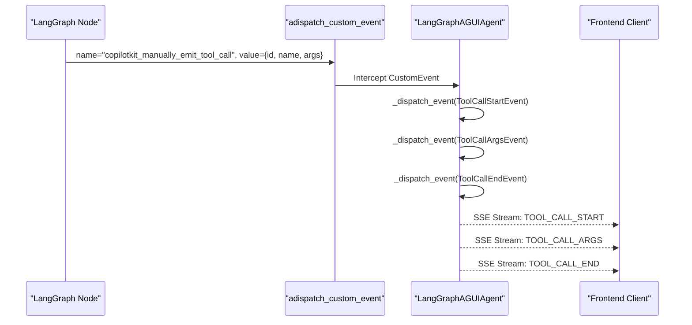
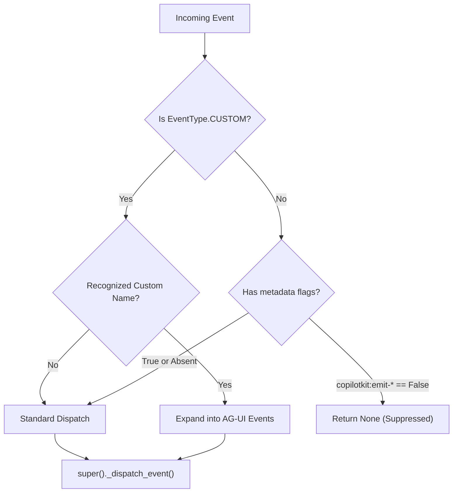
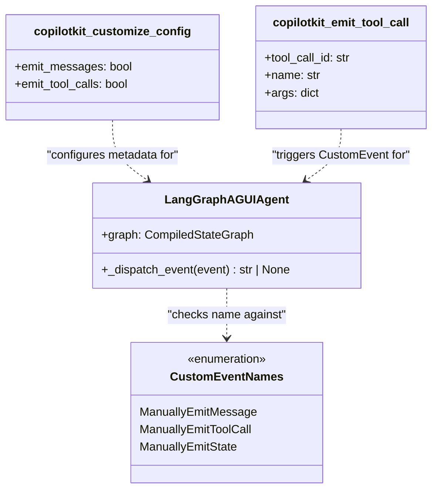

<!-- source: DeepWiki mcp.deepwiki.com · repo CopilotKit/CopilotKit · page 5.5 Event Filtering and Metadata · fetched 2026-10-30 -->

# Event Filtering and Metadata

<details>
<summary>Relevant source files</summary>

The following files were used as context for generating this wiki page:

- [examples/canvas/gemini/agent/main.py](examples/canvas/gemini/agent/main.py)
- [examples/v1/_legacy/saas-dynamic-dashboards/agent/agent.py](examples/v1/_legacy/saas-dynamic-dashboards/agent/agent.py)
- [packages/runtime/src/agents/langgraph/__tests__/event-source.test.ts](packages/runtime/src/agents/langgraph/__tests__/event-source.test.ts)
- [packages/runtime/src/lib/runtime/agent-integrations/langgraph/__tests__/dispatch-event-filtering.test.ts](packages/runtime/src/lib/runtime/agent-integrations/langgraph/__tests__/dispatch-event-filtering.test.ts)
- [packages/sdk-js/src/__tests__/error-handling.test.ts](packages/sdk-js/src/__tests__/error-handling.test.ts)
- [packages/sdk-js/src/langgraph/__tests__/middleware.a2ui-params.test.ts](packages/sdk-js/src/langgraph/__tests__/middleware.a2ui-params.test.ts)
- [packages/sdk-js/src/langgraph/__tests__/middleware.test.ts](packages/sdk-js/src/langgraph/__tests__/middleware.test.ts)
- [packages/sdk-js/src/langgraph/__tests__/utils.test.ts](packages/sdk-js/src/langgraph/__tests__/utils.test.ts)
- [packages/sdk-js/src/langgraph/middleware.ts](packages/sdk-js/src/langgraph/middleware.ts)
- [packages/sdk-js/src/langgraph/utils.ts](packages/sdk-js/src/langgraph/utils.ts)
- [sdk-python/copilotkit/copilotkit_lg_middleware.py](sdk-python/copilotkit/copilotkit_lg_middleware.py)
- [sdk-python/copilotkit/crewai/crewai_sdk.py](sdk-python/copilotkit/crewai/crewai_sdk.py)
- [sdk-python/copilotkit/exc.py](sdk-python/copilotkit/exc.py)
- [sdk-python/copilotkit/langchain.py](sdk-python/copilotkit/langchain.py)
- [sdk-python/copilotkit/langgraph.py](sdk-python/copilotkit/langgraph.py)
- [sdk-python/copilotkit/langgraph_agui_agent.py](sdk-python/copilotkit/langgraph_agui_agent.py)
- [sdk-python/poetry.lock](sdk-python/poetry.lock)
- [sdk-python/pyproject.toml](sdk-python/pyproject.toml)
- [sdk-python/tests/test_agui_agent.py](sdk-python/tests/test_agui_agent.py)
- [sdk-python/tests/test_copilotkit_lg_middleware.py](sdk-python/tests/test_copilotkit_lg_middleware.py)
- [sdk-python/tests/test_crewai_import_compat.py](sdk-python/tests/test_crewai_import_compat.py)
- [sdk-python/tests/test_emit_filtering.py](sdk-python/tests/test_emit_filtering.py)
- [sdk-python/tests/test_emit_tool_call_optional_id.py](sdk-python/tests/test_emit_tool_call_optional_id.py)
- [sdk-python/uv.lock](sdk-python/uv.lock)

</details>


This page covers the event filtering system in the CopilotKit SDKs — specifically how `LangGraphAGUIAgent` uses per-event metadata flags to suppress or pass through AG-UI protocol events and how developers can manually emit events using custom event names.

For information on setting up `LangGraphAGUIAgent` itself, see [LangGraph Agent Integration](). For the broader AG-UI event streaming architecture, see [Real-time Event Streaming]().

---

## Purpose

When a LangGraph agent runs, it produces a stream of AG-UI protocol events — text messages, tool calls, state updates, and so on. Not all of these events should necessarily be forwarded to the frontend. The event filtering system lets each individual event carry **metadata flags** that instruct `LangGraphAGUIAgent` to silently drop or pass it through before it reaches the client.

Additionally, the SDK provides a mechanism to manually trigger AG-UI events from within a LangGraph node by dispatching custom events that the agent intercepts and expands into full protocol event sequences.

---

## Metadata Flags

Two boolean flags are recognized within the `metadata` object of an event. Both are prefixed with `copilotkit:` to avoid collision with other metadata keys.

| Flag | Event Types Affected | Default (if absent) |
|------|----------------------|---------------------|
| `copilotkit:emit-messages` | `TEXT_MESSAGE_START`, `TEXT_MESSAGE_CONTENT`, `TEXT_MESSAGE_END` | Pass through (emit) |
| `copilotkit:emit-tool-calls` | `TOOL_CALL_START`, `TOOL_CALL_ARGS`, `TOOL_CALL_END` | Pass through (emit) |

Setting either flag to `False` suppresses that event from the outgoing stream. Setting it to `True`, or omitting it entirely, leaves the event in the stream.

Sources: [sdk-python/copilotkit/langgraph.py:221-224](), [packages/sdk-js/src/langgraph/utils.ts:128-133]()

### Configuration via `copilotkit_customize_config`
Developers can set these flags globally for a run using `copilotkit_customize_config` (Python) or `copilotkitCustomizeConfig` (JS). This function injects the flags into the LangGraph `RunnableConfig` metadata, which then propagates to individual events generated by the model.

```python
# Python example
config = copilotkit_customize_config(
    config,
    emit_messages=False,
    emit_tool_calls=False
)
```

Sources: [sdk-python/copilotkit/langgraph.py:167-174](), [packages/sdk-js/src/langgraph/utils.ts:56-73](), [packages/sdk-js/src/langgraph/utils.ts:121-134]()

---

## Manual Event Emission

`LangGraphAGUIAgent` supports a set of custom event names that, when dispatched via LangChain's `adispatch_custom_event` (Python) or `dispatchCustomEvent` (JS), are intercepted and transformed into standard AG-UI protocol events.

### Custom Event Names
The `CustomEventNames` enum defines the recognized events:
- `copilotkit_manually_emit_message`: Expands into a sequence of `TEXT_MESSAGE_START`, `TEXT_MESSAGE_CONTENT`, and `TEXT_MESSAGE_END`. [sdk-python/copilotkit/langgraph_agui_agent.py:36-36]()
- `copilotkit_manually_emit_tool_call`: Expands into `TOOL_CALL_START`, `TOOL_CALL_ARGS`, and `TOOL_CALL_END`. [sdk-python/copilotkit/langgraph_agui_agent.py:37-37]()
- `copilotkit_manually_emit_intermediate_state`: Emits a `StateSnapshotEvent`. [sdk-python/copilotkit/langgraph_agui_agent.py:38-38]()

### Manual Emission Flow

Title: "Manual Event Expansion Flow"

Sources: [sdk-python/copilotkit/langgraph_agui_agent.py:84-112](), [sdk-python/copilotkit/langgraph_agui_agent.py:152-177](), [sdk-python/tests/test_emit_tool_call_optional_id.py:76-87]()

---

## Filtering Logic: `_dispatch_event`

The central piece of the filtering system is `LangGraphAGUIAgent._dispatch_event()`. This method overrides the base class implementation and intercepts every event before it is serialized.

**Decision flow for `_dispatch_event`:**

Title: "Event Filtering and Custom Event Handling"

Sources: [sdk-python/copilotkit/langgraph_agui_agent.py:76-112](), [sdk-python/tests/test_agui_agent.py:81-97]()

### Return Values and None-Safety

| Condition | Return value | Notes |
|-----------|-------------|-------|
| Event suppressed by flag | `None` | Not an empty string — ensures None-safety |
| Event passes through | Serialized event string | Returned by `super()._dispatch_event()` |

`LangGraphAGUIAgent.run()` is designed to be None-safe. In the Python implementation, `_dispatch_event` returns `None` for filtered events, which are then ignored by the streaming generator to ensure no empty chunks reach the SSE transport. [sdk-python/copilotkit/langgraph_agui_agent.py:79-82]()

---

## Code Entity Map

The diagram below maps the key code entities involved in event filtering and manual emission.

Title: "Filtering and Emission Code Entities"

Sources: [sdk-python/copilotkit/langgraph_agui_agent.py:33-72](), [sdk-python/copilotkit/langgraph.py:167-174](), [sdk-python/tests/test_emit_tool_call_optional_id.py:76-87]()

---

## Historical Bug Fixes and Robustness

### 1. Robust Metadata Reading
The system handles cases where `raw_event` is a dictionary or an object. By inspecting the `raw_event` attached to the protocol events, `LangGraphAGUIAgent` correctly reads filtering flags regardless of the underlying data format. [sdk-python/copilotkit/langgraph_agui_agent.py:94-109]()

### 2. Validation for Manual Emission
Manual tool call emission includes strict validation. If `ManuallyEmitToolCall` is triggered with missing IDs, non-serializable arguments, or invalid names, the system raises a `CopilotKitMisuseError`. [sdk-python/copilotkit/langgraph_agui_agent.py:116-147](), [sdk-python/tests/test_emit_tool_call_optional_id.py:179-181]()

### 3. CrewAI Parity
The Python SDK maintains parity for these features in CrewAI via `copilotkit_emit_message`, `copilotkit_emit_state`, and `copilotkit_emit_tool_call`, which use a `queue_put` mechanism to inject events into the runtime stream via `get_context_execution`. [sdk-python/copilotkit/crewai/crewai_sdk.py:135-240]()

Sources: [sdk-python/copilotkit/langgraph_agui_agent.py:112-182](), [sdk-python/copilotkit/crewai/crewai_sdk.py:135-240](), [sdk-python/copilotkit/exc.py:9-22]()

---

