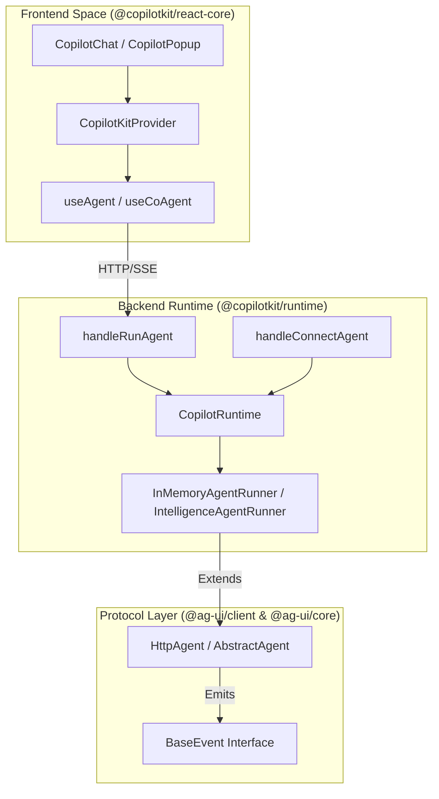
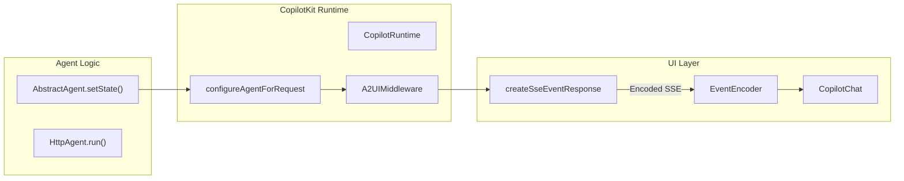

<!-- source: DeepWiki mcp.deepwiki.com · repo CopilotKit/CopilotKit · page 6 AG-UI Protocol · fetched 2026-10-30 -->

# AG-UI Protocol

Relevant source files

The following files were used as context for generating this wiki page:

- [.claude/docs/architecture.md](.claude/docs/architecture.md)
- [README.md](README.md)
- [assets/CopilotTextarea.gif](assets/CopilotTextarea.gif)
- [assets/CopilotTextarea_old.gif](assets/CopilotTextarea_old.gif)
- [assets/demo.gif](assets/demo.gif)
- [assets/proejct-perplexity-clone.png](assets/proejct-perplexity-clone.png)
- [assets/project-canvas-demo.png](assets/project-canvas-demo.png)
- [assets/spreadsheet-demo-big-file.gif](assets/spreadsheet-demo-big-file.gif)
- [packages/core/src/__tests__/debug-config-threading.test.ts](packages/core/src/__tests__/debug-config-threading.test.ts)
- [packages/runtime/src/v2/runtime/__tests__/agent-header-precedence.test.ts](packages/runtime/src/v2/runtime/__tests__/agent-header-precedence.test.ts)
- [packages/runtime/src/v2/runtime/__tests__/agent-utils-header-forwarding.test.ts](packages/runtime/src/v2/runtime/__tests__/agent-utils-header-forwarding.test.ts)
- [packages/runtime/src/v2/runtime/__tests__/agents-factory.test.ts](packages/runtime/src/v2/runtime/__tests__/agents-factory.test.ts)
- [packages/runtime/src/v2/runtime/__tests__/debug-sse-response.test.ts](packages/runtime/src/v2/runtime/__tests__/debug-sse-response.test.ts)
- [packages/runtime/src/v2/runtime/__tests__/handle-connect.test.ts](packages/runtime/src/v2/runtime/__tests__/handle-connect.test.ts)
- [packages/runtime/src/v2/runtime/__tests__/handle-run.test.ts](packages/runtime/src/v2/runtime/__tests__/handle-run.test.ts)
- [packages/runtime/src/v2/runtime/__tests__/header-utils.test.ts](packages/runtime/src/v2/runtime/__tests__/header-utils.test.ts)
- [packages/runtime/src/v2/runtime/__tests__/intelligence-lock-heartbeat.test.ts](packages/runtime/src/v2/runtime/__tests__/intelligence-lock-heartbeat.test.ts)
- [packages/runtime/src/v2/runtime/__tests__/intelligence-run-telemetry.test.ts](packages/runtime/src/v2/runtime/__tests__/intelligence-run-telemetry.test.ts)
- [packages/runtime/src/v2/runtime/__tests__/thread-names.test.ts](packages/runtime/src/v2/runtime/__tests__/thread-names.test.ts)
- [packages/runtime/src/v2/runtime/core/runtime.ts](packages/runtime/src/v2/runtime/core/runtime.ts)
- [packages/runtime/src/v2/runtime/handlers/handle-connect.ts](packages/runtime/src/v2/runtime/handlers/handle-connect.ts)
- [packages/runtime/src/v2/runtime/handlers/handle-run.ts](packages/runtime/src/v2/runtime/handlers/handle-run.ts)
- [packages/runtime/src/v2/runtime/handlers/handle-stop.ts](packages/runtime/src/v2/runtime/handlers/handle-stop.ts)
- [packages/runtime/src/v2/runtime/handlers/header-utils.ts](packages/runtime/src/v2/runtime/handlers/header-utils.ts)
- [packages/runtime/src/v2/runtime/handlers/intelligence/connect.ts](packages/runtime/src/v2/runtime/handlers/intelligence/connect.ts)
- [packages/runtime/src/v2/runtime/handlers/intelligence/run.ts](packages/runtime/src/v2/runtime/handlers/intelligence/run.ts)
- [packages/runtime/src/v2/runtime/handlers/intelligence/thread-names.ts](packages/runtime/src/v2/runtime/handlers/intelligence/thread-names.ts)
- [packages/runtime/src/v2/runtime/handlers/shared/agent-utils.ts](packages/runtime/src/v2/runtime/handlers/shared/agent-utils.ts)
- [packages/runtime/src/v2/runtime/handlers/shared/sse-response.ts](packages/runtime/src/v2/runtime/handlers/shared/sse-response.ts)
- [packages/runtime/src/v2/runtime/handlers/sse/__tests__/sse-connect-agent-id.test.ts](packages/runtime/src/v2/runtime/handlers/sse/__tests__/sse-connect-agent-id.test.ts)
- [packages/runtime/src/v2/runtime/handlers/sse/connect.ts](packages/runtime/src/v2/runtime/handlers/sse/connect.ts)
- [packages/runtime/src/v2/runtime/handlers/sse/run.ts](packages/runtime/src/v2/runtime/handlers/sse/run.ts)
- [packages/runtime/src/v2/runtime/runner/__tests__/bounded-thread-store.test.ts](packages/runtime/src/v2/runtime/runner/__tests__/bounded-thread-store.test.ts)
- [packages/runtime/src/v2/runtime/runner/agent-runner.ts](packages/runtime/src/v2/runtime/runner/agent-runner.ts)
- [packages/shared/src/__tests__/debug.test.ts](packages/shared/src/__tests__/debug.test.ts)
- [packages/shared/src/debug.ts](packages/shared/src/debug.ts)
- [showcase/angular/src/app/features/mastra/mastra-cards.ts](showcase/angular/src/app/features/mastra/mastra-cards.ts)
- [showcase/angular/src/app/features/mastra/mastra-feature.component.ts](showcase/angular/src/app/features/mastra/mastra-feature.component.ts)
- [showcase/shell-docs/src/content/docs/(other)/contributing/code-contributions/package-linking.mdx](showcase/shell-docs/src/content/docs/(other)/contributing/code-contributions/package-linking.mdx)
- [showcase/shell-docs/src/content/docs/(other)/contributing/meta.json](showcase/shell-docs/src/content/docs/(other)/contributing/meta.json)
- [showcase/shell-docs/src/content/docs/agentic-protocols/a2a.mdx](showcase/shell-docs/src/content/docs/agentic-protocols/a2a.mdx)
- [showcase/shell-docs/src/content/docs/integrations/adk/shared-state/workflow-execution.mdx](showcase/shell-docs/src/content/docs/integrations/adk/shared-state/workflow-execution.mdx)
- [showcase/shell-docs/src/content/docs/integrations/deepagents/shared-state/workflow-execution.mdx](showcase/shell-docs/src/content/docs/integrations/deepagents/shared-state/workflow-execution.mdx)
- [showcase/shell-docs/src/content/docs/integrations/langgraph/tutorials/ai-travel-app/step-5-stream-progress.mdx](showcase/shell-docs/src/content/docs/integrations/langgraph/tutorials/ai-travel-app/step-5-stream-progress.mdx)
- [showcase/shell-docs/src/content/docs/integrations/langgraph/tutorials/ai-travel-app/step-6-human-in-the-loop.mdx](showcase/shell-docs/src/content/docs/integrations/langgraph/tutorials/ai-travel-app/step-6-human-in-the-loop.mdx)

## Purpose and Scope

The AG-UI Protocol is a standardized communication protocol that enables bidirectional interaction between agent systems and user interfaces. This document covers the core protocol architecture, event-based communication model, and integration patterns used throughout CopilotKit.

- For detailed event specifications and message formats, see **[Protocol Specification](#6.1)**.
- For information about UI rendering capabilities, see **[Generative UI System](#6.2)**.
- For state synchronization mechanisms, see **[Shared State Management](#6.3)**.
- For user-in-the-loop patterns, see **[Human-in-the-Loop Workflows](#6.4)**.

## Overview

The AG-UI Protocol serves as the universal interface layer connecting diverse agent frameworks to user-facing applications. It defines a standardized event stream format that allows agents to communicate actions, render UI components, synchronize state, and request user input through a consistent API regardless of the underlying agent implementation.

The protocol has been adopted by major platforms including Google, LangChain, AWS, Microsoft, Mastra, and PydanticAI [README.md:55-61]().

**Key Characteristics:**
- **Event-driven architecture**: Agents emit typed events that the UI consumes in real-time.
- **Framework-agnostic**: Works with LangGraph, CrewAI, Mastra, PydanticAI, and custom agents [README.md:97-108]().
- **Bidirectional communication**: Supports both agent-to-UI and UI-to-agent messages via `AbstractAgent` and `HttpAgent` [packages/runtime/src/v2/runtime/core/runtime.ts:19-19](), [packages/runtime/src/v2/runtime/__tests__/handle-run.test.ts:4-4]().
- **State synchronization**: Maintains consistent state across agent and UI layers via `STATE_SNAPSHOT` and `STATE_DELTA` events.

Sources: [README.md:55-61](), [README.md:97-108](), [packages/runtime/src/v2/runtime/core/runtime.ts:19-19](), [packages/runtime/src/v2/runtime/__tests__/handle-run.test.ts:4-4]()

## Protocol Architecture

The protocol bridges the gap between the "Natural Language Space" of LLMs and the "Code Entity Space" of frontend applications. The `CopilotRuntime` handles the transformation of agent outputs and manages the resolution of agents through an `AgentsFactory` or static `AgentsConfig` [packages/runtime/src/v2/runtime/core/runtime.ts:98-110]().

**System Mapping: AG-UI Protocol Architecture**

Sources: [packages/runtime/src/v2/runtime/core/runtime.ts:132-159](), [packages/runtime/src/v2/runtime/handlers/handle-run.ts:13-17](), [packages/runtime/src/v2/runtime/handlers/handle-connect.ts:11-15](), [packages/runtime/src/v2/runtime/handlers/shared/agent-utils.ts:58-79]()

## Event-Based Communication Model

The AG-UI Protocol defines a comprehensive set of event types that agents emit during execution. Events flow through a Server-Sent Events (SSE) stream, enabling real-time updates to the UI. The `createSseEventResponse` utility manages the lifecycle of these streams, including telemetry capture and debug broadcasting [packages/runtime/src/v2/runtime/handlers/shared/sse-response.ts:30-38]().

### Core Event Types

| Event Type | Description |
|------------|-------------|
| `RUN_STARTED` | Signals the beginning of an agent execution run [packages/runtime/src/v2/runtime/handlers/shared/sse-response.ts:94-98](). |
| `TEXT_MESSAGE_*` | Events for streaming assistant text content. |
| `TOOL_CALL_*` | Events for initiating and streaming arguments for tool execution. |
| `STATE_SNAPSHOT` | Broadcasts the full current agent state to subscribers. |
| `STATE_DELTA` | Sends incremental updates to the shared state. |
| `RUN_FINISHED` | Signals the completion of the agent run. |

### Real-time Connectivity
The protocol supports persistent connections via `handleConnectAgent`. The runtime manages headers and security policies, ensuring that only authorized headers (like `Authorization` and custom `x-*` headers) are forwarded to the agent during a run or connection [packages/runtime/src/v2/runtime/handlers/header-utils.ts:128-143](), [packages/runtime/src/v2/runtime/handlers/shared/agent-utils.ts:144-162]().

Sources: [packages/runtime/src/v2/runtime/handlers/shared/sse-response.ts:91-153](), [packages/runtime/src/v2/runtime/handlers/handle-connect.ts:11-15](), [packages/runtime/src/v2/runtime/handlers/header-utils.ts:128-143](), [packages/runtime/src/v2/runtime/handlers/shared/agent-utils.ts:144-162]()

## State Management and Generative UI

The protocol enables a "Shared State" layer where both the agent and the UI can read and write to the same data structures in real-time. The backend `CopilotRuntime` uses `configureAgentForRequest` to attach middlewares like `A2UIMiddleware` and `MCPAppsMiddleware` to the agent, enabling advanced UI capabilities [packages/runtime/src/v2/runtime/handlers/shared/agent-utils.ts:81-93]().

**Code Entity Bridge: State & UI Interaction**

### Generative UI Patterns
The protocol supports multiple patterns for rendering UI from an agent [packages/runtime/src/v2/runtime/handlers/shared/agent-utils.ts:103-125]():
1.  **Static/Tool-based**: Agents trigger specific components via standard tool calls.
2.  **Declarative (A2UI)**: Agents describe UI structure dynamically; enabled by `A2UIMiddleware` when a catalog is present [packages/runtime/src/v2/runtime/handlers/shared/agent-utils.ts:103-125]().
3.  **Open-Ended**: Agents generate sandboxed UI via `OpenGenerativeUIMiddleware` [packages/runtime/src/v2/runtime/handlers/shared/agent-utils.ts:135-142]().

Sources: [packages/runtime/src/v2/runtime/handlers/shared/agent-utils.ts:81-125](), [packages/runtime/src/v2/runtime/handlers/shared/agent-utils.ts:135-142](), [packages/runtime/src/v2/runtime/handlers/shared/sse-response.ts:39-41]()

## Child Pages

For deep technical specifications and implementation details, refer to the following sub-pages:

*   **[Protocol Specification](#6.1)**: Detailed specifications for event types and package documentation for `@ag-ui/core` and `@ag-ui/client`.
*   **[Generative UI System](#6.2)**: How agents render UI components via tool calls, `useRenderTool`, and A2UI.
*   **[Shared State Management](#6.3)**: Implementation of synchronized state, `STATE_DELTA` events, and state snapshots.
*   **[Human-in-the-Loop Workflows](#6.4)**: Patterns for interrupts, Q&A, and user approvals during agent execution.

Sources: [README.md:88-96](), [packages/runtime/src/v2/runtime/core/runtime.ts:65-84]()

---

