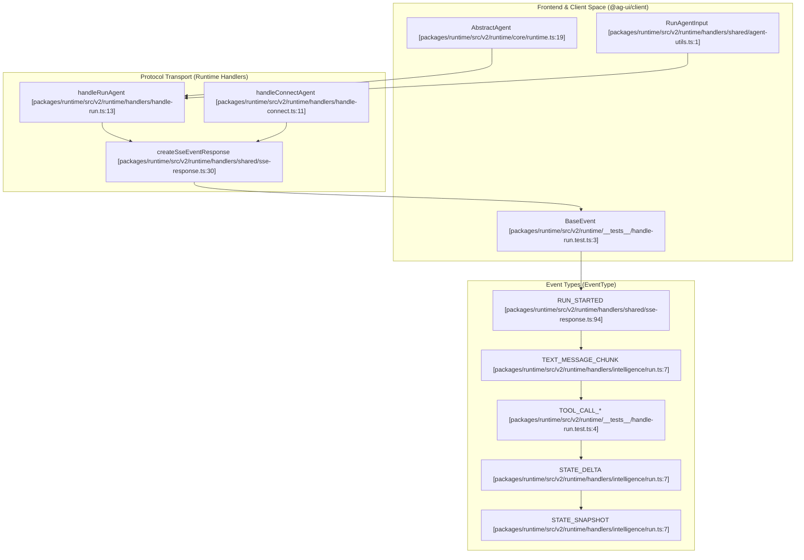
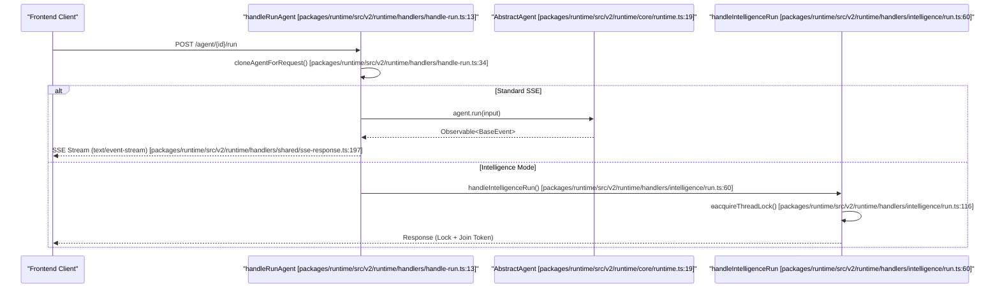

<!-- source: DeepWiki mcp.deepwiki.com · repo CopilotKit/CopilotKit · page 6.1 Protocol Specification · fetched 2026-10-30 -->

# Protocol Specification

Relevant source files

The following files were used as context for generating this wiki page:

- [.claude/docs/architecture.md](.claude/docs/architecture.md)
- [README.md](README.md)
- [assets/CopilotTextarea.gif](assets/CopilotTextarea.gif)
- [assets/CopilotTextarea_old.gif](assets/CopilotTextarea_old.gif)
- [assets/demo.gif](assets/demo.gif)
- [assets/proejct-perplexity-clone.png](assets/proejct-perplexity-clone.png)
- [assets/project-canvas-demo.png](assets/project-canvas-demo.png)
- [assets/spreadsheet-demo-big-file.gif](assets/spreadsheet-demo-big-file.gif)
- [packages/core/src/__tests__/debug-config-threading.test.ts](packages/core/src/__tests__/debug-config-threading.test.ts)
- [packages/runtime/src/v2/runtime/__tests__/agent-header-precedence.test.ts](packages/runtime/src/v2/runtime/__tests__/agent-header-precedence.test.ts)
- [packages/runtime/src/v2/runtime/__tests__/agent-utils-header-forwarding.test.ts](packages/runtime/src/v2/runtime/__tests__/agent-utils-header-forwarding.test.ts)
- [packages/runtime/src/v2/runtime/__tests__/agents-factory.test.ts](packages/runtime/src/v2/runtime/__tests__/agents-factory.test.ts)
- [packages/runtime/src/v2/runtime/__tests__/debug-sse-response.test.ts](packages/runtime/src/v2/runtime/__tests__/debug-sse-response.test.ts)
- [packages/runtime/src/v2/runtime/__tests__/handle-connect.test.ts](packages/runtime/src/v2/runtime/__tests__/handle-connect.test.ts)
- [packages/runtime/src/v2/runtime/__tests__/handle-run.test.ts](packages/runtime/src/v2/runtime/__tests__/handle-run.test.ts)
- [packages/runtime/src/v2/runtime/__tests__/header-utils.test.ts](packages/runtime/src/v2/runtime/__tests__/header-utils.test.ts)
- [packages/runtime/src/v2/runtime/__tests__/intelligence-lock-heartbeat.test.ts](packages/runtime/src/v2/runtime/__tests__/intelligence-lock-heartbeat.test.ts)
- [packages/runtime/src/v2/runtime/__tests__/intelligence-run-telemetry.test.ts](packages/runtime/src/v2/runtime/__tests__/intelligence-run-telemetry.test.ts)
- [packages/runtime/src/v2/runtime/__tests__/thread-names.test.ts](packages/runtime/src/v2/runtime/__tests__/thread-names.test.ts)
- [packages/runtime/src/v2/runtime/core/runtime.ts](packages/runtime/src/v2/runtime/core/runtime.ts)
- [packages/runtime/src/v2/runtime/handlers/handle-connect.ts](packages/runtime/src/v2/runtime/handlers/handle-connect.ts)
- [packages/runtime/src/v2/runtime/handlers/handle-run.ts](packages/runtime/src/v2/runtime/handlers/handle-run.ts)
- [packages/runtime/src/v2/runtime/handlers/handle-stop.ts](packages/runtime/src/v2/runtime/handlers/handle-stop.ts)
- [packages/runtime/src/v2/runtime/handlers/header-utils.ts](packages/runtime/src/v2/runtime/handlers/header-utils.ts)
- [packages/runtime/src/v2/runtime/handlers/intelligence/connect.ts](packages/runtime/src/v2/runtime/handlers/intelligence/connect.ts)
- [packages/runtime/src/v2/runtime/handlers/intelligence/run.ts](packages/runtime/src/v2/runtime/handlers/intelligence/run.ts)
- [packages/runtime/src/v2/runtime/handlers/intelligence/thread-names.ts](packages/runtime/src/v2/runtime/handlers/intelligence/thread-names.ts)
- [packages/runtime/src/v2/runtime/handlers/shared/agent-utils.ts](packages/runtime/src/v2/runtime/handlers/shared/agent-utils.ts)
- [packages/runtime/src/v2/runtime/handlers/shared/sse-response.ts](packages/runtime/src/v2/runtime/handlers/shared/sse-response.ts)
- [packages/runtime/src/v2/runtime/handlers/sse/__tests__/sse-connect-agent-id.test.ts](packages/runtime/src/v2/runtime/handlers/sse/__tests__/sse-connect-agent-id.test.ts)
- [packages/runtime/src/v2/runtime/handlers/sse/connect.ts](packages/runtime/src/v2/runtime/handlers/sse/connect.ts)
- [packages/runtime/src/v2/runtime/handlers/sse/run.ts](packages/runtime/src/v2/runtime/handlers/sse/run.ts)
- [packages/runtime/src/v2/runtime/runner/__tests__/bounded-thread-store.test.ts](packages/runtime/src/v2/runtime/runner/__tests__/bounded-thread-store.test.ts)
- [packages/runtime/src/v2/runtime/runner/agent-runner.ts](packages/runtime/src/v2/runtime/runner/agent-runner.ts)
- [packages/shared/src/__tests__/debug.test.ts](packages/shared/src/__tests__/debug.test.ts)
- [packages/shared/src/debug.ts](packages/shared/src/debug.ts)
- [showcase/angular/src/app/features/mastra/mastra-cards.ts](showcase/angular/src/app/features/mastra/mastra-cards.ts)
- [showcase/angular/src/app/features/mastra/mastra-feature.component.ts](showcase/angular/src/app/features/mastra/mastra-feature.component.ts)
- [showcase/shell-docs/src/content/docs/(other)/contributing/code-contributions/package-linking.mdx](showcase/shell-docs/src/content/docs/(other)/contributing/code-contributions/package-linking.mdx)
- [showcase/shell-docs/src/content/docs/(other)/contributing/meta.json](showcase/shell-docs/src/content/docs/(other)/contributing/meta.json)
- [showcase/shell-docs/src/content/docs/agentic-protocols/a2a.mdx](showcase/shell-docs/src/content/docs/agentic-protocols/a2a.mdx)
- [showcase/shell-docs/src/content/docs/integrations/adk/shared-state/workflow-execution.mdx](showcase/shell-docs/src/content/docs/integrations/adk/shared-state/workflow-execution.mdx)
- [showcase/shell-docs/src/content/docs/integrations/deepagents/shared-state/workflow-execution.mdx](showcase/shell-docs/src/content/docs/integrations/deepagents/shared-state/workflow-execution.mdx)
- [showcase/shell-docs/src/content/docs/integrations/langgraph/tutorials/ai-travel-app/step-5-stream-progress.mdx](showcase/shell-docs/src/content/docs/integrations/langgraph/tutorials/ai-travel-app/step-5-stream-progress.mdx)
- [showcase/shell-docs/src/content/docs/integrations/langgraph/tutorials/ai-travel-app/step-6-human-in-the-loop.mdx](showcase/shell-docs/src/content/docs/integrations/langgraph/tutorials/ai-travel-app/step-6-human-in-the-loop.mdx)

## Purpose and Scope

This document defines the AG-UI Protocol as implemented by CopilotKit. The AG-UI Protocol is a standardized interface for agent-user interaction that enables agents to communicate with user-facing applications through a well-defined set of HTTP endpoints and real-time streaming events.

The protocol serves as the communication backbone between the `@ag-ui/core` and `@ag-ui/client` packages and the backend runtimes. It defines how messages, tool calls, and state snapshots are synchronized across the industry-standard agentic stack. AG-UI protocol documentation is authored upstream in the `ag-ui-protocol/ag-ui` repository.

**Sources:** [packages/runtime/src/v2/runtime/core/runtime.ts:19-21](), [packages/runtime/src/v2/runtime/handlers/handle-run.ts:13-17](), [packages/runtime/src/v2/runtime/handlers/shared/sse-response.ts:1-4]()

## Protocol Architecture

The AG-UI Protocol defines a bidirectional communication channel between frontend applications and agent backends. The protocol operates over HTTP with two distinct patterns:

1.  **Handshake/Control Pattern**: Used for initial connection and retrieving connection metadata via the `/agent/{id}/run` and `/agent/{id}/connect` endpoints. [packages/runtime/src/v2/runtime/handlers/handle-run.ts:13-17](), [packages/runtime/src/v2/runtime/handlers/handle-connect.ts:11-15]()
2.  **Streaming Pattern**: Used for real-time agent execution. This is implemented via Server-Sent Events (SSE) in the standard runtime or via durable intelligence connections. [packages/runtime/src/v2/runtime/handlers/shared/sse-response.ts:30-38](), [packages/runtime/src/v2/runtime/handlers/sse/run.ts:1-10]()

**Diagram: AG-UI Protocol — Code Entity Map**

**Sources:** [packages/runtime/src/v2/runtime/handlers/handle-run.ts:13-17](), [packages/runtime/src/v2/runtime/handlers/shared/sse-response.ts:30-41](), [packages/runtime/src/v2/runtime/handlers/shared/agent-utils.ts:1-2]()

## Event Types and Lifecycle

The protocol uses a specific set of event types to manage the lifecycle of an agent run. These events are processed by the runtime handlers and consumed by the frontend.

### Core Event Types

| Event Type | Description | Reference |
| :--- | :--- | :--- |
| `RUN_STARTED` | Emitted when the agent begins processing a request. | [packages/runtime/src/v2/runtime/handlers/shared/sse-response.ts:94]() |
| `STEP_STARTED` | Indicates the start of a specific execution step. | [packages/runtime/src/v2/runtime/handlers/intelligence/run.ts:7]() |
| `TEXT_MESSAGE_CHUNK` | Streams partial text content for real-time UI updates. | [packages/runtime/src/v2/runtime/handlers/intelligence/run.ts:7]() |
| `TOOL_CALL_START` | Notifies the UI that the agent is invoking a tool. | [packages/runtime/src/v2/runtime/__tests__/handle-run.test.ts:4]() |
| `TOOL_CALL_RESULT` | Returns the output of a tool execution. | [packages/runtime/src/v2/runtime/__tests__/handle-run.test.ts:4]() |
| `STATE_SNAPSHOT` | Provides a full copy of the current agent state. | [packages/runtime/src/v2/runtime/handlers/intelligence/run.ts:7]() |
| `STATE_DELTA` | Provides incremental updates to the state. | [packages/runtime/src/v2/runtime/handlers/intelligence/run.ts:7]() |
| `RUN_FINISHED` | Signals the completion of the agent's task. | [packages/runtime/src/v2/runtime/handlers/intelligence/run.ts:7]() |

**Sources:** [packages/runtime/src/v2/runtime/handlers/shared/sse-response.ts:92-98](), [packages/runtime/src/v2/runtime/handlers/intelligence/run.ts:7]()

## Real-time Event Streaming

### SSE Implementation
In the standard runtime, events are streamed using a `TransformStream` and an `EventEncoder` [packages/runtime/src/v2/runtime/handlers/shared/sse-response.ts:39-41](). The `createSseEventResponse` function converts an RxJS `Observable<BaseEvent>` into a standard web `Response` with `text/event-stream` headers [packages/runtime/src/v2/runtime/handlers/shared/sse-response.ts:197-204]().

### Intelligence Implementation
In Intelligence mode, the runtime handles complex state management, canonical ID resolution, and thread locking [packages/runtime/src/v2/runtime/handlers/intelligence/run.ts:116-125](). The `handleRunAgent` function branches into `handleIntelligenceRun` when the runtime is configured for intelligence mode [packages/runtime/src/v2/runtime/handlers/handle-run.ts:84-92]().

**Diagram: Streaming Interaction Loop**

**Sources:** [packages/runtime/src/v2/runtime/handlers/handle-run.ts:13-102](), [packages/runtime/src/v2/runtime/handlers/intelligence/run.ts:60-137](), [packages/runtime/src/v2/runtime/handlers/shared/sse-response.ts:197-204]()

## State Synchronization Mechanism

State synchronization enables real-time state sharing between agents and UI components.

1.  **STATE_SNAPSHOT**: Sent when a full state replacement is required. [packages/runtime/src/v2/runtime/handlers/intelligence/run.ts:7]()
2.  **STATE_DELTA**: Sent for incremental updates, typically used for large state objects to reduce bandwidth. [packages/runtime/src/v2/runtime/handlers/intelligence/run.ts:7]()

The `handleRunAgent` handler initializes the agent with the incoming state and messages from the request body before execution begins [packages/runtime/src/v2/runtime/handlers/handle-run.ts:73-75]().

**Sources:** [packages/runtime/src/v2/runtime/handlers/intelligence/run.ts:7](), [packages/runtime/src/v2/runtime/handlers/handle-run.ts:73-76]()

## Implementation in @ag-ui/core and @ag-ui/client

The protocol is implemented as a set of TypeScript interfaces and abstract classes to ensure cross-framework compatibility.

### AbstractAgent
The `AbstractAgent` class [packages/runtime/src/v2/runtime/core/runtime.ts:19]() defines the contract for any agent implementation. It works with `BaseEvent` types to communicate execution progress.

### CopilotRuntime Handlers
The runtime provides handlers that translate incoming HTTP requests into agent execution flows:
- `handleRunAgent`: Orchestrates the execution of a new run, handling agent cloning and configuration [packages/runtime/src/v2/runtime/handlers/handle-run.ts:34-41]().
- `handleConnectAgent`: Handles re-connecting to existing agent threads [packages/runtime/src/v2/runtime/handlers/handle-connect.ts:11]().
- `configureAgentForRequest`: Injects middleware (like A2UI or MCP) into the agent instance based on the request context [packages/runtime/src/v2/runtime/handlers/shared/agent-utils.ts:81-93]().

**Sources:** [packages/runtime/src/v2/runtime/handlers/handle-run.ts:13-53](), [packages/runtime/src/v2/runtime/handlers/shared/agent-utils.ts:81-125](), [packages/runtime/src/v2/runtime/handlers/sse/connect.ts:33-40]()

## Industry Adoption

The AG-UI Protocol is designed for interoperability across the AI ecosystem. It is adopted by major players to provide a unified event interface:
- **Framework Integrations**: The protocol allows CopilotKit to support LangGraph, CrewAI, Mastra, and PydanticAI via the AG-UI protocol bridge. [README.md:60-61]()
- **Header Forwarding**: The protocol includes a sophisticated header forwarding policy to ensure security and context propagation (e.g., forwarding `Authorization` and `x-*` headers while stripping infrastructure artifacts like `x-forwarded-for` and `x-real-ip`) [packages/runtime/src/v2/runtime/handlers/header-utils.ts:16-33]().

**Sources:** [README.md:60-61](), [packages/runtime/src/v2/runtime/handlers/header-utils.ts:16-48](), [packages/runtime/src/v2/runtime/handlers/shared/agent-utils.ts:152-161]()

---

