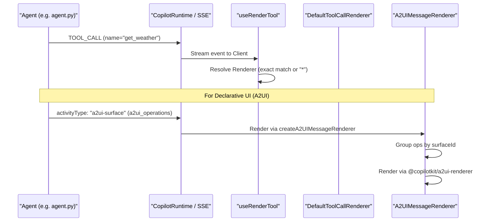

<!-- source: DeepWiki mcp.deepwiki.com · repo CopilotKit/CopilotKit · page 6.2 Generative UI System · fetched 2026-10-30 -->

# Generative UI System

<details>
<summary>Relevant source files</summary>

The following files were used as context for generating this wiki page:

- [packages/core/src/__tests__/core-connect-passive-replay.test.ts](packages/core/src/__tests__/core-connect-passive-replay.test.ts)
- [packages/react-core/src/components/CopilotListeners.tsx](packages/react-core/src/components/CopilotListeners.tsx)
- [packages/react-core/src/components/__tests__/CopilotListeners.defaultAgentAbsent.test.tsx](packages/react-core/src/components/__tests__/CopilotListeners.defaultAgentAbsent.test.tsx)
- [packages/react-core/src/components/__tests__/CopilotListeners.test.tsx](packages/react-core/src/components/__tests__/CopilotListeners.test.tsx)
- [packages/react-core/src/test-helpers/stub-window-location.ts](packages/react-core/src/test-helpers/stub-window-location.ts)
- [packages/react-core/src/v2/__tests__/A2UIMessageRenderer.test.tsx](packages/react-core/src/v2/__tests__/A2UIMessageRenderer.test.tsx)
- [packages/react-core/src/v2/__tests__/A2UIRecoveryStates.test.tsx](packages/react-core/src/v2/__tests__/A2UIRecoveryStates.test.tsx)
- [packages/react-core/src/v2/a2ui/A2UICatalogContext.tsx](packages/react-core/src/v2/a2ui/A2UICatalogContext.tsx)
- [packages/react-core/src/v2/a2ui/A2UIMessageRenderer.tsx](packages/react-core/src/v2/a2ui/A2UIMessageRenderer.tsx)
- [packages/react-core/src/v2/a2ui/A2UIRecoveryStates.tsx](packages/react-core/src/v2/a2ui/A2UIRecoveryStates.tsx)
- [packages/react-core/src/v2/a2ui/A2UIToolCallRenderer.tsx](packages/react-core/src/v2/a2ui/A2UIToolCallRenderer.tsx)
- [packages/react-core/src/v2/components/CopilotKitInspector.tsx](packages/react-core/src/v2/components/CopilotKitInspector.tsx)
- [packages/react-core/src/v2/components/OpenGenerativeUIRenderer.tsx](packages/react-core/src/v2/components/OpenGenerativeUIRenderer.tsx)
- [packages/react-core/src/v2/components/__tests__/OpenGenerativeUIRenderer.test.tsx](packages/react-core/src/v2/components/__tests__/OpenGenerativeUIRenderer.test.tsx)
- [packages/react-core/src/v2/components/chat/__tests__/CopilotChat.suggestionsAlways.test.tsx](packages/react-core/src/v2/components/chat/__tests__/CopilotChat.suggestionsAlways.test.tsx)
- [packages/react-core/src/v2/context.ts](packages/react-core/src/v2/context.ts)
- [packages/react-core/src/v2/hooks/__tests__/use-agent-error-state.test.tsx](packages/react-core/src/v2/hooks/__tests__/use-agent-error-state.test.tsx)
- [packages/react-core/src/v2/hooks/__tests__/use-human-in-the-loop.e2e.test.tsx](packages/react-core/src/v2/hooks/__tests__/use-human-in-the-loop.e2e.test.tsx)
- [packages/react-core/src/v2/hooks/__tests__/use-threads-provider-headers.e2e.test.tsx](packages/react-core/src/v2/hooks/__tests__/use-threads-provider-headers.e2e.test.tsx)
- [packages/react-core/src/v2/hooks/use-agent-context.tsx](packages/react-core/src/v2/hooks/use-agent-context.tsx)
- [packages/react-core/src/v2/hooks/use-configure-suggestions.tsx](packages/react-core/src/v2/hooks/use-configure-suggestions.tsx)
- [packages/react-core/src/v2/hooks/use-frontend-tool.tsx](packages/react-core/src/v2/hooks/use-frontend-tool.tsx)
- [packages/react-core/src/v2/hooks/use-human-in-the-loop.tsx](packages/react-core/src/v2/hooks/use-human-in-the-loop.tsx)
- [packages/react-core/src/v2/index.ts](packages/react-core/src/v2/index.ts)
- [packages/react-core/src/v2/providers/__tests__/CopilotKitProvider.onError.test.tsx](packages/react-core/src/v2/providers/__tests__/CopilotKitProvider.onError.test.tsx)
- [packages/react-core/src/v2/providers/__tests__/CopilotKitProvider.renderCustomMessages.e2e.test.tsx](packages/react-core/src/v2/providers/__tests__/CopilotKitProvider.renderCustomMessages.e2e.test.tsx)
- [packages/react-core/src/v2/providers/__tests__/CopilotKitProvider.test.tsx](packages/react-core/src/v2/providers/__tests__/CopilotKitProvider.test.tsx)
- [packages/react-core/src/v2/types/human-in-the-loop.ts](packages/react-core/src/v2/types/human-in-the-loop.ts)
- [showcase/shell-docs/src/content/docs/agent-config.mdx](showcase/shell-docs/src/content/docs/agent-config.mdx)
- [showcase/shell-docs/src/content/docs/agentic-protocols/mcp.mdx](showcase/shell-docs/src/content/docs/agentic-protocols/mcp.mdx)
- [showcase/shell-docs/src/content/docs/auth.mdx](showcase/shell-docs/src/content/docs/auth.mdx)
- [showcase/shell-docs/src/content/docs/frontend-tools.mdx](showcase/shell-docs/src/content/docs/frontend-tools.mdx)
- [showcase/shell-docs/src/content/docs/generative-ui/a2ui/dynamic-schema.mdx](showcase/shell-docs/src/content/docs/generative-ui/a2ui/dynamic-schema.mdx)
- [showcase/shell-docs/src/content/docs/generative-ui/a2ui/fixed-schema.mdx](showcase/shell-docs/src/content/docs/generative-ui/a2ui/fixed-schema.mdx)
- [showcase/shell-docs/src/content/docs/generative-ui/a2ui/index.mdx](showcase/shell-docs/src/content/docs/generative-ui/a2ui/index.mdx)
- [showcase/shell-docs/src/content/docs/generative-ui/display.mdx](showcase/shell-docs/src/content/docs/generative-ui/display.mdx)
- [showcase/shell-docs/src/content/docs/generative-ui/interactive.mdx](showcase/shell-docs/src/content/docs/generative-ui/interactive.mdx)
- [showcase/shell-docs/src/content/docs/generative-ui/mcp-apps.mdx](showcase/shell-docs/src/content/docs/generative-ui/mcp-apps.mdx)
- [showcase/shell-docs/src/content/docs/generative-ui/open-generative-ui.mdx](showcase/shell-docs/src/content/docs/generative-ui/open-generative-ui.mdx)
- [showcase/shell-docs/src/content/docs/generative-ui/reasoning.mdx](showcase/shell-docs/src/content/docs/generative-ui/reasoning.mdx)
- [showcase/shell-docs/src/content/docs/generative-ui/state-rendering.mdx](showcase/shell-docs/src/content/docs/generative-ui/state-rendering.mdx)
- [showcase/shell-docs/src/content/docs/generative-ui/tool-based.mdx](showcase/shell-docs/src/content/docs/generative-ui/tool-based.mdx)
- [showcase/shell-docs/src/content/docs/generative-ui/tool-rendering.mdx](showcase/shell-docs/src/content/docs/generative-ui/tool-rendering.mdx)
- [showcase/shell-docs/src/content/docs/human-in-the-loop/headless.mdx](showcase/shell-docs/src/content/docs/human-in-the-loop/headless.mdx)
- [showcase/shell-docs/src/content/docs/human-in-the-loop/index.mdx](showcase/shell-docs/src/content/docs/human-in-the-loop/index.mdx)
- [showcase/shell-docs/src/content/docs/human-in-the-loop/useInterrupt.mdx](showcase/shell-docs/src/content/docs/human-in-the-loop/useInterrupt.mdx)
- [showcase/shell-docs/src/content/docs/integrations/a2a/generative-ui/declarative-a2ui.mdx](showcase/shell-docs/src/content/docs/integrations/a2a/generative-ui/declarative-a2ui.mdx)
- [showcase/shell-docs/src/content/docs/integrations/deepagents/generative-ui/a2ui/advanced.mdx](showcase/shell-docs/src/content/docs/integrations/deepagents/generative-ui/a2ui/advanced.mdx)
- [showcase/shell-docs/src/content/docs/integrations/deepagents/generative-ui/a2ui/dynamic-schema.mdx](showcase/shell-docs/src/content/docs/integrations/deepagents/generative-ui/a2ui/dynamic-schema.mdx)
- [showcase/shell-docs/src/content/docs/integrations/deepagents/generative-ui/a2ui/fixed-schema.mdx](showcase/shell-docs/src/content/docs/integrations/deepagents/generative-ui/a2ui/fixed-schema.mdx)
- [showcase/shell-docs/src/content/docs/integrations/deepagents/generative-ui/a2ui/index.mdx](showcase/shell-docs/src/content/docs/integrations/deepagents/generative-ui/a2ui/index.mdx)
- [showcase/shell-docs/src/content/docs/integrations/langgraph/generative-ui/a2ui/advanced.mdx](showcase/shell-docs/src/content/docs/integrations/langgraph/generative-ui/a2ui/advanced.mdx)
- [showcase/shell-docs/src/content/docs/integrations/langgraph/generative-ui/a2ui/fixed-schema.mdx](showcase/shell-docs/src/content/docs/integrations/langgraph/generative-ui/a2ui/fixed-schema.mdx)
- [showcase/shell-docs/src/content/docs/multi-agent/subagents.mdx](showcase/shell-docs/src/content/docs/multi-agent/subagents.mdx)
- [showcase/shell-docs/src/content/docs/programmatic-control.mdx](showcase/shell-docs/src/content/docs/programmatic-control.mdx)
- [showcase/shell-docs/src/content/docs/shared-state.mdx](showcase/shell-docs/src/content/docs/shared-state.mdx)
- [showcase/shell-docs/src/content/docs/shared-state/agent-readonly.mdx](showcase/shell-docs/src/content/docs/shared-state/agent-readonly.mdx)
- [showcase/shell-docs/src/content/docs/shared-state/streaming.mdx](showcase/shell-docs/src/content/docs/shared-state/streaming.mdx)

</details>


This document describes the Generative UI system within CopilotKit, focusing on how agents dynamically render and update user interfaces. It covers the three primary architectural patterns for Generative UI and the technical mechanisms—specifically tool calls, A2UI message renderers, and specialized hooks—by which agents interact with the frontend to produce these interfaces.

## Overview of Generative UI

Generative UI refers to the capability of AI agents to dynamically create, modify, or interact with user interface components at runtime. CopilotKit facilitates this through the **AG-UI Protocol**, which standardizes how agentic backends communicate UI intent to frontend runtimes.

CopilotKit supports three primary types of Generative UI:

1.  **Static (AG-UI Protocol)**: Agents trigger predefined frontend actions that render specific UI components via tool calls.
2.  **Declarative (A2UI)**: Agents provide a declarative JSON schema (Agent-to-UI) that the frontend renders into dynamic UI using a predefined component catalog.
3.  **Open-Ended (MCP Apps)**: Agents generate arbitrary UI components or applications, often within sandboxed environments using the Model Context Protocol.

Sources: [showcase/shell-docs/src/content/docs/generative-ui/tool-rendering.mdx:12-17](), [showcase/shell-docs/src/content/docs/integrations/a2a/generative-ui/declarative-a2ui.mdx:7-8](), [showcase/shell-docs/src/content/docs/generative-ui/mcp-apps.mdx:1-10]()

## Generative UI Types

### 1. Static Generative UI (Tool Rendering)
Static Generative UI leverages the AG-UI Protocol to enable agents to call predefined frontend actions. These actions are registered in the frontend and, when invoked by an agent via a tool call, execute a specific function that renders UI components.

**Implementation Mechanism:**
*   **Frontend Registration**: Developers use the `useRenderTool` hook to define available UI "tools" and their associated React components [showcase/shell-docs/src/content/docs/generative-ui/tool-rendering.mdx:72-78]().
*   **Agent Invocation**: The agent emits a `TOOL_CALL` event. The system resolves the renderer by name.
*   **Execution**: The `useRenderTool` hook matches the tool name to the registered frontend component and renders it within the chat interface [showcase/shell-docs/src/content/docs/generative-ui/tool-rendering.mdx:84-87]().

### 2. Declarative Generative UI (A2UI)
Declarative Generative UI (Agent-to-UI) allows agents to describe UI structures using a shared catalog of components. The agent produces `a2ui_operations` to manipulate the UI [packages/react-core/src/v2/a2ui/A2UIMessageRenderer.tsx:28-28]().

**Implementation Mechanism:**
*   **A2UIMessageRenderer**: A specialized renderer for the `a2ui-surface` activity type. It handles the lifecycle of the generative surface, including "building", "retrying", and "failed" states [packages/react-core/src/v2/a2ui/A2UIMessageRenderer.tsx:114-116]().
*   **Operations Interception**: The `A2UIActionInterceptor` allows the application to intercept user actions dispatched from A2UI components (like button clicks) before they reach the agent, enabling client-side handling (e.g., navigation) [packages/react-core/src/v2/a2ui/A2UIMessageRenderer.tsx:67-70]().
*   **Dynamic Schema**: When using Dynamic Schema A2UI, a secondary LLM generates the UI schema and data. While this happens, `useRenderTool` can be used to show a custom progress indicator for the `render_a2ui` tool [showcase/shell-docs/src/content/docs/integrations/langgraph/generative-ui/a2ui/advanced.mdx:7-13]().

### 3. Open-Ended Generative UI (MCP Apps)
Open-Ended Generative UI allows agents to generate interactive structures powered by the **Model Context Protocol (MCP)**. This allows agents to serve as the backend for full-featured applications rendered within the CopilotKit environment.

Sources: [packages/react-core/src/v2/a2ui/A2UIMessageRenderer.tsx:105-116](), [showcase/shell-docs/src/content/docs/integrations/langgraph/generative-ui/a2ui/advanced.mdx:123-132](), [showcase/shell-docs/src/content/docs/generative-ui/mcp-apps.mdx:1-10]()

## Technical Implementation: `useRenderTool`

The `useRenderTool` hook is the core API for associating agent tool calls with React components.

### Default Rendering Logic
The system includes a `useDefaultRenderTool` hook that registers a wildcard (`"*"`) renderer. This ensures that even tools without custom UI have a visible representation in the chat [showcase/shell-docs/src/content/docs/generative-ui/tool-rendering.mdx:34-38]().

**Data Flow Sequence:**
1.  **Agent Stream**: The agent produces a tool call (e.g., `get_weather`).
2.  **Resolution**: The runtime looks up the renderer. It prioritizes exact name matches, then the wildcard renderer [showcase/shell-docs/src/content/docs/generative-ui/tool-rendering.mdx:89-94]().
3.  **Default UI**: The `DefaultToolCallRenderer` provides a standard UI with "Running" and "Done" statuses, and an expandable section for arguments and results [showcase/shell-docs/src/content/docs/generative-ui/tool-rendering.mdx:34-38]().

### Data Flow Diagram



Title: "Generative UI Tool and A2UI Data Flow"
Sources: [packages/react-core/src/v2/a2ui/A2UIMessageRenderer.tsx:105-152](), [showcase/shell-docs/src/content/docs/generative-ui/tool-rendering.mdx:72-87](), [showcase/shell-docs/src/content/docs/integrations/langgraph/generative-ui/a2ui/advanced.mdx:9-13]()

## Code Entity Space Mapping

This diagram maps high-level Generative UI concepts to specific code entities and hooks.

```mermaid
graph TD
    subgraph "Natural Language Space (Agent Intent)"
        Intent1["Agent: 'Render a weather card'"]
        Intent2["Agent: 'Build a sales dashboard'"]
        Intent3["Agent: 'Ask for approval'"]
    end

    subgraph "Code Entity Space (Implementation)"
        URT["useRenderTool()"]
        UDRT["useDefaultRenderTool()"]
        UHITL["useHumanInTheLoop()"]
        A2UMR["A2UIMessageRenderer"]
        DTCR["DefaultToolCallRenderer"]
        A2UIO["a2ui_operations"]
    end

    Intent1 -->|Tool Call| URT
    Intent2 -->|A2UI Surface| A2UMR
    Intent3 -->|HITL Tool| UHITL
    URT -->|Fallback| UDRT
    UDRT -->|Renders| DTCR
    A2UMR -->|Processes| A2UIO

    URT -->|File| [showcase/shell-docs/src/content/docs/generative-ui/tool-rendering.mdx]()
    UHITL -->|File| [packages/react-core/src/v2/hooks/use-human-in-the-loop.tsx]()
    A2UMR -->|File| [packages/react-core/src/v2/a2ui/A2UIMessageRenderer.tsx]()
```

Title: "Generative UI Entity Mapping"
Sources: [packages/react-core/src/v2/hooks/use-human-in-the-loop.tsx:10-12](), [packages/react-core/src/v2/a2ui/A2UIMessageRenderer.tsx:105-116](), [showcase/shell-docs/src/content/docs/generative-ui/tool-rendering.mdx:34-38]()

## Tool Call Lifecycle and Status

Generative UI components receive a `status` prop to handle the asynchronous nature of agent execution.

| Status | Code Symbol | Description |
| :--- | :--- | :--- |
| **In Progress** | `inProgress` | The tool call has been initiated; parameters are streaming [showcase/shell-docs/src/content/docs/integrations/langgraph/generative-ui/a2ui/advanced.mdx:13](). |
| **Executing** | `executing` | The tool is currently running or waiting for user interaction in HITL flows [packages/react-core/src/v2/hooks/use-human-in-the-loop.tsx:77-85](). |
| **Complete** | `complete` | The tool has finished. UI renders the final result [packages/react-core/src/v2/hooks/use-human-in-the-loop.tsx:86-94](). |

### A2UI Recovery States
A2UI surfaces handle complex loading scenarios where the UI might fail to build or require retries:
*   **A2UIBuildingState**: Shown while the initial surface is being constructed [packages/react-core/src/v2/a2ui/A2UIMessageRenderer.tsx:180]().
*   **A2UIRetryingState**: Displayed if the surface construction takes longer than expected or encounters recoverable errors [packages/react-core/src/v2/a2ui/A2UIMessageRenderer.tsx:166-173]().
*   **A2UIRecoveryFailure**: Rendered when the surface fails to load after maximum retry attempts [packages/react-core/src/v2/a2ui/A2UIMessageRenderer.tsx:161-163]().

## Human-in-the-Loop (HITL) Rendering
HITL is a specialized form of Generative UI where the "tool" is a user interaction.
*   **useHumanInTheLoop**: This hook registers a tool that, when called, renders a UI and provides a `respond` callback to send data back to the agent [packages/react-core/src/v2/hooks/use-human-in-the-loop.tsx:20-27]().
*   **Status Transitions**: HITL components typically transition through `InProgress` (streaming arguments), `Executing` (waiting for user input), and `Complete` (after `respond` is called) [packages/react-core/src/v2/hooks/__tests__/use-human-in-the-loop.e2e.test.tsx:23-26]().

Sources: [packages/react-core/src/v2/hooks/use-human-in-the-loop.tsx:59-105](), [packages/react-core/src/v2/a2ui/A2UIMessageRenderer.tsx:157-181](), [showcase/shell-docs/src/content/docs/integrations/langgraph/generative-ui/a2ui/advanced.mdx:7-13]()

---

