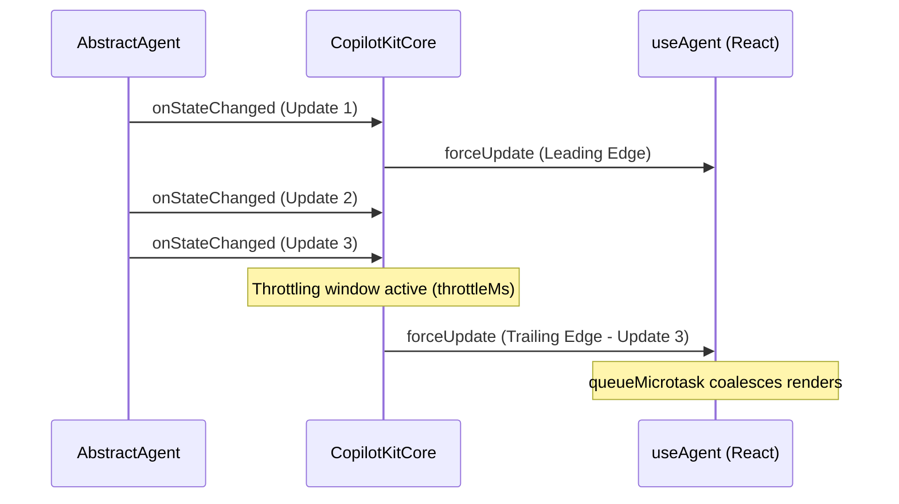

<!-- source: DeepWiki mcp.deepwiki.com · repo CopilotKit/CopilotKit · page 6.3 Shared State Management · fetched 2026-10-30 -->

# Shared State Management

<details>
<summary>Relevant source files</summary>

The following files were used as context for generating this wiki page:

- [examples/v2/react/demo/src/app/api/copilotkit/[[...slug]]/route.ts](examples/v2/react/demo/src/app/api/copilotkit/[[...slug]]/route.ts)
- [packages/angular/src/lib/agent.spec.ts](packages/angular/src/lib/agent.spec.ts)
- [packages/angular/src/lib/agent.ts](packages/angular/src/lib/agent.ts)
- [packages/angular/src/lib/config.ts](packages/angular/src/lib/config.ts)
- [packages/angular/src/lib/copilotkit.spec.ts](packages/angular/src/lib/copilotkit.spec.ts)
- [packages/angular/src/lib/directives/__tests__/copilotkit-config.directive.spec.ts](packages/angular/src/lib/directives/__tests__/copilotkit-config.directive.spec.ts)
- [packages/angular/src/lib/license-watermark.ts](packages/angular/src/lib/license-watermark.ts)
- [packages/core/src/__tests__/core-credentials.test.ts](packages/core/src/__tests__/core-credentials.test.ts)
- [packages/core/src/__tests__/core-headers.test.ts](packages/core/src/__tests__/core-headers.test.ts)
- [packages/core/src/__tests__/core-register-proxied-agent.test.ts](packages/core/src/__tests__/core-register-proxied-agent.test.ts)
- [packages/core/src/__tests__/core-subscribe-to-agent.test.ts](packages/core/src/__tests__/core-subscribe-to-agent.test.ts)
- [packages/core/src/__tests__/proxied-runtime-transport.test.ts](packages/core/src/__tests__/proxied-runtime-transport.test.ts)
- [packages/core/src/agent.ts](packages/core/src/agent.ts)
- [packages/core/src/core/agent-registry.ts](packages/core/src/core/agent-registry.ts)
- [packages/core/src/core/core.ts](packages/core/src/core/core.ts)
- [packages/react-core/src/__tests__/threadid-propagation.contract.test.tsx](packages/react-core/src/__tests__/threadid-propagation.contract.test.tsx)
- [packages/react-core/src/hooks/use-agent-nodename.ts](packages/react-core/src/hooks/use-agent-nodename.ts)
- [packages/react-core/src/v2/components/chat/__tests__/CopilotChatActivityRendering.e2e.test.tsx](packages/react-core/src/v2/components/chat/__tests__/CopilotChatActivityRendering.e2e.test.tsx)
- [packages/react-core/src/v2/components/chat/__tests__/copilot-chat-throttle.test.tsx](packages/react-core/src/v2/components/chat/__tests__/copilot-chat-throttle.test.tsx)
- [packages/react-core/src/v2/hooks/__tests__/use-agent-provider-headers.e2e.test.tsx](packages/react-core/src/v2/hooks/__tests__/use-agent-provider-headers.e2e.test.tsx)
- [packages/react-core/src/v2/hooks/__tests__/use-agent-stability.test.tsx](packages/react-core/src/v2/hooks/__tests__/use-agent-stability.test.tsx)
- [packages/react-core/src/v2/hooks/__tests__/use-agent-throttle.test.tsx](packages/react-core/src/v2/hooks/__tests__/use-agent-throttle.test.tsx)
- [packages/react-core/src/v2/hooks/__tests__/use-agent-types.test.tsx](packages/react-core/src/v2/hooks/__tests__/use-agent-types.test.tsx)
- [packages/react-core/src/v2/hooks/__tests__/use-capabilities.test.tsx](packages/react-core/src/v2/hooks/__tests__/use-capabilities.test.tsx)
- [packages/react-core/src/v2/hooks/use-agent.tsx](packages/react-core/src/v2/hooks/use-agent.tsx)
- [packages/react-core/src/v2/hooks/use-capabilities.tsx](packages/react-core/src/v2/hooks/use-capabilities.tsx)
- [packages/react-core/src/v2/hooks/use-render-activity-message.tsx](packages/react-core/src/v2/hooks/use-render-activity-message.tsx)
- [packages/react-core/src/v2/providers/CopilotKitProvider.tsx](packages/react-core/src/v2/providers/CopilotKitProvider.tsx)
- [packages/react-core/src/v2/providers/__tests__/CopilotKitProvider.stability.test.tsx](packages/react-core/src/v2/providers/__tests__/CopilotKitProvider.stability.test.tsx)
- [showcase/shell-docs/src/content/docs/agent-config.mdx](showcase/shell-docs/src/content/docs/agent-config.mdx)
- [showcase/shell-docs/src/content/docs/agentic-protocols/mcp.mdx](showcase/shell-docs/src/content/docs/agentic-protocols/mcp.mdx)
- [showcase/shell-docs/src/content/docs/auth.mdx](showcase/shell-docs/src/content/docs/auth.mdx)
- [showcase/shell-docs/src/content/docs/frontend-tools.mdx](showcase/shell-docs/src/content/docs/frontend-tools.mdx)
- [showcase/shell-docs/src/content/docs/generative-ui/a2ui/dynamic-schema.mdx](showcase/shell-docs/src/content/docs/generative-ui/a2ui/dynamic-schema.mdx)
- [showcase/shell-docs/src/content/docs/generative-ui/a2ui/fixed-schema.mdx](showcase/shell-docs/src/content/docs/generative-ui/a2ui/fixed-schema.mdx)
- [showcase/shell-docs/src/content/docs/generative-ui/display.mdx](showcase/shell-docs/src/content/docs/generative-ui/display.mdx)
- [showcase/shell-docs/src/content/docs/generative-ui/interactive.mdx](showcase/shell-docs/src/content/docs/generative-ui/interactive.mdx)
- [showcase/shell-docs/src/content/docs/generative-ui/mcp-apps.mdx](showcase/shell-docs/src/content/docs/generative-ui/mcp-apps.mdx)
- [showcase/shell-docs/src/content/docs/generative-ui/open-generative-ui.mdx](showcase/shell-docs/src/content/docs/generative-ui/open-generative-ui.mdx)
- [showcase/shell-docs/src/content/docs/generative-ui/reasoning.mdx](showcase/shell-docs/src/content/docs/generative-ui/reasoning.mdx)
- [showcase/shell-docs/src/content/docs/generative-ui/state-rendering.mdx](showcase/shell-docs/src/content/docs/generative-ui/state-rendering.mdx)
- [showcase/shell-docs/src/content/docs/generative-ui/tool-based.mdx](showcase/shell-docs/src/content/docs/generative-ui/tool-based.mdx)
- [showcase/shell-docs/src/content/docs/generative-ui/tool-rendering.mdx](showcase/shell-docs/src/content/docs/generative-ui/tool-rendering.mdx)
- [showcase/shell-docs/src/content/docs/human-in-the-loop/headless.mdx](showcase/shell-docs/src/content/docs/human-in-the-loop/headless.mdx)
- [showcase/shell-docs/src/content/docs/human-in-the-loop/index.mdx](showcase/shell-docs/src/content/docs/human-in-the-loop/index.mdx)
- [showcase/shell-docs/src/content/docs/human-in-the-loop/useInterrupt.mdx](showcase/shell-docs/src/content/docs/human-in-the-loop/useInterrupt.mdx)
- [showcase/shell-docs/src/content/docs/multi-agent/subagents.mdx](showcase/shell-docs/src/content/docs/multi-agent/subagents.mdx)
- [showcase/shell-docs/src/content/docs/programmatic-control.mdx](showcase/shell-docs/src/content/docs/programmatic-control.mdx)
- [showcase/shell-docs/src/content/docs/shared-state.mdx](showcase/shell-docs/src/content/docs/shared-state.mdx)
- [showcase/shell-docs/src/content/docs/shared-state/agent-readonly.mdx](showcase/shell-docs/src/content/docs/shared-state/agent-readonly.mdx)
- [showcase/shell-docs/src/content/docs/shared-state/streaming.mdx](showcase/shell-docs/src/content/docs/shared-state/streaming.mdx)

</details>


Shared state management in CopilotKit provides a synchronized data layer that allows AI agents and frontend UI components to maintain a single source of truth in real-time. This synchronization enables "Agent-Native" applications where the agent can observe UI state changes and the UI can react to the agent's internal reasoning and state updates.

## State Synchronization Protocol

The synchronization layer is built on top of the AG-UI Protocol, utilizing Server-Sent Events (SSE) or WebSockets to transmit state changes. The protocol defines two primary event types for state management: `STATE_SNAPSHOT` and `STATE_DELTA`.

### Event Types

| Event Type | Purpose | Implementation Detail |
| :--- | :--- | :--- |
| `STATE_SNAPSHOT` | Transmits the entire state object. | Used for initial synchronization or full state resets. |
| `STATE_DELTA` | Transmits only the changes (diffs) to the state. | Optimized for real-time updates to minimize payload size. |

These events allow the frontend to maintain a local mirror of the agent's state. When using the `useAgent` hook (React) or `injectAgentStore` (Angular), these updates are automatically applied to the local state via the `StateManager` [packages/core/src/core/core.ts:33]().

**Sources:**
- [packages/core/src/core/core.ts:1-132]()
- [packages/react-core/src/v2/hooks/use-agent.tsx:13-23]()

## Frontend State Access

Developers interact with shared state through high-level hooks and services that abstract the underlying protocol events.

### useAgent (React)
The `useAgent` hook provides a typed interface to an agent's state. It manages the connection to the `CopilotRuntime` and handles the stream of AG-UI events via the `CopilotKitCore`.

Key features of `useAgent`:
- **Provisional Agents**: While the runtime is connecting or if it's in an error state, the hook returns a `ProxiedCopilotRuntimeAgent` [packages/react-core/src/v2/hooks/use-agent.tsx:215-245](). This prevents the React tree from crashing and keeps references stable to avoid unnecessary HTTP calls [packages/react-core/src/v2/hooks/use-agent.tsx:247-252]().
- **Throttling**: Supports a `throttleMs` parameter to reduce re-render frequency during high-frequency streaming updates. It uses a leading+trailing pattern with a shared window [packages/react-core/src/v2/hooks/use-agent.tsx:28-49]().
- **State Subscription**: Uses `subscribeToAgentWithOptions` to listen for `onStateChanged` events [packages/react-core/src/v2/hooks/use-agent.tsx:266-285]().
- **Microtask Batching**: Coalesces multiple synchronous notifications into a single React re-render using `queueMicrotask` to prevent content flickering and scroll jumping [packages/react-core/src/v2/hooks/use-agent.tsx:276-285]().

### injectAgentStore (Angular)
In Angular, state is managed via `AgentStore` and `injectAgentStore` [packages/angular/src/lib/agent.ts:30-47](). It uses Angular Signals to provide reactive access to `messages`, `state`, and `isRunning` status [packages/angular/src/lib/agent.ts:34-41](). The `AgentStore` subscribes to the agent using `subscribeToAgentWithOptions` from the core instance [packages/angular/src/lib/agent.ts:59-82]().

**Sources:**
- [packages/react-core/src/v2/hooks/use-agent.tsx:59-200]()
- [packages/angular/src/lib/agent.ts:30-94]()
- [packages/angular/src/lib/agent.ts:107-180]()

## Implementation Architecture

The state management flow bridges the "Natural Language Space" (where the agent operates) and the "Code Entity Space" (where the UI and Runtime live).

### Data Flow Diagram

The following diagram shows how a state change propagates from a remote agent to a React component.

```mermaid
graph TD
    subgraph "Natural Language Space (Agent)"
        AGENT_LOGIC["Agent Logic (Python/JS)"]
        AGENT_STATE["Agent State Object"]
        EMIT_STATE["STATE_DELTA / STATE_SNAPSHOT"]
        AGENT_LOGIC -- "Updates" --> AGENT_STATE
        AGENT_STATE -- "Trigger" --> EMIT_STATE
    end

    subgraph "Backend Runtime (Code Entity Space)"
        RUNTIME["CopilotRuntime"]
        AGENT_RUNNER["ProxiedCopilotRuntimeAgent"]
        SSE_STREAM["SSE Stream (AG-UI Protocol)"]
        
        EMIT_STATE -- "HTTP Stream" --> AGENT_RUNNER
        AGENT_RUNNER -- "Pushes to" --> SSE_STREAM
    end

    subgraph "Frontend (Code Entity Space)"
        CORE["CopilotKitCore"]
        REGISTRY["AgentRegistry"]
        USE_AGENT["useAgent Hook"]
        UI_COMPONENT["React Component"]

        SSE_STREAM -- "onStateChanged" --> CORE
        CORE -- "getAgent(id)" --> REGISTRY
        CORE -- "subscribeToAgentWithOptions" --> USE_AGENT
        USE_AGENT -- "forceUpdate" --> UI_COMPONENT
    end

    [packages/core/src/core/core.ts] --> CORE
    [packages/core/src/core/agent-registry.ts] --> REGISTRY
    [packages/react-core/src/v2/hooks/use-agent.tsx] --> USE_AGENT
    [packages/core/src/agent.ts] --> AGENT_RUNNER
```
Title: "Agent-to-UI State Propagation Architecture"

**Sources:**
- [packages/core/src/core/core.ts:18-35]()
- [packages/core/src/core/agent-registry.ts:56-100]()
- [packages/react-core/src/v2/hooks/use-agent.tsx:266-285]()
- [packages/core/src/agent.ts:100-150]()

## Performance and Throttling

High-frequency state updates (e.g., token-by-token streaming) can lead to performance degradation. CopilotKit handles this through a `Throttler` (using `@tanstack/pacer`) in the core logic [packages/core/src/core/core.ts:3]().

### Throttling Strategy
- **Leading Edge**: The first update fires immediately to ensure responsiveness [packages/core/src/__tests__/core-subscribe-to-agent.test.ts:144-157]().
- **Trailing Edge**: Subsequent updates within the `throttleMs` window are coalesced, and the most recent update fires after the window expires [packages/core/src/__tests__/core-subscribe-to-agent.test.ts:163-187]().
- **Lifecycle Events**: Critical events like `onRunInitialized`, `onRunFinalized`, and `onRunFailed` always bypass the throttle to ensure the UI accurately reflects the agent's execution status [packages/react-core/src/v2/hooks/use-agent.tsx:42-43]().

### Update Sequence


Title: "Throttled State Update Sequence"

**Sources:**
- [packages/core/src/core/core.ts:33]()
- [packages/react-core/src/v2/hooks/use-agent.tsx:28-49]()
- [packages/core/src/__tests__/core-subscribe-to-agent.test.ts:144-235]()

## Predictive State Updates

When the UI writes to the state via `agent.setState`, the update is applied locally first to provide an optimistic UI response before being transmitted to the backend agent. This ensures that user interactions feel instantaneous even if the agent is operating over a high-latency connection [showcase/shell-docs/src/content/docs/shared-state.mdx:52-56]().

**Sources:**
- [showcase/shell-docs/src/content/docs/shared-state.mdx:50-61]()
- [packages/react-core/src/v2/hooks/use-agent.tsx:276-285]()

---

