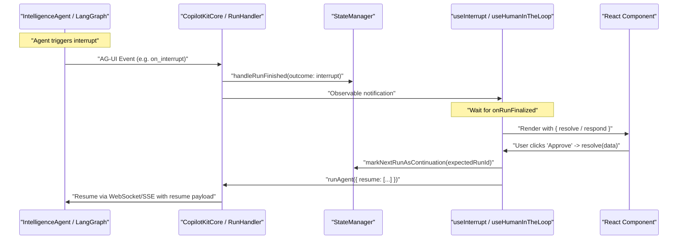
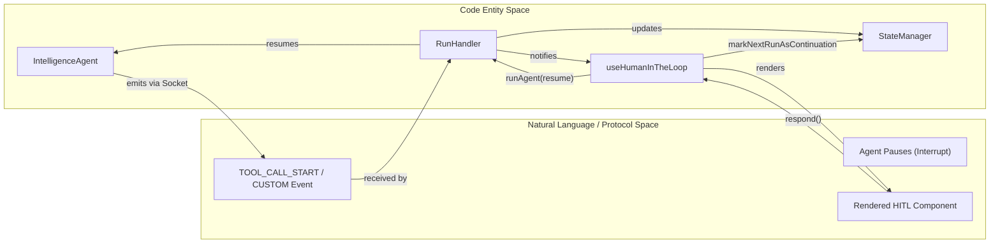

<!-- source: DeepWiki mcp.deepwiki.com · repo CopilotKit/CopilotKit · page 6.4 Human-in-the-Loop Workflows · fetched 2026-10-30 -->

# Human-in-the-Loop Workflows

Relevant source files

The following files were used as context for generating this wiki page:

- [packages/angular/src/lib/components/a2ui/__tests__/a2ui-activity-renderer.spec.ts](packages/angular/src/lib/components/a2ui/__tests__/a2ui-activity-renderer.spec.ts)
- [packages/core/src/__tests__/core-connect-passive-replay.test.ts](packages/core/src/__tests__/core-connect-passive-replay.test.ts)
- [packages/core/src/__tests__/core-connect-thread-switch.test.ts](packages/core/src/__tests__/core-connect-thread-switch.test.ts)
- [packages/core/src/__tests__/core-edge-cases.test.ts](packages/core/src/__tests__/core-edge-cases.test.ts)
- [packages/core/src/__tests__/core-follow-up.test.ts](packages/core/src/__tests__/core-follow-up.test.ts)
- [packages/core/src/__tests__/core-frontend-tool-placeholder.test.ts](packages/core/src/__tests__/core-frontend-tool-placeholder.test.ts)
- [packages/core/src/__tests__/core-parallel-tool-order.test.ts](packages/core/src/__tests__/core-parallel-tool-order.test.ts)
- [packages/core/src/__tests__/core-run-agent-resume.test.ts](packages/core/src/__tests__/core-run-agent-resume.test.ts)
- [packages/core/src/__tests__/intelligence-agent.test.ts](packages/core/src/__tests__/intelligence-agent.test.ts)
- [packages/core/src/__tests__/state-manager.test.ts](packages/core/src/__tests__/state-manager.test.ts)
- [packages/core/src/core/run-handler.ts](packages/core/src/core/run-handler.ts)
- [packages/core/src/core/state-manager.ts](packages/core/src/core/state-manager.ts)
- [packages/core/src/intelligence-agent.ts](packages/core/src/intelligence-agent.ts)
- [packages/react-core/src/components/CopilotListeners.tsx](packages/react-core/src/components/CopilotListeners.tsx)
- [packages/react-core/src/components/__tests__/CopilotListeners.defaultAgentAbsent.test.tsx](packages/react-core/src/components/__tests__/CopilotListeners.defaultAgentAbsent.test.tsx)
- [packages/react-core/src/components/__tests__/CopilotListeners.test.tsx](packages/react-core/src/components/__tests__/CopilotListeners.test.tsx)
- [packages/react-core/src/hooks/__tests__/use-copilot-action.e2e.test.tsx](packages/react-core/src/hooks/__tests__/use-copilot-action.e2e.test.tsx)
- [packages/react-core/src/test-helpers/stub-window-location.ts](packages/react-core/src/test-helpers/stub-window-location.ts)
- [packages/react-core/src/v2/__tests__/A2UIMessageRenderer.test.tsx](packages/react-core/src/v2/__tests__/A2UIMessageRenderer.test.tsx)
- [packages/react-core/src/v2/__tests__/A2UIRecoveryStates.test.tsx](packages/react-core/src/v2/__tests__/A2UIRecoveryStates.test.tsx)
- [packages/react-core/src/v2/a2ui/A2UICatalogContext.tsx](packages/react-core/src/v2/a2ui/A2UICatalogContext.tsx)
- [packages/react-core/src/v2/a2ui/A2UIMessageRenderer.tsx](packages/react-core/src/v2/a2ui/A2UIMessageRenderer.tsx)
- [packages/react-core/src/v2/a2ui/A2UIRecoveryStates.tsx](packages/react-core/src/v2/a2ui/A2UIRecoveryStates.tsx)
- [packages/react-core/src/v2/a2ui/A2UIToolCallRenderer.tsx](packages/react-core/src/v2/a2ui/A2UIToolCallRenderer.tsx)
- [packages/react-core/src/v2/components/CopilotKitInspector.tsx](packages/react-core/src/v2/components/CopilotKitInspector.tsx)
- [packages/react-core/src/v2/components/OpenGenerativeUIRenderer.tsx](packages/react-core/src/v2/components/OpenGenerativeUIRenderer.tsx)
- [packages/react-core/src/v2/components/__tests__/OpenGenerativeUIRenderer.test.tsx](packages/react-core/src/v2/components/__tests__/OpenGenerativeUIRenderer.test.tsx)
- [packages/react-core/src/v2/components/chat/CopilotChat.tsx](packages/react-core/src/v2/components/chat/CopilotChat.tsx)
- [packages/react-core/src/v2/components/chat/__tests__/CopilotChat.runActivityReconnect.test.tsx](packages/react-core/src/v2/components/chat/__tests__/CopilotChat.runActivityReconnect.test.tsx)
- [packages/react-core/src/v2/components/chat/__tests__/CopilotChat.suggestionsAlways.test.tsx](packages/react-core/src/v2/components/chat/__tests__/CopilotChat.suggestionsAlways.test.tsx)
- [packages/react-core/src/v2/context.ts](packages/react-core/src/v2/context.ts)
- [packages/react-core/src/v2/headless.ts](packages/react-core/src/v2/headless.ts)
- [packages/react-core/src/v2/hooks/__tests__/use-agent-error-state.test.tsx](packages/react-core/src/v2/hooks/__tests__/use-agent-error-state.test.tsx)
- [packages/react-core/src/v2/hooks/__tests__/use-human-in-the-loop.e2e.test.tsx](packages/react-core/src/v2/hooks/__tests__/use-human-in-the-loop.e2e.test.tsx)
- [packages/react-core/src/v2/hooks/__tests__/use-interrupt.test.tsx](packages/react-core/src/v2/hooks/__tests__/use-interrupt.test.tsx)
- [packages/react-core/src/v2/hooks/__tests__/use-threads-provider-headers.e2e.test.tsx](packages/react-core/src/v2/hooks/__tests__/use-threads-provider-headers.e2e.test.tsx)
- [packages/react-core/src/v2/hooks/use-agent-context.tsx](packages/react-core/src/v2/hooks/use-agent-context.tsx)
- [packages/react-core/src/v2/hooks/use-configure-suggestions.tsx](packages/react-core/src/v2/hooks/use-configure-suggestions.tsx)
- [packages/react-core/src/v2/hooks/use-frontend-tool.tsx](packages/react-core/src/v2/hooks/use-frontend-tool.tsx)
- [packages/react-core/src/v2/hooks/use-human-in-the-loop.tsx](packages/react-core/src/v2/hooks/use-human-in-the-loop.tsx)
- [packages/react-core/src/v2/hooks/use-interrupt.tsx](packages/react-core/src/v2/hooks/use-interrupt.tsx)
- [packages/react-core/src/v2/index.ts](packages/react-core/src/v2/index.ts)
- [packages/react-core/src/v2/providers/__tests__/CopilotKitProvider.onError.test.tsx](packages/react-core/src/v2/providers/__tests__/CopilotKitProvider.onError.test.tsx)
- [packages/react-core/src/v2/providers/__tests__/CopilotKitProvider.renderCustomMessages.e2e.test.tsx](packages/react-core/src/v2/providers/__tests__/CopilotKitProvider.renderCustomMessages.e2e.test.tsx)
- [packages/react-core/src/v2/providers/__tests__/CopilotKitProvider.test.tsx](packages/react-core/src/v2/providers/__tests__/CopilotKitProvider.test.tsx)
- [packages/react-core/src/v2/types/human-in-the-loop.ts](packages/react-core/src/v2/types/human-in-the-loop.ts)
- [packages/react-core/src/v2/types/interrupt.ts](packages/react-core/src/v2/types/interrupt.ts)
- [packages/react-core/tsdown.config.ts](packages/react-core/tsdown.config.ts)
- [packages/react-textarea/tsdown.config.ts](packages/react-textarea/tsdown.config.ts)
- [packages/react-ui/tsdown.config.ts](packages/react-ui/tsdown.config.ts)
- [packages/runtime/src/agent/__tests__/capabilities.test.ts](packages/runtime/src/agent/__tests__/capabilities.test.ts)
- [packages/runtime/src/agent/__tests__/factory-native-interrupt.test.ts](packages/runtime/src/agent/__tests__/factory-native-interrupt.test.ts)
- [packages/vue/src/v2/hooks/__tests__/use-human-in-the-loop.e2e.test.ts](packages/vue/src/v2/hooks/__tests__/use-human-in-the-loop.e2e.test.ts)
- [showcase/shell-docs/src/content/docs/agent-config.mdx](showcase/shell-docs/src/content/docs/agent-config.mdx)
- [showcase/shell-docs/src/content/docs/agentic-protocols/mcp.mdx](showcase/shell-docs/src/content/docs/agentic-protocols/mcp.mdx)
- [showcase/shell-docs/src/content/docs/auth.mdx](showcase/shell-docs/src/content/docs/auth.mdx)
- [showcase/shell-docs/src/content/docs/frontend-tools.mdx](showcase/shell-docs/src/content/docs/frontend-tools.mdx)
- [showcase/shell-docs/src/content/docs/generative-ui/a2ui/dynamic-schema.mdx](showcase/shell-docs/src/content/docs/generative-ui/a2ui/dynamic-schema.mdx)
- [showcase/shell-docs/src/content/docs/generative-ui/a2ui/fixed-schema.mdx](showcase/shell-docs/src/content/docs/generative-ui/a2ui/fixed-schema.mdx)
- [showcase/shell-docs/src/content/docs/generative-ui/display.mdx](showcase/shell-docs/src/content/docs/generative-ui/display.mdx)
- [showcase/shell-docs/src/content/docs/generative-ui/interactive.mdx](showcase/shell-docs/src/content/docs/generative-ui/interactive.mdx)
- [showcase/shell-docs/src/content/docs/generative-ui/mcp-apps.mdx](showcase/shell-docs/src/content/docs/generative-ui/mcp-apps.mdx)
- [showcase/shell-docs/src/content/docs/generative-ui/open-generative-ui.mdx](showcase/shell-docs/src/content/docs/generative-ui/open-generative-ui.mdx)
- [showcase/shell-docs/src/content/docs/generative-ui/reasoning.mdx](showcase/shell-docs/src/content/docs/generative-ui/reasoning.mdx)
- [showcase/shell-docs/src/content/docs/generative-ui/state-rendering.mdx](showcase/shell-docs/src/content/docs/generative-ui/state-rendering.mdx)
- [showcase/shell-docs/src/content/docs/generative-ui/tool-based.mdx](showcase/shell-docs/src/content/docs/generative-ui/tool-based.mdx)
- [showcase/shell-docs/src/content/docs/generative-ui/tool-rendering.mdx](showcase/shell-docs/src/content/docs/generative-ui/tool-rendering.mdx)
- [showcase/shell-docs/src/content/docs/human-in-the-loop/headless.mdx](showcase/shell-docs/src/content/docs/human-in-the-loop/headless.mdx)
- [showcase/shell-docs/src/content/docs/human-in-the-loop/index.mdx](showcase/shell-docs/src/content/docs/human-in-the-loop/index.mdx)
- [showcase/shell-docs/src/content/docs/human-in-the-loop/useInterrupt.mdx](showcase/shell-docs/src/content/docs/human-in-the-loop/useInterrupt.mdx)
- [showcase/shell-docs/src/content/docs/multi-agent/subagents.mdx](showcase/shell-docs/src/content/docs/multi-agent/subagents.mdx)
- [showcase/shell-docs/src/content/docs/programmatic-control.mdx](showcase/shell-docs/src/content/docs/programmatic-control.mdx)
- [showcase/shell-docs/src/content/docs/shared-state.mdx](showcase/shell-docs/src/content/docs/shared-state.mdx)
- [showcase/shell-docs/src/content/docs/shared-state/agent-readonly.mdx](showcase/shell-docs/src/content/docs/shared-state/agent-readonly.mdx)
- [showcase/shell-docs/src/content/docs/shared-state/streaming.mdx](showcase/shell-docs/src/content/docs/shared-state/streaming.mdx)

## Purpose and Scope

This document explains how CopilotKit enables human-in-the-loop (HITL) workflows where agents pause execution to request user input, confirmation, or edits. This mechanism allows agents to interrupt their execution flow and wait for explicit user interaction via the AG-UI Protocol. The implementation spans backend agent frameworks, the `CopilotRuntime`, and frontend hooks like `useHumanInTheLoop` and `useInterrupt`.

## Overview

Human-in-the-loop workflows enable agents to pause at critical decision points. The system leverages native interrupt mechanisms or tool-based patterns and communicates these through the AG-UI Protocol's event streaming system.

When an agent needs user input, it triggers an interrupt which is captured by the `CopilotRuntime`, serialized into protocol-compliant events, and streamed to the frontend.

**Key Concepts:**

| Concept | Description |
|---------|-------------|
| **Interrupt** | A pause point in agent execution where user input is required. |
| **useHumanInTheLoop** | Frontend hook for tool-call-based pause/resume flows [packages/react-core/src/v2/hooks/use-human-in-the-loop.tsx:168-174](). |
| **useInterrupt** | React v2 hook for handling `on_interrupt` events with manual or chat-integrated rendering [packages/react-core/src/v2/hooks/use-interrupt.tsx:168-173](). |
| **ToolCallStatus** | Enum tracking the lifecycle of a tool call (`InProgress`, `Executing`, `Complete`) [packages/react-core/src/v2/hooks/__tests__/use-human-in-the-loop.e2e.test.tsx:25-25](). |
| **StateManager** | Core class managing run isolation and continuation handoffs for resumed runs [packages/core/src/core/state-manager.ts:41-43](). |

Sources: [packages/react-core/src/v2/hooks/use-human-in-the-loop.tsx:168-174](), [packages/react-core/src/v2/hooks/use-interrupt.tsx:168-173](), [packages/react-core/src/v2/hooks/__tests__/use-human-in-the-loop.e2e.test.tsx:25-25](), [packages/core/src/core/state-manager.ts:41-43]()

## Interrupt Flow Architecture

The following diagram illustrates the lifecycle of an interrupt, bridging the Natural Language/Agent space to the specific code entities in the React Core and Protocol.

**Full interrupt lifecycle — concept names mapped to code entities:**

Sources: [packages/core/src/core/run-handler.ts:113-115](), [packages/core/src/core/state-manager.ts:71-74](), [packages/react-core/src/v2/hooks/use-interrupt.tsx:191-208](), [packages/core/src/core/run-handler.ts:30-31]()

## Frontend Implementation: useInterrupt

The `useInterrupt` hook handles agent pauses in frameworks that support native interrupts. It listens for `on_interrupt` custom events and standard AG-UI interrupts.

### Configuration and Behavior

- **`render`**: A function receiving `props` including `interrupt`, `resolve`, and `cancel`. `resolve(payload)` resumes the agent [packages/react-core/src/v2/hooks/use-interrupt.tsx:88-90]().
- **`handler`**: An optional pre-render function to process the interrupt. It can return a sync or async value to expose as `result` in the render function [packages/react-core/src/v2/hooks/use-interrupt.tsx:96-96]().
- **`enabled`**: A predicate to filter which interrupts this hook handles [packages/react-core/src/v2/hooks/use-interrupt.tsx:102-102]().
- **`renderInChat`**: When `true` (default), the UI is published into `<CopilotChat>` [packages/react-core/src/v2/hooks/use-interrupt.tsx:111-113]().

### State Management
The hook uses `ɵInterruptState` to track open interrupts [packages/react-core/src/v2/hooks/use-interrupt.tsx:184-184](). For standard interrupts (`RUN_FINISHED` with `outcome: "interrupt"`), it captures the `interrupts` array and associates them with the current `runId` [packages/react-core/src/v2/hooks/use-interrupt.tsx:199-204](). It clears state on `onRunStartedEvent` to ensure a fresh cycle [packages/react-core/src/v2/hooks/use-interrupt.tsx:210-215]().

Sources: [packages/react-core/src/v2/hooks/use-interrupt.tsx:88-215]()

## Frontend Implementation: useHumanInTheLoop (Tool-Based)

The `useHumanInTheLoop` hook uses a tool-call-based pause/resume flow. It internally wraps `useFrontendTool` to register a component that the agent can "call" [packages/react-core/src/v2/hooks/use-human-in-the-loop.tsx:113-113]().

### Promise-Based Handlers

The hook creates a `handler` that returns a pending Promise [packages/react-core/src/v2/hooks/use-human-in-the-loop.tsx:29-57](). This Promise remains pending while the UI is in the `Executing` state, effectively pausing the tool's execution until user input is received [packages/react-core/src/v2/hooks/use-human-in-the-loop.tsx:77-85]().

**Status Transitions:**
1. **`InProgress`**: The tool call is being streamed; arguments are arriving but the call is not yet complete [packages/react-core/src/v2/hooks/use-human-in-the-loop.tsx:68-76]().
2. **`Executing`**: The tool call arguments have arrived. The `respond` function is provided to the UI, and the internal handler promise is waiting [packages/react-core/src/v2/hooks/use-human-in-the-loop.tsx:77-85]().
3. **`Complete`**: The user has interacted, `respond()` was called, the promise resolved, and the agent has received the result [packages/react-core/src/v2/hooks/use-human-in-the-loop.tsx:86-94]().

Sources: [packages/react-core/src/v2/hooks/use-human-in-the-loop.tsx:29-94](), [packages/react-core/src/v2/hooks/__tests__/use-human-in-the-loop.e2e.test.tsx:104-109]()

## Runtime and Core Integration

The `CopilotKitCore` and `StateManager` manage the transition between an interrupted run and its resumption.

### Continuation Management
When a user resolves an interrupt, the system must ensure the follow-up run is logically associated with the original run. The `StateManager` provides `markNextRunAsContinuation` which stamps the next run with the `expectedRunId` of the interrupted run [packages/core/src/core/state-manager.ts:71-74]().

### Data Flow Mapping

Sources: [packages/core/src/core/run-handler.ts:113-115](), [packages/core/src/core/state-manager.ts:41-43](), [packages/core/src/intelligence-agent.ts:154-156](), [packages/react-core/src/v2/hooks/use-human-in-the-loop.tsx:59-67]()

## Comparison of HITL Patterns

| Feature | `useInterrupt` (Native) | `useHumanInTheLoop` (Tool-based) |
|---------|-------------------------|-----------------------------------|
| **Mechanism** | Native framework `interrupt()` signals | Promise-based `useFrontendTool` |
| **Trigger** | `outcome: "interrupt"` or `on_interrupt` | LLM-initiated tool call |
| **Best For** | Global checkpoints, confirmations | Tool-specific user input/forms |
| **Status Tracking** | Managed via `ɵInterruptState` [packages/react-core/src/v2/hooks/use-interrupt.tsx:184-184]() | Managed via `ToolCallStatus` [packages/react-core/src/v2/hooks/use-human-in-the-loop.tsx:5-5]() |
| **Resumption** | Via `resume` array in `RunAgentParams` [packages/core/src/core/run-handler.ts:30-31]() | Via tool result submission |

Sources: [packages/react-core/src/v2/hooks/use-interrupt.tsx:184-184](), [packages/react-core/src/v2/hooks/use-human-in-the-loop.tsx:5-5](), [packages/core/src/core/run-handler.ts:30-31]()

---

