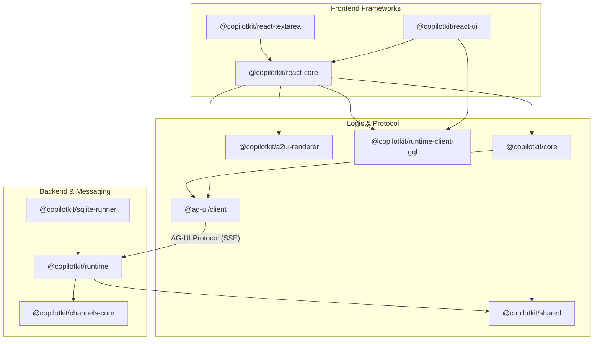
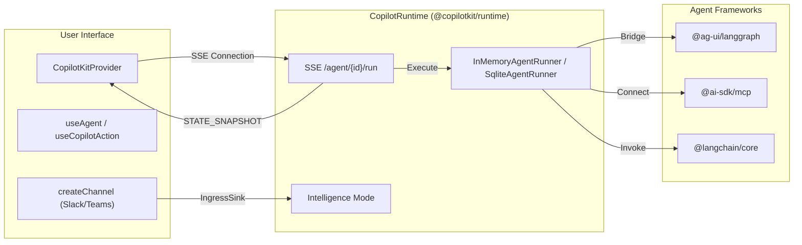

<!-- source: DeepWiki mcp.deepwiki.com · repo CopilotKit/CopilotKit · page 7 Package Structure and Architecture · fetched 2026-10-30 -->

# Package Structure and Architecture

<details>
<summary>Relevant source files</summary>

The following files were used as context for generating this wiki page:

- [packages/a2ui-renderer/package.json](packages/a2ui-renderer/package.json)
- [packages/channels-core/package.json](packages/channels-core/package.json)
- [packages/channels-discord/package.json](packages/channels-discord/package.json)
- [packages/channels-intelligence/package.json](packages/channels-intelligence/package.json)
- [packages/channels-slack/package.json](packages/channels-slack/package.json)
- [packages/channels-teams/package.json](packages/channels-teams/package.json)
- [packages/channels-telegram/package.json](packages/channels-telegram/package.json)
- [packages/channels-ui/package.json](packages/channels-ui/package.json)
- [packages/channels-whatsapp/package.json](packages/channels-whatsapp/package.json)
- [packages/channels/package.json](packages/channels/package.json)
- [packages/core/package.json](packages/core/package.json)
- [packages/react-core/package.json](packages/react-core/package.json)
- [packages/react-textarea/package.json](packages/react-textarea/package.json)
- [packages/react-ui/package.json](packages/react-ui/package.json)
- [packages/runtime-client-gql/package.json](packages/runtime-client-gql/package.json)
- [packages/runtime/package.json](packages/runtime/package.json)
- [packages/sdk-js/package.json](packages/sdk-js/package.json)
- [packages/shared/package.json](packages/shared/package.json)
- [packages/sqlite-runner/package.json](packages/sqlite-runner/package.json)
- [packages/voice/package.json](packages/voice/package.json)
- [packages/web-inspector/package.json](packages/web-inspector/package.json)

</details>


This page documents the high-level organization of the CopilotKit monorepo, its dual-namespace architecture, and the relationship between its various internal components. The codebase is a multi-framework platform centered around the **AG-UI Protocol** and the **Channels Messaging Framework**.

For a detailed inventory of every TypeScript package and its exports, see [TypeScript Package Ecosystem](#7.1). For details on the multi-platform messaging system, see [Channels Messaging Framework](#7.2). For an explanation of the design decisions behind the v1 vs v2 architecture, see [v1.x vs v2.x Architecture](#7.3). For details on how pnpm and nx manage workspace linking and builds, see [Dependency Management](#7.4).

---

## Repository Layout

The repository is a pnpm monorepo managed by **Nx**. The directory structure organizes core packages, framework-specific integrations, the protocol layer, and the messaging umbrella.

```text
CopilotKit/
├── packages/
│   ├── core/               # @copilotkit/core (Framework-agnostic logic)
│   ├── react-core/         # @copilotkit/react-core (React hooks/context)
│   ├── react-ui/           # @copilotkit/react-ui (Pre-built components)
│   ├── react-textarea/     # @copilotkit/react-textarea (AI-powered editor)
│   ├── runtime/            # @copilotkit/runtime (Backend processing engine)
│   ├── sdk-js/             # @copilotkit/sdk-js (Vanilla JS / LangGraph bridge)
│   ├── shared/             # @copilotkit/shared (Common types and utilities)
│   ├── angular/            # @copilotkit/angular (Angular integration)
│   ├── vue/                # @copilotkit/vue (Vue.js integration)
│   ├── channels/           # @copilotkit/channels (Messaging umbrella package)
│   ├── channels-core/      # Base messaging abstractions (Thread, ActionStore)
│   ├── voice/              # @copilotkit/voice (Transcription/TTS services)
│   ├── sqlite-runner/      # @copilotkit/sqlite-runner (Persistent state)
│   ├── a2ui-renderer/      # @copilotkit/a2ui-renderer (A2UI surface rendering)
│   ├── runtime-client-gql/ # @copilotkit/runtime-client-gql (GraphQL client for v1)
│   └── web-inspector/      # @copilotkit/web-inspector (Lit web component)
├── sdk-python/             # Python SDK for backend agents
├── examples/               # Showcase and integration templates
├── showcase/               # Documentation site (shell-docs) and showcase platform
└── package.json            # Root workspace definition
```

Sources: [packages/runtime/package.json:1-23](), [packages/react-core/package.json:1-23](), [packages/core/package.json:1-8](), [packages/react-textarea/package.json:1-22](), [packages/shared/package.json:1-22](), [packages/sdk-js/package.json:1-22]()

---

## Package Inventory

### Core Framework Packages
These packages form the backbone of the CopilotKit SDK, facilitating communication between the frontend and agentic backends via the AG-UI protocol.

| Package name | Path | Role |
|---|---|---|
| `@copilotkit/runtime` | `packages/runtime` | The central backend engine. Supports Express, Hono, and Next.js. Implements the AG-UI protocol and manages LLM adapters (OpenAI, Anthropic, Google). [packages/runtime/package.json:50-61]() |
| `@copilotkit/react-core` | `packages/react-core` | Primary React integration. Provides the `CopilotKit` provider and core hooks like `useAgent` and `useCopilotAction`. [packages/react-core/package.json:47-55]() |
| `@copilotkit/core` | `packages/core` | Framework-agnostic web utilities and AG-UI client logic. [packages/core/package.json:38-43]() |
| `@copilotkit/shared` | `packages/shared` | Shared internal utilities, telemetry, and license verification. [packages/shared/package.json:53-62]() |
| `@copilotkit/sdk-js` | `packages/sdk-js` | JavaScript SDK providing bridges for LangChain and LangGraph via `@ag-ui/langgraph`. [packages/sdk-js/package.json:33-44]() |

Sources: [packages/runtime/package.json:2-121](), [packages/react-core/package.json:2-103](), [packages/core/package.json:2-44](), [packages/shared/package.json:2-63](), [packages/sdk-js/package.json:2-64]()

### Messaging and Persistence
The framework extends beyond the browser into messaging platforms and persistent storage.

| Package name | Path | Role |
|---|---|---|
| `@copilotkit/channels` | `packages/channels` | Umbrella package for Slack, Teams, Discord, and WhatsApp adapters. |
| `@copilotkit/channels-core` | `packages/channels-core` | Core abstractions for messaging: `createChannel`, `Thread`, and `PlatformAdapter`. |
| `@copilotkit/sqlite-runner`| `packages/sqlite-runner` | SQLite-backed agent runner for persistent conversation state using `better-sqlite3`. [packages/sqlite-runner/package.json:47-54]() |
| `@copilotkit/channels-intelligence` | `packages/channels-intelligence` | Adapter for connecting messaging channels to the CopilotKit Intelligence Platform. [packages/runtime/package.json:93-93]() |

Sources: [packages/sqlite-runner/package.json:2-49](), [packages/runtime/package.json:92-93](), [packages/voice/package.json:2-39]()

---

## Architectural Dependency Graph

The following diagram bridges the **Natural Language Space** to the **Code Entity Space** by showing how packages and protocol clients relate.

**System-Wide Dependency Map**



Sources: [packages/react-core/package.json:77-83](), [packages/react-ui/package.json:59-61](), [packages/react-textarea/package.json:57-59](), [packages/core/package.json:38-39](), [packages/runtime/package.json:81-93](), [packages/sqlite-runner/package.json:34-35](), [packages/runtime-client-gql/package.json:53-58]()

---

## The AG-UI and Channels Integration

CopilotKit is built on the **AG-UI Protocol**, standardizing agent-user interactions, while the **Channels Framework** abstracts the messaging transport layer.

**Interaction Loop Architecture**



Sources: [packages/runtime/package.json:80-91](), [packages/react-core/package.json:77-81](), [packages/runtime/package.json:148-158]()

---

## Build and Release System

The monorepo uses a unified build pipeline to ensure consistency across all packages.

*   **Bundling:** Most TypeScript packages use `tsdown` to produce dual ESM (`.mjs`) and CJS (`.cjs`) outputs. [packages/runtime/package.json:68-69](), [packages/react-core/package.json:62-62]()
*   **Task Orchestration:** **Nx** handles dependency-aware builds (e.g., ensuring `shared` is built before `runtime`). [packages/runtime/package.json:189-198]()
*   **Validation:** The repository includes specialized validation for the messaging umbrella package to ensure platform adapter consistency.
*   **Code Quality:** Packages utilize `publint` and `attw` (Are The Types Wrong) to ensure package exports and types are correctly configured for consumers. [packages/shared/package.json:49-50](), [packages/core/package.json:34-35]()
*   **Legacy Support:** The `@copilotkit/runtime-client-gql` package maintains GraphQL codegen for v1 compatibility. [packages/runtime-client-gql/package.json:46-47]()

Sources: [packages/runtime/package.json:67-78](), [packages/react-core/package.json:60-75](), [packages/runtime-client-gql/package.json:39-52](), [packages/shared/package.json:40-51]()

---

