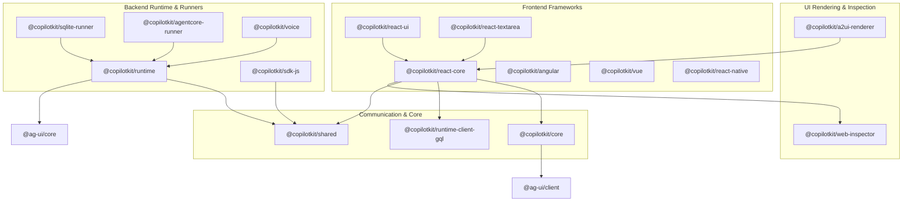
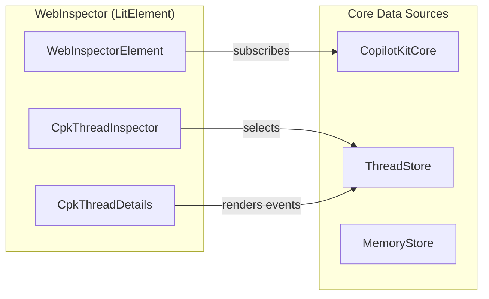
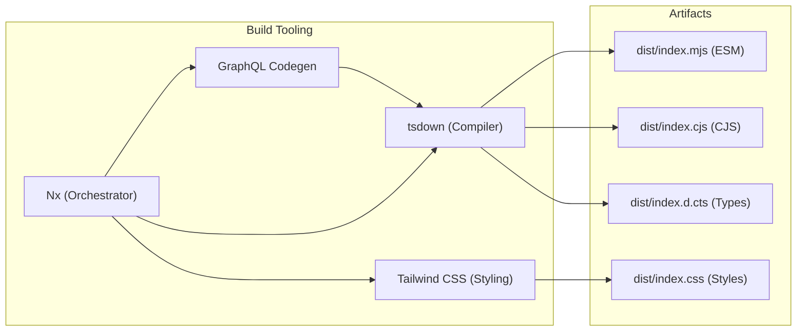

<!-- source: DeepWiki mcp.deepwiki.com · repo CopilotKit/CopilotKit · page 7.1 TypeScript Package Ecosystem · fetched 2026-10-30 -->

# TypeScript Package Ecosystem

Relevant source files

The following files were used as context for generating this wiki page:

- [packages/a2ui-renderer/package.json](packages/a2ui-renderer/package.json)
- [packages/agentcore-runner/package.json](packages/agentcore-runner/package.json)
- [packages/angular/package.json](packages/angular/package.json)
- [packages/core/package.json](packages/core/package.json)
- [packages/demo-agents/package.json](packages/demo-agents/package.json)
- [packages/react-core/package.json](packages/react-core/package.json)
- [packages/react-native/package.json](packages/react-native/package.json)
- [packages/react-textarea/package.json](packages/react-textarea/package.json)
- [packages/react-ui/package.json](packages/react-ui/package.json)
- [packages/runtime-client-gql/package.json](packages/runtime-client-gql/package.json)
- [packages/runtime/package.json](packages/runtime/package.json)
- [packages/sdk-js/package.json](packages/sdk-js/package.json)
- [packages/shared/package.json](packages/shared/package.json)
- [packages/sqlite-runner/package.json](packages/sqlite-runner/package.json)
- [packages/voice/package.json](packages/voice/package.json)
- [packages/vue/package.json](packages/vue/package.json)
- [packages/web-inspector/package.json](packages/web-inspector/package.json)

This document describes the TypeScript/JavaScript packages in the CopilotKit monorepo, their organization, interdependencies, and architectural roles. The ecosystem is built around a monorepo structure using `pnpm` workspaces and the `nx` build system [packages/runtime/package.json:185-194]().

---

## Package Organization

CopilotKit maintains a unified package ecosystem where core logic is separated from framework-specific integrations. The repository uses a flat `packages/` structure for its TypeScript modules, with no `v1/` or `v2/` subdirectories at the top level of the `packages/` folder. However, internal package structures often provide `v2` specific entry points for modern implementations, such as the `@copilotkit/runtime/v2` and `@copilotkit/react-core/v2` exports [packages/runtime/package.json:46-61](), [packages/react-core/package.json:42-56]().

### Monorepo Structure and Data Flow

The following diagram bridges the **Natural Language Space** (System Concepts) to the **Code Entity Space** (Package Names and Classes).

**Sources:** [packages/react-core/package.json:77-83](), [packages/runtime/package.json:80-83](), [packages/sqlite-runner/package.json:33-35](), [packages/core/package.json:37-39](), [packages/react-textarea/package.json:57-59]()

---

## Core Packages

### @copilotkit/core
This package contains framework-agnostic web utilities. It serves as the foundational logic for state management and protocol handling in the browser.
- **Key Functionality**: Foundational web utilities including `CopilotKitCore` and thread/memory store management [packages/core/package.json:4]().
- **Dependencies**: Integrates directly with `@ag-ui/client` for protocol communication [packages/core/package.json:38](). It uses `rxjs` for reactive event handling [packages/core/package.json:42]() and `@tanstack/pacer` for state synchronization [packages/core/package.json:40]().

### @copilotkit/shared
A utility library shared across frontend and backend packages. It contains shared types, schema conversion utilities, and license verification.
- **Implementation**: Provides integration with `@segment/analytics-node` for telemetry [packages/shared/package.json:55]() and `@copilotkit/license-verifier` [packages/shared/package.json:54]().
- **Dependencies**: `zod`, `graphql`, and `zod-to-json-schema` [packages/shared/package.json:58-62](). It defines the base protocol requirements for `@ag-ui/core` [packages/shared/package.json:76]().

### @copilotkit/runtime
The backend execution engine. It processes requests from the frontend and coordinates with LLM adapters or remote agents.
- **Entry Points**: Supports multiple server environments including Express, Hono, and Node.js via dedicated exports [packages/runtime/package.json:37-61]().
- **Integrations**: Includes built-in support for LangGraph via `@ag-ui/langgraph` [packages/runtime/package.json:84]() and MCP via `@ai-sdk/mcp` and `@modelcontextprotocol/sdk` [packages/runtime/package.json:90-98]().
- **Peer Dependencies**: Optional support for OpenAI, Anthropic, Google, and LangChain [packages/runtime/package.json:149-158]().

---

## Frontend Integration Packages

### @copilotkit/react-core
The primary integration point for React applications. It provides the context providers and hooks used by other React-based UI packages.
- **Implementation**: Bridges to `@copilotkit/web-inspector` for development debugging [packages/react-core/package.json:84]() and `@copilotkit/a2ui-renderer` for generative UI [packages/react-core/package.json:79]().
- **Styles**: Exports Tailwind-compiled CSS for UI components [packages/react-core/package.json:55-61]().

### @copilotkit/react-ui & @copilotkit/react-textarea
Specialized UI components for React.
- **react-ui**: Contains chat components utilizing `react-markdown` and `rehype-raw` for message rendering [packages/react-ui/package.json:63-65](). It depends on `@copilotkit/react-core` [packages/react-ui/package.json:59]().
- **react-textarea**: Implements the `CopilotTextarea` with autocompletion features using `slate` and `slate-react` [packages/react-textarea/package.json:74-76](). It depends on `react-core` for its underlying logic [packages/react-textarea/package.json:57]().

### @copilotkit/angular & @copilotkit/vue
Framework-specific wrappers that bring CopilotKit capabilities to Angular and Vue.js environments.
- **Angular**: Provides services and components for the Angular dependency injection system.
- **Vue**: Provides composition API hooks and components for Vue 3 applications.

---

## Specialized Packages

| Package | Purpose | Key Dependencies |
|:---|:---|:---|
| `@copilotkit/sqlite-runner` | Persistent agent state storage using SQLite | `better-sqlite3`, `@copilotkit/runtime` [packages/sqlite-runner/package.json:33-35]() |
| `@copilotkit/sdk-js` | JavaScript SDK for building remote agents and LangGraph middlewares | `@ag-ui/langgraph`, `@copilotkit/shared` [packages/sdk-js/package.json:61-63]() |
| `@copilotkit/web-inspector` | Lit-based web component for inspecting agent state and AG-UI events | `lit`, `@copilotkit/core`, `@ag-ui/client` [packages/web-inspector/package.json:37-42]() |
| `@copilotkit/voice` | Voice services including transcription and TTS | `openai`, `@copilotkit/runtime` [packages/voice/package.json:38-41]() |
| `@copilotkit/a2ui-renderer` | Renderer for Adaptive UI (A2UI) components in React | `@a2ui/web_core`, `zod` [packages/a2ui-renderer/package.json:79-82]() |
| `@copilotkit/runtime-client-gql` | GraphQL client for runtime communication | `urql`, `@copilotkit/shared` [packages/runtime-client-gql/package.json:53-57]() |
| `@copilotkit/agentcore-runner` | Integration for AWS AgentCore runners | `@copilotkit/runtime` |

---

## Dependency Map and Build System

The ecosystem uses `tsdown` (an `esbuild`-based tool) for compilation of TypeScript to ESM and CJS formats [packages/runtime/package.json:68]().

### Web Inspector Implementation Details
The `WebInspectorElement` is a Lit-based component that subscribes to `CopilotKitCore` to visualize real-time agent activity [packages/web-inspector/package.json:37-42]().

**Sources:** [packages/web-inspector/package.json:37-42](), [packages/core/package.json:37-42]()

### Build Pipeline

**Sources:** [packages/runtime/package.json:68-69](), [packages/react-core/package.json:61-62](), [packages/web-inspector/package.json:26-28](), [packages/runtime-client-gql/package.json:40-42]()

### Package Inter-dependencies (Detailed)

| Target Package | Dependencies (Workspace) |
|:---|:---|
| `@copilotkit/react-core` | `core`, `shared`, `a2ui-renderer`, `web-inspector`, `runtime-client-gql` [packages/react-core/package.json:77-84]() |
| `@copilotkit/runtime` | `shared`, `channels-core`, `channels-intelligence` [packages/runtime/package.json:92-95]() |
| `@copilotkit/web-inspector` | `core` [packages/web-inspector/package.json:39]() |
| `@copilotkit/react-textarea` | `react-core`, `shared`, `runtime-client-gql` [packages/react-textarea/package.json:57-59]() |
| `@copilotkit/sqlite-runner` | `runtime` [packages/sqlite-runner/package.json:35]() |
| `@copilotkit/sdk-js` | `shared` [packages/sdk-js/package.json:63]() |

**Sources:** [packages/react-core/package.json:77-84](), [packages/runtime/package.json:92-95](), [packages/web-inspector/package.json:39](), [packages/react-textarea/package.json:57-59](), [packages/sqlite-runner/package.json:35](), [packages/sdk-js/package.json:63]()

---

