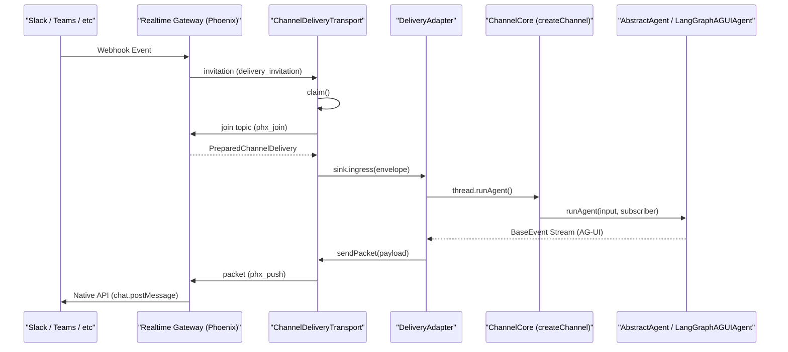
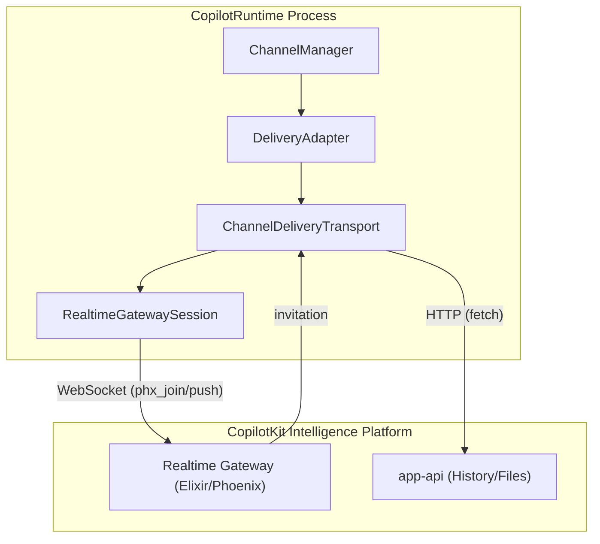

<!-- source: DeepWiki mcp.deepwiki.com · repo CopilotKit/CopilotKit · page 7.2 Channels Messaging Framework · fetched 2026-10-30 -->

# Channels Messaging Framework

Relevant source files

The following files were used as context for generating this wiki page:

- [.npmrc](.npmrc)
- [examples/slack/.env.example](examples/slack/.env.example)
- [examples/slack/README.md](examples/slack/README.md)
- [examples/slack/app/commands/__tests__/commands.test.ts](examples/slack/app/commands/__tests__/commands.test.ts)
- [examples/slack/app/commands/index.ts](examples/slack/app/commands/index.ts)
- [examples/slack/app/index.ts](examples/slack/app/index.ts)
- [examples/slack/app/managed.test.ts](examples/slack/app/managed.test.ts)
- [examples/slack/app/managed.ts](examples/slack/app/managed.ts)
- [examples/slack/app/modals/__tests__/file-issue.test.tsx](examples/slack/app/modals/__tests__/file-issue.test.tsx)
- [examples/slack/app/modals/file-issue.tsx](examples/slack/app/modals/file-issue.tsx)
- [examples/slack/app/tools/__tests__/read-thread.test.ts](examples/slack/app/tools/__tests__/read-thread.test.ts)
- [examples/slack/package.json](examples/slack/package.json)
- [examples/slack/slack-app-manifest.json](examples/slack/slack-app-manifest.json)
- [examples/slack/slack-app-manifest.yaml](examples/slack/slack-app-manifest.yaml)
- [examples/slack/tsconfig.json](examples/slack/tsconfig.json)
- [examples/teams/.env.example](examples/teams/.env.example)
- [examples/teams/README.md](examples/teams/README.md)
- [examples/teams/app/index.tsx](examples/teams/app/index.tsx)
- [package.json](package.json)
- [packages/channels-core/README.md](packages/channels-core/README.md)
- [packages/channels-core/package.json](packages/channels-core/package.json)
- [packages/channels-core/src/canonical-run-loop.test.ts](packages/channels-core/src/canonical-run-loop.test.ts)
- [packages/channels-core/src/create-channel.test.ts](packages/channels-core/src/create-channel.test.ts)
- [packages/channels-core/src/create-channel.ts](packages/channels-core/src/create-channel.ts)
- [packages/channels-core/src/delivery-error.ts](packages/channels-core/src/delivery-error.ts)
- [packages/channels-core/src/index.ts](packages/channels-core/src/index.ts)
- [packages/channels-core/src/platform-adapter.test.ts](packages/channels-core/src/platform-adapter.test.ts)
- [packages/channels-core/src/platform-adapter.ts](packages/channels-core/src/platform-adapter.ts)
- [packages/channels-core/src/run-loop.test.ts](packages/channels-core/src/run-loop.test.ts)
- [packages/channels-core/src/run-loop.ts](packages/channels-core/src/run-loop.ts)
- [packages/channels-core/src/testing/fake-adapter.ts](packages/channels-core/src/testing/fake-adapter.ts)
- [packages/channels-core/src/thread.ts](packages/channels-core/src/thread.ts)
- [packages/channels-core/src/welcome.test.ts](packages/channels-core/src/welcome.test.ts)
- [packages/channels-discord/README.md](packages/channels-discord/README.md)
- [packages/channels-discord/package.json](packages/channels-discord/package.json)
- [packages/channels-intelligence/package.json](packages/channels-intelligence/package.json)
- [packages/channels-intelligence/src/content-parts.ts](packages/channels-intelligence/src/content-parts.ts)
- [packages/channels-intelligence/src/delivery-adapter-final.test.ts](packages/channels-intelligence/src/delivery-adapter-final.test.ts)
- [packages/channels-intelligence/src/delivery-adapter-postfile.test.ts](packages/channels-intelligence/src/delivery-adapter-postfile.test.ts)
- [packages/channels-intelligence/src/delivery-adapter-slack-stream.test.ts](packages/channels-intelligence/src/delivery-adapter-slack-stream.test.ts)
- [packages/channels-intelligence/src/delivery-adapter.concurrency.test.ts](packages/channels-intelligence/src/delivery-adapter.concurrency.test.ts)
- [packages/channels-intelligence/src/delivery-adapter.ts](packages/channels-intelligence/src/delivery-adapter.ts)
- [packages/channels-intelligence/src/delivery-channel-name.test.ts](packages/channels-intelligence/src/delivery-channel-name.test.ts)
- [packages/channels-intelligence/src/delivery-charge.test.ts](packages/channels-intelligence/src/delivery-charge.test.ts)
- [packages/channels-intelligence/src/delivery-contracts.test.ts](packages/channels-intelligence/src/delivery-contracts.test.ts)
- [packages/channels-intelligence/src/delivery-contracts.ts](packages/channels-intelligence/src/delivery-contracts.ts)
- [packages/channels-intelligence/src/delivery-history.test.ts](packages/channels-intelligence/src/delivery-history.test.ts)
- [packages/channels-intelligence/src/delivery-provider-elements.test.ts](packages/channels-intelligence/src/delivery-provider-elements.test.ts)
- [packages/channels-intelligence/src/delivery-test-gateway.ts](packages/channels-intelligence/src/delivery-test-gateway.ts)
- [packages/channels-intelligence/src/delivery-transcript.test.ts](packages/channels-intelligence/src/delivery-transcript.test.ts)
- [packages/channels-intelligence/src/delivery-transcript.ts](packages/channels-intelligence/src/delivery-transcript.ts)
- [packages/channels-intelligence/src/delivery-transport.test.ts](packages/channels-intelligence/src/delivery-transport.test.ts)
- [packages/channels-intelligence/src/delivery-transport.ts](packages/channels-intelligence/src/delivery-transport.ts)
- [packages/channels-intelligence/src/delivery-typing.test.ts](packages/channels-intelligence/src/delivery-typing.test.ts)
- [packages/channels-intelligence/src/index.ts](packages/channels-intelligence/src/index.ts)
- [packages/channels-intelligence/src/realtime-gateway-launcher-provider-seam.test.ts](packages/channels-intelligence/src/realtime-gateway-launcher-provider-seam.test.ts)
- [packages/channels-intelligence/src/realtime-gateway-launcher.ts](packages/channels-intelligence/src/realtime-gateway-launcher.ts)
- [packages/channels-intelligence/src/realtime-gateway-project-join.test.ts](packages/channels-intelligence/src/realtime-gateway-project-join.test.ts)
- [packages/channels-intelligence/src/realtime-gateway-provider-states.test.ts](packages/channels-intelligence/src/realtime-gateway-provider-states.test.ts)
- [packages/channels-intelligence/src/realtime-gateway-retryability.test.ts](packages/channels-intelligence/src/realtime-gateway-retryability.test.ts)
- [packages/channels-intelligence/src/realtime-gateway.test.ts](packages/channels-intelligence/src/realtime-gateway.test.ts)
- [packages/channels-intelligence/src/realtime-gateway.ts](packages/channels-intelligence/src/realtime-gateway.ts)
- [packages/channels-intelligence/src/runtime.ts](packages/channels-intelligence/src/runtime.ts)
- [packages/channels-slack/README.md](packages/channels-slack/README.md)
- [packages/channels-slack/package.json](packages/channels-slack/package.json)
- [packages/channels-slack/src/__tests__/assistant.test.ts](packages/channels-slack/src/__tests__/assistant.test.ts)
- [packages/channels-slack/src/__tests__/chunked-message-stream.test.ts](packages/channels-slack/src/__tests__/chunked-message-stream.test.ts)
- [packages/channels-slack/src/__tests__/event-renderer.test.ts](packages/channels-slack/src/__tests__/event-renderer.test.ts)
- [packages/channels-slack/src/__tests__/native-renderer.test.ts](packages/channels-slack/src/__tests__/native-renderer.test.ts)
- [packages/channels-slack/src/__tests__/native-stream.test.ts](packages/channels-slack/src/__tests__/native-stream.test.ts)
- [packages/channels-slack/src/adapter.test.ts](packages/channels-slack/src/adapter.test.ts)
- [packages/channels-slack/src/adapter.ts](packages/channels-slack/src/adapter.ts)
- [packages/channels-slack/src/block-kit-validation.ts](packages/channels-slack/src/block-kit-validation.ts)
- [packages/channels-slack/src/chunked-message-stream.ts](packages/channels-slack/src/chunked-message-stream.ts)
- [packages/channels-slack/src/data-visualization.ts](packages/channels-slack/src/data-visualization.ts)
- [packages/channels-slack/src/event-renderer.ts](packages/channels-slack/src/event-renderer.ts)
- [packages/channels-slack/src/index.ts](packages/channels-slack/src/index.ts)
- [packages/channels-slack/src/native-catalog.test.ts](packages/channels-slack/src/native-catalog.test.ts)
- [packages/channels-slack/src/native-codec.ts](packages/channels-slack/src/native-codec.ts)
- [packages/channels-slack/src/native-data-visualization-validation.test.ts](packages/channels-slack/src/native-data-visualization-validation.test.ts)
- [packages/channels-slack/src/native-data-visualization.test.tsx](packages/channels-slack/src/native-data-visualization.test.tsx)
- [packages/channels-slack/src/native-data-visualization.types.test.ts](packages/channels-slack/src/native-data-visualization.types.test.ts)
- [packages/channels-slack/src/native-jsx.test.tsx](packages/channels-slack/src/native-jsx.test.tsx)
- [packages/channels-slack/src/native-manifest.ts](packages/channels-slack/src/native-manifest.ts)
- [packages/channels-slack/src/native-stream.ts](packages/channels-slack/src/native-stream.ts)
- [packages/channels-slack/src/native.ts](packages/channels-slack/src/native.ts)
- [packages/channels-slack/src/render/block-kit.ts](packages/channels-slack/src/render/block-kit.ts)
- [packages/channels-teams/README.md](packages/channels-teams/README.md)
- [packages/channels-teams/package.json](packages/channels-teams/package.json)
- [packages/channels-telegram/README.md](packages/channels-telegram/README.md)
- [packages/channels-telegram/package.json](packages/channels-telegram/package.json)
- [packages/channels-ui/package.json](packages/channels-ui/package.json)
- [packages/channels-ui/src/types.ts](packages/channels-ui/src/types.ts)
- [packages/channels-whatsapp/README.md](packages/channels-whatsapp/README.md)
- [packages/channels-whatsapp/package.json](packages/channels-whatsapp/package.json)
- [packages/channels/README.md](packages/channels/README.md)
- [packages/channels/package.json](packages/channels/package.json)
- [packages/channels/src/umbrella.smoke.test.tsx](packages/channels/src/umbrella.smoke.test.tsx)
- [packages/core/src/__tests__/test-utils.ts](packages/core/src/__tests__/test-utils.ts)
- [packages/runtime/skills/runtime/references/intelligence-mode.md](packages/runtime/skills/runtime/references/intelligence-mode.md)
- [packages/runtime/src/v2/runtime/__tests__/channels-integration.test.ts](packages/runtime/src/v2/runtime/__tests__/channels-integration.test.ts)
- [packages/runtime/src/v2/runtime/__tests__/handler-channels-types.test.ts](packages/runtime/src/v2/runtime/__tests__/handler-channels-types.test.ts)
- [packages/runtime/src/v2/runtime/__tests__/handler-channels.test.ts](packages/runtime/src/v2/runtime/__tests__/handler-channels.test.ts)
- [packages/runtime/src/v2/runtime/core/__tests__/channel-activation-config.test.ts](packages/runtime/src/v2/runtime/core/__tests__/channel-activation-config.test.ts)
- [packages/runtime/src/v2/runtime/core/__tests__/channel-canonical-run.test.ts](packages/runtime/src/v2/runtime/core/__tests__/channel-canonical-run.test.ts)
- [packages/runtime/src/v2/runtime/core/__tests__/channel-manager-provider-leg.test.ts](packages/runtime/src/v2/runtime/core/__tests__/channel-manager-provider-leg.test.ts)
- [packages/runtime/src/v2/runtime/core/__tests__/channel-manager-reconnect.test.ts](packages/runtime/src/v2/runtime/core/__tests__/channel-manager-reconnect.test.ts)
- [packages/runtime/src/v2/runtime/core/__tests__/channel-manager-recovery.test.ts](packages/runtime/src/v2/runtime/core/__tests__/channel-manager-recovery.test.ts)
- [packages/runtime/src/v2/runtime/core/__tests__/channel-manager.test.ts](packages/runtime/src/v2/runtime/core/__tests__/channel-manager.test.ts)
- [packages/runtime/src/v2/runtime/core/channel-activation-config.ts](packages/runtime/src/v2/runtime/core/channel-activation-config.ts)
- [packages/runtime/src/v2/runtime/core/channel-manager.ts](packages/runtime/src/v2/runtime/core/channel-manager.ts)
- [packages/runtime/src/v2/runtime/core/fetch-cors.ts](packages/runtime/src/v2/runtime/core/fetch-cors.ts)
- [packages/runtime/src/v2/runtime/handlers/shared/json-response.ts](packages/runtime/src/v2/runtime/handlers/shared/json-response.ts)
- [packages/runtime/src/v2/runtime/index.ts](packages/runtime/src/v2/runtime/index.ts)
- [packages/runtime/src/v2/runtime/runner/__tests__/integration/kind-gateway-drain-runner.ts](packages/runtime/src/v2/runtime/runner/__tests__/integration/kind-gateway-drain-runner.ts)
- [packages/runtime/src/v2/runtime/runner/__tests__/intelligence-runner.test.ts](packages/runtime/src/v2/runtime/runner/__tests__/intelligence-runner.test.ts)
- [packages/runtime/src/v2/runtime/runner/intelligence.ts](packages/runtime/src/v2/runtime/runner/intelligence.ts)
- [patches/eventsource@3.0.7.patch](patches/eventsource@3.0.7.patch)
- [pnpm-lock.yaml](pnpm-lock.yaml)
- [pnpm-workspace.yaml](pnpm-workspace.yaml)
- [skills/copilotkit-debug/references/runtime-debugging.md](skills/copilotkit-debug/references/runtime-debugging.md)
- [skills/runtime/references/intelligence-mode.md](skills/runtime/references/intelligence-mode.md)

The Channels Messaging Framework (`@copilotkit/channels`) is an umbrella package and architectural layer designed to bridge CopilotKit agents with third-party messaging platforms. It provides a platform-agnostic abstraction for building bots that can run across Slack, Microsoft Teams, Discord, Telegram, and WhatsApp using a single codebase [examples/slack/README.md:1-18]().

## Architecture Overview

The framework operates by abstracting platform-specific APIs into a unified **Thread** and **Message** model. It uses a provider-adapter pattern where platform-specific logic is isolated into adapters, while the core logic remains generic [examples/slack/README.md:43-49]().

### High-Level Data Flow

The following diagram illustrates how a message from a platform reaches an agent and how the response is rendered back using the Channels Framework, specifically focusing on the V2 `DeliveryAdapter` architecture.

**Channels Interaction Flow (V2)**

Sources: [packages/channels-intelligence/src/delivery-transport.ts:36-45](), [packages/channels-intelligence/src/delivery-adapter.ts:135-156](), [packages/runtime/src/v2/runtime/core/channel-manager.ts:64-70]()

---

## Key API Entities

### `createChannel`
The entry point for defining a messaging bot. It aggregates adapters, agents, tools, and context [packages/channels-core/src/create-channel.ts:1-20]().

*   **`adapters`**: A list of `PlatformAdapter` instances (e.g., `slack()`, `discord()`).
*   **`agent`**: A factory function that returns an agent instance for a given `threadId`.
*   **`tools`**: `AgentToolDescriptor` definitions that the agent can invoke.
*   **`context`**: System prompts and behavioral guidance.

### `Thread` Abstraction
The `Thread` object represents a stateful conversation [packages/channels-core/src/thread.ts:1-10](). It provides methods like `post()`, `runAgent()`, and handles the translation of high-level actions into platform-specific operations via the active adapter.

### `PlatformAdapter` Interface
Every platform integration must implement this interface. It defines how the framework interacts with the specific messaging service [packages/channels-core/src/platform-adapter.ts:1-20]().

| Property | Description |
| :--- | :--- |
| `platform` | String identifier (e.g., "slack", "teams", "intelligence"). |
| `capabilities` | `SurfaceCapabilities` defining support for `supportsStreaming`, `supportsTyping`, etc. [packages/channels-intelligence/src/delivery-adapter.ts:143-151](). |
| `conversationStore` | Manages agent instances and history loading for a specific conversation [packages/channels-intelligence/src/delivery-adapter.ts:152-199](). |

Sources: [packages/channels-intelligence/src/delivery-adapter.ts:135-151](), [packages/channels-core/src/platform-adapter.ts:1-20]()

---

## Intelligence Platform Integration

The `@copilotkit/channels-intelligence` package provides the `DeliveryAdapter` and `ChannelDeliveryTransport`, which connect the Channels framework to the **CopilotKit Intelligence Platform**. This allows for "Managed" channels where CopilotKit handles the platform credentials and edge connectivity.

### Realtime Gateway Transport
The V2 architecture relies on `connectRealtimeGateway` to establish a persistent WebSocket connection via Phoenix Channels [packages/channels-intelligence/src/realtime-gateway.ts:1-18]().

*   **`ChannelManager`**: Supervises the lifecycle of multiple channels. It tracks `ChannelStatus` (connecting, online, setup_required, etc.) [packages/runtime/src/v2/runtime/core/channel-manager.ts:64-70]().
*   **`ChannelLegs`**: Splits the health of a channel into `transport` (socket) and `provider` (Slack/Teams app attachment) [packages/runtime/src/v2/runtime/core/channel-manager.ts:100-107]().
*   **`ChannelDeliveryTransport`**: Handles the protocol-level "claim" and "packet" exchange with the gateway [packages/channels-intelligence/src/delivery-transport.ts:135-150]().

**Intelligence Delivery Architecture**

Sources: [packages/runtime/src/v2/runtime/core/channel-manager.ts:73-86](), [packages/channels-intelligence/src/realtime-gateway.ts:124-146](), [packages/channels-intelligence/src/delivery-transport.ts:147-160]()

---

## Implementation Details

### ChannelManager Lifecycle
The `ChannelManager` is responsible for `activate()` and `stop()` calls [packages/runtime/src/v2/runtime/core/channel-manager.ts:773-800](). It uses `foldChannelLegs` to determine the overall status: if the transport is `online` but no provider is bound, it reports `setup_required` [packages/runtime/src/v2/runtime/core/channel-manager.ts:153-171]().

### DeliveryAdapter Rendering
The `DeliveryAdapter` uses platform-specific renderers (e.g., `createSlackRunRenderer`, `createTeamsRunRenderer`) to convert agent events into native payloads like Slack Block Kit or Teams Adaptive Cards [packages/channels-intelligence/src/delivery-adapter.ts:40-50]().

### Release Validation Pipeline
To ensure version consistency, the repository includes a validation script `verify-channels-umbrella.ts`. This script checks that:
1.  The `@copilotkit/channels` umbrella package correctly exports all sub-adapters [package.json:29-30]().
2.  The build artifacts are valid and versions are synchronized.

---

## Supported Adapters

The framework provides the following adapters via subpaths of `@copilotkit/channels`:

| Adapter | Subpath | Package |
| :--- | :--- | :--- |
| **Slack** | `/slack` | `@copilotkit/channels-slack` [packages/channels-slack/package.json:1-5]() |
| **Teams** | `/teams` | `@copilotkit/channels-teams` [packages/channels-teams/package.json:1-5]() |
| **Discord** | `/discord` | `@copilotkit/channels-discord` [packages/channels-discord/package.json:1-5]() |
| **Telegram** | `/telegram` | `@copilotkit/channels-telegram` [packages/channels-telegram/package.json:1-5]() |
| **WhatsApp** | `/whatsapp` | `@copilotkit/channels-whatsapp` [packages/channels-whatsapp/package.json:1-5]() |
| **Intelligence**| `/intelligence`| `@copilotkit/channels-intelligence` [packages/channels-intelligence/package.json:1-5]() |

Sources: [packages/channels/package.json:1-10](), [examples/slack/README.md:3-8]()

---

