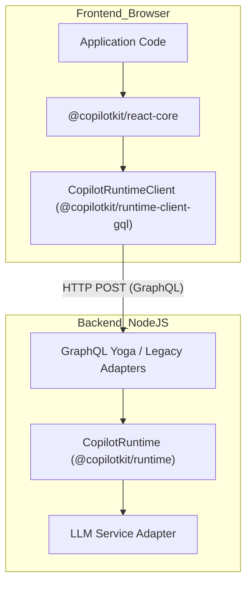
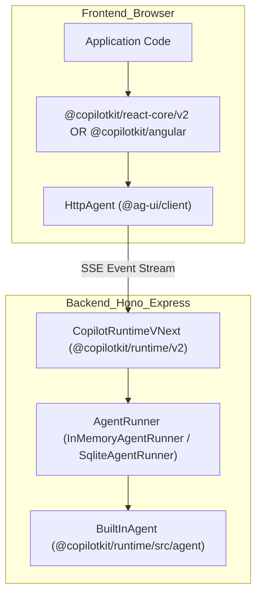

<!-- source: DeepWiki mcp.deepwiki.com · repo CopilotKit/CopilotKit · page 7.3 v1.x vs v2.x Architecture · fetched 2026-10-30 -->

# v1.x vs v2.x Architecture

<details>
<summary>Relevant source files</summary>

The following files were used as context for generating this wiki page:

- [examples/integrations/agent-spec/.env.example](examples/integrations/agent-spec/.env.example)
- [examples/integrations/agent-spec/.gitignore](examples/integrations/agent-spec/.gitignore)
- [examples/integrations/agent-spec/next.config.ts](examples/integrations/agent-spec/next.config.ts)
- [examples/integrations/agent-spec/package-lock.json](examples/integrations/agent-spec/package-lock.json)
- [examples/integrations/agent-spec/package.json](examples/integrations/agent-spec/package.json)
- [examples/integrations/agent-spec/src/app/api/copilotkit/[[...slug]]/route.ts](examples/integrations/agent-spec/src/app/api/copilotkit/[[...slug]]/route.ts)
- [examples/integrations/agent-spec/src/app/page.tsx](examples/integrations/agent-spec/src/app/page.tsx)
- [examples/integrations/agent-spec/src/components/threads-drawer/THEME.md](examples/integrations/agent-spec/src/components/threads-drawer/THEME.md)
- [examples/integrations/agent-spec/src/components/threads-drawer/index.tsx](examples/integrations/agent-spec/src/components/threads-drawer/index.tsx)
- [examples/integrations/agent-spec/src/components/threads-drawer/locked-state.tsx](examples/integrations/agent-spec/src/components/threads-drawer/locked-state.tsx)
- [examples/integrations/agent-spec/src/components/threads-drawer/threads-drawer.module.css](examples/integrations/agent-spec/src/components/threads-drawer/threads-drawer.module.css)
- [examples/integrations/mcp-apps/app/globals.css](examples/integrations/mcp-apps/app/globals.css)
- [examples/integrations/mcp-apps/app/layout.tsx](examples/integrations/mcp-apps/app/layout.tsx)
- [examples/integrations/mcp-apps/app/page.tsx](examples/integrations/mcp-apps/app/page.tsx)
- [examples/integrations/mcp-apps/next.config.ts](examples/integrations/mcp-apps/next.config.ts)
- [packages/angular/README.md](packages/angular/README.md)
- [packages/react-core/src/components/copilot-provider/copilotkit-props.tsx](packages/react-core/src/components/copilot-provider/copilotkit-props.tsx)
- [packages/react-core/src/context/copilot-context.tsx](packages/react-core/src/context/copilot-context.tsx)
- [packages/react-core/src/hooks/use-copilot-authenticated-action.ts](packages/react-core/src/hooks/use-copilot-authenticated-action.ts)
- [packages/react-core/src/hooks/use-copilot-chat-headless_c.ts](packages/react-core/src/hooks/use-copilot-chat-headless_c.ts)
- [packages/react-core/src/hooks/use-tree.ts](packages/react-core/src/hooks/use-tree.ts)
- [packages/react-ui/src/components/chat/Popup.tsx](packages/react-ui/src/components/chat/Popup.tsx)
- [packages/react-ui/src/components/chat/Sidebar.tsx](packages/react-ui/src/components/chat/Sidebar.tsx)
- [packages/runtime/src/lib/runtime/__tests__/on-after-request.test.ts](packages/runtime/src/lib/runtime/__tests__/on-after-request.test.ts)
- [packages/runtime/src/lib/runtime/__tests__/v1-agent-factory.test.ts](packages/runtime/src/lib/runtime/__tests__/v1-agent-factory.test.ts)
- [packages/runtime/src/lib/runtime/copilot-runtime.ts](packages/runtime/src/lib/runtime/copilot-runtime.ts)
- [packages/shared/src/utils/console-styling.ts](packages/shared/src/utils/console-styling.ts)
- [packages/vue/src/components/copilot-provider/types.ts](packages/vue/src/components/copilot-provider/types.ts)
- [scripts/__tests__/integration-intelligence-migration.test.ts](scripts/__tests__/integration-intelligence-migration.test.ts)

</details>


This page explains the technical distinction between the v1 (`@copilotkit/*`) and v2 architecture: the architectural drivers for the split, how each is structured, and the "bridge" implementation that allows v1 to wrap v2 for backward compatibility.

---

## Background: Why Two Architectures Exist

The v1 architecture was built around a **GraphQL-over-HTTP transport** between the browser and the CopilotKit backend. The runtime package (`@copilotkit/runtime`) hosted a GraphQL Yoga server, and the frontend packages relied on generated GraphQL client code. This design was tightly coupled to React and the GraphQL schema.

v2 replaces this custom transport with the **AG-UI Protocol** (`@ag-ui/client`, `@ag-ui/core`), an industry-standardized event streaming protocol for agent-to-UI communication based on Server-Sent Events (SSE). This evolution enabled:

- **Framework Agnosticism:** Targeting multiple UI frameworks (React, Angular, Vue) from a single shared core (`@copilotkit/core`).
- **Standardization:** Aligning with the broader ecosystem (LangGraph, CrewAI, Agno, etc.) via a unified protocol.
- **Performance:** Dropping the heavy GraphQL Yoga dependency stack from the critical path in favor of lean SSE handlers and the Vercel AI SDK.
- **Durable Interaction:** Moving from request-response to long-lived agent interactions via the "Intelligence" mode and the `CopilotKitIntelligence` runtime.

The v1 packages are maintained so existing applications do not break. Internally, v1 packages have been refactored to delegate to v2 packages, creating a bridge layer.

Sources: [packages/runtime/src/lib/runtime/copilot-runtime.ts:29-43](), [packages/runtime/src/lib/runtime/copilot-runtime.ts:37-39](), [scripts/__tests__/integration-intelligence-migration.test.ts:61-67]()

---

## Directory and Namespace Structure

| Dimension | v1 Family | v2 Family |
|---|---|---|
| **Source Directory** | `packages/` (legacy files) | `packages/` (v2 sub-exports) |
| **NPM Namespace** | `@copilotkit/*` | `@copilotkit/*` (with `/v2` subpaths) |
| **Transport Protocol** | GraphQL over HTTP | AG-UI Protocol (SSE / Event Streams) |
| **Core Logic** | `@copilotkit/react-core` | `@copilotkit/core` (Framework Agnostic) |
| **Frameworks** | React only | React, Angular, Vue, React Native |
| **Primary AI SDK** | LangChain (Legacy) | AI SDK (Vercel) + AG-UI |

Sources: [packages/runtime/src/lib/runtime/copilot-runtime.ts:37-47](), [packages/react-core/src/context/copilot-context.tsx:23-24](), [examples/integrations/agent-spec/package.json:17-26]()

---

## Architectural Evolution

### v1 Transport Stack (GraphQL)
In v1, the frontend communicates with the backend via GraphQL queries. The `CopilotRuntimeClient` handles the networking, and the `CopilotRuntime` package executes these against an LLM adapter.

**v1 Data Flow Diagram**

Sources: [packages/react-core/src/context/copilot-context.tsx:23-24](), [packages/runtime/src/lib/runtime/copilot-runtime.ts:31-35](), [packages/runtime/src/lib/runtime/copilot-runtime.ts:54-55]()

### v2 Transport Stack (AG-UI Protocol)
v2 uses a stream-based approach. The AG-UI client manages the protocol state, which is consumed by framework-specific hooks. The backend uses `CopilotRuntimeVNext` and specific `AgentRunner` implementations.

**v2 Data Flow Diagram**

Sources: [packages/runtime/src/lib/runtime/copilot-runtime.ts:37-47](), [examples/integrations/agent-spec/package.json:20-23](), [scripts/__tests__/integration-intelligence-migration.test.ts:61-67]()

---

## The Bridge: How v1 Wraps v2

To ensure backward compatibility, v1 packages have been updated to depend on v2 packages. This means that even if a developer uses the v1 entry points, the underlying execution logic leverages the v2 engine.

### Implementation Details
1. **Dependency Injection:** The v1 `CopilotRuntime` now internally instantiates and delegates to `CopilotRuntimeVNext` [packages/runtime/src/lib/runtime/copilot-runtime.ts:37-43]().
2. **Middleware Translation:** Legacy middleware like `onBeforeRequest` and `onAfterRequest` are mapped to the new v2 middleware system. The `afterRequestMiddleware` in v2 is used to satisfy legacy `onAfterRequest` calls [packages/runtime/src/lib/runtime/__tests__/on-after-request.test.ts:8-16]().
3. **Agent Resolution:** The v1 `agents` configuration (which accepted a static record) now supports a dynamic `AgentsFactory` context, allowing per-request agent resolution which is a core v2 feature [packages/runtime/src/lib/runtime/__tests__/v1-agent-factory.test.ts:21-33]().
4. **Message Conversion:** Legacy GraphQL message types are converted to AG-UI protocol messages using `aguiToGQL` and vice versa to maintain compatibility with `runtime-client-gql` [packages/runtime/src/lib/runtime/copilot-runtime.ts:31-31]().

### Bridge Dependency Map
This diagram shows how v2 code entities associate with protocol-level entities.

**v1-v2 Bridge Entity Map**
```mermaid
graph LR
  subgraph "v2_React_Layer"
    CK_PROV["CopilotKitProvider (react-core)"]
    U_HEADLESS["useCopilotChatHeadless_c (react-core)"]
  end

  subgraph "v2_Runtime_Engine"
    CK_RT_V2["CopilotRuntimeVNext (runtime/v2)"]
    MEM_RUNNER["InMemoryAgentRunner (runtime/v2)"]
  end

  subgraph "AG_UI_Protocol_Space"
    ABS_AGENT["AbstractAgent (@ag-ui/client)"]
    HTTP_AGENT["HttpAgent (@ag-ui/client)"]
    BUILTIN_AGENT["BuiltInAgent (runtime/src/agent)"]
  end

  CK_PROV --> CK_RT_V2
  U_HEADLESS --> ABS_AGENT
  CK_RT_V2 --> MEM_RUNNER
  MEM_RUNNER -- "Executes" --> ABS_AGENT
  ABS_AGENT <|-- HTTP_AGENT
  BUILTIN_AGENT -- "Implements" --> ABS_AGENT
```
Sources: [packages/runtime/src/lib/runtime/copilot-runtime.ts:37-43](), [packages/runtime/src/lib/runtime/copilot-runtime.ts:69-69](), [packages/react-core/src/components/copilot-provider/copilotkit-props.tsx:5-6]()

---

## Key Technical Differences

| Feature | v1 Architecture | v2 Architecture |
|---|---|---|
| **Primary Protocol** | GraphQL | AG-UI Protocol (SSE) |
| **Transport Mode** | Request-Response | Streamed Events (RUN_STARTED, etc.) |
| **Backend Integration** | `CopilotRuntime` (Legacy) | `CopilotKitIntelligence` / `CopilotRuntimeVNext` |
| **State Persistence** | Transient (Request-based) | Durable (via `AgentRunner` + SQLite) |
| **Multi-Tenancy** | Manual Header Handling | `AgentsFactory` with `request` context |
| **UI Control** | `useCopilotChat` | `useCopilotChatHeadless_c` |

Sources: [packages/runtime/src/lib/runtime/copilot-runtime.ts:37-47](), [scripts/__tests__/integration-intelligence-migration.test.ts:61-72](), [packages/shared/src/utils/console-styling.ts:52-60]()

---

## Intelligence Mode and Thread Persistence

A major architectural shift in v2 is the introduction of "Intelligence" mode. This enables persistent conversation history and multi-session context, which were not natively supported in the v1 GraphQL runtime.

### Persistence Bridge
The `InMemoryAgentRunner` is the default for v2, but it can be replaced with persistent runners like `SqliteAgentRunner`. The frontend uses `useSingleEndpoint={false}` to allow the AG-UI client to communicate directly with specialized thread and agent endpoints rather than a single GraphQL monolith.
Sources: [scripts/__tests__/integration-intelligence-migration.test.ts:67-67](), [scripts/__tests__/integration-intelligence-migration.test.ts:84-85](), [examples/integrations/agent-spec/src/components/threads-drawer/locked-state.tsx:41-43]()

### Feature Gating
To maintain backward compatibility while promoting the v2 architecture, certain features (like the Threads drawer) are gated by the presence of a `publicLicenseKey` and the `NEXT_PUBLIC_COPILOTKIT_THREADS_ENABLED` flag.
Sources: [examples/integrations/agent-spec/src/components/threads-drawer/locked-state.tsx:14-22](), [packages/react-core/src/components/copilot-provider/copilotkit-props.tsx:23-24]()

---

## Migration Bridges and @copilotkitnext

During the transition period, many internal components were prefixed with `_c` (e.g., `useCopilotChatHeadless_c`) or housed in the `v2` subdirectories to prevent naming collisions while sharing the same package. The `@copilotkitnext` namespace was used in early development but has largely been consolidated into the standard `@copilotkit/` namespace using sub-exports (e.g., `@copilotkit/react-core/v2`).

Sources: [packages/react-core/src/hooks/use-copilot-chat-headless_c.ts:1-10](), [packages/react-core/src/components/copilot-provider/copilotkit-props.tsx:5-6]()

---

