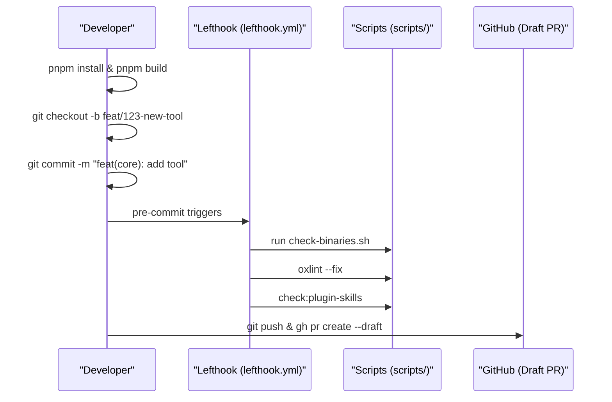

<!-- source: DeepWiki mcp.deepwiki.com · repo CopilotKit/CopilotKit · page 8 Development Guide · fetched 2026-10-30 -->

# Development Guide

<details>
<summary>Relevant source files</summary>

The following files were used as context for generating this wiki page:

- [.claude/docs/documentation.md](.claude/docs/documentation.md)
- [.claude/docs/git.md](.claude/docs/git.md)
- [.claude/docs/hooks.md](.claude/docs/hooks.md)
- [.claude/docs/workflow.md](.claude/docs/workflow.md)
- [.github/config-allowlist.txt](.github/config-allowlist.txt)
- [.github/scripts/check-config-allowlist.sh](.github/scripts/check-config-allowlist.sh)
- [.github/workflows/plugin-skills-check.yml](.github/workflows/plugin-skills-check.yml)
- [.github/workflows/static_check-binaries.yml](.github/workflows/static_check-binaries.yml)
- [.oxfmtrc.json](.oxfmtrc.json)
- [AGENTS.md](AGENTS.md)
- [CLAUDE.md](CLAUDE.md)
- [CONTRIBUTING.md](CONTRIBUTING.md)
- [examples/showcases/daytona-runcode/next.config.ts](examples/showcases/daytona-runcode/next.config.ts)
- [examples/v2/react/demo/tsconfig.json](examples/v2/react/demo/tsconfig.json)
- [lefthook.yml](lefthook.yml)
- [migrations.json](migrations.json)
- [nx.json](nx.json)
- [packages/react-core/src/v2/components/chat/__tests__/CopilotChatPerf.e2e.test.tsx](packages/react-core/src/v2/components/chat/__tests__/CopilotChatPerf.e2e.test.tsx)
- [showcase/scripts/__tests__/fixtures/imagetools/multiarch-labelled.image.json](showcase/scripts/__tests__/fixtures/imagetools/multiarch-labelled.image.json)
- [showcase/scripts/__tests__/fixtures/imagetools/single-platform-unlabelled.image.json](showcase/scripts/__tests__/fixtures/imagetools/single-platform-unlabelled.image.json)
- [showcase/scripts/__tests__/showcase-build-workflow.ts](showcase/scripts/__tests__/showcase-build-workflow.ts)
- [showcase/scripts/__tests__/sync-promote-service-options.test.ts](showcase/scripts/__tests__/sync-promote-service-options.test.ts)
- [showcase/scripts/advance-latest-tag.test.ts](showcase/scripts/advance-latest-tag.test.ts)
- [showcase/scripts/advance-latest-tag.ts](showcase/scripts/advance-latest-tag.ts)
- [showcase/scripts/redeploy-guard.test.ts](showcase/scripts/redeploy-guard.test.ts)
- [showcase/scripts/sync-promote-service-options.ts](showcase/scripts/sync-promote-service-options.ts)
- [showcase/shell-docs/README.md](showcase/shell-docs/README.md)
- [showcase/shell-docs/public/images/channels/channels-architecture-dark.png](showcase/shell-docs/public/images/channels/channels-architecture-dark.png)
- [showcase/shell-docs/public/images/channels/channels-architecture-light.png](showcase/shell-docs/public/images/channels/channels-architecture-light.png)
- [showcase/shell-docs/public/images/channels/intelligence-channels-overview.png](showcase/shell-docs/public/images/channels/intelligence-channels-overview.png)
- [showcase/shell-docs/src/app/[framework]/[[...slug]]/__tests__/framework-root-shell-layout.test.ts](showcase/shell-docs/src/app/[framework]/[[...slug]]/__tests__/framework-root-shell-layout.test.ts)
- [showcase/shell-docs/src/app/__tests__/public-assets.test.ts](showcase/shell-docs/src/app/__tests__/public-assets.test.ts)
- [showcase/shell-docs/src/app/frontends/[frontend]/[...slug]/page.test.ts](showcase/shell-docs/src/app/frontends/[frontend]/[...slug]/page.test.ts)
- [showcase/shell-docs/src/app/frontends/[frontend]/[...slug]/page.tsx](showcase/shell-docs/src/app/frontends/[frontend]/[...slug]/page.tsx)
- [showcase/shell-docs/src/app/frontends/[frontend]/page.tsx](showcase/shell-docs/src/app/frontends/[frontend]/page.tsx)
- [showcase/shell-docs/src/app/frontends/[frontend]/using-these-docs/page.tsx](showcase/shell-docs/src/app/frontends/[frontend]/using-these-docs/page.tsx)
- [showcase/shell-docs/src/app/llms-full.txt/route.test.ts](showcase/shell-docs/src/app/llms-full.txt/route.test.ts)
- [showcase/shell-docs/src/components/__tests__/docs-landing-next.test.tsx](showcase/shell-docs/src/components/__tests__/docs-landing-next.test.tsx)
- [showcase/shell-docs/src/components/__tests__/landing-sample-tabs.test.tsx](showcase/shell-docs/src/components/__tests__/landing-sample-tabs.test.tsx)
- [skills/setup-slack-channel/SKILL.md](skills/setup-slack-channel/SKILL.md)
- [skills/setup-slack-channel/assets/slack-app-manifest.yaml](skills/setup-slack-channel/assets/slack-app-manifest.yaml)
- [skills/setup-slack-channel/references/intelligence-channel.md](skills/setup-slack-channel/references/intelligence-channel.md)
- [skills/setup-slack-channel/references/local-runtime.md](skills/setup-slack-channel/references/local-runtime.md)
- [skills/setup-slack-channel/references/optional-e2e.md](skills/setup-slack-channel/references/optional-e2e.md)
- [skills/setup-slack-channel/references/secrets-and-credentials.md](skills/setup-slack-channel/references/secrets-and-credentials.md)
- [skills/setup-slack-channel/references/slack-workspace-and-app.md](skills/setup-slack-channel/references/slack-workspace-and-app.md)
- [skills/setup-slack-channel/references/troubleshooting.md](skills/setup-slack-channel/references/troubleshooting.md)

</details>


This guide is for developers contributing to the CopilotKit codebase itself. It covers repository setup, build system, development workflows, testing, and release processes. For information about using CopilotKit in your applications, see [Getting Started](#2). For package architecture details, see [Package Structure and Architecture](#7).

## Overview

CopilotKit uses a monorepo structure managed by `pnpm` workspaces with `nx` for build orchestration. The repository contains parallel package ecosystems including core TypeScript packages, example applications, documentation, and a Python SDK.

The development workflow emphasizes:
- **Nx Orchestration**: Always running tasks through `nx` (`nx run`, `nx run-many`, `nx affected`) rather than underlying tools directly [[AGENTS.md:6-13]]().
- **Code Quality**: Enforcing standards via `lefthook` Git hooks and modern linting tools like `oxlint` and `oxfmt` [[lefthook.yml:11-13]](), [[lefthook.yml:80-81]]().
- **AI-Assisted Workflows**: Leveraging AI agent instructions via `CLAUDE.md` and `AGENTS.md` for consistent development patterns, including the use of git worktrees for isolation [[AGENTS.md:28-30]]().
- **Protocol-First Development**: Ensuring all changes align with the AG-UI Protocol communication standards (event-based SSE) [[AGENTS.md:20-21]]().

**Sources:** [[lefthook.yml:1-120]](), [[AGENTS.md:1-73]](), [[CONTRIBUTING.md:1-181]]()

## Development Environment Prerequisites

**Required Software:**

| Tool | Version | Purpose |
|------|---------|---------|
| Node.js | 20.x or later | Primary runtime environment [[CONTRIBUTING.md:65]]() |
| pnpm | v9.x+ | Workspace package manager [[CONTRIBUTING.md:66]]() |
| Nx | Latest | Task runner and build orchestrator [[AGENTS.md:6-13]]() |
| Python | 3.10+ | Required for `sdk-python` development |

**Windows Users:** Must enable **Developer Mode** in system settings to allow `pnpm` and Next.js to create required symlinks [[CONTRIBUTING.md:68]]().

For detailed setup instructions, including framework detection and the `copilotkit-setup` skill workflow, see [Repository Setup](#8.1).

## Repository Structure

The monorepo organizes packages by framework and functionality. It features a flat package structure under the `@copilotkit/` scope [[AGENTS.md:25-26]]().

### Code Entity Mapping
This diagram maps high-level system components to their specific locations and identifiers within the codebase.

```mermaid
graph TD
    subgraph "Frontend_Space"
        ReactCore["@copilotkit/react-core"]
        ReactUI["@copilotkit/react-ui"]
        Angular["@copilotkit/angular"]
        Vue["@copilotkit/vue"]
    end
    
    subgraph "Runtime_Space"
        Runtime["@copilotkit/runtime"]
        Shared["@copilotkit/shared"]
        Core["@copilotkit/core"]
    end
    
    subgraph "Agent_Space"
        PySDK["copilotkit_Python_SDK"]
        BuiltIn["BuiltInAgent"]
    end

    ReactCore --- ["packages/react-core"]
    ReactUI --- ["packages/react-ui"]
    Angular --- ["packages/angular"]
    Vue --- ["packages/vue"]
    Runtime --- ["packages/runtime"]
    Shared --- ["packages/shared"]
    Core --- ["packages/core"]
    PySDK --- ["sdk-python/copilotkit"]
```
**Sources:** [[AGENTS.md:20-26]](), [[CONTRIBUTING.md:111-113]]()

## Build System and Task Orchestration

CopilotKit uses `nx` for task execution with dependency-aware caching. Configuration is centralized in `nx.json` [[nx.json:1-101]]().

### Build Scripts
- `pnpm build`: Standard build command that compiles all packages in the workspace [[CONTRIBUTING.md:83-86]]().
- `pnpm dev`: Starts all packages in development mode [[CONTRIBUTING.md:108-109]]().
- `nx run @copilotkit/package-name:dev`: Starts a specific package in development mode [[CONTRIBUTING.md:112]]().

### Task Definitions
The monorepo defines specialized targets in `nx.json` for package integrity:
- **build**: Depends on upstream builds (`^build`) and caches outputs in `dist/**` [[nx.json:26-31]]().
- **check-types**: Runs type checking across the workspace [[nx.json:50-53]]().
- **publint**: Verifies package exports and compatibility [[nx.json:81-85]]().
- **attw**: Checks TypeScript type definition compatibility [[nx.json:86-90]]().

For details on the build pipeline and Nx configuration, see [Build System and Scripts](#8.2).

## Code Quality and Git Hooks

We use `lefthook` to manage Git hooks and ensure code quality before commits are staged or pushed [[lefthook.yml:1-11]]().

### Pre-commit Checks
The `pre-commit` hook runs the following in parallel [[lefthook.yml:12]]():
- **check-binaries**: Prevents accidental inclusion of binary artifacts and oversized files via `scripts/hooks/check-binaries.sh` [[lefthook.yml:14-16]](), [[.github/workflows/static_check-binaries.yml:35-115]]().
- **lint-fix**: Runs `oxlint --fix` and `oxfmt --write` on staged files, as well as `ruff` for Python files [[lefthook.yml:34-86]]().
- **check-plugin-skills**: Ensures the Claude Code plugin skills mirror is in sync via `pnpm check:plugin-skills` [[lefthook.yml:106-114]]().
- **test-and-check-packages**: Runs `test`, `publint`, and `attw` on affected packages using `nx affected` [[lefthook.yml:87-104]]().

### Commit Message Convention
Commit messages are validated via `commitlint` [[lefthook.yml:115-120]]().
- **Convention**: `<type>(<package>): <subject>` (e.g., `fix(runtime): resolve race condition in SSE handler`) [[CONTRIBUTING.md:128]]().

For details, see [Code Quality and Git Hooks](#8.3).

## Testing and QA

CopilotKit employs a multi-tiered testing strategy:
- **Unit Testing**: Managed via `nx test` targets with caching enabled [[nx.json:36-41]]().
- **E2E Testing**: Performance and regression testing for components like `CopilotChat` using Playwright and Testing Library [[packages/react-core/src/v2/components/chat/__tests__/CopilotChatPerf.e2e.test.tsx:113-115]]().
- **CI Verification**: Automated checks for package integrity and binary exclusion [[lefthook.yml:87-91]]().

For details, see [Testing and Quality Assurance](#9).

## Versioning and Releases

CopilotKit has migrated away from standard Changesets usage to a **conventional-commit-driven release** process [[CONTRIBUTING.md:154-158]]().

- **No Changesets**: Do not add files under `.changeset/`. CI will fail if these files are detected [[CONTRIBUTING.md:157]](), [[.github/workflows/static_check-binaries.yml:77-85]]().
- **Release Tooling**: Scripts in `scripts/release/` build the changelog from commit subjects [[CONTRIBUTING.md:157]](), [[AGENTS.md:27]]().
- **Commit Strategy**: Every meaningful unit of work gets its own commit and is pushed immediately to a draft PR [[AGENTS.md:29-30]]().
- **Worktree Workflow**: Isolation of changes using git worktrees is recommended [[AGENTS.md:28]]().

For details, see [Changesets and Versioning](#8.4).

## Contribution Workflow

This diagram bridges the natural language contribution process with the specific code entities and scripts involved.


**Sources:** [[lefthook.yml:11-120]](), [[CONTRIBUTING.md:88-140]](), [[AGENTS.md:27-30]](), [[.claude/docs/git.md:13-38]]()

## Child Pages
- [Repository Setup](#8.1)
- [Build System and Scripts](#8.2)
- [Code Quality and Git Hooks](#8.3)
- [Changesets and Versioning](#8.4)

---

