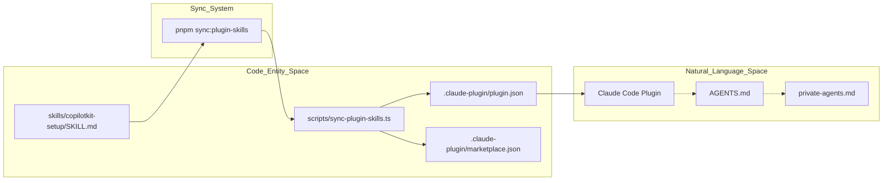
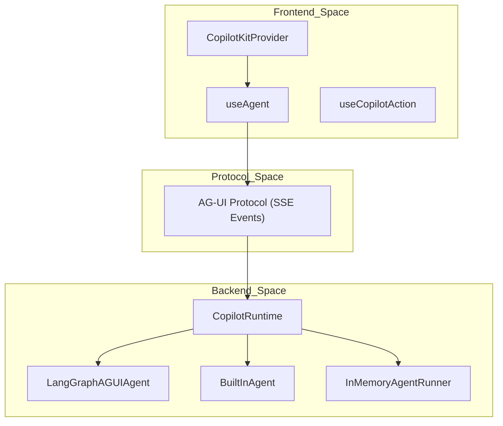

<!-- source: DeepWiki mcp.deepwiki.com · repo CopilotKit/CopilotKit · page 8.1 Repository Setup · fetched 2026-10-30 -->

# Repository Setup

<details>
<summary>Relevant source files</summary>

The following files were used as context for generating this wiki page:

- [.claude-plugin/marketplace.json](.claude-plugin/marketplace.json)
- [.claude-plugin/plugin.json](.claude-plugin/plugin.json)
- [.claude/docs/documentation.md](.claude/docs/documentation.md)
- [.claude/docs/git.md](.claude/docs/git.md)
- [.claude/docs/hooks.md](.claude/docs/hooks.md)
- [.claude/docs/workflow.md](.claude/docs/workflow.md)
- [.github/config-allowlist.txt](.github/config-allowlist.txt)
- [.github/scripts/check-config-allowlist.sh](.github/scripts/check-config-allowlist.sh)
- [.github/workflows/plugin-skills-check.yml](.github/workflows/plugin-skills-check.yml)
- [.github/workflows/static_check-binaries.yml](.github/workflows/static_check-binaries.yml)
- [.mcp.json](.mcp.json)
- [.oxfmtrc.json](.oxfmtrc.json)
- [AGENTS.md](AGENTS.md)
- [CLAUDE.md](CLAUDE.md)
- [CONTRIBUTING.md](CONTRIBUTING.md)
- [examples/showcases/daytona-runcode/next.config.ts](examples/showcases/daytona-runcode/next.config.ts)
- [examples/v2/react/demo/tsconfig.json](examples/v2/react/demo/tsconfig.json)
- [lefthook.yml](lefthook.yml)
- [migrations.json](migrations.json)
- [nx.json](nx.json)
- [packages/react-core/src/v2/components/chat/__tests__/CopilotChatPerf.e2e.test.tsx](packages/react-core/src/v2/components/chat/__tests__/CopilotChatPerf.e2e.test.tsx)
- [scripts/__tests__/sync-plugin-skills.test.ts](scripts/__tests__/sync-plugin-skills.test.ts)
- [scripts/sync-plugin-skills.ts](scripts/sync-plugin-skills.ts)
- [showcase/scripts/__tests__/fixtures/imagetools/multiarch-labelled.image.json](showcase/scripts/__tests__/fixtures/imagetools/multiarch-labelled.image.json)
- [showcase/scripts/__tests__/fixtures/imagetools/single-platform-unlabelled.image.json](showcase/scripts/__tests__/fixtures/imagetools/single-platform-unlabelled.image.json)
- [showcase/scripts/__tests__/showcase-build-workflow.ts](showcase/scripts/__tests__/showcase-build-workflow.ts)
- [showcase/scripts/__tests__/sync-promote-service-options.test.ts](showcase/scripts/__tests__/sync-promote-service-options.test.ts)
- [showcase/scripts/advance-latest-tag.test.ts](showcase/scripts/advance-latest-tag.test.ts)
- [showcase/scripts/advance-latest-tag.ts](showcase/scripts/advance-latest-tag.ts)
- [showcase/scripts/redeploy-guard.test.ts](showcase/scripts/redeploy-guard.test.ts)
- [showcase/scripts/sync-promote-service-options.ts](showcase/scripts/sync-promote-service-options.ts)
- [showcase/shell-docs/README.md](showcase/shell-docs/README.md)
- [showcase/shell-docs/public/images/channels/channels-architecture-dark.png](showcase/shell-docs/public/images/channels/channels-architecture-dark.png)
- [showcase/shell-docs/public/images/channels/channels-architecture-light.png](showcase/shell-docs/public/images/channels/channels-architecture-light.png)
- [showcase/shell-docs/public/images/channels/intelligence-channels-overview.png](showcase/shell-docs/public/images/channels/intelligence-channels-overview.png)
- [showcase/shell-docs/src/app/[framework]/[[...slug]]/__tests__/framework-root-shell-layout.test.ts](showcase/shell-docs/src/app/[framework]/[[...slug]]/__tests__/framework-root-shell-layout.test.ts)
- [showcase/shell-docs/src/app/__tests__/public-assets.test.ts](showcase/shell-docs/src/app/__tests__/public-assets.test.ts)
- [showcase/shell-docs/src/app/frontends/[frontend]/[...slug]/page.test.ts](showcase/shell-docs/src/app/frontends/[frontend]/[...slug]/page.test.ts)
- [showcase/shell-docs/src/app/frontends/[frontend]/[...slug]/page.tsx](showcase/shell-docs/src/app/frontends/[frontend]/[...slug]/page.tsx)
- [showcase/shell-docs/src/app/frontends/[frontend]/page.tsx](showcase/shell-docs/src/app/frontends/[frontend]/page.tsx)
- [showcase/shell-docs/src/app/frontends/[frontend]/using-these-docs/page.tsx](showcase/shell-docs/src/app/frontends/[frontend]/using-these-docs/page.tsx)
- [showcase/shell-docs/src/app/llms-full.txt/route.test.ts](showcase/shell-docs/src/app/llms-full.txt/route.test.ts)
- [showcase/shell-docs/src/components/__tests__/docs-landing-next.test.tsx](showcase/shell-docs/src/components/__tests__/docs-landing-next.test.tsx)
- [showcase/shell-docs/src/components/__tests__/landing-sample-tabs.test.tsx](showcase/shell-docs/src/components/__tests__/landing-sample-tabs.test.tsx)
- [skills/channels-setup/SKILL.md](skills/channels-setup/SKILL.md)
- [skills/copilotkit-agui/references/event-flow-diagrams.md](skills/copilotkit-agui/references/event-flow-diagrams.md)
- [skills/copilotkit-agui/sources.md](skills/copilotkit-agui/sources.md)
- [skills/copilotkit-channels/SKILL.md](skills/copilotkit-channels/SKILL.md)
- [skills/copilotkit-channels/sources.md](skills/copilotkit-channels/sources.md)
- [skills/copilotkit-setup/SKILL.md](skills/copilotkit-setup/SKILL.md)
- [skills/copilotkit-setup/assets/express-runtime.ts](skills/copilotkit-setup/assets/express-runtime.ts)
- [skills/copilotkit-setup/assets/nextjs-app-router-page.tsx](skills/copilotkit-setup/assets/nextjs-app-router-page.tsx)
- [skills/copilotkit-setup/assets/nextjs-app-router-route.ts](skills/copilotkit-setup/assets/nextjs-app-router-route.ts)
- [skills/copilotkit-setup/eval.yaml](skills/copilotkit-setup/eval.yaml)
- [skills/copilotkit-setup/references/framework-detection.md](skills/copilotkit-setup/references/framework-detection.md)
- [skills/copilotkit-setup/references/runtime-architecture.md](skills/copilotkit-setup/references/runtime-architecture.md)
- [skills/copilotkit-setup/references/telemetry-setup.md](skills/copilotkit-setup/references/telemetry-setup.md)
- [skills/copilotkit-setup/sources.md](skills/copilotkit-setup/sources.md)
- [skills/setup-slack-channel/SKILL.md](skills/setup-slack-channel/SKILL.md)
- [skills/setup-slack-channel/assets/slack-app-manifest.yaml](skills/setup-slack-channel/assets/slack-app-manifest.yaml)
- [skills/setup-slack-channel/references/intelligence-channel.md](skills/setup-slack-channel/references/intelligence-channel.md)
- [skills/setup-slack-channel/references/local-runtime.md](skills/setup-slack-channel/references/local-runtime.md)
- [skills/setup-slack-channel/references/optional-e2e.md](skills/setup-slack-channel/references/optional-e2e.md)
- [skills/setup-slack-channel/references/secrets-and-credentials.md](skills/setup-slack-channel/references/secrets-and-credentials.md)
- [skills/setup-slack-channel/references/slack-workspace-and-app.md](skills/setup-slack-channel/references/slack-workspace-and-app.md)
- [skills/setup-slack-channel/references/troubleshooting.md](skills/setup-slack-channel/references/troubleshooting.md)

</details>


This page guides developers through cloning the CopilotKit repository, installing dependencies, and configuring the local development environment. It covers the monorepo structure, required tooling versions, the initial build process, and the specialized systems for AI agent skills and documentation architecture.

---

## Prerequisites

The following tools must be installed before working with this repository.

| Tool | Required Version | Notes |
|------|-----------------|-------|
| **Node.js** | `20.x` or later | Required for compatibility across all packages [CONTRIBUTING.md:65]() |
| **pnpm** | `v9.x` | Must be installed globally: `npm i -g pnpm@^66` [CONTRIBUTING.md:66]() |
| **Windows Developer Mode** | Enabled | Required for symlink creation in Next.js and pnpm [CONTRIBUTING.md:68]() |

Sources: [CONTRIBUTING.md:63-68]()

---

## Initializing the Repository

### 1. Clone the Repository
Fork the repository to your own GitHub account first, then clone your fork locally:

```bash
git clone https://github.com/<your-GitHub-username>/CopilotKit
cd CopilotKit
```

Sources: [CONTRIBUTING.md:46-55]()

### 2. Install Dependencies
CopilotKit uses a pnpm workspace to manage dependencies across all packages and examples. Run the following from the root directory:

```bash
pnpm install
```

Sources: [CONTRIBUTING.md:72-77]()

### 3. Initial Build
To ensure the environment is correctly configured and all internal dependencies are resolved, perform a full build of the monorepo:

```bash
pnpm build
```

Sources: [CONTRIBUTING.md:79-86]()

---

## Development Workflow and Conventions

The repository uses **Nx** to manage tasks across the monorepo. Developers are encouraged to use the `nx` CLI for all tasks to ensure correct dependency resolution [AGENTS.md:6-10]().

### Reference Documentation
The `.claude/docs/` directory contains critical reference files for the development environment:
- `architecture.md`: V2/V1 package roles and request lifecycles [AGENTS.md:69-69]().
- `hooks.md`: Checklist for creating new hooks [AGENTS.md:70-70]().
- `workflow.md`: Mindset for planning and verification [AGENTS.md:71-71]().
- `git.md`: Worktree workflow and branching [AGENTS.md:72-72]().
- `documentation.md`: Detailed guide on where to author docs [AGENTS.md:73-73]().

### Git and PR Workflow
CopilotKit follows a strict "Commit early and often" philosophy [AGENTS.md:29-29](). 
1. **Worktrees**: Always use `git worktree` for non-trivial work to keep the main tree clean [.claude/docs/git.md:15-17]().
2. **Draft PRs**: Open a draft PR immediately after the first meaningful commit [.claude/docs/git.md:25-31]().
3. **Commits**: Every meaningful unit of work (feature, refactor, bugfix) gets its own commit [.claude/docs/git.md:51-53]().

### Running in Development Mode
```bash
# To start all packages in development mode
pnpm dev

# Start a specific package in development mode
nx run @copilotkit/<package-name>:dev
```

Sources: [CONTRIBUTING.md:108-113](), [AGENTS.md:24-25](), [.claude/docs/git.md:1-86]()

---

## Claude Code Plugin & Skills System

The team maintains shared AI agent skills that are integrated into the development environment as Claude Code plugin skills [AGENTS.md:39-40](). These skills provide automated workflows for development, branding, and code review.

### Internal Skills and SKILL.md
Key skills available include:
- `copilotkit-setup`: Framework detection and runtime wiring (Managed Intelligence vs SSE) [skills/copilotkit-setup/SKILL.md:4-8]().
- `copilotkit-channels`: Managed Intelligence Channel customization for Slack/Teams [skills/copilotkit-channels/SKILL.md:3-11]().
- `setup-slack-channel`: Provider-side setup for Slack apps and tokens [skills/setup-slack-channel/SKILL.md:3-4]().

### Synchronizing Skills
The skills system bridges natural language instructions in `SKILL.md` files with codebase operations. The `scripts/sync-plugin-skills.ts` script handles the synchronization between the `skills/` source directory and the `.claude-plugin/` directory [lefthook.yml:108-109]().

```bash
pnpm sync:plugin-skills
```

**Diagram: Skills and Plugin Integration**



Sources: [AGENTS.md:39-46](), [.claude-plugin/plugin.json:1-28](), [.claude-plugin/marketplace.json:1-38](), [lefthook.yml:106-114]()

---

## System Architecture Overview

CopilotKit operates as a three-layer framework communicating via the **AG-UI protocol** (event-based SSE) [AGENTS.md:20-20]().

**Diagram: Component Mapping (Frontend to Agent)**



Sources: [AGENTS.md:20-20](), [skills/copilotkit-setup/SKILL.md:107-125]()

---

## Code Quality and Git Hooks

The repository uses **Lefthook** to manage Git hooks, ensuring code quality before commits are pushed.

### Automated Checks
- **check-plugin-skills**: Ensures the `skills/` directory is synchronized with the plugin system via `pnpm check:plugin-skills` [lefthook.yml:106-109]().
- **check-binaries**: Prevents binary artifacts (e.g., `.wasm`, `.exe`, `.so`) from being committed using `scripts/hooks/check-binaries.sh` [lefthook.yml:14-16](), [.github/workflows/static_check-binaries.yml:49-55]().
- **lint-fix**: Runs `oxlint` and `oxfmt` on staged files to maintain code style [lefthook.yml:34-86]().
- **Commitlint**: Enforces the `<type>(<package>): <subject>` convention [lefthook.yml:115-120]().

### Commit Message Types
- `feat`: A new feature [CONTRIBUTING.md:96]().
- `fix`: A bug fix [CONTRIBUTING.md:97]().
- `docs`: Changes to the documentation [CONTRIBUTING.md:95]().
- `chore`: Changes to the build process or dependencies [CONTRIBUTING.md:176]().

Sources: [lefthook.yml:1-120](), [CONTRIBUTING.md:153-177](), [.github/workflows/static_check-binaries.yml:1-119]()

---

## Documentation System

There are two primary documentation domains. It is critical to use the correct path to ensure changes reach the live site:

1. **CopilotKit Product Docs (docs.copilotkit.ai)**: Authored in **`showcase/shell-docs/src/content/`**. This includes guides, API references, and snippets [CONTRIBUTING.md:34-34](), [.claude/docs/documentation.md:8-16]().
2. **AG-UI Protocol Docs (docs.ag-ui.com)**: Authored upstream in **`ag-ui-protocol/ag-ui`**. The `showcase/shell-docs/src/content/ag-ui/` tree is a downstream mirror [CONTRIBUTING.md:35-35](), [.claude/docs/documentation.md:81-86]().

### Documentation Architecture Rules
- **Top-level `docs/` is a symlink**: Do not recreate the old `docs/content/docs/` tree. It is only a symlink to `showcase/shell-docs/` for muscle memory [AGENTS.md:31-31](), [.claude/docs/documentation.md:75-77]().
- **Framework Docs Modes**: Framework documentation is controlled by `docs_mode` (either `generated` or `authored`) in the integration's `manifest.yaml` [.claude/docs/documentation.md:59-62]().
- **Reference Docs**: V2 reference navigation is generated from frontmatter, not `meta.json` [.claude/docs/documentation.md:58-58]().

Sources: [CONTRIBUTING.md:31-36](), [AGENTS.md:49-65](), [.claude/docs/documentation.md:1-104](), [showcase/shell-docs/README.md:1-117]()

---

