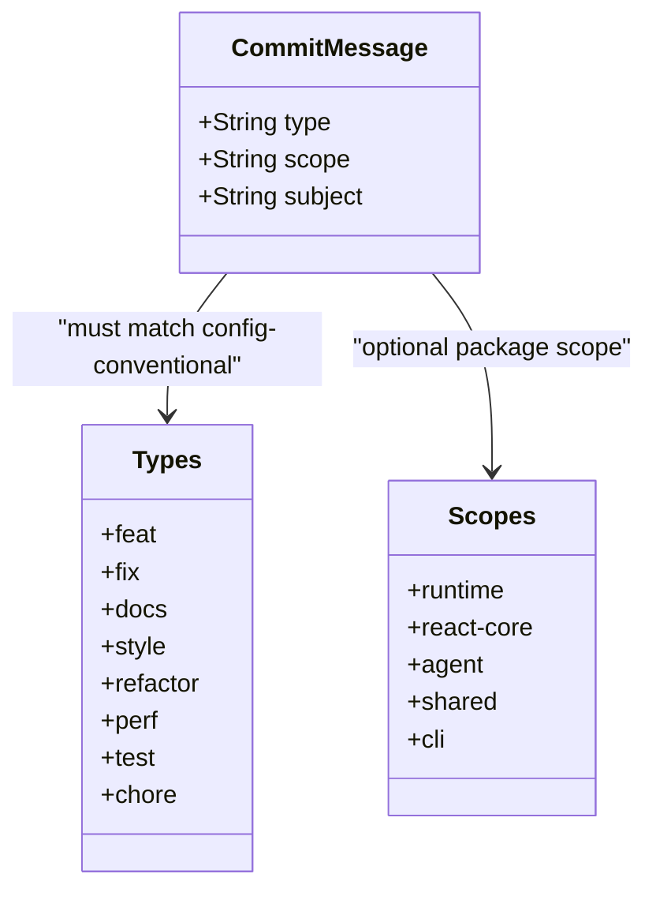

<!-- source: DeepWiki mcp.deepwiki.com · repo CopilotKit/CopilotKit · page 8.3 Code Quality and Git Hooks · fetched 2026-10-30 -->

# Code Quality and Git Hooks

<details>
<summary>Relevant source files</summary>

The following files were used as context for generating this wiki page:

- [.claude/docs/documentation.md](.claude/docs/documentation.md)
- [.claude/docs/git.md](.claude/docs/git.md)
- [.claude/docs/hooks.md](.claude/docs/hooks.md)
- [.claude/docs/workflow.md](.claude/docs/workflow.md)
- [.github/config-allowlist.txt](.github/config-allowlist.txt)
- [.github/scripts/check-config-allowlist.sh](.github/scripts/check-config-allowlist.sh)
- [.github/workflows/plugin-skills-check.yml](.github/workflows/plugin-skills-check.yml)
- [.github/workflows/publish-commit.yml](.github/workflows/publish-commit.yml)
- [.github/workflows/showcase_eval.yml](.github/workflows/showcase_eval.yml)
- [.github/workflows/static_check-binaries.yml](.github/workflows/static_check-binaries.yml)
- [.github/workflows/static_danger.yml](.github/workflows/static_danger.yml)
- [.github/workflows/static_quality.yml](.github/workflows/static_quality.yml)
- [.github/workflows/test_e2e-dojo.yml](.github/workflows/test_e2e-dojo.yml)
- [.github/workflows/test_e2e-legacy-v1.yml](.github/workflows/test_e2e-legacy-v1.yml)
- [.github/workflows/test_e2e-showcase-on-demand.yml](.github/workflows/test_e2e-showcase-on-demand.yml)
- [.github/workflows/test_integration-docs.yml](.github/workflows/test_integration-docs.yml)
- [.github/workflows/test_integration-runtime.yml](.github/workflows/test_integration-runtime.yml)
- [.github/workflows/test_showcase-frontend-matrix.yml](.github/workflows/test_showcase-frontend-matrix.yml)
- [.github/workflows/test_smoke-starter.yml](.github/workflows/test_smoke-starter.yml)
- [.github/workflows/test_unit-showcase.yml](.github/workflows/test_unit-showcase.yml)
- [.github/workflows/test_unit.yml](.github/workflows/test_unit.yml)
- [.oxfmtrc.json](.oxfmtrc.json)
- [AGENTS.md](AGENTS.md)
- [CLAUDE.md](CLAUDE.md)
- [CONTRIBUTING.md](CONTRIBUTING.md)
- [examples/showcases/daytona-runcode/next.config.ts](examples/showcases/daytona-runcode/next.config.ts)
- [examples/v2/react/demo/tsconfig.json](examples/v2/react/demo/tsconfig.json)
- [lefthook.yml](lefthook.yml)
- [migrations.json](migrations.json)
- [nx.json](nx.json)
- [packages/react-core/src/v2/components/chat/__tests__/CopilotChatPerf.e2e.test.tsx](packages/react-core/src/v2/components/chat/__tests__/CopilotChatPerf.e2e.test.tsx)
- [showcase/scripts/__tests__/fixtures/imagetools/multiarch-labelled.image.json](showcase/scripts/__tests__/fixtures/imagetools/multiarch-labelled.image.json)
- [showcase/scripts/__tests__/fixtures/imagetools/single-platform-unlabelled.image.json](showcase/scripts/__tests__/fixtures/imagetools/single-platform-unlabelled.image.json)
- [showcase/scripts/__tests__/showcase-build-workflow.ts](showcase/scripts/__tests__/showcase-build-workflow.ts)
- [showcase/scripts/__tests__/sync-promote-service-options.test.ts](showcase/scripts/__tests__/sync-promote-service-options.test.ts)
- [showcase/scripts/advance-latest-tag.test.ts](showcase/scripts/advance-latest-tag.test.ts)
- [showcase/scripts/advance-latest-tag.ts](showcase/scripts/advance-latest-tag.ts)
- [showcase/scripts/redeploy-guard.test.ts](showcase/scripts/redeploy-guard.test.ts)
- [showcase/scripts/sync-promote-service-options.ts](showcase/scripts/sync-promote-service-options.ts)
- [showcase/shell-docs/README.md](showcase/shell-docs/README.md)
- [showcase/shell-docs/public/images/channels/channels-architecture-dark.png](showcase/shell-docs/public/images/channels/channels-architecture-dark.png)
- [showcase/shell-docs/public/images/channels/channels-architecture-light.png](showcase/shell-docs/public/images/channels/channels-architecture-light.png)
- [showcase/shell-docs/public/images/channels/intelligence-channels-overview.png](showcase/shell-docs/public/images/channels/intelligence-channels-overview.png)
- [showcase/shell-docs/src/app/[framework]/[[...slug]]/__tests__/framework-root-shell-layout.test.ts](showcase/shell-docs/src/app/[framework]/[[...slug]]/__tests__/framework-root-shell-layout.test.ts)
- [showcase/shell-docs/src/app/__tests__/public-assets.test.ts](showcase/shell-docs/src/app/__tests__/public-assets.test.ts)
- [showcase/shell-docs/src/app/frontends/[frontend]/[...slug]/page.test.ts](showcase/shell-docs/src/app/frontends/[frontend]/[...slug]/page.test.ts)
- [showcase/shell-docs/src/app/frontends/[frontend]/[...slug]/page.tsx](showcase/shell-docs/src/app/frontends/[frontend]/[...slug]/page.tsx)
- [showcase/shell-docs/src/app/frontends/[frontend]/page.tsx](showcase/shell-docs/src/app/frontends/[frontend]/page.tsx)
- [showcase/shell-docs/src/app/frontends/[frontend]/using-these-docs/page.tsx](showcase/shell-docs/src/app/frontends/[frontend]/using-these-docs/page.tsx)
- [showcase/shell-docs/src/app/llms-full.txt/route.test.ts](showcase/shell-docs/src/app/llms-full.txt/route.test.ts)
- [showcase/shell-docs/src/components/__tests__/docs-landing-next.test.tsx](showcase/shell-docs/src/components/__tests__/docs-landing-next.test.tsx)
- [showcase/shell-docs/src/components/__tests__/landing-sample-tabs.test.tsx](showcase/shell-docs/src/components/__tests__/landing-sample-tabs.test.tsx)
- [skills/setup-slack-channel/SKILL.md](skills/setup-slack-channel/SKILL.md)
- [skills/setup-slack-channel/assets/slack-app-manifest.yaml](skills/setup-slack-channel/assets/slack-app-manifest.yaml)
- [skills/setup-slack-channel/references/intelligence-channel.md](skills/setup-slack-channel/references/intelligence-channel.md)
- [skills/setup-slack-channel/references/local-runtime.md](skills/setup-slack-channel/references/local-runtime.md)
- [skills/setup-slack-channel/references/optional-e2e.md](skills/setup-slack-channel/references/optional-e2e.md)
- [skills/setup-slack-channel/references/secrets-and-credentials.md](skills/setup-slack-channel/references/secrets-and-credentials.md)
- [skills/setup-slack-channel/references/slack-workspace-and-app.md](skills/setup-slack-channel/references/slack-workspace-and-app.md)
- [skills/setup-slack-channel/references/troubleshooting.md](skills/setup-slack-channel/references/troubleshooting.md)

</details>


This page documents the automated quality assurance mechanisms integrated into the CopilotKit development workflow. It details the Git hooks managed by Lefthook, the commit message validation via commitlint, and the high-performance linting and formatting architecture using Rust-based and Python-based tooling.

## Git Hooks with Lefthook

CopilotKit uses `lefthook` to manage Git hooks, ensuring that code meets quality standards before it is committed or pushed. The configuration is defined in `lefthook.yml` and covers binary checks, lockfile synchronization, linting, and specialized synchronization for plugin skills and showcase services.

### Pre-commit Hooks

The `pre-commit` stage runs multiple commands in parallel to minimize overhead while maintaining strict checks [lefthook.yml:11-12]().

**Pre-commit Execution Flow**

```mermaid
graph TD
    "Git_Commit_Trigger"["git commit"] --> "Lefthook_Engine"["lefthook.yml"]
    
    subgraph "Parallel_Checks"
        "check-binaries"["scripts/hooks/check-binaries.sh"]
        "sync-lockfile"["pnpm i --lockfile-only"]
        "lint-fix"["oxlint --fix && oxfmt --write && ruff format"]
        "check-plugin-skills"["pnpm check:plugin-skills"]
        "sync-promote-dropdown"["tsx showcase/scripts/sync-promote-service-options.ts"]
        "test-packages"["pnpm nx show projects --affected"]
    end

    "Lefthook_Engine" --> "check-binaries"
    "Lefthook_Engine" --> "sync-lockfile"
    "Lefthook_Engine" --> "lint-fix"
    "Lefthook_Engine" --> "check-plugin-skills"
    "Lefthook_Engine" --> "sync-promote-dropdown"
    "Lefthook_Engine" --> "test-packages"

    "check-binaries" --> "Result_Aggregator"["Result Aggregator"]
    "sync-lockfile" --> "Result_Aggregator"
    "lint-fix" --> "Result_Aggregator"
    "check-plugin-skills" --> "Result_Aggregator"
    "sync-promote-dropdown" --> "Result_Aggregator"
    "test-packages" --> "Result_Aggregator"

    "Result_Aggregator" --> "Success"["Commit Allowed"]
    "Result_Aggregator" --> "Failure"["Commit Blocked"]
```

#### check-binaries
This custom script prevents accidental commits of large or compiled files [lefthook.yml:14-16](). It specifically targets binary extensions like `.exe`, `.so`, `.dylib`, and `.wasm` [static_quality.yml:110-115]() [static_check-binaries.yml:49-55]().

#### sync-lockfile
Triggered by changes to any `package.json` file in `packages`, `examples`, or `showcase/scripts`, this command ensures the `pnpm-lock.yaml` is up to date without performing a full install [lefthook.yml:29-33]().

#### lint-fix
Automatically runs `oxlint --fix` and `oxfmt --write` on staged files. The hook is scoped specifically to `{staged_files}` to maintain speed [lefthook.yml:34-77](). It also runs `ruff format` on `.py` files [lefthook.yml:83](). It excludes specific generated directories like `showcase/aimock/` to avoid unnecessary churn [lefthook.yml:55-58]().

#### check-plugin-skills
Ensures the Claude Code plugin skill mirror is in sync with the source. If it drifts, it prompts the user to run `pnpm sync:plugin-skills` [lefthook.yml:106-113](). This check monitors the `skills/` directories, `packages/*/skills/**`, and `.claude-plugin/` configuration [lefthook.yml:108]().

#### sync-promote-dropdown
Regenerates the service dropdown in `.github/workflows/showcase_promote.yml` from the `railway-envs.ts` source of truth, ensuring deployment options never drift [lefthook.yml:17-28](). It uses `showcase/scripts/sync-promote-service-options.ts` to update the choice list [showcase/scripts/sync-promote-service-options.ts:3-12]().

#### test-and-check-packages
Identifies affected projects using `pnpm nx show projects --affected` and runs `test`, `publint`, and `attw` targets [lefthook.yml:87-104]().

**Sources**: [lefthook.yml:11-120](), [.github/workflows/static_check-binaries.yml:49-55](), [showcase/scripts/sync-promote-service-options.ts:3-12]()

---

## Commit Message Validation

To maintain a clean and searchable history, CopilotKit enforces the **Conventional Commits** specification. The repository has migrated away from Changesets for releases and now uses commit subjects to drive changelog generation [CONTRIBUTING.md:153-157]().

### commitlint Configuration
Validation is performed during the `commit-msg` hook using `pnpm commitlint --edit {1}` [lefthook.yml:115-120]().

**Commit Logic Association**



**Sources**: [lefthook.yml:115-120](), [CONTRIBUTING.md:128-157]()

---

## Linting and Formatting Architecture

The repository leverages Rust-based tooling (`oxlint` and `oxfmt`) for JavaScript/TypeScript and `ruff` for Python, orchestrated by **pnpm** and **nx**.

### Tool Integration and Scoping
The `lint-fix` hook in `lefthook.yml` contains defensive logic to prevent `oxfmt` from corrupting `package.json` files by rewriting them into JSON5 syntax, which breaks the `pnpm` parser [lefthook.yml:44-51](). It filters out `.json` from the target glob to keep `package.json` valid [lefthook.yml:52](). In CI, `oxfmt` and `ruff` are scoped to PR-changed files using `git diff` against the merge-base [static_quality.yml:87-116]().

**Code Quality Tooling Map**

```mermaid
graph LR
    subgraph "JS_TS_Tooling"
        "oxlint"["oxlint"]
        "oxfmt"["oxfmt"]
        "publint"["publint"]
        "attw"["attw"]
    end

    subgraph "Python_Tooling"
        "ruff"["ruff"]
    end

    subgraph "Automation_Entrypoints"
        "lefthook_commit"["lefthook pre-commit"]
        "nx_tasks"["nx run-many"]
        "CI_static_quality"["static_quality.yml"]
    end

    "lefthook_commit" --> "oxlint"
    "lefthook_commit" --> "oxfmt"
    "lefthook_commit" --> "ruff"
    "nx_tasks" --> "publint"
    "nx_tasks" --> "attw"
    "CI_static_quality" --> "oxfmt"
    "CI_static_quality" --> "ruff"
```

**Sources**: [lefthook.yml:44-86](), [static_quality.yml:65-86](), [nx.json:81-95]()

---

## Quality Assurance Workflows

CopilotKit employs several GitHub Action workflows to enforce quality across different environments and languages.

### Binary and Artifact Check
The `static_check-binaries.yml` workflow prevents binary artifacts, build outputs, or oversized files (>1MB) from being merged into the main branch [static_check-binaries.yml:1-105](). It checks for:
1. **Binary Extensions**: `.exe`, `.dll`, `.so`, `.dylib`, `.wasm`, etc. [static_check-binaries.yml:50]()
2. **Build Directories**: Files within `/build/` paths [static_check-binaries.yml:58]()
3. **Stale Changesets**: Blocks PRs that add `.changeset/*.md` files, as the repo has migrated to conventional commits [static_check-binaries.yml:77-85]().
4. **Large Files**: Files over 1MB, excluding lockfiles, assets, and specific showcase data [static_check-binaries.yml:87-109]().

### Build and Type Safety
The repository uses `nx` to run many of these checks in parallel across the monorepo packages:
- **Target Defaults**: `nx` defines standard targets for `build`, `test`, and `check-types` with appropriate caching and dependency rules [nx.json:25-53]().
- **Package Integrity**: `publint` and `attw` (Are The Types Wrong) are configured as `nx` targets to ensure published packages meet compatibility standards [nx.json:81-90]().

### Configuration Allowlist
A strict check ensures that only approved configuration files exist in specific directories. The allowed files (like `next.config.ts` or `tsdown.config.ts`) are maintained in `.github/config-allowlist.txt` [config-allowlist.txt:1-121]().

**Sources**: [nx.json:1-100](), [static_check-binaries.yml:1-105](), [.github/config-allowlist.txt:1-121]()

---

