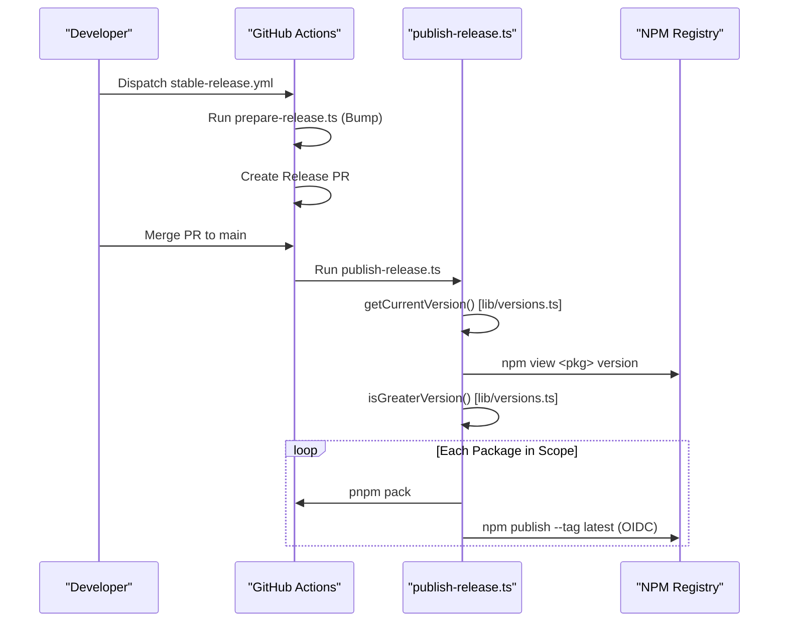
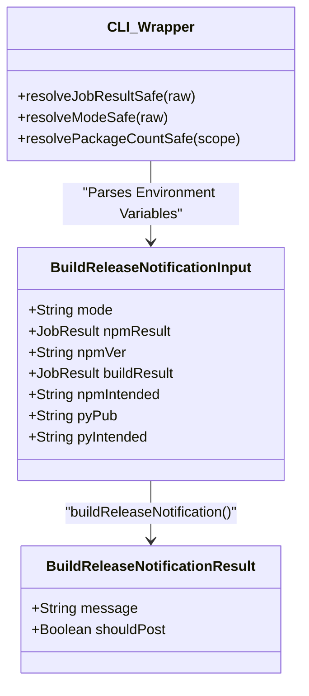

<!-- source: DeepWiki mcp.deepwiki.com · repo CopilotKit/CopilotKit · page 8.4 Changesets and Versioning · fetched 2026-10-30 -->

# Changesets and Versioning

Relevant source files

The following files were used as context for generating this wiki page:

- [.claude/docs/documentation.md](.claude/docs/documentation.md)
- [.claude/docs/git.md](.claude/docs/git.md)
- [.claude/docs/hooks.md](.claude/docs/hooks.md)
- [.claude/docs/workflow.md](.claude/docs/workflow.md)
- [.github/config-allowlist.txt](.github/config-allowlist.txt)
- [.github/scripts/check-config-allowlist.sh](.github/scripts/check-config-allowlist.sh)
- [.github/workflows/canary.yml](.github/workflows/canary.yml)
- [.github/workflows/integrations_parity.yml](.github/workflows/integrations_parity.yml)
- [.github/workflows/publish-release.yml](.github/workflows/publish-release.yml)
- [.github/workflows/stable-release.yml](.github/workflows/stable-release.yml)
- [.github/workflows/static_check-binaries.yml](.github/workflows/static_check-binaries.yml)
- [.oxfmtrc.json](.oxfmtrc.json)
- [AGENTS.md](AGENTS.md)
- [CLAUDE.md](CLAUDE.md)
- [CONTRIBUTING.md](CONTRIBUTING.md)
- [examples/showcases/daytona-runcode/next.config.ts](examples/showcases/daytona-runcode/next.config.ts)
- [release.config.json](release.config.json)
- [scripts/release/__tests__/verify-runtime-package.test.ts](scripts/release/__tests__/verify-runtime-package.test.ts)
- [scripts/release/build-release-notification.ts](scripts/release/build-release-notification.ts)
- [scripts/release/bump-prerelease.ts](scripts/release/bump-prerelease.ts)
- [scripts/release/lib/build-release-notification.test.ts](scripts/release/lib/build-release-notification.test.ts)
- [scripts/release/lib/build-release-notification.ts](scripts/release/lib/build-release-notification.ts)
- [scripts/release/lib/build-release-notification.wrapper.test.ts](scripts/release/lib/build-release-notification.wrapper.test.ts)
- [scripts/release/lib/changes.test.ts](scripts/release/lib/changes.test.ts)
- [scripts/release/lib/changes.ts](scripts/release/lib/changes.ts)
- [scripts/release/lib/channels-umbrella.test.ts](scripts/release/lib/channels-umbrella.test.ts)
- [scripts/release/lib/channels-umbrella.ts](scripts/release/lib/channels-umbrella.ts)
- [scripts/release/lib/config.test.ts](scripts/release/lib/config.test.ts)
- [scripts/release/lib/config.ts](scripts/release/lib/config.ts)
- [scripts/release/lib/github-output.test.ts](scripts/release/lib/github-output.test.ts)
- [scripts/release/lib/github-output.ts](scripts/release/lib/github-output.ts)
- [scripts/release/lib/npm-cli.test.ts](scripts/release/lib/npm-cli.test.ts)
- [scripts/release/lib/npm-cli.ts](scripts/release/lib/npm-cli.ts)
- [scripts/release/lib/pack-workspace.ts](scripts/release/lib/pack-workspace.ts)
- [scripts/release/lib/versions.test.ts](scripts/release/lib/versions.test.ts)
- [scripts/release/lib/versions.ts](scripts/release/lib/versions.ts)
- [scripts/release/prepare-release.ts](scripts/release/prepare-release.ts)
- [scripts/release/prerelease.ts](scripts/release/prerelease.ts)
- [scripts/release/publish-release.ts](scripts/release/publish-release.ts)
- [scripts/release/verify-channels-umbrella.ts](scripts/release/verify-channels-umbrella.ts)
- [scripts/release/verify-release-scope-dropdowns.sh](scripts/release/verify-release-scope-dropdowns.sh)
- [scripts/release/verify-runtime-package.ts](scripts/release/verify-runtime-package.ts)
- [scripts/release/vitest.config.mts](scripts/release/vitest.config.mts)
- [showcase/scripts/__tests__/fixtures/imagetools/multiarch-labelled.image.json](showcase/scripts/__tests__/fixtures/imagetools/multiarch-labelled.image.json)
- [showcase/scripts/__tests__/fixtures/imagetools/single-platform-unlabelled.image.json](showcase/scripts/__tests__/fixtures/imagetools/single-platform-unlabelled.image.json)
- [showcase/scripts/__tests__/showcase-build-workflow.ts](showcase/scripts/__tests__/showcase-build-workflow.ts)
- [showcase/scripts/advance-latest-tag.test.ts](showcase/scripts/advance-latest-tag.test.ts)
- [showcase/scripts/advance-latest-tag.ts](showcase/scripts/advance-latest-tag.ts)
- [showcase/scripts/redeploy-guard.test.ts](showcase/scripts/redeploy-guard.test.ts)
- [showcase/shell-docs/README.md](showcase/shell-docs/README.md)
- [showcase/shell-docs/public/images/channels/channels-architecture-dark.png](showcase/shell-docs/public/images/channels/channels-architecture-dark.png)
- [showcase/shell-docs/public/images/channels/channels-architecture-light.png](showcase/shell-docs/public/images/channels/channels-architecture-light.png)
- [showcase/shell-docs/public/images/channels/intelligence-channels-overview.png](showcase/shell-docs/public/images/channels/intelligence-channels-overview.png)
- [showcase/shell-docs/src/app/[framework]/[[...slug]]/__tests__/framework-root-shell-layout.test.ts](showcase/shell-docs/src/app/[framework]/[[...slug]]/__tests__/framework-root-shell-layout.test.ts)
- [showcase/shell-docs/src/app/__tests__/public-assets.test.ts](showcase/shell-docs/src/app/__tests__/public-assets.test.ts)
- [showcase/shell-docs/src/app/frontends/[frontend]/[...slug]/page.test.ts](showcase/shell-docs/src/app/frontends/[frontend]/[...slug]/page.test.ts)
- [showcase/shell-docs/src/app/frontends/[frontend]/[...slug]/page.tsx](showcase/shell-docs/src/app/frontends/[frontend]/[...slug]/page.tsx)
- [showcase/shell-docs/src/app/frontends/[frontend]/page.tsx](showcase/shell-docs/src/app/frontends/[frontend]/page.tsx)
- [showcase/shell-docs/src/app/frontends/[frontend]/using-these-docs/page.tsx](showcase/shell-docs/src/app/frontends/[frontend]/using-these-docs/page.tsx)
- [showcase/shell-docs/src/app/llms-full.txt/route.test.ts](showcase/shell-docs/src/app/llms-full.txt/route.test.ts)
- [showcase/shell-docs/src/components/__tests__/docs-landing-next.test.tsx](showcase/shell-docs/src/components/__tests__/docs-landing-next.test.tsx)
- [showcase/shell-docs/src/components/__tests__/landing-sample-tabs.test.tsx](showcase/shell-docs/src/components/__tests__/landing-sample-tabs.test.tsx)

This page documents the versioning strategy, release workflows, and automated publishing processes for the CopilotKit repository. CopilotKit utilizes a structured approach to manage a multi-language monorepo (TypeScript and Python) with distinct release lanes, safety gates, and OIDC-based publishing.

## Overview

CopilotKit manages package versioning and publishing through a combination of automated GitHub Actions workflows and custom release scripts. The repository handles two primary ecosystems:
1.  **TypeScript/NPM**: Over 25 packages versioned under the `@copilotkit/*` scope, organized into logical release units [release.config.json:3-46]().
2.  **Python/PyPI**: The `sdk-python` package, which follows a version-detection-based publish lane [.github/workflows/publish-release.yml:25-27]().

The versioning logic is governed by `release.config.json`, which defines "scopes" for grouping packages that should be versioned together or independently [release.config.json:3-46]().

| Feature | Implementation |
| :--- | :--- |
| **Release Scopes** | `monorepo`, `angular`, `channels` [release.config.json:3-46]() |
| **Auth Mechanism** | NPM OIDC Trusted Publishers (no long-lived tokens) [.github/workflows/publish-release.yml:3-7]() |
| **Prerelease Tag** | `canary` [release.config.json:2]() |
| **Stable Tag** | `latest` [scripts/release/publish-release.ts:6]() |

Sources: [release.config.json:1-47](), [.github/workflows/publish-release.yml:1-18](), [scripts/release/publish-release.ts:1-20]()

## Release Scopes and Configuration

The `release.config.json` file is the source of truth for how packages are grouped for release [scripts/release/lib/config.ts:3]().

*   **monorepo**: Includes core packages like `@copilotkit/core`, `@copilotkit/runtime`, and `@copilotkit/react-ui`. It uses `sharedVersion: true`, meaning all packages in this scope are bumped to the same version simultaneously [release.config.json:4-25]().
*   **angular**: Contains the `@copilotkit/angular` package, managed independently with `sharedVersion: false` [release.config.json:26-30]().
*   **channels**: Manages the messaging framework packages (Slack, Teams, Discord, etc.) as a synchronized unit with `sharedVersion: true` [release.config.json:31-45]().

### Version Management Logic
The `scripts/release/lib/versions.ts` library provides the core logic for manipulating versions:
- `getCurrentVersion(scope)`: Reads the version from the designated `versionSource` package defined in the config [scripts/release/lib/versions.ts:35-42]().
- `bumpPackages(scope, newVersion)`: Updates `package.json` files and synchronizes internal dependency versions if `sharedVersion` is enabled, preserving `workspace:*` protocols [scripts/release/lib/versions.ts:148-186]().
- `computeNextStableVersion(current, level)`: Calculates the next semver based on `patch`, `minor`, or `major` increments and strips prerelease suffixes [scripts/release/lib/versions.ts:59-77]().

Sources: [release.config.json:1-47](), [scripts/release/lib/versions.ts:35-186](), [scripts/release/lib/config.ts:1-37]()

## Stable Release Workflow

Stable releases follow a two-step process: PR creation and automated publishing upon merge. **Note: CopilotKit has migrated away from the `@changesets/cli` tool.** Developers must not add `.changeset/*.md` files; releases are driven by conventional commit subjects [CONTRIBUTING.md:153-159]().

### Step 1: Release Preparation (create-pr)
The `release / create-pr` workflow [.github/workflows/stable-release.yml:1-171]() is triggered manually via `workflow_dispatch`.
1.  **Preparation**: Runs `prepare-release.ts` to bump versions in `package.json` files based on the chosen `bump` level [scripts/release/prepare-release.ts]().
2.  **AI Release Notes**: Executes `generate-ai-release-notes.ts` to synthesize changelogs using Anthropic and Notion [.github/workflows/stable-release.yml:104-111]().
3.  **Pull Request**: Creates a branch named `release/publish/<scope>/v<version>` and opens a PR using a dedicated devops-bot token [.github/workflows/stable-release.yml:124-172]().

### Step 2: Publishing (publish-release)
When the release PR is merged into `main`, the `release / publish` workflow [.github/workflows/publish-release.yml:1-181]() triggers.
1.  **Clean Semver Check**: `publish-release.ts` verifies the version has no prerelease suffixes (e.g., `-canary.123`) [scripts/release/publish-release.ts:141-149]().
2.  **Progression Check**: Verifies the new version is strictly greater than the one currently on the npm registry to prevent collisions [scripts/release/publish-release.ts:151-170]().
3.  **OIDC Publish**: Uses OIDC trusted publishers. It packs each package via `pnpm pack` and publishes it with the `latest` tag [scripts/release/publish-release.ts:193-205]().

**Stable Release Sequence**

Sources: [.github/workflows/stable-release.yml:1-171](), [.github/workflows/publish-release.yml:1-181](), [scripts/release/publish-release.ts:1-215](), [scripts/release/lib/versions.ts:1-186](), [CONTRIBUTING.md:153-159]()

## Prerelease (Canary) Workflow

Prereleases allow testing features from non-main branches. They are published with the `canary` dist-tag [release.config.json:2]().

1.  **Orchestration**: The `canary / publish` workflow acts as an orchestrator, mirroring the current branch to a `canary/*` ref to satisfy deployment-branch policies [.github/workflows/canary.yml:14-23]().
2.  **Versioning**: `bump-prerelease.ts` calculates a version like `1.55.0-canary.<timestamp>` or uses a custom suffix provided by the user [scripts/release/bump-prerelease.ts]().
3.  **Publishing**: `prerelease.ts` handles the npm interaction. It receives pre-built artifacts and publishes them with the `canary` tag, skipping tag creation and GitHub Releases [scripts/release/prerelease.ts:1-12]().

Sources: [.github/workflows/canary.yml:1-143](), [.github/workflows/publish-release.yml:14-17](), [scripts/release/prerelease.ts:1-120](), [scripts/release/lib/versions.ts:79-91]()

## Python SDK Publishing

The Python SDK (`sdk-python`) has an independent lane within the `publish-release.yml` workflow [.github/workflows/publish-release.yml:25-27]().

1.  **Detection**: The workflow detects version changes in `sdk-python/pyproject.toml` or is forced via the `python_publish` input [.github/workflows/publish-release.yml:66-70]().
2.  **Verification**: It compares the local version against the PyPI registry.
3.  **Publishing**: If a new version is detected, it builds the package with `poetry` and publishes to PyPI using `uv` [.github/workflows/publish-release.yml:25-27]().

Sources: [.github/workflows/publish-release.yml:20-70]()

## Release Notifications

CopilotKit uses a notification system to alert the engineering team on Slack about release outcomes.

**Notification Entity Map**

The logic is split into a pure builder `lib/build-release-notification.ts` and a CLI wrapper `build-release-notification.ts` [scripts/release/build-release-notification.ts:1-20]().

*   **Safe Resolvers**: Functions like `resolveJobResultSafe` and `resolveModeSafe` prevent the system from crashing due to unrecognized GitHub Actions job statuses, instead degrading to a "failure" state to ensure visibility.
*   **Heredoc Safety**: The system uses random delimiters to ensure multi-line Slack messages do not collide with GitHub Actions output syntax.
*   **Output Emission**: The `emitGithubOutputs` utility ensures that version and scope information are correctly passed between GitHub Actions steps by appending to `GITHUB_OUTPUT` [scripts/release/lib/github-output.ts:17-36]().

Sources: [scripts/release/build-release-notification.ts:1-155](), [scripts/release/lib/github-output.ts:1-36](), [scripts/release/lib/versions.ts:1-186]()

---

