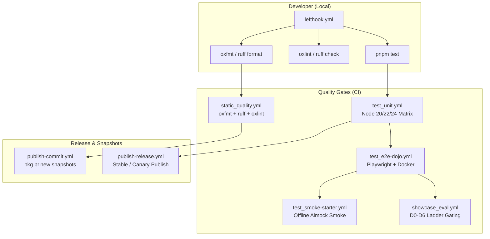
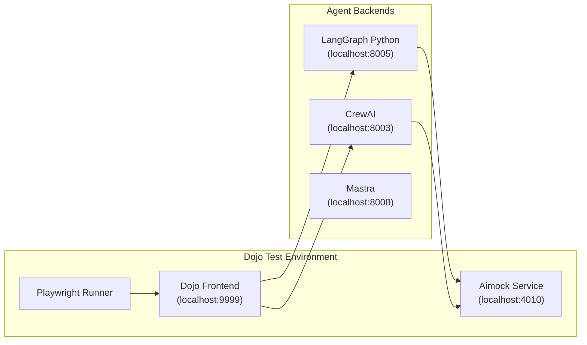

<!-- source: DeepWiki mcp.deepwiki.com · repo CopilotKit/CopilotKit · page 9 Testing and Quality Assurance · fetched 2026-10-30 -->

# Testing and Quality Assurance

Relevant source files

The following files were used as context for generating this wiki page:

- [.github/workflows/publish-commit.yml](.github/workflows/publish-commit.yml)
- [.github/workflows/showcase_eval.yml](.github/workflows/showcase_eval.yml)
- [.github/workflows/static_danger.yml](.github/workflows/static_danger.yml)
- [.github/workflows/static_quality.yml](.github/workflows/static_quality.yml)
- [.github/workflows/test_e2e-dojo.yml](.github/workflows/test_e2e-dojo.yml)
- [.github/workflows/test_e2e-legacy-v1.yml](.github/workflows/test_e2e-legacy-v1.yml)
- [.github/workflows/test_e2e-showcase-on-demand.yml](.github/workflows/test_e2e-showcase-on-demand.yml)
- [.github/workflows/test_integration-docs.yml](.github/workflows/test_integration-docs.yml)
- [.github/workflows/test_integration-runtime.yml](.github/workflows/test_integration-runtime.yml)
- [.github/workflows/test_showcase-frontend-matrix.yml](.github/workflows/test_showcase-frontend-matrix.yml)
- [.github/workflows/test_smoke-starter.yml](.github/workflows/test_smoke-starter.yml)
- [.github/workflows/test_unit-showcase.yml](.github/workflows/test_unit-showcase.yml)
- [.github/workflows/test_unit.yml](.github/workflows/test_unit.yml)
- [showcase/.env.example](showcase/.env.example)
- [showcase/aimock/d5-recorded/.gitignore](showcase/aimock/d5-recorded/.gitignore)
- [showcase/docker-compose.local.yml](showcase/docker-compose.local.yml)
- [showcase/docker-compose.record.yml](showcase/docker-compose.record.yml)
- [showcase/docker-compose.replay.yml](showcase/docker-compose.replay.yml)
- [showcase/scripts/__tests__/integration-smoke-registry.test.ts](showcase/scripts/__tests__/integration-smoke-registry.test.ts)
- [showcase/scripts/record-d5-fixtures.mjs](showcase/scripts/record-d5-fixtures.mjs)
- [showcase/scripts/smoke-local.sh](showcase/scripts/smoke-local.sh)
- [showcase/shared/local-ports.json](showcase/shared/local-ports.json)
- [showcase/tests/docker-compose.integrations.yml](showcase/tests/docker-compose.integrations.yml)
- [showcase/tests/e2e/helpers.ts](showcase/tests/e2e/helpers.ts)
- [showcase/tests/e2e/integration-smoke.spec.ts](showcase/tests/e2e/integration-smoke.spec.ts)
- [showcase/tests/package-lock.json](showcase/tests/package-lock.json)
- [showcase/tests/package.json](showcase/tests/package.json)

This document describes the testing infrastructure and quality assurance processes for the CopilotKit monorepo. It covers unit testing frameworks, end-to-end testing with Playwright, the CI/CD pipeline, and quality checks that ensure code reliability across the TypeScript and Python SDKs.

For information about the build system and development workflows, see page [8.2 Build System and Scripts](). For details on the CI/CD pipeline specifics, see [CI/CD Pipeline](#9.2).

---

## Testing Infrastructure Overview

CopilotKit employs a multi-layered testing strategy coordinated primarily through `nx` and specialized scripts in the `scripts/` directory.

| Test Type | Framework | Scope | pnpm Script |
|-----------|-----------|-------|-------------|
| Unit Tests (TS) | Vitest | `@copilotkit/*` | `pnpm run test` [[.github/workflows/test_unit.yml:106-106]]() |
| Unit Tests (Python) | Pytest | `sdk-python` | `poetry run pytest` |
| E2E – Dojo | Playwright | Agent Frameworks | `npx playwright test` [[.github/workflows/test_e2e-dojo.yml:211-211]]() |
| Smoke Tests | Docker Compose | Starter Templates | `docker compose -f docker-compose.test.yml up` [[.github/workflows/test_smoke-starter.yml:79-79]]() |
| Formatting | oxfmt / ruff | All files | `pnpm run format` [[.github/workflows/static_quality.yml:142-149]]() |
| Linting | oxlint | All packages | `pnpm run lint` |
| Security | zizmor | GitHub Actions | `zizmor .` |
| Commit Quality | commitlint | Commit messages | `pnpm commitlint` |

The CI pipeline maps these test types to distinct GitHub Actions workflows:

| Workflow file | What it tests | Trigger |
|---|---|---|
| `test_unit.yml` | TypeScript unit tests | Push/PR to packages [[.github/workflows/test_unit.yml:3-12]]() |
| `test_e2e-dojo.yml` | Agent framework E2E | PR touching packages/python [[.github/workflows/test_e2e-dojo.yml:3-15]]() |
| `test_smoke-starter.yml` | Starter template sanity | PR to examples or 6h cron [[.github/workflows/test_smoke-starter.yml:19-32]]() |
| `static_quality.yml` | oxfmt, ruff, oxlint | Push/PR to `main` [[.github/workflows/static_quality.yml:3-13]]() |
| `showcase_eval.yml` | Agent performance (D5) | `/eval` PR comment [[.github/workflows/showcase_eval.yml:51-53]]() |
| `publish-commit.yml` | PR snapshots | Every PR push [[.github/workflows/publish-commit.yml:2-8]]() |

**Testing and CI Workflow Map**

Sources: [[.github/workflows/test_unit.yml:48-49]](), [[.github/workflows/static_quality.yml:142-149]](), [[.github/workflows/test_e2e-dojo.yml:69-145]](), [[.github/workflows/test_smoke-starter.yml:78-80]]()

---

## Unit Testing

### TypeScript Unit Tests
The TypeScript packages utilize Vitest for unit testing. The CI environment runs tests against a matrix of Node.js versions (20.x, 22.x, 24.x) and React versions (18, 19) to ensure broad compatibility [[.github/workflows/test_unit.yml:49-54]]().

**Key Execution Steps:**
1. **Dependency Overrides**: For React 18 matrix legs, the root `pnpm.overrides` are modified before install [[.github/workflows/test_unit.yml:121-136]]().
2. **Affected Analysis**: Uses `nx affected` to only test changed packages [[.github/workflows/test_unit.yml:166-166]]().
3. **Runtime Integration**: Specialized integration tests run for Node.js and Bun servers [[.github/workflows/test_integration-runtime.yml:69-121]]().

### Python SDK Unit Tests
The Python SDK is tested against multiple Python versions. Dependency management and environment isolation are handled via `poetry` and `uv`.

Sources: [[.github/workflows/test_unit.yml:43-166]](), [[.github/workflows/test_integration-runtime.yml:69-121]]()

---

## E2E Testing and Dojo Validation

CopilotKit employs a robust end-to-end testing strategy focused on the "Dojo" environment and "Showcase" integrations. For a deep dive, see [E2E Testing with Playwright](#9.1).

### Dojo E2E Suites
The `test_e2e-dojo.yml` workflow runs specialized suites for frameworks like `langgraph-python`, `crew-ai`, `mastra`, and `pydantic-ai` [[.github/workflows/test_e2e-dojo.yml:70-145]](). These tests typically wait for multiple services to be healthy, including the `dojo` frontend (port 9999) and framework-specific backends [[.github/workflows/test_e2e-dojo.yml:74-74]]().

### Showcase Evaluation (D5)
The `/eval` command triggers an evaluation of agent performance against a "ladder" of difficulty levels (D0-D6) [[.github/workflows/showcase_eval.yml:104-154]](). This uses the `showcase eval` CLI to run conversation runners and verify agent behavior against recorded fixtures [[.github/workflows/showcase_eval.yml:5-16]]().

### Aimock and Replay Testing
The `aimock` service provides a stable LLM mock for integration testing [[showcase/docker-compose.local.yml:54-64]](). 
- **Deterministic Latency**: Configured via `--chunk-size` and `--latency` to mimic real LLM streaming [[showcase/docker-compose.local.yml:101-104]]().
- **Fixture Gating**: In test mode, `aimock` runs without `--proxy-only`, ensuring unmatched requests fail loudly rather than incurring real LLM costs [[showcase/docker-compose.local.yml:78-83]]().

**Dojo E2E Execution Context**

Sources: [[.github/workflows/test_e2e-dojo.yml:70-145]](), [[showcase/docker-compose.local.yml:5-30]](), [[showcase/docker-compose.local.yml:84-115]]()

---

## CI/CD Pipeline

The CI/CD pipeline is managed via GitHub Actions and handles everything from static analysis to multi-platform publishing. For details, see [CI/CD Pipeline](#9.2).

### Release Lanes
CopilotKit maintains two independent release lanes:
1. **npm (TypeScript)**: Managed via `nx release` and OIDC trusted publishers.
2. **PyPI (Python SDK)**: Built with `poetry` and published with `uv`.

### Prerelease (Canary) Workflow
Maintainers can trigger canary publishes from any branch. The `pkg-pr-new` workflow also publishes package snapshots to `pkg.pr.new` on every push, allowing developers to test changes without a full npm release [[.github/workflows/publish-commit.yml:26-34]]().

Sources: [[.github/workflows/publish-commit.yml:1-66]](), [[.github/workflows/test_unit.yml:154-160]]()

---

## Preview Environments and Deployment

CopilotKit supports preview deployments and infrastructure management via AWS CDK and Docker. For details, see [Preview Environments and Deployment](#9.3).

- **Docker Compose Local**: Provides a `Railway`-equivalent environment for every showcase package locally [[showcase/docker-compose.local.yml:1-2]]().
- **Health Monitoring**: Integrations include health endpoints (e.g., `/api/health`) monitored by Docker healthchecks [[showcase/docker-compose.local.yml:25-30]]().
- **Infrastructure**: Deployment involves Helm/Helmfile setup and AWS CDK infrastructure, with release validation pipelines ensuring version consistency across the ecosystem.

Sources: [[showcase/docker-compose.local.yml:1-30]](), [[showcase/tests/e2e/integration-smoke.spec.ts:7-10]]()

---

