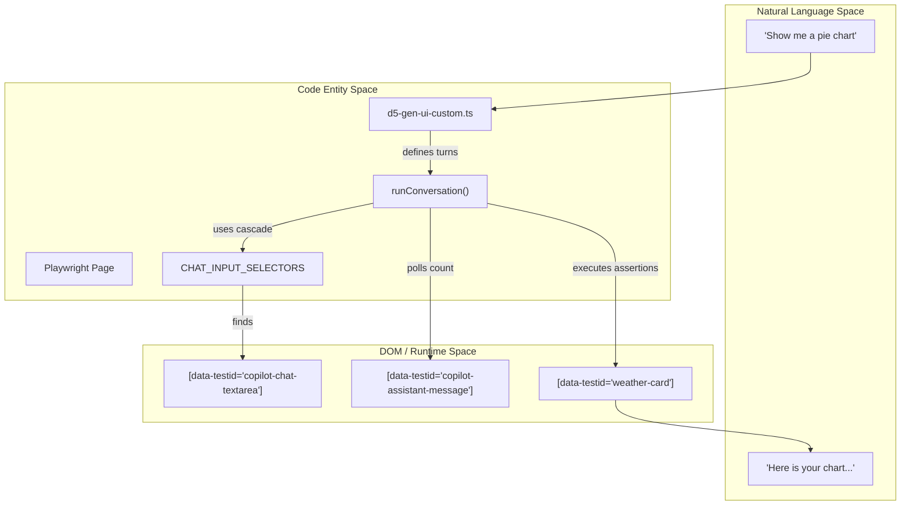
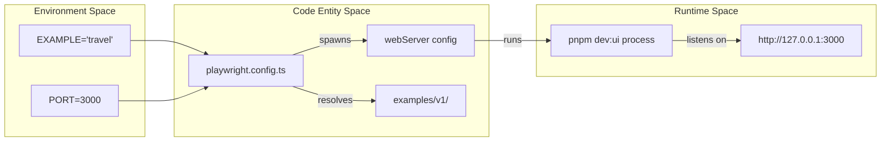

<!-- source: DeepWiki mcp.deepwiki.com · repo CopilotKit/CopilotKit · page 9.1 E2E Testing with Playwright · fetched 2026-10-30 -->

# E2E Testing with Playwright

<details>
<summary>Relevant source files</summary>

The following files were used as context for generating this wiki page:

- [.gitignore](.gitignore)
- [examples/e2e/.gitignore](examples/e2e/.gitignore)
- [examples/e2e/package.json](examples/e2e/package.json)
- [examples/e2e/playwright.config.ts](examples/e2e/playwright.config.ts)
- [examples/e2e/pnpm-lock.yaml](examples/e2e/pnpm-lock.yaml)
- [packages/react-core/src/v2/__tests__/headless-exports.test.ts](packages/react-core/src/v2/__tests__/headless-exports.test.ts)
- [packages/react-core/src/v2/components/chat/CopilotModalHeader.tsx](packages/react-core/src/v2/components/chat/CopilotModalHeader.tsx)
- [packages/react-core/src/v2/components/chat/__tests__/CopilotChat.absentThreadConnect.test.tsx](packages/react-core/src/v2/components/chat/__tests__/CopilotChat.absentThreadConnect.test.tsx)
- [packages/react-core/src/v2/components/chat/__tests__/CopilotChatPropsRerender.e2e.test.tsx](packages/react-core/src/v2/components/chat/__tests__/CopilotChatPropsRerender.e2e.test.tsx)
- [packages/react-core/src/v2/components/chat/__tests__/CopilotModalHeader.drawerLauncher.test.tsx](packages/react-core/src/v2/components/chat/__tests__/CopilotModalHeader.drawerLauncher.test.tsx)
- [packages/react-core/src/v2/components/chat/index.ts](packages/react-core/src/v2/components/chat/index.ts)
- [packages/react-core/src/v2/lib/__tests__/slots.test.ts](packages/react-core/src/v2/lib/__tests__/slots.test.ts)
- [packages/react-core/src/v2/lib/shallow-stable-ref.ts](packages/react-core/src/v2/lib/shallow-stable-ref.ts)
- [packages/react-core/src/v2/lib/slots.tsx](packages/react-core/src/v2/lib/slots.tsx)
- [packages/react-core/src/v2/providers/CopilotChatConfigurationProvider.tsx](packages/react-core/src/v2/providers/CopilotChatConfigurationProvider.tsx)
- [packages/react-core/src/v2/providers/__tests__/CopilotChatConfigurationProvider.test.tsx](packages/react-core/src/v2/providers/__tests__/CopilotChatConfigurationProvider.test.tsx)
- [showcase/.env.example](showcase/.env.example)
- [showcase/aimock/d5-recorded/.gitignore](showcase/aimock/d5-recorded/.gitignore)
- [showcase/aimock/d6/mastra/gen-ui-custom.json](showcase/aimock/d6/mastra/gen-ui-custom.json)
- [showcase/docker-compose.local.yml](showcase/docker-compose.local.yml)
- [showcase/docker-compose.record.yml](showcase/docker-compose.record.yml)
- [showcase/docker-compose.replay.yml](showcase/docker-compose.replay.yml)
- [showcase/harness/src/probes/aimock-fixture-coverage.test.ts](showcase/harness/src/probes/aimock-fixture-coverage.test.ts)
- [showcase/harness/src/probes/helpers/conversation-runner.test.ts](showcase/harness/src/probes/helpers/conversation-runner.test.ts)
- [showcase/harness/src/probes/helpers/conversation-runner.ts](showcase/harness/src/probes/helpers/conversation-runner.ts)
- [showcase/harness/src/probes/scripts/d5-agentic-chat.test.ts](showcase/harness/src/probes/scripts/d5-agentic-chat.test.ts)
- [showcase/harness/src/probes/scripts/d5-agentic-chat.ts](showcase/harness/src/probes/scripts/d5-agentic-chat.ts)
- [showcase/harness/src/probes/scripts/d5-gen-ui-custom.test.ts](showcase/harness/src/probes/scripts/d5-gen-ui-custom.test.ts)
- [showcase/harness/src/probes/scripts/d5-gen-ui-custom.ts](showcase/harness/src/probes/scripts/d5-gen-ui-custom.ts)
- [showcase/harness/src/probes/scripts/d5-hitl-approve-deny.test.ts](showcase/harness/src/probes/scripts/d5-hitl-approve-deny.test.ts)
- [showcase/harness/src/probes/scripts/d5-hitl-approve-deny.ts](showcase/harness/src/probes/scripts/d5-hitl-approve-deny.ts)
- [showcase/harness/src/probes/scripts/d5-hitl-text-input.test.ts](showcase/harness/src/probes/scripts/d5-hitl-text-input.test.ts)
- [showcase/harness/src/probes/scripts/d5-hitl-text-input.ts](showcase/harness/src/probes/scripts/d5-hitl-text-input.ts)
- [showcase/harness/src/probes/scripts/d5-multimodal.test.ts](showcase/harness/src/probes/scripts/d5-multimodal.test.ts)
- [showcase/harness/src/probes/scripts/d5-multimodal.ts](showcase/harness/src/probes/scripts/d5-multimodal.ts)
- [showcase/harness/src/probes/scripts/d5-shared-state.test.ts](showcase/harness/src/probes/scripts/d5-shared-state.test.ts)
- [showcase/harness/src/probes/scripts/d5-shared-state.ts](showcase/harness/src/probes/scripts/d5-shared-state.ts)
- [showcase/harness/src/probes/scripts/d5-tool-rendering.test.ts](showcase/harness/src/probes/scripts/d5-tool-rendering.test.ts)
- [showcase/harness/src/probes/scripts/d5-tool-rendering.ts](showcase/harness/src/probes/scripts/d5-tool-rendering.ts)
- [showcase/harness/src/probes/scripts/d5-voice.test.ts](showcase/harness/src/probes/scripts/d5-voice.test.ts)
- [showcase/integrations/langgraph-python/qa/threadid-frontend-tool-roundtrip.md](showcase/integrations/langgraph-python/qa/threadid-frontend-tool-roundtrip.md)
- [showcase/integrations/langgraph-python/src/app/demos/threadid-frontend-tool-roundtrip/page.tsx](showcase/integrations/langgraph-python/src/app/demos/threadid-frontend-tool-roundtrip/page.tsx)
- [showcase/integrations/langgraph-python/tests/e2e/threadid-frontend-tool-roundtrip.spec.ts](showcase/integrations/langgraph-python/tests/e2e/threadid-frontend-tool-roundtrip.spec.ts)
- [showcase/scripts/__tests__/integration-smoke-registry.test.ts](showcase/scripts/__tests__/integration-smoke-registry.test.ts)
- [showcase/scripts/record-d5-fixtures.mjs](showcase/scripts/record-d5-fixtures.mjs)
- [showcase/scripts/smoke-local.sh](showcase/scripts/smoke-local.sh)
- [showcase/shared/local-ports.json](showcase/shared/local-ports.json)
- [showcase/tests/docker-compose.integrations.yml](showcase/tests/docker-compose.integrations.yml)
- [showcase/tests/e2e/helpers.ts](showcase/tests/e2e/helpers.ts)
- [showcase/tests/e2e/integration-smoke.spec.ts](showcase/tests/e2e/integration-smoke.spec.ts)
- [showcase/tests/package-lock.json](showcase/tests/package-lock.json)
- [showcase/tests/package.json](showcase/tests/package.json)

</details>


This page covers the end-to-end (E2E) test suite for CopilotKit, spanning the example applications, the core React components, and the showcase integrations. It documents the Playwright configuration, environment variables, web server management, and the multi-level smoke testing strategy used to verify the AG-UI protocol and agent runtimes.

For an overview of all testing strategies in the repository, see [Testing and Quality Assurance](9). For the CI workflows that execute these tests automatically, see [CI/CD Pipeline](9.2).

---

## Overview

CopilotKit utilizes Playwright for full-stack verification across three primary domains:
1.  **Example Applications**: Targeted tests for specific apps in `examples/`, driven by `examples/e2e/`.
2.  **Core Component E2E**: React-level browser tests for components like `CopilotChat` to verify DOM behavior and prop synchronization.
3.  **Showcase & Dojo Integrations**: Comprehensive smoke tests in `showcase/` and the "Dojo" environment that verify the full path from backend agent frameworks (LangGraph, CrewAI, etc.) to the frontend UI.

**Tech stack:**
| Tool | Role |
|---|---|
| `@playwright/test` | Test runner and browser automation [examples/e2e/package.json:11]() |
| `aimock` | LLM fixture server for deterministic tests [showcase/docker-compose.local.yml:54-64]() |
| `pnpm` | Package management and script execution [examples/e2e/package.json:5-9]() |

---

## Showcase Smoke Testing Strategy

The showcase smoke tests verify the full path: **Railway backend -> AG-UI protocol -> CopilotKit runtime -> frontend response**. Tests are organized into four levels of increasing complexity.

### Testing Levels

| Level | Tag | Verification Goal |
|---|---|---|
| **L1: Health** | `@health` | Backend health endpoint (usually `/api/health`) returns 200 [showcase/tests/e2e/integration-smoke.spec.ts:74-86]() |
| **L2: Agent** | `@agent` | Agent endpoint is reachable and not a 404 (checks `/info` or POST) [showcase/tests/e2e/integration-smoke.spec.ts:92-108]() |
| **L3: Chat** | `@chat` | Round-trip chat: send message, wait for assistant response in DOM [showcase/tests/e2e/integration-smoke.spec.ts:114-138]() |
| **L4: Tools** | `@tools` | Tool rendering: trigger a tool and verify the structured UI result [showcase/tests/e2e/integration-smoke.spec.ts:144-175]() |

Sources: [showcase/tests/e2e/integration-smoke.spec.ts:1-15](), [showcase/tests/e2e/helpers.ts:51-157]()

---

## Deterministic Testing with Aimock

To avoid flakiness and costs associated with real LLM providers, CopilotKit uses `aimock`, a fixture-based mock server. 

### Aimock Local Configuration
The `showcase/docker-compose.local.yml` file defines the `aimock` service. It is configured to fail loudly if a fixture is missing (disabling `--proxy-only`) to ensure test determinism.

*   **Port**: 4010 [showcase/docker-compose.local.yml:68]()
*   **Fixtures**: Loaded from `showcase/aimock/` subdirectories (d4, d5-recorded, d6, shared) [showcase/docker-compose.local.yml:74-77]()
*   **Latency Simulation**: Configured with `--chunk-size 8` and `--latency 60` to simulate natural LLM streaming [showcase/docker-compose.local.yml:101-104]()

Sources: [showcase/docker-compose.local.yml:33-128]()

---

## The Conversation Runner (D5 Probes)

For complex multi-turn or agentic scenarios, CopilotKit uses a specialized `runConversation` utility. This utility drives a Playwright `Page` through a sequence of turns and handles "settle" detection (waiting for the assistant to finish streaming).

### Settle Detection Logic
The runner detects a finished turn by polling the DOM for assistant message counts. It considers a response "settled" when the count remains stable for `assistantSettleMs` (default 1500ms). It also monitors for a `[data-testid="copilot-error-banner"]` to fast-fail on errors.

### Entity Mapping: Probe Architecture


Sources: [showcase/harness/src/probes/helpers/conversation-runner.ts:7-104](), [showcase/harness/src/probes/scripts/d5-gen-ui-custom.ts:87-156]()

---

## Example Apps Testing (`examples/e2e/`)

The `examples/e2e/` suite targets standalone example applications. It uses a parameterized configuration to launch the correct web server based on the `EXAMPLE` environment variable.

### `playwright.config.ts` Logic
The configuration determines the startup command (`pnpm dev` or `pnpm dev:ui`) and the working directory based on the example name.

### Entity Mapping: Configuration to Runtime


Sources: [examples/e2e/playwright.config.ts:4-30]()

---

## Component-Level E2E Tests

In addition to full application tests, CopilotKit includes component-level E2E tests within the `packages/` directory. For example, `react-core` contains E2E tests for the `CopilotChat` component to verify prop re-rendering behavior and DOM interactions.

### Key Component Tests
*   **`CopilotChatPropsRerender.e2e.test.tsx`**: Verifies that the chat UI correctly responds to changes in React props during an active session.
*   **`CopilotModalHeader.drawerLauncher.test.tsx`**: Tests the interaction between the chat modal header and the thread drawer launcher.
*   **`CopilotChat.absentThreadConnect.test.tsx`**: Verifies behavior when connecting to a thread that does not exist.

Sources: [packages/react-core/src/v2/components/chat/__tests__/CopilotChatPropsRerender.e2e.test.tsx:1-10](), [packages/react-core/src/v2/components/chat/__tests__/CopilotModalHeader.drawerLauncher.test.tsx:1-10]()

---

## Running the Tests

### Integration Smoke Tests
Run against local Docker backends:
```bash
cd showcase/tests
LOCAL_PORTS=1 npx playwright test
```
Sources: [showcase/tests/e2e/integration-smoke.spec.ts:29-49]()

### Example E2E
From `examples/e2e/`:
```bash
# Run specific example (e.g., travel)
EXAMPLE=travel pnpm test

# Run with visible browser
pnpm test:headed

# Open Playwright UI for debugging
pnpm test:ui
```
Sources: [examples/e2e/package.json:5-9](), [examples/e2e/playwright.config.ts:4-5]()

### Probing Tool Rendering
Specific scripts like `d5-tool-rendering.ts` can be used to verify that tools like `get_weather` produce the correct DOM structure (e.g., a weather card with numeric temperature).
Sources: [showcase/harness/src/probes/scripts/d5-tool-rendering.ts:4-58]()

---

