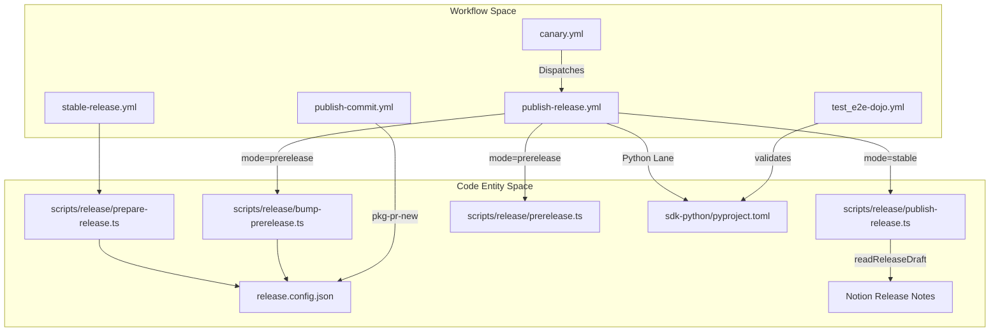
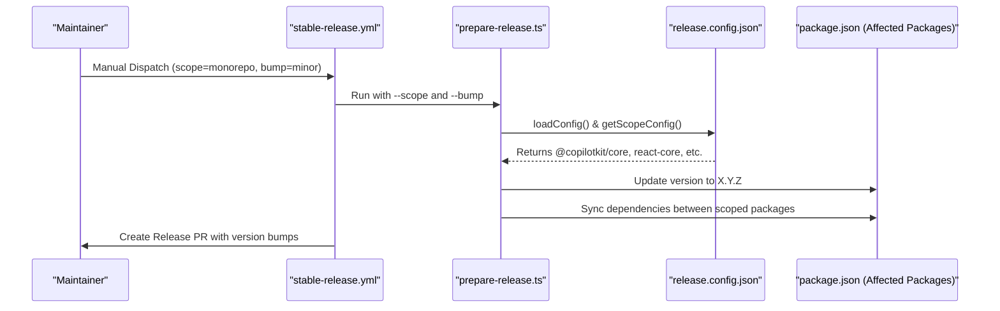

<!-- source: DeepWiki mcp.deepwiki.com · repo CopilotKit/CopilotKit · page 9.2 CI/CD Pipeline · fetched 2026-10-30 -->

# CI/CD Pipeline

Relevant source files

The following files were used as context for generating this wiki page:

- [.github/workflows/canary.yml](.github/workflows/canary.yml)
- [.github/workflows/integrations_parity.yml](.github/workflows/integrations_parity.yml)
- [.github/workflows/publish-commit.yml](.github/workflows/publish-commit.yml)
- [.github/workflows/publish-release.yml](.github/workflows/publish-release.yml)
- [.github/workflows/security_zizmor.yml](.github/workflows/security_zizmor.yml)
- [.github/workflows/showcase_eval.yml](.github/workflows/showcase_eval.yml)
- [.github/workflows/stable-release.yml](.github/workflows/stable-release.yml)
- [.github/workflows/static_danger.yml](.github/workflows/static_danger.yml)
- [.github/workflows/static_quality.yml](.github/workflows/static_quality.yml)
- [.github/workflows/telemetry-docs-fragment.yml](.github/workflows/telemetry-docs-fragment.yml)
- [.github/workflows/telemetry-runtime-fragment.yml](.github/workflows/telemetry-runtime-fragment.yml)
- [.github/workflows/test_e2e-dojo.yml](.github/workflows/test_e2e-dojo.yml)
- [.github/workflows/test_e2e-legacy-v1.yml](.github/workflows/test_e2e-legacy-v1.yml)
- [.github/workflows/test_e2e-showcase-on-demand.yml](.github/workflows/test_e2e-showcase-on-demand.yml)
- [.github/workflows/test_integration-docs.yml](.github/workflows/test_integration-docs.yml)
- [.github/workflows/test_integration-runtime.yml](.github/workflows/test_integration-runtime.yml)
- [.github/workflows/test_showcase-frontend-matrix.yml](.github/workflows/test_showcase-frontend-matrix.yml)
- [.github/workflows/test_smoke-starter.yml](.github/workflows/test_smoke-starter.yml)
- [.github/workflows/test_unit-showcase.yml](.github/workflows/test_unit-showcase.yml)
- [.github/workflows/test_unit.yml](.github/workflows/test_unit.yml)
- [.github/zizmor.yml](.github/zizmor.yml)
- [release.config.json](release.config.json)
- [scripts/__tests__/telemetry-fragment.test.ts](scripts/__tests__/telemetry-fragment.test.ts)
- [scripts/release/__tests__/verify-runtime-package.test.ts](scripts/release/__tests__/verify-runtime-package.test.ts)
- [scripts/release/build-release-notification.ts](scripts/release/build-release-notification.ts)
- [scripts/release/bump-prerelease.ts](scripts/release/bump-prerelease.ts)
- [scripts/release/lib/build-release-notification.test.ts](scripts/release/lib/build-release-notification.test.ts)
- [scripts/release/lib/build-release-notification.ts](scripts/release/lib/build-release-notification.ts)
- [scripts/release/lib/build-release-notification.wrapper.test.ts](scripts/release/lib/build-release-notification.wrapper.test.ts)
- [scripts/release/lib/changes.test.ts](scripts/release/lib/changes.test.ts)
- [scripts/release/lib/changes.ts](scripts/release/lib/changes.ts)
- [scripts/release/lib/channels-umbrella.test.ts](scripts/release/lib/channels-umbrella.test.ts)
- [scripts/release/lib/channels-umbrella.ts](scripts/release/lib/channels-umbrella.ts)
- [scripts/release/lib/config.test.ts](scripts/release/lib/config.test.ts)
- [scripts/release/lib/config.ts](scripts/release/lib/config.ts)
- [scripts/release/lib/github-output.test.ts](scripts/release/lib/github-output.test.ts)
- [scripts/release/lib/github-output.ts](scripts/release/lib/github-output.ts)
- [scripts/release/lib/npm-cli.test.ts](scripts/release/lib/npm-cli.test.ts)
- [scripts/release/lib/npm-cli.ts](scripts/release/lib/npm-cli.ts)
- [scripts/release/lib/pack-workspace.ts](scripts/release/lib/pack-workspace.ts)
- [scripts/release/lib/versions.test.ts](scripts/release/lib/versions.test.ts)
- [scripts/release/lib/versions.ts](scripts/release/lib/versions.ts)
- [scripts/release/prepare-release.ts](scripts/release/prepare-release.ts)
- [scripts/release/prerelease.ts](scripts/release/prerelease.ts)
- [scripts/release/publish-release.ts](scripts/release/publish-release.ts)
- [scripts/release/verify-channels-umbrella.ts](scripts/release/verify-channels-umbrella.ts)
- [scripts/release/verify-release-scope-dropdowns.sh](scripts/release/verify-release-scope-dropdowns.sh)
- [scripts/release/verify-runtime-package.ts](scripts/release/verify-runtime-package.ts)
- [scripts/release/vitest.config.mts](scripts/release/vitest.config.mts)
- [scripts/telemetry/emit-fragment.ts](scripts/telemetry/emit-fragment.ts)
- [scripts/telemetry/extract.ts](scripts/telemetry/extract.ts)

The CopilotKit CI/CD pipeline is a multi-stage system built on GitHub Actions that manages the lifecycle of the AG-UI protocol, SDK packages, and the Showcase platform. It handles automated testing across multiple runtimes, secure releases via OIDC, and real-time synchronization of documentation and preview assets.

---

## Workflow Architecture

The repository utilizes specialized workflows triggered by code changes, pull requests, and manual dispatches.

| Workflow File | Name | Purpose |
| :--- | :--- | :--- |
| `test_unit.yml` | `test / unit` | Node.js unit tests and release script validation [ .github/workflows/test_unit.yml:1-20 ]() |
| `static_quality.yml` | `static / quality` | High-performance formatting (`oxfmt`), linting (`ruff`), and PR auto-fix [ .github/workflows/static_quality.yml:1-31 ]() |
| `publish-release.yml` | `release / publish` | Unified OIDC entry point for npm and PyPI releases [ .github/workflows/publish-release.yml:1-18 ]() |
| `stable-release.yml` | `release / create-pr` | Automates version bumping and AI-generated release notes [ .github/workflows/stable-release.yml:1-21 ]() |
| `canary.yml` | `canary / publish` | Orchestrates branch-scoped canary releases via OIDC [ .github/workflows/canary.yml:1-12 ]() |
| `publish-commit.yml` | `🚀 pkg-pr-new` | Publishes instant snapshot releases for every commit [ .github/workflows/publish-commit.yml:1-21 ]() |
| `test_e2e-dojo.yml` | `test / e2e / dojo` | Validates agent framework integrations (LangGraph, CrewAI, etc.) [ .github/workflows/test_e2e-dojo.yml:1-16 ]() |
| `showcase_eval.yml` | `showcase / eval` | Triggers D0-D6 evaluation ladder via PR comments [ .github/workflows/showcase_eval.yml:1-21 ]() |
| `test_smoke-starter.yml` | `test / smoke / starter` | Post-merge breakage detector for integration examples [ .github/workflows/test_smoke-starter.yml:1-18 ]() |

Sources: [ .github/workflows/test_unit.yml:1-20 ](), [ .github/workflows/static_quality.yml:1-31 ](), [ .github/workflows/publish-release.yml:1-18 ](), [ .github/workflows/stable-release.yml:1-21 ](), [ .github/workflows/canary.yml:1-12 ](), [ .github/workflows/publish-commit.yml:1-21 ](), [ .github/workflows/test_e2e-dojo.yml:1-16 ](), [ .github/workflows/showcase_eval.yml:1-21 ](), [ .github/workflows/test_smoke-starter.yml:1-18 ]()

---

## Testing and Quality Assurance

### Unit Testing Pipeline
The `unit` job executes on high-performance `depot-ubuntu-24.04-4` runners [ .github/workflows/test_unit.yml:44 ](). It validates the codebase across a matrix of Node.js versions (20.x, 22.x, 24.x) [ .github/workflows/test_unit.yml:49 ]() and React versions (18, 19) [ .github/workflows/test_unit.yml:54 ]().

1.  **ABI Safety**: The workflow manually manages the pnpm store path to include the `matrix.node-version` in the cache key [ .github/workflows/test_unit.yml:101-105 ](). This prevents `better-sqlite3` (used in `sqlite-runner`) from loading incompatible binaries across different Node ABIs [ .github/workflows/test_unit.yml:88-91 ]().
2.  **React Matrix**: The workflow dynamically overrides `pnpm.overrides` in `package.json` to test against React 18 and 19 [ .github/workflows/test_unit.yml:121-132 ]().
3.  **Selective Execution**: It uses `nx affected:test` to only test packages changed within the PR range [ .github/workflows/test_unit.yml:173 ]().

Sources: [ .github/workflows/test_unit.yml:44-173 ]()

### Integration and E2E Testing
*   **Dojo E2E**: The `test_e2e-dojo.yml` workflow runs Playwright tests against a matrix of agent framework suites, including `langgraph-python`, `crew-ai`, and `mastra` [ .github/workflows/test_e2e-dojo.yml:70-145 ](). It uses `docker compose` to orchestrate the `dojo` environment and framework-specific services [ .github/workflows/test_e2e-dojo.yml:79-139 ]().
*   **Smoke Tests**: `test_smoke-starter.yml` runs every 6 hours to detect breakage in integration examples caused by floating dependencies or upstream releases [ .github/workflows/test_smoke-starter.yml:20-24 ]().
*   **On-Demand Showcase**: `test_e2e-showcase-on-demand.yml` allows maintainers to trigger Playwright E2E tests against specific Python integrations (e.g., `crewai-crews`) using the `/test-aimock <slug>` comment command [ .github/workflows/test_e2e-showcase-on-demand.yml:85-109 ]().

Sources: [ .github/workflows/test_e2e-dojo.yml:70-145 ](), [ .github/workflows/test_smoke-starter.yml:20-24 ](), [ .github/workflows/test_e2e-showcase-on-demand.yml:85-109 ]()

### Static Quality and Security
The pipeline enforces code standards using the Oxc and Ruff toolchains:
- **Auto-Formatting**: `oxfmt` is scoped to PR-changed files [ .github/workflows/static_quality.yml:88-116 ](). On same-repo PRs, it automatically commits formatting fixes back to the branch [ .github/workflows/static_quality.yml:150-165 ]().
- **Python Linting**: `ruff` handles formatting for the `sdk-python` package [ .github/workflows/static_quality.yml:146-149 ]().
- **Security Scanning**: `zizmor` configuration at `.github/zizmor.yml` performs static analysis on GitHub Actions workflows to detect `template-injection` in `run:` scripts and `dangerous-triggers` like `pull_request_target` [ .github/zizmor.yml:13-27 ]().

Sources: [ .github/workflows/static_quality.yml:88-165 ](), [ .github/zizmor.yml:13-27 ]()

---

## Release and Deployment Lifecycle

### Multi-Lane Publishing
The `publish-release.yml` workflow manages two independent lanes:
1.  **TypeScript (npm)**: Uses Nx Release and OIDC trusted publishers [ .github/workflows/publish-release.yml:22-23 ](). It supports a `prerelease` mode which invokes `scripts/release/bump-prerelease.ts` to apply canary versioning [ .github/workflows/publish-release.yml:149-164 ](). The `scripts/release/prerelease.ts` script then publishes these pre-built artifacts with the "canary" dist-tag [ scripts/release/prerelease.ts:106-113 ]().
2.  **Python (PyPI)**: Detects version changes in `sdk-python/pyproject.toml` and publishes using `uv` [ .github/workflows/publish-release.yml:25-27 ]().

Sources: [ .github/workflows/publish-release.yml:22-164 ](), [ scripts/release/prerelease.ts:106-113 ]()

### Stable Release Workflow
The release process follows a strictly gated PR-based flow:
1.  **Create PR**: The `stable-release.yml` workflow is manually dispatched to create a release PR [ .github/workflows/stable-release.yml:4-21 ](). It runs `scripts/release/prepare-release.ts` to bump versions and sync plugin skills [ .github/workflows/stable-release.yml:91-102 ]().
2.  **AI Release Notes**: `scripts/release/generate-ai-release-notes.ts` uses Anthropic's Claude to generate a changelog, which is then posted to Notion for human editing [ .github/workflows/stable-release.yml:104-112 ]().
3.  **Publish**: Upon merging the release PR, `publish-release.yml` triggers. It can read the final edited notes back from Notion using `scripts/release/publish-release.ts` [ scripts/release/publish-release.ts:176-186 ]().

Sources: [ .github/workflows/stable-release.yml:4-112 ](), [ scripts/release/publish-release.ts:176-186 ]()

---

## System Mapping: Pipeline to Code Entities

The following diagram associates CI/CD workflows with the specific scripts and data structures they manage.

Sources: [ .github/workflows/stable-release.yml:91-98 ](), [ .github/workflows/publish-release.yml:149-164 ](), [ .github/workflows/canary.yml:7-12 ](), [ scripts/release/publish-release.ts:176-186 ](), [ release.config.json:1-47 ](), [ scripts/release/publish-release.ts:31 ]()

---

## Data Flow: Release Scopes

CopilotKit uses "Release Scopes" defined in `release.config.json` to manage groups of packages that version together (e.g., `monorepo`, `angular`, `channels`) [ release.config.json:3-46 ]().

Sources: [ release.config.json:4-25 ](), [ .github/workflows/stable-release.yml:91-98 ](), [ scripts/release/prepare-release.ts:1-100 ](), [ scripts/release/lib/config.ts:32 ]()

---

## Security and Performance Optimizations

- **OIDC Trusted Publishers**: The repository uses GitHub Actions OIDC tokens for npm and PyPI authentication, eliminating the need for persistent secrets [ .github/workflows/publish-release.yml:3-7 ]().
- **Depot Acceleration**: `test_unit.yml` and `test_e2e-dojo.yml` utilize `depot-ubuntu-24.04-4` runners for significantly faster execution via distributed caching [ .github/workflows/test_unit.yml:44 ](), [ .github/workflows/test_e2e-dojo.yml:63 ]().
- **Zizmor Hardening**: The `zizmor.yml` configuration suppresses specific `artipacked` findings for release workflows that legitimately need `persist-credentials: true` to push tags [ .github/zizmor.yml:68-76 ]().
- **Concurrency Gates**: Release workflows are scoped by `inputs.scope` to allow parallel releases of independent package groups while serializing releases within the same group [ .github/workflows/publish-release.yml:75-83 ](), [ .github/workflows/stable-release.yml:28-34 ]().

Sources: [ .github/workflows/publish-release.yml:3-83 ](), [ .github/workflows/test_unit.yml:44 ](), [ .github/workflows/test_e2e-dojo.yml:63 ](), [ .github/zizmor.yml:68-76 ](), [ .github/workflows/stable-release.yml:28-34 ]()

---

