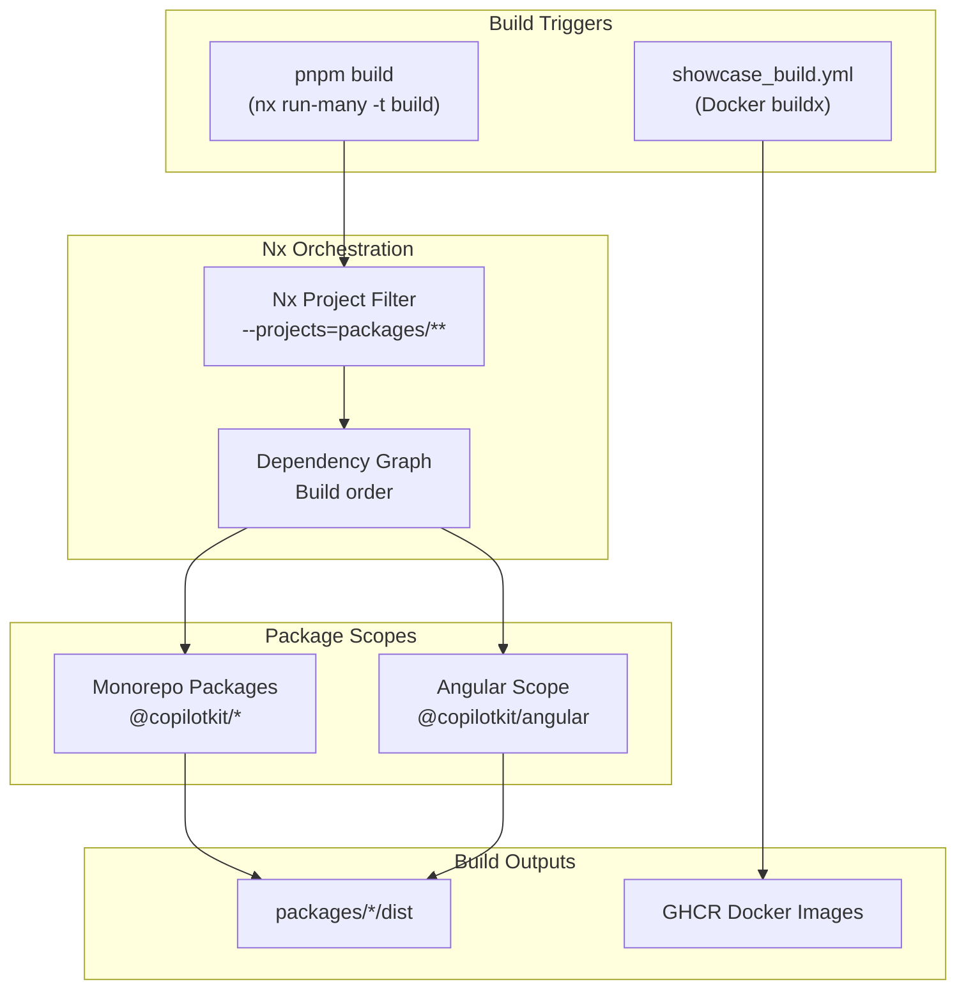
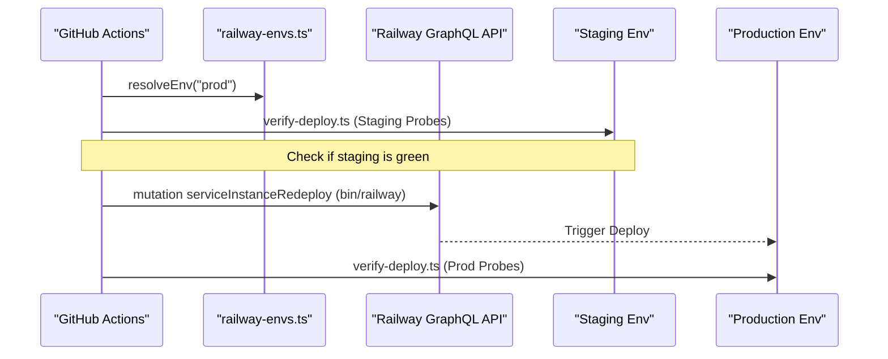

<!-- source: DeepWiki mcp.deepwiki.com · repo CopilotKit/CopilotKit · page 9.3 Preview Environments and Deployment · fetched 2026-10-30 -->

# Preview Environments and Deployment

Relevant source files

The following files were used as context for generating this wiki page:

- [.github/workflows/ghcr_unlinked_packages.yml](.github/workflows/ghcr_unlinked_packages.yml)
- [.github/workflows/lint-release-workflows.yml](.github/workflows/lint-release-workflows.yml)
- [.github/workflows/showcase_build.yml](.github/workflows/showcase_build.yml)
- [.github/workflows/showcase_build_check.yml](.github/workflows/showcase_build_check.yml)
- [.github/workflows/showcase_capture-previews.yml](.github/workflows/showcase_capture-previews.yml)
- [.github/workflows/showcase_deploy.yml](.github/workflows/showcase_deploy.yml)
- [.github/workflows/showcase_eval-webhook_build.yml](.github/workflows/showcase_eval-webhook_build.yml)
- [.github/workflows/showcase_eval_check.yml](.github/workflows/showcase_eval_check.yml)
- [.github/workflows/showcase_keep-alive.yml](.github/workflows/showcase_keep-alive.yml)
- [.github/workflows/showcase_lint_prod.yml](.github/workflows/showcase_lint_prod.yml)
- [.github/workflows/showcase_promote.yml](.github/workflows/showcase_promote.yml)
- [.github/workflows/showcase_promote_notify.dry-run.sh](.github/workflows/showcase_promote_notify.dry-run.sh)
- [.github/workflows/showcase_promote_notify.yml](.github/workflows/showcase_promote_notify.yml)
- [.github/workflows/showcase_reconcile.yml](.github/workflows/showcase_reconcile.yml)
- [.github/workflows/showcase_reconcile_staging.yml](.github/workflows/showcase_reconcile_staging.yml)
- [.github/workflows/showcase_validate.yml](.github/workflows/showcase_validate.yml)
- [showcase/aimock/Dockerfile](showcase/aimock/Dockerfile)
- [showcase/bin/README.md](showcase/bin/README.md)
- [showcase/bin/railway](showcase/bin/railway)
- [showcase/bin/spec/all_tests.rb](showcase/bin/spec/all_tests.rb)
- [showcase/bin/spec/spec_helper.rb](showcase/bin/spec/spec_helper.rb)
- [showcase/bin/spec/test_cli_parsing.rb](showcase/bin/spec/test_cli_parsing.rb)
- [showcase/bin/spec/test_env_diff.rb](showcase/bin/spec/test_env_diff.rb)
- [showcase/bin/spec/test_ghcr_bearer.rb](showcase/bin/spec/test_ghcr_bearer.rb)
- [showcase/bin/spec/test_ghcr_digest.rb](showcase/bin/spec/test_ghcr_digest.rb)
- [showcase/bin/spec/test_ghcr_manifest_exists.rb](showcase/bin/spec/test_ghcr_manifest_exists.rb)
- [showcase/bin/spec/test_ghcr_token.rb](showcase/bin/spec/test_ghcr_token.rb)
- [showcase/bin/spec/test_lint_prod_covers_starters.rb](showcase/bin/spec/test_lint_prod_covers_starters.rb)
- [showcase/bin/spec/test_production_protection.rb](showcase/bin/spec/test_production_protection.rb)
- [showcase/bin/spec/test_promote_cr_fixes.rb](showcase/bin/spec/test_promote_cr_fixes.rb)
- [showcase/bin/spec/test_promote_execute.rb](showcase/bin/spec/test_promote_execute.rb)
- [showcase/bin/spec/test_promote_fleet_target_invariant.rb](showcase/bin/spec/test_promote_fleet_target_invariant.rb)
- [showcase/bin/spec/test_promote_healthcheck_reassert.rb](showcase/bin/spec/test_promote_healthcheck_reassert.rb)
- [showcase/bin/spec/test_promote_p1.rb](showcase/bin/spec/test_promote_p1.rb)
- [showcase/bin/spec/test_promote_p2.rb](showcase/bin/spec/test_promote_p2.rb)
- [showcase/bin/spec/test_promote_p3.rb](showcase/bin/spec/test_promote_p3.rb)
- [showcase/bin/spec/test_promote_p5.rb](showcase/bin/spec/test_promote_p5.rb)
- [showcase/bin/spec/test_promote_p6.rb](showcase/bin/spec/test_promote_p6.rb)
- [showcase/bin/spec/test_promote_replicas_reassert.rb](showcase/bin/spec/test_promote_replicas_reassert.rb)
- [showcase/bin/spec/test_promote_resolve_once.rb](showcase/bin/spec/test_promote_resolve_once.rb)
- [showcase/bin/spec/test_promote_single_service.rb](showcase/bin/spec/test_promote_single_service.rb)
- [showcase/bin/spec/test_promote_single_service_fleet_invariants.rb](showcase/bin/spec/test_promote_single_service_fleet_invariants.rb)
- [showcase/bin/spec/test_promote_u5_env_serviceref.rb](showcase/bin/spec/test_promote_u5_env_serviceref.rb)
- [showcase/bin/spec/test_reconcile_prod.rb](showcase/bin/spec/test_reconcile_prod.rb)
- [showcase/bin/spec/test_rollback_commit_injection.rb](showcase/bin/spec/test_rollback_commit_injection.rb)
- [showcase/bin/spec/test_rollback_sort.rb](showcase/bin/spec/test_rollback_sort.rb)
- [showcase/bin/spec/test_snapshot_graphql.rb](showcase/bin/spec/test_snapshot_graphql.rb)
- [showcase/bin/spec/test_snapshot_ivar_lint.rb](showcase/bin/spec/test_snapshot_ivar_lint.rb)
- [showcase/bin/spec/test_snapshot_roundtrip.rb](showcase/bin/spec/test_snapshot_roundtrip.rb)
- [showcase/eval-webhook/.dockerignore](showcase/eval-webhook/.dockerignore)
- [showcase/eval-webhook/Dockerfile](showcase/eval-webhook/Dockerfile)
- [showcase/eval-webhook/package-lock.json](showcase/eval-webhook/package-lock.json)
- [showcase/eval-webhook/package.json](showcase/eval-webhook/package.json)
- [showcase/eval-webhook/src/server.ts](showcase/eval-webhook/src/server.ts)
- [showcase/eval-webhook/tsconfig.json](showcase/eval-webhook/tsconfig.json)
- [showcase/harness/src/fleet/run-visibility.integration.test.ts](showcase/harness/src/fleet/run-visibility.integration.test.ts)
- [showcase/integrations/strands-typescript/manifest.yaml](showcase/integrations/strands-typescript/manifest.yaml)
- [showcase/scripts/__tests__/deploy-to-railway.digest-pin.test.ts](showcase/scripts/__tests__/deploy-to-railway.digest-pin.test.ts)
- [showcase/scripts/__tests__/deploy-to-railway.healthcheck.test.ts](showcase/scripts/__tests__/deploy-to-railway.healthcheck.test.ts)
- [showcase/scripts/__tests__/emit-railway-envs-json.test.ts](showcase/scripts/__tests__/emit-railway-envs-json.test.ts)
- [showcase/scripts/__tests__/fixtures/railway-envs.golden.json](showcase/scripts/__tests__/fixtures/railway-envs.golden.json)
- [showcase/scripts/__tests__/lint-prod-gate.bats](showcase/scripts/__tests__/lint-prod-gate.bats)
- [showcase/scripts/__tests__/promote-fleet.bats](showcase/scripts/__tests__/promote-fleet.bats)
- [showcase/scripts/__tests__/promote-notify.bats](showcase/scripts/__tests__/promote-notify.bats)
- [showcase/scripts/__tests__/railway-envs.golden.test.ts](showcase/scripts/__tests__/railway-envs.golden.test.ts)
- [showcase/scripts/__tests__/reconcile-prod-gate.bats](showcase/scripts/__tests__/reconcile-prod-gate.bats)
- [showcase/scripts/__tests__/redeploy-env.harness-worker-prod-scope.test.ts](showcase/scripts/__tests__/redeploy-env.harness-worker-prod-scope.test.ts)
- [showcase/scripts/__tests__/redeploy-env.summary.test.ts](showcase/scripts/__tests__/redeploy-env.summary.test.ts)
- [showcase/scripts/__tests__/redeploy-env.token.test.ts](showcase/scripts/__tests__/redeploy-env.token.test.ts)
- [showcase/scripts/__tests__/resolve-promote-targets.bats](showcase/scripts/__tests__/resolve-promote-targets.bats)
- [showcase/scripts/__tests__/verify-deploy.drivers.test.ts](showcase/scripts/__tests__/verify-deploy.drivers.test.ts)
- [showcase/scripts/__tests__/verify-deploy.test.ts](showcase/scripts/__tests__/verify-deploy.test.ts)
- [showcase/scripts/__tests__/verify-railway-image-refs.test.ts](showcase/scripts/__tests__/verify-railway-image-refs.test.ts)
- [showcase/scripts/deploy-to-railway.ts](showcase/scripts/deploy-to-railway.ts)
- [showcase/scripts/emit-railway-envs-json.test.ts](showcase/scripts/emit-railway-envs-json.test.ts)
- [showcase/scripts/emit-railway-envs-json.ts](showcase/scripts/emit-railway-envs-json.ts)
- [showcase/scripts/lib/__tests__/railway-graphql.scan.test.ts](showcase/scripts/lib/__tests__/railway-graphql.scan.test.ts)
- [showcase/scripts/lib/__tests__/railway-graphql.test.ts](showcase/scripts/lib/__tests__/railway-graphql.test.ts)
- [showcase/scripts/lib/__tests__/railway-token.envelope.test.ts](showcase/scripts/lib/__tests__/railway-token.envelope.test.ts)
- [showcase/scripts/lib/__tests__/railway-token.test.ts](showcase/scripts/lib/__tests__/railway-token.test.ts)
- [showcase/scripts/lib/railway-graphql.ts](showcase/scripts/lib/railway-graphql.ts)
- [showcase/scripts/lib/railway-token.ts](showcase/scripts/lib/railway-token.ts)
- [showcase/scripts/lint-prod-gate.sh](showcase/scripts/lint-prod-gate.sh)
- [showcase/scripts/promote-fleet.sh](showcase/scripts/promote-fleet.sh)
- [showcase/scripts/railway-envs.generated.json](showcase/scripts/railway-envs.generated.json)
- [showcase/scripts/railway-envs.test.ts](showcase/scripts/railway-envs.test.ts)
- [showcase/scripts/railway-envs.ts](showcase/scripts/railway-envs.ts)
- [showcase/scripts/reconcile-prod-gate.sh](showcase/scripts/reconcile-prod-gate.sh)
- [showcase/scripts/reconcile-staging.test.ts](showcase/scripts/reconcile-staging.test.ts)
- [showcase/scripts/reconcile-staging.ts](showcase/scripts/reconcile-staging.ts)
- [showcase/scripts/redeploy-env.test.ts](showcase/scripts/redeploy-env.test.ts)
- [showcase/scripts/redeploy-env.ts](showcase/scripts/redeploy-env.ts)
- [showcase/scripts/resolve-promote-targets.sh](showcase/scripts/resolve-promote-targets.sh)
- [showcase/scripts/verify-deploy.drivers.baseline.ts](showcase/scripts/verify-deploy.drivers.baseline.ts)
- [showcase/scripts/verify-deploy.drivers.starter.ts](showcase/scripts/verify-deploy.drivers.starter.ts)
- [showcase/scripts/verify-deploy.drivers.ts](showcase/scripts/verify-deploy.drivers.ts)
- [showcase/scripts/verify-deploy.ts](showcase/scripts/verify-deploy.ts)
- [showcase/scripts/verify-railway-image-refs.test.ts](showcase/scripts/verify-railway-image-refs.test.ts)
- [showcase/scripts/verify-railway-image-refs.ts](showcase/scripts/verify-railway-image-refs.ts)

This document details the deployment infrastructure for CopilotKit, focusing on how Docker containerization, CI/CD pipelines, and preview environments support testing and releases. It covers the build system, release workflows, and the Railway-based showcase infrastructure used to validate agentic applications across multiple frameworks.

For information about the E2E testing that runs in these environments, see [9.1 E2E Testing with Playwright](). For details about the overall CI/CD pipeline structure, see [9.2 CI/CD Pipeline]().

---

## Overview

CopilotKit uses a multi-layered deployment and verification strategy:

1.  **Local Development**: Developers run applications locally using `pnpm dev` [package.json:17]() or the unified showcase CLI.
2.  **Showcase Platform**: A fleet of 41+ framework-specific integrations and infrastructure services deployed to Railway [showcase/scripts/railway-envs.test.ts:110-112]().
3.  **Preview Environments**: Automated staging deployments for the showcase fleet triggered on pushes to `main` [.github/workflows/showcase_build.yml:13-17]().
4.  **Verification Gates**: Post-deploy health probes driven by `verify-deploy.ts` that verify services before promoting from staging to production [.github/workflows/showcase_deploy.yml:1-7]().
5.  **Release Pipeline**: Automated NPM package publishing and versioning via GitHub Actions.

Sources: [.github/workflows/showcase_build.yml:1-62](), [.github/workflows/showcase_deploy.yml:1-7](), [showcase/scripts/railway-envs.test.ts:110-112]()

---

## Docker Containerization

### Integration Image Architecture
Each showcase integration is bundled as a Docker image containing a Next.js frontend and an agent backend. These images are built and pushed to GitHub Container Registry (GHCR) [.github/workflows/showcase_build.yml:3-4](). The build process uses an immutable `:<sha>` tag for the initial push, and a guarded step advances the `:latest` tag only if the new commit is a descendant of the current tag to prevent race conditions during concurrent merges [.github/workflows/showcase_build.yml:27-31]().

### Showcase Infrastructure Services
The platform relies on several supporting services containerized for deployment:
*   **showcase-aimock**: An LLM fixture server for deterministic testing [showcase/scripts/railway-envs.generated.json:9-15](). Its Dockerfile is at `showcase/aimock/Dockerfile`.
*   **showcase-pocketbase**: Persistence layer for the live status dashboard [showcase/scripts/railway-envs.generated.json:206-212]().
*   **showcase-harness**: The probe runner that executes Playwright-based E2E tests [showcase/scripts/railway-envs.generated.json:127-133]().
*   **harness-workers**: A pool of workers that run browser contexts for E2E validation, using `imageOf: "harness"` to share the same Docker image [showcase/scripts/railway-envs.generated.json:158-167]().

Sources: [.github/workflows/showcase_build.yml:3-31](), [showcase/scripts/railway-envs.generated.json:9-212](), [showcase/aimock/Dockerfile:1-10]()

---

## Build System Architecture

### Package Build Pipeline
The build system uses Nx to orchestrate package builds with proper dependency ordering and caching [package.json:5]().

**Build and Quality Commands:**

| Command | Purpose | Implementation |
| :--- | :--- | :--- |
| `pnpm build` | Build all packages | `nx run-many -t build --projects=packages/**` [package.json:5]() |
| `pnpm run test` | Run package unit tests | `nx run-many -t test --projects=packages/**` [package.json:14]() |

Sources: [package.json:5-14](), [.github/workflows/showcase_build.yml:1-4]()

---

## Showcase Deployment & Promotion

### Railway Environment Management
The Single Source of Truth (SSOT) for the deployment fleet is defined in `showcase/scripts/railway-envs.ts` [showcase/scripts/railway-envs.ts:2-8](). This file maps service names to Railway `serviceId` and environment-specific `instanceId` for `prod` and `staging` [showcase/scripts/railway-envs.ts:15-21]().

### Staging and Verification
On push to `main`, the `Showcase: Build & Push` workflow builds images and triggers `serviceInstanceRedeploy` via `redeploy-env.ts` [.github/workflows/showcase_build.yml:1-6](). 

The `Showcase: Verify Deploy` workflow acts as the staging gate [.github/workflows/showcase_deploy.yml:1-12](). It uses `verify-deploy.ts` to execute health probes against the staging URLs [showcase/scripts/railway-envs.ts:104-107]().

### Promotion to Production
Promotion is a manual `workflow_dispatch` process [.github/workflows/showcase_promote.yml:26-31](). It uses `bin/railway` (a Ruby-based tool) to handle GraphQL interactions with Railway [showcase/bin/railway:4-9]().

**Promotion Sequence:**
1.  **resolve-targets**: Uses `resolve-promote-targets.sh` to expand the requested service into a tiered closure (e.g., promoting a shell also triggers its dependencies) [.github/workflows/showcase_promote.yml:133-148]().
2.  **verify-staging-precondition**: Live-probes staging; refuses promotion if staging is red [.github/workflows/showcase_promote.yml:150-170]().
3.  **promote**: Executes `bin/railway promote` to shift staging snapshots to production [showcase/bin/railway:11-12]().
4.  **verify-prod**: Final health check of the production environment [.github/workflows/showcase_promote.yml:16-21]().

Sources: [.github/workflows/showcase_deploy.yml:1-155](), [.github/workflows/showcase_promote.yml:1-170](), [showcase/scripts/railway-envs.ts:1-101](), [showcase/bin/railway:1-172]()

---

## Drift Management and Quality Assurance

### Drift Detection and Linting
*   **Snapshot Ivar Lint**: A Ruby test suite `test_snapshot_ivar_lint.rb` ensures that the `bin/railway` tool correctly handles fleet-wide vs. single-service snapshots to prevent spurious promotion failures [showcase/bin/spec/test_snapshot_ivar_lint.rb:3-19]().
*   **Lint Prod**: Validates that every production service is digest-pinned to an immutable image reference [showcase/bin/railway:15]().
*   **Redeploy Summary**: The `redeploy-env.ts` script generates a markdown summary and a JSON artifact (`REDEPLOY_SUMMARY_JSON`) to track exactly which services were bounced during a build [.github/workflows/showcase_deploy.yml:109-128]().

### Preview Capture
The `Showcase: Capture Previews` workflow automatically records MP4 videos of showcase demos using Playwright and uploads them to a GitHub release [.github/workflows/showcase_capture-previews.yml:32-49](). It then updates `registry.json` with the new preview URLs and commits the change back to the repository [.github/workflows/showcase_capture-previews.yml:154-172]().

| Probe Driver | Purpose | Code Entity |
| :--- | :--- | :--- |
| `aimock` | Verify LLM mock server health | `ProbeDriver` [showcase/scripts/railway-envs.ts:132]() |
| `harness` | Verify Playwright harness availability | `ProbeDriver` [showcase/scripts/railway-envs.ts:130]() |
| `pocketbase` | Verify DB admin login | `ProbeDriver` [showcase/scripts/railway-envs.ts:133]() |
| `agent` | Verify integration /api endpoint | `ProbeDriver` [showcase/scripts/railway-envs.ts:138]() |

Sources: [showcase/bin/spec/test_snapshot_ivar_lint.rb:1-132](), [showcase/scripts/redeploy-env.ts:39-50](), [.github/workflows/showcase_capture-previews.yml:1-180](), [showcase/scripts/railway-envs.ts:104-140]()

---

