# Page: Overview

# Overview

<details>
<summary>Relevant source files</summary>

The following files were used as context for generating this wiki page:

- [README.md](README.md)
- [assets/CopilotTextarea.gif](assets/CopilotTextarea.gif)
- [assets/CopilotTextarea_old.gif](assets/CopilotTextarea_old.gif)
- [assets/demo.gif](assets/demo.gif)
- [assets/proejct-perplexity-clone.png](assets/proejct-perplexity-clone.png)
- [assets/project-canvas-demo.png](assets/project-canvas-demo.png)
- [assets/spreadsheet-demo-big-file.gif](assets/spreadsheet-demo-big-file.gif)
- [packages/a2ui-renderer/package.json](packages/a2ui-renderer/package.json)
- [packages/core/package.json](packages/core/package.json)
- [packages/react-core/package.json](packages/react-core/package.json)
- [packages/react-textarea/package.json](packages/react-textarea/package.json)
- [packages/react-ui/package.json](packages/react-ui/package.json)
- [packages/runtime-client-gql/package.json](packages/runtime-client-gql/package.json)
- [packages/runtime/package.json](packages/runtime/package.json)
- [packages/sdk-js/package.json](packages/sdk-js/package.json)
- [packages/shared/package.json](packages/shared/package.json)
- [packages/sqlite-runner/package.json](packages/sqlite-runner/package.json)
- [packages/voice/package.json](packages/voice/package.json)
- [packages/web-inspector/package.json](packages/web-inspector/package.json)
- [showcase/angular/src/app/features/mastra/mastra-cards.ts](showcase/angular/src/app/features/mastra/mastra-cards.ts)
- [showcase/angular/src/app/features/mastra/mastra-feature.component.ts](showcase/angular/src/app/features/mastra/mastra-feature.component.ts)
- [showcase/shell-docs/src/content/docs/(other)/contributing/code-contributions/package-linking.mdx](showcase/shell-docs/src/content/docs/(other)/contributing/code-contributions/package-linking.mdx)
- [showcase/shell-docs/src/content/docs/(other)/contributing/meta.json](showcase/shell-docs/src/content/docs/(other)/contributing/meta.json)
- [showcase/shell-docs/src/content/docs/agentic-protocols/a2a.mdx](showcase/shell-docs/src/content/docs/agentic-protocols/a2a.mdx)
- [showcase/shell-docs/src/content/docs/integrations/adk/shared-state/workflow-execution.mdx](showcase/shell-docs/src/content/docs/integrations/adk/shared-state/workflow-execution.mdx)
- [showcase/shell-docs/src/content/docs/integrations/deepagents/shared-state/workflow-execution.mdx](showcase/shell-docs/src/content/docs/integrations/deepagents/shared-state/workflow-execution.mdx)
- [showcase/shell-docs/src/content/docs/integrations/langgraph/tutorials/ai-travel-app/step-5-stream-progress.mdx](showcase/shell-docs/src/content/docs/integrations/langgraph/tutorials/ai-travel-app/step-5-stream-progress.mdx)
- [showcase/shell-docs/src/content/docs/integrations/langgraph/tutorials/ai-travel-app/step-6-human-in-the-loop.mdx](showcase/shell-docs/src/content/docs/integrations/langgraph/tutorials/ai-travel-app/step-6-human-in-the-loop.mdx)

</details>


This document provides a high-level introduction to the CopilotKit repository, its purpose as an agentic application platform and SDK for the AG-UI Protocol, and an overview of the repository structure. For information about specific architectural patterns, see [System Architecture](#1.2). For core concepts like Agent-native applications and Generative UI, see [Core Concepts](#1.1). For detailed guidance on integration, see [Frontend Integration](#3) and [Backend Runtime](#4).

## Purpose and Scope

CopilotKit is a best-in-class SDK for building full-stack agentic applications, Generative UI, and chat applications [README.md:56-58](). It serves as the reference implementation and SDK provider for the **AG-UI Protocol** (Agent-User Interaction Protocol), an industry-standard protocol adopted by Google, LangChain, AWS, Microsoft, Mastra, and PydanticAI [README.md:60-61]().

The repository is organized as a monorepo containing:
- **Multi-framework Frontend SDKs**: Support for React, Angular, Vue, and React Native [README.md:101-108]().
- **Backend Runtime**: Implementation of the `CopilotRuntime` for processing agent requests and managing LLM interactions [packages/runtime/package.json:2]().
- **Python SDK**: Integration with agent frameworks like LangGraph and CrewAI [README.md:109]().
- **Agent Skills**: Tools that teach coding agents (like Claude Code) how to build and debug with CopilotKit [README.md:70-73]().
- **Channels Framework**: An umbrella framework for deploying agents to Slack, MS Teams, Discord, and more [README.md:111-119]().

**Sources:** [README.md:54-73](), [README.md:101-119](), [packages/runtime/package.json:1-3]()

## What is CopilotKit

CopilotKit provides the following core capabilities for building agent-native applications [README.md:88-95]():

| Feature | Description |
|---------|-------------|
| **Chat UI** | Fully customizable interface supporting message streaming, tool calls, and agent responses [README.md:90](). |
| **Backend Tool Rendering** | Enables agents to call backend tools that return UI components rendered directly in the client [README.md:91](). |
| **Generative UI** | Dynamic generation and updates of UI components at runtime based on user intent [README.md:92](). |
| **Shared State** | A synchronized state layer that both agents and UI components can read/write in real time [README.md:93](). |
| **Human-in-the-Loop** | Workflow pauses for user input, confirmation, or edits before execution continues [README.md:94](). |
| **Self-Learning** | Continuous improvement via reinforcement learning from human feedback (CLHF) [README.md:95](). |
| **Beyond the Browser** | Deployment to Slack, Teams, and other messaging platforms via the `@copilotkit/channels` framework [README.md:111-119]().

The platform connects UI, agents, and tools into a single interaction loop where the agent logic remains consistent while AG-UI handles the wire protocol [README.md:109]().

**Sources:** [README.md:88-119]()

## Repository Structure

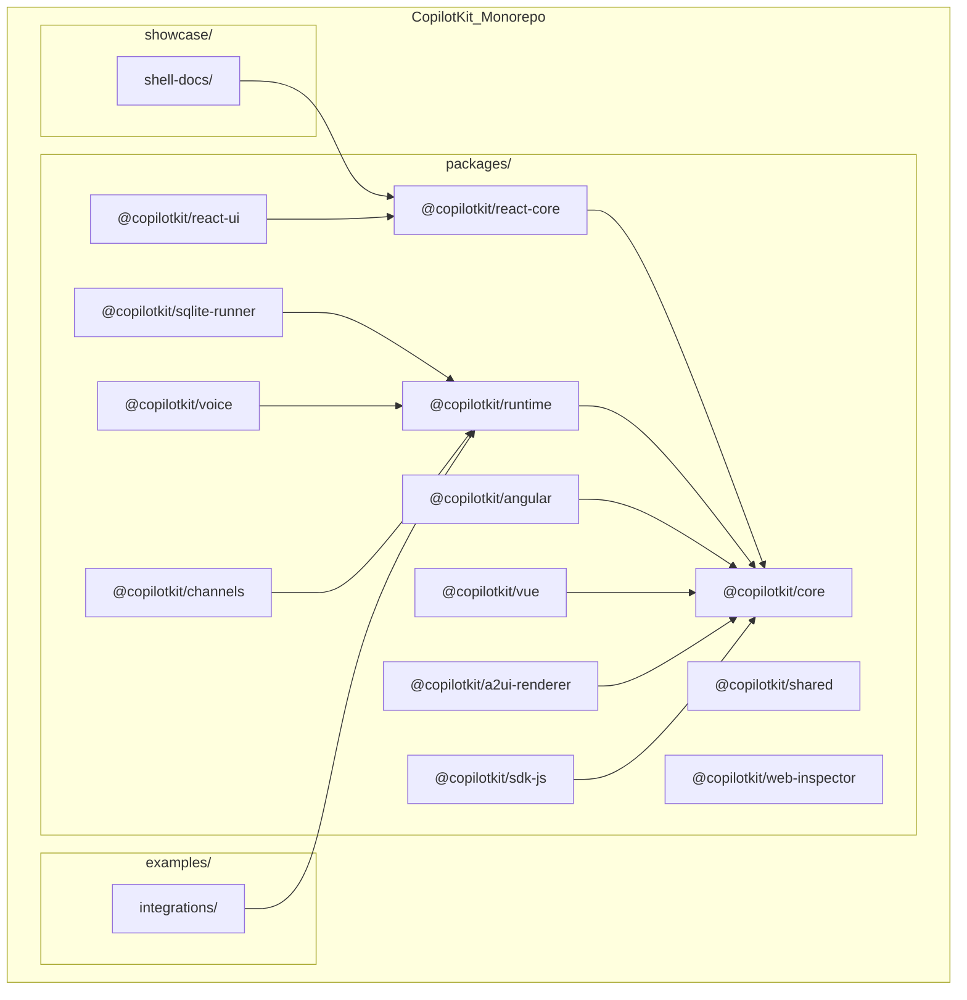

The repository is a monorepo managed by `pnpm`. The `packages/` directory contains the core logic and framework-specific SDKs. Documentation is actively managed within `showcase/shell-docs/` while the top-level `docs/` folder is retired [showcase/shell-docs/src/content/docs/(other)/contributing/meta.json]().

**Sources:** [packages/runtime/package.json:1-121](), [packages/react-core/package.json:1-103](), [packages/shared/package.json:1-63](), [packages/runtime/package.json:126]()

## Core Package Ecosystem

### Frontend and Frameworks

The frontend architecture provides framework-specific wrappers around the core logic and the AG-UI protocol.

| Package | Purpose |
|---------|---------|
| `@copilotkit/react-core` | React hooks (e.g., `useAgent`, `useCoAgent`) and context providers [packages/react-core/package.json:2](). |
| `@copilotkit/react-ui` | Pre-built UI components like `CopilotChat` and `CopilotSidebar` [packages/react-ui/package.json:2](). |
| `@copilotkit/react-textarea` | Specialized AI-powered textarea component for autocompletion [packages/react-textarea/package.json:2](). |
| `@copilotkit/angular` | Angular-specific integration patterns [README.md:104](). |
| `@copilotkit/vue` | Vue.js integration patterns [README.md:105](). |
| `@copilotkit/web-inspector` | Lit-based web component for debugging agent interactions [packages/web-inspector/package.json:4](). |
| `@copilotkit/a2ui-renderer` | Renderer for A2UI (Agent-to-UI) surfaces in React [packages/a2ui-renderer/package.json:5](). |

**Sources:** [packages/react-core/package.json:2](), [packages/react-ui/package.json:2](), [packages/react-textarea/package.json:2](), [packages/web-inspector/package.json:4](), [packages/a2ui-renderer/package.json:5]()

### Backend Runtime and Utilities

The backend runtime orchestrates communication between the LLM and agentic logic.

| Package | Key Entities | Role |
|---------|--------------|------|
| `@copilotkit/runtime` | `CopilotRuntime` | Primary entry point for backend integrations (Express, Hono, Next.js) [packages/runtime/package.json:2](). |
| `@copilotkit/shared` | Common Types | Utilities and type definitions used monorepo-wide [packages/shared/package.json:2](). |
| `@copilotkit/sqlite-runner` | `SqliteAgentRunner` | SQLite-backed persistence for agent state and threads [packages/sqlite-runner/package.json:4](). |
| `@copilotkit/voice` | `TranscriptionServiceOpenAI` | Voice services including OpenAI-based transcription [packages/voice/package.json:4](). |
| `@copilotkit/sdk-js` | Framework-agnostic SDK | JS SDK for custom integrations and LangChain/LangGraph middleware [packages/sdk-js/package.json:2](). |
| `@copilotkit/channels` | `createChannel` | Umbrella package for messaging platform adapters (Slack, Teams) [packages/runtime/package.json:126](). |

**Sources:** [packages/runtime/package.json:2](), [packages/sqlite-runner/package.json:4](), [packages/voice/package.json:4](), [packages/sdk-js/package.json:2]()

## AG-UI Protocol Integration

CopilotKit implements the **AG-UI Protocol**, standardizing how agents and UIs communicate across the "Natural Language Space" and "Code Entity Space".

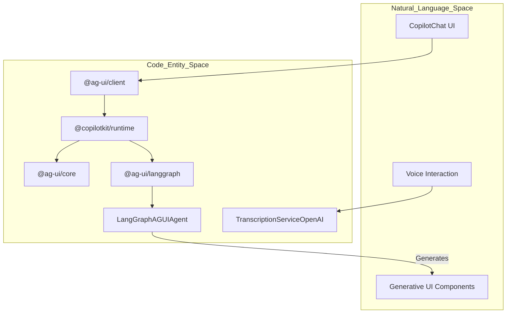

The protocol enables seamless integration with major agent frameworks by standardizing event streaming (SSE) and state synchronization. The `@copilotkit/runtime` package depends heavily on `@ag-ui/core`, `@ag-ui/client`, and `@ag-ui/encoder` to maintain this standard [packages/runtime/package.json:81-84]().

**Sources:** [README.md:60-61](), [packages/runtime/package.json:81-84](), [packages/voice/package.json:37-38]()

## Entry Points for Developers

CopilotKit provides multiple entry points depending on the user's needs:

- **New Projects**: `npx copilotkit@latest create` scaffolds a full-stack application [README.md:67]().
- **Agent Skills**: `npx copilotkit@latest skills install` provides the latest tools for coding agents (Claude Code, Cursor, etc.) to help them understand the codebase [README.md:72-77]().
- **Core Hook**: The `useAgent` hook in `@copilotkit/react-core` is the primary interface for managing agent state in the frontend [packages/react-core/package.json:53]().

**Sources:** [README.md:67-77](), [packages/react-core/package.json:51-53]()

---

# Page: Core Concepts

# Core Concepts

<details>
<summary>Relevant source files</summary>

The following files were used as context for generating this wiki page:

- [README.md](README.md)
- [assets/CopilotTextarea.gif](assets/CopilotTextarea.gif)
- [assets/CopilotTextarea_old.gif](assets/CopilotTextarea_old.gif)
- [assets/demo.gif](assets/demo.gif)
- [assets/proejct-perplexity-clone.png](assets/proejct-perplexity-clone.png)
- [assets/project-canvas-demo.png](assets/project-canvas-demo.png)
- [assets/spreadsheet-demo-big-file.gif](assets/spreadsheet-demo-big-file.gif)
- [examples/v2/react/demo/src/app/api/copilotkit/[[...slug]]/route.ts](examples/v2/react/demo/src/app/api/copilotkit/[[...slug]]/route.ts)
- [packages/angular/src/lib/agent.spec.ts](packages/angular/src/lib/agent.spec.ts)
- [packages/angular/src/lib/agent.ts](packages/angular/src/lib/agent.ts)
- [packages/angular/src/lib/config.ts](packages/angular/src/lib/config.ts)
- [packages/angular/src/lib/copilotkit.spec.ts](packages/angular/src/lib/copilotkit.spec.ts)
- [packages/angular/src/lib/directives/__tests__/copilotkit-config.directive.spec.ts](packages/angular/src/lib/directives/__tests__/copilotkit-config.directive.spec.ts)
- [packages/angular/src/lib/license-watermark.ts](packages/angular/src/lib/license-watermark.ts)
- [packages/core/src/__tests__/core-credentials.test.ts](packages/core/src/__tests__/core-credentials.test.ts)
- [packages/core/src/__tests__/core-headers.test.ts](packages/core/src/__tests__/core-headers.test.ts)
- [packages/core/src/__tests__/core-register-proxied-agent.test.ts](packages/core/src/__tests__/core-register-proxied-agent.test.ts)
- [packages/core/src/__tests__/core-subscribe-to-agent.test.ts](packages/core/src/__tests__/core-subscribe-to-agent.test.ts)
- [packages/core/src/__tests__/proxied-runtime-transport.test.ts](packages/core/src/__tests__/proxied-runtime-transport.test.ts)
- [packages/core/src/agent.ts](packages/core/src/agent.ts)
- [packages/core/src/core/agent-registry.ts](packages/core/src/core/agent-registry.ts)
- [packages/core/src/core/core.ts](packages/core/src/core/core.ts)
- [packages/react-core/src/__tests__/threadid-propagation.contract.test.tsx](packages/react-core/src/__tests__/threadid-propagation.contract.test.tsx)
- [packages/react-core/src/hooks/use-agent-nodename.ts](packages/react-core/src/hooks/use-agent-nodename.ts)
- [packages/react-core/src/v2/components/chat/__tests__/CopilotChatActivityRendering.e2e.test.tsx](packages/react-core/src/v2/components/chat/__tests__/CopilotChatActivityRendering.e2e.test.tsx)
- [packages/react-core/src/v2/components/chat/__tests__/copilot-chat-throttle.test.tsx](packages/react-core/src/v2/components/chat/__tests__/copilot-chat-throttle.test.tsx)
- [packages/react-core/src/v2/hooks/__tests__/use-agent-provider-headers.e2e.test.tsx](packages/react-core/src/v2/hooks/__tests__/use-agent-provider-headers.e2e.test.tsx)
- [packages/react-core/src/v2/hooks/__tests__/use-agent-stability.test.tsx](packages/react-core/src/v2/hooks/__tests__/use-agent-stability.test.tsx)
- [packages/react-core/src/v2/hooks/__tests__/use-agent-throttle.test.tsx](packages/react-core/src/v2/hooks/__tests__/use-agent-throttle.test.tsx)
- [packages/react-core/src/v2/hooks/__tests__/use-agent-types.test.tsx](packages/react-core/src/v2/hooks/__tests__/use-agent-types.test.tsx)
- [packages/react-core/src/v2/hooks/__tests__/use-capabilities.test.tsx](packages/react-core/src/v2/hooks/__tests__/use-capabilities.test.tsx)
- [packages/react-core/src/v2/hooks/use-agent.tsx](packages/react-core/src/v2/hooks/use-agent.tsx)
- [packages/react-core/src/v2/hooks/use-capabilities.tsx](packages/react-core/src/v2/hooks/use-capabilities.tsx)
- [packages/react-core/src/v2/hooks/use-render-activity-message.tsx](packages/react-core/src/v2/hooks/use-render-activity-message.tsx)
- [packages/react-core/src/v2/providers/CopilotKitProvider.tsx](packages/react-core/src/v2/providers/CopilotKitProvider.tsx)
- [packages/react-core/src/v2/providers/__tests__/CopilotKitProvider.stability.test.tsx](packages/react-core/src/v2/providers/__tests__/CopilotKitProvider.stability.test.tsx)
- [showcase/angular/src/app/features/mastra/mastra-cards.ts](showcase/angular/src/app/features/mastra/mastra-cards.ts)
- [showcase/angular/src/app/features/mastra/mastra-feature.component.ts](showcase/angular/src/app/features/mastra/mastra-feature.component.ts)
- [showcase/shell-docs/src/content/docs/(other)/contributing/code-contributions/package-linking.mdx](showcase/shell-docs/src/content/docs/(other)/contributing/code-contributions/package-linking.mdx)
- [showcase/shell-docs/src/content/docs/(other)/contributing/meta.json](showcase/shell-docs/src/content/docs/(other)/contributing/meta.json)
- [showcase/shell-docs/src/content/docs/agentic-protocols/a2a.mdx](showcase/shell-docs/src/content/docs/agentic-protocols/a2a.mdx)
- [showcase/shell-docs/src/content/docs/integrations/adk/shared-state/workflow-execution.mdx](showcase/shell-docs/src/content/docs/integrations/adk/shared-state/workflow-execution.mdx)
- [showcase/shell-docs/src/content/docs/integrations/deepagents/shared-state/workflow-execution.mdx](showcase/shell-docs/src/content/docs/integrations/deepagents/shared-state/workflow-execution.mdx)
- [showcase/shell-docs/src/content/docs/integrations/langgraph/tutorials/ai-travel-app/step-5-stream-progress.mdx](showcase/shell-docs/src/content/docs/integrations/langgraph/tutorials/ai-travel-app/step-5-stream-progress.mdx)
- [showcase/shell-docs/src/content/docs/integrations/langgraph/tutorials/ai-travel-app/step-6-human-in-the-loop.mdx](showcase/shell-docs/src/content/docs/integrations/langgraph/tutorials/ai-travel-app/step-6-human-in-the-loop.mdx)

</details>


This document explains the fundamental concepts underlying CopilotKit's architecture and programming model. It covers agent-native applications, the AG-UI Protocol, generative UI patterns, the `useAgent` hook, shared state management, and human-in-the-loop workflows.

---

## Agent-Native Applications

Agent-native applications treat AI agents as first-class architectural components rather than auxiliary features. In CopilotKit, this means:

- **Agents drive workflows**: Agents orchestrate multi-step processes, make decisions, and coordinate tool execution [README.md:16-16]().
- **Agents render UI**: Agents can call tools that return UI components rendered directly in the client [README.md:91-92]().
- **Agents manage state**: Agents read from and write to shared application state in real-time [README.md:93-93]().
- **Agents request input**: Agents can pause execution to ask users for confirmation, edits, or additional information [README.md:94-94]().

The interaction loop in agent-native applications flows through three layers: the UI layer (user interactions), the agent layer (decision-making and orchestration), and the tool layer (actions and data access). These layers communicate through the AG-UI Protocol [README.md:109-109]().

### Key Characteristics

| Characteristic        | Traditional Apps          | Agent-Native Apps                 |
|----------------------|--------------------------|---------------------------------|
| Control Flow         | User-initiated actions    | Agent-orchestrated workflows     |
| UI Updates           | Explicit state mutations  | Generative UI from agent actions |
| Backend Calls        | REST/GraphQL APIs         | Agent tool invocations           |
| User Interaction     | Forms and buttons         | Natural language + human-in-the-loop |

**Sources:** [README.md:16-16](), [README.md:88-95](), [README.md:109-109]()

---

## The AG-UI Protocol

The **AG-UI Protocol** (Agent-User Interaction Protocol) is an industry-standard event-driven specification defining communication between AI agents and user interfaces. It provides a common, structured "language" of event types used to orchestrate agent runs, tool calls, state syncing, UI rendering, and user interaction.

CopilotKit is the originator and primary steward of the AG-UI Protocol, which has been adopted by major companies like Google, AWS, Microsoft, LangChain, Mastra, and PydanticAI [README.md:56-60]().

### Core Protocol Capabilities

- **Streaming text messages** to the UI [README.md:90-90]().
- **Executing tool calls** and returning results [README.md:91-91]().
- **Synchronizing state bidirectionally** using `STATE_SNAPSHOT` and `STATE_DELTA` events [README.md:93-93]().
- **Requesting user input** during agent execution to pause and resume workflows [README.md:94-94]().
- **Rendering UI components** that get streamed and rendered client-side [README.md:92-92]().

### AG-UI Protocol Event Flow

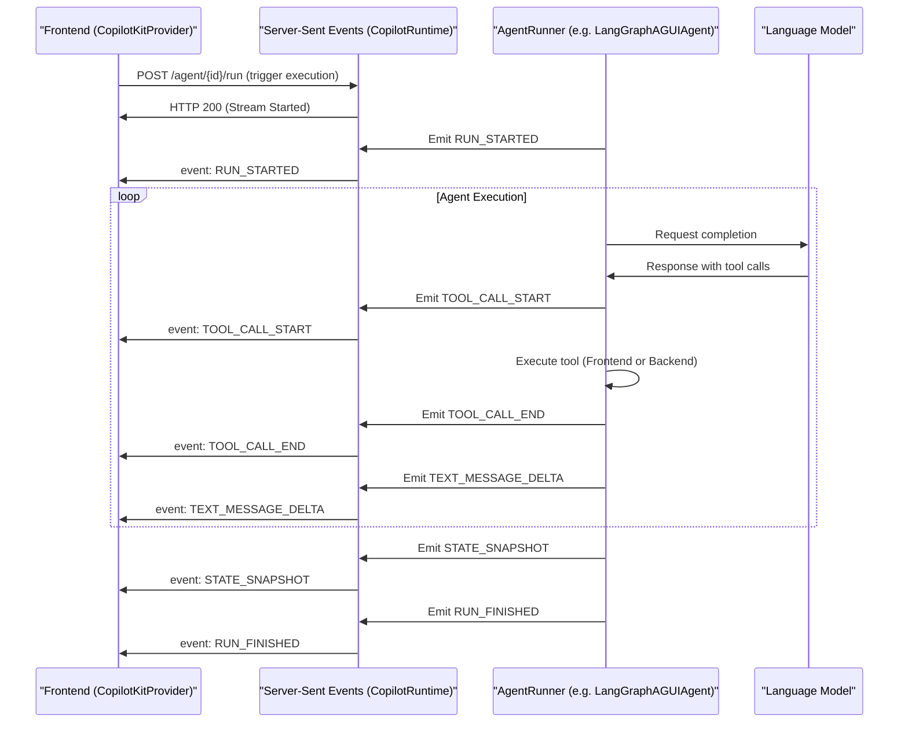

### Protocol Events and Subscribers

`CopilotKitCore` defines an event subscription system that maps AG-UI events to lifecycle callbacks [packages/core/src/core/core.ts:134-197](). These feed into stores like `AgentStore` in Angular or the `useAgent` state in React that frontends observe for rendering and state management [packages/angular/src/lib/agent.ts:30-82]().

| Event Handler        | Description                                                  | Direction    |
|----------------------|--------------------------------------------------------------|--------------|
| `onRunInitialized`   | Signals the start of agent execution                         | Agent → UI   |
| `onMessagesChanged`  | Streams text content or messages (e.g., chat messages)       | Agent → UI   |
| `onStateChanged`     | Signals state synchronization events                         | Bidirectional|
| `onRunFinalized`     | Signals successful run completion                             | Agent → UI   |
| `onRunFailed`        | Signals run failure or local exception                        | Agent → UI   |
| `onRunErrorEvent`    | Signals backend protocol-level `RUN_ERROR` events            | Agent → UI   |

**Sources:** [README.md:56-60](), [README.md:90-94](), [packages/core/src/core/core.ts:134-197](), [packages/angular/src/lib/agent.ts:30-82]()

---

## Generative UI

Generative UI in CopilotKit enables agents to dynamically create and modify UI components at runtime as part of the interaction experience [README.md:92-92]().

### Types of Generative UI in CopilotKit

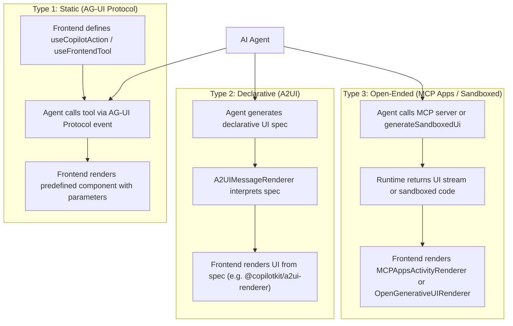

### 1. Static Generative UI (AG-UI Protocol)
Frontends register tools/actions. Agents invoke these via tool calls, and the frontend executes the associated component with parameters. This is handled through the `onToolExecutionStart` and `onToolExecutionEnd` subscribers [packages/core/src/core/core.ts:139-153]().

### 2. Declarative Generative UI (A2UI)
Agents produce a structured specification describing controls and layout. The `createA2UIMessageRenderer` creates components that interpret these messages [packages/react-core/src/v2/providers/CopilotKitProvider.tsx:43-43]().

### 3. Open-Ended Generative UI
- **MCP Apps**: Agents interact with Model Context Protocol apps, requesting arbitrary UI fragments handled by `MCPAppsActivityRenderer` [packages/react-core/src/v2/providers/CopilotKitProvider.tsx:32-35]().
- **Sandboxed UI**: The `OpenGenerativeUIRenderer` handles rendering sandboxed code (HTML/CSS/JS) generated by the LLM securely within an iframe [packages/react-core/src/v2/providers/CopilotKitProvider.tsx:37-42](). The prompt for this generation is specifically tuned for a minimal, flat aesthetic [packages/react-core/src/v2/providers/CopilotKitProvider.tsx:89-98]().

**Sources:** [README.md:91-92](), [packages/react-core/src/v2/providers/CopilotKitProvider.tsx:32-43](), [packages/react-core/src/v2/providers/CopilotKitProvider.tsx:89-98]()

---

## The `useAgent` Hook

The `useAgent` hook is the primary React API for connecting components with agents. It manages subscriptions to agent messages, state, and run status [packages/react-core/src/v2/hooks/use-agent.tsx:13-17]().

### Architecture and Data Flow

```mermaid
graph TB
    Component["React Component"]
    useAgent["useAgent Hook (packages/react-core/src/v2/hooks/use-agent.tsx)"]
    CopilotKitCore["CopilotKitCore (packages/core/src/core/core.ts)"]
    AgentRegistry["AgentRegistry (packages/core/src/core/agent-registry.ts)"]
    Proxy["ProxiedCopilotRuntimeAgent (packages/core/src/agent.ts)"]
    Runtime["CopilotRuntime (Backend)"]

    Component-->"const { agent } = useAgent()"-->useAgent
    useAgent-->"subscribeToAgentWithOptions"-->CopilotKitCore
    CopilotKitCore-->"AgentRegistry.getAgent()"-->AgentRegistry
    AgentRegistry-->"manages"-->Proxy
    Proxy-->"HTTP POST /agent/{id}/run"-->Runtime

    Runtime-->"SSE Event Stream"-->Proxy
    Proxy-->"updates subscribers"-->CopilotKitCore
    CopilotKitCore-->"batched forceUpdate"-->Component
```

### Key Features
- **Provisional Agents**: While the runtime is connecting or in an error state, `useAgent` returns a `ProxiedCopilotRuntimeAgent` with `runtimeMode: "pending"`. This prevents React tree crashes and keeps reference stability [packages/react-core/src/v2/hooks/use-agent.tsx:160-202]().
- **Throttled Updates**: Uses `throttleMs` to coalesce high-frequency streaming updates (e.g., token-by-token text) into fewer re-renders, using a leading+trailing pattern [packages/react-core/src/v2/hooks/use-agent.tsx:32-50]().
- **Precedence Logic**: Resolves `agentId` by checking explicit props, then surrounding `CopilotChatConfiguration`, then the global default [packages/react-core/src/v2/hooks/use-agent.tsx:112-121]().

**Sources:** [packages/react-core/src/v2/hooks/use-agent.tsx:32-202](), [packages/core/src/core/core.ts:41-73]()

---

## Shared State Management

CopilotKit provides a synchronized state layer where agents and UI components share a common `State` object.

### State Synchronization Flow

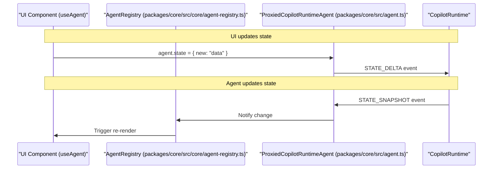

- **Isolation**: `AgentRegistry` allows registering proxied agents that route to different runtime IDs while keeping local state isolated [packages/core/src/core/agent-registry.ts:32-45]().
- **Signal-Based Sync (Angular)**: In Angular, the `AgentStore` uses signals to provide reactive access to `messages`, `state`, and `isRunning` status, seeded synchronously from the agent instance [packages/angular/src/lib/agent.ts:30-57]().

**Sources:** [packages/core/src/core/agent-registry.ts:32-45](), [packages/angular/src/lib/agent.ts:30-57]()

---

## Human-in-the-Loop Workflows (HITL)

HITL allows agents to pause execution to request user intervention. This is implemented via tool calls that the frontend intercepts to render interaction UI [README.md:94-94]().

- **Preservation**: The agent's execution state is held while waiting for user input.
- **Implementation**: The `CopilotKitProvider` accepts a `humanInTheLoop` array defining how specific requests should be rendered and handled [packages/react-core/src/v2/providers/CopilotKitProvider.tsx:139-139]().
- **Protocol Support**: Agents emit activity snapshots and tool calls that the UI interprets to show progress or prompt for input [packages/react-core/src/v2/components/chat/__tests__/CopilotChatActivityRendering.e2e.test.tsx:178-189]().

**Sources:** [README.md:94-94](), [packages/react-core/src/v2/providers/CopilotKitProvider.tsx:139-139](), [packages/react-core/src/v2/components/chat/__tests__/CopilotChatActivityRendering.e2e.test.tsx:178-189]()

---

## Integration Summary Diagram

This diagram maps the bridge from Natural Language Space (User Intent) to Code Entity Space (Implementation).

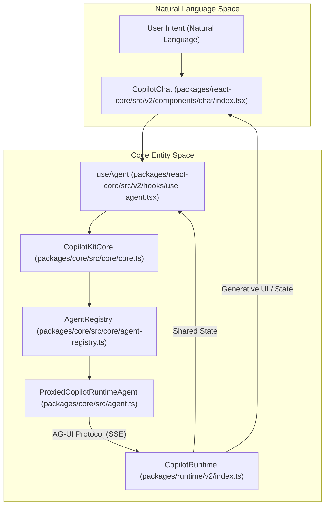

**Sources:** [packages/react-core/src/v2/hooks/use-agent.tsx:142-202](), [packages/core/src/core/core.ts:19-31](), [packages/core/src/agent.ts:100-150](), [packages/core/src/core/agent-registry.ts:56-99]()

---

# Page: System Architecture

# System Architecture

<details>
<summary>Relevant source files</summary>

The following files were used as context for generating this wiki page:

- [.claude/docs/architecture.md](.claude/docs/architecture.md)
- [README.md](README.md)
- [assets/CopilotTextarea.gif](assets/CopilotTextarea.gif)
- [assets/CopilotTextarea_old.gif](assets/CopilotTextarea_old.gif)
- [assets/demo.gif](assets/demo.gif)
- [assets/proejct-perplexity-clone.png](assets/proejct-perplexity-clone.png)
- [assets/project-canvas-demo.png](assets/project-canvas-demo.png)
- [assets/spreadsheet-demo-big-file.gif](assets/spreadsheet-demo-big-file.gif)
- [packages/a2ui-renderer/package.json](packages/a2ui-renderer/package.json)
- [packages/core/package.json](packages/core/package.json)
- [packages/core/src/__tests__/debug-config-threading.test.ts](packages/core/src/__tests__/debug-config-threading.test.ts)
- [packages/react-core/package.json](packages/react-core/package.json)
- [packages/react-textarea/package.json](packages/react-textarea/package.json)
- [packages/react-ui/package.json](packages/react-ui/package.json)
- [packages/runtime-client-gql/package.json](packages/runtime-client-gql/package.json)
- [packages/runtime/package.json](packages/runtime/package.json)
- [packages/runtime/src/v2/runtime/__tests__/agent-header-precedence.test.ts](packages/runtime/src/v2/runtime/__tests__/agent-header-precedence.test.ts)
- [packages/runtime/src/v2/runtime/__tests__/agent-utils-header-forwarding.test.ts](packages/runtime/src/v2/runtime/__tests__/agent-utils-header-forwarding.test.ts)
- [packages/runtime/src/v2/runtime/__tests__/agents-factory.test.ts](packages/runtime/src/v2/runtime/__tests__/agents-factory.test.ts)
- [packages/runtime/src/v2/runtime/__tests__/debug-sse-response.test.ts](packages/runtime/src/v2/runtime/__tests__/debug-sse-response.test.ts)
- [packages/runtime/src/v2/runtime/__tests__/handle-connect.test.ts](packages/runtime/src/v2/runtime/__tests__/handle-connect.test.ts)
- [packages/runtime/src/v2/runtime/__tests__/handle-run.test.ts](packages/runtime/src/v2/runtime/__tests__/handle-run.test.ts)
- [packages/runtime/src/v2/runtime/__tests__/header-utils.test.ts](packages/runtime/src/v2/runtime/__tests__/header-utils.test.ts)
- [packages/runtime/src/v2/runtime/__tests__/intelligence-lock-heartbeat.test.ts](packages/runtime/src/v2/runtime/__tests__/intelligence-lock-heartbeat.test.ts)
- [packages/runtime/src/v2/runtime/__tests__/intelligence-run-telemetry.test.ts](packages/runtime/src/v2/runtime/__tests__/intelligence-run-telemetry.test.ts)
- [packages/runtime/src/v2/runtime/__tests__/thread-names.test.ts](packages/runtime/src/v2/runtime/__tests__/thread-names.test.ts)
- [packages/runtime/src/v2/runtime/core/runtime.ts](packages/runtime/src/v2/runtime/core/runtime.ts)
- [packages/runtime/src/v2/runtime/handlers/handle-connect.ts](packages/runtime/src/v2/runtime/handlers/handle-connect.ts)
- [packages/runtime/src/v2/runtime/handlers/handle-run.ts](packages/runtime/src/v2/runtime/handlers/handle-run.ts)
- [packages/runtime/src/v2/runtime/handlers/handle-stop.ts](packages/runtime/src/v2/runtime/handlers/handle-stop.ts)
- [packages/runtime/src/v2/runtime/handlers/header-utils.ts](packages/runtime/src/v2/runtime/handlers/header-utils.ts)
- [packages/runtime/src/v2/runtime/handlers/intelligence/connect.ts](packages/runtime/src/v2/runtime/handlers/intelligence/connect.ts)
- [packages/runtime/src/v2/runtime/handlers/intelligence/run.ts](packages/runtime/src/v2/runtime/handlers/intelligence/run.ts)
- [packages/runtime/src/v2/runtime/handlers/intelligence/thread-names.ts](packages/runtime/src/v2/runtime/handlers/intelligence/thread-names.ts)
- [packages/runtime/src/v2/runtime/handlers/shared/agent-utils.ts](packages/runtime/src/v2/runtime/handlers/shared/agent-utils.ts)
- [packages/runtime/src/v2/runtime/handlers/shared/sse-response.ts](packages/runtime/src/v2/runtime/handlers/shared/sse-response.ts)
- [packages/runtime/src/v2/runtime/handlers/sse/__tests__/sse-connect-agent-id.test.ts](packages/runtime/src/v2/runtime/handlers/sse/__tests__/sse-connect-agent-id.test.ts)
- [packages/runtime/src/v2/runtime/handlers/sse/connect.ts](packages/runtime/src/v2/runtime/handlers/sse/connect.ts)
- [packages/runtime/src/v2/runtime/handlers/sse/run.ts](packages/runtime/src/v2/runtime/handlers/sse/run.ts)
- [packages/runtime/src/v2/runtime/runner/__tests__/bounded-thread-store.test.ts](packages/runtime/src/v2/runtime/runner/__tests__/bounded-thread-store.test.ts)
- [packages/runtime/src/v2/runtime/runner/agent-runner.ts](packages/runtime/src/v2/runtime/runner/agent-runner.ts)
- [packages/sdk-js/package.json](packages/sdk-js/package.json)
- [packages/shared/package.json](packages/shared/package.json)
- [packages/shared/src/__tests__/debug.test.ts](packages/shared/src/__tests__/debug.test.ts)
- [packages/shared/src/debug.ts](packages/shared/src/debug.ts)
- [packages/sqlite-runner/package.json](packages/sqlite-runner/package.json)
- [packages/voice/package.json](packages/voice/package.json)
- [packages/web-inspector/package.json](packages/web-inspector/package.json)
- [showcase/angular/src/app/features/mastra/mastra-cards.ts](showcase/angular/src/app/features/mastra/mastra-cards.ts)
- [showcase/angular/src/app/features/mastra/mastra-feature.component.ts](showcase/angular/src/app/features/mastra/mastra-feature.component.ts)
- [showcase/shell-docs/src/content/docs/(other)/contributing/code-contributions/package-linking.mdx](showcase/shell-docs/src/content/docs/(other)/contributing/code-contributions/package-linking.mdx)
- [showcase/shell-docs/src/content/docs/(other)/contributing/meta.json](showcase/shell-docs/src/content/docs/(other)/contributing/meta.json)
- [showcase/shell-docs/src/content/docs/agentic-protocols/a2a.mdx](showcase/shell-docs/src/content/docs/agentic-protocols/a2a.mdx)
- [showcase/shell-docs/src/content/docs/integrations/adk/shared-state/workflow-execution.mdx](showcase/shell-docs/src/content/docs/integrations/adk/shared-state/workflow-execution.mdx)
- [showcase/shell-docs/src/content/docs/integrations/deepagents/shared-state/workflow-execution.mdx](showcase/shell-docs/src/content/docs/integrations/deepagents/shared-state/workflow-execution.mdx)
- [showcase/shell-docs/src/content/docs/integrations/langgraph/tutorials/ai-travel-app/step-5-stream-progress.mdx](showcase/shell-docs/src/content/docs/integrations/langgraph/tutorials/ai-travel-app/step-5-stream-progress.mdx)
- [showcase/shell-docs/src/content/docs/integrations/langgraph/tutorials/ai-travel-app/step-6-human-in-the-loop.mdx](showcase/shell-docs/src/content/docs/integrations/langgraph/tutorials/ai-travel-app/step-6-human-in-the-loop.mdx)

</details>


This document provides a technical overview of the CopilotKit system architecture. It describes how the UI, agents, and tools interact via the **AG-UI Protocol**, the three-layer architecture (Frontend, Runtime, and Agent), and the repository's package dependency map.

## Architecture Overview

CopilotKit is built on a three-layer stack where the **AG-UI Protocol** serves as the unified communication standard. This architecture bridges the "Natural Language Space" of agents with the "Code Entity Space" of application logic.

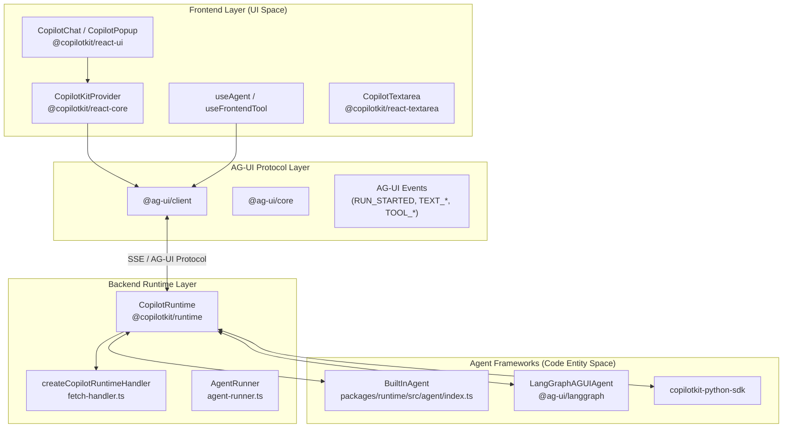

**Sources:** [README.md:54-61](), [README.md:97-101](), [packages/runtime/src/v2/runtime/core/runtime.ts:179-210](), [packages/runtime/src/v2/runtime/core/fetch-handler.ts:114-180]()

### Core Architectural Layers

| Layer | Primary Packages | Purpose |
|-------|------------------|---------|
| **Frontend** | `@copilotkit/react-core`, `@copilotkit/react-ui`, `@copilotkit/angular`, `@copilotkit/vue` | Provides framework-specific components, hooks, and providers for UI integration. |
| **Runtime** | `@copilotkit/runtime` | Orchestrates agent execution, manages LLM adapters, and handles the SSE event stream via `CopilotSseRuntime` or `CopilotIntelligenceRuntime`. |
| **Agent** | `BuiltInAgent`, `@copilotkit/sdk-js`, `copilotkit` (Python) | SDKs and classes for building agents that implement the `AbstractAgent` interface and communicate via AG-UI events. |
| **Shared** | `@copilotkit/shared` | Common utilities, telemetry, and shared types used across all packages. |

**Sources:** [packages/runtime/package.json:79-95](), [packages/react-core/package.json:77-84](), [packages/runtime/src/v2/runtime/core/runtime.ts:179-210](), [packages/runtime/src/v2/runtime/core/fetch-handler.ts:53-109]()

## The Interaction Loop

CopilotKit connects the application UI, backend agents, and local tools into a continuous interaction loop. This loop is powered by Server-Sent Events (SSE) and the AG-UI Protocol specification.

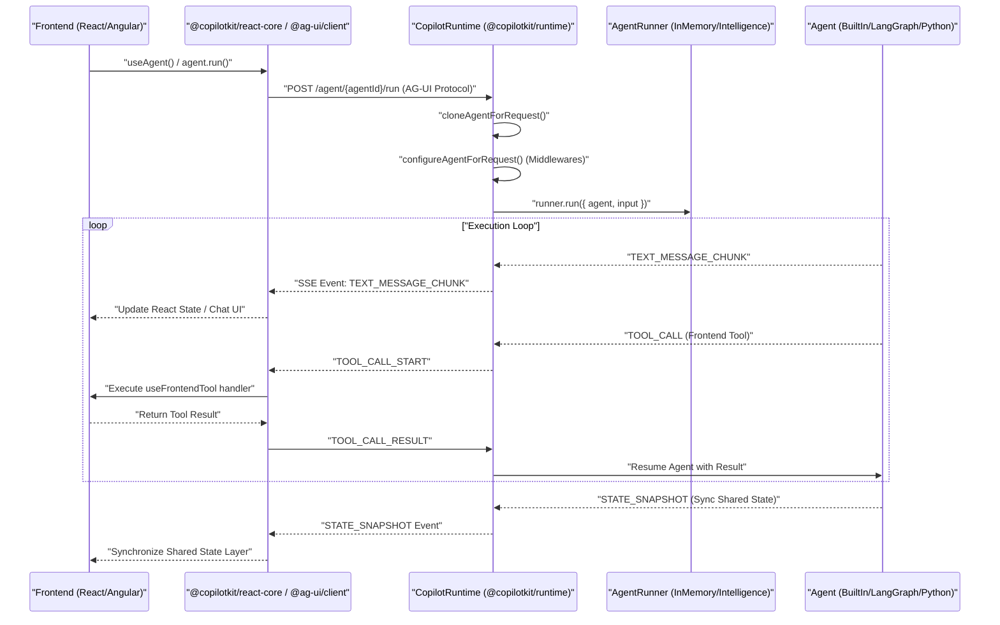

**Sources:** [packages/runtime/src/v2/runtime/handlers/handle-run.ts:13-97](), [packages/runtime/src/v2/runtime/handlers/shared/agent-utils.ts:52-73](), [packages/runtime/src/v2/runtime/runner/agent-runner.ts:1-20]()

### Key Components in the Loop

*   **`CopilotRuntime`**: The primary backend class that manages agent registration and routing. It supports two modes: `CopilotSseRuntime` for standard SSE and `CopilotIntelligenceRuntime` for durable, persistent sessions. [packages/runtime/src/v2/runtime/core/runtime.ts:179-210]()
*   **`fetch-handler`**: A framework-agnostic handler that maps HTTP requests to runtime operations like `handleRunAgent`, `handleConnectAgent`, and `handleGetRuntimeInfo`. [packages/runtime/src/v2/runtime/core/fetch-handler.ts:75-109]()
*   **`AgentRunner`**: Interface for executing agents. `InMemoryAgentRunner` handles execution in the current process, while `IntelligenceAgentRunner` (via `@copilotkit/channels-intelligence`) delegates to the CopilotKit Intelligence Platform. [packages/runtime/src/v2/runtime/runner/agent-runner.ts:1-20]()
*   **`BuiltInAgent`**: A powerful agent implementation that uses the Vercel AI SDK and supports Model Context Protocol (MCP) servers. [packages/runtime/package.json:90-91]()

## Package Dependency Map

The repository is managed as a pnpm workspace. The architecture is modular, with the `@copilotkit/runtime` package serving as the backend hub.

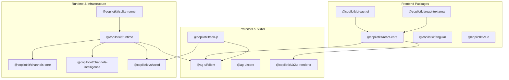

**Sources:** [packages/runtime/package.json:79-95](), [packages/react-core/package.json:77-84](), [packages/react-ui/package.json:59-61](), [packages/react-textarea/package.json:57-59](), [packages/sqlite-runner/package.json:34-36]()

### Package Responsibilities

| Package | Responsibility |
|---------|----------------|
| `@copilotkit/runtime` | Backend orchestration, agent management, and SSE/Intelligence protocol handling. [packages/runtime/package.json:2-16]() |
| `@copilotkit/channels-core` | Core logic for multi-platform messaging (Slack, Teams, Discord). [packages/runtime/package.json:92]() |
| `@copilotkit/shared` | Shared logic for telemetry, logging, and license verification. [packages/shared/package.json:52-63]() |
| `@ag-ui/client` | Implementation of the AG-UI Protocol client-side logic. [packages/core/package.json:38]() |
| `@copilotkit/sqlite-runner` | Persistence layer for agent threads using SQLite. [packages/sqlite-runner/package.json:4-5]() |

## Implementation Detail: Managed Channels

CopilotKit introduces **Managed Channels** for "Beyond the Browser" interactions (e.g., Slack, MS Teams). This is orchestrated by the `ChannelManager`.

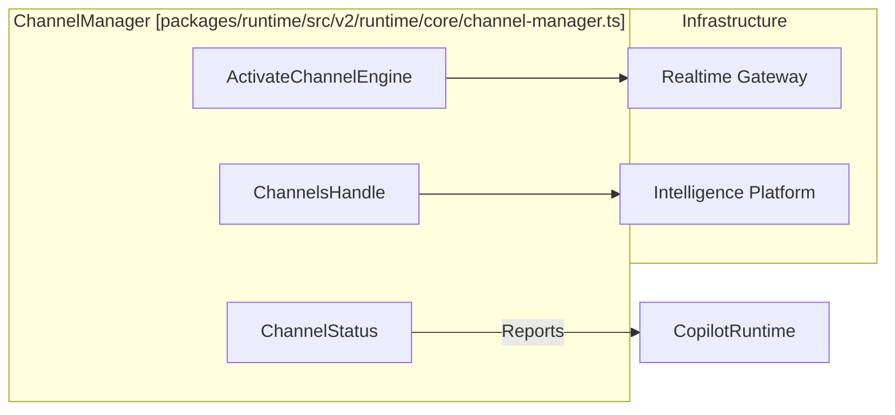

1.  **Lazy Activation**: Channels are only activated when `handler.channels.ready()` is called, making the runtime safe for serverless environments. [packages/runtime/src/v2/runtime/core/fetch-handler.ts:28-44]()
2.  **`ChannelManager`**: Tracks the lifecycle status (`connecting`, `online`, `reconnecting`, `error`) of each activated channel. [packages/runtime/src/v2/runtime/core/channel-manager.ts:13-43]()
3.  **`IntelligenceAgentRunner`**: Enables durable execution where agent state is persisted on the Intelligence Platform, allowing agents to respond across different platforms (Web vs Slack) in the same thread. [packages/runtime/src/v2/runtime/core/runtime.ts:188-210]()

**Sources:** [packages/runtime/src/v2/runtime/core/channel-manager.ts:13-60](), [packages/runtime/src/v2/runtime/core/fetch-handler.ts:28-51](), [packages/runtime/package.json:92-93]()

---

# Page: Getting Started

# Getting Started

<details>
<summary>Relevant source files</summary>

The following files were used as context for generating this wiki page:

- [.mcp.json](.mcp.json)
- [packages/a2ui-renderer/package.json](packages/a2ui-renderer/package.json)
- [packages/core/package.json](packages/core/package.json)
- [packages/react-core/package.json](packages/react-core/package.json)
- [packages/react-textarea/package.json](packages/react-textarea/package.json)
- [packages/react-ui/package.json](packages/react-ui/package.json)
- [packages/runtime-client-gql/package.json](packages/runtime-client-gql/package.json)
- [packages/runtime/package.json](packages/runtime/package.json)
- [packages/sdk-js/package.json](packages/sdk-js/package.json)
- [packages/shared/package.json](packages/shared/package.json)
- [packages/sqlite-runner/package.json](packages/sqlite-runner/package.json)
- [packages/voice/package.json](packages/voice/package.json)
- [packages/web-inspector/package.json](packages/web-inspector/package.json)
- [scripts/__tests__/sync-plugin-skills.test.ts](scripts/__tests__/sync-plugin-skills.test.ts)
- [scripts/sync-plugin-skills.ts](scripts/sync-plugin-skills.ts)
- [skills/channels-setup/SKILL.md](skills/channels-setup/SKILL.md)
- [skills/copilotkit-agui/references/event-flow-diagrams.md](skills/copilotkit-agui/references/event-flow-diagrams.md)
- [skills/copilotkit-agui/sources.md](skills/copilotkit-agui/sources.md)
- [skills/copilotkit-channels/SKILL.md](skills/copilotkit-channels/SKILL.md)
- [skills/copilotkit-channels/sources.md](skills/copilotkit-channels/sources.md)
- [skills/copilotkit-setup/SKILL.md](skills/copilotkit-setup/SKILL.md)
- [skills/copilotkit-setup/assets/express-runtime.ts](skills/copilotkit-setup/assets/express-runtime.ts)
- [skills/copilotkit-setup/assets/nextjs-app-router-page.tsx](skills/copilotkit-setup/assets/nextjs-app-router-page.tsx)
- [skills/copilotkit-setup/assets/nextjs-app-router-route.ts](skills/copilotkit-setup/assets/nextjs-app-router-route.ts)
- [skills/copilotkit-setup/eval.yaml](skills/copilotkit-setup/eval.yaml)
- [skills/copilotkit-setup/references/framework-detection.md](skills/copilotkit-setup/references/framework-detection.md)
- [skills/copilotkit-setup/references/runtime-architecture.md](skills/copilotkit-setup/references/runtime-architecture.md)
- [skills/copilotkit-setup/references/telemetry-setup.md](skills/copilotkit-setup/references/telemetry-setup.md)
- [skills/copilotkit-setup/sources.md](skills/copilotkit-setup/sources.md)

</details>


This document provides a high-level overview of getting started with CopilotKit, including available development paths, the package ecosystem, and basic setup flows. For detailed installation instructions, see [Installation](#2.1). For a step-by-step walkthrough, see [Quick Start Guide](#2.2).

CopilotKit is a best-in-class SDK for building full-stack **agent-native applications**, Generative UI, and chat applications. It enables a synchronized interaction loop between UI components and AI agents using the **AG-UI Protocol**.

Sources: [packages/runtime/package.json:80-84](), [packages/react-core/package.json:77-78]()

## Development Paths

CopilotKit offers automated and manual paths to integration, supporting React, Angular, Vue, and React Native.

### CLI-Based Setup (Recommended)

The CopilotKit CLI automates package installation and runtime configuration.

*   **New Projects:** Creates a fresh application with pre-configured agent backends.
    ```bash
    npx copilotkit@latest create
    ```
*   **Existing Projects:** Initializes CopilotKit in an existing codebase, detecting the framework and installing necessary dependencies like `@copilotkit/react-core` [packages/react-core/package.json:2]() or `@copilotkit/runtime` [packages/runtime/package.json:2]().
    ```bash
    npx copilotkit@latest init
    ```

### Agent Skills for Coding Assistants

The repository includes a dedicated `skills/` directory containing configurations to teach coding agents (like Claude Code or Cursor) how to work with the CopilotKit codebase. [packages/runtime/package.json:26](), [packages/react-core/package.json:26]()
```bash
npx copilotkit@latest skills install
```

Sources: [packages/runtime/package.json:24-27](), [packages/react-core/package.json:24-27]()

## Setup Flow Overview

The following diagram bridges the "Natural Language Space" (developer intent) to the "Code Entity Space" (specific classes and packages).

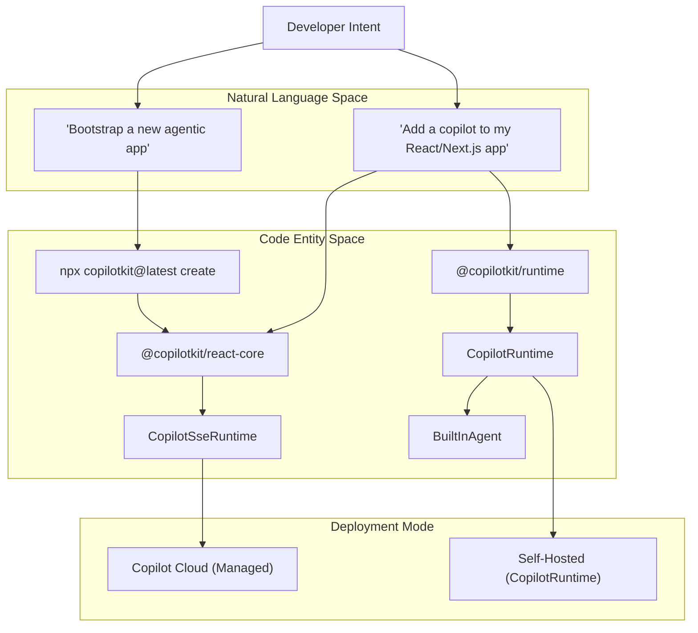

**Title:** Bridging Developer Intent to CopilotKit Code Entities

Sources: [packages/runtime/package.json:2](), [packages/react-core/package.json:2](), [packages/runtime-client-gql/package.json:2]()

## Key Architectural Decisions

### Backend Runtime & Agents

The `@copilotkit/runtime` [packages/runtime/package.json:2]() is the core orchestration engine. It manages agents via specialized runners such as the default `InMemoryAgentRunner` or the persistent `SqliteAgentRunner` [packages/sqlite-runner/package.json:2-4](). 

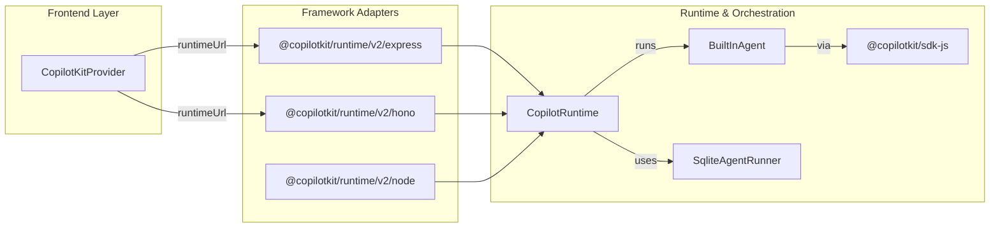

**Title:** Runtime Configuration and Endpoint Entities

Sources: [packages/runtime/package.json:46-61](), [packages/sqlite-runner/package.json:2-4](), [packages/sdk-js/package.json:2]()

### UI Integration & Frameworks

CopilotKit provides framework-specific packages to manage shared state and Generative UI.

| Framework | Core Package | UI Components |
|-----------|--------------|---------------|
| **React** | `@copilotkit/react-core` [packages/react-core/package.json:2]() | `CopilotChat`, `CopilotPopup`, `CopilotSidebar` |
| **Angular** | `@copilotkit/angular` | `CopilotKit` service, `AgentStore` signals |
| **Vue** | `@copilotkit/vue` | `CopilotKitProvider.vue`, `useAgent` |
| **Mobile** | `React Native` | Polyfills + `@copilotkit/react-core` |

Sources: [packages/react-core/package.json:2](), [packages/react-ui/package.json:2](), [packages/react-textarea/package.json:2]()

## Basic Configuration Pattern

For a React application, you typically import the v2 styles and wrap your application in the `CopilotKit` provider (from `@copilotkit/react-core/v2`). [packages/react-core/package.json:42-55]()

```tsx
// Example layout.tsx / App.tsx
import "@copilotkit/react-core/v2/styles.css";
import { CopilotKit } from "@copilotkit/react-core/v2";

export default function RootLayout({ children }: { children: React.ReactNode }) {
  return (
    <CopilotKit runtimeUrl="/api/copilotkit">
      {children}
    </CopilotKit>
  );
}
```

Sources: [packages/react-core/package.json:42-55](), [packages/react-ui/package.json:39]()

## Next Steps

- **[Installation](#2.1)**: Detailed instructions for CLI and manual setup across different frameworks, including provider wiring.
- **[Quick Start Guide](#2.2)**: A hands-on tutorial covering the `BuiltInAgent` + `CopilotRuntime` pattern.

---

# Page: Installation

# Installation

<details>
<summary>Relevant source files</summary>

The following files were used as context for generating this wiki page:

- [.github/workflows/plugin-skills-check.yml](.github/workflows/plugin-skills-check.yml)
- [.mcp.json](.mcp.json)
- [examples/v2/react/demo/tsconfig.json](examples/v2/react/demo/tsconfig.json)
- [lefthook.yml](lefthook.yml)
- [migrations.json](migrations.json)
- [nx.json](nx.json)
- [packages/a2ui-renderer/package.json](packages/a2ui-renderer/package.json)
- [packages/core/package.json](packages/core/package.json)
- [packages/react-core/package.json](packages/react-core/package.json)
- [packages/react-core/src/v2/components/chat/__tests__/CopilotChatPerf.e2e.test.tsx](packages/react-core/src/v2/components/chat/__tests__/CopilotChatPerf.e2e.test.tsx)
- [packages/react-textarea/package.json](packages/react-textarea/package.json)
- [packages/react-ui/package.json](packages/react-ui/package.json)
- [packages/runtime-client-gql/package.json](packages/runtime-client-gql/package.json)
- [packages/runtime/package.json](packages/runtime/package.json)
- [packages/sdk-js/package.json](packages/sdk-js/package.json)
- [packages/shared/package.json](packages/shared/package.json)
- [packages/sqlite-runner/package.json](packages/sqlite-runner/package.json)
- [packages/voice/package.json](packages/voice/package.json)
- [packages/web-inspector/package.json](packages/web-inspector/package.json)
- [scripts/__tests__/sync-plugin-skills.test.ts](scripts/__tests__/sync-plugin-skills.test.ts)
- [scripts/sync-plugin-skills.ts](scripts/sync-plugin-skills.ts)
- [showcase/scripts/__tests__/sync-promote-service-options.test.ts](showcase/scripts/__tests__/sync-promote-service-options.test.ts)
- [showcase/scripts/sync-promote-service-options.ts](showcase/scripts/sync-promote-service-options.ts)
- [skills/channels-setup/SKILL.md](skills/channels-setup/SKILL.md)
- [skills/copilotkit-agui/references/event-flow-diagrams.md](skills/copilotkit-agui/references/event-flow-diagrams.md)
- [skills/copilotkit-agui/sources.md](skills/copilotkit-agui/sources.md)
- [skills/copilotkit-channels/SKILL.md](skills/copilotkit-channels/SKILL.md)
- [skills/copilotkit-channels/sources.md](skills/copilotkit-channels/sources.md)
- [skills/copilotkit-setup/SKILL.md](skills/copilotkit-setup/SKILL.md)
- [skills/copilotkit-setup/assets/express-runtime.ts](skills/copilotkit-setup/assets/express-runtime.ts)
- [skills/copilotkit-setup/assets/nextjs-app-router-page.tsx](skills/copilotkit-setup/assets/nextjs-app-router-page.tsx)
- [skills/copilotkit-setup/assets/nextjs-app-router-route.ts](skills/copilotkit-setup/assets/nextjs-app-router-route.ts)
- [skills/copilotkit-setup/eval.yaml](skills/copilotkit-setup/eval.yaml)
- [skills/copilotkit-setup/references/framework-detection.md](skills/copilotkit-setup/references/framework-detection.md)
- [skills/copilotkit-setup/references/runtime-architecture.md](skills/copilotkit-setup/references/runtime-architecture.md)
- [skills/copilotkit-setup/references/telemetry-setup.md](skills/copilotkit-setup/references/telemetry-setup.md)
- [skills/copilotkit-setup/sources.md](skills/copilotkit-setup/sources.md)
- [skills/setup-slack-channel/SKILL.md](skills/setup-slack-channel/SKILL.md)
- [skills/setup-slack-channel/assets/slack-app-manifest.yaml](skills/setup-slack-channel/assets/slack-app-manifest.yaml)
- [skills/setup-slack-channel/references/intelligence-channel.md](skills/setup-slack-channel/references/intelligence-channel.md)
- [skills/setup-slack-channel/references/local-runtime.md](skills/setup-slack-channel/references/local-runtime.md)
- [skills/setup-slack-channel/references/optional-e2e.md](skills/setup-slack-channel/references/optional-e2e.md)
- [skills/setup-slack-channel/references/secrets-and-credentials.md](skills/setup-slack-channel/references/secrets-and-credentials.md)
- [skills/setup-slack-channel/references/slack-workspace-and-app.md](skills/setup-slack-channel/references/slack-workspace-and-app.md)
- [skills/setup-slack-channel/references/troubleshooting.md](skills/setup-slack-channel/references/troubleshooting.md)

</details>


## Purpose and Scope

This document provides detailed installation instructions for all CopilotKit components across the full stack. It covers the CLI bootstrap tool for new projects, manual integration for existing projects (TypeScript/React frontends, Node.js backends), and the SDKs for agent development. CopilotKit facilitates the creation of **agent-native applications** by providing a synchronized state layer and UI components that interact via the **AG-UI Protocol** [packages/runtime/package.json:81-82]().

---

## CLI Bootstrap (Recommended)

The fastest way to start with CopilotKit is using the CLI, which handles framework detection, package installation, and initial runtime wiring.

### Create a New Project
```bash
npx copilotkit@latest create
```
This command scaffolds a full-stack agent application from scratch, including frontend components and a backend runtime.

### Initialize in Existing Project
```bash
npx copilotkit@latest init
```
The `init` command integrates CopilotKit into an existing codebase. It performs a "skill-like" workflow orchestrated by the `copilotkit-setup` skill:
1.  **Framework Detection**: Identifies the project environment (e.g., Next.js App Router vs. Pages Router, Express, or Hono) [skills/copilotkit-setup/references/framework-detection.md]().
2.  **Package Installation**: Adds necessary dependencies based on detection (e.g., `@copilotkit/react-core`, `@copilotkit/runtime`) [packages/runtime/package.json:1-123]().
3.  **Runtime Wiring**: Scaffolds a runtime endpoint using templates like `nextjs-app-router-route.ts` or `express-runtime.ts` [skills/copilotkit-setup/assets/nextjs-app-router-route.ts](), [skills/copilotkit-setup/assets/express-runtime.ts]().
4.  **Provider Setup**: Wraps the application root with the `CopilotKit` provider [skills/copilotkit-setup/assets/nextjs-app-router-page.tsx]().

Sources: [packages/runtime/package.json:1-20](), [skills/copilotkit-setup/SKILL.md](), [skills/copilotkit-setup/references/framework-detection.md]()

---

## Package Overview and Monorepo Structure

CopilotKit is organized as a monorepo with a flat package structure under `packages/`.

### Core Package Map

| Package | Role | Key Dependencies |
|---------|------|------------------|
| `@copilotkit/react-core` | Foundational React hooks and provider | `@ag-ui/client`, `@copilotkit/core`, `@copilotkit/shared` [packages/react-core/package.json:77-82]() |
| `@copilotkit/runtime` | Backend orchestration and LLM adapters | `hono`, `express`, `ai`, `@ag-ui/core` [packages/runtime/package.json:82,102,111]() |
| `@copilotkit/sdk-js` | TypeScript SDK for agent framework integration | `@ag-ui/langgraph`, `@copilotkit/shared` [packages/sdk-js/package.json:61-63]() |
| `@copilotkit/shared` | Shared types and utilities across packages | `zod`, `uuid`, `@ag-ui/client` [packages/shared/package.json:53-61]() |
| `@copilotkit/react-ui` | Pre-built chat, sidebar, and popup components | `@copilotkit/react-core`, `react-markdown` [packages/react-ui/package.json:59,63]() |
| `@copilotkit/a2ui-renderer` | Generative UI (A2UI) rendering engine | `@a2ui/web_core`, `lit` [packages/a2ui-renderer/package.json:79-81]() |

Sources: [packages/react-core/package.json:77-80](), [packages/runtime/package.json:1-15](), [packages/sdk-js/package.json:61-63]()

---

## Installation Decision Tree

The following diagram illustrates the path from project initiation to specific package selection based on your stack.

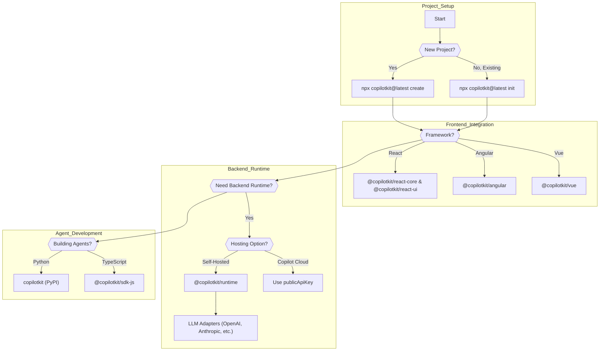

Sources: [packages/runtime/package.json:1-15](), [packages/sdk-js/package.json:1-15]()

---

## Prerequisites

### Environment Requirements

| Environment | Minimum Version | Notes |
|-------------|-----------------|-------|
| **Node.js** | 18.x | Required for all JS/TS packages [packages/core/package.json:60]() |
| **React** | 18.x / 19.x | Supported versions for UI packages [packages/react-core/package.json:137]() |
| **TypeScript** | 5.2.x | Required for type safety [packages/sdk-js/package.json:86]() |
| **Python** | 3.10 | Required for `copilotkit` Python SDK |

Sources: [packages/core/package.json:59-61](), [packages/react-core/package.json:136-140]()

---

## Frontend Installation (React)

### 1. Install Packages
Install the foundational provider and the UI component library.

```bash
pnpm add @copilotkit/react-core @copilotkit/react-ui
```

### 2. Styles Import
Import the default styles in your root layout (e.g., `layout.tsx`) to render components correctly.

```tsx
import "@copilotkit/react-ui/styles.css";
```
*Note: v2 components require `@copilotkit/react-ui/v2/styles.css` [packages/react-ui/package.json:39]().*

### 3. Provider Configuration
Wrap your application in the `CopilotKit` provider. Specify the `runtimeUrl` for your backend endpoint.

```tsx
import { CopilotKit } from "@copilotkit/react-core";

export default function RootLayout({ children }: { children: React.ReactNode }) {
  return (
    <CopilotKit runtimeUrl="/api/copilotkit"> 
      {children}
    </CopilotKit>
  );
}
```

Sources: [packages/react-core/package.json:2-10](), [packages/react-ui/package.json:32-40]()

---

## Backend Runtime Installation

The `CopilotRuntime` processes agent requests and manages LLM interactions.

### 1. Install Runtime
```bash
pnpm add @copilotkit/runtime
```

### 2. Setup Runtime Endpoint
The runtime can be integrated into various Node.js environments including Express, Hono, and Next.js [packages/runtime/package.json:50-61]().

```ts
import { CopilotRuntime, OpenAIAdapter } from '@copilotkit/runtime';

const serviceAdapter = new OpenAIAdapter();
const runtime = new CopilotRuntime();

// Use framework-specific handler
```

Sources: [packages/runtime/package.json:37-63](), [packages/runtime/package.json:102-112]()

---

## Agent SDK Installation

To build agents that synchronize state with the UI via the AG-UI protocol, use the framework-specific SDKs.

### TypeScript SDK
Used for building agents with LangGraph JS or custom TypeScript logic.
```bash
pnpm add @copilotkit/sdk-js
```
The SDK provides `langgraph` and `langchain` entry points [packages/sdk-js/package.json:33-40]().

### Python SDK
Used for building agents with LangGraph Python, CrewAI, or PydanticAI.
```bash
pip install copilotkit
```

Sources: [packages/sdk-js/package.json:1-45](), [packages/runtime/package.json:84]()

---

## Implementation Architecture

This diagram associates installation components with specific code entities and their communication paths.

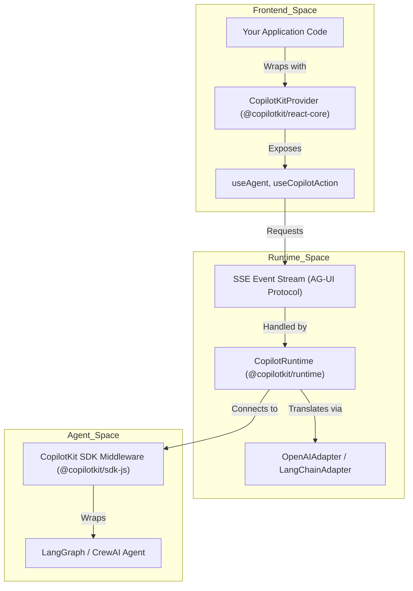

**Code Entity Mapping**

| Entity | Implementation | Package |
|--------|----------------|---------|
| Interaction Protocol | `AG-UI Protocol` | `@ag-ui/core` [packages/runtime/package.json:82]() |
| Runtime Orchestrator | `CopilotRuntime` | `@copilotkit/runtime` [packages/runtime/package.json:2]() |
| State Management | `AgentStore` | `@copilotkit/react-core` [packages/react-core/package.json:2]() |
| UI Rendering | `A2UI-Renderer` | `@copilotkit/a2ui-renderer` [packages/a2ui-renderer/package.json:2]() |

Sources: [packages/react-core/package.json:77-80](), [packages/runtime/package.json:81-84](), [packages/sdk-js/package.json:61-64]()

---

## Verification

To verify your installation, ensure the following are present and functional:

1.  **Dependencies**: Check `package.json` for `@copilotkit/react-core` and `@copilotkit/runtime` [packages/react-core/package.json:2-3]().
2.  **Runtime**: Ensure your runtime endpoint is reachable and configured with a valid `serviceAdapter` (e.g., `OpenAIAdapter`) [packages/runtime/package.json:91,112]().
3.  **Build**: Run your project's build command to ensure all TypeScript types resolve correctly [packages/runtime/package.json:68]().

Sources: [packages/runtime/package.json:1-123](), [packages/react-core/package.json:1-105]()

---

# Page: Quick Start Guide

# Quick Start Guide

<details>
<summary>Relevant source files</summary>

The following files were used as context for generating this wiki page:

- [README.md](README.md)
- [assets/CopilotTextarea.gif](assets/CopilotTextarea.gif)
- [assets/CopilotTextarea_old.gif](assets/CopilotTextarea_old.gif)
- [assets/demo.gif](assets/demo.gif)
- [assets/proejct-perplexity-clone.png](assets/proejct-perplexity-clone.png)
- [assets/project-canvas-demo.png](assets/project-canvas-demo.png)
- [assets/spreadsheet-demo-big-file.gif](assets/spreadsheet-demo-big-file.gif)
- [examples/v2/react/demo/src/app/api/copilotkit/[[...slug]]/route.ts](examples/v2/react/demo/src/app/api/copilotkit/[[...slug]]/route.ts)
- [packages/angular/src/lib/agent.spec.ts](packages/angular/src/lib/agent.spec.ts)
- [packages/angular/src/lib/agent.ts](packages/angular/src/lib/agent.ts)
- [packages/angular/src/lib/config.ts](packages/angular/src/lib/config.ts)
- [packages/angular/src/lib/copilotkit.spec.ts](packages/angular/src/lib/copilotkit.spec.ts)
- [packages/angular/src/lib/directives/__tests__/copilotkit-config.directive.spec.ts](packages/angular/src/lib/directives/__tests__/copilotkit-config.directive.spec.ts)
- [packages/angular/src/lib/license-watermark.ts](packages/angular/src/lib/license-watermark.ts)
- [packages/core/src/__tests__/core-credentials.test.ts](packages/core/src/__tests__/core-credentials.test.ts)
- [packages/core/src/__tests__/core-headers.test.ts](packages/core/src/__tests__/core-headers.test.ts)
- [packages/core/src/__tests__/core-register-proxied-agent.test.ts](packages/core/src/__tests__/core-register-proxied-agent.test.ts)
- [packages/core/src/__tests__/core-subscribe-to-agent.test.ts](packages/core/src/__tests__/core-subscribe-to-agent.test.ts)
- [packages/core/src/__tests__/proxied-runtime-transport.test.ts](packages/core/src/__tests__/proxied-runtime-transport.test.ts)
- [packages/core/src/agent.ts](packages/core/src/agent.ts)
- [packages/core/src/core/agent-registry.ts](packages/core/src/core/agent-registry.ts)
- [packages/core/src/core/core.ts](packages/core/src/core/core.ts)
- [packages/react-core/src/__tests__/threadid-propagation.contract.test.tsx](packages/react-core/src/__tests__/threadid-propagation.contract.test.tsx)
- [packages/react-core/src/hooks/use-agent-nodename.ts](packages/react-core/src/hooks/use-agent-nodename.ts)
- [packages/react-core/src/v2/components/chat/__tests__/CopilotChatActivityRendering.e2e.test.tsx](packages/react-core/src/v2/components/chat/__tests__/CopilotChatActivityRendering.e2e.test.tsx)
- [packages/react-core/src/v2/components/chat/__tests__/copilot-chat-throttle.test.tsx](packages/react-core/src/v2/components/chat/__tests__/copilot-chat-throttle.test.tsx)
- [packages/react-core/src/v2/hooks/__tests__/use-agent-provider-headers.e2e.test.tsx](packages/react-core/src/v2/hooks/__tests__/use-agent-provider-headers.e2e.test.tsx)
- [packages/react-core/src/v2/hooks/__tests__/use-agent-stability.test.tsx](packages/react-core/src/v2/hooks/__tests__/use-agent-stability.test.tsx)
- [packages/react-core/src/v2/hooks/__tests__/use-agent-throttle.test.tsx](packages/react-core/src/v2/hooks/__tests__/use-agent-throttle.test.tsx)
- [packages/react-core/src/v2/hooks/__tests__/use-agent-types.test.tsx](packages/react-core/src/v2/hooks/__tests__/use-agent-types.test.tsx)
- [packages/react-core/src/v2/hooks/__tests__/use-capabilities.test.tsx](packages/react-core/src/v2/hooks/__tests__/use-capabilities.test.tsx)
- [packages/react-core/src/v2/hooks/use-agent.tsx](packages/react-core/src/v2/hooks/use-agent.tsx)
- [packages/react-core/src/v2/hooks/use-capabilities.tsx](packages/react-core/src/v2/hooks/use-capabilities.tsx)
- [packages/react-core/src/v2/hooks/use-render-activity-message.tsx](packages/react-core/src/v2/hooks/use-render-activity-message.tsx)
- [packages/react-core/src/v2/providers/CopilotKitProvider.tsx](packages/react-core/src/v2/providers/CopilotKitProvider.tsx)
- [packages/react-core/src/v2/providers/__tests__/CopilotKitProvider.stability.test.tsx](packages/react-core/src/v2/providers/__tests__/CopilotKitProvider.stability.test.tsx)
- [showcase/angular/src/app/features/mastra/mastra-cards.ts](showcase/angular/src/app/features/mastra/mastra-cards.ts)
- [showcase/angular/src/app/features/mastra/mastra-feature.component.ts](showcase/angular/src/app/features/mastra/mastra-feature.component.ts)
- [showcase/shell-docs/src/content/docs/(other)/contributing/code-contributions/package-linking.mdx](showcase/shell-docs/src/content/docs/(other)/contributing/code-contributions/package-linking.mdx)
- [showcase/shell-docs/src/content/docs/(other)/contributing/meta.json](showcase/shell-docs/src/content/docs/(other)/contributing/meta.json)
- [showcase/shell-docs/src/content/docs/agentic-protocols/a2a.mdx](showcase/shell-docs/src/content/docs/agentic-protocols/a2a.mdx)
- [showcase/shell-docs/src/content/docs/integrations/a2a/quickstart.mdx](showcase/shell-docs/src/content/docs/integrations/a2a/quickstart.mdx)
- [showcase/shell-docs/src/content/docs/integrations/adk/quickstart.mdx](showcase/shell-docs/src/content/docs/integrations/adk/quickstart.mdx)
- [showcase/shell-docs/src/content/docs/integrations/adk/shared-state/workflow-execution.mdx](showcase/shell-docs/src/content/docs/integrations/adk/shared-state/workflow-execution.mdx)
- [showcase/shell-docs/src/content/docs/integrations/ag2/quickstart.mdx](showcase/shell-docs/src/content/docs/integrations/ag2/quickstart.mdx)
- [showcase/shell-docs/src/content/docs/integrations/agent-spec/quickstart.mdx](showcase/shell-docs/src/content/docs/integrations/agent-spec/quickstart.mdx)
- [showcase/shell-docs/src/content/docs/integrations/agno/quickstart.mdx](showcase/shell-docs/src/content/docs/integrations/agno/quickstart.mdx)
- [showcase/shell-docs/src/content/docs/integrations/aws-strands/quickstart.mdx](showcase/shell-docs/src/content/docs/integrations/aws-strands/quickstart.mdx)
- [showcase/shell-docs/src/content/docs/integrations/built-in-agent/quickstart.mdx](showcase/shell-docs/src/content/docs/integrations/built-in-agent/quickstart.mdx)
- [showcase/shell-docs/src/content/docs/integrations/crewai-flows/quickstart.mdx](showcase/shell-docs/src/content/docs/integrations/crewai-flows/quickstart.mdx)
- [showcase/shell-docs/src/content/docs/integrations/deepagents/shared-state/workflow-execution.mdx](showcase/shell-docs/src/content/docs/integrations/deepagents/shared-state/workflow-execution.mdx)
- [showcase/shell-docs/src/content/docs/integrations/langgraph/doctest.json](showcase/shell-docs/src/content/docs/integrations/langgraph/doctest.json)
- [showcase/shell-docs/src/content/docs/integrations/langgraph/prebuilt-components.mdx](showcase/shell-docs/src/content/docs/integrations/langgraph/prebuilt-components.mdx)
- [showcase/shell-docs/src/content/docs/integrations/langgraph/quickstart.mdx](showcase/shell-docs/src/content/docs/integrations/langgraph/quickstart.mdx)
- [showcase/shell-docs/src/content/docs/integrations/langgraph/tutorials/ai-travel-app/step-5-stream-progress.mdx](showcase/shell-docs/src/content/docs/integrations/langgraph/tutorials/ai-travel-app/step-5-stream-progress.mdx)
- [showcase/shell-docs/src/content/docs/integrations/langgraph/tutorials/ai-travel-app/step-6-human-in-the-loop.mdx](showcase/shell-docs/src/content/docs/integrations/langgraph/tutorials/ai-travel-app/step-6-human-in-the-loop.mdx)
- [showcase/shell-docs/src/content/docs/integrations/llamaindex/quickstart.mdx](showcase/shell-docs/src/content/docs/integrations/llamaindex/quickstart.mdx)
- [showcase/shell-docs/src/content/docs/integrations/mastra/quickstart.mdx](showcase/shell-docs/src/content/docs/integrations/mastra/quickstart.mdx)
- [showcase/shell-docs/src/content/docs/integrations/microsoft-agent-framework/quickstart.mdx](showcase/shell-docs/src/content/docs/integrations/microsoft-agent-framework/quickstart.mdx)
- [showcase/shell-docs/src/content/docs/integrations/pydantic-ai/quickstart.mdx](showcase/shell-docs/src/content/docs/integrations/pydantic-ai/quickstart.mdx)

</details>


This guide walks through creating your first CopilotKit application with minimal configuration. It covers the fastest paths to get a working AI-powered application running, including the **BuiltInAgent + CopilotRuntime + CopilotKitProvider** pattern and endpoint styles.

## Overview

A minimal CopilotKit application requires three components:
1.  **Frontend Provider**: The `CopilotKitProvider` component wrapping your application to manage context and communication [packages/react-core/src/v2/providers/CopilotKitProvider.tsx:114-142]().
2.  **Backend Runtime**: A `CopilotRuntime` instance handling agent requests and bridging to LLMs [packages/core/src/core/core.ts:42-45]().
3.  **Agent**: A `BuiltInAgent` (Simple Mode) or a remote agent (e.g., LangGraph) that processes logic [packages/core/src/core/agent-registry.ts:56-60]().

Two setup approaches are available:
*   **Copilot Cloud**: Managed backend with `publicApiKey` configuration [packages/react-core/src/v2/providers/CopilotKitProvider.tsx:81-82]().
*   **Self-Hosted**: Custom runtime endpoint with `runtimeUrl` configuration [packages/core/src/core/core.ts:42-43]().

## Quick Start with CLI

The fastest path to a working application uses the CopilotKit CLI, which scaffolds a complete full-stack agent application [README.md:62-68]().

```bash
npx copilotkit@latest create
```

This command bootstraps a project with a pre-configured frontend provider, backend runtime endpoint, and example UI components [README.md:143-146]().

## Application Architecture Flow

The diagram below bridges the natural language space to code entities, showing how React components interact with the backend runtime classes via the AG-UI protocol.

**Diagram: Frontend to Backend Code Entity Mapping**
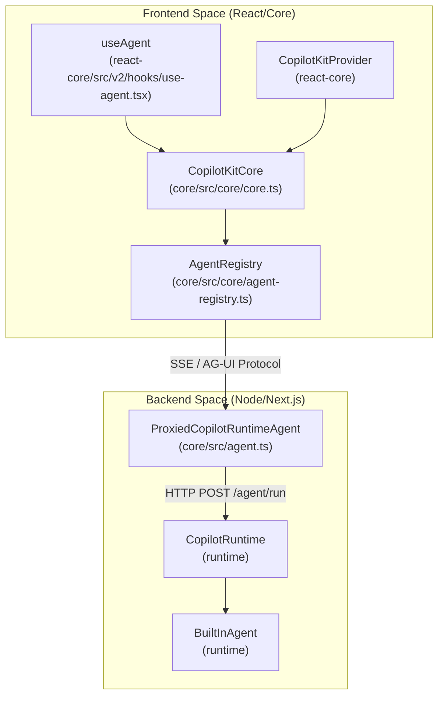
Sources: [packages/core/src/core/core.ts:19-22](), [packages/react-core/src/v2/hooks/use-agent.tsx:6-9](), [packages/core/src/agent.ts:100-110](), [packages/core/src/core/agent-registry.ts:56-60]()

## Manual Setup: Copilot Cloud (Fastest)

Copilot Cloud provides a managed backend runtime, eliminating the need to configure server endpoints manually.

### Step 1: Configure Provider

Wrap your application with the `CopilotKitProvider`. For Cloud, use a `publicApiKey` or `publicLicenseKey`.

```tsx
import { CopilotKitProvider } from "@copilotkit/react-core";

export default function RootLayout({ children }) {
  return (
    <CopilotKitProvider publicApiKey="YOUR_KEY">
      {children}
    </CopilotKitProvider>
  );
}
```
Sources: [packages/react-core/src/v2/providers/CopilotKitProvider.tsx:81-82](), [packages/react-core/src/v2/providers/CopilotKitProvider.tsx:122-125]()

## Manual Setup: Self-Hosted Runtime

Self-hosting gives you control over the `CopilotRuntime` and the agents it runs.

### Step 1: Create Runtime Endpoint

The runtime endpoint processes requests via the AG-UI protocol. You can use the `CopilotRuntime` class to manage agents. The frontend connects to this via the `runtimeUrl` prop on the provider [packages/core/src/core/core.ts:42-43]().

#### Next.js App Router (Single Route Style)
Next.js applications typically use a single endpoint to handle all agent interactions by setting `useSingleEndpoint` to `true` [packages/react-core/src/v2/providers/CopilotKitProvider.tsx:132-132]().

```ts
// Example single route endpoint structure
export const POST = async (req: Request) => {
  // Logic to handle agent/run, agent/info, and agent/stop
};
```
Sources: [packages/core/src/agent.ts:216-234](), [packages/core/src/core/agent-registry.ts:69-75]()

## BuiltInAgent Pattern

The `BuiltInAgent` is the default agent implementation. It supports Model Context Protocol (MCP) tools and various LLM providers. In the frontend, the `useAgent` hook connects to these agents by their `agentId` [packages/react-core/src/v2/hooks/use-agent.tsx:111-121]().

**Diagram: BuiltInAgent Execution Flow**
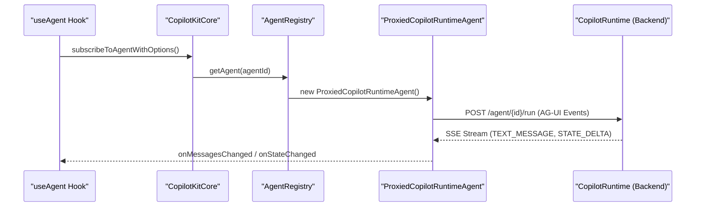
Sources: [packages/react-core/src/v2/hooks/use-agent.tsx:142-160](), [packages/core/src/core/core.ts:134-167](), [packages/core/src/agent.ts:100-110](), [packages/core/src/core/agent-registry.ts:155-166]()

## Multi-Route vs Single-Route Endpoints

CopilotKit supports two architectural styles for backend endpoints, controlled by the `runtimeTransport` setting in `CopilotKitCore` [packages/core/src/core/agent-registry.ts:69-75]():

1.  **Single-Route (`runtimeTransport: "single"`)**:
    *   The frontend communicates with one URL (the `runtimeUrl`).
    *   The payload includes a `method` (e.g., `agent/run`) and `params` (including `agentId`) [packages/core/src/agent.ts:225-234]().
    *   Simplifies deployment by requiring only one backend route.

2.  **Multi-Route (`runtimeTransport: "rest"`)**:
    *   Exposes specific RESTful paths for different agents: `/agent/{agentId}/run` [packages/core/src/agent.ts:122-125]().
    *   Allows for standard HTTP load balancing and path-based middleware.

## Next Steps

*   **Shared State**: Use `useAgent` to access the `state` signal which is synchronized between the frontend and the agent [packages/angular/src/lib/agent.ts:36-41]().
*   **Throttling**: For high-frequency streaming, use the `throttleMs` prop in `useAgent` to coalesce UI updates [packages/react-core/src/v2/hooks/use-agent.tsx:28-40]().
*   **Custom Agents**: Register remote agents (like LangGraph) in your backend `CopilotRuntime` to handle complex multi-step reasoning [showcase/shell-docs/src/content/docs/integrations/langgraph/quickstart.mdx:135-139]().

Sources: [packages/core/src/core/core.ts:208-215](), [packages/react-core/src/v2/hooks/use-agent.tsx:42-49](), [packages/angular/src/lib/agent.ts:59-67]()

---

# Page: Frontend Integration

# Frontend Integration

<details>
<summary>Relevant source files</summary>

The following files were used as context for generating this wiki page:

- [examples/v2/react/demo/src/app/api/copilotkit/[[...slug]]/route.ts](examples/v2/react/demo/src/app/api/copilotkit/[[...slug]]/route.ts)
- [packages/a2ui-renderer/package.json](packages/a2ui-renderer/package.json)
- [packages/angular/src/lib/agent.spec.ts](packages/angular/src/lib/agent.spec.ts)
- [packages/angular/src/lib/agent.ts](packages/angular/src/lib/agent.ts)
- [packages/angular/src/lib/config.ts](packages/angular/src/lib/config.ts)
- [packages/angular/src/lib/copilotkit.spec.ts](packages/angular/src/lib/copilotkit.spec.ts)
- [packages/angular/src/lib/directives/__tests__/copilotkit-config.directive.spec.ts](packages/angular/src/lib/directives/__tests__/copilotkit-config.directive.spec.ts)
- [packages/angular/src/lib/license-watermark.ts](packages/angular/src/lib/license-watermark.ts)
- [packages/core/package.json](packages/core/package.json)
- [packages/core/src/__tests__/core-credentials.test.ts](packages/core/src/__tests__/core-credentials.test.ts)
- [packages/core/src/__tests__/core-headers.test.ts](packages/core/src/__tests__/core-headers.test.ts)
- [packages/core/src/__tests__/core-register-proxied-agent.test.ts](packages/core/src/__tests__/core-register-proxied-agent.test.ts)
- [packages/core/src/__tests__/core-subscribe-to-agent.test.ts](packages/core/src/__tests__/core-subscribe-to-agent.test.ts)
- [packages/core/src/__tests__/proxied-runtime-transport.test.ts](packages/core/src/__tests__/proxied-runtime-transport.test.ts)
- [packages/core/src/agent.ts](packages/core/src/agent.ts)
- [packages/core/src/core/agent-registry.ts](packages/core/src/core/agent-registry.ts)
- [packages/core/src/core/core.ts](packages/core/src/core/core.ts)
- [packages/react-core/package.json](packages/react-core/package.json)
- [packages/react-core/src/__tests__/threadid-propagation.contract.test.tsx](packages/react-core/src/__tests__/threadid-propagation.contract.test.tsx)
- [packages/react-core/src/hooks/use-agent-nodename.ts](packages/react-core/src/hooks/use-agent-nodename.ts)
- [packages/react-core/src/v2/components/chat/__tests__/CopilotChatActivityRendering.e2e.test.tsx](packages/react-core/src/v2/components/chat/__tests__/CopilotChatActivityRendering.e2e.test.tsx)
- [packages/react-core/src/v2/components/chat/__tests__/copilot-chat-throttle.test.tsx](packages/react-core/src/v2/components/chat/__tests__/copilot-chat-throttle.test.tsx)
- [packages/react-core/src/v2/hooks/__tests__/use-agent-provider-headers.e2e.test.tsx](packages/react-core/src/v2/hooks/__tests__/use-agent-provider-headers.e2e.test.tsx)
- [packages/react-core/src/v2/hooks/__tests__/use-agent-stability.test.tsx](packages/react-core/src/v2/hooks/__tests__/use-agent-stability.test.tsx)
- [packages/react-core/src/v2/hooks/__tests__/use-agent-throttle.test.tsx](packages/react-core/src/v2/hooks/__tests__/use-agent-throttle.test.tsx)
- [packages/react-core/src/v2/hooks/__tests__/use-agent-types.test.tsx](packages/react-core/src/v2/hooks/__tests__/use-agent-types.test.tsx)
- [packages/react-core/src/v2/hooks/__tests__/use-capabilities.test.tsx](packages/react-core/src/v2/hooks/__tests__/use-capabilities.test.tsx)
- [packages/react-core/src/v2/hooks/use-agent.tsx](packages/react-core/src/v2/hooks/use-agent.tsx)
- [packages/react-core/src/v2/hooks/use-capabilities.tsx](packages/react-core/src/v2/hooks/use-capabilities.tsx)
- [packages/react-core/src/v2/hooks/use-render-activity-message.tsx](packages/react-core/src/v2/hooks/use-render-activity-message.tsx)
- [packages/react-core/src/v2/providers/CopilotKitProvider.tsx](packages/react-core/src/v2/providers/CopilotKitProvider.tsx)
- [packages/react-core/src/v2/providers/__tests__/CopilotKitProvider.stability.test.tsx](packages/react-core/src/v2/providers/__tests__/CopilotKitProvider.stability.test.tsx)
- [packages/react-textarea/package.json](packages/react-textarea/package.json)
- [packages/react-ui/package.json](packages/react-ui/package.json)
- [packages/runtime-client-gql/package.json](packages/runtime-client-gql/package.json)
- [packages/runtime/package.json](packages/runtime/package.json)
- [packages/sdk-js/package.json](packages/sdk-js/package.json)
- [packages/shared/package.json](packages/shared/package.json)
- [packages/sqlite-runner/package.json](packages/sqlite-runner/package.json)
- [packages/voice/package.json](packages/voice/package.json)
- [packages/web-inspector/package.json](packages/web-inspector/package.json)

</details>


## Purpose and Scope

This document covers the frontend integration layer of CopilotKit, detailing how React, Angular, Vue, and React Native applications connect to CopilotKit's agent runtime system. It explains the available UI components, hooks, services, and provider configuration patterns that enable applications to interact with AI agents through the AG-UI Protocol.

For provider configuration details, see [CopilotKit Provider Configuration](#3.1). For React-specific components and hooks, see [React Components and Hooks](#3.2). For Angular integration, see [Angular Components and Services](#3.3). For Vue and React Native, see [Vue and React Native Integration](#3.4). For defining frontend actions that agents can call, see [Frontend Actions and Tools](#3.5).

---

## Frontend Package Architecture

The frontend integration layer consists of a core engine, `@copilotkit/core`, which is framework-agnostic and built on top of the `@ag-ui/client` library. This core manages the `AgentRegistry`, `RunHandler`, and `ContextStore` to facilitate communication between the UI and AI agents using the AG-UI Protocol.

### Package Structure Overview

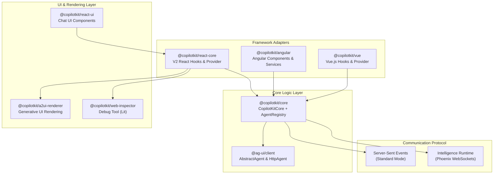

**Sources:** [packages/core/src/core/core.ts:1-36](), [packages/react-core/src/v2/providers/CopilotKitProvider.tsx:49-54](), [packages/core/src/agent.ts:100-115]()

---

## Provider Configuration Patterns

All CopilotKit applications require wrapping components with a provider that configures the connection to the agent runtime. The `CopilotKitProvider` initializes a `CopilotKitCore` instance, which manages the lifecycle of `AbstractAgent` instances.

### Provider to Core Mapping

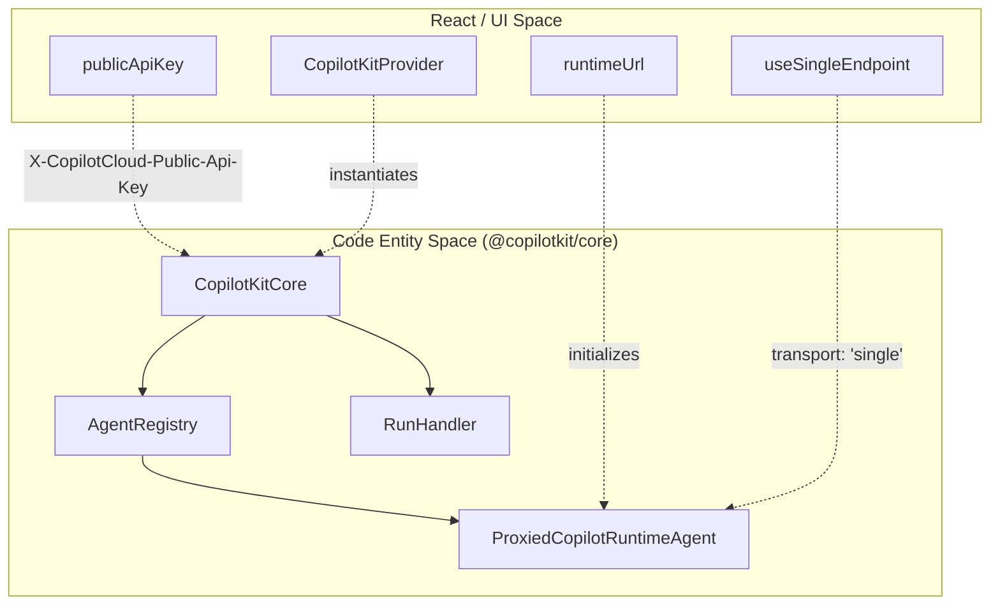

**Sources:** [packages/react-core/src/v2/providers/CopilotKitProvider.tsx:114-150](), [packages/core/src/core/core.ts:39-71](), [packages/core/src/core/agent-registry.ts:56-100]()

---

## React Integration Components

React applications utilize hooks like `useAgent` and components like `CopilotChat` to build agentic interfaces. The `useAgent` hook is the primary mechanism for binding a component to a specific agent's state and message stream.

| Component/Hook | Purpose | Key Code Reference |
|-----------|---------|-------------|
| `CopilotKitProvider` | Root configuration and context provider | [packages/react-core/src/v2/providers/CopilotKitProvider.tsx:114]() |
| `CopilotChat` | Stateful chat component with message history | [packages/react-core/package.json:64]() |
| `useAgent` | Hook to subscribe to agent messages and state | [packages/react-core/src/v2/hooks/use-agent.tsx:57]() |
| `useFrontendTool` | Hook to register UI-side functions for agents | [packages/core/src/core/run-handler.ts:195]() |

**Sources:** [packages/react-core/src/v2/hooks/use-agent.tsx:86-125](), [packages/core/src/core/core.ts:67-73]()

---

## Agent and Runtime Communication

The frontend communicates with agents through the `ProxiedCopilotRuntimeAgent`. This class abstracts the transport layer, supporting both standard SSE (Server-Sent Events) and the Phoenix-based `IntelligenceAgent` for persistent WebSocket connections.

### Runtime Connection Flow

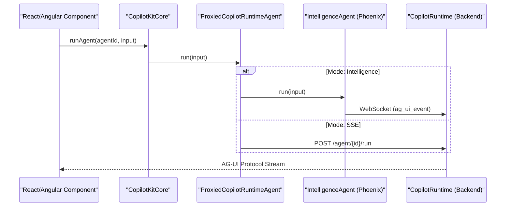

**Sources:** [packages/core/src/agent.ts:187-232](), [packages/core/src/core/run-handler.ts:17-30](), [packages/core/src/core/core.ts:98-132]()

---

## Generative UI and Tool Rendering

CopilotKit enables agents to render custom UI components directly in the chat via `renderToolCalls`. This is powered by the `A2UI` (Agent-to-UI) system, which maps backend tool calls to frontend React components or sandboxed HTML/JS.

- **Declarative Rendering:** Components registered via `renderToolCalls` prop on the provider.
- **Open Generative UI:** Agents generate sandboxed UI code (HTML/CSS/JS) rendered in an iframe using `@copilotkit/a2ui-renderer`.
- **Human-in-the-Loop:** Agents can pause for user confirmation or input via `useHumanInTheLoop`.

**Sources:** [packages/react-core/src/v2/providers/CopilotKitProvider.tsx:135-148](), [packages/a2ui-renderer/package.json:1-13](), [packages/core/src/core/run-handler.ts:28-30]()

---

# Page: CopilotKit Provider Configuration

# CopilotKit Provider Configuration

<details>
<summary>Relevant source files</summary>

The following files were used as context for generating this wiki page:

- [examples/v2/react/demo/src/app/api/copilotkit/[[...slug]]/route.ts](examples/v2/react/demo/src/app/api/copilotkit/[[...slug]]/route.ts)
- [packages/angular/src/lib/agent.spec.ts](packages/angular/src/lib/agent.spec.ts)
- [packages/angular/src/lib/agent.ts](packages/angular/src/lib/agent.ts)
- [packages/angular/src/lib/config.ts](packages/angular/src/lib/config.ts)
- [packages/angular/src/lib/copilotkit.spec.ts](packages/angular/src/lib/copilotkit.spec.ts)
- [packages/angular/src/lib/directives/__tests__/copilotkit-config.directive.spec.ts](packages/angular/src/lib/directives/__tests__/copilotkit-config.directive.spec.ts)
- [packages/angular/src/lib/license-watermark.ts](packages/angular/src/lib/license-watermark.ts)
- [packages/core/src/__tests__/core-credentials.test.ts](packages/core/src/__tests__/core-credentials.test.ts)
- [packages/core/src/__tests__/core-headers.test.ts](packages/core/src/__tests__/core-headers.test.ts)
- [packages/core/src/__tests__/core-register-proxied-agent.test.ts](packages/core/src/__tests__/core-register-proxied-agent.test.ts)
- [packages/core/src/__tests__/core-subscribe-to-agent.test.ts](packages/core/src/__tests__/core-subscribe-to-agent.test.ts)
- [packages/core/src/__tests__/core-suggestions-capability.test.ts](packages/core/src/__tests__/core-suggestions-capability.test.ts)
- [packages/core/src/__tests__/core-suggestions-stateless.test.ts](packages/core/src/__tests__/core-suggestions-stateless.test.ts)
- [packages/core/src/__tests__/proxied-runtime-transport.test.ts](packages/core/src/__tests__/proxied-runtime-transport.test.ts)
- [packages/core/src/agent.ts](packages/core/src/agent.ts)
- [packages/core/src/core/agent-registry.ts](packages/core/src/core/agent-registry.ts)
- [packages/core/src/core/core.ts](packages/core/src/core/core.ts)
- [packages/core/src/core/suggestion-engine.ts](packages/core/src/core/suggestion-engine.ts)
- [packages/react-core/src/__tests__/threadid-propagation.contract.test.tsx](packages/react-core/src/__tests__/threadid-propagation.contract.test.tsx)
- [packages/react-core/src/hooks/use-agent-nodename.ts](packages/react-core/src/hooks/use-agent-nodename.ts)
- [packages/react-core/src/v2/components/chat/__tests__/CopilotChatActivityRendering.e2e.test.tsx](packages/react-core/src/v2/components/chat/__tests__/CopilotChatActivityRendering.e2e.test.tsx)
- [packages/react-core/src/v2/components/chat/__tests__/copilot-chat-throttle.test.tsx](packages/react-core/src/v2/components/chat/__tests__/copilot-chat-throttle.test.tsx)
- [packages/react-core/src/v2/hooks/__tests__/use-agent-provider-headers.e2e.test.tsx](packages/react-core/src/v2/hooks/__tests__/use-agent-provider-headers.e2e.test.tsx)
- [packages/react-core/src/v2/hooks/__tests__/use-agent-stability.test.tsx](packages/react-core/src/v2/hooks/__tests__/use-agent-stability.test.tsx)
- [packages/react-core/src/v2/hooks/__tests__/use-agent-throttle.test.tsx](packages/react-core/src/v2/hooks/__tests__/use-agent-throttle.test.tsx)
- [packages/react-core/src/v2/hooks/__tests__/use-agent-types.test.tsx](packages/react-core/src/v2/hooks/__tests__/use-agent-types.test.tsx)
- [packages/react-core/src/v2/hooks/__tests__/use-capabilities.test.tsx](packages/react-core/src/v2/hooks/__tests__/use-capabilities.test.tsx)
- [packages/react-core/src/v2/hooks/use-agent.tsx](packages/react-core/src/v2/hooks/use-agent.tsx)
- [packages/react-core/src/v2/hooks/use-capabilities.tsx](packages/react-core/src/v2/hooks/use-capabilities.tsx)
- [packages/react-core/src/v2/hooks/use-render-activity-message.tsx](packages/react-core/src/v2/hooks/use-render-activity-message.tsx)
- [packages/react-core/src/v2/providers/CopilotKitProvider.tsx](packages/react-core/src/v2/providers/CopilotKitProvider.tsx)
- [packages/react-core/src/v2/providers/__tests__/CopilotKitProvider.stability.test.tsx](packages/react-core/src/v2/providers/__tests__/CopilotKitProvider.stability.test.tsx)
- [packages/runtime/src/v2/runtime/__tests__/fetch-handler.test.ts](packages/runtime/src/v2/runtime/__tests__/fetch-handler.test.ts)
- [packages/runtime/src/v2/runtime/__tests__/fetch-router.test.ts](packages/runtime/src/v2/runtime/__tests__/fetch-router.test.ts)
- [packages/runtime/src/v2/runtime/__tests__/handle-memories.test.ts](packages/runtime/src/v2/runtime/__tests__/handle-memories.test.ts)
- [packages/runtime/src/v2/runtime/__tests__/integration/node-servers.integration.test.ts](packages/runtime/src/v2/runtime/__tests__/integration/node-servers.integration.test.ts)
- [packages/runtime/src/v2/runtime/__tests__/integration/suites/debug-events.suite.ts](packages/runtime/src/v2/runtime/__tests__/integration/suites/debug-events.suite.ts)
- [packages/runtime/src/v2/runtime/core/fetch-handler.ts](packages/runtime/src/v2/runtime/core/fetch-handler.ts)
- [packages/runtime/src/v2/runtime/core/fetch-router.ts](packages/runtime/src/v2/runtime/core/fetch-router.ts)
- [packages/runtime/src/v2/runtime/core/hooks.ts](packages/runtime/src/v2/runtime/core/hooks.ts)
- [packages/runtime/src/v2/runtime/handlers/__tests__/handle-debug-events.test.ts](packages/runtime/src/v2/runtime/handlers/__tests__/handle-debug-events.test.ts)
- [packages/runtime/src/v2/runtime/handlers/__tests__/handle-suggest.test.ts](packages/runtime/src/v2/runtime/handlers/__tests__/handle-suggest.test.ts)
- [packages/runtime/src/v2/runtime/handlers/__tests__/suggest-no-leak.test.ts](packages/runtime/src/v2/runtime/handlers/__tests__/suggest-no-leak.test.ts)
- [packages/runtime/src/v2/runtime/handlers/handle-debug-events.ts](packages/runtime/src/v2/runtime/handlers/handle-debug-events.ts)
- [packages/runtime/src/v2/runtime/handlers/handle-memories.ts](packages/runtime/src/v2/runtime/handlers/handle-memories.ts)
- [packages/runtime/src/v2/runtime/handlers/handle-suggest.ts](packages/runtime/src/v2/runtime/handlers/handle-suggest.ts)
- [packages/runtime/src/v2/runtime/handlers/intelligence/memories.ts](packages/runtime/src/v2/runtime/handlers/intelligence/memories.ts)
- [packages/runtime/src/v2/runtime/intelligence-platform/__tests__/client.test.ts](packages/runtime/src/v2/runtime/intelligence-platform/__tests__/client.test.ts)
- [packages/runtime/src/v2/runtime/intelligence-platform/client.ts](packages/runtime/src/v2/runtime/intelligence-platform/client.ts)

</details>


## Purpose and Scope

The `CopilotKitProvider` is the central configuration hub for the CopilotKit SDK. It establishes the communication channel between the frontend application and the **Copilot Runtime**, manages the lifecycle of AI agents, and synchronizes state via the **AG-UI Protocol**. This page details the configuration for both self-hosted and Copilot Cloud scenarios, including runtime URLs, authentication headers, license management, and advanced properties.

## Provider Architecture

The `CopilotKitProvider` initializes an instance of `CopilotKitCoreReact`, which extends the core logic to handle React-specific lifecycles [packages/react-core/src/v2/providers/CopilotKitProvider.tsx:49](). It manages a registry of agents and tracks the execution status of tool calls across the component tree [packages/react-core/src/v2/providers/CopilotKitProvider.tsx:181-193]().

### System Entity Mapping

The following diagram maps high-level configuration concepts to the specific classes and interfaces in the codebase.

**Diagram: Provider to Code Entity Mapping**
```mermaid
graph TD
    subgraph "Frontend Context (React)"
        PROVIDER["CopilotKitProvider<br/>[packages/react-core/src/v2/providers/CopilotKitProvider.tsx]"]
        CORE_REACT["CopilotKitCoreReact<br/>[packages/react-core/src/v2/lib/react-core.ts]"]
    end

    subgraph "Core Logic (TypeScript)"
        CORE["CopilotKitCore<br/>[packages/core/src/core/core.ts]"]
        AGENT_REGISTRY["AgentRegistry<br/>[packages/core/src/core/agent-registry.ts]"]
        RUN_HANDLER["RunHandler<br/>[packages/core/src/core/run-handler.ts]"]
    end

    subgraph "Network & Protocol"
        RUNTIME["CopilotRuntime (Remote)<br/>[packages/runtime/src/v2/runtime/core/runtime.ts]"]
        PROXIED_AGENT["ProxiedCopilotRuntimeAgent<br/>[packages/core/src/agent.ts]"]
    end

    PROVIDER --> CORE_REACT
    CORE_REACT --|> CORE
    CORE --> AGENT_REGISTRY
    CORE --> RUN_HANDLER
    AGENT_REGISTRY -- "Creates" --> PROXIED_AGENT
    PROXIED_AGENT -- "SSE / REST" --> RUNTIME
```
**Sources:** [packages/react-core/src/v2/providers/CopilotKitProvider.tsx:49-193](), [packages/core/src/core/core.ts:39-71](), [packages/core/src/core/agent-registry.ts:56-86](), [packages/core/src/agent.ts:100-150]()

## Configuration Scenarios

### 1. Self-Hosted Scenario
In a self-hosted setup, you point the provider to your own deployment of the Copilot Runtime. This is typically an endpoint in a Next.js, Express, or Hono application [examples/v2/react/demo/src/app/api/copilotkit/[[...slug]]/route.ts:77-80]().

```tsx
<CopilotKitProvider runtimeUrl="/api/copilotkit">
  {children}
</CopilotKitProvider>
```

### 2. Copilot Cloud Scenario
When using Copilot Cloud, you provide a `publicApiKey` or `publicLicenseKey`. The provider automatically routes requests to the managed cloud endpoint at `https://api.cloud.copilotkit.ai/copilotkit/v1` [packages/react-core/src/v2/providers/CopilotKitProvider.tsx:82]().

```tsx
<CopilotKitProvider publicApiKey="your_cloud_api_key">
  {children}
</CopilotKitProvider>
```

## Core Properties Reference

The `CopilotKitProviderProps` interface defines the available configuration options [packages/react-core/src/v2/providers/CopilotKitProvider.tsx:114-154]():

| Property | Type | Description |
|----------|------|-------------|
| `runtimeUrl` | `string` | The endpoint of your Copilot Runtime [packages/core/src/core/core.ts:43](). |
| `publicApiKey` | `string` | Public API key for Copilot Cloud [packages/react-core/src/v2/providers/CopilotKitProvider.tsx:123](). |
| `headers` | `Record<string, string> \| () => ...` | Headers appended to every HTTP request [packages/core/src/core/core.ts:62](). |
| `properties` | `Record<string, unknown>` | Metadata sent as `forwardedProps` to agents [packages/core/src/core/core.ts:66](). |
| `credentials` | `RequestCredentials` | Fetch credentials mode (e.g., `"include"` for cookies) [packages/core/src/core/core.ts:64](). |
| `licenseToken` | `string` | Signed token for offline verification of premium features [packages/react-core/src/v2/providers/CopilotKitProvider.tsx:130](). |
| `runtimeTransport` | `"rest" \| "single" \| "auto"` | Transport style for CopilotRuntime endpoints [packages/core/src/core/core.ts:45](). |
| `useSingleEndpoint` | `boolean` | If `true`, forces the runtime to use a single endpoint for all agent interactions [packages/react-core/src/v2/providers/CopilotKitProvider.tsx:132](). |
| `agents__unsafe_dev_only` | `Record<string, AbstractAgent>` | For development only: a map of agent names to `AbstractAgent` instances [packages/core/src/core/core.ts:56](). |
| `debug` | `DebugConfig` | Enables debug logging for the client-side event pipeline [packages/core/src/core/core.ts:72](). |

**Sources:** [packages/react-core/src/v2/providers/CopilotKitProvider.tsx:114-154](), [packages/core/src/core/core.ts:41-73]()

### `runtimeTransport` and `useSingleEndpoint`

The `runtimeTransport` property [packages/core/src/core/core.ts:45]() determines how the frontend communicates with the Copilot Runtime.

- **`"auto"` (default)**: The provider attempts to auto-detect the runtime's capabilities by fetching the `/info` endpoint [packages/core/src/core/agent-registry.ts:69]().
- **`"rest"`**: Forces the use of REST-based communication, typically with separate endpoints like `/agent/{id}/run` [packages/core/src/agent.ts:125]().
- **`"single"`**: Forces the use of a single endpoint for all agent interactions. This is often used with serverless functions [packages/core/src/agent.ts:124]().

The `AgentRegistry` manages the resolution of the `runtimeTransport` and updates the `_runtimeTransport` and `_requestedTransport` properties accordingly [packages/core/src/core/agent-registry.ts:69-75]().

**Diagram: Runtime Transport Resolution**
```mermaid
graph TD
    A["CopilotKitProvider Props"] --> B{"runtimeTransport specified?"}

    B -- "Yes, 'single'" --> C["Set _runtimeTransport = 'single'"]
    B -- "Yes, 'rest'" --> D["Set _runtimeTransport = 'rest'"]
    B -- "Yes, 'auto' or No" --> E["Fetch /info endpoint"]

    E -- "Success" --> F["Resolve from RuntimeInfo"]
    
    C --> H["ProxiedCopilotRuntimeAgent uses single endpoint URL"]
    D --> I["ProxiedCopilotRuntimeAgent uses /agent/{id}/run URL"]

    subgraph "AgentRegistry [packages/core/src/core/agent-registry.ts]"
        C; D; E; F;
    end
    subgraph "ProxiedCopilotRuntimeAgent [packages/core/src/agent.ts]"
        H; I;
    end
```
**Sources:** [packages/core/src/core/core.ts:45](), [packages/react-core/src/v2/providers/CopilotKitProvider.tsx:132](), [packages/core/src/core/agent-registry.ts:69-75](), [packages/core/src/agent.ts:120-126]()

## Implementation Details: Agent Management

The provider coordinates how agents are instantiated. In v2, the `useAgent` hook manages the lifecycle of agents, including **provisional agents** (`ProxiedCopilotRuntimeAgent`) that exist while the runtime is connecting [packages/react-core/src/v2/hooks/use-agent.tsx:7-9]().

### Proxied Agent Registration
For scenarios requiring multiple frontend agents to route to a single runtime agent, the `AgentRegistry` provides `registerProxiedAgent`. This allows a distinct local `agentId` to proxy outbound requests to a different `runtimeAgentId` [packages/core/src/core/agent-registry.ts:32-45]().

**Diagram: Agent Instance Resolution**
```mermaid
sequenceDiagram
    participant UI as useAgent(agentId)
    participant Core as CopilotKitCore
    participant Registry as AgentRegistry
    participant Proxy as ProxiedCopilotRuntimeAgent

    UI->>Core: getAgent(agentId)
    Core->>Registry: getAgent(agentId)
    
    alt Agent Found
        Registry-->>UI: AbstractAgent Instance
    else Agent Not Found (Connecting)
        Registry-->>UI: Provisional ProxiedCopilotRuntimeAgent
    else Agent Not Found (Ready)
        Registry-->>UI: Throw Error
    end
```
**Sources:** [packages/react-core/src/v2/hooks/use-agent.tsx:142-200](), [packages/core/src/core/agent-registry.ts:32-45](), [packages/core/src/agent.ts:100-115]()

## Throttling and Performance

To handle high-frequency streaming updates (e.g., token-by-token text generation), the provider supports throttling via `subscribeToAgentWithOptions`. This reduces re-render frequency by coalescing notifications within a specified window [packages/react-core/src/v2/hooks/use-agent.tsx:33-50]().

- **Leading Edge**: The first update in a window fires immediately for responsiveness [packages/core/src/__tests__/core-subscribe-to-agent.test.ts:144-157]().
- **Trailing Edge**: A final update fires after the window expires to ensure the UI reflects the final state [packages/core/src/__tests__/core-subscribe-to-agent.test.ts:163-187]().

**Sources:** [packages/react-core/src/v2/hooks/use-agent.tsx:33-50](), [packages/core/src/__tests__/core-subscribe-to-agent.test.ts:144-235](), [packages/react-core/src/v2/hooks/__tests__/use-agent-throttle.test.tsx:212-227]()

## Intelligence Runtime Selection

The SDK supports two primary runtime modes: `CopilotSseRuntime` and `CopilotIntelligenceRuntime` [packages/runtime/src/v2/runtime/core/fetch-handler.ts:60-65]().

- **`CopilotSseRuntime`**: The standard runtime for streaming agent responses via Server-Sent Events (SSE).
- **`CopilotIntelligenceRuntime`**: A specialized runtime for applications leveraging the CopilotKit Intelligence Platform, supporting advanced features like long-term memory, thread persistence, and managed channels [packages/runtime/src/v2/runtime/intelligence-platform/client.ts:83-137]().

The `AgentRegistry` detects the `runtimeMode` during the `/info` handshake and configures `ProxiedCopilotRuntimeAgent` instances to use either standard SSE or the Intelligence delegate [packages/core/src/core/agent-registry.ts:128-131]().

**Sources:** [packages/runtime/src/v2/runtime/core/fetch-handler.ts:60-65](), [packages/core/src/core/agent-registry.ts:128-131](), [packages/runtime/src/v2/runtime/intelligence-platform/client.ts:83-137]()

## License Management
The provider includes a `LicenseWarningBanner` and `LicenseContext` to manage premium feature access [packages/react-core/src/v2/providers/CopilotKitProvider.tsx:16-24](). The `licenseStatus` is synchronized from the `AgentRegistry` [packages/core/src/core/agent-registry.ts:160-162](). If a `publicApiKey` or `licenseToken` is missing when premium features are used, the provider emits warnings [packages/react-core/src/v2/providers/CopilotKitProvider.tsx:23]().

**Sources:** [packages/react-core/src/v2/providers/CopilotKitProvider.tsx:16-24](), [packages/core/src/core/agent-registry.ts:160-162]()

---

# Page: React Components and Hooks

# React Components and Hooks

<details>
<summary>Relevant source files</summary>

The following files were used as context for generating this wiki page:

- [codemods/__tests__/migrate-attachments.test.ts](codemods/__tests__/migrate-attachments.test.ts)
- [codemods/migrate-attachments.ts](codemods/migrate-attachments.ts)
- [examples/v2/react/storybook/stories/CopilotChatView.stories.tsx](examples/v2/react/storybook/stories/CopilotChatView.stories.tsx)
- [examples/v2/react/storybook/stories/IntelligenceIndicator.stories.tsx](examples/v2/react/storybook/stories/IntelligenceIndicator.stories.tsx)
- [packages/angular/src/lib/components/a2ui/__tests__/a2ui-activity-renderer.spec.ts](packages/angular/src/lib/components/a2ui/__tests__/a2ui-activity-renderer.spec.ts)
- [packages/angular/src/lib/components/chat/copilot-chat-suggestion-view.ts](packages/angular/src/lib/components/chat/copilot-chat-suggestion-view.ts)
- [packages/angular/src/lib/components/chat/copilot-chat-view-input-container.ts](packages/angular/src/lib/components/chat/copilot-chat-view-input-container.ts)
- [packages/core/src/__tests__/core-connect-thread-switch.test.ts](packages/core/src/__tests__/core-connect-thread-switch.test.ts)
- [packages/core/src/__tests__/core-edge-cases.test.ts](packages/core/src/__tests__/core-edge-cases.test.ts)
- [packages/core/src/__tests__/core-follow-up.test.ts](packages/core/src/__tests__/core-follow-up.test.ts)
- [packages/core/src/__tests__/core-frontend-tool-placeholder.test.ts](packages/core/src/__tests__/core-frontend-tool-placeholder.test.ts)
- [packages/core/src/__tests__/core-parallel-tool-order.test.ts](packages/core/src/__tests__/core-parallel-tool-order.test.ts)
- [packages/core/src/__tests__/core-run-agent-resume.test.ts](packages/core/src/__tests__/core-run-agent-resume.test.ts)
- [packages/core/src/__tests__/intelligence-agent.test.ts](packages/core/src/__tests__/intelligence-agent.test.ts)
- [packages/core/src/__tests__/state-manager.test.ts](packages/core/src/__tests__/state-manager.test.ts)
- [packages/core/src/core/run-handler.ts](packages/core/src/core/run-handler.ts)
- [packages/core/src/core/state-manager.ts](packages/core/src/core/state-manager.ts)
- [packages/core/src/intelligence-agent.ts](packages/core/src/intelligence-agent.ts)
- [packages/react-core/src/hooks/__tests__/use-copilot-action.e2e.test.tsx](packages/react-core/src/hooks/__tests__/use-copilot-action.e2e.test.tsx)
- [packages/react-core/src/v2/__tests__/utils/test-helpers.tsx](packages/react-core/src/v2/__tests__/utils/test-helpers.tsx)
- [packages/react-core/src/v2/components/chat/CopilotChat.tsx](packages/react-core/src/v2/components/chat/CopilotChat.tsx)
- [packages/react-core/src/v2/components/chat/CopilotChatAttachmentQueue.tsx](packages/react-core/src/v2/components/chat/CopilotChatAttachmentQueue.tsx)
- [packages/react-core/src/v2/components/chat/CopilotChatAttachmentRenderer.tsx](packages/react-core/src/v2/components/chat/CopilotChatAttachmentRenderer.tsx)
- [packages/react-core/src/v2/components/chat/CopilotChatInput.tsx](packages/react-core/src/v2/components/chat/CopilotChatInput.tsx)
- [packages/react-core/src/v2/components/chat/CopilotChatMessageView.tsx](packages/react-core/src/v2/components/chat/CopilotChatMessageView.tsx)
- [packages/react-core/src/v2/components/chat/CopilotChatSuggestionView.tsx](packages/react-core/src/v2/components/chat/CopilotChatSuggestionView.tsx)
- [packages/react-core/src/v2/components/chat/CopilotChatView.tsx](packages/react-core/src/v2/components/chat/CopilotChatView.tsx)
- [packages/react-core/src/v2/components/chat/Lightbox.tsx](packages/react-core/src/v2/components/chat/Lightbox.tsx)
- [packages/react-core/src/v2/components/chat/__tests__/CopilotChat.attachments.test.tsx](packages/react-core/src/v2/components/chat/__tests__/CopilotChat.attachments.test.tsx)
- [packages/react-core/src/v2/components/chat/__tests__/CopilotChat.e2e.test.tsx](packages/react-core/src/v2/components/chat/__tests__/CopilotChat.e2e.test.tsx)
- [packages/react-core/src/v2/components/chat/__tests__/CopilotChat.runActivityReconnect.test.tsx](packages/react-core/src/v2/components/chat/__tests__/CopilotChat.runActivityReconnect.test.tsx)
- [packages/react-core/src/v2/components/chat/__tests__/CopilotChatInput.test.tsx](packages/react-core/src/v2/components/chat/__tests__/CopilotChatInput.test.tsx)
- [packages/react-core/src/v2/components/chat/__tests__/CopilotChatMessageView.test.tsx](packages/react-core/src/v2/components/chat/__tests__/CopilotChatMessageView.test.tsx)
- [packages/react-core/src/v2/components/chat/__tests__/CopilotChatView.inputOverlay.test.tsx](packages/react-core/src/v2/components/chat/__tests__/CopilotChatView.inputOverlay.test.tsx)
- [packages/react-core/src/v2/components/chat/__tests__/CopilotChatView.pinToSend.test.tsx](packages/react-core/src/v2/components/chat/__tests__/CopilotChatView.pinToSend.test.tsx)
- [packages/react-core/src/v2/components/chat/__tests__/normalize-auto-scroll.test.ts](packages/react-core/src/v2/components/chat/__tests__/normalize-auto-scroll.test.ts)
- [packages/react-core/src/v2/components/chat/last-user-message-context.ts](packages/react-core/src/v2/components/chat/last-user-message-context.ts)
- [packages/react-core/src/v2/components/chat/normalize-auto-scroll.ts](packages/react-core/src/v2/components/chat/normalize-auto-scroll.ts)
- [packages/react-core/src/v2/components/chat/scroll-element-context.ts](packages/react-core/src/v2/components/chat/scroll-element-context.ts)
- [packages/react-core/src/v2/components/index.ts](packages/react-core/src/v2/components/index.ts)
- [packages/react-core/src/v2/components/intelligence-indicator/IntelligenceIndicator.tsx](packages/react-core/src/v2/components/intelligence-indicator/IntelligenceIndicator.tsx)
- [packages/react-core/src/v2/components/intelligence-indicator/IntelligenceIndicatorView.tsx](packages/react-core/src/v2/components/intelligence-indicator/IntelligenceIndicatorView.tsx)
- [packages/react-core/src/v2/components/intelligence-indicator/__tests__/IntelligenceIndicator.e2e.test.tsx](packages/react-core/src/v2/components/intelligence-indicator/__tests__/IntelligenceIndicator.e2e.test.tsx)
- [packages/react-core/src/v2/components/intelligence-indicator/__tests__/intelligence-indicator-logic.test.ts](packages/react-core/src/v2/components/intelligence-indicator/__tests__/intelligence-indicator-logic.test.ts)
- [packages/react-core/src/v2/components/intelligence-indicator/index.ts](packages/react-core/src/v2/components/intelligence-indicator/index.ts)
- [packages/react-core/src/v2/headless.ts](packages/react-core/src/v2/headless.ts)
- [packages/react-core/src/v2/hooks/__tests__/use-attachments.test.tsx](packages/react-core/src/v2/hooks/__tests__/use-attachments.test.tsx)
- [packages/react-core/src/v2/hooks/__tests__/use-interrupt.test.tsx](packages/react-core/src/v2/hooks/__tests__/use-interrupt.test.tsx)
- [packages/react-core/src/v2/hooks/__tests__/use-pin-to-send.test.tsx](packages/react-core/src/v2/hooks/__tests__/use-pin-to-send.test.tsx)
- [packages/react-core/src/v2/hooks/use-attachments.tsx](packages/react-core/src/v2/hooks/use-attachments.tsx)
- [packages/react-core/src/v2/hooks/use-interrupt.tsx](packages/react-core/src/v2/hooks/use-interrupt.tsx)
- [packages/react-core/src/v2/hooks/use-pin-to-send.ts](packages/react-core/src/v2/hooks/use-pin-to-send.ts)
- [packages/react-core/src/v2/styles/__tests__/streamdown-styles.test.ts](packages/react-core/src/v2/styles/__tests__/streamdown-styles.test.ts)
- [packages/react-core/src/v2/styles/__tests__/streamdown-table-controls.test.tsx](packages/react-core/src/v2/styles/__tests__/streamdown-table-controls.test.tsx)
- [packages/react-core/src/v2/styles/globals.css](packages/react-core/src/v2/styles/globals.css)
- [packages/react-core/src/v2/types/interrupt.ts](packages/react-core/src/v2/types/interrupt.ts)
- [packages/react-core/tsdown.config.ts](packages/react-core/tsdown.config.ts)
- [packages/react-textarea/src/components/copilot-textarea/copilot-textarea.tsx](packages/react-textarea/src/components/copilot-textarea/copilot-textarea.tsx)
- [packages/react-textarea/src/hooks/make-autosuggestions-function/use-make-standard-autosuggestions-function.tsx](packages/react-textarea/src/hooks/make-autosuggestions-function/use-make-standard-autosuggestions-function.tsx)
- [packages/react-textarea/src/lib/editor-to-text.ts](packages/react-textarea/src/lib/editor-to-text.ts)
- [packages/react-textarea/src/lib/get-text-around-cursor.ts](packages/react-textarea/src/lib/get-text-around-cursor.ts)
- [packages/react-textarea/src/types/index.ts](packages/react-textarea/src/types/index.ts)
- [packages/react-textarea/tsdown.config.ts](packages/react-textarea/tsdown.config.ts)
- [packages/react-ui/src/components/chat/AttachmentQueue.tsx](packages/react-ui/src/components/chat/AttachmentQueue.tsx)
- [packages/react-ui/src/components/chat/AttachmentRenderer.tsx](packages/react-ui/src/components/chat/AttachmentRenderer.tsx)
- [packages/react-ui/src/components/chat/Chat.tsx](packages/react-ui/src/components/chat/Chat.tsx)
- [packages/react-ui/src/components/chat/attachment-utils.ts](packages/react-ui/src/components/chat/attachment-utils.ts)
- [packages/react-ui/src/components/chat/messages/ImageRenderer.tsx](packages/react-ui/src/components/chat/messages/ImageRenderer.tsx)
- [packages/react-ui/src/components/chat/messages/UserMessage.tsx](packages/react-ui/src/components/chat/messages/UserMessage.tsx)
- [packages/react-ui/src/components/chat/props.ts](packages/react-ui/src/components/chat/props.ts)
- [packages/react-ui/src/css/attachments.css](packages/react-ui/src/css/attachments.css)
- [packages/react-ui/src/css/messages.css](packages/react-ui/src/css/messages.css)
- [packages/react-ui/src/styles.css](packages/react-ui/src/styles.css)
- [packages/react-ui/tsdown.config.ts](packages/react-ui/tsdown.config.ts)
- [packages/runtime/src/agent/__tests__/capabilities.test.ts](packages/runtime/src/agent/__tests__/capabilities.test.ts)
- [packages/runtime/src/agent/__tests__/factory-native-interrupt.test.ts](packages/runtime/src/agent/__tests__/factory-native-interrupt.test.ts)
- [packages/runtime/src/agent/__tests__/multimodal.test.ts](packages/runtime/src/agent/__tests__/multimodal.test.ts)
- [packages/runtime/src/v2/runtime/core/debug-event-bus.ts](packages/runtime/src/v2/runtime/core/debug-event-bus.ts)
- [packages/shared/src/attachments/__tests__/utils.test.ts](packages/shared/src/attachments/__tests__/utils.test.ts)
- [packages/shared/src/attachments/index.ts](packages/shared/src/attachments/index.ts)
- [packages/shared/src/attachments/types.ts](packages/shared/src/attachments/types.ts)
- [packages/shared/src/attachments/utils.ts](packages/shared/src/attachments/utils.ts)
- [packages/shared/src/debug-event-envelope.ts](packages/shared/src/debug-event-envelope.ts)
- [packages/shared/src/index.ts](packages/shared/src/index.ts)
- [packages/shared/src/types/__tests__/message.test.ts](packages/shared/src/types/__tests__/message.test.ts)
- [packages/shared/src/types/message.ts](packages/shared/src/types/message.ts)
- [packages/vue/src/v2/components/chat/CopilotChat.vue](packages/vue/src/v2/components/chat/CopilotChat.vue)
- [packages/vue/src/v2/components/chat/CopilotChatAssistantMessage.vue](packages/vue/src/v2/components/chat/CopilotChatAssistantMessage.vue)
- [packages/vue/src/v2/components/chat/CopilotChatAttachmentQueue.vue](packages/vue/src/v2/components/chat/CopilotChatAttachmentQueue.vue)
- [packages/vue/src/v2/components/chat/CopilotChatAttachmentRenderer.vue](packages/vue/src/v2/components/chat/CopilotChatAttachmentRenderer.vue)
- [packages/vue/src/v2/components/chat/CopilotChatAudioRecorder.vue](packages/vue/src/v2/components/chat/CopilotChatAudioRecorder.vue)
- [packages/vue/src/v2/components/chat/CopilotChatInput.vue](packages/vue/src/v2/components/chat/CopilotChatInput.vue)
- [packages/vue/src/v2/components/chat/CopilotChatReasoningMessage.vue](packages/vue/src/v2/components/chat/CopilotChatReasoningMessage.vue)
- [packages/vue/src/v2/components/chat/CopilotChatSuggestionPill.vue](packages/vue/src/v2/components/chat/CopilotChatSuggestionPill.vue)
- [packages/vue/src/v2/components/chat/CopilotChatSuggestionView.vue](packages/vue/src/v2/components/chat/CopilotChatSuggestionView.vue)
- [packages/vue/src/v2/components/chat/CopilotChatToggleButton.vue](packages/vue/src/v2/components/chat/CopilotChatToggleButton.vue)
- [packages/vue/src/v2/components/chat/CopilotChatView.vue](packages/vue/src/v2/components/chat/CopilotChatView.vue)
- [packages/vue/src/v2/hooks/__tests__/use-human-in-the-loop.e2e.test.ts](packages/vue/src/v2/hooks/__tests__/use-human-in-the-loop.e2e.test.ts)

</details>


This page documents the React-specific components and hooks provided by CopilotKit for building agent-native user interfaces. These components enable direct integration with agents, provide intelligent text editing, and render generative UI through the AG-UI Protocol.

## UI Components

### CopilotChat Component

The `CopilotChat` component provides a full conversational interface. It follows a modular design, separating logic, state management, and UI layout to enhance maintainability and extensibility.

Title: CopilotChat Architecture and Data Flow
```mermaid
graph TD
    subgraph "Frontend_Code_Space"
        CC["CopilotChat.tsx"]
        CV["CopilotChatView.tsx"]
        CMV["CopilotChatMessageView.tsx"]
        CI["CopilotChatInput.tsx"]
        CAQ["CopilotChatAttachmentQueue.tsx"]
    end

    subgraph "Logic_and_Hooks"
        UA["useAgent()"]
        UAt["useAttachments()"]
        URT["useRenderTool()"]
    end

    subgraph "AG-UI_Protocol_Space"
        HA["HttpAgent (AbstractAgent)"]
        MSGS["Message Array (User/Assistant/Tool/Activity)"]
    end

    CC --> UA
    CC --> UAt
    UA --> HA
    CC --> CV
    CV --> CMV
    CV --> CI
    CMV --> MSGS
    CV --> CAQ
    CMV --> URT
```

#### Implementation and Data Flow

- `CopilotChat.tsx` uses the `useAgent` hook to subscribe to the agent identified by `agentId` and manages message streams and agent runs [packages/react-core/src/v2/components/chat/CopilotChat.tsx:123-126]().
- It uses `useAttachments` to manage multimodal attachment states such as images, audio, video, and document uploads [packages/react-core/src/v2/components/chat/CopilotChat.tsx:183-195]().
- The core UI is rendered via `CopilotChatView`, which internally composes `CopilotChatMessageView` (displaying the message list, including tool call results), `CopilotChatInput` (user input area), and `CopilotChatAttachmentQueue` (for previews and management of attachments) [packages/react-core/src/v2/components/chat/CopilotChatView.tsx:139-178]().
- `CopilotChatMessageView` optimizes rendering with memoized components to prevent unnecessary re-renders during streaming updates [packages/react-core/src/v2/components/chat/CopilotChatMessageView.tsx:66-152]().
- Assistant messages are specifically memoized to detect changes in tool calls and tool results without re-rendering the entire message list [packages/react-core/src/v2/components/chat/CopilotChatMessageView.tsx:91-151]().
- The component integrates the `IntelligenceIndicator` to visually mark turns where specific knowledge base tools are executing [packages/react-core/src/v2/components/chat/CopilotChatMessageView.tsx:28-32]().
- `CopilotChat` subscribes to errors scoped by agent and optionally throttles UI updates via the `throttleMs` option [packages/react-core/src/v2/components/chat/CopilotChat.tsx:147-169]().

**Key Features:**

- **Message Deduplication:** Assistant messages with identical IDs and different partial content/tool calls are handled to maintain coherent UI during streaming [packages/react-core/src/v2/components/chat/CopilotChatMessageView.tsx:93-108]().
- **Audio Transcription:** Integrates `transcribeAudio` for voice-to-text input if enabled in the provider [packages/react-core/src/v2/components/chat/CopilotChat.tsx:207-210]().
- **Pin to Send:** Includes logic to "pin" the input to the bottom during active runs to ensure the user can always see their draft message [packages/react-core/src/v2/components/chat/CopilotChatView.tsx:41]().
- **Slot-based UI Composition:** `CopilotChatView` supports slot overrides to replace subcomponents like `messageView`, `input`, and `suggestionView` [packages/react-core/src/v2/components/chat/CopilotChatView.tsx:57-63]().

**Sources:** [packages/react-core/src/v2/components/chat/CopilotChat.tsx](), [packages/react-core/src/v2/components/chat/CopilotChatView.tsx](), [packages/react-core/src/v2/components/chat/CopilotChatMessageView.tsx](), [packages/react-core/src/v2/components/chat/CopilotChatInput.tsx]()

---

### CopilotTextarea Component

`<CopilotTextarea>` is a drop-in replacement for the standard HTML `<textarea>`, augmented with AI-powered autocomplete and contextual suggestions. It integrates tightly with the CopilotKit context and autosuggestion framework.

#### Implementation Highlights

- The `CopilotTextarea` component wraps a core `BaseCopilotTextarea` and injects an autosuggestion function generated by `useMakeStandardAutosuggestionFunction` [packages/react-textarea/src/components/copilot-textarea/copilot-textarea.tsx:173-176]().
- It leverages `useMakeStandardInsertionOrEditingFunction` to handle text transformations and summarizes [packages/react-textarea/src/components/copilot-textarea/copilot-textarea.tsx:98]().
- The component supports a hovering editor window triggered by the keyboard shortcut `Cmd+K` (Mac) or `Ctrl+K` (Windows), enabling users to suggest changes to the text [packages/react-textarea/src/components/copilot-textarea/copilot-textarea.tsx:9-10]().
- Autosuggestion and insertion API configurations can be customized via the `autosuggestionsConfig` prop, including parameters like `maxTokens` and stopping characters [packages/react-textarea/src/components/copilot-textarea/copilot-textarea.tsx:112-129]().
- Styling is provided via `@copilotkit/react-textarea/styles.css`, which should be imported at the root of the project [packages/react-textarea/src/components/copilot-textarea/copilot-textarea.tsx:74-77]().

```tsx
import { CopilotTextarea } from '@copilotkit/react-textarea';
import "@copilotkit/react-textarea/styles.css";

<CopilotTextarea
  autosuggestionsConfig={{
    textareaPurpose: "the body of an email message",
    chatApiConfigs: {
      suggestionsApiConfig: {
        maxTokens: 20,
        stop: [".", "?", "!"],
      },
    },
  }}
/>
```

**Sources:** [packages/react-textarea/src/components/copilot-textarea/copilot-textarea.tsx](), [packages/react-textarea/src/hooks/make-autosuggestions-function/use-make-standard-autosuggestions-function.tsx]()

---

## React Hooks

CopilotKit offers a set of React hooks tailored for agent integration, UI state management, and rendering generative UI.

### useAgent

- The primary hook to access an agent's state and messages by `agentId` and optionally `threadId`.
- Internally, it connects to the `HttpAgent` instance and subscribes to real-time updates via the AG-UI protocol [packages/react-core/src/v2/components/chat/CopilotChat.tsx:123-126]().
- Supports throttling via `throttleMs` to control re-render frequency on message updates [packages/react-core/src/v2/components/chat/CopilotChat.tsx:89-90]().

**Sources:** [packages/react-core/src/v2/components/chat/CopilotChat.tsx](), [packages/react-core/src/v2/hooks/use-agent.tsx]()

---

### useRenderTool

- Registers a React rendering component for specific tools invoked by agents.
- `CopilotChatMessageView` uses `useRenderActivityMessage` and `useRenderCustomMessages` to determine how to display tool-related activities [packages/react-core/src/v2/components/chat/CopilotChatMessageView.tsx:25]().
- Tool results are rendered as separate messages with `role="tool"` that reference tool call IDs [packages/react-core/src/v2/components/chat/CopilotChatMessageView.tsx:111-112]().

**Sources:** [packages/react-core/src/v2/components/chat/CopilotChatMessageView.tsx](), [packages/react-core/src/v2/hooks/index.ts]()

---

### useThreads

- Manages and subscribes to multiple chat threads for a given agent.
- Interacts with the runtime to manage thread lifecycle.
- In v2, `ɵcreateThreadStore` is used to manage the thread state and subscription to run activities [packages/react-core/src/v2/components/chat/CopilotChat.tsx:22]().

**Sources:** [packages/react-core/src/v2/components/chat/CopilotChat.tsx](), [packages/core/src/core/core.ts]()

---

### useCopilotReadable

- Shares frontend application state with the agent as a readable context.
- Used by `CopilotTextarea` to provide intelligent suggestions based on the application context [packages/react-textarea/src/components/copilot-textarea/copilot-textarea.tsx:6-7]().

---

### useHumanInTheLoop

- Implements the Human-In-The-Loop (HITL) pattern where the agent pauses execution awaiting user input or confirmation.
- The `RunHandler` in the core package manages the standard `resume` array which addresses open AG-UI interrupts [packages/core/src/core/run-handler.ts:28-30]().

**Sources:** [packages/core/src/core/run-handler.ts]()

---

## Summary Diagram: From Natural Language Space to React Components and Hooks

Title: Mapping Natural Language Space to React Code Entities
```mermaid
graph TD
    NL["Natural Language Space"]
    AG["Agent Runtime (CopilotRuntime)"]
    UI["Frontend React Components and Hooks"]

    NL -->|User Messages, Commands| AG
    AG -->|AG-UI Protocol Events| UI

    subgraph "CopilotKit_React_Components"
        CC[/"CopilotChat.tsx"/]
        CT[/"CopilotTextarea.tsx"/]
        CV[/"CopilotChatView.tsx"/]
    end

    subgraph "CopilotKit_React_Hooks"
        UA[/useAgent/]
        UFT[/useFrontendTool/]
        URT[/useRenderTool/]
        UT[/useThreads/]
        UCR[/useCopilotReadable/]
    end

    AG --> UA
    AG --> UT
    UA --> CC
    UA --> CT
    UCR --> CT
    URT --> CV
    CV --> CC
```

---

## Summary Table of Main React Components and Hooks

| Component / Hook      | Purpose | Key Files |
|----------------------|---------|-----------|
| **CopilotChat**      | Full chatbot UI panel with message rendering, input, and attachments. | [packages/react-core/src/v2/components/chat/CopilotChat.tsx]() |
| **CopilotTextarea**  | AI-enhanced, context-aware enriched textarea with autosuggestions. | [packages/react-textarea/src/components/copilot-textarea/copilot-textarea.tsx]() |
| **CopilotChatView**  | Layout component for chat, handling scroll, input, and message views. | [packages/react-core/src/v2/components/chat/CopilotChatView.tsx]() |
| **useAgent**         | Subscribes to a specific agent and thread, manages message and run state. | [packages/react-core/src/v2/hooks/use-agent.tsx]() |
| **useRenderTool**    | Registers React components to render agent tool calls. | [packages/react-core/src/v2/hooks/index.ts]() |
| **useThreads**       | Manages and subscribes to multiple chat threads. | [packages/react-core/src/v2/components/chat/CopilotChat.tsx]() |
| **useCopilotReadable** | Provides application context to the agent. | [packages/react-textarea/src/components/copilot-textarea/copilot-textarea.tsx]() |
| **useAttachments**   | Manages file uploads and attachment state for chat. | [packages/react-core/src/v2/hooks/use-attachments.tsx]() |

---

# Conclusion

CopilotKit's React components and hooks form a comprehensive ecosystem for embedding agent-driven interactions into React applications. The `CopilotChat` and `CopilotTextarea` components offer sophisticated, context-aware UIs wired to the agent runtime via `useAgent`. The modular design with slots, memoization, and specialized hooks enables developers to build highly customized, real-time agentic experiences.

---

**Sources:**  
- [packages/react-core/src/v2/components/chat/CopilotChat.tsx]()
- [packages/react-core/src/v2/components/chat/CopilotChatView.tsx]()
- [packages/react-core/src/v2/components/chat/CopilotChatMessageView.tsx]()
- [packages/react-textarea/src/components/copilot-textarea/copilot-textarea.tsx]()
- [packages/core/src/core/run-handler.ts]()
- [packages/react-core/src/v2/hooks/use-attachments.tsx]()

---

# Page: Angular Components and Services

# Angular Components and Services

<details>
<summary>Relevant source files</summary>

The following files were used as context for generating this wiki page:

- [packages/angular/package.json](packages/angular/package.json)
- [packages/angular/src/lib/components/chat/__tests__/copilot-threads-drawer.spec.ts](packages/angular/src/lib/components/chat/__tests__/copilot-threads-drawer.spec.ts)
- [packages/angular/src/lib/components/chat/copilot-threads-drawer.ts](packages/angular/src/lib/components/chat/copilot-threads-drawer.ts)
- [packages/demo-agents/package.json](packages/demo-agents/package.json)
- [packages/react-core/src/v2/components/chat/CopilotThreadsDrawer.tsx](packages/react-core/src/v2/components/chat/CopilotThreadsDrawer.tsx)
- [packages/react-core/src/v2/components/chat/__tests__/CopilotThreadsDrawer.test.tsx](packages/react-core/src/v2/components/chat/__tests__/CopilotThreadsDrawer.test.tsx)
- [packages/vue/src/v2/components/chat/CopilotThreadsDrawer.vue](packages/vue/src/v2/components/chat/CopilotThreadsDrawer.vue)
- [packages/vue/src/v2/components/chat/__tests__/CopilotThreadsDrawer.ssr.test.ts](packages/vue/src/v2/components/chat/__tests__/CopilotThreadsDrawer.ssr.test.ts)
- [packages/vue/src/v2/components/chat/__tests__/CopilotThreadsDrawer.test.ts](packages/vue/src/v2/components/chat/__tests__/CopilotThreadsDrawer.test.ts)
- [packages/web-components/src/threads-drawer/__tests__/copilotkit-drawer.test.ts](packages/web-components/src/threads-drawer/__tests__/copilotkit-drawer.test.ts)
- [packages/web-components/src/threads-drawer/copilotkit-threads-drawer.ts](packages/web-components/src/threads-drawer/copilotkit-threads-drawer.ts)
- [packages/web-components/src/threads-drawer/index.ts](packages/web-components/src/threads-drawer/index.ts)
- [packages/web-components/src/threads-drawer/styles.ts](packages/web-components/src/threads-drawer/styles.ts)
- [packages/web-components/src/threads-drawer/types.ts](packages/web-components/src/threads-drawer/types.ts)

</details>


This document covers the Angular-specific components, services, and integration patterns provided by the `@copilotkit/angular` package. This package enables Angular applications to integrate with CopilotKit's architecture using native Angular constructs, including Dependency Injection (DI) tokens, services, and signals.

## Package Overview

The `@copilotkit/angular` package provides Angular 20+ components and services that wrap the framework-agnostic `@copilotkit/core` utilities. It follows Angular's dependency injection patterns and component lifecycle while maintaining compatibility with the AG-UI Protocol.

**Package Information:**
- **Package Name:** `@copilotkit/angular` [packages/angular/package.json:2-2]()
- **Minimum Angular Version:** 20.3.26 [packages/angular/package.json:98-98]()
- **Reactive Primitive:** Angular Signals

### Natural Language to Code Entity Mapping (Angular Integration)

The following diagram bridges high-level Angular integration concepts to their specific code entities and file locations.

```mermaid
graph TD
    subgraph "Angular DI & Services"
        PKIT["provideCopilotKit()"]
        CSERV["CopilotKit (Service)"]
        ASTORE["AgentStore"]
        AFAC["CopilotkitAgentFactory"]
    end

    subgraph "Core Entities"
        CORE["CopilotKitCore"]
        PAGENT["ProxiedCopilotRuntimeAgent"]
        TREG["AgentRegistry"]
    end

    subgraph "Reactive State"
        SIGS["Angular Signals"]
        OBS["RxJS Observable"]
    end

    PKIT -->|Initializes| CSERV
    CSERV -->|Wraps| CORE
    AFAC -->|Creates| ASTORE
    ASTORE -->|Subscribes To| PAGENT

    CSERV -->|Exposes| SIGS
    ASTORE -->|Exposes| SIGS
    PAGENT -->|Emits| OBS
```
Sources: `packages/angular/package.json`, `packages/angular/src/lib/agent.ts`, `packages/angular/src/lib/copilotkit.ts`

## Service Layer and Dependency Injection

Angular services provide the bridge between Angular's DI system and the framework-agnostic core utilities.

### provideCopilotKit and CopilotKit Service
The `provideCopilotKit` DI token is the primary entry point for configuring the CopilotKit instance. It initializes the service layer which maintains a reference to the core runtime logic.

- **CopilotKit Service**: Acts as the central registry for agents and tools. It facilitates communication between the Angular UI and the backend runtime.
- **Signal-based Reactivity**: The service layer leverages Angular Signals for properties like connection status (`runtimeConnectionStatus`), headers, and the runtime URL [packages/angular/src/lib/agent.spec.ts:147-160]().

### injectAgentStore and AgentStore Signals
The `injectAgentStore` function allows components to access the synchronized state of a specific agent. This state is exposed via **Angular Signals**, providing fine-grained reactivity for UI updates.

- **AgentStore**: Encapsulates the state of a specific agent, including `messages`, `state`, and `isRunning` status [packages/angular/src/lib/agent.ts:39-41]().
- **Lifecycle Management**: It ensures that subscriptions are cleaned up when components are destroyed using `DestroyRef.onDestroy` [packages/angular/src/lib/agent.ts:84-86]().
- **Provisional Agents**: The system handles scenarios where an agent is requested before the runtime connection is fully established by using a `ProxiedCopilotRuntimeAgent` [packages/angular/src/lib/agent.ts:155-160]().

```mermaid
graph TB
    subgraph "Angular Component"
        COMP["Component Class"]
        IA_STORE["injectAgentStore(agentId)"]
    end

    subgraph "AgentStore (Signal-based)"
        SIG_MSG["messages()"]
        SIG_STATE["state()"]
        SIG_RUNNING["isRunning()"]
    end

    subgraph "CopilotKit Core"
        CK_CORE["CopilotKitCore"]
        AGENT["AbstractAgent / ProxiedAgent"]
        SUBS["subscribeToAgentWithOptions"]
    end

    COMP --> IA_STORE
    IA_STORE --> SIG_MSG
    IA_STORE --> SIG_STATE
    IA_STORE --> SIG_RUNNING

    SIG_MSG -.->|Updates via| SUBS
    SUBS -.->|Listens to| AGENT
    AGENT -.->|Managed by| CK_CORE
```
Sources: `packages/angular/src/lib/agent.ts`, `packages/angular/src/lib/agent.spec.ts`

## UI Components and Rendering

The Angular package includes a suite of components for rendering chat interfaces, message bubbles, and thread management.

### CopilotThreadsDrawer
The `CopilotThreadsDrawer` is an Angular wrapper around the framework-agnostic `<copilotkit-threads-drawer>` web component [packages/angular/src/lib/components/chat/copilot-threads-drawer.ts:148-184]().

- **Web Component Integration**: It uses `CUSTOM_ELEMENTS_SCHEMA` to host the Lit-based drawer [packages/angular/src/lib/components/chat/copilot-threads-drawer.ts:152-152]().
- **Thread Synchronization**: It fetches thread list state via `injectThreads` and pushes data to the element's properties via Angular `effect` [packages/angular/src/lib/components/chat/copilot-threads-drawer.ts:135-141]().
- **Custom Row Rendering**: Supports a structural directive `copilotThreadsDrawerRow` to project custom Angular templates into thread list rows using `slot="row:{id}"` [packages/angular/src/lib/components/chat/copilot-threads-drawer.ts:122-126]().
- **Focus Management**: Implements `findChatInput` to ensure that selecting a thread returns focus to the correct `textarea[copilotChatTextarea]` within a `copilot-chat-view` container [packages/angular/src/lib/components/chat/copilot-threads-drawer.ts:94-102]().

### Message Rendering
CopilotKit provides specialized renderers for assistant and user messages, supporting Markdown, code highlighting, and LaTeX math equations.

- **Markdown & Code**: The system uses `marked` for Markdown parsing, `highlight.js` for code blocks, and `katex` for mathematical formulas [packages/angular/package.json:81-83]().
- **Reactivity**: `AgentStore` uses `WritableSignal` to update `messages` and `state` whenever the underlying agent emits changes via `onMessagesChanged` or `onStateChanged` [packages/angular/src/lib/agent.ts:60-67]().

## Frontend Tool and UI Registration

Angular integration supports registering tools that the agent can call to perform actions or render UI directly.

### registerFrontendTool
Used to define client-side logic that the agent can execute. In Angular, this is handled via the CopilotKit service, which interacts with the `AgentRegistry` in the core [packages/core/src/core/agent-registry.ts:56-56]().

### registerRenderToolCall and RenderToolCalls Component
The `RenderToolCalls` component orchestrates the display of tool-driven UI.
- **Dynamic Rendering**: Registered components receive tool call data via Angular inputs, allowing them to render agent-requested UI.
- **Generative UI**: This enables scenarios where the agent "chooses" which Angular component to display to the user based on the tool call.

### registerHumanInTheLoop
Enables Human-in-the-Loop (HITL) workflows. This allows agents to pause execution and request user input or confirmation before proceeding, synchronized via the `onRunStatusChanged` updates [packages/react-core/src/v2/hooks/use-agent.tsx:16-16]().

## Implementation Details

### Reactive Data Flow
The Angular implementation heavily utilizes `computed` signals to resolve agents and manage the `AgentStore` lifecycle [packages/angular/src/lib/agent.ts:181-186]().

### Styling and Theme Support
Components use Tailwind CSS for styling and support both light and dark modes.
- **Scoped Styles**: Global styles are processed and scoped to prevent conflicts with the host application [packages/angular/package.json:63-63]().
- **Tailwind Integration**: The package includes a `styles.css` export for easy integration into Angular projects [packages/angular/package.json:29-29]().

| Feature | Code Entity | Description |
| :--- | :--- | :--- |
| **Agent State** | `AgentStore` | Encapsulates signals for `messages`, `state`, and `isRunning` [packages/angular/src/lib/agent.ts:30-30](). |
| **Agent Resolution** | `CopilotkitAgentFactory` | Resolves real or provisional agents based on runtime status [packages/angular/src/lib/agent.ts:103-103](). |
| **Thread Drawer** | `CopilotThreadsDrawer` | Angular wrapper for thread history and management [packages/angular/src/lib/components/chat/copilot-threads-drawer.ts:184-184](). |
| **Runtime Connection** | `CopilotKitCoreRuntimeConnectionStatus` | Enum tracking `Disconnected`, `Connecting`, `Connected`, and `Error` states [packages/core/src/core/core.ts:132-135](). |
| **Tool Registry** | `AgentRegistry` | Manages local and remote agent registration and lifecycle [packages/core/src/core/agent-registry.ts:56-56](). |

Sources: `packages/angular/package.json`, `packages/angular/src/lib/agent.ts`, `packages/angular/src/lib/components/chat/copilot-threads-drawer.ts`, `packages/core/src/core/core.ts`, `packages/core/src/core/agent-registry.ts`, `packages/react-core/src/v2/hooks/use-agent.tsx`

---

# Page: Vue and React Native Integration

# Vue and React Native Integration

<details>
<summary>Relevant source files</summary>

The following files were used as context for generating this wiki page:

- [examples/v2/react/storybook/stories/CopilotChatMessageView.stories.tsx](examples/v2/react/storybook/stories/CopilotChatMessageView.stories.tsx)
- [packages/agentcore-runner/package.json](packages/agentcore-runner/package.json)
- [packages/react-core/src/v2/hooks/__tests__/use-default-render-tool.test.tsx](packages/react-core/src/v2/hooks/__tests__/use-default-render-tool.test.tsx)
- [packages/react-core/src/v2/hooks/__tests__/use-render-tool-call.test.tsx](packages/react-core/src/v2/hooks/__tests__/use-render-tool-call.test.tsx)
- [packages/react-core/src/v2/hooks/use-default-render-tool.tsx](packages/react-core/src/v2/hooks/use-default-render-tool.tsx)
- [packages/react-core/src/v2/hooks/use-render-tool-call.tsx](packages/react-core/src/v2/hooks/use-render-tool-call.tsx)
- [packages/react-native/package.json](packages/react-native/package.json)
- [packages/vue/package.json](packages/vue/package.json)
- [showcase/integrations/langgraph-python/src/agents/a2ui_fixed.py](showcase/integrations/langgraph-python/src/agents/a2ui_fixed.py)
- [showcase/integrations/langgraph-python/src/agents/tool_rendering_agent.py](showcase/integrations/langgraph-python/src/agents/tool_rendering_agent.py)
- [showcase/integrations/langgraph-python/src/app/demos/a2ui-fixed-schema/a2ui/catalog.ts](showcase/integrations/langgraph-python/src/app/demos/a2ui-fixed-schema/a2ui/catalog.ts)
- [showcase/integrations/langgraph-python/src/app/demos/a2ui-fixed-schema/a2ui/definitions.ts](showcase/integrations/langgraph-python/src/app/demos/a2ui-fixed-schema/a2ui/definitions.ts)
- [showcase/integrations/langgraph-python/src/app/demos/declarative-gen-ui/a2ui/catalog.ts](showcase/integrations/langgraph-python/src/app/demos/declarative-gen-ui/a2ui/catalog.ts)
- [showcase/integrations/langgraph-python/src/app/demos/declarative-gen-ui/page.tsx](showcase/integrations/langgraph-python/src/app/demos/declarative-gen-ui/page.tsx)
- [showcase/integrations/langgraph-python/src/app/demos/gen-ui-tool-based/page.tsx](showcase/integrations/langgraph-python/src/app/demos/gen-ui-tool-based/page.tsx)
- [showcase/integrations/langgraph-python/src/app/demos/tool-rendering-custom-catchall/custom-catchall-renderer.tsx](showcase/integrations/langgraph-python/src/app/demos/tool-rendering-custom-catchall/custom-catchall-renderer.tsx)
- [showcase/integrations/langgraph-python/src/app/demos/tool-rendering-default-catchall/page.tsx](showcase/integrations/langgraph-python/src/app/demos/tool-rendering-default-catchall/page.tsx)
- [showcase/integrations/langgraph-python/src/app/demos/tool-rendering/d20-card.tsx](showcase/integrations/langgraph-python/src/app/demos/tool-rendering/d20-card.tsx)
- [showcase/integrations/langgraph-python/src/app/demos/tool-rendering/flight-list-card.tsx](showcase/integrations/langgraph-python/src/app/demos/tool-rendering/flight-list-card.tsx)
- [showcase/integrations/langgraph-python/src/app/demos/tool-rendering/page.tsx](showcase/integrations/langgraph-python/src/app/demos/tool-rendering/page.tsx)
- [showcase/integrations/langgraph-python/src/app/demos/tool-rendering/stock-card.tsx](showcase/integrations/langgraph-python/src/app/demos/tool-rendering/stock-card.tsx)
- [showcase/integrations/langgraph-python/tests/e2e/frontend-tools.spec.ts](showcase/integrations/langgraph-python/tests/e2e/frontend-tools.spec.ts)

</details>


CopilotKit provides first-class support for Vue.js and React Native applications, offering a set of hooks and components that mirror the React API while respecting the idiomatic patterns of each platform. This includes Vue's reactivity system (Composables) and React Native's specific networking and polyfill requirements for mobile environments.

## Vue.js Integration

The Vue integration is built on top of the `@copilotkit/core` and `@ag-ui/core` packages, providing a native Vue experience through Composables and the `CopilotKitProvider.vue` component.

### CopilotKitProvider

The `CopilotKitProvider` is the root component for any Vue-based CopilotKit application. It initializes the Copilot engine and provides context to all child components.

*   **V1 Compatibility**: The `CopilotKit.vue` component acts as a compatibility wrapper for `CopilotKitProvider.vue`, accepting legacy props like `publicApiKey` and `publicLicenseKey` [packages/vue/src/components/copilot-provider/CopilotKit.vue:1-18]().
*   **V2 Provider**: The core logic resides in `CopilotKitProvider.vue`, which manages the connection to the `runtimeUrl` and handles the lifecycle of the agentic interaction [packages/vue/src/v2/providers/CopilotKitProvider.vue:1-10]().

### Vue Composables (Hooks)

Vue integration utilizes Composables (functions prefixed with `use`) to interact with the Copilot engine. These functions leverage Vue's `computed`, `ref`, and `watch` for reactivity.

| Composable | Description | Code Reference |
| :--- | :--- | :--- |
| `useAgent` | Accesses a specific agent's state and methods. | [packages/vue/src/v2/hooks/use-agent.ts:4-4]() |
| `useAgentContext` | Registers reactive contextual data sent with agent runs. | [packages/vue/src/v2/hooks/use-agent-context.ts:32-55]() |
| `useFrontendTool` | Registers a tool and optional renderer with CopilotKit core. | [packages/vue/src/v2/hooks/use-frontend-tool.ts:24-68]() |
| `useComponent` | Higher-level wrapper to display a Vue component in the chat. | [packages/vue/src/v2/hooks/use-component.ts:11-46]() |
| `useRenderTool` | Registers a UI component to be rendered for a specific tool call. | [packages/vue/src/v2/hooks/use-render-tool.ts:1-1]() |
| `useDefaultRenderTool` | Registers a wildcard (`*`) renderer for unhandled tool calls. | [packages/vue/src/v2/hooks/use-default-render-tool.ts:1-1]() |
| `useHumanInTheLoop` | Pauses execution until `respond` is called from the UI. | [packages/vue/src/v2/hooks/use-human-in-the-loop.ts:28-90]() |
| `useConfigureSuggestions` | Manages dynamic or static chat suggestions. | [packages/vue/src/v2/hooks/use-configure-suggestions.ts:56-250]() |
| `useAttachments` | Handles file uploads, drag-and-drop, and pasting. | [packages/vue/src/v2/hooks/use-attachments.ts:37-212]() |
| `useThreads` | Manages conversation threads and history. | [packages/vue/src/v2/hooks/use-threads.ts:1-10]() |

Sources: [packages/vue/src/v2/hooks/index.ts:1-30](), [packages/vue/src/v2/hooks/use-frontend-tool.ts:24-68](), [packages/vue/src/v2/hooks/use-agent-context.ts:32-55](), [packages/vue/src/v2/hooks/use-human-in-the-loop.ts:28-90](), [packages/vue/src/v2/hooks/use-threads.ts:1-10]()

### Threads Management and Drawer

The Vue integration includes a native implementation of the `CopilotThreadsDrawer`, which utilizes the framework-agnostic `<copilotkit-threads-drawer>` Lit web component [packages/vue/src/v2/components/chat/CopilotThreadsDrawer.vue:3-10]().

*   **SSR Safety**: The Lit custom element is imported lazily inside `onMounted` to ensure compatibility with SSR frameworks like Nuxt [packages/vue/src/v2/components/chat/CopilotThreadsDrawer.vue:5-8]().
*   **Property Mapping**: Reactive Vue state is pushed to the element's DOM properties via `watchEffect` [packages/vue/src/v2/components/chat/CopilotThreadsDrawer.vue:139-167]().
*   **Event Routing**: Events from the drawer (e.g., `thread-selected`, `archive`, `delete`) are routed back to the `useThreads` composable and the ambient chat configuration [packages/vue/src/v2/components/chat/CopilotThreadsDrawer.vue:185-230]().

### Default Tool Rendering

The `useDefaultRenderTool` composable allows developers to register a "wildcard" renderer that handles any tool call not explicitly covered by a specific `useRenderTool` registration. This prevents tool calls from being invisible when no specific renderer is found [packages/react-core/src/v2/hooks/use-render-tool-call.tsx:162-164]().

**Data Flow: Tool Call to Vue Component**

The system adapts internal raw renderer props (like `args` and enum-based statuses) into a documented `DefaultRenderProps` shape for the UI [packages/react-core/src/v2/hooks/use-default-render-tool.tsx:80-90]().

1.  **Status Mapping**: The internal `ToolCallStatus` enum is mapped to string literals: `inProgress`, `executing`, or `complete` [packages/react-core/src/v2/hooks/use-default-render-tool.tsx:48-73]().
2.  **Prop Adaptation**: The `adaptRendererProps` function ensures that whether the agent sends `args` or `parameters`, the Vue component receives a consistent `parameters` prop [packages/react-core/src/v2/hooks/use-default-render-tool.tsx:80-90]().
3.  **Safe Stringification**: To prevent Vue render crashes from circular references in agent payloads, the `safeStringifyForPre` utility is used for `<pre>` blocks [packages/react-core/src/v2/hooks/use-default-render-tool.tsx:160-178]().

Sources: [packages/react-core/src/v2/hooks/use-default-render-tool.tsx:1-154](), [packages/react-core/src/v2/hooks/use-render-tool-call.tsx:111-185]()

### A2UI and Generative UI in Vue

Vue supports the **Agent-to-UI (A2UI)** protocol through a native implementation of the A2UI Surface.

*   **VueSurface**: Replaces the React island pattern with Vue components that use framework-agnostic primitives from `@a2ui/web_core` [packages/vue/package.json:80-80]().
*   **GenericBinder**: Used within `createVueComponent` to create a reactive bridge between the A2UI state and Vue's `ref` system.
*   **DeferredChild**: A component that subscribes to `onCreated` and `onDeleted` events from the A2UI `SurfaceModel` to dynamically render components as the agent generates them.

**Diagram: Vue A2UI Adapter Architecture**

```mermaid
graph TD
    subgraph "A2UI_Core_Space [@a2ui/web_core]"
        A["SurfaceModel"] --> B["ComponentModel"]
        B --> C["GenericBinder"]
    end

    subgraph "Vue_Entity_Space [@copilotkit/vue]"
        D["A2uiSurface_Component"] --> E["DeferredChild_Component"]
        E --> F["createVueComponent_Adapter"]
        F --> G["VueWrapper"]
        G -- "uses" --> C
    end

    C -- "updates" --> H["resolvedProps_Vue_ref"]
    H --> G
```
Sources: [packages/vue/package.json:79-82](), [packages/vue/src/v2/hooks/use-component.ts:11-46]()

## React Native Integration

The React Native integration is provided via the `@copilotkit/react-native` package. While it shares the same hook-based API as the React integration, it includes specific modifications for the mobile environment.

### Core Differences from React Web
1.  **Polyfills**: React Native requires polyfills for standard web APIs like `web-streams-polyfill` and `text-encoding` [packages/react-native/package.json:86-87](). The package exports specific polyfill entry points for `streams`, `encoding`, `crypto`, `dom`, and `location` [packages/react-native/package.json:38-61]().
2.  **Streaming Fetch**: The `CopilotKitProvider` for Native is optimized to handle Server-Sent Events (SSE) via `react-native-streamdown` [packages/react-native/package.json:107-107]().
3.  **Native UI Components**: The package provides mobile-optimized components, often leveraging `@gorhom/bottom-sheet` and `react-native-reanimated` for native feel [packages/react-native/package.json:100-106]().

### Activity Rendering and MCP
React Native integration supports the Model Context Protocol (MCP) and Activity Rendering. The `MCPAppsActivityRenderer` allows agents to push complex mobile activities or screens to the user, utilizing native navigation and gesture patterns. This is often paired with `AgentCoreRunner` for AWS Bedrock AgentCore-compatible workflows [packages/agentcore-runner/package.json:2-4]().

## Implementation Comparison

| Feature | React (Web) | Vue.js | React Native |
| :--- | :--- | :--- | :--- |
| **Provider** | `CopilotKitProvider` | `CopilotKitProvider.vue` | `CopilotKitProvider` (Native) |
| **State** | React Context / Hooks | Vue Provide/Inject / Composables | React Context / Hooks |
| **Reactivity** | `useState` / `useEffect` | `ref` / `computed` / `watch` | `useState` / `useEffect` |
| **UI Protocol** | A2UI (React) | A2UI (Vue Adapter) | Native UI Components |
| **Threads UI** | `CopilotThreadsDrawer` | `CopilotThreadsDrawer.vue` | Custom Native Drawer |

**Diagram: Vue Integration Data Flow**

```mermaid
graph LR
    subgraph "Frontend_Runtime [@copilotkit/vue]"
        A["CopilotKitProvider.vue"] -- "provides" --> B["CopilotKit_Instance"]
    end

    subgraph "Composables_Hooks"
        B --> C["useAgent"]
        B --> D["useFrontendTool"]
        B --> E["useDefaultRenderTool"]
        B --> F["useHumanInTheLoop"]
        B --> G["useThreads"]
    end

    subgraph "Default_Tool_Rendering"
        E --> I["DefaultToolCallRenderer"]
        I -- "calls" --> J["adaptRendererProps"]
        J -- "maps" --> K["ToolCallStatus_Enum"]
    end
```
Sources: [packages/react-core/src/v2/hooks/use-default-render-tool.tsx:28-81](), [packages/vue/src/v2/hooks/use-agent-context.ts:32-55](), [packages/vue/src/v2/hooks/use-frontend-tool.ts:24-68](), [packages/vue/src/v2/hooks/use-human-in-the-loop.ts:28-90](), [packages/vue/src/v2/hooks/use-threads.ts:1-10]()

## Technical Details

### Component Lifecycle in Vue
In the A2UI implementation, the `GenericBinder` is initialized in the `setup` function of the Vue wrapper. It subscribes to updates and is explicitly disposed of during the `onUnmounted` lifecycle hook to prevent memory leaks. Composables like `useFrontendTool` and `useAgentContext` utilize `onCleanup` within a `watch` or `onScopeDispose` to remove tools/context from the core when the component is destroyed [packages/vue/src/v2/hooks/use-frontend-tool.ts:62-64](), [packages/vue/src/v2/hooks/use-agent-context.ts:51-51]().

### React Native Polyfills
React Native integration requires explicit polyfill imports before using CopilotKit:
*   `@copilotkit/react-native/polyfills`
*   `@copilotkit/react-native/polyfills/streams`
*   `@copilotkit/react-native/polyfills/encoding`

These ensure that the `@copilotkit/core` logic, which expects standard web environment globals like `TextEncoder` and `ReadableStream`, can function correctly in the Hermes or JSC runtimes [packages/react-native/package.json:20-61]().

Sources: [packages/vue/src/v2/hooks/use-frontend-tool.ts:62-64](), [packages/vue/src/v2/hooks/use-agent-context.ts:51-51](), [packages/react-native/package.json:20-61]()

---

# Page: Frontend Actions and Tools

# Frontend Actions and Tools

<details>
<summary>Relevant source files</summary>

The following files were used as context for generating this wiki page:

- [examples/v2/react/storybook/stories/CopilotChatMessageView.stories.tsx](examples/v2/react/storybook/stories/CopilotChatMessageView.stories.tsx)
- [packages/angular/src/lib/memories.spec.ts](packages/angular/src/lib/memories.spec.ts)
- [packages/angular/src/lib/memories.ts](packages/angular/src/lib/memories.ts)
- [packages/core/src/__tests__/core-connect-passive-replay.test.ts](packages/core/src/__tests__/core-connect-passive-replay.test.ts)
- [packages/core/src/__tests__/memory.test.ts](packages/core/src/__tests__/memory.test.ts)
- [packages/core/src/memory-errors.ts](packages/core/src/memory-errors.ts)
- [packages/core/src/memory.ts](packages/core/src/memory.ts)
- [packages/react-core/src/components/CopilotListeners.tsx](packages/react-core/src/components/CopilotListeners.tsx)
- [packages/react-core/src/components/__tests__/CopilotListeners.defaultAgentAbsent.test.tsx](packages/react-core/src/components/__tests__/CopilotListeners.defaultAgentAbsent.test.tsx)
- [packages/react-core/src/components/__tests__/CopilotListeners.test.tsx](packages/react-core/src/components/__tests__/CopilotListeners.test.tsx)
- [packages/react-core/src/test-helpers/stub-window-location.ts](packages/react-core/src/test-helpers/stub-window-location.ts)
- [packages/react-core/src/v2/__tests__/A2UIMessageRenderer.test.tsx](packages/react-core/src/v2/__tests__/A2UIMessageRenderer.test.tsx)
- [packages/react-core/src/v2/__tests__/A2UIRecoveryStates.test.tsx](packages/react-core/src/v2/__tests__/A2UIRecoveryStates.test.tsx)
- [packages/react-core/src/v2/a2ui/A2UICatalogContext.tsx](packages/react-core/src/v2/a2ui/A2UICatalogContext.tsx)
- [packages/react-core/src/v2/a2ui/A2UIMessageRenderer.tsx](packages/react-core/src/v2/a2ui/A2UIMessageRenderer.tsx)
- [packages/react-core/src/v2/a2ui/A2UIRecoveryStates.tsx](packages/react-core/src/v2/a2ui/A2UIRecoveryStates.tsx)
- [packages/react-core/src/v2/a2ui/A2UIToolCallRenderer.tsx](packages/react-core/src/v2/a2ui/A2UIToolCallRenderer.tsx)
- [packages/react-core/src/v2/components/CopilotKitInspector.tsx](packages/react-core/src/v2/components/CopilotKitInspector.tsx)
- [packages/react-core/src/v2/components/OpenGenerativeUIRenderer.tsx](packages/react-core/src/v2/components/OpenGenerativeUIRenderer.tsx)
- [packages/react-core/src/v2/components/__tests__/OpenGenerativeUIRenderer.test.tsx](packages/react-core/src/v2/components/__tests__/OpenGenerativeUIRenderer.test.tsx)
- [packages/react-core/src/v2/components/chat/__tests__/CopilotChat.suggestionsAlways.test.tsx](packages/react-core/src/v2/components/chat/__tests__/CopilotChat.suggestionsAlways.test.tsx)
- [packages/react-core/src/v2/context.ts](packages/react-core/src/v2/context.ts)
- [packages/react-core/src/v2/hooks/__tests__/use-agent-error-state.test.tsx](packages/react-core/src/v2/hooks/__tests__/use-agent-error-state.test.tsx)
- [packages/react-core/src/v2/hooks/__tests__/use-default-render-tool.test.tsx](packages/react-core/src/v2/hooks/__tests__/use-default-render-tool.test.tsx)
- [packages/react-core/src/v2/hooks/__tests__/use-human-in-the-loop.e2e.test.tsx](packages/react-core/src/v2/hooks/__tests__/use-human-in-the-loop.e2e.test.tsx)
- [packages/react-core/src/v2/hooks/__tests__/use-learning-containers.test.tsx](packages/react-core/src/v2/hooks/__tests__/use-learning-containers.test.tsx)
- [packages/react-core/src/v2/hooks/__tests__/use-memories.test.tsx](packages/react-core/src/v2/hooks/__tests__/use-memories.test.tsx)
- [packages/react-core/src/v2/hooks/__tests__/use-render-tool-call.test.tsx](packages/react-core/src/v2/hooks/__tests__/use-render-tool-call.test.tsx)
- [packages/react-core/src/v2/hooks/__tests__/use-threads-provider-headers.e2e.test.tsx](packages/react-core/src/v2/hooks/__tests__/use-threads-provider-headers.e2e.test.tsx)
- [packages/react-core/src/v2/hooks/index.ts](packages/react-core/src/v2/hooks/index.ts)
- [packages/react-core/src/v2/hooks/use-agent-context.tsx](packages/react-core/src/v2/hooks/use-agent-context.tsx)
- [packages/react-core/src/v2/hooks/use-configure-suggestions.tsx](packages/react-core/src/v2/hooks/use-configure-suggestions.tsx)
- [packages/react-core/src/v2/hooks/use-default-render-tool.tsx](packages/react-core/src/v2/hooks/use-default-render-tool.tsx)
- [packages/react-core/src/v2/hooks/use-frontend-tool.tsx](packages/react-core/src/v2/hooks/use-frontend-tool.tsx)
- [packages/react-core/src/v2/hooks/use-human-in-the-loop.tsx](packages/react-core/src/v2/hooks/use-human-in-the-loop.tsx)
- [packages/react-core/src/v2/hooks/use-learning-containers-in-current-thread.tsx](packages/react-core/src/v2/hooks/use-learning-containers-in-current-thread.tsx)
- [packages/react-core/src/v2/hooks/use-learning-containers.tsx](packages/react-core/src/v2/hooks/use-learning-containers.tsx)
- [packages/react-core/src/v2/hooks/use-memories.tsx](packages/react-core/src/v2/hooks/use-memories.tsx)
- [packages/react-core/src/v2/hooks/use-render-tool-call.tsx](packages/react-core/src/v2/hooks/use-render-tool-call.tsx)
- [packages/react-core/src/v2/index.ts](packages/react-core/src/v2/index.ts)
- [packages/react-core/src/v2/providers/__tests__/CopilotKitProvider.onError.test.tsx](packages/react-core/src/v2/providers/__tests__/CopilotKitProvider.onError.test.tsx)
- [packages/react-core/src/v2/providers/__tests__/CopilotKitProvider.renderCustomMessages.e2e.test.tsx](packages/react-core/src/v2/providers/__tests__/CopilotKitProvider.renderCustomMessages.e2e.test.tsx)
- [packages/react-core/src/v2/providers/__tests__/CopilotKitProvider.test.tsx](packages/react-core/src/v2/providers/__tests__/CopilotKitProvider.test.tsx)
- [packages/react-core/src/v2/types/human-in-the-loop.ts](packages/react-core/src/v2/types/human-in-the-loop.ts)
- [showcase/integrations/langgraph-python/src/agents/a2ui_fixed.py](showcase/integrations/langgraph-python/src/agents/a2ui_fixed.py)
- [showcase/integrations/langgraph-python/src/agents/tool_rendering_agent.py](showcase/integrations/langgraph-python/src/agents/tool_rendering_agent.py)
- [showcase/integrations/langgraph-python/src/app/demos/a2ui-fixed-schema/a2ui/catalog.ts](showcase/integrations/langgraph-python/src/app/demos/a2ui-fixed-schema/a2ui/catalog.ts)
- [showcase/integrations/langgraph-python/src/app/demos/a2ui-fixed-schema/a2ui/definitions.ts](showcase/integrations/langgraph-python/src/app/demos/a2ui-fixed-schema/a2ui/definitions.ts)
- [showcase/integrations/langgraph-python/src/app/demos/declarative-gen-ui/a2ui/catalog.ts](showcase/integrations/langgraph-python/src/app/demos/declarative-gen-ui/a2ui/catalog.ts)
- [showcase/integrations/langgraph-python/src/app/demos/declarative-gen-ui/page.tsx](showcase/integrations/langgraph-python/src/app/demos/declarative-gen-ui/page.tsx)
- [showcase/integrations/langgraph-python/src/app/demos/gen-ui-tool-based/page.tsx](showcase/integrations/langgraph-python/src/app/demos/gen-ui-tool-based/page.tsx)
- [showcase/integrations/langgraph-python/src/app/demos/tool-rendering-custom-catchall/custom-catchall-renderer.tsx](showcase/integrations/langgraph-python/src/app/demos/tool-rendering-custom-catchall/custom-catchall-renderer.tsx)
- [showcase/integrations/langgraph-python/src/app/demos/tool-rendering-default-catchall/page.tsx](showcase/integrations/langgraph-python/src/app/demos/tool-rendering-default-catchall/page.tsx)
- [showcase/integrations/langgraph-python/src/app/demos/tool-rendering/d20-card.tsx](showcase/integrations/langgraph-python/src/app/demos/tool-rendering/d20-card.tsx)
- [showcase/integrations/langgraph-python/src/app/demos/tool-rendering/flight-list-card.tsx](showcase/integrations/langgraph-python/src/app/demos/tool-rendering/flight-list-card.tsx)
- [showcase/integrations/langgraph-python/src/app/demos/tool-rendering/page.tsx](showcase/integrations/langgraph-python/src/app/demos/tool-rendering/page.tsx)
- [showcase/integrations/langgraph-python/src/app/demos/tool-rendering/stock-card.tsx](showcase/integrations/langgraph-python/src/app/demos/tool-rendering/stock-card.tsx)
- [showcase/integrations/langgraph-python/tests/e2e/frontend-tools.spec.ts](showcase/integrations/langgraph-python/tests/e2e/frontend-tools.spec.ts)

</details>


**Purpose**: This document explains how to define and use frontend tools that render UI components and execute client-side logic when called by AI agents. Frontend tools enable agents to generate interactive user interfaces dynamically as part of their execution flow using the AG-UI Protocol.

For backend runtime configuration and server-side tools, see [CopilotRuntime Setup](#4.1). For React-specific hooks and components, see [React Components and Hooks](#3.2).

---

## Overview

CopilotKit provides several hooks to define frontend tools and actions that agents can invoke. These tools are registered within the `CopilotKitCore` and synchronized with the agent during connection.

| Tool Type | Hook / Function | Primary Use Case |
|-----------|-----------------|-------------------|
| **Frontend Tool** | `useFrontendTool` | General purpose client-side tool with logic (`handler`) and optional UI (`render`). |
| **Render Tool** | `useRenderTool` | Specialized for Generative UI; defines UI for a specific tool call without execution logic. |
| **Default Render Tool**| `useDefaultRenderTool`| Registers a wildcard (`"*"`) renderer for any tool without a specific UI. |
| **Human-in-the-Loop** | `useHumanInTheLoop` | Pauses agent execution to request user confirmation or input via a promise-based `respond` callback. |
| **Memories** | `useMemories` | Allows the UI to manage persistent user memories (topical, episodic, operational). |

**Sources**: [packages/react-core/src/v2/hooks/index.ts:5-9](), [packages/react-core/src/v2/hooks/use-memories.tsx:149-188](), [packages/react-core/src/v2/hooks/use-human-in-the-loop.tsx:10-122]()

---

## Frontend Tool Architecture

### Diagram: Tool Registration and Execution

The interaction loop bridges the Natural Language Space (agent intent) to the Code Entity Space (frontend implementation).

```mermaid
graph TB
    subgraph "Natural Language Space (Agent)"
        Intent["Agent decides to call 'getWeather'"]
        AGUI_SSE["AG-UI SSE: TOOL_CALL_CHUNK / TOOL_CALL_START"]
    end
    
    subgraph "Code Entity Space (Frontend Core)"
        Core["CopilotKitCore"]
        ToolRegistry["ToolStore / _tools: ReactFrontendTool[]"]
        MemoryStore["ɵMemoryStore (memory.ts)"]
    end
    
    subgraph "UI Space (React Components)"
        Hook["useFrontendTool / useHumanInTheLoop"]
        ChatUI["CopilotChat (CopilotChat.tsx)"]
        Renderer["useRenderToolCall (use-render-tool-call.tsx)"]
    end

    Intent --> AGUI_SSE
    AGUI_SSE --> Core
    Core --> ToolRegistry
    Hook --> |"register"| ToolRegistry
    Core --> |"execute handler()"| Hook
    Core --> |"update status"| Renderer
    Renderer --> ChatUI
    Hook -.-> |"manages"| MemoryStore
```

**Sources**: [packages/react-core/src/v2/hooks/use-render-tool-call.tsx:115-136](), [packages/react-core/src/v2/hooks/use-human-in-the-loop.tsx:107-113](), [packages/core/src/memory.ts:186-197]()

---

## Defining Frontend Tools

### useFrontendTool

The `useFrontendTool` hook registers a tool that the agent can invoke. It combines logic (`handler`) and presentation (`render`). Tools are defined with Zod schemas for parameter validation.

```typescript
import { useFrontendTool } from "@copilotkit/react-core";
import { z } from "zod";

useFrontendTool({
  name: "getWeather",
  description: "Get the current weather for a location",
  parameters: z.object({
    location: z.string(),
  }),
  handler: async ({ location }) => {
    const data = await fetchWeather(location);
    return JSON.stringify(data); // Result sent back to agent via AG-UI
  },
  render: ({ args, status, result }) => (
    <div>
      <h3>Weather in {args.location}</h3>
      {status === "executing" && <p>Fetching...</p>}
      {result && <p>Temperature: {result.temp}°</p>}
    </div>
  ),
});
```

**Sources**: [packages/react-core/src/v2/hooks/use-frontend-tool.tsx:1-20](), [packages/react-core/src/v2/providers/__tests__/CopilotKitProvider.test.tsx:104-129]()

### useRenderTool and Wildcards

The `useRenderTool` hook defines the UI for a tool call without providing execution logic. This is essential for backend-driven tools.

- **Wildcard Tools**: Using `name: "*"` allows catching all tool calls that don't have a specific renderer [packages/react-core/src/v2/hooks/use-default-render-tool.test.tsx:22-45]().
- **useDefaultRenderTool**: Registers the built-in `DefaultToolCallRenderer` under the `*` name [packages/react-core/src/v2/hooks/use-default-render-tool.tsx:128-154](). This renderer provides a standard card with status pills and collapsible JSON views for arguments and results [packages/react-core/src/v2/hooks/use-default-render-tool.test.tsx:141-162]().

**Sources**: [packages/react-core/src/v2/hooks/use-render-tool-call.tsx:2-10](), [packages/react-core/src/v2/hooks/use-default-render-tool.tsx:180-212]()

---

## Tool Lifecycle and Execution

### Render Call Logic

When an agent emits a `TOOL_CALL`, the `useRenderToolCall` hook determines which component to display using a priority lookup:
1. Exact match by name and `agentId`.
2. Exact match by name (global).
3. Wildcard (`*`) renderer.
4. Framework built-in fallback (`DefaultToolCallRenderer`).

```mermaid
graph TD
    subgraph "useRenderToolCall Lookup"
        A["TOOL_CALL Event"] --> B{"Exact Name Match?"}
        B -- "Yes" --> C{"Matches agentId?"}
        C -- "Yes" --> D["Use Agent-Scoped Renderer"]
        C -- "No" --> E["Use Global Name Match"]
        B -- "No" --> F{"Wildcard '*' Registered?"}
        F -- "Yes" --> G["Use Wildcard Renderer"]
        F -- "No" --> H["DefaultToolCallRenderer (Fallback)"]
    end
```

**Sources**: [packages/react-core/src/v2/hooks/use-render-tool-call.tsx:115-136](), [packages/react-core/src/v2/hooks/use-default-render-tool.test.tsx:22-45]()

---

## Human-in-the-Loop (HITL)

The `useHumanInTheLoop` hook allows agents to pause and request user interaction. It wraps a standard frontend tool but provides a `respond` callback to the `render` function to resolve the agent's pending promise.

### Interaction Flow

1. **Agent Request**: The agent triggers a tool call registered via `useHumanInTheLoop` [packages/react-core/src/v2/hooks/use-human-in-the-loop.tsx:107-111]().
2. **Execution Pause**: The `handler` returns a `Promise` that stays pending until `respond()` is called [packages/react-core/src/v2/hooks/use-human-in-the-loop.tsx:32-54]().
3. **UI Interruption**: The `render` component receives a `respond` function when `status` is `Executing` [packages/react-core/src/v2/hooks/use-human-in-the-loop.tsx:77-85]().
4. **User Resolution**: The user interacts with the UI (e.g., clicks "Approve"). The UI calls `respond(result)`, which resolves the promise and sends the data back to the agent [packages/react-core/src/v2/hooks/__tests__/use-human-in-the-loop.e2e.test.tsx:52-59]().

**Sources**: [packages/react-core/src/v2/hooks/use-human-in-the-loop.tsx:20-27](), [packages/react-core/src/v2/hooks/__tests__/use-human-in-the-loop.e2e.test.tsx:114-127]()

---

## Memory Management

Frontend actions can interact with the platform's memory system via `useMemories`. This allows agents to recall or persist information across sessions.

- **Realtime Sync**: The `ɵMemoryStore` opens a Phoenix socket to the `user_meta:memories` topic to receive live `memory_metadata` deltas [packages/core/src/memory.ts:56-60](), [packages/core/src/memory.ts:164-165]().
- **Operations**: Supports `addMemory`, `updateMemory` (supersede), and `removeMemory` (retire) [packages/react-core/src/v2/hooks/use-memories.tsx:65-85]().
- **Availability**: The `isAvailable` flag indicates if the runtime configuration supports memory (404/501/422 status codes) [packages/core/src/memory.ts:68-73]().

**Sources**: [packages/core/src/memory.ts:156-165](), [packages/react-core/src/v2/hooks/use-memories.tsx:177-188](), [packages/angular/src/lib/memories.spec.ts:170-192]()

---

## Error Handling and Status

Tools transition through several statuses during their lifecycle, which are mapped to user-friendly labels in the default renderer.

| ToolCallStatus | Default Label | Description |
|----------------|---------------|-------------|
| `InProgress`   | `Running`     | The tool call is being streamed (arguments are arriving). |
| `Executing`    | `Running`     | The frontend handler is currently running or waiting for user input. |
| `Complete`     | `Done`        | The tool has returned a result and the agent has received it. |

**Sources**: [packages/react-core/src/v2/hooks/use-default-render-tool.tsx:192-202](), [packages/react-core/src/v2/hooks/__tests__/use-human-in-the-loop.e2e.test.tsx:103-134]()

---

# Page: Backend Runtime

# Backend Runtime

<details>
<summary>Relevant source files</summary>

The following files were used as context for generating this wiki page:

- [.claude/docs/architecture.md](.claude/docs/architecture.md)
- [packages/a2ui-renderer/package.json](packages/a2ui-renderer/package.json)
- [packages/core/package.json](packages/core/package.json)
- [packages/core/src/__tests__/debug-config-threading.test.ts](packages/core/src/__tests__/debug-config-threading.test.ts)
- [packages/react-core/package.json](packages/react-core/package.json)
- [packages/react-textarea/package.json](packages/react-textarea/package.json)
- [packages/react-ui/package.json](packages/react-ui/package.json)
- [packages/runtime-client-gql/package.json](packages/runtime-client-gql/package.json)
- [packages/runtime/package.json](packages/runtime/package.json)
- [packages/runtime/src/v2/runtime/__tests__/agent-header-precedence.test.ts](packages/runtime/src/v2/runtime/__tests__/agent-header-precedence.test.ts)
- [packages/runtime/src/v2/runtime/__tests__/agent-utils-header-forwarding.test.ts](packages/runtime/src/v2/runtime/__tests__/agent-utils-header-forwarding.test.ts)
- [packages/runtime/src/v2/runtime/__tests__/agents-factory.test.ts](packages/runtime/src/v2/runtime/__tests__/agents-factory.test.ts)
- [packages/runtime/src/v2/runtime/__tests__/debug-sse-response.test.ts](packages/runtime/src/v2/runtime/__tests__/debug-sse-response.test.ts)
- [packages/runtime/src/v2/runtime/__tests__/handle-connect.test.ts](packages/runtime/src/v2/runtime/__tests__/handle-connect.test.ts)
- [packages/runtime/src/v2/runtime/__tests__/handle-run.test.ts](packages/runtime/src/v2/runtime/__tests__/handle-run.test.ts)
- [packages/runtime/src/v2/runtime/__tests__/header-utils.test.ts](packages/runtime/src/v2/runtime/__tests__/header-utils.test.ts)
- [packages/runtime/src/v2/runtime/__tests__/intelligence-lock-heartbeat.test.ts](packages/runtime/src/v2/runtime/__tests__/intelligence-lock-heartbeat.test.ts)
- [packages/runtime/src/v2/runtime/__tests__/intelligence-run-telemetry.test.ts](packages/runtime/src/v2/runtime/__tests__/intelligence-run-telemetry.test.ts)
- [packages/runtime/src/v2/runtime/__tests__/thread-names.test.ts](packages/runtime/src/v2/runtime/__tests__/thread-names.test.ts)
- [packages/runtime/src/v2/runtime/core/runtime.ts](packages/runtime/src/v2/runtime/core/runtime.ts)
- [packages/runtime/src/v2/runtime/handlers/handle-connect.ts](packages/runtime/src/v2/runtime/handlers/handle-connect.ts)
- [packages/runtime/src/v2/runtime/handlers/handle-run.ts](packages/runtime/src/v2/runtime/handlers/handle-run.ts)
- [packages/runtime/src/v2/runtime/handlers/handle-stop.ts](packages/runtime/src/v2/runtime/handlers/handle-stop.ts)
- [packages/runtime/src/v2/runtime/handlers/header-utils.ts](packages/runtime/src/v2/runtime/handlers/header-utils.ts)
- [packages/runtime/src/v2/runtime/handlers/intelligence/connect.ts](packages/runtime/src/v2/runtime/handlers/intelligence/connect.ts)
- [packages/runtime/src/v2/runtime/handlers/intelligence/run.ts](packages/runtime/src/v2/runtime/handlers/intelligence/run.ts)
- [packages/runtime/src/v2/runtime/handlers/intelligence/thread-names.ts](packages/runtime/src/v2/runtime/handlers/intelligence/thread-names.ts)
- [packages/runtime/src/v2/runtime/handlers/shared/agent-utils.ts](packages/runtime/src/v2/runtime/handlers/shared/agent-utils.ts)
- [packages/runtime/src/v2/runtime/handlers/shared/sse-response.ts](packages/runtime/src/v2/runtime/handlers/shared/sse-response.ts)
- [packages/runtime/src/v2/runtime/handlers/sse/__tests__/sse-connect-agent-id.test.ts](packages/runtime/src/v2/runtime/handlers/sse/__tests__/sse-connect-agent-id.test.ts)
- [packages/runtime/src/v2/runtime/handlers/sse/connect.ts](packages/runtime/src/v2/runtime/handlers/sse/connect.ts)
- [packages/runtime/src/v2/runtime/handlers/sse/run.ts](packages/runtime/src/v2/runtime/handlers/sse/run.ts)
- [packages/runtime/src/v2/runtime/runner/__tests__/bounded-thread-store.test.ts](packages/runtime/src/v2/runtime/runner/__tests__/bounded-thread-store.test.ts)
- [packages/runtime/src/v2/runtime/runner/agent-runner.ts](packages/runtime/src/v2/runtime/runner/agent-runner.ts)
- [packages/sdk-js/package.json](packages/sdk-js/package.json)
- [packages/shared/package.json](packages/shared/package.json)
- [packages/shared/src/__tests__/debug.test.ts](packages/shared/src/__tests__/debug.test.ts)
- [packages/shared/src/debug.ts](packages/shared/src/debug.ts)
- [packages/sqlite-runner/package.json](packages/sqlite-runner/package.json)
- [packages/voice/package.json](packages/voice/package.json)
- [packages/web-inspector/package.json](packages/web-inspector/package.json)

</details>


The Backend Runtime is the server-side orchestration layer of CopilotKit, responsible for managing LLM interactions, routing requests to appropriate providers or agent frameworks, and streaming responses back to the frontend. It provides a unified interface for integrating with various LLM providers (OpenAI, Anthropic, Google, etc.) and agent frameworks (LangGraph, CrewAI, Mastra, PydanticAI) through the AG-UI Protocol.

For frontend integration details, see [Frontend Integration](#3). For Python-based agent development, see [Python SDK](#5).

## Package Structure and Exports

The backend runtime is distributed across packages supporting both legacy (v1) and modern (v2) architectural patterns.

### V1 Runtime: @copilotkit/runtime
The `CopilotRuntime` class in `@copilotkit/runtime` acts as a high-level wrapper that provides backward compatibility for v1 features while delegating modern agent execution to the v2 core.

| Class / Export | Purpose | Key File |
|-------------|---------|----------|
| `CopilotRuntime` | Main entry point; manages actions, remote endpoints, and agent mapping. | [packages/runtime/src/v2/runtime/core/runtime.ts:131-168]() |
| `BuiltInAgent` | A Vercel AI SDK-powered agent with MCP support. | [packages/runtime/src/agent/index.ts:251-260]() |
| `resolveModel` | Utility to convert model strings (e.g., `openai/gpt-4o`) to AI SDK instances. | [packages/runtime/src/agent/index.ts:168-182]() |

### V2 Runtime Core
The v2 core introduces specialized execution modes and a new fetch-based handler architecture.

| Mode | Class / Interface | Communication Protocol |
|------|-------------------|------------------------|
| **SSE Mode** | `CopilotSseRuntimeOptions` | Standard Server-Sent Events (SSE) via `InMemoryAgentRunner`. |
| **Intelligence Mode** | `CopilotIntelligenceRuntimeOptions` | Durable threads and real-time events via `IntelligenceAgentRunner`. |

**Sources:** [packages/runtime/package.json:2-63](), [packages/runtime/src/v2/runtime/core/runtime.ts:179-204](), [packages/runtime/src/agent/index.ts:83-108](), [packages/runtime/src/v2/runtime/core/fetch-handler.ts:1-51]()

## System Architecture

### Runtime Logic & Agent Interaction

```mermaid
graph TB
    subgraph "Frontend (@copilotkit/react-core)"
        Provider["CopilotKitProvider"]
    end
    
    subgraph "CopilotRuntime (@copilotkit/runtime v2)"
        CR["CopilotRuntime Instance"]
        FM["ChannelManager"]
        
        subgraph "Agent Runners"
            IMR["InMemoryAgentRunner"]
            SAR["SqliteAgentRunner"]
            IR["IntelligenceAgentRunner"]
        end
    end
    
    subgraph "Agent Implementation Space"
        BIA["BuiltInAgent (Vercel AI SDK)"]
        LGA["LangGraphAGUIAgent"]
        HttpA["HttpAgent (Remote)"]
    end
    
    subgraph "Intelligence Platform"
        Gateway["Realtime Gateway"]
    end

    Provider -- "AG-UI Protocol (POST /agent/:id/run)" --> CR
    CR -- "activateChannels" --> FM
    CR --> IMR
    CR --> SAR
    CR --> IR
    
    FM -- "startChannelsOverRealtimeGateway" --> Gateway
    IMR -- "run" --> BIA
    IMR -- "run" --> LGA
    IR -- "run" --> HttpA
```

The runtime bridges "Natural Language Space" (messages) to "Code Entity Space" by mapping incoming requests to specific `AbstractAgent` implementations and managing persistent communication channels via `ChannelManager`.

**Sources:** [packages/runtime/src/v2/runtime/core/runtime.ts:131-168](), [packages/runtime/src/v2/runtime/core/channel-manager.ts:158-180](), [packages/runtime/src/agent/index.ts:251-260](), [packages/runtime/src/v2/runtime/core/fetch-handler.ts:53-109]()

## Key Components

### CopilotRuntime (V2 Core)
The core engine that manages the lifecycle of a request. It supports middleware for A2UI (Generative UI) and MCP (Model Context Protocol).
*   **`agents`**: Can be a static map or an `AgentsFactory` for per-request agent resolution (e.g., multi-tenant setups). [packages/runtime/src/v2/runtime/core/runtime.ts:97-109]()
*   **`middleware`**: Supports `beforeRequestMiddleware` and `afterRequestMiddleware` for observability and HITL. [packages/runtime/src/v2/runtime/core/runtime.ts:151-154]()

### Channel Manager
The `ChannelManager` handles the lifecycle of managed Channels (e.g., Slack, Teams) for Intelligence runtimes via `@copilotkit/channels-core`.
*   **Lazy Activation**: Channels are only activated when `handler.channels.ready()` is called, preventing unnecessary connections in serverless environments. [packages/runtime/src/v2/runtime/core/fetch-handler.ts:28-44]()
*   **Status Tracking**: Monitors channel health through states like `connecting`, `online`, `reconnecting`, and `setup_required`. [packages/runtime/src/v2/runtime/core/channel-manager.ts:36-43]()

### Built-in Agent System
The `BuiltInAgent` leverages the Vercel AI SDK and `ai` package to provide a robust, tool-calling agent out of the box.
*   **Model Resolution**: Uses `resolveModel` to dynamically load providers based on strings like `anthropic/claude-3.7-sonnet`. [packages/runtime/src/agent/index.ts:168-216]()
*   **MCP Support**: Integrates with Model Context Protocol servers via `MCPClientConfig` to dynamically fetch tools. [packages/runtime/src/agent/index.ts:118-147]()

**Sources:** [packages/runtime/package.json:79-123](), [packages/runtime/src/v2/runtime/core/runtime.ts:85-130](), [packages/runtime/src/v2/runtime/core/channel-manager.ts:13-35](), [packages/runtime/src/v2/runtime/core/channel-activation-config.ts:22-46]()

## Request Handling Flow

```mermaid
sequenceDiagram
    participant FE as Frontend (useAgent)
    participant EP as FetchHandler (createCopilotRuntimeHandler)
    participant RT as CopilotRuntime
    participant AG as Agent (BuiltIn/LangGraph)
    participant LLM as LLM Provider

    FE->>EP: POST /agent/my-agent/run
    EP->>RT: resolveAgents(request)
    RT->>RT: cloneAgentForRequest()
    RT->>RT: configureAgentForRequest(middlewares)
    RT->>AG: run(input)
    AG->>LLM: streamText / generate
    LLM-->>AG: chunks / tool calls
    AG-->>RT: Observable<BaseEvent>
    RT-->>FE: SSE Stream (TEXT_MESSAGE_CHUNK, etc.)
```

1.  **Routing**: The `matchRoute` utility strips the `basePath` and identifies the requested operation (e.g., `agent/run`, `info`, `threads/list`). [packages/runtime/src/v2/runtime/core/fetch-router.ts:1-20]()
2.  **Cloning**: Every request uses a cloned agent instance via `cloneAgentForRequest` to ensure thread safety and isolation. [packages/runtime/src/v2/runtime/handlers/shared/agent-utils.ts:52-73]()
3.  **Configuration**: Middlewares like `A2UIMiddleware` or `MCPAppsMiddleware` are injected into the agent instance before execution. [packages/runtime/src/v2/runtime/handlers/shared/agent-utils.ts:75-133]()
4.  **Execution**: The `handleRunAgent` function determines whether to use `handleIntelligenceRun` or `handleSseRun` based on the runtime mode. [packages/runtime/src/v2/runtime/handlers/handle-run.ts:79-97]()

**Sources:** [packages/runtime/src/v2/runtime/core/fetch-handler.ts:71-100](), [packages/runtime/src/v2/runtime/handlers/handle-run.ts:13-31](), [packages/runtime/src/v2/runtime/handlers/shared/agent-utils.ts:164-180]()

## Persistence and Specialized Runners

CopilotKit provides several runners for different persistence and deployment needs:

| Runner | Package | Purpose |
|--------|---------|---------|
| `InMemoryAgentRunner` | `@copilotkit/runtime` | Default transient state runner. |
| `SqliteAgentRunner` | `@copilotkit/sqlite-runner` | Local persistence using `better-sqlite3`. |
| `AgentCoreRunner` | `@copilotkit/agentcore-runner` | Integration with AWS AgentCore services. |

**Sources:** [packages/sqlite-runner/package.json:2-37](), [packages/runtime/src/v2/runtime/runner/agent-runner.ts:1-30]()

## Setup and Integration

For detailed instructions on setting up the runtime across different environments, see the following child pages:

*   **[CopilotRuntime Setup](#4.1)**: Detail how to create and configure `CopilotRuntime` instances across Express, Hono, and Next.js, including the `/info` and `/agent/{id}/run` endpoints and the fetch-router architecture.
*   **[LLM Service Adapters](#4.2)**: Document the service adapter pattern for connecting to OpenAI, Anthropic, Google, Groq, Bedrock, and LangChain.
*   **[Agent Framework Integrations](#4.3)**: Explain integrations with LangGraph (JS/Python), CrewAI, Mastra, LlamaIndex, Agno, PydanticAI, and others via the AG-UI protocol.
*   **[Real-time Event Streaming](#4.4)**: Document the SSE-based architecture, the `IntelligenceRunner`, and AG-UI event types like `STATE_SNAPSHOT` and `TOOL_CALL_START`.
*   **[Built-in Agent and Persistence](#4.5)**: Document the `BuiltInAgent` (Factory vs Simple mode), `SqliteAgentRunner`, `AgentCoreRunner`, and `TranscriptionServiceOpenAI`.

## Intelligence Platform Client
The `CopilotKitIntelligence` client provides direct access to the Intelligence Platform REST API for thread and memory management.
*   **Thread Management**: Methods for `listThreads`, `getThreadMessages`, and `updateThread`. [packages/runtime/src/v2/runtime/intelligence-platform/client.ts:116-150]()
*   **Memory Management**: Methods for `listMemories`, `createMemory`, and `removeMemory`. [packages/runtime/src/v2/runtime/intelligence-platform/client.ts:151-186]()

**Sources:** [packages/runtime/src/v2/runtime/intelligence-platform/client.ts:44-64](), [packages/runtime/src/v2/runtime/intelligence-platform/client.ts:187-200]()

---

# Page: CopilotRuntime Setup

# CopilotRuntime Setup

<details>
<summary>Relevant source files</summary>

The following files were used as context for generating this wiki page:

- [.claude/docs/architecture.md](.claude/docs/architecture.md)
- [packages/angular/README.md](packages/angular/README.md)
- [packages/core/src/__tests__/core-suggestions-capability.test.ts](packages/core/src/__tests__/core-suggestions-capability.test.ts)
- [packages/core/src/__tests__/core-suggestions-stateless.test.ts](packages/core/src/__tests__/core-suggestions-stateless.test.ts)
- [packages/core/src/__tests__/debug-config-threading.test.ts](packages/core/src/__tests__/debug-config-threading.test.ts)
- [packages/core/src/core/suggestion-engine.ts](packages/core/src/core/suggestion-engine.ts)
- [packages/react-core/src/components/copilot-provider/copilotkit-props.tsx](packages/react-core/src/components/copilot-provider/copilotkit-props.tsx)
- [packages/react-core/src/context/copilot-context.tsx](packages/react-core/src/context/copilot-context.tsx)
- [packages/react-core/src/hooks/use-copilot-authenticated-action.ts](packages/react-core/src/hooks/use-copilot-authenticated-action.ts)
- [packages/react-core/src/hooks/use-copilot-chat-headless_c.ts](packages/react-core/src/hooks/use-copilot-chat-headless_c.ts)
- [packages/react-core/src/hooks/use-tree.ts](packages/react-core/src/hooks/use-tree.ts)
- [packages/react-ui/src/components/chat/Popup.tsx](packages/react-ui/src/components/chat/Popup.tsx)
- [packages/react-ui/src/components/chat/Sidebar.tsx](packages/react-ui/src/components/chat/Sidebar.tsx)
- [packages/runtime/src/lib/runtime/__tests__/on-after-request.test.ts](packages/runtime/src/lib/runtime/__tests__/on-after-request.test.ts)
- [packages/runtime/src/lib/runtime/__tests__/v1-agent-factory.test.ts](packages/runtime/src/lib/runtime/__tests__/v1-agent-factory.test.ts)
- [packages/runtime/src/lib/runtime/copilot-runtime.ts](packages/runtime/src/lib/runtime/copilot-runtime.ts)
- [packages/runtime/src/v2/runtime/__tests__/agent-header-precedence.test.ts](packages/runtime/src/v2/runtime/__tests__/agent-header-precedence.test.ts)
- [packages/runtime/src/v2/runtime/__tests__/agent-utils-header-forwarding.test.ts](packages/runtime/src/v2/runtime/__tests__/agent-utils-header-forwarding.test.ts)
- [packages/runtime/src/v2/runtime/__tests__/agents-factory.test.ts](packages/runtime/src/v2/runtime/__tests__/agents-factory.test.ts)
- [packages/runtime/src/v2/runtime/__tests__/debug-sse-response.test.ts](packages/runtime/src/v2/runtime/__tests__/debug-sse-response.test.ts)
- [packages/runtime/src/v2/runtime/__tests__/fetch-handler.test.ts](packages/runtime/src/v2/runtime/__tests__/fetch-handler.test.ts)
- [packages/runtime/src/v2/runtime/__tests__/fetch-router.test.ts](packages/runtime/src/v2/runtime/__tests__/fetch-router.test.ts)
- [packages/runtime/src/v2/runtime/__tests__/handle-connect.test.ts](packages/runtime/src/v2/runtime/__tests__/handle-connect.test.ts)
- [packages/runtime/src/v2/runtime/__tests__/handle-memories.test.ts](packages/runtime/src/v2/runtime/__tests__/handle-memories.test.ts)
- [packages/runtime/src/v2/runtime/__tests__/handle-run.test.ts](packages/runtime/src/v2/runtime/__tests__/handle-run.test.ts)
- [packages/runtime/src/v2/runtime/__tests__/header-utils.test.ts](packages/runtime/src/v2/runtime/__tests__/header-utils.test.ts)
- [packages/runtime/src/v2/runtime/__tests__/integration/node-servers.integration.test.ts](packages/runtime/src/v2/runtime/__tests__/integration/node-servers.integration.test.ts)
- [packages/runtime/src/v2/runtime/__tests__/integration/suites/debug-events.suite.ts](packages/runtime/src/v2/runtime/__tests__/integration/suites/debug-events.suite.ts)
- [packages/runtime/src/v2/runtime/__tests__/intelligence-lock-heartbeat.test.ts](packages/runtime/src/v2/runtime/__tests__/intelligence-lock-heartbeat.test.ts)
- [packages/runtime/src/v2/runtime/__tests__/intelligence-run-telemetry.test.ts](packages/runtime/src/v2/runtime/__tests__/intelligence-run-telemetry.test.ts)
- [packages/runtime/src/v2/runtime/__tests__/thread-names.test.ts](packages/runtime/src/v2/runtime/__tests__/thread-names.test.ts)
- [packages/runtime/src/v2/runtime/core/fetch-handler.ts](packages/runtime/src/v2/runtime/core/fetch-handler.ts)
- [packages/runtime/src/v2/runtime/core/fetch-router.ts](packages/runtime/src/v2/runtime/core/fetch-router.ts)
- [packages/runtime/src/v2/runtime/core/hooks.ts](packages/runtime/src/v2/runtime/core/hooks.ts)
- [packages/runtime/src/v2/runtime/core/runtime.ts](packages/runtime/src/v2/runtime/core/runtime.ts)
- [packages/runtime/src/v2/runtime/handlers/__tests__/handle-debug-events.test.ts](packages/runtime/src/v2/runtime/handlers/__tests__/handle-debug-events.test.ts)
- [packages/runtime/src/v2/runtime/handlers/__tests__/handle-suggest.test.ts](packages/runtime/src/v2/runtime/handlers/__tests__/handle-suggest.test.ts)
- [packages/runtime/src/v2/runtime/handlers/__tests__/suggest-no-leak.test.ts](packages/runtime/src/v2/runtime/handlers/__tests__/suggest-no-leak.test.ts)
- [packages/runtime/src/v2/runtime/handlers/handle-connect.ts](packages/runtime/src/v2/runtime/handlers/handle-connect.ts)
- [packages/runtime/src/v2/runtime/handlers/handle-debug-events.ts](packages/runtime/src/v2/runtime/handlers/handle-debug-events.ts)
- [packages/runtime/src/v2/runtime/handlers/handle-memories.ts](packages/runtime/src/v2/runtime/handlers/handle-memories.ts)
- [packages/runtime/src/v2/runtime/handlers/handle-run.ts](packages/runtime/src/v2/runtime/handlers/handle-run.ts)
- [packages/runtime/src/v2/runtime/handlers/handle-stop.ts](packages/runtime/src/v2/runtime/handlers/handle-stop.ts)
- [packages/runtime/src/v2/runtime/handlers/handle-suggest.ts](packages/runtime/src/v2/runtime/handlers/handle-suggest.ts)
- [packages/runtime/src/v2/runtime/handlers/header-utils.ts](packages/runtime/src/v2/runtime/handlers/header-utils.ts)
- [packages/runtime/src/v2/runtime/handlers/intelligence/connect.ts](packages/runtime/src/v2/runtime/handlers/intelligence/connect.ts)
- [packages/runtime/src/v2/runtime/handlers/intelligence/memories.ts](packages/runtime/src/v2/runtime/handlers/intelligence/memories.ts)
- [packages/runtime/src/v2/runtime/handlers/intelligence/run.ts](packages/runtime/src/v2/runtime/handlers/intelligence/run.ts)
- [packages/runtime/src/v2/runtime/handlers/intelligence/thread-names.ts](packages/runtime/src/v2/runtime/handlers/intelligence/thread-names.ts)
- [packages/runtime/src/v2/runtime/handlers/shared/agent-utils.ts](packages/runtime/src/v2/runtime/handlers/shared/agent-utils.ts)
- [packages/runtime/src/v2/runtime/handlers/shared/sse-response.ts](packages/runtime/src/v2/runtime/handlers/shared/sse-response.ts)
- [packages/runtime/src/v2/runtime/handlers/sse/__tests__/sse-connect-agent-id.test.ts](packages/runtime/src/v2/runtime/handlers/sse/__tests__/sse-connect-agent-id.test.ts)
- [packages/runtime/src/v2/runtime/handlers/sse/connect.ts](packages/runtime/src/v2/runtime/handlers/sse/connect.ts)
- [packages/runtime/src/v2/runtime/handlers/sse/run.ts](packages/runtime/src/v2/runtime/handlers/sse/run.ts)
- [packages/runtime/src/v2/runtime/intelligence-platform/__tests__/client.test.ts](packages/runtime/src/v2/runtime/intelligence-platform/__tests__/client.test.ts)
- [packages/runtime/src/v2/runtime/intelligence-platform/client.ts](packages/runtime/src/v2/runtime/intelligence-platform/client.ts)
- [packages/runtime/src/v2/runtime/runner/__tests__/bounded-thread-store.test.ts](packages/runtime/src/v2/runtime/runner/__tests__/bounded-thread-store.test.ts)
- [packages/runtime/src/v2/runtime/runner/agent-runner.ts](packages/runtime/src/v2/runtime/runner/agent-runner.ts)
- [packages/shared/src/__tests__/debug.test.ts](packages/shared/src/__tests__/debug.test.ts)
- [packages/shared/src/debug.ts](packages/shared/src/debug.ts)
- [packages/shared/src/utils/console-styling.ts](packages/shared/src/utils/console-styling.ts)
- [packages/vue/src/components/copilot-provider/types.ts](packages/vue/src/components/copilot-provider/types.ts)

</details>


## Overview

`CopilotRuntime` is the central server-side orchestrator of CopilotKit. It serves as the bridge between the frontend UI (via the AG-UI Protocol) and the backend intelligence layer, which includes LLM adapters and external agent frameworks like LangGraph, CrewAI, or Mastra. It handles request routing, agent lifecycle management, state synchronization, and real-time event streaming.

The runtime is designed with a "Fetch-native" core, allowing it to run on any standard web environment (Node.js, Bun, Deno, Cloudflare Workers) while providing specialized adapters for frameworks like Next.js, Express, and Hono.

---

## Runtime Architecture and Core Classes

The runtime logic is encapsulated in the `CopilotRuntime` class. It manages a registry of agents and provides the execution context for processing AI interactions.

### Key Runtime Entities

| Class / Type | Role |
| :--- | :--- |
| `CopilotRuntime` | The main container for backend logic, managing `AgentsConfig` and transcription services [packages/runtime/src/v2/runtime/core/runtime.ts:132-151](). |
| `createCopilotRuntimeHandler` | A framework-agnostic factory that returns a standard `(Request) => Promise<Response>` fetch handler [packages/runtime/src/v2/runtime/core/fetch-handler.ts:185-200](). |
| `AgentRunner` | Interface for executing agent logic. Defaults to `InMemoryAgentRunner` or `IntelligenceAgentRunner` [packages/runtime/src/v2/runtime/core/runtime.ts:32-34](). |
| `BuiltInAgent` | A pre-configured agent using the Vercel AI SDK, supporting multiple LLM providers and MCP tools [packages/runtime/src/lib/runtime/copilot-runtime.ts:74-75](). |
| `ChannelManager` | Manages the lifecycle of persistent communication channels (e.g., Slack, Teams) via the Intelligence Platform [packages/runtime/src/v2/runtime/core/channel-manager.ts:50-60](). |

### Data Flow: Request to Execution

The runtime uses a `fetch-router` to map incoming HTTP requests to specific handler functions.

**Diagram: CopilotRuntime Internal Component Mapping**

```mermaid
graph TD
    subgraph "RequestEntry"
        REQ["HTTP Request\n(Next.js/Express/Hono)"]
        F_HAND["createCopilotRuntimeHandler"]
        M_ROUT["matchRoute"]
    end

    subgraph "CopilotRuntimeLogic"
        RT["CopilotRuntime Instance"]
        HOOKS["CopilotRuntimeHooks\n(onRequest/onResponse)"]
        MW_B["callBeforeRequestMiddleware"]
    end

    subgraph "HandlersExecution"
        H_RUN["handleRunAgent"]
        H_INFO["handleGetRuntimeInfo"]
        AR["AgentRunner\n(InMemory/Intelligence)"]
        AG["AbstractAgent\n(LangGraph/BuiltInAgent/etc)"]
    end

    REQ --> F_HAND
    F_HAND --> HOOKS
    HOOKS --> MW_B
    MW_B --> M_ROUT
    M_ROUT -->|"agent/run"| H_RUN
    M_ROUT -->|"info"| H_INFO
    H_RUN --> AR
    AR --> AG
```
Sources: [packages/runtime/src/v2/runtime/core/fetch-handler.ts:60-117](), [packages/runtime/src/v2/runtime/core/fetch-router.ts:20-51](), [packages/runtime/src/v2/runtime/core/runtime.ts:132-155]()

---

## Endpoint Configuration

The runtime supports two primary modes for exposing endpoints: `multi-route` (standard RESTful paths) and `single-route` (a single POST endpoint with a JSON envelope) [packages/runtime/src/v2/runtime/core/fetch-handler.ts:137-141]().

### Core Endpoints (Multi-Route)

| Endpoint | Method | Description |
| :--- | :--- | :--- |
| `/info` | `GET` | Returns runtime metadata and agent capabilities [packages/runtime/src/v2/runtime/core/fetch-router.ts:68-70](). |
| `/agent/:agentId/run` | `POST` | Primary execution endpoint for a specific agent [packages/runtime/src/v2/runtime/core/fetch-router.ts:89-97](). |
| `/agent/:agentId/connect` | `POST` | Establishes a connection context for an agent [packages/runtime/src/v2/runtime/core/fetch-router.ts:110-119](). |
| `/threads` | `GET` | Lists available threads [packages/runtime/src/v2/runtime/core/fetch-router.ts:209-211](). |
| `/memories` | `GET/POST` | Manages persistent user memories [packages/runtime/src/v2/runtime/core/fetch-router.ts:234-237](). |
| `/transcribe` | `POST` | Audio-to-text processing [packages/runtime/src/v2/runtime/core/fetch-router.ts:73-75](). |

### Single-Route Mode
In `single-route` mode, all calls are funneled through a single POST endpoint. The handler uses `parseMethodCall` to extract the target action from the JSON body [packages/runtime/src/v2/runtime/core/fetch-handler.ts:110-113]().

### Framework Implementation Examples

#### Next.js App Router
Next.js integration utilizes the framework-agnostic fetch handler directly.

```typescript
// app/api/copilotkit/route.ts
import { CopilotRuntime, createCopilotRuntimeHandler } from "@copilotkit/runtime/v2";

const runtime = new CopilotRuntime({ agents: { ... } });
const handler = createCopilotRuntimeHandler({
  runtime,
  basePath: "/api/copilotkit",
});

export const POST = handler;
export const GET = handler;
```
Sources: [packages/runtime/src/v2/runtime/core/fetch-handler.ts:9-26]()

---

## Managed Channels Setup

For long-running hosts, the runtime can manage persistent connections to external platforms like Slack or Teams via the `ChannelManager` [packages/runtime/src/v2/runtime/core/channel-manager.ts:49-60]().

### Channel Activation
Activation is lazy and must be explicitly triggered on long-running hosts [packages/runtime/src/v2/runtime/core/fetch-handler.ts:28-51]().

```typescript
const handler = createCopilotRuntimeHandler({ runtime });

// On a long-running Node.js server:
await handler.channels.ready(); 
```

**Diagram: Channel Manager Activation Flow**

```mermaid
graph TD
    subgraph "Initialization"
        CI["CopilotKitIntelligence"]
        CH["createChannel"]
        MGR["ChannelManager"]
    end

    subgraph "Activation"
        READY["manager.ready()"]
        DERIVE["deriveChannelActivationConfig"]
        ENG["ActivateChannelEngine\n(Realtime Gateway)"]
    end

    subgraph "Status"
        ON["online"]
        ERR["error"]
        SETUP["setup_required"]
    end

    CI --> MGR
    CH --> MGR
    MGR --> READY
    READY --> DERIVE
    DERIVE --> ENG
    ENG --> ON
    ENG --> ERR
    ENG --> SETUP
```
Sources: [packages/runtime/src/v2/runtime/core/channel-manager.ts:121-141](), [packages/runtime/src/v2/runtime/core/fetch-handler.ts:45-50]()

---

## Middleware and Lifecycle Hooks

The runtime provides extensibility via `CopilotRuntimeHooks` to intercept the request pipeline [packages/runtime/src/v2/runtime/core/hooks.ts:1-27]().

### Agent Middleware Configuration
Runtimes automatically apply middleware like `A2UIMiddleware` and `MCPAppsMiddleware` during agent initialization [packages/runtime/src/v2/runtime/handlers/shared/agent-utils.ts:81-142]().

### Lifecycle Hooks
- `onRequest`: Executed before routing [packages/runtime/src/v2/runtime/core/hooks.ts:94-101]().
- `onBeforeHandler`: Executed after routing but before execution [packages/runtime/src/v2/runtime/core/hooks.ts:103-111]().
- `onResponse`: Executed after the handler produces a response [packages/runtime/src/v2/runtime/core/hooks.ts:113-120]().
- `onError`: Executed when an error occurs [packages/runtime/src/v2/runtime/core/hooks.ts:122-125]().

**Diagram: Hook Execution Pipeline**

```mermaid
graph LR
    subgraph "Entry"
        REQ["Request"]
    end

    subgraph "Hooks"
        H1["onRequest"]
        H2["onBeforeHandler"]
        H3["onResponse"]
    end

    subgraph "Core"
        ROUT["Router"]
        HAND["Handler"]
    end

    REQ --> H1
    H1 --> ROUT
    ROUT --> H2
    H2 --> HAND
    HAND --> H3
    H3 --> RESP["Final Response"]
```
Sources: [packages/runtime/src/v2/runtime/core/hooks.ts:132-165](), [packages/runtime/src/v2/runtime/core/fetch-handler.ts:68-74]()

---

## Routing Strategies

The `fetch-router` supports two matching strategies based on the presence of `basePath` [packages/runtime/src/v2/runtime/core/fetch-router.ts:1-9]().

| Strategy | Description |
| :--- | :--- |
| **Strict Prefix** | If `basePath` is provided, the router strips the prefix and matches the remainder [packages/runtime/src/v2/runtime/core/fetch-router.ts:26-44](). |
| **Suffix Matching** | If `basePath` is omitted, the router scans the end of the pathname for known patterns [packages/runtime/src/v2/runtime/core/fetch-router.ts:45-48](). |

Sources: [packages/runtime/src/v2/runtime/core/fetch-handler.ts:122-178](), [packages/runtime/src/v2/runtime/core/fetch-router.ts:20-60](), [packages/runtime/src/v2/runtime/core/runtime.ts:132-180](), [packages/runtime/src/v2/runtime/handlers/shared/agent-utils.ts:58-79]().

---

# Page: LLM Service Adapters

# LLM Service Adapters

<details>
<summary>Relevant source files</summary>

The following files were used as context for generating this wiki page:

- [packages/runtime/src/agent/__tests__/agent-test-helpers.ts](packages/runtime/src/agent/__tests__/agent-test-helpers.ts)
- [packages/runtime/src/agent/__tests__/agent.test.ts](packages/runtime/src/agent/__tests__/agent.test.ts)
- [packages/runtime/src/agent/__tests__/basic-agent.test.ts](packages/runtime/src/agent/__tests__/basic-agent.test.ts)
- [packages/runtime/src/agent/__tests__/converter-aisdk.test.ts](packages/runtime/src/agent/__tests__/converter-aisdk.test.ts)
- [packages/runtime/src/agent/__tests__/converter-custom.test.ts](packages/runtime/src/agent/__tests__/converter-custom.test.ts)
- [packages/runtime/src/agent/__tests__/converter-tanstack-input.test.ts](packages/runtime/src/agent/__tests__/converter-tanstack-input.test.ts)
- [packages/runtime/src/agent/__tests__/converter-tanstack.test.ts](packages/runtime/src/agent/__tests__/converter-tanstack.test.ts)
- [packages/runtime/src/agent/__tests__/state-tools.test.ts](packages/runtime/src/agent/__tests__/state-tools.test.ts)
- [packages/runtime/src/agent/__tests__/test-helpers.ts](packages/runtime/src/agent/__tests__/test-helpers.ts)
- [packages/runtime/src/agent/__tests__/utils.test.ts](packages/runtime/src/agent/__tests__/utils.test.ts)
- [packages/runtime/src/agent/converters/aisdk.ts](packages/runtime/src/agent/converters/aisdk.ts)
- [packages/runtime/src/agent/converters/index.ts](packages/runtime/src/agent/converters/index.ts)
- [packages/runtime/src/agent/converters/tanstack.ts](packages/runtime/src/agent/converters/tanstack.ts)
- [packages/runtime/src/agent/index.ts](packages/runtime/src/agent/index.ts)
- [packages/runtime/src/agent/state-delta.ts](packages/runtime/src/agent/state-delta.ts)
- [packages/runtime/src/service-adapters/anthropic/anthropic-adapter.ts](packages/runtime/src/service-adapters/anthropic/anthropic-adapter.ts)
- [packages/runtime/src/service-adapters/anthropic/utils.ts](packages/runtime/src/service-adapters/anthropic/utils.ts)
- [packages/runtime/src/service-adapters/openai/__tests__/openai-v5-compat.test.ts](packages/runtime/src/service-adapters/openai/__tests__/openai-v5-compat.test.ts)
- [packages/runtime/src/service-adapters/openai/openai-adapter.ts](packages/runtime/src/service-adapters/openai/openai-adapter.ts)
- [packages/runtime/src/service-adapters/openai/openai-assistant-adapter.ts](packages/runtime/src/service-adapters/openai/openai-assistant-adapter.ts)
- [packages/runtime/src/service-adapters/openai/utils.ts](packages/runtime/src/service-adapters/openai/utils.ts)
- [packages/runtime/tests/service-adapters/anthropic/anthropic-adapter.test.ts](packages/runtime/tests/service-adapters/anthropic/anthropic-adapter.test.ts)
- [packages/runtime/tests/service-adapters/anthropic/utils-token-trimming.test.ts](packages/runtime/tests/service-adapters/anthropic/utils-token-trimming.test.ts)

</details>


LLM Service Adapters serve as the critical integration layer between the **Copilot Runtime** and various Large Language Model (LLM) providers. They encapsulate the diverse APIs and SDKs of these providers, presenting a standardized interface for the runtime to perform chat completions, manage tool calls, and stream responses seamlessly.

This page details the service adapter pattern, adapter configuration, and implementation specifics for connecting to supported LLM providers such as OpenAI, Anthropic, Google, and others. It also covers the `EmptyAdapter` for agent-only setups and the factory-mode converters for Vercel AI SDK and TanStack AI.

---

## Overview

The core interface implemented by each adapter defines how the runtime processes chat completion requests. In the v2 architecture, this pattern has evolved into the `BuiltInAgent` and specialized `AgentRunner` implementations that manage model interactions through the **AG-UI Protocol**.

### Runtime Request Flow

The diagram below shows the interaction flow from the CopilotKit frontend through the runtime to a concrete agent/adapter, and onward to the corresponding LLM provider:

```mermaid
sequenceDiagram
    participant Frontend as "CopilotKit (Frontend)"
    participant Runtime as "CopilotRuntime"
    participant Agent as "BuiltInAgent / AbstractAgent"
    participant Provider as "LLM Provider (AI SDK / TanStack)"

    Frontend->>Runtime: POST /agent/{id}/run (AG-UI Events)
    Runtime->>Agent: agent.run(RunAgentInput)
    Agent->>Agent: resolveModel(modelSpecifier)
    Agent->>Provider: streamText / chat()
    Provider-->>Agent: Framework-specific Stream (Chunks)
    Agent->>Agent: convertAISDKStream / convertTanStackStream
    Agent-->>Runtime: Observable<BaseEvent> (AG-UI)
    Runtime-->>Frontend: SSE Stream (AG-UI Protocol)
```

Sources: [packages/runtime/src/agent/index.ts:166-171](), [packages/runtime/src/agent/converters/aisdk.ts:35-40](), [packages/runtime/src/agent/converters/tanstack.ts:18-20]()

---

## Supported Providers and Model Resolution

CopilotKit utilizes the `resolveModel` function to dynamically instantiate LLM providers based on a string specifier (e.g., `"openai/gpt-4o"`) or a direct `LanguageModel` instance [packages/runtime/src/agent/index.ts:166-174]().

### OpenAI
- **Provider Key:** `openai` [packages/runtime/src/agent/index.ts:196]()
- **Supported Models:** Includes `gpt-4o`, `gpt-4o-mini`, and reasoning models like `o3-mini` [packages/runtime/src/agent/index.ts:88-93]().
- **Configuration:** Uses `OPENAI_API_KEY` environment variable by default [packages/runtime/src/agent/index.ts:201](). Supports `OPENAI_BASE_URL` for compatible endpoints [packages/runtime/src/agent/index.ts:205]().

### Anthropic
- **Provider Key:** `anthropic` [packages/runtime/src/agent/index.ts:212]()
- **Supported Models:** Claude series including `claude-3.7-sonnet` and `claude-3.5-haiku` [packages/runtime/src/agent/index.ts:95-100]().
- **Configuration:** Uses `ANTHROPIC_API_KEY` environment variable [packages/runtime/src/agent/index.ts:216](). Supports `ANTHROPIC_BASE_URL` [packages/runtime/src/agent/index.ts:218]().

### Google Gemini
- **Provider Keys:** `google`, `gemini`, `google-gemini` [packages/runtime/src/agent/index.ts:224-226]()
- **Supported Models:** `gemini-2.5-pro`, `gemini-2.5-flash` [packages/runtime/src/agent/index.ts:102-104]().
- **Configuration:** Uses `GOOGLE_API_KEY` environment variable [packages/runtime/src/agent/index.ts:230]().

### Groq and Bedrock
- **Groq:** Supported via the `groq` provider key [packages/runtime/src/agent/index.ts:244]().
- **AWS Bedrock:** Supported via the `bedrock` provider key [packages/runtime/src/agent/index.ts:252]().

---

## BuiltInAgent and Factory Converters

The `BuiltInAgent` allows for "Factory Mode" where developers can provide their own LLM calls using frameworks like Vercel AI SDK or TanStack AI. CopilotKit provides specialized converters to bridge these framework-specific streams to the AG-UI protocol.

### TanStack AI Converter
The `convertTanStackStream` function transforms chunks from TanStack AI's `chat()` (like `TEXT_MESSAGE_CONTENT` and `TOOL_CALL_START`) into AG-UI `BaseEvent` objects [packages/runtime/src/agent/converters/tanstack.ts:18-20](). It handles complex mappings like closing open JSON schemas for OpenAI strict mode compatibility [packages/runtime/src/agent/converters/tanstack.ts:197-210]().

### AI SDK Converter
The `convertAISDKStream` generator transforms a Vercel AI SDK `fullStream` into AG-UI events. It handles the mapping of `text-delta`, `tool-call`, and `reasoning-delta` events while managing unique `messageId` generation [packages/runtime/src/agent/converters/aisdk.ts:35-54](). It also handles `tool-approval-request` for human-in-the-loop workflows [packages/runtime/src/agent/converters/aisdk.ts:236-240]().

```mermaid
graph TD
    subgraph "Natural Language Space"
        UserMsg["User Message"]
        SysPrompt["System Prompt"]
        AppState["Application State"]
    end

    subgraph "Code Entity Space"
        Input["RunAgentInput"]
        TSConv["convertTanStackStream"]
        AIConv["convertAISDKStream"]
        Agent["BuiltInAgent"]
        ResModel["resolveModel"]
        
        Input --> TSConv
        Input --> AIConv
        Agent --> ResModel
        TSConv --> Agent
        AIConv --> Agent
    end

    UserMsg -.-> Input
    SysPrompt -.-> Input
    AppState -.-> Input
```
Sources: [packages/runtime/src/agent/converters/tanstack.ts:79-91](), [packages/runtime/src/agent/converters/aisdk.ts:35-40](), [packages/runtime/src/agent/index.ts:166-171]()

---

## Service Adapters (Legacy/Compatibility)

While the v2 architecture moves toward the `Agent` abstraction, the `CopilotServiceAdapter` interface remains for backward compatibility and direct runtime integration.

### OpenAIAdapter
The `OpenAIAdapter` handles communication with OpenAI models. It includes logic to filter and deduplicate tool result messages to prevent infinite loops [packages/runtime/src/service-adapters/openai/openai-adapter.ts:173-198]().
- **Parallel Tool Calls:** Can be disabled via `disableParallelToolCalls` to ensure sequential execution [packages/runtime/src/service-adapters/openai/openai-adapter.ts:91]().
- **Token Trimming:** Uses `limitMessagesToTokenCount` to fit within model context windows [packages/runtime/src/service-adapters/openai/openai-adapter.ts:203-208]().

### AnthropicAdapter
The `AnthropicAdapter` supports Claude models and includes specific optimizations for Anthropic's API.
- **Prompt Caching:** Supports `ephemeral` cache control for system prompts and incremental messages [packages/runtime/src/service-adapters/anthropic/anthropic-adapter.ts:132-161]().
- **Message Coalescing:** Coalesces consecutive messages with the same role as required by the Anthropic API [packages/runtime/src/service-adapters/anthropic/anthropic-adapter.ts:36]().

---

## Configuration and Overrides

Adapters and Agents support forwarding specific LLM parameters directly to the underlying provider via `forwardedProps`. These match the parameter names in standard SDKs like Vercel AI `streamText` [packages/runtime/src/agent/index.ts:63-76]().

| Property | Description |
| :--- | :--- |
| `temperature` | Controls randomness (0.0 to 2.0) |
| `maxOutputTokens` | Limits the length of the generated response |
| `toolChoice` | Forces the model to use a specific tool or no tool |
| `presencePenalty` | Penalizes new tokens based on whether they appear in the text so far |
| `frequencyPenalty` | Penalizes new tokens based on their existing frequency in the text |

Sources: [packages/runtime/src/agent/index.ts:63-76]()

---

## Serverless Timeout and EmptyAdapter

When deploying in serverless environments (e.g., Vercel, AWS Lambda), long-running streaming operations can be terminated by platform timeouts.

- **Timeout Considerations:** Multi-step agent runs (loops) or reasoning models (like OpenAI `o3`) may exceed default 10-15s timeouts. Developers should configure `maxDuration` to 60s+ in their serverless config.
- **EmptyAdapter / Agent-Only Setups:** In scenarios where only external agents (e.g., LangGraph via `HttpAgent`) are used, the runtime does not require a local LLM adapter. The `BuiltInAgent` acts as the primary local runner, while remote agents are accessed via HTTP protocols [packages/runtime/src/agent/index.ts:111]().

---

## Entity Mapping

```mermaid
classDiagram
    class AbstractAgent {
        <<abstract>>
        +run(input)
    }
    class BuiltInAgent {
        +model: ModelSpecifier
        +run(input)
    }
    class CopilotServiceAdapter {
        <<interface>>
        +process(request)
        +getLanguageModel()
    }
    class OpenAIAdapter {
        +openai: OpenAI
        +process(request)
    }
    class AnthropicAdapter {
        +anthropic: Anthropic
        +process(request)
    }

    AbstractAgent <|-- BuiltInAgent
    CopilotServiceAdapter <|-- OpenAIAdapter
    CopilotServiceAdapter <|-- AnthropicAdapter
    
    BuiltInAgent ..> AbstractAgent : extends
```

Sources: [packages/runtime/src/agent/index.ts:21](), [packages/runtime/src/service-adapters/service-adapter.ts:29-32](), [packages/runtime/src/service-adapters/openai/openai-adapter.ts:108](), [packages/runtime/src/service-adapters/anthropic/anthropic-adapter.ts:82]()

---

# Summary

LLM Service Adapters in CopilotKit v2 are implemented through the `BuiltInAgent` and `resolveModel` architecture, complemented by legacy `ServiceAdapter` classes for direct provider control. By abstracting provider-specific logic into converters (AI SDK, TanStack) and providing a unified model resolution strategy, CopilotKit ensures that agent logic remains decoupled from specific LLM provider implementations while maintaining full support for advanced features like streaming, tool calling, reasoning, and prompt caching.

---

# Page: Agent Framework Integrations

# Agent Framework Integrations

<details>
<summary>Relevant source files</summary>

The following files were used as context for generating this wiki page:

- [examples/canvas/gemini/agent/main.py](examples/canvas/gemini/agent/main.py)
- [examples/v1/_legacy/saas-dynamic-dashboards/agent/agent.py](examples/v1/_legacy/saas-dynamic-dashboards/agent/agent.py)
- [packages/runtime/src/agents/langgraph/__tests__/event-source.test.ts](packages/runtime/src/agents/langgraph/__tests__/event-source.test.ts)
- [packages/runtime/src/lib/runtime/agent-integrations/langgraph/__tests__/dispatch-event-filtering.test.ts](packages/runtime/src/lib/runtime/agent-integrations/langgraph/__tests__/dispatch-event-filtering.test.ts)
- [packages/sdk-js/src/__tests__/error-handling.test.ts](packages/sdk-js/src/__tests__/error-handling.test.ts)
- [packages/sdk-js/src/langgraph/__tests__/middleware.a2ui-params.test.ts](packages/sdk-js/src/langgraph/__tests__/middleware.a2ui-params.test.ts)
- [packages/sdk-js/src/langgraph/__tests__/middleware.test.ts](packages/sdk-js/src/langgraph/__tests__/middleware.test.ts)
- [packages/sdk-js/src/langgraph/__tests__/utils.test.ts](packages/sdk-js/src/langgraph/__tests__/utils.test.ts)
- [packages/sdk-js/src/langgraph/middleware.ts](packages/sdk-js/src/langgraph/middleware.ts)
- [packages/sdk-js/src/langgraph/utils.ts](packages/sdk-js/src/langgraph/utils.ts)
- [sdk-python/copilotkit/copilotkit_lg_middleware.py](sdk-python/copilotkit/copilotkit_lg_middleware.py)
- [sdk-python/copilotkit/crewai/crewai_sdk.py](sdk-python/copilotkit/crewai/crewai_sdk.py)
- [sdk-python/copilotkit/exc.py](sdk-python/copilotkit/exc.py)
- [sdk-python/copilotkit/langchain.py](sdk-python/copilotkit/langchain.py)
- [sdk-python/copilotkit/langgraph.py](sdk-python/copilotkit/langgraph.py)
- [sdk-python/copilotkit/langgraph_agui_agent.py](sdk-python/copilotkit/langgraph_agui_agent.py)
- [sdk-python/poetry.lock](sdk-python/poetry.lock)
- [sdk-python/pyproject.toml](sdk-python/pyproject.toml)
- [sdk-python/tests/test_agui_agent.py](sdk-python/tests/test_agui_agent.py)
- [sdk-python/tests/test_copilotkit_lg_middleware.py](sdk-python/tests/test_copilotkit_lg_middleware.py)
- [sdk-python/tests/test_crewai_import_compat.py](sdk-python/tests/test_crewai_import_compat.py)
- [sdk-python/tests/test_emit_filtering.py](sdk-python/tests/test_emit_filtering.py)
- [sdk-python/tests/test_emit_tool_call_optional_id.py](sdk-python/tests/test_emit_tool_call_optional_id.py)
- [sdk-python/uv.lock](sdk-python/uv.lock)
- [showcase/aimock/d4/mastra/chat.json](showcase/aimock/d4/mastra/chat.json)
- [showcase/aimock/d6/google-adk/threadid-frontend-tool-roundtrip.json](showcase/aimock/d6/google-adk/threadid-frontend-tool-roundtrip.json)
- [showcase/aimock/d6/mastra/beautiful-chat.json](showcase/aimock/d6/mastra/beautiful-chat.json)
- [showcase/aimock/d6/mastra/gen-ui-headless-complete.json](showcase/aimock/d6/mastra/gen-ui-headless-complete.json)
- [showcase/aimock/d6/mastra/headless-complete.json](showcase/aimock/d6/mastra/headless-complete.json)
- [showcase/aimock/d6/mastra/shared-state-streaming.json](showcase/aimock/d6/mastra/shared-state-streaming.json)
- [showcase/aimock/d6/mastra/tool-rendering-reasoning-chain.json](showcase/aimock/d6/mastra/tool-rendering-reasoning-chain.json)
- [showcase/aimock/d6/mastra/tool-rendering.json](showcase/aimock/d6/mastra/tool-rendering.json)
- [showcase/aimock/d6/ms-agent-python/chat-slots.json](showcase/aimock/d6/ms-agent-python/chat-slots.json)
- [showcase/integrations/ag2/manifest.yaml](showcase/integrations/ag2/manifest.yaml)
- [showcase/integrations/ag2/src/agent_server.py](showcase/integrations/ag2/src/agent_server.py)
- [showcase/integrations/ag2/src/agents/agent_config_agent.py](showcase/integrations/ag2/src/agents/agent_config_agent.py)
- [showcase/integrations/ag2/src/app/api/copilotkit-auth/[[...slug]]/route.ts](showcase/integrations/ag2/src/app/api/copilotkit-auth/[[...slug]]/route.ts)
- [showcase/integrations/ag2/src/app/api/copilotkit-beautiful-chat/route.ts](showcase/integrations/ag2/src/app/api/copilotkit-beautiful-chat/route.ts)
- [showcase/integrations/ag2/src/app/api/copilotkit-mcp-apps/route.ts](showcase/integrations/ag2/src/app/api/copilotkit-mcp-apps/route.ts)
- [showcase/integrations/ag2/src/app/api/copilotkit/route.ts](showcase/integrations/ag2/src/app/api/copilotkit/route.ts)
- [showcase/integrations/agno/manifest.yaml](showcase/integrations/agno/manifest.yaml)
- [showcase/integrations/agno/src/app/api/copilotkit-byoc-hashbrown/route.ts](showcase/integrations/agno/src/app/api/copilotkit-byoc-hashbrown/route.ts)
- [showcase/integrations/agno/src/app/api/copilotkit/route.ts](showcase/integrations/agno/src/app/api/copilotkit/route.ts)
- [showcase/integrations/claude-sdk-python/manifest.yaml](showcase/integrations/claude-sdk-python/manifest.yaml)
- [showcase/integrations/claude-sdk-python/src/agent_server.py](showcase/integrations/claude-sdk-python/src/agent_server.py)
- [showcase/integrations/claude-sdk-python/src/app/api/copilotkit-declarative-gen-ui/route.ts](showcase/integrations/claude-sdk-python/src/app/api/copilotkit-declarative-gen-ui/route.ts)
- [showcase/integrations/claude-sdk-python/src/app/api/copilotkit/route.ts](showcase/integrations/claude-sdk-python/src/app/api/copilotkit/route.ts)
- [showcase/integrations/claude-sdk-python/tests/python/conftest.py](showcase/integrations/claude-sdk-python/tests/python/conftest.py)
- [showcase/integrations/claude-sdk-python/tests/python/test_cvdiag_boundaries.py](showcase/integrations/claude-sdk-python/tests/python/test_cvdiag_boundaries.py)
- [showcase/integrations/claude-sdk-typescript/manifest.yaml](showcase/integrations/claude-sdk-typescript/manifest.yaml)
- [showcase/integrations/claude-sdk-typescript/src/app/api/copilotkit-beautiful-chat/route.ts](showcase/integrations/claude-sdk-typescript/src/app/api/copilotkit-beautiful-chat/route.ts)
- [showcase/integrations/claude-sdk-typescript/src/app/api/copilotkit/route.ts](showcase/integrations/claude-sdk-typescript/src/app/api/copilotkit/route.ts)
- [showcase/integrations/crewai-crews/manifest.yaml](showcase/integrations/crewai-crews/manifest.yaml)
- [showcase/integrations/crewai-crews/src/agent_server.py](showcase/integrations/crewai-crews/src/agent_server.py)
- [showcase/integrations/crewai-crews/src/agents/tool_rendering.py](showcase/integrations/crewai-crews/src/agents/tool_rendering.py)
- [showcase/integrations/crewai-crews/src/app/api/copilotkit-beautiful-chat/route.ts](showcase/integrations/crewai-crews/src/app/api/copilotkit-beautiful-chat/route.ts)
- [showcase/integrations/crewai-crews/src/app/api/copilotkit/route.ts](showcase/integrations/crewai-crews/src/app/api/copilotkit/route.ts)
- [showcase/integrations/google-adk/manifest.yaml](showcase/integrations/google-adk/manifest.yaml)
- [showcase/integrations/google-adk/src/agents/interrupt_agent.py](showcase/integrations/google-adk/src/agents/interrupt_agent.py)
- [showcase/integrations/google-adk/src/agents/registry.py](showcase/integrations/google-adk/src/agents/registry.py)
- [showcase/integrations/google-adk/src/app/api/copilotkit/route.ts](showcase/integrations/google-adk/src/app/api/copilotkit/route.ts)
- [showcase/integrations/google-adk/src/app/demos/gen-ui-interrupt/page.tsx](showcase/integrations/google-adk/src/app/demos/gen-ui-interrupt/page.tsx)
- [showcase/integrations/google-adk/src/app/demos/threadid-frontend-tool-roundtrip/page.tsx](showcase/integrations/google-adk/src/app/demos/threadid-frontend-tool-roundtrip/page.tsx)
- [showcase/integrations/langgraph-fastapi/manifest.yaml](showcase/integrations/langgraph-fastapi/manifest.yaml)
- [showcase/integrations/langgraph-fastapi/src/app/api/copilotkit-beautiful-chat/route.ts](showcase/integrations/langgraph-fastapi/src/app/api/copilotkit-beautiful-chat/route.ts)
- [showcase/integrations/langgraph-python/manifest.yaml](showcase/integrations/langgraph-python/manifest.yaml)
- [showcase/integrations/langgraph-typescript/manifest.yaml](showcase/integrations/langgraph-typescript/manifest.yaml)
- [showcase/integrations/langroid/manifest.yaml](showcase/integrations/langroid/manifest.yaml)
- [showcase/integrations/langroid/src/app/api/copilotkit/route.ts](showcase/integrations/langroid/src/app/api/copilotkit/route.ts)
- [showcase/integrations/llamaindex/manifest.yaml](showcase/integrations/llamaindex/manifest.yaml)
- [showcase/integrations/llamaindex/src/agent_server.py](showcase/integrations/llamaindex/src/agent_server.py)
- [showcase/integrations/llamaindex/src/agents/frontend_tools_async_agent.py](showcase/integrations/llamaindex/src/agents/frontend_tools_async_agent.py)
- [showcase/integrations/llamaindex/src/app/api/copilotkit/route.ts](showcase/integrations/llamaindex/src/app/api/copilotkit/route.ts)
- [showcase/integrations/llamaindex/tests/python/conftest.py](showcase/integrations/llamaindex/tests/python/conftest.py)
- [showcase/integrations/llamaindex/tests/python/test_cvdiag_boundaries.py](showcase/integrations/llamaindex/tests/python/test_cvdiag_boundaries.py)
- [showcase/integrations/mastra/manifest.yaml](showcase/integrations/mastra/manifest.yaml)
- [showcase/integrations/mastra/qa/reasoning-custom.md](showcase/integrations/mastra/qa/reasoning-custom.md)
- [showcase/integrations/mastra/qa/reasoning-default.md](showcase/integrations/mastra/qa/reasoning-default.md)
- [showcase/integrations/mastra/qa/tool-rendering-reasoning-chain.md](showcase/integrations/mastra/qa/tool-rendering-reasoning-chain.md)
- [showcase/integrations/mastra/src/app/api/copilotkit-auth/[[...slug]]/route.ts](showcase/integrations/mastra/src/app/api/copilotkit-auth/[[...slug]]/route.ts)
- [showcase/integrations/mastra/src/app/api/copilotkit-beautiful-chat/route.ts](showcase/integrations/mastra/src/app/api/copilotkit-beautiful-chat/route.ts)
- [showcase/integrations/mastra/src/app/api/copilotkit-byoc-hashbrown/route.ts](showcase/integrations/mastra/src/app/api/copilotkit-byoc-hashbrown/route.ts)
- [showcase/integrations/mastra/src/app/api/copilotkit-byoc-json-render/route.ts](showcase/integrations/mastra/src/app/api/copilotkit-byoc-json-render/route.ts)
- [showcase/integrations/mastra/src/app/api/copilotkit-multimodal/route.ts](showcase/integrations/mastra/src/app/api/copilotkit-multimodal/route.ts)
- [showcase/integrations/mastra/src/app/api/copilotkit-ogui/route.ts](showcase/integrations/mastra/src/app/api/copilotkit-ogui/route.ts)
- [showcase/integrations/mastra/src/app/api/copilotkit-voice/[[...slug]]/route.ts](showcase/integrations/mastra/src/app/api/copilotkit-voice/[[...slug]]/route.ts)
- [showcase/integrations/mastra/src/app/api/copilotkit/route.ts](showcase/integrations/mastra/src/app/api/copilotkit/route.ts)
- [showcase/integrations/mastra/src/mastra/agents/index.ts](showcase/integrations/mastra/src/mastra/agents/index.ts)
- [showcase/integrations/mastra/src/mastra/index.ts](showcase/integrations/mastra/src/mastra/index.ts)
- [showcase/integrations/mastra/src/mastra/tools/a2ui-context.ts](showcase/integrations/mastra/src/mastra/tools/a2ui-context.ts)
- [showcase/integrations/mastra/src/mastra/tools/index.ts](showcase/integrations/mastra/src/mastra/tools/index.ts)
- [showcase/integrations/mastra/src/mastra/tools/working-memory.ts](showcase/integrations/mastra/src/mastra/tools/working-memory.ts)
- [showcase/integrations/mastra/tests/e2e/tool-rendering.spec.ts](showcase/integrations/mastra/tests/e2e/tool-rendering.spec.ts)
- [showcase/integrations/mastra/tests/vitest/a2ui-context.test.ts](showcase/integrations/mastra/tests/vitest/a2ui-context.test.ts)
- [showcase/integrations/mastra/tests/vitest/demoAgentNames.parity.test.ts](showcase/integrations/mastra/tests/vitest/demoAgentNames.parity.test.ts)
- [showcase/integrations/mastra/vitest.config.ts](showcase/integrations/mastra/vitest.config.ts)
- [showcase/integrations/ms-agent-dotnet/manifest.yaml](showcase/integrations/ms-agent-dotnet/manifest.yaml)
- [showcase/integrations/ms-agent-python/manifest.yaml](showcase/integrations/ms-agent-python/manifest.yaml)
- [showcase/integrations/ms-agent-python/src/agent_server.py](showcase/integrations/ms-agent-python/src/agent_server.py)
- [showcase/integrations/ms-agent-python/src/agents/reasoning_agent.py](showcase/integrations/ms-agent-python/src/agents/reasoning_agent.py)
- [showcase/integrations/ms-agent-python/src/app/api/copilotkit/route.ts](showcase/integrations/ms-agent-python/src/app/api/copilotkit/route.ts)
- [showcase/integrations/ms-agent-python/tests/python/conftest.py](showcase/integrations/ms-agent-python/tests/python/conftest.py)
- [showcase/integrations/ms-agent-python/tests/python/test_cvdiag_boundaries.py](showcase/integrations/ms-agent-python/tests/python/test_cvdiag_boundaries.py)
- [showcase/integrations/pydantic-ai/manifest.yaml](showcase/integrations/pydantic-ai/manifest.yaml)
- [showcase/integrations/pydantic-ai/src/agent_server.py](showcase/integrations/pydantic-ai/src/agent_server.py)
- [showcase/integrations/pydantic-ai/src/app/api/copilotkit/route.ts](showcase/integrations/pydantic-ai/src/app/api/copilotkit/route.ts)
- [showcase/integrations/spring-ai/manifest.yaml](showcase/integrations/spring-ai/manifest.yaml)
- [showcase/integrations/spring-ai/src/app/api/copilotkit/route.ts](showcase/integrations/spring-ai/src/app/api/copilotkit/route.ts)
- [showcase/integrations/strands/manifest.yaml](showcase/integrations/strands/manifest.yaml)
- [showcase/integrations/strands/src/agent_server.py](showcase/integrations/strands/src/agent_server.py)
- [showcase/integrations/strands/src/app/api/copilotkit/route.ts](showcase/integrations/strands/src/app/api/copilotkit/route.ts)
- [showcase/shell-docs/src/content/docs/integrations/mastra/shared-state/meta.json](showcase/shell-docs/src/content/docs/integrations/mastra/shared-state/meta.json)
- [showcase/shell-docs/src/content/docs/integrations/mastra/shared-state/predictive-state-updates.mdx](showcase/shell-docs/src/content/docs/integrations/mastra/shared-state/predictive-state-updates.mdx)

</details>


This document explains how CopilotKit integrates with major agent frameworks through the AG-UI Protocol. This standardized interface allows agents from LangGraph (Python and JS), CrewAI, Mastra, LlamaIndex, Agno, PydanticAI, ADK, AG2, Spring AI, Langroid, and others to communicate with React frontends for real-time state synchronization, generative UI, and human-in-the-loop workflows.

## Integration Architecture

CopilotKit provides a unified integration pattern where backend agent frameworks expose standardized endpoints that the `CopilotRuntime` consumes.

### High-Level Integration Pattern

The following diagram bridges the Natural Language Space (User Intent) to the Code Entity Space by showing how framework-specific agents are wrapped and exposed via the AG-UI protocol.

Title: Bridge from UI to Framework Agents
```mermaid
graph TB
    subgraph "Frontend Space (React/Angular/Vue)"
        UI["CopilotSidebar / CopilotChat"]
        Provider["CopilotKit Provider"]
    end
    
    subgraph "Code Entity Space - Backend Runtime"
        Runtime["CopilotRuntime"]
        RemoteEndpoint["CopilotKitRemoteEndpoint"]
        AgentRunner["AgentRunner (Sqlite/InMemory)"]
    end
    
    subgraph "Agent Framework Integrations"
        LGA["LangGraphAGUIAgent (Python/JS)"]
        ASA["AgentSpecAgent (WayFlow/LangGraph)"]
        BIA["BuiltInAgent (Vercel AI SDK + MCP)"]
        Crew["CrewAI (Crews/Flows)"]
    end
    
    UI --> Provider
    Provider <-->|"SSE / AG-UI Protocol"| Runtime
    Runtime --> RemoteEndpoint
    RemoteEndpoint --> AgentRunner
    
    AgentRunner --> LGA
    AgentRunner --> ASA
    AgentRunner --> BIA
    AgentRunner --> Crew
    
    LGA -.->|"ag-ui-langgraph bridge"| LG_Graph["CompiledStateGraph"]
    ASA -.->|"AgUiSpanProcessor"| AS_Spec["Agent Spec Config"]
    BIA -.->|"MCP Tools"| MCP_Server["MCP Server"]
```

**Sources:** [sdk-python/copilotkit/langgraph_agui_agent.py:20-65](), [sdk-python/copilotkit/crewai/crewai_sdk.py:19-76]()

### Agent-User Interaction (AG-UI) Flow

The AG-UI protocol bridges the gap between the agent's internal execution steps and the user's interface by converting framework-specific events into a unified event stream.

Title: Event Conversion and Data Flow
```mermaid
sequenceDiagram
    participant UI as "CopilotKit UI (Frontend)"
    participant CR as "CopilotRuntime (Backend)"
    participant AG as "LangGraphAGUIAgent / CrewAI Flow"
    participant CONV as "Converters (aisdk.ts / tanstack.ts)"
    
    UI->>CR: "POST /agent/{id}/run"
    CR->>AG: "run() / kickoff_async()"
    
    loop "Agent Execution"
        AG->>CONV: "Internal Event (Chunk/ToolCall)"
        CONV->>CONV: "Map to AG-UI Event"
        CONV-->>CR: "EventType.TEXT_MESSAGE_CHUNK"
        CONV-->>CR: "EventType.TOOL_CALL_START"
        CR-->>UI: "Real-time UI Update (SSE)"
    end
    
    AG->>CONV: "Final State Snapshot"
    CONV-->>CR: "EventType.STATE_SNAPSHOT"
    CR-->>UI: "Final UI Sync"
```

**Sources:** [sdk-python/copilotkit/langgraph_agui_agent.py:72-185]()

## Supported Frameworks

CopilotKit provides deep integration for a variety of agent frameworks, enabling features like Shared State, Generative UI, and Human-in-the-Loop (HITL).

### Framework Support Matrix

| Framework | Language | Key Integration Entity | Implementation Pattern |
| :--- | :--- | :--- | :--- |
| **LangGraph** | Python | `LangGraphAGUIAgent` | Uses `ag-ui-langgraph` bridge and `CopilotKitMiddleware` [sdk-python/copilotkit/langgraph_agui_agent.py:60-69]() |
| **LangGraph** | JS | `CopilotKitMiddleware` | Higher-order model wrapper for tool injection [packages/sdk-js/src/langgraph/middleware.ts:1-27]() |
| **CrewAI** | Python | `crewai_flow_async_runner` | Event bus subscriber for FlowStarted/MethodExecution [sdk-python/copilotkit/crewai/crewai_sdk.py:77-128]() |
| **Mastra** | TypeScript | `Agent` | AG-UI protocol adapter for Mastra workflows [showcase/integrations/mastra/src/mastra/agents/index.ts:181-192]() |
| **Agno** | Python | `AgnoAgent` | Sub-agents and per-token state delta streaming |
| **PydanticAI** | Python | `PydanticAIAgent` | Type-safe state synchronization |
| **Google ADK** | Python | `ADK LlmAgent` | Gemini-powered agents via `ag-ui-adk` middleware [showcase/integrations/google-adk/manifest.yaml:6-10]() |
| **Spring AI** | Java | `AgentController` | Java-based backend with per-token state streaming [showcase/integrations/spring-ai/manifest.yaml:6-13]() |
| **Langroid** | Python | `LangroidAgent` | Multi-agent orchestration and HITL support [showcase/integrations/langroid/manifest.yaml:6-9]() |

**Sources:** [sdk-python/copilotkit/langgraph_agui_agent.py:8-19](), [showcase/integrations/google-adk/manifest.yaml:1-10](), [showcase/integrations/spring-ai/manifest.yaml:1-13](), [packages/sdk-js/src/langgraph/middleware.ts:1-27](), [showcase/integrations/mastra/src/mastra/agents/index.ts:181-192]()

## Framework Specifics

### LangGraph (Python)
The Python integration utilizes `CopilotKitMiddleware` and `LangGraphAGUIAgent` to handle frontend tool injection and state exposure.
*   **Manual Event Emission:** Supports `copilotkit_manually_emit_message`, `copilotkit_manually_emit_tool_call`, and `copilotkit_manually_emit_intermediate_state` via custom events dispatched to the graph [sdk-python/copilotkit/langgraph_agui_agent.py:33-40]().
*   **Message Conversion:** `langchain_messages_to_copilotkit` handles mapping complex LangChain message types (Human, System, AI, Tool) to standardized CopilotKit roles, including extraction of text parts from multimodal content blocks [sdk-python/copilotkit/langgraph.py:56-140]().
*   **State Management:** Uses `CopilotKitState` which extends `MessagesState` to include `copilotkit` properties for actions and context items [sdk-python/copilotkit/langgraph.py:50-54]().
*   **Header Propagation:** `CopilotKitMiddleware` extracts `x-*` headers from the LangGraph config and pushes them into the header-propagation ContextVar to forward them to outgoing LLM requests [sdk-python/copilotkit/copilotkit_lg_middleware.py:80-164]().

### LangGraph (JS/TS)
The JS SDK provides middleware for configuring how LangGraph interacts with the CopilotKit frontend.
*   **Auto-A2UI:** Bridges inferred models from `wrapModelCall` to `wrapToolCall` using a thread-id keyed map to inject A2UI subagent tools [packages/sdk-js/src/langgraph/middleware.ts:12-59]().
*   **Zod State:** The `zodState` utility augments schemas with a `~standard.jsonSchema.input` hook to ensure state fields are correctly serialized into the graph's `output_schema` and sent to the frontend [packages/sdk-js/src/langgraph/middleware.ts:106-136]().
*   **Expose State:** Allows explicit control over which state keys are surfaced to the LLM prompt via `ExposeStateOption` [packages/sdk-js/src/langgraph/middleware.ts:165-187]().

### CrewAI (Python)
Supports both **Crews** and **Flows** through the `copilotkit` Python package.
*   **Event Integration:** `crewai_flow_async_runner` hooks into the `crewai_event_bus` to capture `FlowStartedEvent`, `MethodExecutionStartedEvent`, and `FlowFinishedEvent`, translating them into AG-UI protocol events like `RunStarted` and `NodeStarted` [sdk-python/copilotkit/crewai/crewai_sdk.py:83-128]().
*   **State Emission:** `copilotkit_emit_state` allows nodes to update the user with intermediate progress by putting `agent_state_message` into the execution queue [sdk-python/copilotkit/crewai/crewai_sdk.py:135-187]().
*   **Manual Messaging:** `copilotkit_emit_message` generates a UUID and emits `text_message_start`, `content`, and `end` events [sdk-python/copilotkit/crewai/crewai_sdk.py:190-227]().
*   **Tool Call Emission:** `copilotkit_emit_tool_call` allows manual triggering of frontend or backend tools with optional `tool_call_id`. If no ID is provided, a UUID is automatically generated [sdk-python/copilotkit/crewai/crewai_sdk.py:230-241]().

### Mastra (TypeScript)
Mastra agents are integrated using the `@ag-ui/mastra` adapter.
*   **Shared State Schema:** State is defined using Zod schemas (e.g., `SharedStateRWAgentState`, `GenUiAgentState`) which are synchronized between the agent's working memory and the UI [showcase/integrations/mastra/src/mastra/agents/index.ts:91-160]().
*   **A2UI Support:** Uses `getA2UITools` from `@ag-ui/mastra/a2ui` to provide backend-owned generative UI with validation-retry recovery loops [showcase/integrations/mastra/src/mastra/agents/index.ts:39]().
*   **Header Forwarding:** Includes a shim to propagate inbound `x-*` headers (like `x-aimock-context`) to outbound LLM calls via a fetch wrapper [showcase/integrations/mastra/src/mastra/agents/index.ts:1-7]().

### Google ADK
The ADK integration exposes distinct `LlmAgent` instances powered by Gemini.
*   **Middleware:** Uses `ag-ui-adk` to bridge ADK agents with React-side CopilotKit components [showcase/integrations/google-adk/manifest.yaml:6-10]().
*   **Features:** Supports full generative UI capabilities, including `useDefaultRenderTool` for branded wildcard renderers and `useHumanInTheLoop` for inline chat interaction [showcase/integrations/google-adk/manifest.yaml:121-168]().

### Spring AI
A Java-based integration that provides enterprise-grade agent capabilities.
*   **State Streaming:** Implements per-token state delta streaming from the Java backend to the React UI [showcase/integrations/spring-ai/manifest.yaml:59]().
*   **HITL Patterns:** Supports both in-chat (inline cards) and in-app (modals) human-in-the-loop workflows [showcase/integrations/spring-ai/manifest.yaml:46-48]().

**Sources:** [sdk-python/copilotkit/langgraph_agui_agent.py:72-108](), [packages/sdk-js/src/langgraph/middleware.ts:12-187](), [sdk-python/copilotkit/langgraph.py:56-140](), [sdk-python/copilotkit/crewai/crewai_sdk.py:77-128](), [showcase/integrations/google-adk/manifest.yaml:6-10](), [showcase/integrations/spring-ai/manifest.yaml:6-13](), [sdk-python/copilotkit/copilotkit_lg_middleware.py:80-164](), [showcase/integrations/mastra/src/mastra/agents/index.ts:1-160]()

---

# Page: Real-time Event Streaming

# Real-time Event Streaming

<details>
<summary>Relevant source files</summary>

The following files were used as context for generating this wiki page:

- [.claude/docs/architecture.md](.claude/docs/architecture.md)
- [packages/channels-intelligence/src/content-parts.ts](packages/channels-intelligence/src/content-parts.ts)
- [packages/channels-intelligence/src/delivery-adapter-final.test.ts](packages/channels-intelligence/src/delivery-adapter-final.test.ts)
- [packages/channels-intelligence/src/delivery-adapter-postfile.test.ts](packages/channels-intelligence/src/delivery-adapter-postfile.test.ts)
- [packages/channels-intelligence/src/delivery-adapter-slack-stream.test.ts](packages/channels-intelligence/src/delivery-adapter-slack-stream.test.ts)
- [packages/channels-intelligence/src/delivery-adapter.concurrency.test.ts](packages/channels-intelligence/src/delivery-adapter.concurrency.test.ts)
- [packages/channels-intelligence/src/delivery-adapter.ts](packages/channels-intelligence/src/delivery-adapter.ts)
- [packages/channels-intelligence/src/delivery-channel-name.test.ts](packages/channels-intelligence/src/delivery-channel-name.test.ts)
- [packages/channels-intelligence/src/delivery-charge.test.ts](packages/channels-intelligence/src/delivery-charge.test.ts)
- [packages/channels-intelligence/src/delivery-contracts.test.ts](packages/channels-intelligence/src/delivery-contracts.test.ts)
- [packages/channels-intelligence/src/delivery-contracts.ts](packages/channels-intelligence/src/delivery-contracts.ts)
- [packages/channels-intelligence/src/delivery-history.test.ts](packages/channels-intelligence/src/delivery-history.test.ts)
- [packages/channels-intelligence/src/delivery-test-gateway.ts](packages/channels-intelligence/src/delivery-test-gateway.ts)
- [packages/channels-intelligence/src/delivery-transcript.test.ts](packages/channels-intelligence/src/delivery-transcript.test.ts)
- [packages/channels-intelligence/src/delivery-transcript.ts](packages/channels-intelligence/src/delivery-transcript.ts)
- [packages/channels-intelligence/src/delivery-transport.test.ts](packages/channels-intelligence/src/delivery-transport.test.ts)
- [packages/channels-intelligence/src/delivery-transport.ts](packages/channels-intelligence/src/delivery-transport.ts)
- [packages/channels-intelligence/src/delivery-typing.test.ts](packages/channels-intelligence/src/delivery-typing.test.ts)
- [packages/channels-intelligence/src/index.ts](packages/channels-intelligence/src/index.ts)
- [packages/channels-intelligence/src/realtime-gateway-launcher-provider-seam.test.ts](packages/channels-intelligence/src/realtime-gateway-launcher-provider-seam.test.ts)
- [packages/channels-intelligence/src/realtime-gateway-launcher.ts](packages/channels-intelligence/src/realtime-gateway-launcher.ts)
- [packages/channels-intelligence/src/realtime-gateway-project-join.test.ts](packages/channels-intelligence/src/realtime-gateway-project-join.test.ts)
- [packages/channels-intelligence/src/realtime-gateway-provider-states.test.ts](packages/channels-intelligence/src/realtime-gateway-provider-states.test.ts)
- [packages/channels-intelligence/src/realtime-gateway-retryability.test.ts](packages/channels-intelligence/src/realtime-gateway-retryability.test.ts)
- [packages/channels-intelligence/src/realtime-gateway.test.ts](packages/channels-intelligence/src/realtime-gateway.test.ts)
- [packages/channels-intelligence/src/realtime-gateway.ts](packages/channels-intelligence/src/realtime-gateway.ts)
- [packages/channels-intelligence/src/runtime.ts](packages/channels-intelligence/src/runtime.ts)
- [packages/channels-slack/src/__tests__/chunked-message-stream.test.ts](packages/channels-slack/src/__tests__/chunked-message-stream.test.ts)
- [packages/channels-slack/src/__tests__/event-renderer.test.ts](packages/channels-slack/src/__tests__/event-renderer.test.ts)
- [packages/channels-slack/src/__tests__/native-renderer.test.ts](packages/channels-slack/src/__tests__/native-renderer.test.ts)
- [packages/channels-slack/src/__tests__/native-stream.test.ts](packages/channels-slack/src/__tests__/native-stream.test.ts)
- [packages/channels-slack/src/adapter.ts](packages/channels-slack/src/adapter.ts)
- [packages/channels-slack/src/chunked-message-stream.ts](packages/channels-slack/src/chunked-message-stream.ts)
- [packages/channels-slack/src/event-renderer.ts](packages/channels-slack/src/event-renderer.ts)
- [packages/channels-slack/src/native-stream.ts](packages/channels-slack/src/native-stream.ts)
- [packages/channels-ui/src/types.ts](packages/channels-ui/src/types.ts)
- [packages/core/src/__tests__/debug-config-threading.test.ts](packages/core/src/__tests__/debug-config-threading.test.ts)
- [packages/core/src/__tests__/test-utils.ts](packages/core/src/__tests__/test-utils.ts)
- [packages/runtime/src/v2/runtime/__tests__/agent-header-precedence.test.ts](packages/runtime/src/v2/runtime/__tests__/agent-header-precedence.test.ts)
- [packages/runtime/src/v2/runtime/__tests__/agent-utils-header-forwarding.test.ts](packages/runtime/src/v2/runtime/__tests__/agent-utils-header-forwarding.test.ts)
- [packages/runtime/src/v2/runtime/__tests__/agents-factory.test.ts](packages/runtime/src/v2/runtime/__tests__/agents-factory.test.ts)
- [packages/runtime/src/v2/runtime/__tests__/channels-integration.test.ts](packages/runtime/src/v2/runtime/__tests__/channels-integration.test.ts)
- [packages/runtime/src/v2/runtime/__tests__/debug-sse-response.test.ts](packages/runtime/src/v2/runtime/__tests__/debug-sse-response.test.ts)
- [packages/runtime/src/v2/runtime/__tests__/handle-connect.test.ts](packages/runtime/src/v2/runtime/__tests__/handle-connect.test.ts)
- [packages/runtime/src/v2/runtime/__tests__/handle-run.test.ts](packages/runtime/src/v2/runtime/__tests__/handle-run.test.ts)
- [packages/runtime/src/v2/runtime/__tests__/handler-channels-types.test.ts](packages/runtime/src/v2/runtime/__tests__/handler-channels-types.test.ts)
- [packages/runtime/src/v2/runtime/__tests__/handler-channels.test.ts](packages/runtime/src/v2/runtime/__tests__/handler-channels.test.ts)
- [packages/runtime/src/v2/runtime/__tests__/header-utils.test.ts](packages/runtime/src/v2/runtime/__tests__/header-utils.test.ts)
- [packages/runtime/src/v2/runtime/__tests__/intelligence-lock-heartbeat.test.ts](packages/runtime/src/v2/runtime/__tests__/intelligence-lock-heartbeat.test.ts)
- [packages/runtime/src/v2/runtime/__tests__/intelligence-run-telemetry.test.ts](packages/runtime/src/v2/runtime/__tests__/intelligence-run-telemetry.test.ts)
- [packages/runtime/src/v2/runtime/__tests__/thread-names.test.ts](packages/runtime/src/v2/runtime/__tests__/thread-names.test.ts)
- [packages/runtime/src/v2/runtime/core/__tests__/channel-activation-config.test.ts](packages/runtime/src/v2/runtime/core/__tests__/channel-activation-config.test.ts)
- [packages/runtime/src/v2/runtime/core/__tests__/channel-manager-provider-leg.test.ts](packages/runtime/src/v2/runtime/core/__tests__/channel-manager-provider-leg.test.ts)
- [packages/runtime/src/v2/runtime/core/__tests__/channel-manager-reconnect.test.ts](packages/runtime/src/v2/runtime/core/__tests__/channel-manager-reconnect.test.ts)
- [packages/runtime/src/v2/runtime/core/__tests__/channel-manager-recovery.test.ts](packages/runtime/src/v2/runtime/core/__tests__/channel-manager-recovery.test.ts)
- [packages/runtime/src/v2/runtime/core/__tests__/channel-manager.test.ts](packages/runtime/src/v2/runtime/core/__tests__/channel-manager.test.ts)
- [packages/runtime/src/v2/runtime/core/channel-activation-config.ts](packages/runtime/src/v2/runtime/core/channel-activation-config.ts)
- [packages/runtime/src/v2/runtime/core/channel-manager.ts](packages/runtime/src/v2/runtime/core/channel-manager.ts)
- [packages/runtime/src/v2/runtime/core/fetch-cors.ts](packages/runtime/src/v2/runtime/core/fetch-cors.ts)
- [packages/runtime/src/v2/runtime/core/runtime.ts](packages/runtime/src/v2/runtime/core/runtime.ts)
- [packages/runtime/src/v2/runtime/handlers/handle-connect.ts](packages/runtime/src/v2/runtime/handlers/handle-connect.ts)
- [packages/runtime/src/v2/runtime/handlers/handle-run.ts](packages/runtime/src/v2/runtime/handlers/handle-run.ts)
- [packages/runtime/src/v2/runtime/handlers/handle-stop.ts](packages/runtime/src/v2/runtime/handlers/handle-stop.ts)
- [packages/runtime/src/v2/runtime/handlers/header-utils.ts](packages/runtime/src/v2/runtime/handlers/header-utils.ts)
- [packages/runtime/src/v2/runtime/handlers/intelligence/connect.ts](packages/runtime/src/v2/runtime/handlers/intelligence/connect.ts)
- [packages/runtime/src/v2/runtime/handlers/intelligence/run.ts](packages/runtime/src/v2/runtime/handlers/intelligence/run.ts)
- [packages/runtime/src/v2/runtime/handlers/intelligence/thread-names.ts](packages/runtime/src/v2/runtime/handlers/intelligence/thread-names.ts)
- [packages/runtime/src/v2/runtime/handlers/shared/agent-utils.ts](packages/runtime/src/v2/runtime/handlers/shared/agent-utils.ts)
- [packages/runtime/src/v2/runtime/handlers/shared/json-response.ts](packages/runtime/src/v2/runtime/handlers/shared/json-response.ts)
- [packages/runtime/src/v2/runtime/handlers/shared/sse-response.ts](packages/runtime/src/v2/runtime/handlers/shared/sse-response.ts)
- [packages/runtime/src/v2/runtime/handlers/sse/__tests__/sse-connect-agent-id.test.ts](packages/runtime/src/v2/runtime/handlers/sse/__tests__/sse-connect-agent-id.test.ts)
- [packages/runtime/src/v2/runtime/handlers/sse/connect.ts](packages/runtime/src/v2/runtime/handlers/sse/connect.ts)
- [packages/runtime/src/v2/runtime/handlers/sse/run.ts](packages/runtime/src/v2/runtime/handlers/sse/run.ts)
- [packages/runtime/src/v2/runtime/index.ts](packages/runtime/src/v2/runtime/index.ts)
- [packages/runtime/src/v2/runtime/runner/__tests__/bounded-thread-store.test.ts](packages/runtime/src/v2/runtime/runner/__tests__/bounded-thread-store.test.ts)
- [packages/runtime/src/v2/runtime/runner/__tests__/integration/kind-gateway-drain-runner.ts](packages/runtime/src/v2/runtime/runner/__tests__/integration/kind-gateway-drain-runner.ts)
- [packages/runtime/src/v2/runtime/runner/__tests__/intelligence-runner.test.ts](packages/runtime/src/v2/runtime/runner/__tests__/intelligence-runner.test.ts)
- [packages/runtime/src/v2/runtime/runner/agent-runner.ts](packages/runtime/src/v2/runtime/runner/agent-runner.ts)
- [packages/runtime/src/v2/runtime/runner/intelligence.ts](packages/runtime/src/v2/runtime/runner/intelligence.ts)
- [packages/shared/src/__tests__/debug.test.ts](packages/shared/src/__tests__/debug.test.ts)
- [packages/shared/src/debug.ts](packages/shared/src/debug.ts)

</details>


This page documents the event streaming architecture used to relay AG-UI protocol events between backend agents and frontend subscribers in real time. The system supports standard SSE (Server-Sent Events) for request-scoped communication and Phoenix WebSocket-based streaming for persistent agent interactions and managed external channels (Slack, Teams).

---

## Overview

CopilotKit utilizes a real-time event stream to provide a responsive agentic experience. When an agent runs, it emits a sequence of events (text deltas, tool calls, state updates) that are streamed to the frontend.

The runtime supports two primary streaming modes:
1.  **SSE (Server-Sent Events)**: The default for standard LLM adapters and stateless agent runs, handled via `handleSseRun` [packages/runtime/src/v2/runtime/handlers/sse/run.ts:1]().
2.  **Intelligence Streaming (WebSockets)**: Used by the v2 architecture for persistent threads and managed channels, providing bidirectional capabilities and robust re-connection via `IntelligenceAgentRunner` [packages/runtime/src/v2/runtime/runner/intelligence.ts:73-81]().

**Key Event Types**:
- `RUN_STARTED` / `RUN_FINISHED`: Lifecycle markers for an agent execution [packages/runtime/src/v2/runtime/handlers/shared/sse-response.ts:85-158]().
- `TEXT_MESSAGE_START` / `TEXT_MESSAGE_CONTENT` / `TEXT_MESSAGE_END`: Incremental text updates [packages/runtime/src/v2/runtime/runner/__tests__/intelligence-runner.test.ts:9-11]().
- `TOOL_CALL_START` / `TOOL_CALL_ARGS` / `TOOL_CALL_END`: Incremental tool execution progress [packages/runtime/src/v2/runtime/handlers/shared/sse-response.ts:194-204]().
- `STATE_SNAPSHOT` / `STATE_DELTA`: Synchronization of agent and frontend state [packages/runtime/src/v2/runtime/handlers/shared/sse-response.ts:205-207]().

Sources: [packages/runtime/src/v2/runtime/handlers/shared/sse-response.ts:1-212](), [packages/runtime/src/v2/runtime/runner/intelligence.ts:1-18]()

---

## SSE Architecture

For standard agent runs, the `CopilotRuntime` utilizes a `TransformStream` to pipe events from an RxJS `Observable` (provided by the `AgentRunner`) into a standard HTTP response with the `text/event-stream` content type.

### Data Flow Diagram

Title: SSE Agent Run Data Flow
```mermaid
graph TD
  subgraph "Frontend"
    UI["CopilotChat\n(CopilotChatInput.tsx)"]
    EventSource["EventSource / fetch"]
  end

  subgraph "CopilotRuntime (Backend)"
    HRun["handleRunAgent\n(handle-run.ts)"]
    HSseRun["handleSseRun\n(sse/run.ts)"]
    SSEFactory["createSseEventResponse\n(sse-response.ts)"]
  end

  subgraph "Agent Runner"
    Runner["AgentRunner.run()"]
    Agent["AbstractAgent / BuiltInAgent"]
  end

  UI --> EventSource
  EventSource -->|"POST /agent/{id}/run"| HRun
  HRun --> HSseRun
  HSseRun --> SSEFactory
  SSEFactory -->|"subscribes to"| Runner
  Runner -->|"executes"| Agent
  Agent -->|"emits BaseEvent"| Runner
  Runner -->|"next(event)"| SSEFactory
  SSEFactory -->|"TransformStream"| EventSource
```

Sources: [packages/runtime/src/v2/runtime/handlers/shared/sse-response.ts:24-34](), [packages/runtime/src/v2/runtime/handlers/handle-run.ts:89-97](), [packages/runtime/src/v2/runtime/handlers/shared/sse-response.ts:115-129]()

### Implementation Details
- **Encoding**: Events are encoded and written to the `TransformStream` in `createSseEventResponse` [packages/runtime/src/v2/runtime/handlers/shared/sse-response.ts:115-140]().
- **Lifecycle**: The stream remains open until the `Observable` completes or the client aborts the request. `RUN_FINISHED` or `RUN_ERROR` typically trigger the completion [packages/runtime/src/v2/runtime/handlers/shared/sse-response.ts:145-168]().
- **Telemetry**: The runtime captures telemetry events to track request volume and configuration [packages/runtime/src/v2/runtime/core/runtime.ts:41]().

---

## Managed Channels and WebSocket Streaming

The Intelligence mode supports long-lived, managed channels (e.g., Slack, Teams) via the `ChannelManager`. This system handles lazy activation of persistent listeners through a Realtime Gateway.

### Component Map

Title: Managed Channel Activation and Transport
```mermaid
graph TD
  subgraph "CopilotRuntime Core"
    CM["ChannelManager\n(channel-manager.ts)"]
    CAC["ChannelActivationConfig\n(channel-activation-config.ts)"]
  end

  subgraph "Intelligence Platform Adapter"
    DA["DeliveryAdapter\n(delivery-adapter.ts)"]
    DCT["ChannelDeliveryTransport\n(delivery-transport.ts)"]
    RGW["RealtimeGatewaySession\n(realtime-gateway.ts)"]
  end

  subgraph "External Providers"
    Slack["Slack Native Stream\n(native-stream.ts)"]
    Teams["Teams Card Renderer"]
  end

  CM -->|"deriveConfig"| CAC
  CM -->|"activate"| DA
  DA -->|"manages"| DCT
  DCT -->|"Phoenix Socket"| RGW
  DCT -->|"delivers to"| Slack
  DCT -->|"delivers to"| Teams
```

Sources: [packages/runtime/src/v2/runtime/core/channel-manager.ts:33-55](), [packages/channels-intelligence/src/delivery-adapter.ts:135-151](), [packages/channels-intelligence/src/delivery-transport.ts:147-171](), [packages/channels-slack/src/native-stream.ts:60-75]()

### Managed Channel Lifecycle
- **Lazy Activation**: Activation is triggered by the `ChannelManager.activate()` method [packages/runtime/src/v2/runtime/core/channel-manager.ts:78-84]().
- **Status Tracking**: The manager tracks statuses including `connecting`, `online`, `setup_required`, and `reconnecting`. `setup_required` indicates a declared channel has no managed provider (e.g., Slack App) bound yet [packages/runtime/src/v2/runtime/core/channel-manager.ts:40-44]().
- **Transport Legs**: The system distinguishes between the `transport` leg (socket health) and the `provider` leg (external app health) to provide accurate status reporting [packages/runtime/src/v2/runtime/core/channel-manager.ts:100-107]().
- **Native Streaming**: For Slack, the runtime supports the `chat.startStream` API, allowing raw markdown deltas and structured chunks [packages/channels-slack/src/native-stream.ts:7-12]().

---

## AG-UI Event Types

The stream transmits `BaseEvent` objects. Key event types handled by the runtime and agents include:

| Event Type | Purpose | Implementation Detail |
| :--- | :--- | :--- |
| `RUN_STARTED` | Signals the start of agent execution | Contains `threadId` and `runId` [packages/runtime/src/v2/runtime/handlers/shared/sse-response.ts:85-89](). |
| `TEXT_MESSAGE_START` | Signals beginning of a text response | Triggers UI typing indicators [packages/runtime/src/v2/runtime/runner/__tests__/intelligence-runner.test.ts:9](). |
| `TEXT_MESSAGE_CONTENT` | Incremental text deltas | Contains the `content` or `delta` [packages/runtime/src/v2/runtime/runner/__tests__/intelligence-runner.test.ts:10](). |
| `STATE_SNAPSHOT` | Synchronizes full agent state | Used for generative UI synchronization [packages/runtime/src/v2/runtime/handlers/shared/sse-response.ts:205-206](). |
| `STATE_DELTA` | Incremental state changes | Efficient updates for large state objects [packages/runtime/src/v2/runtime/handlers/shared/sse-response.ts:207](). |
| `RUN_FINISHED` | Signals successful completion | Closes the stream and releases resources [packages/runtime/src/v2/runtime/handlers/shared/sse-response.ts:158-167](). |

Sources: [packages/runtime/src/v2/runtime/handlers/shared/sse-response.ts:194-212](), [packages/runtime/src/v2/runtime/runner/intelligence.ts:10-15]()

---

## Intelligence Runner and Thread Management

The `IntelligenceAgentRunner` manages WebSocket-based agent execution, particularly for persistent threads.

- **Socket Isolation**: Each run/connect gets its own Phoenix socket to ensure that failures on one thread do not affect others [packages/runtime/src/v2/runtime/runner/intelligence.ts:84-89]().
- **Exponential Backoff**: The runner implements custom backoff for both WebSocket reconnection and channel rejoining [packages/runtime/src/v2/runtime/runner/intelligence.ts:104-118]().
- **Event Sequencing**: Every event is stamped with `cpki_event_id` and `cpki_event_seq` to ensure reliable ordering and deduplication at the gateway [packages/runtime/src/v2/runtime/runner/intelligence.ts:151-177]().
- **Batching**: The runner supports `runner_event_batch_v1`, allowing multiple events to be flushed in a single push for efficiency [packages/runtime/src/v2/runtime/runner/intelligence.ts:68-70]().

Sources: [packages/runtime/src/v2/runtime/runner/intelligence.ts:73-177]()

---

## Error Handling and Recovery

Streaming errors are handled at multiple levels:
- **SSE Level**: If a write fails (e.g., client disconnect), the `TransformStream` writer is closed and the RxJS subscription is cancelled [packages/runtime/src/v2/runtime/handlers/shared/sse-response.ts:130-143]().
- **Agent Level**: If an agent throws during execution, the runner catches the error and emits it through the observable, which the SSE handler logs and uses to close the stream [packages/runtime/src/v2/runtime/handlers/shared/sse-response.ts:145-157]().
- **Channel Recovery**: The `ChannelManager` reflects the health status via `onStateChange`, delegating actual reconnection to the underlying Phoenix socket [packages/runtime/src/v2/runtime/core/channel-manager.ts:51-54]().
- **Delivery Failures**: In managed channels, if a provider call fails (e.g., Slack API error), the `ChannelProviderDeliveryError` records the terminal state and notifies the gateway [packages/channels-intelligence/src/delivery-transport.ts:140-159]().

Sources: [packages/runtime/src/v2/runtime/handlers/shared/sse-response.ts:130-182](), [packages/runtime/src/v2/runtime/core/channel-manager.ts:33-70](), [packages/channels-intelligence/src/delivery-transport.ts:140-171]()

---

# Page: Built-in Agent and Persistence

# Built-in Agent and Persistence

<details>
<summary>Relevant source files</summary>

The following files were used as context for generating this wiki page:

- [packages/angular/src/lib/chat-configuration.spec.ts](packages/angular/src/lib/chat-configuration.spec.ts)
- [packages/angular/src/lib/chat-configuration.ts](packages/angular/src/lib/chat-configuration.ts)
- [packages/core/src/__tests__/core-thread-store-auto-unregister.test.ts](packages/core/src/__tests__/core-thread-store-auto-unregister.test.ts)
- [packages/core/src/__tests__/thread-store-registry.test.ts](packages/core/src/__tests__/thread-store-registry.test.ts)
- [packages/core/src/__tests__/threads.test.ts](packages/core/src/__tests__/threads.test.ts)
- [packages/core/src/core/thread-store-registry.ts](packages/core/src/core/thread-store-registry.ts)
- [packages/core/src/threads.ts](packages/core/src/threads.ts)
- [packages/core/src/types.ts](packages/core/src/types.ts)
- [packages/react-core/src/v2/hooks/__tests__/use-threads.test.tsx](packages/react-core/src/v2/hooks/__tests__/use-threads.test.tsx)
- [packages/react-core/src/v2/hooks/use-threads.tsx](packages/react-core/src/v2/hooks/use-threads.tsx)
- [packages/runtime/src/lib/__tests__/telemetry-disclosure.test.ts](packages/runtime/src/lib/__tests__/telemetry-disclosure.test.ts)
- [packages/runtime/src/lib/telemetry-disclosure.ts](packages/runtime/src/lib/telemetry-disclosure.ts)
- [packages/runtime/src/v2/runtime/__tests__/get-runtime-info.test.ts](packages/runtime/src/v2/runtime/__tests__/get-runtime-info.test.ts)
- [packages/runtime/src/v2/runtime/__tests__/handle-threads.test.ts](packages/runtime/src/v2/runtime/__tests__/handle-threads.test.ts)
- [packages/runtime/src/v2/runtime/handlers/get-runtime-info.ts](packages/runtime/src/v2/runtime/handlers/get-runtime-info.ts)
- [packages/runtime/src/v2/runtime/handlers/handle-threads.ts](packages/runtime/src/v2/runtime/handlers/handle-threads.ts)
- [packages/runtime/src/v2/runtime/handlers/intelligence/threads.ts](packages/runtime/src/v2/runtime/handlers/intelligence/threads.ts)
- [packages/runtime/src/v2/runtime/runner/__tests__/finalize-events.test.ts](packages/runtime/src/v2/runtime/runner/__tests__/finalize-events.test.ts)
- [packages/runtime/src/v2/runtime/runner/__tests__/in-memory-runner.test.ts](packages/runtime/src/v2/runtime/runner/__tests__/in-memory-runner.test.ts)
- [packages/runtime/src/v2/runtime/runner/in-memory.ts](packages/runtime/src/v2/runtime/runner/in-memory.ts)
- [packages/shared/src/finalize-events.ts](packages/shared/src/finalize-events.ts)
- [packages/shared/src/utils/types.ts](packages/shared/src/utils/types.ts)
- [packages/web-inspector/src/__tests__/web-inspector.spec.ts](packages/web-inspector/src/__tests__/web-inspector.spec.ts)
- [packages/web-inspector/src/index.ts](packages/web-inspector/src/index.ts)
- [packages/web-inspector/src/lib/__tests__/telemetry.test.ts](packages/web-inspector/src/lib/__tests__/telemetry.test.ts)
- [packages/web-inspector/src/lib/persistence.ts](packages/web-inspector/src/lib/persistence.ts)
- [packages/web-inspector/src/lib/telemetry.ts](packages/web-inspector/src/lib/telemetry.ts)
- [packages/web-inspector/src/styles/generated.css](packages/web-inspector/src/styles/generated.css)
- [showcase/aimock/d6/built-in-agent/a2ui-recovery.json](showcase/aimock/d6/built-in-agent/a2ui-recovery.json)
- [showcase/aimock/d6/built-in-agent/gen-ui-a2ui-fixed.json](showcase/aimock/d6/built-in-agent/gen-ui-a2ui-fixed.json)
- [showcase/aimock/d6/built-in-agent/gen-ui-declarative.json](showcase/aimock/d6/built-in-agent/gen-ui-declarative.json)
- [showcase/aimock/d6/built-in-agent/shared-state-read.json](showcase/aimock/d6/built-in-agent/shared-state-read.json)
- [showcase/aimock/d6/ms-agent-dotnet/a2ui-recovery.json](showcase/aimock/d6/ms-agent-dotnet/a2ui-recovery.json)
- [showcase/harness/src/probes/scripts/d5-a2ui-recovery.ts](showcase/harness/src/probes/scripts/d5-a2ui-recovery.ts)
- [showcase/integrations/built-in-agent/PARITY_NOTES.md](showcase/integrations/built-in-agent/PARITY_NOTES.md)
- [showcase/integrations/built-in-agent/manifest.yaml](showcase/integrations/built-in-agent/manifest.yaml)
- [showcase/integrations/built-in-agent/src/app/api/copilotkit-reasoning/route.ts](showcase/integrations/built-in-agent/src/app/api/copilotkit-reasoning/route.ts)
- [showcase/integrations/built-in-agent/src/app/api/copilotkit/route.ts](showcase/integrations/built-in-agent/src/app/api/copilotkit/route.ts)
- [showcase/integrations/built-in-agent/src/app/api/smoke/route.ts](showcase/integrations/built-in-agent/src/app/api/smoke/route.ts)
- [showcase/integrations/built-in-agent/src/app/demos/gen-ui-tool-based/page.tsx](showcase/integrations/built-in-agent/src/app/demos/gen-ui-tool-based/page.tsx)
- [showcase/integrations/built-in-agent/src/app/demos/hitl-in-chat/page.tsx](showcase/integrations/built-in-agent/src/app/demos/hitl-in-chat/page.tsx)
- [showcase/integrations/built-in-agent/src/app/demos/subagents/delegation-log.tsx](showcase/integrations/built-in-agent/src/app/demos/subagents/delegation-log.tsx)
- [showcase/integrations/built-in-agent/src/app/demos/subagents/page.tsx](showcase/integrations/built-in-agent/src/app/demos/subagents/page.tsx)
- [showcase/integrations/built-in-agent/src/app/demos/subagents/subagent-activity-card.tsx](showcase/integrations/built-in-agent/src/app/demos/subagents/subagent-activity-card.tsx)
- [showcase/integrations/built-in-agent/src/app/demos/subagents/supervisor-activity-banner.tsx](showcase/integrations/built-in-agent/src/app/demos/subagents/supervisor-activity-banner.tsx)
- [showcase/integrations/built-in-agent/src/lib/factory/a2ui-factory.ts](showcase/integrations/built-in-agent/src/lib/factory/a2ui-factory.ts)
- [showcase/integrations/built-in-agent/src/lib/factory/a2ui-fixed-schema-factory.ts](showcase/integrations/built-in-agent/src/lib/factory/a2ui-fixed-schema-factory.ts)
- [showcase/integrations/built-in-agent/src/lib/factory/agentic-chat-factory.ts](showcase/integrations/built-in-agent/src/lib/factory/agentic-chat-factory.ts)
- [showcase/integrations/built-in-agent/src/lib/factory/byoc-hashbrown-factory.ts](showcase/integrations/built-in-agent/src/lib/factory/byoc-hashbrown-factory.ts)
- [showcase/integrations/built-in-agent/src/lib/factory/byoc-json-render-factory.ts](showcase/integrations/built-in-agent/src/lib/factory/byoc-json-render-factory.ts)
- [showcase/integrations/built-in-agent/src/lib/factory/demo-prompts.ts](showcase/integrations/built-in-agent/src/lib/factory/demo-prompts.ts)
- [showcase/integrations/built-in-agent/src/lib/factory/mcp-apps-factory.ts](showcase/integrations/built-in-agent/src/lib/factory/mcp-apps-factory.ts)
- [showcase/integrations/built-in-agent/src/lib/factory/ogui-factory.ts](showcase/integrations/built-in-agent/src/lib/factory/ogui-factory.ts)
- [showcase/integrations/built-in-agent/src/lib/factory/reasoning-factory.ts](showcase/integrations/built-in-agent/src/lib/factory/reasoning-factory.ts)
- [showcase/integrations/built-in-agent/src/lib/factory/subagent-tools.ts](showcase/integrations/built-in-agent/src/lib/factory/subagent-tools.ts)
- [showcase/integrations/built-in-agent/src/lib/factory/tanstack-factory.test.ts](showcase/integrations/built-in-agent/src/lib/factory/tanstack-factory.test.ts)
- [showcase/integrations/built-in-agent/src/lib/factory/tanstack-factory.ts](showcase/integrations/built-in-agent/src/lib/factory/tanstack-factory.ts)
- [showcase/integrations/built-in-agent/vitest.config.ts](showcase/integrations/built-in-agent/vitest.config.ts)
- [showcase/integrations/ms-agent-dotnet/agent/RecoveryAgent.cs](showcase/integrations/ms-agent-dotnet/agent/RecoveryAgent.cs)
- [showcase/integrations/ms-agent-dotnet/src/app/api/copilotkit-a2ui-recovery/route.ts](showcase/integrations/ms-agent-dotnet/src/app/api/copilotkit-a2ui-recovery/route.ts)
- [showcase/integrations/ms-agent-dotnet/src/app/demos/a2ui-recovery/chat.tsx](showcase/integrations/ms-agent-dotnet/src/app/demos/a2ui-recovery/chat.tsx)
- [showcase/integrations/ms-agent-dotnet/src/app/demos/a2ui-recovery/page.tsx](showcase/integrations/ms-agent-dotnet/src/app/demos/a2ui-recovery/page.tsx)
- [showcase/integrations/ms-agent-dotnet/src/app/demos/a2ui-recovery/suggestions.ts](showcase/integrations/ms-agent-dotnet/src/app/demos/a2ui-recovery/suggestions.ts)

</details>


This section documents the built-in agent capabilities provided by `@copilotkit/runtime`, which leverages the Vercel AI SDK and Model Context Protocol (MCP). It also details the persistence layer, including `SqliteAgentRunner` and `InMemoryAgentRunner` for conversation state management, the `AgentCoreRunner` for AWS integration, and voice transcription services.

## Overview

CopilotKit provides a high-performance, built-in agent that implements the AG-UI Protocol. This agent is designed to bridge the gap between Large Language Models (LLMs) and application-specific tools, supporting real-time streaming, generative UI, and persistent conversation threads.

### Key Components
- **BuiltInAgent**: A flexible agent implementation that supports multiple LLM backends and custom streaming logic. It can operate in "Factory Mode" for full control or "Simple Mode" for quick model swapping.
- **MCP Integration**: Support for Model Context Protocol (MCP) clients to dynamically pull tools from external servers [packages/runtime/src/v2/runtime/handlers/get-runtime-info.ts:49-49]().
- **InMemoryAgentRunner**: The default runner that maintains conversation state in volatile memory using a process-global store [packages/runtime/src/v2/runtime/runner/in-memory.ts:3-6]().
- **SqliteAgentRunner**: A persistence provider that stores conversation state and history in a SQLite database, enabling state recovery across sessions.
- **AgentCoreRunner**: Integration for AWS Bedrock AgentCore, allowing CopilotKit to orchestrate agents hosted on AWS infrastructure.
- **TranscriptionServiceOpenAI**: A service for converting voice input to text using OpenAI's models [packages/runtime/src/v2/runtime/handlers/get-runtime-info.ts:10-10]().

---

## Built-in Agent Implementation

The built-in agent serves as the default intelligence engine. It is often used in a **named-agent registry** pattern where each frontend demo targets a specific agent ID [showcase/integrations/built-in-agent/PARITY_NOTES.md:34-38]().

### Model Support and Factory Mode
In "Factory Mode," developers define how the LLM is called. CopilotKit provides factories for various use cases:
- **Agentic Chat**: Standard conversational logic [showcase/integrations/built-in-agent/manifest.yaml:102-111]().
- **Reasoning**: Support for reasoning-capable models that emit reasoning events [showcase/integrations/built-in-agent/PARITY_NOTES.md:82-86]().
- **Generative UI**: Agents that return tool calls to render frontend components [showcase/integrations/built-in-agent/manifest.yaml:123-133]().

### Data Flow: Run Execution
Title: "Built-in Agent Run Execution Flow"
```mermaid
graph TD
    subgraph "NaturalLanguageSpace"
        UserMsg["User Message (AG-UI Protocol)"]
        AgentResp["Agent Response (SSE Stream)"]
    end

    subgraph "CodeEntitySpace"
        Runtime["CopilotRuntime"]
        Runner["AgentRunner (e.g., InMemoryAgentRunner)"]
        Agent["AbstractAgent / BuiltInAgent"]
        Handler["handleGetRuntimeInfo"]
        Protocol["AG-UI Protocol Events"]
    end

    UserMsg --> Runtime
    Runtime --> Runner
    Runner --> Agent
    Agent --> Protocol
    Protocol --> AgentResp
    Runtime -.-> Handler
```
Sources: [packages/runtime/src/v2/runtime/runner/in-memory.ts:6-20](), [packages/runtime/src/v2/runtime/handlers/get-runtime-info.ts:1-20]()

---

## Persistence and Agent Runners

Agent Runners manage the lifecycle of an agent's execution and its state persistence.

### InMemoryAgentRunner
The `InMemoryAgentRunner` is the default runner. It manages threads in a process-global store with configurable limits to prevent memory exhaustion [packages/runtime/src/v2/runtime/runner/in-memory.ts:61-66]().

- **Concurrency**: Can be configured to `throw` or `supersede` when a concurrent run is requested on the same thread [packages/runtime/src/v2/runtime/runner/in-memory.ts:53-60]().
- **Memory Management**: Implements LRU eviction for threads and FIFO caps for runs per thread [packages/runtime/src/v2/runtime/runner/in-memory.ts:20-24](). It also supports a `maxBytes` ceiling to bound the total memory footprint of retained history [packages/runtime/src/v2/runtime/runner/in-memory.ts:42-42]().
- **Event Compaction**: Uses `compactEvents` from `@ag-ui/client` to manage the event history stored for each thread [packages/runtime/src/v2/runtime/runner/in-memory.ts:17-17]().

### SqliteAgentRunner
The `SqliteAgentRunner` provides a persistent storage backend using SQLite. It is designed to store conversation history and state snapshots, allowing agents to maintain context across multiple user sessions.

### AgentCoreRunner
The `AgentCoreRunner` integrates with AWS Bedrock AgentCore. It allows the `CopilotRuntime` to forward requests to agents hosted on AWS, managing the translation between AG-UI Protocol events and the AWS AgentCore communication format.

---

## Thread Management and Real-time Sync

Conversation threads are managed via the `useThreads` hook on the frontend, which interacts with the Intelligence platform or a local runtime.

### Thread Synchronization
Threads are kept in sync via a realtime WebSocket subscription using Phoenix channels [packages/core/src/threads.ts:31-37]().

- **Metadata Events**: The system listens for `thread_metadata` events (created, renamed, archived, deleted) to update the local thread list [packages/core/src/threads.ts:40-40]().
- **Activity Notifications**: `thread_run_activity` events notify the UI when an agent is active on a thread without necessarily changing its metadata [packages/core/src/threads.ts:41-41]().

### Data Flow: Thread Persistence
Title: "Thread State Persistence and Sync"
```mermaid
graph LR
    subgraph "NaturalLanguageSpace"
        ThreadList["Thread List UI"]
        RealtimeUpdate["Real-time Metadata Update"]
    end

    subgraph "CodeEntitySpace"
        Hook["useThreads"]
        Store["ɵThreadStore"]
        Socket["ɵphoenixSocket$"]
        Channel["ɵphoenixChannel$"]
        Runner["InMemoryAgentRunner / SqliteAgentRunner"]
    end

    ThreadList --> Hook
    Hook --> Store
    Store --> Socket
    Socket --> Channel
    Channel --> RealtimeUpdate
    Store -.-> Runner
```
Sources: [packages/react-core/src/v2/hooks/use-threads.tsx:4-12](), [packages/core/src/threads.ts:31-41](), [packages/runtime/src/v2/runtime/runner/in-memory.ts:163-169]()

---

## Voice and Transcription

CopilotKit includes built-in support for voice interactions via the `TranscriptionService`.

### Transcription Service
The `TranscriptionService` (and its implementation `TranscriptionServiceOpenAI`) allows the runtime to process audio files and return text transcripts [packages/runtime/src/v2/runtime/handlers/get-runtime-info.test.ts:15-19]().

- **Runtime Advertisement**: The runtime info endpoint (`/info`) advertises whether transcription is enabled based on the service configuration [packages/runtime/src/v2/runtime/handlers/get-runtime-info.ts:104-104]().
- **Integration**: Audio files are sent to the transcription service, which typically wraps a provider like OpenAI Whisper, and the resulting text is fed back into the agent interaction loop.

| Component | Role | Source |
| :--- | :--- | :--- |
| `TranscriptionService` | Abstract base class for transcription providers | [packages/runtime/src/v2/runtime/handlers/get-runtime-info.ts:10-10]() |
| `handleGetRuntimeInfo` | Reports `audioFileTranscriptionEnabled` status | [packages/runtime/src/v2/runtime/handlers/get-runtime-info.ts:93-112]() |
| `CopilotRuntime` | Orchestrates the transcription service within the backend | [packages/runtime/src/v2/runtime/handlers/get-runtime-info.ts:148-153]() |

Sources: [packages/runtime/src/v2/runtime/runner/in-memory.ts:1-169](), [packages/core/src/threads.ts:1-118](), [packages/runtime/src/v2/runtime/handlers/get-runtime-info.ts:1-180](), [showcase/integrations/built-in-agent/PARITY_NOTES.md:1-60]()

---

# Page: Python SDK

# Python SDK

<details>
<summary>Relevant source files</summary>

The following files were used as context for generating this wiki page:

- [examples/canvas/gemini/agent/main.py](examples/canvas/gemini/agent/main.py)
- [examples/v1/_legacy/saas-dynamic-dashboards/agent/agent.py](examples/v1/_legacy/saas-dynamic-dashboards/agent/agent.py)
- [packages/runtime/src/agents/langgraph/__tests__/event-source.test.ts](packages/runtime/src/agents/langgraph/__tests__/event-source.test.ts)
- [packages/runtime/src/lib/runtime/agent-integrations/langgraph/__tests__/dispatch-event-filtering.test.ts](packages/runtime/src/lib/runtime/agent-integrations/langgraph/__tests__/dispatch-event-filtering.test.ts)
- [packages/sdk-js/src/__tests__/error-handling.test.ts](packages/sdk-js/src/__tests__/error-handling.test.ts)
- [packages/sdk-js/src/__tests__/header-propagation.test.ts](packages/sdk-js/src/__tests__/header-propagation.test.ts)
- [packages/sdk-js/src/header-propagation.ts](packages/sdk-js/src/header-propagation.ts)
- [packages/sdk-js/src/index.ts](packages/sdk-js/src/index.ts)
- [packages/sdk-js/src/langgraph/__tests__/middleware.a2ui-params.test.ts](packages/sdk-js/src/langgraph/__tests__/middleware.a2ui-params.test.ts)
- [packages/sdk-js/src/langgraph/__tests__/middleware.test.ts](packages/sdk-js/src/langgraph/__tests__/middleware.test.ts)
- [packages/sdk-js/src/langgraph/__tests__/utils.test.ts](packages/sdk-js/src/langgraph/__tests__/utils.test.ts)
- [packages/sdk-js/src/langgraph/middleware.ts](packages/sdk-js/src/langgraph/middleware.ts)
- [packages/sdk-js/src/langgraph/utils.ts](packages/sdk-js/src/langgraph/utils.ts)
- [sdk-python/copilotkit/__init__.py](sdk-python/copilotkit/__init__.py)
- [sdk-python/copilotkit/agent.py](sdk-python/copilotkit/agent.py)
- [sdk-python/copilotkit/copilotkit_lg_middleware.py](sdk-python/copilotkit/copilotkit_lg_middleware.py)
- [sdk-python/copilotkit/crewai/crewai_sdk.py](sdk-python/copilotkit/crewai/crewai_sdk.py)
- [sdk-python/copilotkit/exc.py](sdk-python/copilotkit/exc.py)
- [sdk-python/copilotkit/header_propagation.py](sdk-python/copilotkit/header_propagation.py)
- [sdk-python/copilotkit/integrations/fastapi.py](sdk-python/copilotkit/integrations/fastapi.py)
- [sdk-python/copilotkit/langchain.py](sdk-python/copilotkit/langchain.py)
- [sdk-python/copilotkit/langgraph.py](sdk-python/copilotkit/langgraph.py)
- [sdk-python/copilotkit/langgraph_agui_agent.py](sdk-python/copilotkit/langgraph_agui_agent.py)
- [sdk-python/copilotkit/sdk.py](sdk-python/copilotkit/sdk.py)
- [sdk-python/poetry.lock](sdk-python/poetry.lock)
- [sdk-python/pyproject.toml](sdk-python/pyproject.toml)
- [sdk-python/tests/test_agui_agent.py](sdk-python/tests/test_agui_agent.py)
- [sdk-python/tests/test_copilotkit_lg_middleware.py](sdk-python/tests/test_copilotkit_lg_middleware.py)
- [sdk-python/tests/test_crewai_import_compat.py](sdk-python/tests/test_crewai_import_compat.py)
- [sdk-python/tests/test_emit_filtering.py](sdk-python/tests/test_emit_filtering.py)
- [sdk-python/tests/test_emit_tool_call_optional_id.py](sdk-python/tests/test_emit_tool_call_optional_id.py)
- [sdk-python/tests/test_header_propagation.py](sdk-python/tests/test_header_propagation.py)
- [sdk-python/uv.lock](sdk-python/uv.lock)
- [showcase/integrations/ms-agent-dotnet/agent/AimockHeaderContext.cs](showcase/integrations/ms-agent-dotnet/agent/AimockHeaderContext.cs)
- [showcase/integrations/ms-agent-dotnet/agent/AimockHeaderMiddleware.cs](showcase/integrations/ms-agent-dotnet/agent/AimockHeaderMiddleware.cs)
- [showcase/integrations/ms-agent-dotnet/agent/AimockHeaderPolicy.cs](showcase/integrations/ms-agent-dotnet/agent/AimockHeaderPolicy.cs)
- [showcase/integrations/ms-agent-dotnet/agent/tests/AimockHeaderPropagationTests.cs](showcase/integrations/ms-agent-dotnet/agent/tests/AimockHeaderPropagationTests.cs)
- [showcase/integrations/ms-agent-dotnet/agent/tests/SharedStateAgent.Tests.csproj](showcase/integrations/ms-agent-dotnet/agent/tests/SharedStateAgent.Tests.csproj)
- [showcase/integrations/spring-ai/src/main/java/com/copilotkit/showcase/springai/AimockHeaderContext.java](showcase/integrations/spring-ai/src/main/java/com/copilotkit/showcase/springai/AimockHeaderContext.java)
- [showcase/integrations/spring-ai/src/main/java/com/copilotkit/showcase/springai/AimockHeaderInterceptor.java](showcase/integrations/spring-ai/src/main/java/com/copilotkit/showcase/springai/AimockHeaderInterceptor.java)
- [showcase/integrations/spring-ai/src/main/java/com/copilotkit/showcase/springai/AimockHeaderRequestInterceptor.java](showcase/integrations/spring-ai/src/main/java/com/copilotkit/showcase/springai/AimockHeaderRequestInterceptor.java)
- [showcase/integrations/spring-ai/src/main/java/com/copilotkit/showcase/springai/AimockWebMvcConfig.java](showcase/integrations/spring-ai/src/main/java/com/copilotkit/showcase/springai/AimockWebMvcConfig.java)
- [showcase/integrations/spring-ai/src/main/java/com/copilotkit/showcase/springai/WebClientConfig.java](showcase/integrations/spring-ai/src/main/java/com/copilotkit/showcase/springai/WebClientConfig.java)

</details>


The CopilotKit Python SDK (`copilotkit` package) provides the backend tooling needed to build Python-based AI agents and expose them to a CopilotKit frontend via an HTTP API. It serves as the primary bridge for integrating frameworks like LangGraph and CrewAI into the CopilotKit ecosystem by implementing the AG-UI protocol.

For installation and environment setup, see [Python SDK Installation and Configuration](#5.1).

---

## Package Overview

The SDK lives in `sdk-python/` and is published as the `copilotkit` PyPI package. It is designed to work with modern Python asynchronous patterns and integrates deeply with the LangChain and LangGraph ecosystems.

| Attribute | Value |
|---|---|
| Package name | `copilotkit` |
| Python versions | `>=3.10, <3.15` |
| Core dependencies | `langgraph >=0.3.25`, `langchain >=0.3.0`, `ag-ui-langgraph >=0.0.42`, `fastapi >=0.115.0` |
| Optional extras | `crewai` (installed via `pip install copilotkit[crewai]`) |
| Build system | Poetry |

Sources: [sdk-python/pyproject.toml:1-48](), [sdk-python/poetry.lock:16-38]()

---

## Architecture

The SDK bridges the "Natural Language Space" (where users interact with chat) and the "Code Entity Space" (where graphs and actions execute). It uses a registry pattern to manage agents and actions, and a transport layer to expose them via FastAPI.

**Diagram: SDK Component Relationships**

```mermaid
graph TD
    subgraph "Transport_Layer_FastAPI"
        [add_fastapi_endpoint] --> [handler]
    end

    subgraph "Registry_Space"
        ["CopilotKitRemoteEndpoint"]
        [handler] --> ["CopilotKitRemoteEndpoint"]
    end

    subgraph "Agent_Entities"
        direction LR
        ["LangGraphAGUIAgent"]
        ["CrewAIAgent"]
        ["CopilotKitRemoteEndpoint"] --> ["LangGraphAGUIAgent"]
        ["CopilotKitRemoteEndpoint"] --> ["CrewAIAgent"]
    end

    subgraph "Execution_Graphs"
        ["langgraph.graph.CompiledStateGraph"]
        ["crewai.flow.Flow"]
        ["LangGraphAGUIAgent"] --> ["langgraph.graph.CompiledStateGraph"]
        ["CrewAIAgent"] --> ["crewai.flow.Flow"]
    end

    subgraph "Action_Space"
        ["copilotkit.Action"]
        ["CopilotKitRemoteEndpoint"] --> ["copilotkit.Action"]
    end

    subgraph "Middleware_Interceptors"
        ["CopilotKitMiddleware"]
        ["CopilotKitMiddleware"] -.-> ["install_httpx_hook"]
        ["install_httpx_hook"] -.-> ["set_forwarded_headers"]
    end
```

Sources: [sdk-python/copilotkit/sdk.py:66-213](), [sdk-python/copilotkit/integrations/fastapi.py:29-67](), [sdk-python/copilotkit/copilotkit_lg_middleware.py:1-40](), [sdk-python/copilotkit/header_propagation.py:104-123](), [sdk-python/copilotkit/langgraph_agui_agent.py:60-69]()

---

## Core Components

### 1. Registry and Transport
The `CopilotKitRemoteEndpoint` acts as a central hub for all Python-side logic. It is typically mounted to a FastAPI application using `add_fastapi_endpoint`.

- **`CopilotKitRemoteEndpoint`**: Holds `actions` and `agents`. Can take static lists or factory functions that use `CopilotKitContext` to dynamically return entities based on request headers or frontend properties. [sdk-python/copilotkit/sdk.py:66-213]()
- **FastAPI Integration**: Provides the HTTP interface via `add_fastapi_endpoint`. It handles `/info` for discovery and `/agent/{name}` for execution. For details, see [CopilotKitRemoteEndpoint and FastAPI](#5.3). [sdk-python/copilotkit/integrations/fastapi.py:29-67]()

### 2. LangGraph Integration
CopilotKit provides specialized agents and state management for LangGraph.
- **`LangGraphAGUIAgent`**: The primary class for wrapping LangGraph graphs. It extends `ag_ui_langgraph.LangGraphAgent` to handle custom CopilotKit events like `ManuallyEmitMessage` and `ManuallyEmitToolCall`. [sdk-python/copilotkit/langgraph_agui_agent.py:60-108]()
- **`CopilotKitMiddleware`**: A middleware for LangGraph that automates frontend tool injection, app context surfacing, and header propagation. [sdk-python/copilotkit/copilotkit_lg_middleware.py:1-40]()
- **`copilotkit_customize_config`**: Utility to configure how messages and tool calls are emitted via LangGraph metadata (e.g., `copilotkit:emit-messages`). [sdk-python/copilotkit/langgraph.py:167-174]()
- **Header Propagation**: The `install_httpx_hook` and `set_forwarded_headers` functions ensure that `x-aimock-*` and other tracing headers are forwarded from the inbound request to outbound LLM provider calls. [sdk-python/copilotkit/header_propagation.py:1-43]()

### 3. CrewAI Integration
The SDK includes support for CrewAI, allowing both `Crew` and `Flow` objects to be served as CopilotKit agents.
- **`crewai_flow_async_runner`**: Specialized runner that executes CrewAI flows and translates `FlowStartedEvent`, `MethodExecutionStartedEvent`, etc., into AG-UI protocol events. [sdk-python/copilotkit/crewai/crewai_sdk.py:77-134]()
- **Manual Emission**: Functions like `copilotkit_emit_message` and `copilotkit_emit_tool_call` allow long-running CrewAI tasks to update the UI. [sdk-python/copilotkit/crewai/crewai_sdk.py:190-232]()
- For details, see [Python Actions and Custom Agents](#5.4).

---

## Data Flow: Natural Language to Code

The following diagram shows how a user message in the UI is transformed into a graph execution in Python.

**Diagram: Request Transformation Flow**

```mermaid
sequenceDiagram
    participant UI as "CopilotChat (React)"
    participant RT as "CopilotRuntime (Node.js)"
    participant PY as "FastAPI (Python SDK)"
    participant LG as "LangGraphAGUIAgent"
    participant MW as "CopilotKitMiddleware"

    UI->>RT: "User: 'Run the report'"
    RT->>PY: "POST /copilotkit/agent/report_agent"
    Note over PY: "handler() parses JSON body"
    PY->>LG: "handle_execute_agent()"
    LG->>MW: "before_agent() hook"
    Note over MW: "Injects FE tools & context"
    LG->>LG: "graph.astream_events()"
    LG-->>PY: "AG-UI Event Stream (SSE)"
    PY-->>RT: "Forwarded Events"
    RT-->>UI: "Generative UI Update"
```

Sources: [sdk-python/copilotkit/integrations/fastapi.py:108-130](), [sdk-python/copilotkit/copilotkit_lg_middleware.py:1-40](), [sdk-python/copilotkit/sdk.py:185-205](), [sdk-python/tests/test_copilotkit_lg_middleware.py:1-23](), [sdk-python/copilotkit/langgraph_agui_agent.py:72-108]()

---

## Related Pages

- [Python SDK Installation and Configuration](#5.1) — Dependency management and Poetry/uv setup.
- [LangGraph Agent Integration](#5.2) — Building agents with LangGraph, `CopilotKitMiddleware`, and `ag-ui-langgraph`.
- [CopilotKitRemoteEndpoint and FastAPI](#5.3) — Serving agents and actions over HTTP with header propagation.
- [Python Actions and Custom Agents](#5.4) — Defining custom handlers and CrewAI integration.
- [Event Filtering and Metadata](#5.5) — Controlling event emission and handling manual emission events.

Sources: [sdk-python/copilotkit/sdk.py:1-30](), [sdk-python/copilotkit/copilotkit_lg_middleware.py:1-15](), [sdk-python/copilotkit/header_propagation.py:1-43](), [sdk-python/copilotkit/langgraph.py:167-216]()

---

# Page: Python SDK Installation and Configuration

# Python SDK Installation and Configuration

<details>
<summary>Relevant source files</summary>

The following files were used as context for generating this wiki page:

- [examples/canvas/gemini/agent/main.py](examples/canvas/gemini/agent/main.py)
- [examples/v1/_legacy/saas-dynamic-dashboards/agent/agent.py](examples/v1/_legacy/saas-dynamic-dashboards/agent/agent.py)
- [packages/runtime/src/agents/langgraph/__tests__/event-source.test.ts](packages/runtime/src/agents/langgraph/__tests__/event-source.test.ts)
- [packages/runtime/src/lib/runtime/agent-integrations/langgraph/__tests__/dispatch-event-filtering.test.ts](packages/runtime/src/lib/runtime/agent-integrations/langgraph/__tests__/dispatch-event-filtering.test.ts)
- [packages/sdk-js/src/__tests__/error-handling.test.ts](packages/sdk-js/src/__tests__/error-handling.test.ts)
- [packages/sdk-js/src/__tests__/header-propagation.test.ts](packages/sdk-js/src/__tests__/header-propagation.test.ts)
- [packages/sdk-js/src/header-propagation.ts](packages/sdk-js/src/header-propagation.ts)
- [packages/sdk-js/src/index.ts](packages/sdk-js/src/index.ts)
- [packages/sdk-js/src/langgraph/__tests__/middleware.a2ui-params.test.ts](packages/sdk-js/src/langgraph/__tests__/middleware.a2ui-params.test.ts)
- [packages/sdk-js/src/langgraph/__tests__/middleware.test.ts](packages/sdk-js/src/langgraph/__tests__/middleware.test.ts)
- [packages/sdk-js/src/langgraph/__tests__/utils.test.ts](packages/sdk-js/src/langgraph/__tests__/utils.test.ts)
- [packages/sdk-js/src/langgraph/middleware.ts](packages/sdk-js/src/langgraph/middleware.ts)
- [packages/sdk-js/src/langgraph/utils.ts](packages/sdk-js/src/langgraph/utils.ts)
- [sdk-python/copilotkit/__init__.py](sdk-python/copilotkit/__init__.py)
- [sdk-python/copilotkit/agent.py](sdk-python/copilotkit/agent.py)
- [sdk-python/copilotkit/copilotkit_lg_middleware.py](sdk-python/copilotkit/copilotkit_lg_middleware.py)
- [sdk-python/copilotkit/crewai/crewai_sdk.py](sdk-python/copilotkit/crewai/crewai_sdk.py)
- [sdk-python/copilotkit/exc.py](sdk-python/copilotkit/exc.py)
- [sdk-python/copilotkit/header_propagation.py](sdk-python/copilotkit/header_propagation.py)
- [sdk-python/copilotkit/integrations/fastapi.py](sdk-python/copilotkit/integrations/fastapi.py)
- [sdk-python/copilotkit/langchain.py](sdk-python/copilotkit/langchain.py)
- [sdk-python/copilotkit/langgraph.py](sdk-python/copilotkit/langgraph.py)
- [sdk-python/copilotkit/langgraph_agui_agent.py](sdk-python/copilotkit/langgraph_agui_agent.py)
- [sdk-python/copilotkit/sdk.py](sdk-python/copilotkit/sdk.py)
- [sdk-python/poetry.lock](sdk-python/poetry.lock)
- [sdk-python/pyproject.toml](sdk-python/pyproject.toml)
- [sdk-python/tests/test_agui_agent.py](sdk-python/tests/test_agui_agent.py)
- [sdk-python/tests/test_copilotkit_lg_middleware.py](sdk-python/tests/test_copilotkit_lg_middleware.py)
- [sdk-python/tests/test_crewai_import_compat.py](sdk-python/tests/test_crewai_import_compat.py)
- [sdk-python/tests/test_emit_filtering.py](sdk-python/tests/test_emit_filtering.py)
- [sdk-python/tests/test_emit_tool_call_optional_id.py](sdk-python/tests/test_emit_tool_call_optional_id.py)
- [sdk-python/tests/test_header_propagation.py](sdk-python/tests/test_header_propagation.py)
- [sdk-python/uv.lock](sdk-python/uv.lock)
- [showcase/integrations/ms-agent-dotnet/agent/AimockHeaderContext.cs](showcase/integrations/ms-agent-dotnet/agent/AimockHeaderContext.cs)
- [showcase/integrations/ms-agent-dotnet/agent/AimockHeaderMiddleware.cs](showcase/integrations/ms-agent-dotnet/agent/AimockHeaderMiddleware.cs)
- [showcase/integrations/ms-agent-dotnet/agent/AimockHeaderPolicy.cs](showcase/integrations/ms-agent-dotnet/agent/AimockHeaderPolicy.cs)
- [showcase/integrations/ms-agent-dotnet/agent/tests/AimockHeaderPropagationTests.cs](showcase/integrations/ms-agent-dotnet/agent/tests/AimockHeaderPropagationTests.cs)
- [showcase/integrations/ms-agent-dotnet/agent/tests/SharedStateAgent.Tests.csproj](showcase/integrations/ms-agent-dotnet/agent/tests/SharedStateAgent.Tests.csproj)
- [showcase/integrations/spring-ai/src/main/java/com/copilotkit/showcase/springai/AimockHeaderContext.java](showcase/integrations/spring-ai/src/main/java/com/copilotkit/showcase/springai/AimockHeaderContext.java)
- [showcase/integrations/spring-ai/src/main/java/com/copilotkit/showcase/springai/AimockHeaderInterceptor.java](showcase/integrations/spring-ai/src/main/java/com/copilotkit/showcase/springai/AimockHeaderInterceptor.java)
- [showcase/integrations/spring-ai/src/main/java/com/copilotkit/showcase/springai/AimockHeaderRequestInterceptor.java](showcase/integrations/spring-ai/src/main/java/com/copilotkit/showcase/springai/AimockHeaderRequestInterceptor.java)
- [showcase/integrations/spring-ai/src/main/java/com/copilotkit/showcase/springai/AimockWebMvcConfig.java](showcase/integrations/spring-ai/src/main/java/com/copilotkit/showcase/springai/AimockWebMvcConfig.java)
- [showcase/integrations/spring-ai/src/main/java/com/copilotkit/showcase/springai/WebClientConfig.java](showcase/integrations/spring-ai/src/main/java/com/copilotkit/showcase/springai/WebClientConfig.java)

</details>


This page covers the installation and configuration of the CopilotKit Python SDK, including package managers, version requirements, core and optional dependencies, and basic setup procedures. For information about implementing LangGraph agents with the SDK, see [5.2 LangGraph Agent Integration](). For details on exposing agents via HTTP endpoints, see [5.3 CopilotKitRemoteEndpoint and FastAPI]().

---

## Overview

The CopilotKit Python SDK (`copilotkit`) enables server-side agent development with deep integration into the AG-UI Protocol. The SDK is distributed via PyPI and provides abstractions for wrapping LangGraph agents, exposing them via FastAPI endpoints, and streaming agent events to frontend applications. [sdk-python/pyproject.toml:1-28]()

The package has a focused dependency tree centered on LangGraph/LangChain for agent orchestration and FastAPI for HTTP serving. Optional integrations like CrewAI extend the SDK's capabilities for specific agent frameworks. [sdk-python/pyproject.toml:29-45]()

---

## Package Identity and Version Requirements

The Python SDK is published under the package name `copilotkit` with the current version `0.1.94`. The package enforces strict Python version compatibility: [sdk-python/pyproject.toml:2-3]()

| Requirement | Version Constraint |
|-------------|-------------------|
| **Python Version** | `>=3.10,<3.15` |
| **Supported Versions** | Python 3.10, 3.11, 3.12, 3.13, 3.14 |
| **Unsupported Versions** | Python 3.9 and earlier, Python 3.15 and later |

The Python version constraint is defined in [sdk-python/pyproject.toml:30]() and ensures compatibility with the dependency ecosystem. Note that for `crewai` support, the constraint is tighter: `>=3.10,<3.14`. [sdk-python/pyproject.toml:33]()

**Sources:** [sdk-python/pyproject.toml:2-3](), [sdk-python/pyproject.toml:30-33]()

---

## Installation Methods

### Installation via pip

The standard installation method uses `pip`:

```bash
pip install copilotkit
```

For installing with optional CrewAI integration:

```bash
pip install "copilotkit[crewai]"
```

### Installation via Poetry / uv

For projects using Poetry as the dependency manager:

```bash
poetry add copilotkit
```

With CrewAI extras:

```bash
poetry add copilotkit -E crewai
```

### Version Pinning

For production deployments, pin to a specific version:

```bash
pip install copilotkit==0.1.94
```

**Sources:** [sdk-python/pyproject.toml:1-10](), [sdk-python/pyproject.toml:43-44]()

---

## Core Dependencies

The SDK requires several core dependencies that are automatically installed:

### LangGraph and LangChain

**LangGraph** (`langgraph`) is the primary agent framework:
- Version constraint: `>=0.3.25,<2` [sdk-python/pyproject.toml:31]()
- Integrated via `CopilotKitMiddleware` to handle frontend tool injection and state surfacing. [sdk-python/copilotkit/copilotkit_lg_middleware.py:1-28]()

**LangChain** (`langchain`) provides foundational components:
- Version constraint: `>=0.3.0` [sdk-python/pyproject.toml:32]()
- Supplies message types like `AIMessage`, `SystemMessage`, and `ToolMessage`. [sdk-python/copilotkit/copilotkit_lg_middleware.py:21-27]()

### AG-UI Protocol Integration

**ag-ui-langgraph** (`ag-ui-langgraph`) bridges LangGraph to the AG-UI Protocol:
- Version constraint: `>=0.0.42` [sdk-python/pyproject.toml:34]()
- The `fastapi` extra is included to enable endpoint support. [sdk-python/pyproject.toml:34]()
- Implements the base `LangGraph` integration and `get_a2ui_tools` for Generative UI. [sdk-python/poetry.lock:16-37]()

**ag-ui-protocol** (`ag-ui-protocol`) defines the protocol specification:
- Version constraint: `>=0.1.15` [sdk-python/pyproject.toml:35]()
- Defines the core event types used for streaming (e.g., `RUN_STARTED`, `TEXT_MESSAGE_*`). [sdk-python/poetry.lock:40-52]()

### FastAPI Server

**FastAPI** (`fastapi`) enables HTTP endpoint exposure:
- Version constraint: `>=0.115.0,<1.0.0` [sdk-python/pyproject.toml:36]()
- Used to serve the agent endpoints via the `add_fastapi_endpoint` utility. [sdk-python/copilotkit/integrations/fastapi.py:29-67]()

**Sources:** [sdk-python/pyproject.toml:29-41](), [sdk-python/copilotkit/copilotkit_lg_middleware.py:1-28](), [sdk-python/copilotkit/integrations/fastapi.py:29-67]()

---

## Dependency Architecture

**Dependency relationships for `copilotkit` v0.1.94**

```mermaid
graph TB
    copilotkit["copilotkit\nv0.1.94"]

    langgraph["langgraph\n>=0.3.25,<2"]
    langchain["langchain\n>=0.3.0"]
    ag_ui_lg["ag-ui-langgraph\n>=0.0.42 [fastapi]"]
    fastapi["fastapi\n>=0.115.0,<1.0.0"]
    partialjson["partialjson\n^0.0.8"]
    pydantic_core["pydantic-core\n>=2.35.0"]
    crewai["crewai\n>=0.118.0 (optional)"]

    ag_ui_protocol["ag-ui-protocol\n>=0.1.15"]
    langchain_core["langchain-core\n(transitive)"]

    copilotkit --> langgraph
    copilotkit --> langchain
    copilotkit --> ag_ui_lg
    copilotkit --> fastapi
    copilotkit --> partialjson
    copilotkit --> pydantic_core
    copilotkit -.->|"extra: crewai"| crewai

    ag_ui_lg --> ag_ui_protocol
    ag_ui_lg --> langchain
    ag_ui_lg --> langgraph
    ag_ui_lg --> fastapi

    langgraph --> langchain_core
    langchain --> langchain_core
```

The `copilotkit` package declares `ag-ui-langgraph` with `extras = ["fastapi"]`, meaning the FastAPI integration within that package is always activated. [sdk-python/pyproject.toml:34]()

**Sources:** [sdk-python/pyproject.toml:29-44](), [sdk-python/poetry.lock:16-37]()

---

## Optional Dependencies

### CrewAI Integration

The SDK provides optional CrewAI support through the `crewai` extra: [sdk-python/pyproject.toml:43-44]()

**CrewAI** (`crewai`):
- Version: `>=0.118.0` [sdk-python/pyproject.toml:33]()
- Requires Python `>=3.10,<3.14`. [sdk-python/pyproject.toml:33]()
- Brings additional transitive dependencies including `aiohttp` and `aiohappyeyeballs`. [sdk-python/poetry.lock:55-74]()

**Sources:** [sdk-python/pyproject.toml:33, 43-44](), [sdk-python/poetry.lock:55-74]()

---

## Python Version Compatibility Matrix

```mermaid
graph LR
    subgraph "Supported Python Versions"
        py310["Python 3.10<br/>✓ Supported"]
        py311["Python 3.11<br/>✓ Supported"]
        py312["Python 3.12<br/>✓ Supported"]
        py313["Python 3.13<br/>✓ Supported"]
        py314["Python 3.14<br/>✓ Supported"]
    end
    
    subgraph "Unsupported Python Versions"
        py39["Python 3.9<br/>✗ Not Supported"]
        py315["Python 3.15<br/>✗ Not Supported"]
    end
    
    copilotkit_pkg["copilotkit<br/>python>=3.10,<3.15"]
    
    py310 --> copilotkit_pkg
    py311 --> copilotkit_pkg
    py312 --> copilotkit_pkg
    py313 --> copilotkit_pkg
    py314 --> copilotkit_pkg
    
    py39 -.->|blocked| copilotkit_pkg
    py315 -.->|blocked| copilotkit_pkg
```

**Python Version Compatibility Matrix**

The constraint `python = ">=3.10,<3.15"` ensures the SDK only installs on compatible Python versions. [sdk-python/pyproject.toml:30]() This version range accommodates the latest Python releases while maintaining stability for core dependencies like `pydantic-core`. [sdk-python/pyproject.toml:39-41]()

**Sources:** [sdk-python/pyproject.toml:19-25, 30, 39-41]()

---

## Installation Flow and Verification

```mermaid
sequenceDiagram
    participant Dev as "Developer"
    participant PM as "Package Manager<br/>(pip/poetry)"
    participant PyPI as "PyPI Registry"
    participant Env as "Python Environment"
    
    Dev->>PM: pip install copilotkit
    PM->>PyPI: Request copilotkit==0.1.94
    PyPI-->>PM: Package metadata
    
    PM->>PM: Resolve python>=3.10,<3.15
    
    alt Python Version Compatible
        PM->>PyPI: Download copilotkit
        PM->>PyPI: Download langgraph>=0.3.25
        PM->>PyPI: Download ag-ui-langgraph>=0.0.42
        PM->>PyPI: Download fastapi>=0.115.0
        
        PyPI-->>PM: All packages
        PM->>Env: Install packages
        Env-->>Dev: Installation complete
    else Python Version Incompatible
        PM-->>Dev: Error: Python version not supported
    end
    
    Dev->>Env: import copilotkit
    Env->>Env: Load copilotkit modules
    Env-->>Dev: Import successful
```

**Verification:** After installation, verify the package is available:

```python
import copilotkit
# Verify version 0.1.94 is installed
print(copilotkit.__version__)
```

**Sources:** [sdk-python/pyproject.toml:30-36](), [sdk-python/copilotkit/sdk.py:21-28]()

---

## Integration with AG-UI Protocol

The SDK's core value proposition is seamless AG-UI Protocol integration. This is achieved through the `ag-ui-langgraph` and `ag-ui-protocol` dependencies.

```mermaid
graph LR
    subgraph "Python SDK Layer"
        LangGraphAgent["LangGraphAGUIAgent<br/>(copilotkit.LangGraphAGUIAgent)"]
        Middleware["CopilotKitMiddleware<br/>(copilotkit.CopilotKitMiddleware)"]
        RemoteEndpoint["CopilotKitRemoteEndpoint<br/>(copilotkit.CopilotKitRemoteEndpoint)"]
    end
    
    subgraph "Protocol Bridge"
        AGUILangGraph["ag-ui-langgraph<br/>(LangGraph Protocol Adapter)"]
        AGUIProtocol["ag-ui-protocol<br/>(Event Definitions)"]
    end
    
    subgraph "Agent Framework"
        CompiledGraph["CompiledStateGraph<br/>(langgraph)"]
        LangChainMsgs["AIMessage/SystemMessage<br/>(langchain_core)"]
    end
    
    LangGraphAgent --> AGUILangGraph
    Middleware --> CompiledGraph
    RemoteEndpoint --> LangGraphAgent
    AGUILangGraph --> AGUIProtocol
    AGUILangGraph --> CompiledGraph
    CompiledGraph --> LangChainMsgs
```

**AG-UI Protocol Integration Architecture**

The `LangGraphAGUIAgent` [sdk-python/copilotkit/langgraph_agui_agent.py:63-72]() serves as the primary extension layer on top of `ag-ui-langgraph`'s base agent. It handles CopilotKit-specific orchestration, while the `CopilotKitMiddleware` ensures that frontend-provided tools and state are correctly injected into the LangGraph model calls. [sdk-python/copilotkit/copilotkit_lg_middleware.py:1-15]()

**Sources:** [sdk-python/pyproject.toml:34-35](), [sdk-python/copilotkit/copilotkit_lg_middleware.py:1-28](), [sdk-python/copilotkit/langgraph_agui_agent.py:63-72](), [sdk-python/copilotkit/sdk.py:66-150]()

---

## Header Propagation Configuration

The Python SDK includes a mechanism to forward `x-*` headers from inbound requests to outbound LLM provider calls. This is critical for request correlation and testing (e.g., using `aimock`). [sdk-python/copilotkit/header_propagation.py:1-15]()

### Implementation Detail

1. **Context Storage**: Headers are stored in a `contextvars.ContextVar` named `_forwarded_headers`. [sdk-python/copilotkit/header_propagation.py:51-53]()
2. **FastAPI Middleware**: The `handler` function in the FastAPI integration automatically extracts headers and calls `set_forwarded_headers`. [sdk-python/copilotkit/integrations/fastapi.py:85-86]()
3. **HTTPX Hook**: The `install_httpx_hook` function attaches a request event hook to `httpx.Client` or `httpx.AsyncClient` instances used by LLM SDKs (OpenAI, Anthropic). [sdk-python/copilotkit/header_propagation.py:104-123]()

```mermaid
sequenceDiagram
    participant FE as "Frontend"
    participant FA as "FastAPI / CopilotKitMiddleware"
    participant CV as "ContextVar (_forwarded_headers)"
    participant LLM as "LLM Provider SDK (OpenAI/Anthropic)"
    participant Provider as "LLM API / Aimock"

    FE->>FA: POST /agent/run (Header: x-aimock-session)
    FA->>CV: set_forwarded_headers(request.headers)
    FA->>LLM: agent.invoke()
    LLM->>CV: get_forwarded_headers()
    LLM->>Provider: POST /chat/completions (Header: x-aimock-session)
```

**Sources:** [sdk-python/copilotkit/header_propagation.py:45-123](), [sdk-python/copilotkit/integrations/fastapi.py:85-86]()

---

## Next Steps

After installation, proceed to:

- [5.2 LangGraph Agent Integration]() to wrap a graph with `LangGraphAGUIAgent` and use `CopilotKitMiddleware`.
- [5.3 CopilotKitRemoteEndpoint and FastAPI]() to expose agents via HTTP endpoints using `add_fastapi_endpoint`.
- [5.4 Python Actions and Custom Agents]() to define custom actions or integrate CrewAI flows.

**Sources:** [sdk-python/copilotkit/copilotkit_lg_middleware.py:1-15](), [sdk-python/copilotkit/integrations/fastapi.py:29-67]()

---

# Page: LangGraph Agent Integration

# LangGraph Agent Integration

<details>
<summary>Relevant source files</summary>

The following files were used as context for generating this wiki page:

- [examples/canvas/gemini/agent/main.py](examples/canvas/gemini/agent/main.py)
- [examples/integrations/langgraph-js/agent/package.json](examples/integrations/langgraph-js/agent/package.json)
- [examples/integrations/langgraph-js/docker/Dockerfile.agent](examples/integrations/langgraph-js/docker/Dockerfile.agent)
- [examples/integrations/mcp-apps/threejs-server/postcss.config.mjs](examples/integrations/mcp-apps/threejs-server/postcss.config.mjs)
- [examples/v1/_legacy/saas-dynamic-dashboards/agent/agent.py](examples/v1/_legacy/saas-dynamic-dashboards/agent/agent.py)
- [packages/runtime/src/agents/langgraph/__tests__/event-source.test.ts](packages/runtime/src/agents/langgraph/__tests__/event-source.test.ts)
- [packages/runtime/src/lib/runtime/agent-integrations/langgraph/__tests__/dispatch-event-filtering.test.ts](packages/runtime/src/lib/runtime/agent-integrations/langgraph/__tests__/dispatch-event-filtering.test.ts)
- [packages/sdk-js/src/__tests__/error-handling.test.ts](packages/sdk-js/src/__tests__/error-handling.test.ts)
- [packages/sdk-js/src/langgraph/__tests__/middleware.a2ui-params.test.ts](packages/sdk-js/src/langgraph/__tests__/middleware.a2ui-params.test.ts)
- [packages/sdk-js/src/langgraph/__tests__/middleware.test.ts](packages/sdk-js/src/langgraph/__tests__/middleware.test.ts)
- [packages/sdk-js/src/langgraph/__tests__/utils.test.ts](packages/sdk-js/src/langgraph/__tests__/utils.test.ts)
- [packages/sdk-js/src/langgraph/middleware.ts](packages/sdk-js/src/langgraph/middleware.ts)
- [packages/sdk-js/src/langgraph/utils.ts](packages/sdk-js/src/langgraph/utils.ts)
- [sdk-python/copilotkit/copilotkit_lg_middleware.py](sdk-python/copilotkit/copilotkit_lg_middleware.py)
- [sdk-python/copilotkit/crewai/crewai_sdk.py](sdk-python/copilotkit/crewai/crewai_sdk.py)
- [sdk-python/copilotkit/exc.py](sdk-python/copilotkit/exc.py)
- [sdk-python/copilotkit/langchain.py](sdk-python/copilotkit/langchain.py)
- [sdk-python/copilotkit/langgraph.py](sdk-python/copilotkit/langgraph.py)
- [sdk-python/copilotkit/langgraph_agui_agent.py](sdk-python/copilotkit/langgraph_agui_agent.py)
- [sdk-python/poetry.lock](sdk-python/poetry.lock)
- [sdk-python/pyproject.toml](sdk-python/pyproject.toml)
- [sdk-python/tests/test_agui_agent.py](sdk-python/tests/test_agui_agent.py)
- [sdk-python/tests/test_copilotkit_lg_middleware.py](sdk-python/tests/test_copilotkit_lg_middleware.py)
- [sdk-python/tests/test_crewai_import_compat.py](sdk-python/tests/test_crewai_import_compat.py)
- [sdk-python/tests/test_emit_filtering.py](sdk-python/tests/test_emit_filtering.py)
- [sdk-python/tests/test_emit_tool_call_optional_id.py](sdk-python/tests/test_emit_tool_call_optional_id.py)
- [sdk-python/uv.lock](sdk-python/uv.lock)
- [showcase/integrations/crewai-crews/requirements.txt](showcase/integrations/crewai-crews/requirements.txt)
- [showcase/integrations/google-adk/requirements.txt](showcase/integrations/google-adk/requirements.txt)
- [showcase/integrations/langgraph-fastapi/package-lock.json](showcase/integrations/langgraph-fastapi/package-lock.json)
- [showcase/integrations/langgraph-fastapi/package.json](showcase/integrations/langgraph-fastapi/package.json)
- [showcase/integrations/langgraph-fastapi/requirements.txt](showcase/integrations/langgraph-fastapi/requirements.txt)
- [showcase/integrations/langgraph-python/package-lock.json](showcase/integrations/langgraph-python/package-lock.json)
- [showcase/integrations/langgraph-python/package.json](showcase/integrations/langgraph-python/package.json)
- [showcase/integrations/langgraph-python/requirements.txt](showcase/integrations/langgraph-python/requirements.txt)
- [showcase/integrations/langgraph-python/tsconfig.json](showcase/integrations/langgraph-python/tsconfig.json)
- [showcase/integrations/langgraph-typescript/package-lock.json](showcase/integrations/langgraph-typescript/package-lock.json)
- [showcase/integrations/langgraph-typescript/package.json](showcase/integrations/langgraph-typescript/package.json)
- [showcase/integrations/langgraph-typescript/src/agent/package-lock.json](showcase/integrations/langgraph-typescript/src/agent/package-lock.json)
- [showcase/integrations/langgraph-typescript/src/agent/package.json](showcase/integrations/langgraph-typescript/src/agent/package.json)
- [showcase/integrations/pydantic-ai/requirements.txt](showcase/integrations/pydantic-ai/requirements.txt)
- [showcase/integrations/strands-typescript/src/agent/package-lock.json](showcase/integrations/strands-typescript/src/agent/package-lock.json)
- [showcase/integrations/strands-typescript/src/agent/package.json](showcase/integrations/strands-typescript/src/agent/package.json)
- [showcase/integrations/strands/requirements.txt](showcase/integrations/strands/requirements.txt)

</details>


This page documents how to create and configure LangGraph agents using the CopilotKit Python and JS SDKs, covering the `LangGraphAGUIAgent` class, the `CopilotKitMiddleware` pattern, state management, event streaming, and manual event emission. For how to expose these agents via a FastAPI endpoint, see [CopilotKitRemoteEndpoint and FastAPI](5.3). For event filtering via LangGraph node metadata, see [Event Filtering and Metadata](5.5).

---

## Overview

The CopilotKit SDKs provide a bridge between LangGraph's `CompiledStateGraph` and the frontend via the **AG-UI Protocol**. This integration allows agents to merge frontend state with graph state, handle human-in-the-loop interrupts, and stream structured events including text, tool calls, and state deltas.

In Python, the primary class is `LangGraphAGUIAgent` [[sdk-python/copilotkit/langgraph_agui_agent.py:63]](). In both Python and JS, a `CopilotKitMiddleware` pattern is available to automatically handle tool injection and state surfacing for existing agents [[sdk-python/copilotkit/copilotkit_lg_middleware.py:1-15]]() [[packages/sdk-js/src/langgraph/middleware.ts:1-22]]().

---

## Class Hierarchy and Entity Mapping

The following diagram bridges the Natural Language Space of "Agent Integration" to the Code Entity Space of the SDK.

**Agent Integration Entity Map:**

```mermaid
classDiagram
    class "ag_ui_langgraph.LangGraphAgent" as AGUIBase {
        +name: str
        +graph: CompiledStateGraph
        +run(input)
    }

    class LangGraphAGUIAgent {
        +active_run: dict
        +constant_schema_keys: list
        +run(input)
        #_dispatch_event(event)
    }

    class CopilotKitMiddleware {
        +wrap_model_call(request, handler)
        +before_agent(state)
        +after_model(response)
        +after_agent(state)
    }

    class "copilotkit.langgraph" as LangGraphUtils {
        +copilotkit_customize_config()
        +copilotkit_emit_state()
        +copilotkit_emit_message()
        +copilotkit_emit_tool_call()
        +langchain_messages_to_copilotkit()
    }

    AGUIBase <|-- LangGraphAGUIAgent : "Inherits core run logic"
    LangGraphAGUIAgent ..> LangGraphUtils : "Uses for conversion"
    CopilotKitMiddleware ..> LangGraphUtils : "Uses CopilotKitProperties"
```

Sources: [[sdk-python/copilotkit/langgraph_agui_agent.py:63-73]](), [[sdk-python/copilotkit/langgraph.py:32-164]](), [[sdk-python/copilotkit/copilotkit_lg_middleware.py:1-15]](), [[packages/sdk-js/src/langgraph/middleware.ts:1-22]]()

---

## Configuration and Customization

### copilotkit_customize_config
To control how a LangGraph agent interacts with CopilotKit, developers use `copilotkit_customize_config` [[sdk-python/copilotkit/langgraph.py:167]](). This function modifies the `RunnableConfig` metadata to set flags that the `LangGraphAGUIAgent` or middleware inspect during execution.

| Parameter | Type | Description |
|---|---|---|
| `emit_messages` | `bool` | Whether to stream text messages to the UI [[sdk-python/copilotkit/langgraph.py:221]](). |
| `emit_tool_calls` | `bool \| str \| list` | Filter which tool calls are visible to the user [[sdk-python/copilotkit/langgraph.py:223]](). |
| `emit_intermediate_state` | `list` | Configures streaming of tool arguments directly into UI state keys [[sdk-python/copilotkit/langgraph.py:225]](). |

**Example: Intermediate State Configuration**
```python
from copilotkit.langgraph import copilotkit_customize_config

config = copilotkit_customize_config(
    config,
    emit_intermediate_state=[
       {
            "state_key": "search_results",
            "tool": "SearchTool",
            "tool_argument": "results"
        },
    ]
)
```
Sources: [[sdk-python/copilotkit/langgraph.py:167-215]]()

---

## CopilotKitMiddleware Hooks

The `CopilotKitMiddleware` provides a plug-and-play way to integrate CopilotKit features into any LangGraph agent.

### wrap_model_call
This hook intercepts calls to the LLM to:
1. **Inject Frontend Tools**: Merges tools defined in `state["copilotkit"]["actions"]` with the agent's backend tools [[sdk-python/copilotkit/copilotkit_lg_middleware.py:105-121]]().
2. **Surface State**: If `expose_state` is enabled, it appends a "Current agent state" note to the system prompt [[sdk-python/copilotkit/copilotkit_lg_middleware.py:150-164]]().
3. **Header Propagation**: Extracts `x-*` headers from the LangGraph config (via `get_config()`) and ensures they are forwarded to the LLM provider SDK via `httpx` hooks [[sdk-python/copilotkit/copilotkit_lg_middleware.py:80-164]]().
4. **Auto-A2UI**: Injects `generate_a2ui` tools if the host environment supports it, bridging the inferred model across node boundaries using thread IDs [[sdk-python/copilotkit/copilotkit_lg_middleware.py:47-78]]() [[packages/sdk-js/src/langgraph/middleware.ts:12-60]]().

### before_agent & after_agent
- **before_agent**: Prepares the context, such as injecting App Context as a `SystemMessage` [[sdk-python/tests/test_copilotkit_lg_middleware.py:10-12]]().
- **after_agent**: Ensures frontend tool calls (which were peeled off during `after_model` to prevent execution by the backend `ToolNode`) are re-attached to the message history so the frontend can see them [[sdk-python/tests/test_copilotkit_lg_middleware.py:13-15]]().

Sources: [[sdk-python/copilotkit/copilotkit_lg_middleware.py:1-200]](), [[packages/sdk-js/src/langgraph/middleware.ts:1-180]]()

---

## Event Streaming and Dispatching

`LangGraphAGUIAgent` overrides the `_dispatch_event` method [[sdk-python/copilotkit/langgraph_agui_agent.py:76]]() to translate internal events and handle manual emissions.

### Manual Event Emission
Agents can manually trigger UI updates using custom events. This is useful for long-running nodes that need to provide feedback before completion.

| Event Name | Function | Resulting AG-UI Events |
|---|---|---|
| `copilotkit_manually_emit_message` | `copilotkit_emit_message()` | `TEXT_MESSAGE_START`, `TEXT_MESSAGE_CONTENT`, `TEXT_MESSAGE_END` [[sdk-python/copilotkit/langgraph_agui_agent.py:87-111]]() |
| `copilotkit_manually_emit_tool_call` | `copilotkit_emit_tool_call()` | `TOOL_CALL_START`, `TOOL_CALL_ARGS`, `TOOL_CALL_END` [[sdk-python/copilotkit/langgraph_agui_agent.py:114-177]]() |
| `copilotkit_manually_emit_intermediate_state` | `copilotkit_emit_state()` | `STATE_SNAPSHOT` [[sdk-python/copilotkit/langgraph_agui_agent.py:186-193]]() |

### Event Flow Diagram

This diagram shows how a `CustomEvent` within a LangGraph node becomes a sequence of AG-UI protocol events.

```mermaid
sequenceDiagram
    participant LG as "LangGraph Node"
    participant AG as "LangGraphAGUIAgent"
    participant P as "AG-UI Protocol (SSE)"
    participant UI as "Frontend (useAgent)"

    LG->>AG: "dispatch('copilotkit_manually_emit_message', {msg, id})"
    AG->>AG: "_dispatch_event(CustomEvent)"
    AG->>P: "EventType.TEXT_MESSAGE_START"
    AG->>P: "EventType.TEXT_MESSAGE_CONTENT (delta=msg)"
    AG->>P: "EventType.TEXT_MESSAGE_END"
    P->>UI: "Streamed SSE Events"
    UI->>UI: "Update Chat UI"
```

Sources: [[sdk-python/copilotkit/langgraph_agui_agent.py:84-112]](), [[sdk-python/tests/test_emit_tool_call_optional_id.py:68-105]]()

---

## State Management and Conversion

### Messages Conversion
The function `langchain_messages_to_copilotkit` [[sdk-python/copilotkit/langgraph.py:56]]() handles the transformation of LangChain `BaseMessage` objects into the format required by the CopilotKit frontend.

- **Content Extraction**: It handles complex content types, including lists of content blocks (common in Anthropic models) by concatenating text parts [[sdk-python/copilotkit/langgraph.py:77-86]]().
- **Orphan Prevention**: It always emits an `assistant` message even if content is empty [[sdk-python/copilotkit/langgraph.py:112-118]](). This is critical because tool calls reference a `parentMessageId`; omitting the parent would orphan the tool call in the frontend thread [[sdk-python/copilotkit/langgraph.py:110-111]]().
- **Reordering**: Tool result messages (`ToolMessage`) are reordered to immediately follow their corresponding tool calls to maintain thread integrity [[sdk-python/copilotkit/langgraph.py:148-164]]().

### Shared State (CopilotKitState)
The SDK defines `CopilotKitState` [[sdk-python/copilotkit/langgraph.py:50]]() which extends the standard LangGraph `MessagesState`. It includes a `copilotkit` property [[sdk-python/copilotkit/langgraph.py:53]]() containing:
- `actions`: List of available frontend actions [[sdk-python/copilotkit/langgraph.py:42]]().
- `context`: List of `CopilotContextItem` objects [[sdk-python/copilotkit/langgraph.py:43]]().

In TypeScript, `zodState` is provided to augment Zod schemas so they can be serialized correctly by LangGraph's `output_schema`, ensuring state fields are visible to the frontend [[packages/sdk-js/src/langgraph/middleware.ts:106-136]]().

Sources: [[sdk-python/copilotkit/langgraph.py:32-164]](), [[sdk-python/copilotkit/langgraph_agui_agent.py:70]](), [[packages/sdk-js/src/langgraph/middleware.ts:106-136]]()

---

## Validation and Error Handling

The `LangGraphAGUIAgent` performs strict validation on manually emitted events to ensure protocol compliance:
- **Tool Calls**: Validates that `id`, `name`, and `args` are present and that `args` are JSON-serializable [[sdk-python/copilotkit/langgraph_agui_agent.py:117-143]]().
- **Misuse Errors**: Both SDKs throw `CopilotKitMisuseError` when required parameters are missing or invalid [[sdk-python/copilotkit/langgraph_agui_agent.py:117-136]]() [[sdk-python/copilotkit/exc.py:1-10]]().

Sources: [[sdk-python/copilotkit/langgraph_agui_agent.py:112-143]](), [[sdk-python/tests/test_emit_tool_call_optional_id.py:143-195]]()

---

# Page: CopilotKitRemoteEndpoint and FastAPI

# CopilotKitRemoteEndpoint and FastAPI

<details>
<summary>Relevant source files</summary>

The following files were used as context for generating this wiki page:

- [packages/sdk-js/src/__tests__/header-propagation.test.ts](packages/sdk-js/src/__tests__/header-propagation.test.ts)
- [packages/sdk-js/src/header-propagation.ts](packages/sdk-js/src/header-propagation.ts)
- [packages/sdk-js/src/index.ts](packages/sdk-js/src/index.ts)
- [sdk-python/copilotkit/__init__.py](sdk-python/copilotkit/__init__.py)
- [sdk-python/copilotkit/agent.py](sdk-python/copilotkit/agent.py)
- [sdk-python/copilotkit/header_propagation.py](sdk-python/copilotkit/header_propagation.py)
- [sdk-python/copilotkit/integrations/fastapi.py](sdk-python/copilotkit/integrations/fastapi.py)
- [sdk-python/copilotkit/sdk.py](sdk-python/copilotkit/sdk.py)
- [sdk-python/tests/test_header_propagation.py](sdk-python/tests/test_header_propagation.py)
- [showcase/aimock/d6/google-adk/threadid-frontend-tool-roundtrip.json](showcase/aimock/d6/google-adk/threadid-frontend-tool-roundtrip.json)
- [showcase/aimock/d6/ms-agent-python/chat-slots.json](showcase/aimock/d6/ms-agent-python/chat-slots.json)
- [showcase/integrations/ag2/src/agent_server.py](showcase/integrations/ag2/src/agent_server.py)
- [showcase/integrations/ag2/src/agents/agent_config_agent.py](showcase/integrations/ag2/src/agents/agent_config_agent.py)
- [showcase/integrations/ag2/src/app/api/copilotkit-auth/[[...slug]]/route.ts](showcase/integrations/ag2/src/app/api/copilotkit-auth/[[...slug]]/route.ts)
- [showcase/integrations/ag2/src/app/api/copilotkit-beautiful-chat/route.ts](showcase/integrations/ag2/src/app/api/copilotkit-beautiful-chat/route.ts)
- [showcase/integrations/ag2/src/app/api/copilotkit-mcp-apps/route.ts](showcase/integrations/ag2/src/app/api/copilotkit-mcp-apps/route.ts)
- [showcase/integrations/ag2/src/app/api/copilotkit/route.ts](showcase/integrations/ag2/src/app/api/copilotkit/route.ts)
- [showcase/integrations/agno/src/app/api/copilotkit-byoc-hashbrown/route.ts](showcase/integrations/agno/src/app/api/copilotkit-byoc-hashbrown/route.ts)
- [showcase/integrations/agno/src/app/api/copilotkit/route.ts](showcase/integrations/agno/src/app/api/copilotkit/route.ts)
- [showcase/integrations/claude-sdk-python/src/agent_server.py](showcase/integrations/claude-sdk-python/src/agent_server.py)
- [showcase/integrations/claude-sdk-python/src/app/api/copilotkit-declarative-gen-ui/route.ts](showcase/integrations/claude-sdk-python/src/app/api/copilotkit-declarative-gen-ui/route.ts)
- [showcase/integrations/claude-sdk-python/src/app/api/copilotkit/route.ts](showcase/integrations/claude-sdk-python/src/app/api/copilotkit/route.ts)
- [showcase/integrations/claude-sdk-python/tests/python/conftest.py](showcase/integrations/claude-sdk-python/tests/python/conftest.py)
- [showcase/integrations/claude-sdk-python/tests/python/test_cvdiag_boundaries.py](showcase/integrations/claude-sdk-python/tests/python/test_cvdiag_boundaries.py)
- [showcase/integrations/claude-sdk-typescript/src/app/api/copilotkit-beautiful-chat/route.ts](showcase/integrations/claude-sdk-typescript/src/app/api/copilotkit-beautiful-chat/route.ts)
- [showcase/integrations/claude-sdk-typescript/src/app/api/copilotkit/route.ts](showcase/integrations/claude-sdk-typescript/src/app/api/copilotkit/route.ts)
- [showcase/integrations/crewai-crews/src/agent_server.py](showcase/integrations/crewai-crews/src/agent_server.py)
- [showcase/integrations/crewai-crews/src/agents/tool_rendering.py](showcase/integrations/crewai-crews/src/agents/tool_rendering.py)
- [showcase/integrations/crewai-crews/src/app/api/copilotkit-beautiful-chat/route.ts](showcase/integrations/crewai-crews/src/app/api/copilotkit-beautiful-chat/route.ts)
- [showcase/integrations/crewai-crews/src/app/api/copilotkit/route.ts](showcase/integrations/crewai-crews/src/app/api/copilotkit/route.ts)
- [showcase/integrations/google-adk/src/agents/interrupt_agent.py](showcase/integrations/google-adk/src/agents/interrupt_agent.py)
- [showcase/integrations/google-adk/src/agents/registry.py](showcase/integrations/google-adk/src/agents/registry.py)
- [showcase/integrations/google-adk/src/app/api/copilotkit/route.ts](showcase/integrations/google-adk/src/app/api/copilotkit/route.ts)
- [showcase/integrations/google-adk/src/app/demos/gen-ui-interrupt/page.tsx](showcase/integrations/google-adk/src/app/demos/gen-ui-interrupt/page.tsx)
- [showcase/integrations/google-adk/src/app/demos/threadid-frontend-tool-roundtrip/page.tsx](showcase/integrations/google-adk/src/app/demos/threadid-frontend-tool-roundtrip/page.tsx)
- [showcase/integrations/langgraph-fastapi/src/app/api/copilotkit-beautiful-chat/route.ts](showcase/integrations/langgraph-fastapi/src/app/api/copilotkit-beautiful-chat/route.ts)
- [showcase/integrations/langroid/src/app/api/copilotkit/route.ts](showcase/integrations/langroid/src/app/api/copilotkit/route.ts)
- [showcase/integrations/llamaindex/src/agent_server.py](showcase/integrations/llamaindex/src/agent_server.py)
- [showcase/integrations/llamaindex/src/agents/frontend_tools_async_agent.py](showcase/integrations/llamaindex/src/agents/frontend_tools_async_agent.py)
- [showcase/integrations/llamaindex/src/app/api/copilotkit/route.ts](showcase/integrations/llamaindex/src/app/api/copilotkit/route.ts)
- [showcase/integrations/llamaindex/tests/python/conftest.py](showcase/integrations/llamaindex/tests/python/conftest.py)
- [showcase/integrations/llamaindex/tests/python/test_cvdiag_boundaries.py](showcase/integrations/llamaindex/tests/python/test_cvdiag_boundaries.py)
- [showcase/integrations/ms-agent-dotnet/agent/AimockHeaderContext.cs](showcase/integrations/ms-agent-dotnet/agent/AimockHeaderContext.cs)
- [showcase/integrations/ms-agent-dotnet/agent/AimockHeaderMiddleware.cs](showcase/integrations/ms-agent-dotnet/agent/AimockHeaderMiddleware.cs)
- [showcase/integrations/ms-agent-dotnet/agent/AimockHeaderPolicy.cs](showcase/integrations/ms-agent-dotnet/agent/AimockHeaderPolicy.cs)
- [showcase/integrations/ms-agent-dotnet/agent/tests/AimockHeaderPropagationTests.cs](showcase/integrations/ms-agent-dotnet/agent/tests/AimockHeaderPropagationTests.cs)
- [showcase/integrations/ms-agent-dotnet/agent/tests/SharedStateAgent.Tests.csproj](showcase/integrations/ms-agent-dotnet/agent/tests/SharedStateAgent.Tests.csproj)
- [showcase/integrations/ms-agent-python/src/agent_server.py](showcase/integrations/ms-agent-python/src/agent_server.py)
- [showcase/integrations/ms-agent-python/src/agents/reasoning_agent.py](showcase/integrations/ms-agent-python/src/agents/reasoning_agent.py)
- [showcase/integrations/ms-agent-python/src/app/api/copilotkit/route.ts](showcase/integrations/ms-agent-python/src/app/api/copilotkit/route.ts)
- [showcase/integrations/ms-agent-python/tests/python/conftest.py](showcase/integrations/ms-agent-python/tests/python/conftest.py)
- [showcase/integrations/ms-agent-python/tests/python/test_cvdiag_boundaries.py](showcase/integrations/ms-agent-python/tests/python/test_cvdiag_boundaries.py)
- [showcase/integrations/pydantic-ai/src/agent_server.py](showcase/integrations/pydantic-ai/src/agent_server.py)
- [showcase/integrations/pydantic-ai/src/app/api/copilotkit/route.ts](showcase/integrations/pydantic-ai/src/app/api/copilotkit/route.ts)
- [showcase/integrations/spring-ai/src/app/api/copilotkit/route.ts](showcase/integrations/spring-ai/src/app/api/copilotkit/route.ts)
- [showcase/integrations/spring-ai/src/main/java/com/copilotkit/showcase/springai/AimockHeaderContext.java](showcase/integrations/spring-ai/src/main/java/com/copilotkit/showcase/springai/AimockHeaderContext.java)
- [showcase/integrations/spring-ai/src/main/java/com/copilotkit/showcase/springai/AimockHeaderInterceptor.java](showcase/integrations/spring-ai/src/main/java/com/copilotkit/showcase/springai/AimockHeaderInterceptor.java)
- [showcase/integrations/spring-ai/src/main/java/com/copilotkit/showcase/springai/AimockHeaderRequestInterceptor.java](showcase/integrations/spring-ai/src/main/java/com/copilotkit/showcase/springai/AimockHeaderRequestInterceptor.java)
- [showcase/integrations/spring-ai/src/main/java/com/copilotkit/showcase/springai/AimockWebMvcConfig.java](showcase/integrations/spring-ai/src/main/java/com/copilotkit/showcase/springai/AimockWebMvcConfig.java)
- [showcase/integrations/spring-ai/src/main/java/com/copilotkit/showcase/springai/WebClientConfig.java](showcase/integrations/spring-ai/src/main/java/com/copilotkit/showcase/springai/WebClientConfig.java)
- [showcase/integrations/strands/src/agent_server.py](showcase/integrations/strands/src/agent_server.py)
- [showcase/integrations/strands/src/app/api/copilotkit/route.ts](showcase/integrations/strands/src/app/api/copilotkit/route.ts)

</details>


## Purpose and Scope

This page documents the `CopilotKitRemoteEndpoint` class and its integration with FastAPI for serving CopilotKit agents and actions over HTTP. The `CopilotKitRemoteEndpoint` class provides the core SDK interface for registering and executing actions and agents, while the FastAPI integration exposes these capabilities as HTTP endpoints. It also details the header propagation middleware that ensures context continuity between inbound requests and outbound LLM calls.

For information about the LangGraph-specific agent implementation, see [LangGraph Agent Integration](5.2). For details on defining custom actions and agent types, see [Python Actions and Custom Agents](5.4).

Sources: [sdk-python/copilotkit/sdk.py:66-69](), [sdk-python/copilotkit/integrations/fastapi.py:1-24]()

---

## CopilotKitRemoteEndpoint Class

### Overview

The `CopilotKitRemoteEndpoint` class serves as the main entry point for the Python SDK. It maintains registries of actions and agents and provides methods for executing them. The class supports both static and dynamic configuration through callable factories.

**Class Definition and Constructor**

```python
CopilotKitRemoteEndpoint(
    actions: Optional[Union[List[Action], Callable[[CopilotKitContext], List[Action]]]] = None,
    agents: Optional[Union[List[Agent], Callable[[CopilotKitContext], List[Agent]]]] = None
)
```

| Parameter | Type | Description |
|-----------|------|-------------|
| `actions` | `List[Action]` or callable | Static list or dynamic factory for actions |
| `agents` | `List[Agent]` or callable | Static list or dynamic factory for agents |

The constructor accepts either static lists of actions/agents or callable factories that receive a `CopilotKitContext` and return lists dynamically. This enables request-specific configuration, authentication-based filtering, and context-aware action/agent registration. [sdk-python/copilotkit/sdk.py:215-224]()

**Key Methods**

| Method | Purpose | Return Type |
|--------|---------|-------------|
| `info(context)` | Returns metadata about available actions and agents | `InfoDict` |
| `execute_action(context, name, arguments)` | Executes a named action with arguments | `Coroutine[ActionResultDict]` |
| `execute_agent(...)` | Executes an agent with state and messages | `AsyncGenerator` |
| `get_agent_state(context, thread_id, name)` | Retrieves current state of an agent thread | `dict` |

Sources: [sdk-python/copilotkit/sdk.py:66-224](), [sdk-python/copilotkit/sdk.py:228-258]()

---

### CopilotKitContext Structure

The `CopilotKitContext` TypedDict provides request context to actions and agents:

```python
class CopilotKitContext(TypedDict):
    properties: Any                    # From <CopilotKit properties={...} />
    frontend_url: Optional[str]        # Current frontend URL
    headers: Mapping[str, str]         # HTTP request headers
```

This context enables actions and agents to access:
- **Properties**: Custom data passed from the React `<CopilotKit>` provider. [sdk-python/copilotkit/sdk.py:57-57]()
- **Frontend URL**: The originating page URL for context-aware responses. [sdk-python/copilotkit/sdk.py:58-58]()
- **Headers**: Authentication tokens, user agents, and other HTTP metadata. [sdk-python/copilotkit/sdk.py:59-59]()

Sources: [sdk-python/copilotkit/sdk.py:43-60]()

---

### Static vs Dynamic Configuration

#### Static Configuration

Actions and agents are provided as fixed lists:

```python
sdk = CopilotKitRemoteEndpoint(
    actions=[action_a, action_b],
    agents=[agent_x, agent_y]
)
```

All requests receive the same set of actions and agents regardless of context. [sdk-python/copilotkit/sdk.py:86-102]()

#### Dynamic Configuration

Callables receive the `CopilotKitContext` and return lists based on request properties:

```python
sdk = CopilotKitRemoteEndpoint(
    actions=lambda context: (
        [admin_action, user_action] 
        if is_admin(context["properties"]["token"]) 
        else [user_action]
    ),
    agents=lambda context: [
        LangGraphAGUIAgent(
            name="email_agent",
            graph=graph,
            langgraph_config={"user_id": context["properties"]["user_id"]}
        )
    ]
)
```

This pattern enables:
- **Authentication-based filtering**: Different actions/agents per user role. [sdk-python/copilotkit/sdk.py:121-131]()
- **Multi-tenancy**: Agent configuration varies by tenant ID. [sdk-python/copilotkit/sdk.py:158-170]()
- **Context injection**: Pass frontend properties into agent configuration.

Sources: [sdk-python/copilotkit/sdk.py:104-183]()

---

## FastAPI Integration

### add_fastapi_endpoint Function

The `add_fastapi_endpoint()` function registers CopilotKit routes with a FastAPI application:

```python
def add_fastapi_endpoint(
    fastapi_app: FastAPI,
    sdk: CopilotKitRemoteEndpoint,
    prefix: str,
    *,
    use_thread_pool: bool = False,     # Deprecated
    max_workers: int = 10              # Deprecated
)
```

| Parameter | Purpose |
|-----------|---------|
| `fastapi_app` | The FastAPI application instance |
| `sdk` | Configured `CopilotKitRemoteEndpoint` instance |
| `prefix` | URL prefix for all routes (e.g., `"/copilotkit"`) |

The function registers a catch-all route at `{prefix}/{path:path}` that handles all HTTP methods. [sdk-python/copilotkit/integrations/fastapi.py:62-66](). The prefix is normalized to start with `/` and have no trailing slash. [sdk-python/copilotkit/integrations/fastapi.py:60-60]()

**Example Usage**

```python
from fastapi import FastAPI
from copilotkit import CopilotKitRemoteEndpoint
from copilotkit.integrations.fastapi import add_fastapi_endpoint

app = FastAPI()
sdk = CopilotKitRemoteEndpoint(agents=[my_agent])
add_fastapi_endpoint(app, sdk, "/copilotkit")
```

Sources: [sdk-python/copilotkit/integrations/fastapi.py:29-66]()

---

### Request Handler Architecture

**Handler Function Routing**

```mermaid
graph TB
    Request["HTTP Request<br/>{prefix}/{path}"]
    Handler["handler()<br/>fastapi.py:77"]
    ParseBody["Parse JSON Body<br/>Extract path, method"]
    HeaderProp["set_forwarded_headers()<br/>header_propagation.py"]
    Router{"Route<br/>Matcher"}
    
    InfoRoute["GET/POST /<br/>handle_info()"]
    AgentExec["POST /agent/{name}<br/>handle_execute_agent()"]
    AgentState["POST /agent/{name}/state<br/>handle_get_agent_state()"]
    ActionExec["POST /action/{name}<br/>handle_execute_action()"]
    HandlerV1["handler_v1()<br/>Backward Compat"]
    NotFound["404 Not Found"]
    
    Request --> Handler
    Handler --> ParseBody
    ParseBody --> HeaderProp
    HeaderProp --> Router
    
    Router -->|"path='' method=GET/POST"| InfoRoute
    Router -->|"path=agent/[name]"| AgentExec
    Router -->|"path=agent/[name]/state"| AgentState
    Router -->|"path=action/[name]"| ActionExec
    Router -->|"No match"| HandlerV1
    HandlerV1 -->|"v1 match"| InfoRoute
    HandlerV1 -->|"No v1 match"| NotFound
```

Sources: [sdk-python/copilotkit/integrations/fastapi.py:77-170](), [sdk-python/copilotkit/integrations/fastapi.py:173-230](), [sdk-python/copilotkit/header_propagation.py:68-75]()

---

## HTTP API Specification

### Route Table

| Route | Method | Purpose | Handler Function |
|-------|--------|---------|------------------|
| `/` | GET, POST | Returns SDK info (actions/agents) | `handle_info()` |
| `/agent/{name}` | POST | Execute agent with messages and state | `handle_execute_agent()` |
| `/agent/{name}/state` | POST | Get current agent state | `handle_get_agent_state()` |
| `/action/{name}` | POST | Execute action with arguments | `handle_execute_action()` |

**Backward Compatibility Routes (v1)**

| Route | Method | Purpose |
|-------|--------|---------|
| `/info` | POST | Legacy info endpoint |
| `/actions/execute` | POST | Legacy action execution |
| `/agents/execute` | POST | Legacy agent execution |
| `/agents/state` | POST | Legacy state retrieval |

Sources: [sdk-python/copilotkit/integrations/fastapi.py:99-223]()

---

### Info Endpoint

**Request**
```
GET /copilotkit
Accept: application/json  (or text/html for HTML response)
```

**Response (JSON)**
```json
{
  "sdkVersion": "0.1.94",
  "actions": [
    {
      "name": "action_name",
      "description": "Action description",
      "parameters": [...]
    }
  ],
  "agents": [
    {
      "name": "agent_name",
      "description": "Agent description"
    }
  ]
}
```

The endpoint supports both JSON and HTML responses. When `Accept: text/html` is specified, it returns a formatted HTML page displaying the SDK information via `generate_info_html`. [sdk-python/copilotkit/integrations/fastapi.py:102-106]()

Sources: [sdk-python/copilotkit/integrations/fastapi.py:99-106](), [sdk-python/copilotkit/integrations/fastapi.py:233-243](), [sdk-python/copilotkit/sdk.py:22-28]()

---

### Agent Execution Endpoint

**Request**
```
POST /copilotkit/agent/{agent_name}
Content-Type: application/json

{
  "threadId": "thread-uuid",
  "nodeName": "node_1",           // LangGraph-specific
  "state": { "key": "value" },
  "messages": [
    {
      "role": "user",
      "content": "Hello"
    }
  ],
  "actions": [
    {
      "name": "action_name",
      "description": "...",
      "parameters": [...]
    }
  ]
}
```

**Response**

The response is a `StreamingResponse` with `media_type="application/json"`. [sdk-python/copilotkit/integrations/fastapi.py:270-305](). Events are streamed as newline-delimited JSON. The execution handles both standard `Agent` implementations and specialized `LangGraphAGUIAgent` instances. [sdk-python/copilotkit/integrations/fastapi.py:109-130]()

Sources: [sdk-python/copilotkit/integrations/fastapi.py:109-130](), [sdk-python/copilotkit/integrations/fastapi.py:270-305]()

---

### Agent State Endpoint

**Request**
```
POST /copilotkit/agent/{agent_name}/state
Content-Type: application/json

{
  "threadId": "thread-uuid"
}
```

**Response**
```json
{
  "threadId": "thread-uuid",
  "threadExists": true,
  "state": {
    "key": "value"
  },
  "messages": [
    {
      "role": "assistant",
      "content": "Previous message"
    }
  ]
}
```

Sources: [sdk-python/copilotkit/integrations/fastapi.py:133-142](), [sdk-python/copilotkit/integrations/fastapi.py:307-327]()

---

### Action Execution Endpoint

**Request**
```
POST /copilotkit/action/{action_name}
Content-Type: application/json

{
  "arguments": {
    "param1": "value1",
    "param2": "value2"
  }
}
```

**Response**
```json
{
  "result": "action result value"
}
```

Error responses return appropriate HTTP status codes:
- `404`: Action not found (`ActionNotFoundException`) [sdk-python/copilotkit/integrations/fastapi.py:261-263]()
- `500`: Action execution error (`ActionExecutionException`) [sdk-python/copilotkit/integrations/fastapi.py:264-266]()

Sources: [sdk-python/copilotkit/integrations/fastapi.py:145-154](), [sdk-python/copilotkit/integrations/fastapi.py:245-268]()

---

## Request Processing Flow

### Complete Request Lifecycle

```mermaid
sequenceDiagram
    participant Client as "React App"
    participant FastAPI as "FastAPI App"
    participant Handler as "handler()<br/>fastapi.py"
    participant Headers as "set_forwarded_headers()<br/>header_propagation.py"
    participant SDK as "CopilotKitRemoteEndpoint"
    participant Agent as "Agent.execute()"
    
    Client->>FastAPI: POST /copilotkit/agent/my_agent
    FastAPI->>Handler: Route to handler(request, sdk)
    Handler->>Handler: Parse JSON body
    Handler->>Headers: Propagate x-aimock-* headers
    Handler->>Handler: Build CopilotKitContext
    
    Note over Handler: Context = {properties, frontend_url, headers}
    
    Handler->>SDK: execute_agent(context, name, thread_id, state, messages, actions)
    SDK->>SDK: Resolve agents (static or callable)
    SDK->>SDK: Find agent by name
    
    alt Agent not found
        SDK-->>Handler: AgentNotFoundException
        Handler-->>FastAPI: JSONResponse(error, 404)
        FastAPI-->>Client: 404 Error
    else Agent found
        SDK->>Agent: execute(state, messages, thread_id, actions, ...)
        Agent-->>SDK: AsyncGenerator[events]
        SDK-->>Handler: Return generator
        Handler-->>FastAPI: StreamingResponse(events)
        
        loop For each event
            Agent->>SDK: yield event
            SDK->>Handler: Stream event
            Handler->>FastAPI: Write to response
            FastAPI->>Client: Server-sent event
        end
        
        FastAPI-->>Client: Close stream
    end
```

Sources: [sdk-python/copilotkit/integrations/fastapi.py:77-170](), [sdk-python/copilotkit/sdk.py:310-357](), [sdk-python/copilotkit/header_propagation.py:68-75]()

---

### Header Propagation

On each inbound request, the FastAPI integration extracts `x-*` prefixed headers (e.g., `x-aimock-context`, `x-request-id`) and stores them in a `contextvars.ContextVar`. [sdk-python/copilotkit/header_propagation.py:8-14](), [sdk-python/copilotkit/integrations/fastapi.py:86-86]().

When the agent later makes outbound calls to an LLM provider (OpenAI, Anthropic), these headers are automatically injected into the outbound request via an `httpx` event hook. [sdk-python/copilotkit/header_propagation.py:31-39](). This ensures that downstream services like the `aimock` test server can correlate the outbound call with the original inbound request. [sdk-python/copilotkit/header_propagation.py:1-4]().

**Key Functions in `header_propagation.py`**:
- `set_forwarded_headers(headers)`: Filters input headers to `x-*` prefixed keys and stores them in the `_forwarded_headers` ContextVar. [sdk-python/copilotkit/header_propagation.py:68-76]()
- `get_forwarded_headers()`: Retrieves the stored headers from the current request context. [sdk-python/copilotkit/header_propagation.py:78-81]()
- `install_httpx_hook(client)`: Attaches a request event hook to an `httpx` client or SDK wrapper (OpenAI/Anthropic) to perform the injection. [sdk-python/copilotkit/header_propagation.py:104-168]()

**LangGraph Integration**:
The `CopilotKitMiddleware` for LangGraph automatically extracts forwarded headers from the `RunnableConfig` (via `_extract_forwarded_headers_from_config`) and ensures they are pushed into the `header_propagation` ContextVar before model calls. [sdk-python/copilotkit/copilotkit_lg_middleware.py:80-159](). It also ensures the `httpx` hook is installed on the model client. [sdk-python/copilotkit/copilotkit_lg_middleware.py:173-181]().

Sources: [sdk-python/copilotkit/integrations/fastapi.py:86-86](), [sdk-python/copilotkit/header_propagation.py:1-168](), [sdk-python/copilotkit/copilotkit_lg_middleware.py:80-181]()

---

### Context Building and Dynamic Configuration

**Context Extraction Flow**

```mermaid
graph TB
    Request["FastAPI Request"]
    ParseBody["Parse JSON Body"]
    ExtractProps["Extract properties<br/>body.get('properties')"]
    ExtractURL["Extract frontendUrl<br/>body.get('frontendUrl')"]
    ExtractHeaders["Extract headers<br/>request.headers"]
    
    BuildContext["Build CopilotKitContext<br/>{properties, frontend_url, headers}"]
    
    ResolveActions{"actions<br/>callable?"}
    StaticActions["Use static<br/>actions list"]
    DynamicActions["Call actions(context)<br/>Returns filtered list"]
    
    ResolveAgents{"agents<br/>callable?"}
    StaticAgents["Use static<br/>agents list"]
    DynamicAgents["Call agents(context)<br/>Returns configured list"]
    
    Request --> ParseBody
    ParseBody --> ExtractProps
    ParseBody --> ExtractURL
    ParseBody --> ExtractHeaders
    
    ExtractProps --> BuildContext
    ExtractURL --> BuildContext
    ExtractHeaders --> BuildContext
    
    BuildContext --> ResolveActions
    ResolveActions -->|No| StaticActions
    ResolveActions -->|Yes| DynamicActions
    
    BuildContext --> ResolveAgents
    ResolveAgents -->|No| StaticAgents
    ResolveAgents -->|Yes| DynamicAgents
    
    DynamicActions --> Execute["Execute with<br/>resolved actions/agents"]
    StaticActions --> Execute
    DynamicAgents --> Execute
    StaticAgents --> Execute
```

Sources: [sdk-python/copilotkit/integrations/fastapi.py:90-97](), [sdk-python/copilotkit/sdk.py:233-248](), [sdk-python/copilotkit/sdk.py:326-329]()

---

## Error Handling

### Exception Types and HTTP Status Codes

| Exception | HTTP Status | Usage |
|-----------|-------------|-------|
| `ActionNotFoundException` | 404 | Action name not found in registry |
| `ActionExecutionException` | 500 | Action handler raised an exception |
| `AgentNotFoundException` | 404 | Agent name not found in registry |
| `AgentExecutionException` | 500 | Agent execution failed |
| `HTTPException` | 400 | Invalid request body or parameters |

**Error Response Format**

```json
{
  "error": "Error message describing the failure"
}
```

All handler functions wrap SDK method calls in try-except blocks and convert exceptions to appropriate JSON responses with status codes. [sdk-python/copilotkit/integrations/fastapi.py:260-268](), [sdk-python/copilotkit/integrations/fastapi.py:297-305]()

Sources: [sdk-python/copilotkit/exc.py:10-17](), [sdk-python/copilotkit/integrations/fastapi.py:260-268](), [sdk-python/copilotkit/integrations/fastapi.py:297-305]()

---

## Implementation Details

### Request Body Validation

The `body_get_or_raise()` utility function ensures required fields are present in the request body:

```python
def body_get_or_raise(body: Any, key: str):
    value = body.get(key)
    if value is None:
        raise HTTPException(status_code=400, detail=f"{key} is required")
    return value
```

Used primarily for mandatory fields like `threadId` and `name` in v1/v2 routes. [sdk-python/copilotkit/integrations/fastapi.py:135-135](), [sdk-python/copilotkit/integrations/fastapi.py:189-189]().

Sources: [sdk-python/copilotkit/integrations/fastapi.py:69-74]()

---

### Thread Pool Executor (Deprecated)

The `use_thread_pool` and `max_workers` parameters in `add_fastapi_endpoint()` are deprecated. [sdk-python/copilotkit/integrations/fastapi.py:38-43](). They previously enabled running handlers in separate threads via `ThreadPoolExecutor`, but this pattern is no longer recommended for modern async FastAPI usage. [sdk-python/copilotkit/integrations/fastapi.py:52-56]()

Sources: [sdk-python/copilotkit/integrations/fastapi.py:34-43]()

---

## Backward Compatibility

The FastAPI integration maintains backward compatibility with v1 routes through the `handler_v1()` function. [sdk-python/copilotkit/integrations/fastapi.py:173-180](). Legacy routes are automatically mapped to new endpoints:

| Legacy Route | New Route |
|--------------|-----------|
| `POST /info` | `GET /` or `POST /` |
| `POST /actions/execute` | `POST /action/{name}` |
| `POST /agents/execute` | `POST /agent/{name}` |
| `POST /agents/state` | `POST /agent/{name}/state` |

The v1 handler is invoked as a fallback when no v2 route matches, ensuring existing integrations continue to work without modification. [sdk-python/copilotkit/integrations/fastapi.py:159-168]()

Sources: [sdk-python/copilotkit/integrations/fastapi.py:159-168](), [sdk-python/copilotkit/integrations/fastapi.py:173-230]()

---

# Page: Python Actions and Custom Agents

# Python Actions and Custom Agents

<details>
<summary>Relevant source files</summary>

The following files were used as context for generating this wiki page:

- [examples/canvas/gemini/agent/main.py](examples/canvas/gemini/agent/main.py)
- [examples/v1/_legacy/saas-dynamic-dashboards/agent/agent.py](examples/v1/_legacy/saas-dynamic-dashboards/agent/agent.py)
- [packages/runtime/src/agents/langgraph/__tests__/event-source.test.ts](packages/runtime/src/agents/langgraph/__tests__/event-source.test.ts)
- [packages/runtime/src/lib/runtime/agent-integrations/langgraph/__tests__/dispatch-event-filtering.test.ts](packages/runtime/src/lib/runtime/agent-integrations/langgraph/__tests__/dispatch-event-filtering.test.ts)
- [packages/sdk-js/src/__tests__/error-handling.test.ts](packages/sdk-js/src/__tests__/error-handling.test.ts)
- [packages/sdk-js/src/__tests__/header-propagation.test.ts](packages/sdk-js/src/__tests__/header-propagation.test.ts)
- [packages/sdk-js/src/header-propagation.ts](packages/sdk-js/src/header-propagation.ts)
- [packages/sdk-js/src/index.ts](packages/sdk-js/src/index.ts)
- [packages/sdk-js/src/langgraph/__tests__/middleware.a2ui-params.test.ts](packages/sdk-js/src/langgraph/__tests__/middleware.a2ui-params.test.ts)
- [packages/sdk-js/src/langgraph/__tests__/middleware.test.ts](packages/sdk-js/src/langgraph/__tests__/middleware.test.ts)
- [packages/sdk-js/src/langgraph/__tests__/utils.test.ts](packages/sdk-js/src/langgraph/__tests__/utils.test.ts)
- [packages/sdk-js/src/langgraph/middleware.ts](packages/sdk-js/src/langgraph/middleware.ts)
- [packages/sdk-js/src/langgraph/utils.ts](packages/sdk-js/src/langgraph/utils.ts)
- [sdk-python/copilotkit/__init__.py](sdk-python/copilotkit/__init__.py)
- [sdk-python/copilotkit/agent.py](sdk-python/copilotkit/agent.py)
- [sdk-python/copilotkit/copilotkit_lg_middleware.py](sdk-python/copilotkit/copilotkit_lg_middleware.py)
- [sdk-python/copilotkit/crewai/crewai_sdk.py](sdk-python/copilotkit/crewai/crewai_sdk.py)
- [sdk-python/copilotkit/exc.py](sdk-python/copilotkit/exc.py)
- [sdk-python/copilotkit/header_propagation.py](sdk-python/copilotkit/header_propagation.py)
- [sdk-python/copilotkit/integrations/fastapi.py](sdk-python/copilotkit/integrations/fastapi.py)
- [sdk-python/copilotkit/langchain.py](sdk-python/copilotkit/langchain.py)
- [sdk-python/copilotkit/langgraph.py](sdk-python/copilotkit/langgraph.py)
- [sdk-python/copilotkit/langgraph_agui_agent.py](sdk-python/copilotkit/langgraph_agui_agent.py)
- [sdk-python/copilotkit/sdk.py](sdk-python/copilotkit/sdk.py)
- [sdk-python/poetry.lock](sdk-python/poetry.lock)
- [sdk-python/pyproject.toml](sdk-python/pyproject.toml)
- [sdk-python/tests/test_agui_agent.py](sdk-python/tests/test_agui_agent.py)
- [sdk-python/tests/test_copilotkit_lg_middleware.py](sdk-python/tests/test_copilotkit_lg_middleware.py)
- [sdk-python/tests/test_crewai_import_compat.py](sdk-python/tests/test_crewai_import_compat.py)
- [sdk-python/tests/test_emit_filtering.py](sdk-python/tests/test_emit_filtering.py)
- [sdk-python/tests/test_emit_tool_call_optional_id.py](sdk-python/tests/test_emit_tool_call_optional_id.py)
- [sdk-python/tests/test_header_propagation.py](sdk-python/tests/test_header_propagation.py)
- [sdk-python/uv.lock](sdk-python/uv.lock)
- [showcase/integrations/ms-agent-dotnet/agent/AimockHeaderContext.cs](showcase/integrations/ms-agent-dotnet/agent/AimockHeaderContext.cs)
- [showcase/integrations/ms-agent-dotnet/agent/AimockHeaderMiddleware.cs](showcase/integrations/ms-agent-dotnet/agent/AimockHeaderMiddleware.cs)
- [showcase/integrations/ms-agent-dotnet/agent/AimockHeaderPolicy.cs](showcase/integrations/ms-agent-dotnet/agent/AimockHeaderPolicy.cs)
- [showcase/integrations/ms-agent-dotnet/agent/tests/AimockHeaderPropagationTests.cs](showcase/integrations/ms-agent-dotnet/agent/tests/AimockHeaderPropagationTests.cs)
- [showcase/integrations/ms-agent-dotnet/agent/tests/SharedStateAgent.Tests.csproj](showcase/integrations/ms-agent-dotnet/agent/tests/SharedStateAgent.Tests.csproj)
- [showcase/integrations/spring-ai/src/main/java/com/copilotkit/showcase/springai/AimockHeaderContext.java](showcase/integrations/spring-ai/src/main/java/com/copilotkit/showcase/springai/AimockHeaderContext.java)
- [showcase/integrations/spring-ai/src/main/java/com/copilotkit/showcase/springai/AimockHeaderInterceptor.java](showcase/integrations/spring-ai/src/main/java/com/copilotkit/showcase/springai/AimockHeaderInterceptor.java)
- [showcase/integrations/spring-ai/src/main/java/com/copilotkit/showcase/springai/AimockHeaderRequestInterceptor.java](showcase/integrations/spring-ai/src/main/java/com/copilotkit/showcase/springai/AimockHeaderRequestInterceptor.java)
- [showcase/integrations/spring-ai/src/main/java/com/copilotkit/showcase/springai/AimockWebMvcConfig.java](showcase/integrations/spring-ai/src/main/java/com/copilotkit/showcase/springai/AimockWebMvcConfig.java)
- [showcase/integrations/spring-ai/src/main/java/com/copilotkit/showcase/springai/WebClientConfig.java](showcase/integrations/spring-ai/src/main/java/com/copilotkit/showcase/springai/WebClientConfig.java)

</details>


## Purpose and Scope

This page covers two extension points in the CopilotKit Python SDK:

1.  **Actions** — server-side Python callables that the Copilot can invoke, defined with the `Action` class and registered via `CopilotKitRemoteEndpoint`.
2.  **Custom Agents** — Python classes that extend the abstract `Agent` base class, enabling integration with agent frameworks beyond the built-in LangGraph support, including **CrewAI Crews and Flows**.

It also covers dynamic (per-request) registration patterns using callables, the `CopilotKitContext` structure for accessing request metadata, and how to customize `LangGraphAgent` and `CrewAIAgent` behavior via `CopilotKitConfig`.

For the `LangGraphAGUIAgent` class and LangGraph-specific event streaming, see page [5.2](). For `CopilotKitRemoteEndpoint` setup and FastAPI wiring, see page [5.3](). For metadata-based event filtering flags, see page [5.5]().

---

## Actions

### Defining an Action

The `Action` class represents a server-side function the Copilot can call. It is registered with `CopilotKitRemoteEndpoint` via the `actions` parameter and exposed at `POST /action/{name}` through the FastAPI handler [sdk-python/copilotkit/integrations/fastapi.py:145-154]().

| Field | Type | Description |
| :--- | :--- | :--- |
| `name` | `str` | Unique identifier; sent to the LLM as the tool name |
| `handler` | `Callable` | Python function or coroutine invoked on execution |
| `description` | `str` | Natural-language description used for LLM tool selection |
| `parameters` | `List[dict]` | JSON Schema-like parameter definitions (`name`, `type`, `description`, `required`) |

Example from [sdk-python/copilotkit/sdk.py:81-97]():

```python
from copilotkit import CopilotKitRemoteEndpoint, Action

sdk = CopilotKitRemoteEndpoint(
    actions=[
        Action(
            name="greet_user",
            handler=greet_user_handler,
            description="Greet the user",
            parameters=[
                {
                    "name": "name",
                    "type": "string",
                    "description": "The name of the user"
                }
            ]
        )
    ]
)
```

### Action Execution Flow

**Diagram: HTTP Request to Action Handler (`handle_execute_action`)**

```mermaid
sequenceDiagram
    participant client as "HTTP Client"
    participant fapi as "add_fastapi_endpoint"
    participant sdk as "CopilotKitRemoteEndpoint"
    participant action as "Action.execute"
    participant fn as "handler()"

    client->>fapi: "POST /prefix/action/{name} {arguments}"
    fapi->>sdk: "handle_execute_action(sdk, context, name, arguments)"
    sdk->>sdk: "execute_action(context, name, arguments)"
    sdk->>action: "action.execute(arguments=arguments)"
    action->>fn: "await handler(**arguments)"
    fn-->>action: "result"
    action-->>sdk: "ActionResultDict"
    sdk-->>fapi: "ActionResultDict"
    fapi-->>client: "JSONResponse"
```

Sources: [sdk-python/copilotkit/integrations/fastapi.py:145-154](), [sdk-python/copilotkit/sdk.py:215-224]()

---

## The `CopilotKitContext` Object

`CopilotKitContext` is a `TypedDict` passed to every callable registered with `CopilotKitRemoteEndpoint`. It carries per-request metadata from the frontend [sdk-python/copilotkit/sdk.py:43-60]().

| Field | Type | Source |
| :--- | :--- | :--- |
| `properties` | `Any` | Value of the `properties` prop on the frontend `<CopilotKit />` component |
| `frontend_url` | `Optional[str]` | Current URL of the frontend page |
| `headers` | `Mapping[str, str]` | HTTP request headers from the inbound request |

The `CopilotKitSDKContext` alias exists for backwards compatibility [sdk-python/copilotkit/sdk.py:63]().

Sources: [sdk-python/copilotkit/sdk.py:43-63]()

---

## Dynamic Action and Agent Registration

Both `actions` and `agents` parameters of `CopilotKitRemoteEndpoint` accept either a static list or a callable `(CopilotKitContext) -> List[Action | Agent]`. The callable is re-invoked on every request, enabling per-request logic [sdk-python/copilotkit/sdk.py:218-224]().

**Common patterns:**

| Pattern | Description |
| :--- | :--- |
| Per-request parameterization | Pass user-specific values into handler factories |
| Access control | Return different sets of actions/agents based on auth tokens |
| Context-dependent configuration | Supply different `langgraph_config` per user or tenant |

From the docstring examples at [sdk-python/copilotkit/sdk.py:108-183]():

```python
# Per-request action parameterization
sdk = CopilotKitRemoteEndpoint(
    actions=lambda context: [
        Action(
            name="greet_user",
            handler=make_greet_user_handler(context["properties"]["name"]), 
            description="Greet the user"
        )
    ]
)

# Role-based access control for agents
sdk = CopilotKitRemoteEndpoint(
    agents=lambda context: (
        [agent_a, agent_b] if is_admin(context["properties"]["token"]) else [agent_a]
    )
)
```

The callable is resolved at the following call sites in `CopilotKitRemoteEndpoint`:

| Method | Callable resolved at |
| :--- | :--- |
| `info()` | [sdk-python/copilotkit/sdk.py:233-234]() |

Sources: [sdk-python/copilotkit/sdk.py:108-234]()

---

## The `Agent` Abstract Base Class

All custom Python agents must subclass `Agent` from `sdk-python/copilotkit/agent.py`. This class defines the interface `CopilotKitRemoteEndpoint` calls during agent execution and state retrieval.

**Diagram: `Agent` Class Hierarchy and Concrete Implementations**

```mermaid
classDiagram
    class Agent {
        <<abstract>>
        +name str
        +description Optional~str~
        +execute(state, config, messages, thread_id, actions, meta_events) *
        +get_state(thread_id) *
        +dict_repr() AgentDict
    }
    class AgentDict {
        <<TypedDict>>
        +name str
        +description Optional~str~
    }
    class LangGraphAGUIAgent {
        +graph CompiledStateGraph
        +execute(...)
    }
    Agent <|-- LangGraphAGUIAgent
    Agent ..> AgentDict : "dict_repr() returns"
```

Sources: [sdk-python/copilotkit/agent.py:9-10](), [sdk-python/copilotkit/langgraph_agui_agent.py:63-72]()

---

## CrewAI Integration

The `copilotkit[crewai]` extra enables running CrewAI `Flows` as CopilotKit agents [sdk-python/pyproject.toml:33-44]().

### Crew and Flow Execution
- **Flows:** Are executed via `crewai_flow_async_runner` which handles the event bus registration for streaming [sdk-python/copilotkit/crewai/crewai_sdk.py:77-133]().
- **State Management:** `CopilotKitState` extends `FlowState` to include `messages` and `copilotkit` properties [sdk-python/copilotkit/crewai/crewai_sdk.py:70-74]().

### CrewAI Event Bus Integration
CopilotKit subscribes to the `_crewai_event_bus` to stream internal agent progress to the frontend. It maps CrewAI events to CopilotKit protocol events [sdk-python/copilotkit/crewai/crewai_sdk.py:83-111]():

| CrewAI Event | CopilotKit Protocol Event |
| :--- | :--- |
| `FlowStartedEvent` | `RUN_STARTED` |
| `MethodExecutionStartedEvent` | `NODE_STARTED` |
| `MethodExecutionFinishedEvent` | `NODE_FINISHED` |
| `FlowFinishedEvent` | `RUN_FINISHED` |

### Manual Emission Functions
Developers can manually emit updates from within a CrewAI node or task using these utility functions:
- `copilotkit_emit_state(state)`: Emits intermediate state updates by calling `agent_state_message` [sdk-python/copilotkit/crewai/crewai_sdk.py:135-187]().
- `copilotkit_emit_message(message)`: Emits a text message to the UI using `text_message_start`, `content`, and `end` [sdk-python/copilotkit/crewai/crewai_sdk.py:190-228]().
- `copilotkit_emit_tool_call(name, args, tool_call_id)`: Manually triggers a tool call UI element. If no `tool_call_id` is provided, a UUID is generated [sdk-python/copilotkit/crewai/crewai_sdk.py:230-245]().

Sources: [sdk-python/copilotkit/crewai/crewai_sdk.py:70-245](), [sdk-python/pyproject.toml:33-44]()

---

## LangGraph Custom Events and Emission

The `LangGraphAGUIAgent` handles specific custom events dispatched via LangChain's `adispatch_custom_event`.

| Custom Event Name | Behavior |
| :--- | :--- |
| `copilotkit_manually_emit_message` | Dispatches `TEXT_MESSAGE_START`, `CONTENT`, and `END` events [sdk-python/copilotkit/langgraph_agui_agent.py:87-112]() |
| `copilotkit_manually_emit_tool_call` | Dispatches `TOOL_CALL_START`, `ARGS`, and `END` events [sdk-python/copilotkit/langgraph_agui_agent.py:114-177]() |

These events allow for manual UI updates during long-running LangGraph nodes, similar to the CrewAI utility functions. Validation is performed to ensure `args` are JSON-serializable and IDs are valid [sdk-python/copilotkit/langgraph_agui_agent.py:116-147]().

Sources: [sdk-python/copilotkit/langgraph_agui_agent.py:33-39](), [sdk-python/copilotkit/langgraph_agui_agent.py:84-177]()

---

## End-to-End Registration Overview

**Diagram: From `Action`/`Agent` Definition to Exposed HTTP Routes**

```mermaid
flowchart TD
    subgraph "User definitions"
        AC["Action(name, handler, description, parameters)"]
        AG["Agent subclass (LangGraphAGUIAgent)"]
    end

    subgraph "CopilotKitRemoteEndpoint (sdk.py)"
        SDK["CopilotKitRemoteEndpoint(actions, agents)"]
        INFO["info() -> InfoDict"]
    end

    subgraph "add_fastapi_endpoint (integrations/fastapi.py)"
        ROUTE["fastapi_app.add_api_route('/prefix/{path:path}')"]
        R1["GET/POST / -> handle_info()"]
        R2["POST /action/{name} -> handle_execute_action()"]
        R3["POST /agent/{name} -> handle_execute_agent()"]
        R4["POST /agent/{name}/state -> handle_get_agent_state()"]
    end

    AC --> SDK
    AG --> SDK
    SDK --> ROUTE
    ROUTE --> R1
    ROUTE --> R2
    ROUTE --> R3
    ROUTE --> R4
    R1 --> INFO
```

Sources: [sdk-python/copilotkit/sdk.py:66-234](), [sdk-python/copilotkit/integrations/fastapi.py:29-66](), [sdk-python/copilotkit/integrations/fastapi.py:100-154]()

---

# Page: Event Filtering and Metadata

# Event Filtering and Metadata

<details>
<summary>Relevant source files</summary>

The following files were used as context for generating this wiki page:

- [examples/canvas/gemini/agent/main.py](examples/canvas/gemini/agent/main.py)
- [examples/v1/_legacy/saas-dynamic-dashboards/agent/agent.py](examples/v1/_legacy/saas-dynamic-dashboards/agent/agent.py)
- [packages/runtime/src/agents/langgraph/__tests__/event-source.test.ts](packages/runtime/src/agents/langgraph/__tests__/event-source.test.ts)
- [packages/runtime/src/lib/runtime/agent-integrations/langgraph/__tests__/dispatch-event-filtering.test.ts](packages/runtime/src/lib/runtime/agent-integrations/langgraph/__tests__/dispatch-event-filtering.test.ts)
- [packages/sdk-js/src/__tests__/error-handling.test.ts](packages/sdk-js/src/__tests__/error-handling.test.ts)
- [packages/sdk-js/src/langgraph/__tests__/middleware.a2ui-params.test.ts](packages/sdk-js/src/langgraph/__tests__/middleware.a2ui-params.test.ts)
- [packages/sdk-js/src/langgraph/__tests__/middleware.test.ts](packages/sdk-js/src/langgraph/__tests__/middleware.test.ts)
- [packages/sdk-js/src/langgraph/__tests__/utils.test.ts](packages/sdk-js/src/langgraph/__tests__/utils.test.ts)
- [packages/sdk-js/src/langgraph/middleware.ts](packages/sdk-js/src/langgraph/middleware.ts)
- [packages/sdk-js/src/langgraph/utils.ts](packages/sdk-js/src/langgraph/utils.ts)
- [sdk-python/copilotkit/copilotkit_lg_middleware.py](sdk-python/copilotkit/copilotkit_lg_middleware.py)
- [sdk-python/copilotkit/crewai/crewai_sdk.py](sdk-python/copilotkit/crewai/crewai_sdk.py)
- [sdk-python/copilotkit/exc.py](sdk-python/copilotkit/exc.py)
- [sdk-python/copilotkit/langchain.py](sdk-python/copilotkit/langchain.py)
- [sdk-python/copilotkit/langgraph.py](sdk-python/copilotkit/langgraph.py)
- [sdk-python/copilotkit/langgraph_agui_agent.py](sdk-python/copilotkit/langgraph_agui_agent.py)
- [sdk-python/poetry.lock](sdk-python/poetry.lock)
- [sdk-python/pyproject.toml](sdk-python/pyproject.toml)
- [sdk-python/tests/test_agui_agent.py](sdk-python/tests/test_agui_agent.py)
- [sdk-python/tests/test_copilotkit_lg_middleware.py](sdk-python/tests/test_copilotkit_lg_middleware.py)
- [sdk-python/tests/test_crewai_import_compat.py](sdk-python/tests/test_crewai_import_compat.py)
- [sdk-python/tests/test_emit_filtering.py](sdk-python/tests/test_emit_filtering.py)
- [sdk-python/tests/test_emit_tool_call_optional_id.py](sdk-python/tests/test_emit_tool_call_optional_id.py)
- [sdk-python/uv.lock](sdk-python/uv.lock)

</details>


This page covers the event filtering system in the CopilotKit SDKs — specifically how `LangGraphAGUIAgent` uses per-event metadata flags to suppress or pass through AG-UI protocol events and how developers can manually emit events using custom event names.

For information on setting up `LangGraphAGUIAgent` itself, see [LangGraph Agent Integration](). For the broader AG-UI event streaming architecture, see [Real-time Event Streaming]().

---

## Purpose

When a LangGraph agent runs, it produces a stream of AG-UI protocol events — text messages, tool calls, state updates, and so on. Not all of these events should necessarily be forwarded to the frontend. The event filtering system lets each individual event carry **metadata flags** that instruct `LangGraphAGUIAgent` to silently drop or pass it through before it reaches the client.

Additionally, the SDK provides a mechanism to manually trigger AG-UI events from within a LangGraph node by dispatching custom events that the agent intercepts and expands into full protocol event sequences.

---

## Metadata Flags

Two boolean flags are recognized within the `metadata` object of an event. Both are prefixed with `copilotkit:` to avoid collision with other metadata keys.

| Flag | Event Types Affected | Default (if absent) |
|------|----------------------|---------------------|
| `copilotkit:emit-messages` | `TEXT_MESSAGE_START`, `TEXT_MESSAGE_CONTENT`, `TEXT_MESSAGE_END` | Pass through (emit) |
| `copilotkit:emit-tool-calls` | `TOOL_CALL_START`, `TOOL_CALL_ARGS`, `TOOL_CALL_END` | Pass through (emit) |

Setting either flag to `False` suppresses that event from the outgoing stream. Setting it to `True`, or omitting it entirely, leaves the event in the stream.

Sources: [sdk-python/copilotkit/langgraph.py:221-224](), [packages/sdk-js/src/langgraph/utils.ts:128-133]()

### Configuration via `copilotkit_customize_config`
Developers can set these flags globally for a run using `copilotkit_customize_config` (Python) or `copilotkitCustomizeConfig` (JS). This function injects the flags into the LangGraph `RunnableConfig` metadata, which then propagates to individual events generated by the model.

```python
# Python example
config = copilotkit_customize_config(
    config,
    emit_messages=False,
    emit_tool_calls=False
)
```

Sources: [sdk-python/copilotkit/langgraph.py:167-174](), [packages/sdk-js/src/langgraph/utils.ts:56-73](), [packages/sdk-js/src/langgraph/utils.ts:121-134]()

---

## Manual Event Emission

`LangGraphAGUIAgent` supports a set of custom event names that, when dispatched via LangChain's `adispatch_custom_event` (Python) or `dispatchCustomEvent` (JS), are intercepted and transformed into standard AG-UI protocol events.

### Custom Event Names
The `CustomEventNames` enum defines the recognized events:
- `copilotkit_manually_emit_message`: Expands into a sequence of `TEXT_MESSAGE_START`, `TEXT_MESSAGE_CONTENT`, and `TEXT_MESSAGE_END`. [sdk-python/copilotkit/langgraph_agui_agent.py:36-36]()
- `copilotkit_manually_emit_tool_call`: Expands into `TOOL_CALL_START`, `TOOL_CALL_ARGS`, and `TOOL_CALL_END`. [sdk-python/copilotkit/langgraph_agui_agent.py:37-37]()
- `copilotkit_manually_emit_intermediate_state`: Emits a `StateSnapshotEvent`. [sdk-python/copilotkit/langgraph_agui_agent.py:38-38]()

### Manual Emission Flow

Title: "Manual Event Expansion Flow"
```mermaid
sequenceDiagram
    participant Node as "LangGraph Node"
    participant Dispatcher as "adispatch_custom_event"
    participant Agent as "LangGraphAGUIAgent"
    participant Client as "Frontend Client"

    Node->>Dispatcher: name="copilotkit_manually_emit_tool_call", value={id, name, args}
    Dispatcher->>Agent: Intercept CustomEvent
    Agent->>Agent: _dispatch_event(ToolCallStartEvent)
    Agent->>Agent: _dispatch_event(ToolCallArgsEvent)
    Agent->>Agent: _dispatch_event(ToolCallEndEvent)
    Agent-->>Client: SSE Stream: TOOL_CALL_START
    Agent-->>Client: SSE Stream: TOOL_CALL_ARGS
    Agent-->>Client: SSE Stream: TOOL_CALL_END
```
Sources: [sdk-python/copilotkit/langgraph_agui_agent.py:84-112](), [sdk-python/copilotkit/langgraph_agui_agent.py:152-177](), [sdk-python/tests/test_emit_tool_call_optional_id.py:76-87]()

---

## Filtering Logic: `_dispatch_event`

The central piece of the filtering system is `LangGraphAGUIAgent._dispatch_event()`. This method overrides the base class implementation and intercepts every event before it is serialized.

**Decision flow for `_dispatch_event`:**

Title: "Event Filtering and Custom Event Handling"
```mermaid
flowchart TD
    A["Incoming Event"] --> B{"Is EventType.CUSTOM?"}
    B -- "Yes" --> C{"Recognized Custom Name?"}
    C -- "Yes" --> D["Expand into AG-UI Events"]
    C -- "No" --> E["Standard Dispatch"]
    B -- "No" --> F{"Has metadata flags?"}
    F -- "copilotkit:emit-* == False" --> G["Return None (Suppressed)"]
    F -- "True or Absent" --> E
    E --> H["super()._dispatch_event()"]
    D --> H
```
Sources: [sdk-python/copilotkit/langgraph_agui_agent.py:76-112](), [sdk-python/tests/test_agui_agent.py:81-97]()

### Return Values and None-Safety

| Condition | Return value | Notes |
|-----------|-------------|-------|
| Event suppressed by flag | `None` | Not an empty string — ensures None-safety |
| Event passes through | Serialized event string | Returned by `super()._dispatch_event()` |

`LangGraphAGUIAgent.run()` is designed to be None-safe. In the Python implementation, `_dispatch_event` returns `None` for filtered events, which are then ignored by the streaming generator to ensure no empty chunks reach the SSE transport. [sdk-python/copilotkit/langgraph_agui_agent.py:79-82]()

---

## Code Entity Map

The diagram below maps the key code entities involved in event filtering and manual emission.

Title: "Filtering and Emission Code Entities"
```mermaid
classDiagram
    class LangGraphAGUIAgent {
        +graph: CompiledStateGraph
        +_dispatch_event(event) str | None
    }

    class CustomEventNames {
        <<enumeration>>
        ManuallyEmitMessage
        ManuallyEmitToolCall
        ManuallyEmitState
    }

    class copilotkit_customize_config {
        +emit_messages: bool
        +emit_tool_calls: bool
    }

    class copilotkit_emit_tool_call {
        +tool_call_id: str
        +name: str
        +args: dict
    }

    LangGraphAGUIAgent ..> CustomEventNames : "checks name against"
    copilotkit_customize_config ..> LangGraphAGUIAgent : "configures metadata for"
    copilotkit_emit_tool_call ..> LangGraphAGUIAgent : "triggers CustomEvent for"
```
Sources: [sdk-python/copilotkit/langgraph_agui_agent.py:33-72](), [sdk-python/copilotkit/langgraph.py:167-174](), [sdk-python/tests/test_emit_tool_call_optional_id.py:76-87]()

---

## Historical Bug Fixes and Robustness

### 1. Robust Metadata Reading
The system handles cases where `raw_event` is a dictionary or an object. By inspecting the `raw_event` attached to the protocol events, `LangGraphAGUIAgent` correctly reads filtering flags regardless of the underlying data format. [sdk-python/copilotkit/langgraph_agui_agent.py:94-109]()

### 2. Validation for Manual Emission
Manual tool call emission includes strict validation. If `ManuallyEmitToolCall` is triggered with missing IDs, non-serializable arguments, or invalid names, the system raises a `CopilotKitMisuseError`. [sdk-python/copilotkit/langgraph_agui_agent.py:116-147](), [sdk-python/tests/test_emit_tool_call_optional_id.py:179-181]()

### 3. CrewAI Parity
The Python SDK maintains parity for these features in CrewAI via `copilotkit_emit_message`, `copilotkit_emit_state`, and `copilotkit_emit_tool_call`, which use a `queue_put` mechanism to inject events into the runtime stream via `get_context_execution`. [sdk-python/copilotkit/crewai/crewai_sdk.py:135-240]()

Sources: [sdk-python/copilotkit/langgraph_agui_agent.py:112-182](), [sdk-python/copilotkit/crewai/crewai_sdk.py:135-240](), [sdk-python/copilotkit/exc.py:9-22]()

---

# Page: AG-UI Protocol

# AG-UI Protocol

<details>
<summary>Relevant source files</summary>

The following files were used as context for generating this wiki page:

- [.claude/docs/architecture.md](.claude/docs/architecture.md)
- [README.md](README.md)
- [assets/CopilotTextarea.gif](assets/CopilotTextarea.gif)
- [assets/CopilotTextarea_old.gif](assets/CopilotTextarea_old.gif)
- [assets/demo.gif](assets/demo.gif)
- [assets/proejct-perplexity-clone.png](assets/proejct-perplexity-clone.png)
- [assets/project-canvas-demo.png](assets/project-canvas-demo.png)
- [assets/spreadsheet-demo-big-file.gif](assets/spreadsheet-demo-big-file.gif)
- [packages/core/src/__tests__/debug-config-threading.test.ts](packages/core/src/__tests__/debug-config-threading.test.ts)
- [packages/runtime/src/v2/runtime/__tests__/agent-header-precedence.test.ts](packages/runtime/src/v2/runtime/__tests__/agent-header-precedence.test.ts)
- [packages/runtime/src/v2/runtime/__tests__/agent-utils-header-forwarding.test.ts](packages/runtime/src/v2/runtime/__tests__/agent-utils-header-forwarding.test.ts)
- [packages/runtime/src/v2/runtime/__tests__/agents-factory.test.ts](packages/runtime/src/v2/runtime/__tests__/agents-factory.test.ts)
- [packages/runtime/src/v2/runtime/__tests__/debug-sse-response.test.ts](packages/runtime/src/v2/runtime/__tests__/debug-sse-response.test.ts)
- [packages/runtime/src/v2/runtime/__tests__/handle-connect.test.ts](packages/runtime/src/v2/runtime/__tests__/handle-connect.test.ts)
- [packages/runtime/src/v2/runtime/__tests__/handle-run.test.ts](packages/runtime/src/v2/runtime/__tests__/handle-run.test.ts)
- [packages/runtime/src/v2/runtime/__tests__/header-utils.test.ts](packages/runtime/src/v2/runtime/__tests__/header-utils.test.ts)
- [packages/runtime/src/v2/runtime/__tests__/intelligence-lock-heartbeat.test.ts](packages/runtime/src/v2/runtime/__tests__/intelligence-lock-heartbeat.test.ts)
- [packages/runtime/src/v2/runtime/__tests__/intelligence-run-telemetry.test.ts](packages/runtime/src/v2/runtime/__tests__/intelligence-run-telemetry.test.ts)
- [packages/runtime/src/v2/runtime/__tests__/thread-names.test.ts](packages/runtime/src/v2/runtime/__tests__/thread-names.test.ts)
- [packages/runtime/src/v2/runtime/core/runtime.ts](packages/runtime/src/v2/runtime/core/runtime.ts)
- [packages/runtime/src/v2/runtime/handlers/handle-connect.ts](packages/runtime/src/v2/runtime/handlers/handle-connect.ts)
- [packages/runtime/src/v2/runtime/handlers/handle-run.ts](packages/runtime/src/v2/runtime/handlers/handle-run.ts)
- [packages/runtime/src/v2/runtime/handlers/handle-stop.ts](packages/runtime/src/v2/runtime/handlers/handle-stop.ts)
- [packages/runtime/src/v2/runtime/handlers/header-utils.ts](packages/runtime/src/v2/runtime/handlers/header-utils.ts)
- [packages/runtime/src/v2/runtime/handlers/intelligence/connect.ts](packages/runtime/src/v2/runtime/handlers/intelligence/connect.ts)
- [packages/runtime/src/v2/runtime/handlers/intelligence/run.ts](packages/runtime/src/v2/runtime/handlers/intelligence/run.ts)
- [packages/runtime/src/v2/runtime/handlers/intelligence/thread-names.ts](packages/runtime/src/v2/runtime/handlers/intelligence/thread-names.ts)
- [packages/runtime/src/v2/runtime/handlers/shared/agent-utils.ts](packages/runtime/src/v2/runtime/handlers/shared/agent-utils.ts)
- [packages/runtime/src/v2/runtime/handlers/shared/sse-response.ts](packages/runtime/src/v2/runtime/handlers/shared/sse-response.ts)
- [packages/runtime/src/v2/runtime/handlers/sse/__tests__/sse-connect-agent-id.test.ts](packages/runtime/src/v2/runtime/handlers/sse/__tests__/sse-connect-agent-id.test.ts)
- [packages/runtime/src/v2/runtime/handlers/sse/connect.ts](packages/runtime/src/v2/runtime/handlers/sse/connect.ts)
- [packages/runtime/src/v2/runtime/handlers/sse/run.ts](packages/runtime/src/v2/runtime/handlers/sse/run.ts)
- [packages/runtime/src/v2/runtime/runner/__tests__/bounded-thread-store.test.ts](packages/runtime/src/v2/runtime/runner/__tests__/bounded-thread-store.test.ts)
- [packages/runtime/src/v2/runtime/runner/agent-runner.ts](packages/runtime/src/v2/runtime/runner/agent-runner.ts)
- [packages/shared/src/__tests__/debug.test.ts](packages/shared/src/__tests__/debug.test.ts)
- [packages/shared/src/debug.ts](packages/shared/src/debug.ts)
- [showcase/angular/src/app/features/mastra/mastra-cards.ts](showcase/angular/src/app/features/mastra/mastra-cards.ts)
- [showcase/angular/src/app/features/mastra/mastra-feature.component.ts](showcase/angular/src/app/features/mastra/mastra-feature.component.ts)
- [showcase/shell-docs/src/content/docs/(other)/contributing/code-contributions/package-linking.mdx](showcase/shell-docs/src/content/docs/(other)/contributing/code-contributions/package-linking.mdx)
- [showcase/shell-docs/src/content/docs/(other)/contributing/meta.json](showcase/shell-docs/src/content/docs/(other)/contributing/meta.json)
- [showcase/shell-docs/src/content/docs/agentic-protocols/a2a.mdx](showcase/shell-docs/src/content/docs/agentic-protocols/a2a.mdx)
- [showcase/shell-docs/src/content/docs/integrations/adk/shared-state/workflow-execution.mdx](showcase/shell-docs/src/content/docs/integrations/adk/shared-state/workflow-execution.mdx)
- [showcase/shell-docs/src/content/docs/integrations/deepagents/shared-state/workflow-execution.mdx](showcase/shell-docs/src/content/docs/integrations/deepagents/shared-state/workflow-execution.mdx)
- [showcase/shell-docs/src/content/docs/integrations/langgraph/tutorials/ai-travel-app/step-5-stream-progress.mdx](showcase/shell-docs/src/content/docs/integrations/langgraph/tutorials/ai-travel-app/step-5-stream-progress.mdx)
- [showcase/shell-docs/src/content/docs/integrations/langgraph/tutorials/ai-travel-app/step-6-human-in-the-loop.mdx](showcase/shell-docs/src/content/docs/integrations/langgraph/tutorials/ai-travel-app/step-6-human-in-the-loop.mdx)

</details>


## Purpose and Scope

The AG-UI Protocol is a standardized communication protocol that enables bidirectional interaction between agent systems and user interfaces. This document covers the core protocol architecture, event-based communication model, and integration patterns used throughout CopilotKit.

- For detailed event specifications and message formats, see **[Protocol Specification](#6.1)**.
- For information about UI rendering capabilities, see **[Generative UI System](#6.2)**.
- For state synchronization mechanisms, see **[Shared State Management](#6.3)**.
- For user-in-the-loop patterns, see **[Human-in-the-Loop Workflows](#6.4)**.

## Overview

The AG-UI Protocol serves as the universal interface layer connecting diverse agent frameworks to user-facing applications. It defines a standardized event stream format that allows agents to communicate actions, render UI components, synchronize state, and request user input through a consistent API regardless of the underlying agent implementation.

The protocol has been adopted by major platforms including Google, LangChain, AWS, Microsoft, Mastra, and PydanticAI [README.md:55-61]().

**Key Characteristics:**
- **Event-driven architecture**: Agents emit typed events that the UI consumes in real-time.
- **Framework-agnostic**: Works with LangGraph, CrewAI, Mastra, PydanticAI, and custom agents [README.md:97-108]().
- **Bidirectional communication**: Supports both agent-to-UI and UI-to-agent messages via `AbstractAgent` and `HttpAgent` [packages/runtime/src/v2/runtime/core/runtime.ts:19-19](), [packages/runtime/src/v2/runtime/__tests__/handle-run.test.ts:4-4]().
- **State synchronization**: Maintains consistent state across agent and UI layers via `STATE_SNAPSHOT` and `STATE_DELTA` events.

Sources: [README.md:55-61](), [README.md:97-108](), [packages/runtime/src/v2/runtime/core/runtime.ts:19-19](), [packages/runtime/src/v2/runtime/__tests__/handle-run.test.ts:4-4]()

## Protocol Architecture

The protocol bridges the gap between the "Natural Language Space" of LLMs and the "Code Entity Space" of frontend applications. The `CopilotRuntime` handles the transformation of agent outputs and manages the resolution of agents through an `AgentsFactory` or static `AgentsConfig` [packages/runtime/src/v2/runtime/core/runtime.ts:98-110]().

**System Mapping: AG-UI Protocol Architecture**

```mermaid
graph TB
    subgraph "Frontend Space (@copilotkit/react-core)"
        UI["CopilotChat / CopilotPopup"]
        Provider["CopilotKitProvider"]
        Hooks["useAgent / useCoAgent"]
    end

    subgraph "Backend Runtime (@copilotkit/runtime)"
        CopilotRuntime["CopilotRuntime"]
        RunHandler["handleRunAgent"]
        ConnectHandler["handleConnectAgent"]
        AgentRunner["InMemoryAgentRunner / IntelligenceAgentRunner"]
    end

    subgraph "Protocol Layer (@ag-ui/client & @ag-ui/core)"
        AGUIClient["HttpAgent / AbstractAgent"]
        BaseEvent["BaseEvent Interface"]
    end

    UI --> Provider
    Provider --> Hooks
    Hooks -- "HTTP/SSE" --> RunHandler
    RunHandler --> CopilotRuntime
    ConnectHandler --> CopilotRuntime
    CopilotRuntime --> AgentRunner
    AgentRunner -- "Extends" --> AGUIClient
    AGUIClient -- "Emits" --> BaseEvent
```

Sources: [packages/runtime/src/v2/runtime/core/runtime.ts:132-159](), [packages/runtime/src/v2/runtime/handlers/handle-run.ts:13-17](), [packages/runtime/src/v2/runtime/handlers/handle-connect.ts:11-15](), [packages/runtime/src/v2/runtime/handlers/shared/agent-utils.ts:58-79]()

## Event-Based Communication Model

The AG-UI Protocol defines a comprehensive set of event types that agents emit during execution. Events flow through a Server-Sent Events (SSE) stream, enabling real-time updates to the UI. The `createSseEventResponse` utility manages the lifecycle of these streams, including telemetry capture and debug broadcasting [packages/runtime/src/v2/runtime/handlers/shared/sse-response.ts:30-38]().

### Core Event Types

| Event Type | Description |
|------------|-------------|
| `RUN_STARTED` | Signals the beginning of an agent execution run [packages/runtime/src/v2/runtime/handlers/shared/sse-response.ts:94-98](). |
| `TEXT_MESSAGE_*` | Events for streaming assistant text content. |
| `TOOL_CALL_*` | Events for initiating and streaming arguments for tool execution. |
| `STATE_SNAPSHOT` | Broadcasts the full current agent state to subscribers. |
| `STATE_DELTA` | Sends incremental updates to the shared state. |
| `RUN_FINISHED` | Signals the completion of the agent run. |

### Real-time Connectivity
The protocol supports persistent connections via `handleConnectAgent`. The runtime manages headers and security policies, ensuring that only authorized headers (like `Authorization` and custom `x-*` headers) are forwarded to the agent during a run or connection [packages/runtime/src/v2/runtime/handlers/header-utils.ts:128-143](), [packages/runtime/src/v2/runtime/handlers/shared/agent-utils.ts:144-162]().

Sources: [packages/runtime/src/v2/runtime/handlers/shared/sse-response.ts:91-153](), [packages/runtime/src/v2/runtime/handlers/handle-connect.ts:11-15](), [packages/runtime/src/v2/runtime/handlers/header-utils.ts:128-143](), [packages/runtime/src/v2/runtime/handlers/shared/agent-utils.ts:144-162]()

## State Management and Generative UI

The protocol enables a "Shared State" layer where both the agent and the UI can read and write to the same data structures in real-time. The backend `CopilotRuntime` uses `configureAgentForRequest` to attach middlewares like `A2UIMiddleware` and `MCPAppsMiddleware` to the agent, enabling advanced UI capabilities [packages/runtime/src/v2/runtime/handlers/shared/agent-utils.ts:81-93]().

**Code Entity Bridge: State & UI Interaction**

```mermaid
graph LR
    subgraph "Agent Logic"
        AbstractAgent["AbstractAgent.setState()"]
        HttpAgent["HttpAgent.run()"]
    end

    subgraph "CopilotKit Runtime"
        CopilotRuntime["CopilotRuntime"]
        AgentUtils["configureAgentForRequest"]
        A2UIMid["A2UIMiddleware"]
    end

    subgraph "UI Layer"
        ChatUI["CopilotChat"]
        EventEncoder["EventEncoder"]
        SSEResponse["createSseEventResponse"]
    end

    AbstractAgent --> AgentUtils
    AgentUtils --> A2UIMid
    A2UIMid --> SSEResponse
    SSEResponse -- "Encoded SSE" --> EventEncoder
    EventEncoder --> ChatUI
```

### Generative UI Patterns
The protocol supports multiple patterns for rendering UI from an agent [packages/runtime/src/v2/runtime/handlers/shared/agent-utils.ts:103-125]():
1.  **Static/Tool-based**: Agents trigger specific components via standard tool calls.
2.  **Declarative (A2UI)**: Agents describe UI structure dynamically; enabled by `A2UIMiddleware` when a catalog is present [packages/runtime/src/v2/runtime/handlers/shared/agent-utils.ts:103-125]().
3.  **Open-Ended**: Agents generate sandboxed UI via `OpenGenerativeUIMiddleware` [packages/runtime/src/v2/runtime/handlers/shared/agent-utils.ts:135-142]().

Sources: [packages/runtime/src/v2/runtime/handlers/shared/agent-utils.ts:81-125](), [packages/runtime/src/v2/runtime/handlers/shared/agent-utils.ts:135-142](), [packages/runtime/src/v2/runtime/handlers/shared/sse-response.ts:39-41]()

## Child Pages

For deep technical specifications and implementation details, refer to the following sub-pages:

*   **[Protocol Specification](#6.1)**: Detailed specifications for event types and package documentation for `@ag-ui/core` and `@ag-ui/client`.
*   **[Generative UI System](#6.2)**: How agents render UI components via tool calls, `useRenderTool`, and A2UI.
*   **[Shared State Management](#6.3)**: Implementation of synchronized state, `STATE_DELTA` events, and state snapshots.
*   **[Human-in-the-Loop Workflows](#6.4)**: Patterns for interrupts, Q&A, and user approvals during agent execution.

Sources: [README.md:88-96](), [packages/runtime/src/v2/runtime/core/runtime.ts:65-84]()

---

# Page: Protocol Specification

# Protocol Specification

<details>
<summary>Relevant source files</summary>

The following files were used as context for generating this wiki page:

- [.claude/docs/architecture.md](.claude/docs/architecture.md)
- [README.md](README.md)
- [assets/CopilotTextarea.gif](assets/CopilotTextarea.gif)
- [assets/CopilotTextarea_old.gif](assets/CopilotTextarea_old.gif)
- [assets/demo.gif](assets/demo.gif)
- [assets/proejct-perplexity-clone.png](assets/proejct-perplexity-clone.png)
- [assets/project-canvas-demo.png](assets/project-canvas-demo.png)
- [assets/spreadsheet-demo-big-file.gif](assets/spreadsheet-demo-big-file.gif)
- [packages/core/src/__tests__/debug-config-threading.test.ts](packages/core/src/__tests__/debug-config-threading.test.ts)
- [packages/runtime/src/v2/runtime/__tests__/agent-header-precedence.test.ts](packages/runtime/src/v2/runtime/__tests__/agent-header-precedence.test.ts)
- [packages/runtime/src/v2/runtime/__tests__/agent-utils-header-forwarding.test.ts](packages/runtime/src/v2/runtime/__tests__/agent-utils-header-forwarding.test.ts)
- [packages/runtime/src/v2/runtime/__tests__/agents-factory.test.ts](packages/runtime/src/v2/runtime/__tests__/agents-factory.test.ts)
- [packages/runtime/src/v2/runtime/__tests__/debug-sse-response.test.ts](packages/runtime/src/v2/runtime/__tests__/debug-sse-response.test.ts)
- [packages/runtime/src/v2/runtime/__tests__/handle-connect.test.ts](packages/runtime/src/v2/runtime/__tests__/handle-connect.test.ts)
- [packages/runtime/src/v2/runtime/__tests__/handle-run.test.ts](packages/runtime/src/v2/runtime/__tests__/handle-run.test.ts)
- [packages/runtime/src/v2/runtime/__tests__/header-utils.test.ts](packages/runtime/src/v2/runtime/__tests__/header-utils.test.ts)
- [packages/runtime/src/v2/runtime/__tests__/intelligence-lock-heartbeat.test.ts](packages/runtime/src/v2/runtime/__tests__/intelligence-lock-heartbeat.test.ts)
- [packages/runtime/src/v2/runtime/__tests__/intelligence-run-telemetry.test.ts](packages/runtime/src/v2/runtime/__tests__/intelligence-run-telemetry.test.ts)
- [packages/runtime/src/v2/runtime/__tests__/thread-names.test.ts](packages/runtime/src/v2/runtime/__tests__/thread-names.test.ts)
- [packages/runtime/src/v2/runtime/core/runtime.ts](packages/runtime/src/v2/runtime/core/runtime.ts)
- [packages/runtime/src/v2/runtime/handlers/handle-connect.ts](packages/runtime/src/v2/runtime/handlers/handle-connect.ts)
- [packages/runtime/src/v2/runtime/handlers/handle-run.ts](packages/runtime/src/v2/runtime/handlers/handle-run.ts)
- [packages/runtime/src/v2/runtime/handlers/handle-stop.ts](packages/runtime/src/v2/runtime/handlers/handle-stop.ts)
- [packages/runtime/src/v2/runtime/handlers/header-utils.ts](packages/runtime/src/v2/runtime/handlers/header-utils.ts)
- [packages/runtime/src/v2/runtime/handlers/intelligence/connect.ts](packages/runtime/src/v2/runtime/handlers/intelligence/connect.ts)
- [packages/runtime/src/v2/runtime/handlers/intelligence/run.ts](packages/runtime/src/v2/runtime/handlers/intelligence/run.ts)
- [packages/runtime/src/v2/runtime/handlers/intelligence/thread-names.ts](packages/runtime/src/v2/runtime/handlers/intelligence/thread-names.ts)
- [packages/runtime/src/v2/runtime/handlers/shared/agent-utils.ts](packages/runtime/src/v2/runtime/handlers/shared/agent-utils.ts)
- [packages/runtime/src/v2/runtime/handlers/shared/sse-response.ts](packages/runtime/src/v2/runtime/handlers/shared/sse-response.ts)
- [packages/runtime/src/v2/runtime/handlers/sse/__tests__/sse-connect-agent-id.test.ts](packages/runtime/src/v2/runtime/handlers/sse/__tests__/sse-connect-agent-id.test.ts)
- [packages/runtime/src/v2/runtime/handlers/sse/connect.ts](packages/runtime/src/v2/runtime/handlers/sse/connect.ts)
- [packages/runtime/src/v2/runtime/handlers/sse/run.ts](packages/runtime/src/v2/runtime/handlers/sse/run.ts)
- [packages/runtime/src/v2/runtime/runner/__tests__/bounded-thread-store.test.ts](packages/runtime/src/v2/runtime/runner/__tests__/bounded-thread-store.test.ts)
- [packages/runtime/src/v2/runtime/runner/agent-runner.ts](packages/runtime/src/v2/runtime/runner/agent-runner.ts)
- [packages/shared/src/__tests__/debug.test.ts](packages/shared/src/__tests__/debug.test.ts)
- [packages/shared/src/debug.ts](packages/shared/src/debug.ts)
- [showcase/angular/src/app/features/mastra/mastra-cards.ts](showcase/angular/src/app/features/mastra/mastra-cards.ts)
- [showcase/angular/src/app/features/mastra/mastra-feature.component.ts](showcase/angular/src/app/features/mastra/mastra-feature.component.ts)
- [showcase/shell-docs/src/content/docs/(other)/contributing/code-contributions/package-linking.mdx](showcase/shell-docs/src/content/docs/(other)/contributing/code-contributions/package-linking.mdx)
- [showcase/shell-docs/src/content/docs/(other)/contributing/meta.json](showcase/shell-docs/src/content/docs/(other)/contributing/meta.json)
- [showcase/shell-docs/src/content/docs/agentic-protocols/a2a.mdx](showcase/shell-docs/src/content/docs/agentic-protocols/a2a.mdx)
- [showcase/shell-docs/src/content/docs/integrations/adk/shared-state/workflow-execution.mdx](showcase/shell-docs/src/content/docs/integrations/adk/shared-state/workflow-execution.mdx)
- [showcase/shell-docs/src/content/docs/integrations/deepagents/shared-state/workflow-execution.mdx](showcase/shell-docs/src/content/docs/integrations/deepagents/shared-state/workflow-execution.mdx)
- [showcase/shell-docs/src/content/docs/integrations/langgraph/tutorials/ai-travel-app/step-5-stream-progress.mdx](showcase/shell-docs/src/content/docs/integrations/langgraph/tutorials/ai-travel-app/step-5-stream-progress.mdx)
- [showcase/shell-docs/src/content/docs/integrations/langgraph/tutorials/ai-travel-app/step-6-human-in-the-loop.mdx](showcase/shell-docs/src/content/docs/integrations/langgraph/tutorials/ai-travel-app/step-6-human-in-the-loop.mdx)

</details>


## Purpose and Scope

This document defines the AG-UI Protocol as implemented by CopilotKit. The AG-UI Protocol is a standardized interface for agent-user interaction that enables agents to communicate with user-facing applications through a well-defined set of HTTP endpoints and real-time streaming events.

The protocol serves as the communication backbone between the `@ag-ui/core` and `@ag-ui/client` packages and the backend runtimes. It defines how messages, tool calls, and state snapshots are synchronized across the industry-standard agentic stack. AG-UI protocol documentation is authored upstream in the `ag-ui-protocol/ag-ui` repository.

**Sources:** [packages/runtime/src/v2/runtime/core/runtime.ts:19-21](), [packages/runtime/src/v2/runtime/handlers/handle-run.ts:13-17](), [packages/runtime/src/v2/runtime/handlers/shared/sse-response.ts:1-4]()

## Protocol Architecture

The AG-UI Protocol defines a bidirectional communication channel between frontend applications and agent backends. The protocol operates over HTTP with two distinct patterns:

1.  **Handshake/Control Pattern**: Used for initial connection and retrieving connection metadata via the `/agent/{id}/run` and `/agent/{id}/connect` endpoints. [packages/runtime/src/v2/runtime/handlers/handle-run.ts:13-17](), [packages/runtime/src/v2/runtime/handlers/handle-connect.ts:11-15]()
2.  **Streaming Pattern**: Used for real-time agent execution. This is implemented via Server-Sent Events (SSE) in the standard runtime or via durable intelligence connections. [packages/runtime/src/v2/runtime/handlers/shared/sse-response.ts:30-38](), [packages/runtime/src/v2/runtime/handlers/sse/run.ts:1-10]()

**Diagram: AG-UI Protocol — Code Entity Map**

```mermaid
graph TB
    subgraph "Frontend & Client Space (@ag-ui/client)"
        AbstractAgent["AbstractAgent [packages/runtime/src/v2/runtime/core/runtime.ts:19]"]
        BaseEvent["BaseEvent [packages/runtime/src/v2/runtime/__tests__/handle-run.test.ts:3]"]
        RunAgentInput["RunAgentInput [packages/runtime/src/v2/runtime/handlers/shared/agent-utils.ts:1]"]
    end

    subgraph "Protocol Transport (Runtime Handlers)"
        HandleRun["handleRunAgent [packages/runtime/src/v2/runtime/handlers/handle-run.ts:13]"]
        HandleConnect["handleConnectAgent [packages/runtime/src/v2/runtime/handlers/handle-connect.ts:11]"]
        SSEResponse["createSseEventResponse [packages/runtime/src/v2/runtime/handlers/shared/sse-response.ts:30]"]
    end

    subgraph "Event Types (EventType)"
        RUN_STARTED["RUN_STARTED [packages/runtime/src/v2/runtime/handlers/shared/sse-response.ts:94]"]
        TEXT_CHUNK["TEXT_MESSAGE_CHUNK [packages/runtime/src/v2/runtime/handlers/intelligence/run.ts:7]"]
        TOOL_CALL["TOOL_CALL_* [packages/runtime/src/v2/runtime/__tests__/handle-run.test.ts:4]"]
        STATE_SNAPSHOT["STATE_SNAPSHOT [packages/runtime/src/v2/runtime/handlers/intelligence/run.ts:7]"]
        STATE_DELTA["STATE_DELTA [packages/runtime/src/v2/runtime/handlers/intelligence/run.ts:7]"]
    end

    AbstractAgent --> HandleRun
    RunAgentInput --> HandleRun
    HandleRun --> SSEResponse
    HandleConnect --> SSEResponse
    SSEResponse --> BaseEvent
    BaseEvent --> RUN_STARTED
    RUN_STARTED --> TEXT_CHUNK
    TEXT_CHUNK --> TOOL_CALL
    TOOL_CALL --> STATE_DELTA
    STATE_DELTA --> STATE_SNAPSHOT
```

**Sources:** [packages/runtime/src/v2/runtime/handlers/handle-run.ts:13-17](), [packages/runtime/src/v2/runtime/handlers/shared/sse-response.ts:30-41](), [packages/runtime/src/v2/runtime/handlers/shared/agent-utils.ts:1-2]()

## Event Types and Lifecycle

The protocol uses a specific set of event types to manage the lifecycle of an agent run. These events are processed by the runtime handlers and consumed by the frontend.

### Core Event Types

| Event Type | Description | Reference |
| :--- | :--- | :--- |
| `RUN_STARTED` | Emitted when the agent begins processing a request. | [packages/runtime/src/v2/runtime/handlers/shared/sse-response.ts:94]() |
| `STEP_STARTED` | Indicates the start of a specific execution step. | [packages/runtime/src/v2/runtime/handlers/intelligence/run.ts:7]() |
| `TEXT_MESSAGE_CHUNK` | Streams partial text content for real-time UI updates. | [packages/runtime/src/v2/runtime/handlers/intelligence/run.ts:7]() |
| `TOOL_CALL_START` | Notifies the UI that the agent is invoking a tool. | [packages/runtime/src/v2/runtime/__tests__/handle-run.test.ts:4]() |
| `TOOL_CALL_RESULT` | Returns the output of a tool execution. | [packages/runtime/src/v2/runtime/__tests__/handle-run.test.ts:4]() |
| `STATE_SNAPSHOT` | Provides a full copy of the current agent state. | [packages/runtime/src/v2/runtime/handlers/intelligence/run.ts:7]() |
| `STATE_DELTA` | Provides incremental updates to the state. | [packages/runtime/src/v2/runtime/handlers/intelligence/run.ts:7]() |
| `RUN_FINISHED` | Signals the completion of the agent's task. | [packages/runtime/src/v2/runtime/handlers/intelligence/run.ts:7]() |

**Sources:** [packages/runtime/src/v2/runtime/handlers/shared/sse-response.ts:92-98](), [packages/runtime/src/v2/runtime/handlers/intelligence/run.ts:7]()

## Real-time Event Streaming

### SSE Implementation
In the standard runtime, events are streamed using a `TransformStream` and an `EventEncoder` [packages/runtime/src/v2/runtime/handlers/shared/sse-response.ts:39-41](). The `createSseEventResponse` function converts an RxJS `Observable<BaseEvent>` into a standard web `Response` with `text/event-stream` headers [packages/runtime/src/v2/runtime/handlers/shared/sse-response.ts:197-204]().

### Intelligence Implementation
In Intelligence mode, the runtime handles complex state management, canonical ID resolution, and thread locking [packages/runtime/src/v2/runtime/handlers/intelligence/run.ts:116-125](). The `handleRunAgent` function branches into `handleIntelligenceRun` when the runtime is configured for intelligence mode [packages/runtime/src/v2/runtime/handlers/handle-run.ts:84-92]().

**Diagram: Streaming Interaction Loop**

```mermaid
sequenceDiagram
    participant UI as "Frontend Client"
    participant HR as "handleRunAgent [packages/runtime/src/v2/runtime/handlers/handle-run.ts:13]"
    participant AG as "AbstractAgent [packages/runtime/src/v2/runtime/core/runtime.ts:19]"
    participant IR as "handleIntelligenceRun [packages/runtime/src/v2/runtime/handlers/intelligence/run.ts:60]"

    UI->>HR: POST /agent/{id}/run
    HR->>HR: cloneAgentForRequest() [packages/runtime/src/v2/runtime/handlers/handle-run.ts:34]
    alt Standard SSE
        HR->>AG: agent.run(input)
        AG-->>HR: Observable<BaseEvent>
        HR-->>UI: SSE Stream (text/event-stream) [packages/runtime/src/v2/runtime/handlers/shared/sse-response.ts:197]
    else Intelligence Mode
        HR->>IR: handleIntelligenceRun() [packages/runtime/src/v2/runtime/handlers/intelligence/run.ts:60]
        IR->>IR: ɵacquireThreadLock() [packages/runtime/src/v2/runtime/handlers/intelligence/run.ts:116]
        IR-->>UI: Response (Lock + Join Token)
    end
```

**Sources:** [packages/runtime/src/v2/runtime/handlers/handle-run.ts:13-102](), [packages/runtime/src/v2/runtime/handlers/intelligence/run.ts:60-137](), [packages/runtime/src/v2/runtime/handlers/shared/sse-response.ts:197-204]()

## State Synchronization Mechanism

State synchronization enables real-time state sharing between agents and UI components.

1.  **STATE_SNAPSHOT**: Sent when a full state replacement is required. [packages/runtime/src/v2/runtime/handlers/intelligence/run.ts:7]()
2.  **STATE_DELTA**: Sent for incremental updates, typically used for large state objects to reduce bandwidth. [packages/runtime/src/v2/runtime/handlers/intelligence/run.ts:7]()

The `handleRunAgent` handler initializes the agent with the incoming state and messages from the request body before execution begins [packages/runtime/src/v2/runtime/handlers/handle-run.ts:73-75]().

**Sources:** [packages/runtime/src/v2/runtime/handlers/intelligence/run.ts:7](), [packages/runtime/src/v2/runtime/handlers/handle-run.ts:73-76]()

## Implementation in @ag-ui/core and @ag-ui/client

The protocol is implemented as a set of TypeScript interfaces and abstract classes to ensure cross-framework compatibility.

### AbstractAgent
The `AbstractAgent` class [packages/runtime/src/v2/runtime/core/runtime.ts:19]() defines the contract for any agent implementation. It works with `BaseEvent` types to communicate execution progress.

### CopilotRuntime Handlers
The runtime provides handlers that translate incoming HTTP requests into agent execution flows:
- `handleRunAgent`: Orchestrates the execution of a new run, handling agent cloning and configuration [packages/runtime/src/v2/runtime/handlers/handle-run.ts:34-41]().
- `handleConnectAgent`: Handles re-connecting to existing agent threads [packages/runtime/src/v2/runtime/handlers/handle-connect.ts:11]().
- `configureAgentForRequest`: Injects middleware (like A2UI or MCP) into the agent instance based on the request context [packages/runtime/src/v2/runtime/handlers/shared/agent-utils.ts:81-93]().

**Sources:** [packages/runtime/src/v2/runtime/handlers/handle-run.ts:13-53](), [packages/runtime/src/v2/runtime/handlers/shared/agent-utils.ts:81-125](), [packages/runtime/src/v2/runtime/handlers/sse/connect.ts:33-40]()

## Industry Adoption

The AG-UI Protocol is designed for interoperability across the AI ecosystem. It is adopted by major players to provide a unified event interface:
- **Framework Integrations**: The protocol allows CopilotKit to support LangGraph, CrewAI, Mastra, and PydanticAI via the AG-UI protocol bridge. [README.md:60-61]()
- **Header Forwarding**: The protocol includes a sophisticated header forwarding policy to ensure security and context propagation (e.g., forwarding `Authorization` and `x-*` headers while stripping infrastructure artifacts like `x-forwarded-for` and `x-real-ip`) [packages/runtime/src/v2/runtime/handlers/header-utils.ts:16-33]().

**Sources:** [README.md:60-61](), [packages/runtime/src/v2/runtime/handlers/header-utils.ts:16-48](), [packages/runtime/src/v2/runtime/handlers/shared/agent-utils.ts:152-161]()

---

# Page: Generative UI System

# Generative UI System

<details>
<summary>Relevant source files</summary>

The following files were used as context for generating this wiki page:

- [packages/core/src/__tests__/core-connect-passive-replay.test.ts](packages/core/src/__tests__/core-connect-passive-replay.test.ts)
- [packages/react-core/src/components/CopilotListeners.tsx](packages/react-core/src/components/CopilotListeners.tsx)
- [packages/react-core/src/components/__tests__/CopilotListeners.defaultAgentAbsent.test.tsx](packages/react-core/src/components/__tests__/CopilotListeners.defaultAgentAbsent.test.tsx)
- [packages/react-core/src/components/__tests__/CopilotListeners.test.tsx](packages/react-core/src/components/__tests__/CopilotListeners.test.tsx)
- [packages/react-core/src/test-helpers/stub-window-location.ts](packages/react-core/src/test-helpers/stub-window-location.ts)
- [packages/react-core/src/v2/__tests__/A2UIMessageRenderer.test.tsx](packages/react-core/src/v2/__tests__/A2UIMessageRenderer.test.tsx)
- [packages/react-core/src/v2/__tests__/A2UIRecoveryStates.test.tsx](packages/react-core/src/v2/__tests__/A2UIRecoveryStates.test.tsx)
- [packages/react-core/src/v2/a2ui/A2UICatalogContext.tsx](packages/react-core/src/v2/a2ui/A2UICatalogContext.tsx)
- [packages/react-core/src/v2/a2ui/A2UIMessageRenderer.tsx](packages/react-core/src/v2/a2ui/A2UIMessageRenderer.tsx)
- [packages/react-core/src/v2/a2ui/A2UIRecoveryStates.tsx](packages/react-core/src/v2/a2ui/A2UIRecoveryStates.tsx)
- [packages/react-core/src/v2/a2ui/A2UIToolCallRenderer.tsx](packages/react-core/src/v2/a2ui/A2UIToolCallRenderer.tsx)
- [packages/react-core/src/v2/components/CopilotKitInspector.tsx](packages/react-core/src/v2/components/CopilotKitInspector.tsx)
- [packages/react-core/src/v2/components/OpenGenerativeUIRenderer.tsx](packages/react-core/src/v2/components/OpenGenerativeUIRenderer.tsx)
- [packages/react-core/src/v2/components/__tests__/OpenGenerativeUIRenderer.test.tsx](packages/react-core/src/v2/components/__tests__/OpenGenerativeUIRenderer.test.tsx)
- [packages/react-core/src/v2/components/chat/__tests__/CopilotChat.suggestionsAlways.test.tsx](packages/react-core/src/v2/components/chat/__tests__/CopilotChat.suggestionsAlways.test.tsx)
- [packages/react-core/src/v2/context.ts](packages/react-core/src/v2/context.ts)
- [packages/react-core/src/v2/hooks/__tests__/use-agent-error-state.test.tsx](packages/react-core/src/v2/hooks/__tests__/use-agent-error-state.test.tsx)
- [packages/react-core/src/v2/hooks/__tests__/use-human-in-the-loop.e2e.test.tsx](packages/react-core/src/v2/hooks/__tests__/use-human-in-the-loop.e2e.test.tsx)
- [packages/react-core/src/v2/hooks/__tests__/use-threads-provider-headers.e2e.test.tsx](packages/react-core/src/v2/hooks/__tests__/use-threads-provider-headers.e2e.test.tsx)
- [packages/react-core/src/v2/hooks/use-agent-context.tsx](packages/react-core/src/v2/hooks/use-agent-context.tsx)
- [packages/react-core/src/v2/hooks/use-configure-suggestions.tsx](packages/react-core/src/v2/hooks/use-configure-suggestions.tsx)
- [packages/react-core/src/v2/hooks/use-frontend-tool.tsx](packages/react-core/src/v2/hooks/use-frontend-tool.tsx)
- [packages/react-core/src/v2/hooks/use-human-in-the-loop.tsx](packages/react-core/src/v2/hooks/use-human-in-the-loop.tsx)
- [packages/react-core/src/v2/index.ts](packages/react-core/src/v2/index.ts)
- [packages/react-core/src/v2/providers/__tests__/CopilotKitProvider.onError.test.tsx](packages/react-core/src/v2/providers/__tests__/CopilotKitProvider.onError.test.tsx)
- [packages/react-core/src/v2/providers/__tests__/CopilotKitProvider.renderCustomMessages.e2e.test.tsx](packages/react-core/src/v2/providers/__tests__/CopilotKitProvider.renderCustomMessages.e2e.test.tsx)
- [packages/react-core/src/v2/providers/__tests__/CopilotKitProvider.test.tsx](packages/react-core/src/v2/providers/__tests__/CopilotKitProvider.test.tsx)
- [packages/react-core/src/v2/types/human-in-the-loop.ts](packages/react-core/src/v2/types/human-in-the-loop.ts)
- [showcase/shell-docs/src/content/docs/agent-config.mdx](showcase/shell-docs/src/content/docs/agent-config.mdx)
- [showcase/shell-docs/src/content/docs/agentic-protocols/mcp.mdx](showcase/shell-docs/src/content/docs/agentic-protocols/mcp.mdx)
- [showcase/shell-docs/src/content/docs/auth.mdx](showcase/shell-docs/src/content/docs/auth.mdx)
- [showcase/shell-docs/src/content/docs/frontend-tools.mdx](showcase/shell-docs/src/content/docs/frontend-tools.mdx)
- [showcase/shell-docs/src/content/docs/generative-ui/a2ui/dynamic-schema.mdx](showcase/shell-docs/src/content/docs/generative-ui/a2ui/dynamic-schema.mdx)
- [showcase/shell-docs/src/content/docs/generative-ui/a2ui/fixed-schema.mdx](showcase/shell-docs/src/content/docs/generative-ui/a2ui/fixed-schema.mdx)
- [showcase/shell-docs/src/content/docs/generative-ui/a2ui/index.mdx](showcase/shell-docs/src/content/docs/generative-ui/a2ui/index.mdx)
- [showcase/shell-docs/src/content/docs/generative-ui/display.mdx](showcase/shell-docs/src/content/docs/generative-ui/display.mdx)
- [showcase/shell-docs/src/content/docs/generative-ui/interactive.mdx](showcase/shell-docs/src/content/docs/generative-ui/interactive.mdx)
- [showcase/shell-docs/src/content/docs/generative-ui/mcp-apps.mdx](showcase/shell-docs/src/content/docs/generative-ui/mcp-apps.mdx)
- [showcase/shell-docs/src/content/docs/generative-ui/open-generative-ui.mdx](showcase/shell-docs/src/content/docs/generative-ui/open-generative-ui.mdx)
- [showcase/shell-docs/src/content/docs/generative-ui/reasoning.mdx](showcase/shell-docs/src/content/docs/generative-ui/reasoning.mdx)
- [showcase/shell-docs/src/content/docs/generative-ui/state-rendering.mdx](showcase/shell-docs/src/content/docs/generative-ui/state-rendering.mdx)
- [showcase/shell-docs/src/content/docs/generative-ui/tool-based.mdx](showcase/shell-docs/src/content/docs/generative-ui/tool-based.mdx)
- [showcase/shell-docs/src/content/docs/generative-ui/tool-rendering.mdx](showcase/shell-docs/src/content/docs/generative-ui/tool-rendering.mdx)
- [showcase/shell-docs/src/content/docs/human-in-the-loop/headless.mdx](showcase/shell-docs/src/content/docs/human-in-the-loop/headless.mdx)
- [showcase/shell-docs/src/content/docs/human-in-the-loop/index.mdx](showcase/shell-docs/src/content/docs/human-in-the-loop/index.mdx)
- [showcase/shell-docs/src/content/docs/human-in-the-loop/useInterrupt.mdx](showcase/shell-docs/src/content/docs/human-in-the-loop/useInterrupt.mdx)
- [showcase/shell-docs/src/content/docs/integrations/a2a/generative-ui/declarative-a2ui.mdx](showcase/shell-docs/src/content/docs/integrations/a2a/generative-ui/declarative-a2ui.mdx)
- [showcase/shell-docs/src/content/docs/integrations/deepagents/generative-ui/a2ui/advanced.mdx](showcase/shell-docs/src/content/docs/integrations/deepagents/generative-ui/a2ui/advanced.mdx)
- [showcase/shell-docs/src/content/docs/integrations/deepagents/generative-ui/a2ui/dynamic-schema.mdx](showcase/shell-docs/src/content/docs/integrations/deepagents/generative-ui/a2ui/dynamic-schema.mdx)
- [showcase/shell-docs/src/content/docs/integrations/deepagents/generative-ui/a2ui/fixed-schema.mdx](showcase/shell-docs/src/content/docs/integrations/deepagents/generative-ui/a2ui/fixed-schema.mdx)
- [showcase/shell-docs/src/content/docs/integrations/deepagents/generative-ui/a2ui/index.mdx](showcase/shell-docs/src/content/docs/integrations/deepagents/generative-ui/a2ui/index.mdx)
- [showcase/shell-docs/src/content/docs/integrations/langgraph/generative-ui/a2ui/advanced.mdx](showcase/shell-docs/src/content/docs/integrations/langgraph/generative-ui/a2ui/advanced.mdx)
- [showcase/shell-docs/src/content/docs/integrations/langgraph/generative-ui/a2ui/fixed-schema.mdx](showcase/shell-docs/src/content/docs/integrations/langgraph/generative-ui/a2ui/fixed-schema.mdx)
- [showcase/shell-docs/src/content/docs/multi-agent/subagents.mdx](showcase/shell-docs/src/content/docs/multi-agent/subagents.mdx)
- [showcase/shell-docs/src/content/docs/programmatic-control.mdx](showcase/shell-docs/src/content/docs/programmatic-control.mdx)
- [showcase/shell-docs/src/content/docs/shared-state.mdx](showcase/shell-docs/src/content/docs/shared-state.mdx)
- [showcase/shell-docs/src/content/docs/shared-state/agent-readonly.mdx](showcase/shell-docs/src/content/docs/shared-state/agent-readonly.mdx)
- [showcase/shell-docs/src/content/docs/shared-state/streaming.mdx](showcase/shell-docs/src/content/docs/shared-state/streaming.mdx)

</details>


This document describes the Generative UI system within CopilotKit, focusing on how agents dynamically render and update user interfaces. It covers the three primary architectural patterns for Generative UI and the technical mechanisms—specifically tool calls, A2UI message renderers, and specialized hooks—by which agents interact with the frontend to produce these interfaces.

## Overview of Generative UI

Generative UI refers to the capability of AI agents to dynamically create, modify, or interact with user interface components at runtime. CopilotKit facilitates this through the **AG-UI Protocol**, which standardizes how agentic backends communicate UI intent to frontend runtimes.

CopilotKit supports three primary types of Generative UI:

1.  **Static (AG-UI Protocol)**: Agents trigger predefined frontend actions that render specific UI components via tool calls.
2.  **Declarative (A2UI)**: Agents provide a declarative JSON schema (Agent-to-UI) that the frontend renders into dynamic UI using a predefined component catalog.
3.  **Open-Ended (MCP Apps)**: Agents generate arbitrary UI components or applications, often within sandboxed environments using the Model Context Protocol.

Sources: [showcase/shell-docs/src/content/docs/generative-ui/tool-rendering.mdx:12-17](), [showcase/shell-docs/src/content/docs/integrations/a2a/generative-ui/declarative-a2ui.mdx:7-8](), [showcase/shell-docs/src/content/docs/generative-ui/mcp-apps.mdx:1-10]()

## Generative UI Types

### 1. Static Generative UI (Tool Rendering)
Static Generative UI leverages the AG-UI Protocol to enable agents to call predefined frontend actions. These actions are registered in the frontend and, when invoked by an agent via a tool call, execute a specific function that renders UI components.

**Implementation Mechanism:**
*   **Frontend Registration**: Developers use the `useRenderTool` hook to define available UI "tools" and their associated React components [showcase/shell-docs/src/content/docs/generative-ui/tool-rendering.mdx:72-78]().
*   **Agent Invocation**: The agent emits a `TOOL_CALL` event. The system resolves the renderer by name.
*   **Execution**: The `useRenderTool` hook matches the tool name to the registered frontend component and renders it within the chat interface [showcase/shell-docs/src/content/docs/generative-ui/tool-rendering.mdx:84-87]().

### 2. Declarative Generative UI (A2UI)
Declarative Generative UI (Agent-to-UI) allows agents to describe UI structures using a shared catalog of components. The agent produces `a2ui_operations` to manipulate the UI [packages/react-core/src/v2/a2ui/A2UIMessageRenderer.tsx:28-28]().

**Implementation Mechanism:**
*   **A2UIMessageRenderer**: A specialized renderer for the `a2ui-surface` activity type. It handles the lifecycle of the generative surface, including "building", "retrying", and "failed" states [packages/react-core/src/v2/a2ui/A2UIMessageRenderer.tsx:114-116]().
*   **Operations Interception**: The `A2UIActionInterceptor` allows the application to intercept user actions dispatched from A2UI components (like button clicks) before they reach the agent, enabling client-side handling (e.g., navigation) [packages/react-core/src/v2/a2ui/A2UIMessageRenderer.tsx:67-70]().
*   **Dynamic Schema**: When using Dynamic Schema A2UI, a secondary LLM generates the UI schema and data. While this happens, `useRenderTool` can be used to show a custom progress indicator for the `render_a2ui` tool [showcase/shell-docs/src/content/docs/integrations/langgraph/generative-ui/a2ui/advanced.mdx:7-13]().

### 3. Open-Ended Generative UI (MCP Apps)
Open-Ended Generative UI allows agents to generate interactive structures powered by the **Model Context Protocol (MCP)**. This allows agents to serve as the backend for full-featured applications rendered within the CopilotKit environment.

Sources: [packages/react-core/src/v2/a2ui/A2UIMessageRenderer.tsx:105-116](), [showcase/shell-docs/src/content/docs/integrations/langgraph/generative-ui/a2ui/advanced.mdx:123-132](), [showcase/shell-docs/src/content/docs/generative-ui/mcp-apps.mdx:1-10]()

## Technical Implementation: `useRenderTool`

The `useRenderTool` hook is the core API for associating agent tool calls with React components.

### Default Rendering Logic
The system includes a `useDefaultRenderTool` hook that registers a wildcard (`"*"`) renderer. This ensures that even tools without custom UI have a visible representation in the chat [showcase/shell-docs/src/content/docs/generative-ui/tool-rendering.mdx:34-38]().

**Data Flow Sequence:**
1.  **Agent Stream**: The agent produces a tool call (e.g., `get_weather`).
2.  **Resolution**: The runtime looks up the renderer. It prioritizes exact name matches, then the wildcard renderer [showcase/shell-docs/src/content/docs/generative-ui/tool-rendering.mdx:89-94]().
3.  **Default UI**: The `DefaultToolCallRenderer` provides a standard UI with "Running" and "Done" statuses, and an expandable section for arguments and results [showcase/shell-docs/src/content/docs/generative-ui/tool-rendering.mdx:34-38]().

### Data Flow Diagram

```mermaid
sequenceDiagram
    participant A as "Agent (e.g. agent.py)"
    participant R as "CopilotRuntime / SSE"
    participant H as "useRenderTool"
    participant D as "DefaultToolCallRenderer"
    participant A2UI as "A2UIMessageRenderer"

    A->>R: TOOL_CALL (name="get_weather")
    R->>H: Stream event to Client
    H->>H: Resolve Renderer (exact match or "*")
    
    Note over A, A2UI: For Declarative UI (A2UI)
    A->>R: activityType: "a2ui-surface" (a2ui_operations)
    R->>A2UI: Render via createA2UIMessageRenderer
    A2UI->>A2UI: Group ops by surfaceId
    A2UI->>A2UI: Render via @copilotkit/a2ui-renderer
```

Title: "Generative UI Tool and A2UI Data Flow"
Sources: [packages/react-core/src/v2/a2ui/A2UIMessageRenderer.tsx:105-152](), [showcase/shell-docs/src/content/docs/generative-ui/tool-rendering.mdx:72-87](), [showcase/shell-docs/src/content/docs/integrations/langgraph/generative-ui/a2ui/advanced.mdx:9-13]()

## Code Entity Space Mapping

This diagram maps high-level Generative UI concepts to specific code entities and hooks.

```mermaid
graph TD
    subgraph "Natural Language Space (Agent Intent)"
        Intent1["Agent: 'Render a weather card'"]
        Intent2["Agent: 'Build a sales dashboard'"]
        Intent3["Agent: 'Ask for approval'"]
    end

    subgraph "Code Entity Space (Implementation)"
        URT["useRenderTool()"]
        UDRT["useDefaultRenderTool()"]
        UHITL["useHumanInTheLoop()"]
        A2UMR["A2UIMessageRenderer"]
        DTCR["DefaultToolCallRenderer"]
        A2UIO["a2ui_operations"]
    end

    Intent1 -->|Tool Call| URT
    Intent2 -->|A2UI Surface| A2UMR
    Intent3 -->|HITL Tool| UHITL
    URT -->|Fallback| UDRT
    UDRT -->|Renders| DTCR
    A2UMR -->|Processes| A2UIO

    URT -->|File| [showcase/shell-docs/src/content/docs/generative-ui/tool-rendering.mdx]()
    UHITL -->|File| [packages/react-core/src/v2/hooks/use-human-in-the-loop.tsx]()
    A2UMR -->|File| [packages/react-core/src/v2/a2ui/A2UIMessageRenderer.tsx]()
```

Title: "Generative UI Entity Mapping"
Sources: [packages/react-core/src/v2/hooks/use-human-in-the-loop.tsx:10-12](), [packages/react-core/src/v2/a2ui/A2UIMessageRenderer.tsx:105-116](), [showcase/shell-docs/src/content/docs/generative-ui/tool-rendering.mdx:34-38]()

## Tool Call Lifecycle and Status

Generative UI components receive a `status` prop to handle the asynchronous nature of agent execution.

| Status | Code Symbol | Description |
| :--- | :--- | :--- |
| **In Progress** | `inProgress` | The tool call has been initiated; parameters are streaming [showcase/shell-docs/src/content/docs/integrations/langgraph/generative-ui/a2ui/advanced.mdx:13](). |
| **Executing** | `executing` | The tool is currently running or waiting for user interaction in HITL flows [packages/react-core/src/v2/hooks/use-human-in-the-loop.tsx:77-85](). |
| **Complete** | `complete` | The tool has finished. UI renders the final result [packages/react-core/src/v2/hooks/use-human-in-the-loop.tsx:86-94](). |

### A2UI Recovery States
A2UI surfaces handle complex loading scenarios where the UI might fail to build or require retries:
*   **A2UIBuildingState**: Shown while the initial surface is being constructed [packages/react-core/src/v2/a2ui/A2UIMessageRenderer.tsx:180]().
*   **A2UIRetryingState**: Displayed if the surface construction takes longer than expected or encounters recoverable errors [packages/react-core/src/v2/a2ui/A2UIMessageRenderer.tsx:166-173]().
*   **A2UIRecoveryFailure**: Rendered when the surface fails to load after maximum retry attempts [packages/react-core/src/v2/a2ui/A2UIMessageRenderer.tsx:161-163]().

## Human-in-the-Loop (HITL) Rendering
HITL is a specialized form of Generative UI where the "tool" is a user interaction.
*   **useHumanInTheLoop**: This hook registers a tool that, when called, renders a UI and provides a `respond` callback to send data back to the agent [packages/react-core/src/v2/hooks/use-human-in-the-loop.tsx:20-27]().
*   **Status Transitions**: HITL components typically transition through `InProgress` (streaming arguments), `Executing` (waiting for user input), and `Complete` (after `respond` is called) [packages/react-core/src/v2/hooks/__tests__/use-human-in-the-loop.e2e.test.tsx:23-26]().

Sources: [packages/react-core/src/v2/hooks/use-human-in-the-loop.tsx:59-105](), [packages/react-core/src/v2/a2ui/A2UIMessageRenderer.tsx:157-181](), [showcase/shell-docs/src/content/docs/integrations/langgraph/generative-ui/a2ui/advanced.mdx:7-13]()

---

# Page: Shared State Management

# Shared State Management

<details>
<summary>Relevant source files</summary>

The following files were used as context for generating this wiki page:

- [examples/v2/react/demo/src/app/api/copilotkit/[[...slug]]/route.ts](examples/v2/react/demo/src/app/api/copilotkit/[[...slug]]/route.ts)
- [packages/angular/src/lib/agent.spec.ts](packages/angular/src/lib/agent.spec.ts)
- [packages/angular/src/lib/agent.ts](packages/angular/src/lib/agent.ts)
- [packages/angular/src/lib/config.ts](packages/angular/src/lib/config.ts)
- [packages/angular/src/lib/copilotkit.spec.ts](packages/angular/src/lib/copilotkit.spec.ts)
- [packages/angular/src/lib/directives/__tests__/copilotkit-config.directive.spec.ts](packages/angular/src/lib/directives/__tests__/copilotkit-config.directive.spec.ts)
- [packages/angular/src/lib/license-watermark.ts](packages/angular/src/lib/license-watermark.ts)
- [packages/core/src/__tests__/core-credentials.test.ts](packages/core/src/__tests__/core-credentials.test.ts)
- [packages/core/src/__tests__/core-headers.test.ts](packages/core/src/__tests__/core-headers.test.ts)
- [packages/core/src/__tests__/core-register-proxied-agent.test.ts](packages/core/src/__tests__/core-register-proxied-agent.test.ts)
- [packages/core/src/__tests__/core-subscribe-to-agent.test.ts](packages/core/src/__tests__/core-subscribe-to-agent.test.ts)
- [packages/core/src/__tests__/proxied-runtime-transport.test.ts](packages/core/src/__tests__/proxied-runtime-transport.test.ts)
- [packages/core/src/agent.ts](packages/core/src/agent.ts)
- [packages/core/src/core/agent-registry.ts](packages/core/src/core/agent-registry.ts)
- [packages/core/src/core/core.ts](packages/core/src/core/core.ts)
- [packages/react-core/src/__tests__/threadid-propagation.contract.test.tsx](packages/react-core/src/__tests__/threadid-propagation.contract.test.tsx)
- [packages/react-core/src/hooks/use-agent-nodename.ts](packages/react-core/src/hooks/use-agent-nodename.ts)
- [packages/react-core/src/v2/components/chat/__tests__/CopilotChatActivityRendering.e2e.test.tsx](packages/react-core/src/v2/components/chat/__tests__/CopilotChatActivityRendering.e2e.test.tsx)
- [packages/react-core/src/v2/components/chat/__tests__/copilot-chat-throttle.test.tsx](packages/react-core/src/v2/components/chat/__tests__/copilot-chat-throttle.test.tsx)
- [packages/react-core/src/v2/hooks/__tests__/use-agent-provider-headers.e2e.test.tsx](packages/react-core/src/v2/hooks/__tests__/use-agent-provider-headers.e2e.test.tsx)
- [packages/react-core/src/v2/hooks/__tests__/use-agent-stability.test.tsx](packages/react-core/src/v2/hooks/__tests__/use-agent-stability.test.tsx)
- [packages/react-core/src/v2/hooks/__tests__/use-agent-throttle.test.tsx](packages/react-core/src/v2/hooks/__tests__/use-agent-throttle.test.tsx)
- [packages/react-core/src/v2/hooks/__tests__/use-agent-types.test.tsx](packages/react-core/src/v2/hooks/__tests__/use-agent-types.test.tsx)
- [packages/react-core/src/v2/hooks/__tests__/use-capabilities.test.tsx](packages/react-core/src/v2/hooks/__tests__/use-capabilities.test.tsx)
- [packages/react-core/src/v2/hooks/use-agent.tsx](packages/react-core/src/v2/hooks/use-agent.tsx)
- [packages/react-core/src/v2/hooks/use-capabilities.tsx](packages/react-core/src/v2/hooks/use-capabilities.tsx)
- [packages/react-core/src/v2/hooks/use-render-activity-message.tsx](packages/react-core/src/v2/hooks/use-render-activity-message.tsx)
- [packages/react-core/src/v2/providers/CopilotKitProvider.tsx](packages/react-core/src/v2/providers/CopilotKitProvider.tsx)
- [packages/react-core/src/v2/providers/__tests__/CopilotKitProvider.stability.test.tsx](packages/react-core/src/v2/providers/__tests__/CopilotKitProvider.stability.test.tsx)
- [showcase/shell-docs/src/content/docs/agent-config.mdx](showcase/shell-docs/src/content/docs/agent-config.mdx)
- [showcase/shell-docs/src/content/docs/agentic-protocols/mcp.mdx](showcase/shell-docs/src/content/docs/agentic-protocols/mcp.mdx)
- [showcase/shell-docs/src/content/docs/auth.mdx](showcase/shell-docs/src/content/docs/auth.mdx)
- [showcase/shell-docs/src/content/docs/frontend-tools.mdx](showcase/shell-docs/src/content/docs/frontend-tools.mdx)
- [showcase/shell-docs/src/content/docs/generative-ui/a2ui/dynamic-schema.mdx](showcase/shell-docs/src/content/docs/generative-ui/a2ui/dynamic-schema.mdx)
- [showcase/shell-docs/src/content/docs/generative-ui/a2ui/fixed-schema.mdx](showcase/shell-docs/src/content/docs/generative-ui/a2ui/fixed-schema.mdx)
- [showcase/shell-docs/src/content/docs/generative-ui/display.mdx](showcase/shell-docs/src/content/docs/generative-ui/display.mdx)
- [showcase/shell-docs/src/content/docs/generative-ui/interactive.mdx](showcase/shell-docs/src/content/docs/generative-ui/interactive.mdx)
- [showcase/shell-docs/src/content/docs/generative-ui/mcp-apps.mdx](showcase/shell-docs/src/content/docs/generative-ui/mcp-apps.mdx)
- [showcase/shell-docs/src/content/docs/generative-ui/open-generative-ui.mdx](showcase/shell-docs/src/content/docs/generative-ui/open-generative-ui.mdx)
- [showcase/shell-docs/src/content/docs/generative-ui/reasoning.mdx](showcase/shell-docs/src/content/docs/generative-ui/reasoning.mdx)
- [showcase/shell-docs/src/content/docs/generative-ui/state-rendering.mdx](showcase/shell-docs/src/content/docs/generative-ui/state-rendering.mdx)
- [showcase/shell-docs/src/content/docs/generative-ui/tool-based.mdx](showcase/shell-docs/src/content/docs/generative-ui/tool-based.mdx)
- [showcase/shell-docs/src/content/docs/generative-ui/tool-rendering.mdx](showcase/shell-docs/src/content/docs/generative-ui/tool-rendering.mdx)
- [showcase/shell-docs/src/content/docs/human-in-the-loop/headless.mdx](showcase/shell-docs/src/content/docs/human-in-the-loop/headless.mdx)
- [showcase/shell-docs/src/content/docs/human-in-the-loop/index.mdx](showcase/shell-docs/src/content/docs/human-in-the-loop/index.mdx)
- [showcase/shell-docs/src/content/docs/human-in-the-loop/useInterrupt.mdx](showcase/shell-docs/src/content/docs/human-in-the-loop/useInterrupt.mdx)
- [showcase/shell-docs/src/content/docs/multi-agent/subagents.mdx](showcase/shell-docs/src/content/docs/multi-agent/subagents.mdx)
- [showcase/shell-docs/src/content/docs/programmatic-control.mdx](showcase/shell-docs/src/content/docs/programmatic-control.mdx)
- [showcase/shell-docs/src/content/docs/shared-state.mdx](showcase/shell-docs/src/content/docs/shared-state.mdx)
- [showcase/shell-docs/src/content/docs/shared-state/agent-readonly.mdx](showcase/shell-docs/src/content/docs/shared-state/agent-readonly.mdx)
- [showcase/shell-docs/src/content/docs/shared-state/streaming.mdx](showcase/shell-docs/src/content/docs/shared-state/streaming.mdx)

</details>


Shared state management in CopilotKit provides a synchronized data layer that allows AI agents and frontend UI components to maintain a single source of truth in real-time. This synchronization enables "Agent-Native" applications where the agent can observe UI state changes and the UI can react to the agent's internal reasoning and state updates.

## State Synchronization Protocol

The synchronization layer is built on top of the AG-UI Protocol, utilizing Server-Sent Events (SSE) or WebSockets to transmit state changes. The protocol defines two primary event types for state management: `STATE_SNAPSHOT` and `STATE_DELTA`.

### Event Types

| Event Type | Purpose | Implementation Detail |
| :--- | :--- | :--- |
| `STATE_SNAPSHOT` | Transmits the entire state object. | Used for initial synchronization or full state resets. |
| `STATE_DELTA` | Transmits only the changes (diffs) to the state. | Optimized for real-time updates to minimize payload size. |

These events allow the frontend to maintain a local mirror of the agent's state. When using the `useAgent` hook (React) or `injectAgentStore` (Angular), these updates are automatically applied to the local state via the `StateManager` [packages/core/src/core/core.ts:33]().

**Sources:**
- [packages/core/src/core/core.ts:1-132]()
- [packages/react-core/src/v2/hooks/use-agent.tsx:13-23]()

## Frontend State Access

Developers interact with shared state through high-level hooks and services that abstract the underlying protocol events.

### useAgent (React)
The `useAgent` hook provides a typed interface to an agent's state. It manages the connection to the `CopilotRuntime` and handles the stream of AG-UI events via the `CopilotKitCore`.

Key features of `useAgent`:
- **Provisional Agents**: While the runtime is connecting or if it's in an error state, the hook returns a `ProxiedCopilotRuntimeAgent` [packages/react-core/src/v2/hooks/use-agent.tsx:215-245](). This prevents the React tree from crashing and keeps references stable to avoid unnecessary HTTP calls [packages/react-core/src/v2/hooks/use-agent.tsx:247-252]().
- **Throttling**: Supports a `throttleMs` parameter to reduce re-render frequency during high-frequency streaming updates. It uses a leading+trailing pattern with a shared window [packages/react-core/src/v2/hooks/use-agent.tsx:28-49]().
- **State Subscription**: Uses `subscribeToAgentWithOptions` to listen for `onStateChanged` events [packages/react-core/src/v2/hooks/use-agent.tsx:266-285]().
- **Microtask Batching**: Coalesces multiple synchronous notifications into a single React re-render using `queueMicrotask` to prevent content flickering and scroll jumping [packages/react-core/src/v2/hooks/use-agent.tsx:276-285]().

### injectAgentStore (Angular)
In Angular, state is managed via `AgentStore` and `injectAgentStore` [packages/angular/src/lib/agent.ts:30-47](). It uses Angular Signals to provide reactive access to `messages`, `state`, and `isRunning` status [packages/angular/src/lib/agent.ts:34-41](). The `AgentStore` subscribes to the agent using `subscribeToAgentWithOptions` from the core instance [packages/angular/src/lib/agent.ts:59-82]().

**Sources:**
- [packages/react-core/src/v2/hooks/use-agent.tsx:59-200]()
- [packages/angular/src/lib/agent.ts:30-94]()
- [packages/angular/src/lib/agent.ts:107-180]()

## Implementation Architecture

The state management flow bridges the "Natural Language Space" (where the agent operates) and the "Code Entity Space" (where the UI and Runtime live).

### Data Flow Diagram

The following diagram shows how a state change propagates from a remote agent to a React component.

```mermaid
graph TD
    subgraph "Natural Language Space (Agent)"
        AGENT_LOGIC["Agent Logic (Python/JS)"]
        AGENT_STATE["Agent State Object"]
        EMIT_STATE["STATE_DELTA / STATE_SNAPSHOT"]
        AGENT_LOGIC -- "Updates" --> AGENT_STATE
        AGENT_STATE -- "Trigger" --> EMIT_STATE
    end

    subgraph "Backend Runtime (Code Entity Space)"
        RUNTIME["CopilotRuntime"]
        AGENT_RUNNER["ProxiedCopilotRuntimeAgent"]
        SSE_STREAM["SSE Stream (AG-UI Protocol)"]
        
        EMIT_STATE -- "HTTP Stream" --> AGENT_RUNNER
        AGENT_RUNNER -- "Pushes to" --> SSE_STREAM
    end

    subgraph "Frontend (Code Entity Space)"
        CORE["CopilotKitCore"]
        REGISTRY["AgentRegistry"]
        USE_AGENT["useAgent Hook"]
        UI_COMPONENT["React Component"]

        SSE_STREAM -- "onStateChanged" --> CORE
        CORE -- "getAgent(id)" --> REGISTRY
        CORE -- "subscribeToAgentWithOptions" --> USE_AGENT
        USE_AGENT -- "forceUpdate" --> UI_COMPONENT
    end

    [packages/core/src/core/core.ts] --> CORE
    [packages/core/src/core/agent-registry.ts] --> REGISTRY
    [packages/react-core/src/v2/hooks/use-agent.tsx] --> USE_AGENT
    [packages/core/src/agent.ts] --> AGENT_RUNNER
```
Title: "Agent-to-UI State Propagation Architecture"

**Sources:**
- [packages/core/src/core/core.ts:18-35]()
- [packages/core/src/core/agent-registry.ts:56-100]()
- [packages/react-core/src/v2/hooks/use-agent.tsx:266-285]()
- [packages/core/src/agent.ts:100-150]()

## Performance and Throttling

High-frequency state updates (e.g., token-by-token streaming) can lead to performance degradation. CopilotKit handles this through a `Throttler` (using `@tanstack/pacer`) in the core logic [packages/core/src/core/core.ts:3]().

### Throttling Strategy
- **Leading Edge**: The first update fires immediately to ensure responsiveness [packages/core/src/__tests__/core-subscribe-to-agent.test.ts:144-157]().
- **Trailing Edge**: Subsequent updates within the `throttleMs` window are coalesced, and the most recent update fires after the window expires [packages/core/src/__tests__/core-subscribe-to-agent.test.ts:163-187]().
- **Lifecycle Events**: Critical events like `onRunInitialized`, `onRunFinalized`, and `onRunFailed` always bypass the throttle to ensure the UI accurately reflects the agent's execution status [packages/react-core/src/v2/hooks/use-agent.tsx:42-43]().

### Update Sequence

```mermaid
sequenceDiagram
    participant Agent as AbstractAgent
    participant Core as CopilotKitCore
    participant Hook as useAgent (React)
    
    Agent->>Core: onStateChanged (Update 1)
    Core->>Hook: forceUpdate (Leading Edge)
    Agent->>Core: onStateChanged (Update 2)
    Agent->>Core: onStateChanged (Update 3)
    Note over Core: Throttling window active (throttleMs)
    Core->>Hook: forceUpdate (Trailing Edge - Update 3)
    Note over Hook: queueMicrotask coalesces renders
```
Title: "Throttled State Update Sequence"

**Sources:**
- [packages/core/src/core/core.ts:33]()
- [packages/react-core/src/v2/hooks/use-agent.tsx:28-49]()
- [packages/core/src/__tests__/core-subscribe-to-agent.test.ts:144-235]()

## Predictive State Updates

When the UI writes to the state via `agent.setState`, the update is applied locally first to provide an optimistic UI response before being transmitted to the backend agent. This ensures that user interactions feel instantaneous even if the agent is operating over a high-latency connection [showcase/shell-docs/src/content/docs/shared-state.mdx:52-56]().

**Sources:**
- [showcase/shell-docs/src/content/docs/shared-state.mdx:50-61]()
- [packages/react-core/src/v2/hooks/use-agent.tsx:276-285]()

---

# Page: Human-in-the-Loop Workflows

# Human-in-the-Loop Workflows

<details>
<summary>Relevant source files</summary>

The following files were used as context for generating this wiki page:

- [packages/angular/src/lib/components/a2ui/__tests__/a2ui-activity-renderer.spec.ts](packages/angular/src/lib/components/a2ui/__tests__/a2ui-activity-renderer.spec.ts)
- [packages/core/src/__tests__/core-connect-passive-replay.test.ts](packages/core/src/__tests__/core-connect-passive-replay.test.ts)
- [packages/core/src/__tests__/core-connect-thread-switch.test.ts](packages/core/src/__tests__/core-connect-thread-switch.test.ts)
- [packages/core/src/__tests__/core-edge-cases.test.ts](packages/core/src/__tests__/core-edge-cases.test.ts)
- [packages/core/src/__tests__/core-follow-up.test.ts](packages/core/src/__tests__/core-follow-up.test.ts)
- [packages/core/src/__tests__/core-frontend-tool-placeholder.test.ts](packages/core/src/__tests__/core-frontend-tool-placeholder.test.ts)
- [packages/core/src/__tests__/core-parallel-tool-order.test.ts](packages/core/src/__tests__/core-parallel-tool-order.test.ts)
- [packages/core/src/__tests__/core-run-agent-resume.test.ts](packages/core/src/__tests__/core-run-agent-resume.test.ts)
- [packages/core/src/__tests__/intelligence-agent.test.ts](packages/core/src/__tests__/intelligence-agent.test.ts)
- [packages/core/src/__tests__/state-manager.test.ts](packages/core/src/__tests__/state-manager.test.ts)
- [packages/core/src/core/run-handler.ts](packages/core/src/core/run-handler.ts)
- [packages/core/src/core/state-manager.ts](packages/core/src/core/state-manager.ts)
- [packages/core/src/intelligence-agent.ts](packages/core/src/intelligence-agent.ts)
- [packages/react-core/src/components/CopilotListeners.tsx](packages/react-core/src/components/CopilotListeners.tsx)
- [packages/react-core/src/components/__tests__/CopilotListeners.defaultAgentAbsent.test.tsx](packages/react-core/src/components/__tests__/CopilotListeners.defaultAgentAbsent.test.tsx)
- [packages/react-core/src/components/__tests__/CopilotListeners.test.tsx](packages/react-core/src/components/__tests__/CopilotListeners.test.tsx)
- [packages/react-core/src/hooks/__tests__/use-copilot-action.e2e.test.tsx](packages/react-core/src/hooks/__tests__/use-copilot-action.e2e.test.tsx)
- [packages/react-core/src/test-helpers/stub-window-location.ts](packages/react-core/src/test-helpers/stub-window-location.ts)
- [packages/react-core/src/v2/__tests__/A2UIMessageRenderer.test.tsx](packages/react-core/src/v2/__tests__/A2UIMessageRenderer.test.tsx)
- [packages/react-core/src/v2/__tests__/A2UIRecoveryStates.test.tsx](packages/react-core/src/v2/__tests__/A2UIRecoveryStates.test.tsx)
- [packages/react-core/src/v2/a2ui/A2UICatalogContext.tsx](packages/react-core/src/v2/a2ui/A2UICatalogContext.tsx)
- [packages/react-core/src/v2/a2ui/A2UIMessageRenderer.tsx](packages/react-core/src/v2/a2ui/A2UIMessageRenderer.tsx)
- [packages/react-core/src/v2/a2ui/A2UIRecoveryStates.tsx](packages/react-core/src/v2/a2ui/A2UIRecoveryStates.tsx)
- [packages/react-core/src/v2/a2ui/A2UIToolCallRenderer.tsx](packages/react-core/src/v2/a2ui/A2UIToolCallRenderer.tsx)
- [packages/react-core/src/v2/components/CopilotKitInspector.tsx](packages/react-core/src/v2/components/CopilotKitInspector.tsx)
- [packages/react-core/src/v2/components/OpenGenerativeUIRenderer.tsx](packages/react-core/src/v2/components/OpenGenerativeUIRenderer.tsx)
- [packages/react-core/src/v2/components/__tests__/OpenGenerativeUIRenderer.test.tsx](packages/react-core/src/v2/components/__tests__/OpenGenerativeUIRenderer.test.tsx)
- [packages/react-core/src/v2/components/chat/CopilotChat.tsx](packages/react-core/src/v2/components/chat/CopilotChat.tsx)
- [packages/react-core/src/v2/components/chat/__tests__/CopilotChat.runActivityReconnect.test.tsx](packages/react-core/src/v2/components/chat/__tests__/CopilotChat.runActivityReconnect.test.tsx)
- [packages/react-core/src/v2/components/chat/__tests__/CopilotChat.suggestionsAlways.test.tsx](packages/react-core/src/v2/components/chat/__tests__/CopilotChat.suggestionsAlways.test.tsx)
- [packages/react-core/src/v2/context.ts](packages/react-core/src/v2/context.ts)
- [packages/react-core/src/v2/headless.ts](packages/react-core/src/v2/headless.ts)
- [packages/react-core/src/v2/hooks/__tests__/use-agent-error-state.test.tsx](packages/react-core/src/v2/hooks/__tests__/use-agent-error-state.test.tsx)
- [packages/react-core/src/v2/hooks/__tests__/use-human-in-the-loop.e2e.test.tsx](packages/react-core/src/v2/hooks/__tests__/use-human-in-the-loop.e2e.test.tsx)
- [packages/react-core/src/v2/hooks/__tests__/use-interrupt.test.tsx](packages/react-core/src/v2/hooks/__tests__/use-interrupt.test.tsx)
- [packages/react-core/src/v2/hooks/__tests__/use-threads-provider-headers.e2e.test.tsx](packages/react-core/src/v2/hooks/__tests__/use-threads-provider-headers.e2e.test.tsx)
- [packages/react-core/src/v2/hooks/use-agent-context.tsx](packages/react-core/src/v2/hooks/use-agent-context.tsx)
- [packages/react-core/src/v2/hooks/use-configure-suggestions.tsx](packages/react-core/src/v2/hooks/use-configure-suggestions.tsx)
- [packages/react-core/src/v2/hooks/use-frontend-tool.tsx](packages/react-core/src/v2/hooks/use-frontend-tool.tsx)
- [packages/react-core/src/v2/hooks/use-human-in-the-loop.tsx](packages/react-core/src/v2/hooks/use-human-in-the-loop.tsx)
- [packages/react-core/src/v2/hooks/use-interrupt.tsx](packages/react-core/src/v2/hooks/use-interrupt.tsx)
- [packages/react-core/src/v2/index.ts](packages/react-core/src/v2/index.ts)
- [packages/react-core/src/v2/providers/__tests__/CopilotKitProvider.onError.test.tsx](packages/react-core/src/v2/providers/__tests__/CopilotKitProvider.onError.test.tsx)
- [packages/react-core/src/v2/providers/__tests__/CopilotKitProvider.renderCustomMessages.e2e.test.tsx](packages/react-core/src/v2/providers/__tests__/CopilotKitProvider.renderCustomMessages.e2e.test.tsx)
- [packages/react-core/src/v2/providers/__tests__/CopilotKitProvider.test.tsx](packages/react-core/src/v2/providers/__tests__/CopilotKitProvider.test.tsx)
- [packages/react-core/src/v2/types/human-in-the-loop.ts](packages/react-core/src/v2/types/human-in-the-loop.ts)
- [packages/react-core/src/v2/types/interrupt.ts](packages/react-core/src/v2/types/interrupt.ts)
- [packages/react-core/tsdown.config.ts](packages/react-core/tsdown.config.ts)
- [packages/react-textarea/tsdown.config.ts](packages/react-textarea/tsdown.config.ts)
- [packages/react-ui/tsdown.config.ts](packages/react-ui/tsdown.config.ts)
- [packages/runtime/src/agent/__tests__/capabilities.test.ts](packages/runtime/src/agent/__tests__/capabilities.test.ts)
- [packages/runtime/src/agent/__tests__/factory-native-interrupt.test.ts](packages/runtime/src/agent/__tests__/factory-native-interrupt.test.ts)
- [packages/vue/src/v2/hooks/__tests__/use-human-in-the-loop.e2e.test.ts](packages/vue/src/v2/hooks/__tests__/use-human-in-the-loop.e2e.test.ts)
- [showcase/shell-docs/src/content/docs/agent-config.mdx](showcase/shell-docs/src/content/docs/agent-config.mdx)
- [showcase/shell-docs/src/content/docs/agentic-protocols/mcp.mdx](showcase/shell-docs/src/content/docs/agentic-protocols/mcp.mdx)
- [showcase/shell-docs/src/content/docs/auth.mdx](showcase/shell-docs/src/content/docs/auth.mdx)
- [showcase/shell-docs/src/content/docs/frontend-tools.mdx](showcase/shell-docs/src/content/docs/frontend-tools.mdx)
- [showcase/shell-docs/src/content/docs/generative-ui/a2ui/dynamic-schema.mdx](showcase/shell-docs/src/content/docs/generative-ui/a2ui/dynamic-schema.mdx)
- [showcase/shell-docs/src/content/docs/generative-ui/a2ui/fixed-schema.mdx](showcase/shell-docs/src/content/docs/generative-ui/a2ui/fixed-schema.mdx)
- [showcase/shell-docs/src/content/docs/generative-ui/display.mdx](showcase/shell-docs/src/content/docs/generative-ui/display.mdx)
- [showcase/shell-docs/src/content/docs/generative-ui/interactive.mdx](showcase/shell-docs/src/content/docs/generative-ui/interactive.mdx)
- [showcase/shell-docs/src/content/docs/generative-ui/mcp-apps.mdx](showcase/shell-docs/src/content/docs/generative-ui/mcp-apps.mdx)
- [showcase/shell-docs/src/content/docs/generative-ui/open-generative-ui.mdx](showcase/shell-docs/src/content/docs/generative-ui/open-generative-ui.mdx)
- [showcase/shell-docs/src/content/docs/generative-ui/reasoning.mdx](showcase/shell-docs/src/content/docs/generative-ui/reasoning.mdx)
- [showcase/shell-docs/src/content/docs/generative-ui/state-rendering.mdx](showcase/shell-docs/src/content/docs/generative-ui/state-rendering.mdx)
- [showcase/shell-docs/src/content/docs/generative-ui/tool-based.mdx](showcase/shell-docs/src/content/docs/generative-ui/tool-based.mdx)
- [showcase/shell-docs/src/content/docs/generative-ui/tool-rendering.mdx](showcase/shell-docs/src/content/docs/generative-ui/tool-rendering.mdx)
- [showcase/shell-docs/src/content/docs/human-in-the-loop/headless.mdx](showcase/shell-docs/src/content/docs/human-in-the-loop/headless.mdx)
- [showcase/shell-docs/src/content/docs/human-in-the-loop/index.mdx](showcase/shell-docs/src/content/docs/human-in-the-loop/index.mdx)
- [showcase/shell-docs/src/content/docs/human-in-the-loop/useInterrupt.mdx](showcase/shell-docs/src/content/docs/human-in-the-loop/useInterrupt.mdx)
- [showcase/shell-docs/src/content/docs/multi-agent/subagents.mdx](showcase/shell-docs/src/content/docs/multi-agent/subagents.mdx)
- [showcase/shell-docs/src/content/docs/programmatic-control.mdx](showcase/shell-docs/src/content/docs/programmatic-control.mdx)
- [showcase/shell-docs/src/content/docs/shared-state.mdx](showcase/shell-docs/src/content/docs/shared-state.mdx)
- [showcase/shell-docs/src/content/docs/shared-state/agent-readonly.mdx](showcase/shell-docs/src/content/docs/shared-state/agent-readonly.mdx)
- [showcase/shell-docs/src/content/docs/shared-state/streaming.mdx](showcase/shell-docs/src/content/docs/shared-state/streaming.mdx)

</details>


## Purpose and Scope

This document explains how CopilotKit enables human-in-the-loop (HITL) workflows where agents pause execution to request user input, confirmation, or edits. This mechanism allows agents to interrupt their execution flow and wait for explicit user interaction via the AG-UI Protocol. The implementation spans backend agent frameworks, the `CopilotRuntime`, and frontend hooks like `useHumanInTheLoop` and `useInterrupt`.

## Overview

Human-in-the-loop workflows enable agents to pause at critical decision points. The system leverages native interrupt mechanisms or tool-based patterns and communicates these through the AG-UI Protocol's event streaming system.

When an agent needs user input, it triggers an interrupt which is captured by the `CopilotRuntime`, serialized into protocol-compliant events, and streamed to the frontend.

**Key Concepts:**

| Concept | Description |
|---------|-------------|
| **Interrupt** | A pause point in agent execution where user input is required. |
| **useHumanInTheLoop** | Frontend hook for tool-call-based pause/resume flows [packages/react-core/src/v2/hooks/use-human-in-the-loop.tsx:168-174](). |
| **useInterrupt** | React v2 hook for handling `on_interrupt` events with manual or chat-integrated rendering [packages/react-core/src/v2/hooks/use-interrupt.tsx:168-173](). |
| **ToolCallStatus** | Enum tracking the lifecycle of a tool call (`InProgress`, `Executing`, `Complete`) [packages/react-core/src/v2/hooks/__tests__/use-human-in-the-loop.e2e.test.tsx:25-25](). |
| **StateManager** | Core class managing run isolation and continuation handoffs for resumed runs [packages/core/src/core/state-manager.ts:41-43](). |

Sources: [packages/react-core/src/v2/hooks/use-human-in-the-loop.tsx:168-174](), [packages/react-core/src/v2/hooks/use-interrupt.tsx:168-173](), [packages/react-core/src/v2/hooks/__tests__/use-human-in-the-loop.e2e.test.tsx:25-25](), [packages/core/src/core/state-manager.ts:41-43]()

## Interrupt Flow Architecture

The following diagram illustrates the lifecycle of an interrupt, bridging the Natural Language/Agent space to the specific code entities in the React Core and Protocol.

**Full interrupt lifecycle — concept names mapped to code entities:**

```mermaid
sequenceDiagram
    participant Agent as "IntelligenceAgent / LangGraph"
    participant Core as "CopilotKitCore / RunHandler"
    participant State as "StateManager"
    participant Hook as "useInterrupt / useHumanInTheLoop"
    participant UI as "React Component"

    Note over Agent: "Agent triggers interrupt"
    Agent->>Core: "AG-UI Event (e.g. on_interrupt)"
    Core->>State: "handleRunFinished(outcome: interrupt)"
    Core->>Hook: "Observable notification"
    
    Note over Hook: "Wait for onRunFinalized"
    
    Hook->>UI: "Render with { resolve / respond }"
    UI->>Hook: "User clicks 'Approve' -> resolve(data)"
    
    Hook->>State: "markNextRunAsContinuation(expectedRunId)"
    Hook->>Core: "runAgent({ resume: [...] })"
    Core->>Agent: "Resume via WebSocket/SSE with resume payload"
```

Sources: [packages/core/src/core/run-handler.ts:113-115](), [packages/core/src/core/state-manager.ts:71-74](), [packages/react-core/src/v2/hooks/use-interrupt.tsx:191-208](), [packages/core/src/core/run-handler.ts:30-31]()

## Frontend Implementation: useInterrupt

The `useInterrupt` hook handles agent pauses in frameworks that support native interrupts. It listens for `on_interrupt` custom events and standard AG-UI interrupts.

### Configuration and Behavior

- **`render`**: A function receiving `props` including `interrupt`, `resolve`, and `cancel`. `resolve(payload)` resumes the agent [packages/react-core/src/v2/hooks/use-interrupt.tsx:88-90]().
- **`handler`**: An optional pre-render function to process the interrupt. It can return a sync or async value to expose as `result` in the render function [packages/react-core/src/v2/hooks/use-interrupt.tsx:96-96]().
- **`enabled`**: A predicate to filter which interrupts this hook handles [packages/react-core/src/v2/hooks/use-interrupt.tsx:102-102]().
- **`renderInChat`**: When `true` (default), the UI is published into `<CopilotChat>` [packages/react-core/src/v2/hooks/use-interrupt.tsx:111-113]().

### State Management
The hook uses `ɵInterruptState` to track open interrupts [packages/react-core/src/v2/hooks/use-interrupt.tsx:184-184](). For standard interrupts (`RUN_FINISHED` with `outcome: "interrupt"`), it captures the `interrupts` array and associates them with the current `runId` [packages/react-core/src/v2/hooks/use-interrupt.tsx:199-204](). It clears state on `onRunStartedEvent` to ensure a fresh cycle [packages/react-core/src/v2/hooks/use-interrupt.tsx:210-215]().

Sources: [packages/react-core/src/v2/hooks/use-interrupt.tsx:88-215]()

## Frontend Implementation: useHumanInTheLoop (Tool-Based)

The `useHumanInTheLoop` hook uses a tool-call-based pause/resume flow. It internally wraps `useFrontendTool` to register a component that the agent can "call" [packages/react-core/src/v2/hooks/use-human-in-the-loop.tsx:113-113]().

### Promise-Based Handlers

The hook creates a `handler` that returns a pending Promise [packages/react-core/src/v2/hooks/use-human-in-the-loop.tsx:29-57](). This Promise remains pending while the UI is in the `Executing` state, effectively pausing the tool's execution until user input is received [packages/react-core/src/v2/hooks/use-human-in-the-loop.tsx:77-85]().

**Status Transitions:**
1. **`InProgress`**: The tool call is being streamed; arguments are arriving but the call is not yet complete [packages/react-core/src/v2/hooks/use-human-in-the-loop.tsx:68-76]().
2. **`Executing`**: The tool call arguments have arrived. The `respond` function is provided to the UI, and the internal handler promise is waiting [packages/react-core/src/v2/hooks/use-human-in-the-loop.tsx:77-85]().
3. **`Complete`**: The user has interacted, `respond()` was called, the promise resolved, and the agent has received the result [packages/react-core/src/v2/hooks/use-human-in-the-loop.tsx:86-94]().

Sources: [packages/react-core/src/v2/hooks/use-human-in-the-loop.tsx:29-94](), [packages/react-core/src/v2/hooks/__tests__/use-human-in-the-loop.e2e.test.tsx:104-109]()

## Runtime and Core Integration

The `CopilotKitCore` and `StateManager` manage the transition between an interrupted run and its resumption.

### Continuation Management
When a user resolves an interrupt, the system must ensure the follow-up run is logically associated with the original run. The `StateManager` provides `markNextRunAsContinuation` which stamps the next run with the `expectedRunId` of the interrupted run [packages/core/src/core/state-manager.ts:71-74]().

### Data Flow Mapping

```mermaid
graph LR
    subgraph "Code Entity Space"
        Agent["IntelligenceAgent"]
        Handler["RunHandler"]
        StateM["StateManager"]
        Hook["useHumanInTheLoop"]
    end

    subgraph "Natural Language / Protocol Space"
        Pause["Agent Pauses (Interrupt)"]
        Event["TOOL_CALL_START / CUSTOM Event"]
        UI["Rendered HITL Component"]
    end

    Agent -- "emits via Socket" --> Event
    Event -- "received by" --> Handler
    Handler -- "updates" --> StateM
    Handler -- "notifies" --> Hook
    Hook -- "renders" --> UI
    UI -- "respond()" --> Hook
    Hook -- "markNextRunAsContinuation" --> StateM
    Hook -- "runAgent(resume)" --> Handler
    Handler -- "resumes" --> Agent
```

Sources: [packages/core/src/core/run-handler.ts:113-115](), [packages/core/src/core/state-manager.ts:41-43](), [packages/core/src/intelligence-agent.ts:154-156](), [packages/react-core/src/v2/hooks/use-human-in-the-loop.tsx:59-67]()

## Comparison of HITL Patterns

| Feature | `useInterrupt` (Native) | `useHumanInTheLoop` (Tool-based) |
|---------|-------------------------|-----------------------------------|
| **Mechanism** | Native framework `interrupt()` signals | Promise-based `useFrontendTool` |
| **Trigger** | `outcome: "interrupt"` or `on_interrupt` | LLM-initiated tool call |
| **Best For** | Global checkpoints, confirmations | Tool-specific user input/forms |
| **Status Tracking** | Managed via `ɵInterruptState` [packages/react-core/src/v2/hooks/use-interrupt.tsx:184-184]() | Managed via `ToolCallStatus` [packages/react-core/src/v2/hooks/use-human-in-the-loop.tsx:5-5]() |
| **Resumption** | Via `resume` array in `RunAgentParams` [packages/core/src/core/run-handler.ts:30-31]() | Via tool result submission |

Sources: [packages/react-core/src/v2/hooks/use-interrupt.tsx:184-184](), [packages/react-core/src/v2/hooks/use-human-in-the-loop.tsx:5-5](), [packages/core/src/core/run-handler.ts:30-31]()

---

# Page: Package Structure and Architecture

# Package Structure and Architecture

<details>
<summary>Relevant source files</summary>

The following files were used as context for generating this wiki page:

- [packages/a2ui-renderer/package.json](packages/a2ui-renderer/package.json)
- [packages/channels-core/package.json](packages/channels-core/package.json)
- [packages/channels-discord/package.json](packages/channels-discord/package.json)
- [packages/channels-intelligence/package.json](packages/channels-intelligence/package.json)
- [packages/channels-slack/package.json](packages/channels-slack/package.json)
- [packages/channels-teams/package.json](packages/channels-teams/package.json)
- [packages/channels-telegram/package.json](packages/channels-telegram/package.json)
- [packages/channels-ui/package.json](packages/channels-ui/package.json)
- [packages/channels-whatsapp/package.json](packages/channels-whatsapp/package.json)
- [packages/channels/package.json](packages/channels/package.json)
- [packages/core/package.json](packages/core/package.json)
- [packages/react-core/package.json](packages/react-core/package.json)
- [packages/react-textarea/package.json](packages/react-textarea/package.json)
- [packages/react-ui/package.json](packages/react-ui/package.json)
- [packages/runtime-client-gql/package.json](packages/runtime-client-gql/package.json)
- [packages/runtime/package.json](packages/runtime/package.json)
- [packages/sdk-js/package.json](packages/sdk-js/package.json)
- [packages/shared/package.json](packages/shared/package.json)
- [packages/sqlite-runner/package.json](packages/sqlite-runner/package.json)
- [packages/voice/package.json](packages/voice/package.json)
- [packages/web-inspector/package.json](packages/web-inspector/package.json)

</details>


This page documents the high-level organization of the CopilotKit monorepo, its dual-namespace architecture, and the relationship between its various internal components. The codebase is a multi-framework platform centered around the **AG-UI Protocol** and the **Channels Messaging Framework**.

For a detailed inventory of every TypeScript package and its exports, see [TypeScript Package Ecosystem](#7.1). For details on the multi-platform messaging system, see [Channels Messaging Framework](#7.2). For an explanation of the design decisions behind the v1 vs v2 architecture, see [v1.x vs v2.x Architecture](#7.3). For details on how pnpm and nx manage workspace linking and builds, see [Dependency Management](#7.4).

---

## Repository Layout

The repository is a pnpm monorepo managed by **Nx**. The directory structure organizes core packages, framework-specific integrations, the protocol layer, and the messaging umbrella.

```text
CopilotKit/
├── packages/
│   ├── core/               # @copilotkit/core (Framework-agnostic logic)
│   ├── react-core/         # @copilotkit/react-core (React hooks/context)
│   ├── react-ui/           # @copilotkit/react-ui (Pre-built components)
│   ├── react-textarea/     # @copilotkit/react-textarea (AI-powered editor)
│   ├── runtime/            # @copilotkit/runtime (Backend processing engine)
│   ├── sdk-js/             # @copilotkit/sdk-js (Vanilla JS / LangGraph bridge)
│   ├── shared/             # @copilotkit/shared (Common types and utilities)
│   ├── angular/            # @copilotkit/angular (Angular integration)
│   ├── vue/                # @copilotkit/vue (Vue.js integration)
│   ├── channels/           # @copilotkit/channels (Messaging umbrella package)
│   ├── channels-core/      # Base messaging abstractions (Thread, ActionStore)
│   ├── voice/              # @copilotkit/voice (Transcription/TTS services)
│   ├── sqlite-runner/      # @copilotkit/sqlite-runner (Persistent state)
│   ├── a2ui-renderer/      # @copilotkit/a2ui-renderer (A2UI surface rendering)
│   ├── runtime-client-gql/ # @copilotkit/runtime-client-gql (GraphQL client for v1)
│   └── web-inspector/      # @copilotkit/web-inspector (Lit web component)
├── sdk-python/             # Python SDK for backend agents
├── examples/               # Showcase and integration templates
├── showcase/               # Documentation site (shell-docs) and showcase platform
└── package.json            # Root workspace definition
```

Sources: [packages/runtime/package.json:1-23](), [packages/react-core/package.json:1-23](), [packages/core/package.json:1-8](), [packages/react-textarea/package.json:1-22](), [packages/shared/package.json:1-22](), [packages/sdk-js/package.json:1-22]()

---

## Package Inventory

### Core Framework Packages
These packages form the backbone of the CopilotKit SDK, facilitating communication between the frontend and agentic backends via the AG-UI protocol.

| Package name | Path | Role |
|---|---|---|
| `@copilotkit/runtime` | `packages/runtime` | The central backend engine. Supports Express, Hono, and Next.js. Implements the AG-UI protocol and manages LLM adapters (OpenAI, Anthropic, Google). [packages/runtime/package.json:50-61]() |
| `@copilotkit/react-core` | `packages/react-core` | Primary React integration. Provides the `CopilotKit` provider and core hooks like `useAgent` and `useCopilotAction`. [packages/react-core/package.json:47-55]() |
| `@copilotkit/core` | `packages/core` | Framework-agnostic web utilities and AG-UI client logic. [packages/core/package.json:38-43]() |
| `@copilotkit/shared` | `packages/shared` | Shared internal utilities, telemetry, and license verification. [packages/shared/package.json:53-62]() |
| `@copilotkit/sdk-js` | `packages/sdk-js` | JavaScript SDK providing bridges for LangChain and LangGraph via `@ag-ui/langgraph`. [packages/sdk-js/package.json:33-44]() |

Sources: [packages/runtime/package.json:2-121](), [packages/react-core/package.json:2-103](), [packages/core/package.json:2-44](), [packages/shared/package.json:2-63](), [packages/sdk-js/package.json:2-64]()

### Messaging and Persistence
The framework extends beyond the browser into messaging platforms and persistent storage.

| Package name | Path | Role |
|---|---|---|
| `@copilotkit/channels` | `packages/channels` | Umbrella package for Slack, Teams, Discord, and WhatsApp adapters. |
| `@copilotkit/channels-core` | `packages/channels-core` | Core abstractions for messaging: `createChannel`, `Thread`, and `PlatformAdapter`. |
| `@copilotkit/sqlite-runner`| `packages/sqlite-runner` | SQLite-backed agent runner for persistent conversation state using `better-sqlite3`. [packages/sqlite-runner/package.json:47-54]() |
| `@copilotkit/channels-intelligence` | `packages/channels-intelligence` | Adapter for connecting messaging channels to the CopilotKit Intelligence Platform. [packages/runtime/package.json:93-93]() |

Sources: [packages/sqlite-runner/package.json:2-49](), [packages/runtime/package.json:92-93](), [packages/voice/package.json:2-39]()

---

## Architectural Dependency Graph

The following diagram bridges the **Natural Language Space** to the **Code Entity Space** by showing how packages and protocol clients relate.

**System-Wide Dependency Map**

```mermaid
graph TD
  subgraph "Frontend Frameworks"
    react_ui["@copilotkit/react-ui"]
    react_core["@copilotkit/react-core"]
    react_textarea["@copilotkit/react-textarea"]
  end

  subgraph "Logic & Protocol"
    core["@copilotkit/core"]
    ag_client["@ag-ui/client"]
    shared["@copilotkit/shared"]
    a2ui["@copilotkit/a2ui-renderer"]
    gql_client["@copilotkit/runtime-client-gql"]
  end

  subgraph "Backend & Messaging"
    runtime["@copilotkit/runtime"]
    channels_core["@copilotkit/channels-core"]
    sqlite["@copilotkit/sqlite-runner"]
  end

  react_ui --> react_core
  react_ui --> gql_client
  react_textarea --> react_core
  react_core --> core
  react_core --> a2ui
  react_core --> ag_client
  react_core --> gql_client
  core --> ag_client
  core --> shared
  
  ag_client -- "AG-UI Protocol (SSE)" --> runtime
  runtime --> shared
  runtime --> channels_core
  sqlite --> runtime
```

Sources: [packages/react-core/package.json:77-83](), [packages/react-ui/package.json:59-61](), [packages/react-textarea/package.json:57-59](), [packages/core/package.json:38-39](), [packages/runtime/package.json:81-93](), [packages/sqlite-runner/package.json:34-35](), [packages/runtime-client-gql/package.json:53-58]()

---

## The AG-UI and Channels Integration

CopilotKit is built on the **AG-UI Protocol**, standardizing agent-user interactions, while the **Channels Framework** abstracts the messaging transport layer.

**Interaction Loop Architecture**

```mermaid
graph LR
  subgraph "User Interface"
    Provider["CopilotKitProvider"]
    Hook["useAgent / useCopilotAction"]
    Channel["createChannel (Slack/Teams)"]
  end

  subgraph "CopilotRuntime (@copilotkit/runtime)"
    SSE["SSE /agent/{id}/run"]
    Intelligence["Intelligence Mode"]
    Runner["InMemoryAgentRunner / SqliteAgentRunner"]
  end

  subgraph "Agent Frameworks"
    LG["@ag-ui/langgraph"]
    MCP["@ai-sdk/mcp"]
    LangChain["@langchain/core"]
  end

  Provider -- "SSE Connection" --> SSE
  Channel -- "IngressSink" --> Intelligence
  SSE -- "STATE_SNAPSHOT" --> Provider
  SSE -- "Execute" --> Runner
  Runner -- "Bridge" --> LG
  Runner -- "Connect" --> MCP
  Runner -- "Invoke" --> LangChain
```

Sources: [packages/runtime/package.json:80-91](), [packages/react-core/package.json:77-81](), [packages/runtime/package.json:148-158]()

---

## Build and Release System

The monorepo uses a unified build pipeline to ensure consistency across all packages.

*   **Bundling:** Most TypeScript packages use `tsdown` to produce dual ESM (`.mjs`) and CJS (`.cjs`) outputs. [packages/runtime/package.json:68-69](), [packages/react-core/package.json:62-62]()
*   **Task Orchestration:** **Nx** handles dependency-aware builds (e.g., ensuring `shared` is built before `runtime`). [packages/runtime/package.json:189-198]()
*   **Validation:** The repository includes specialized validation for the messaging umbrella package to ensure platform adapter consistency.
*   **Code Quality:** Packages utilize `publint` and `attw` (Are The Types Wrong) to ensure package exports and types are correctly configured for consumers. [packages/shared/package.json:49-50](), [packages/core/package.json:34-35]()
*   **Legacy Support:** The `@copilotkit/runtime-client-gql` package maintains GraphQL codegen for v1 compatibility. [packages/runtime-client-gql/package.json:46-47]()

Sources: [packages/runtime/package.json:67-78](), [packages/react-core/package.json:60-75](), [packages/runtime-client-gql/package.json:39-52](), [packages/shared/package.json:40-51]()

---

# Page: TypeScript Package Ecosystem

# TypeScript Package Ecosystem

<details>
<summary>Relevant source files</summary>

The following files were used as context for generating this wiki page:

- [packages/a2ui-renderer/package.json](packages/a2ui-renderer/package.json)
- [packages/agentcore-runner/package.json](packages/agentcore-runner/package.json)
- [packages/angular/package.json](packages/angular/package.json)
- [packages/core/package.json](packages/core/package.json)
- [packages/demo-agents/package.json](packages/demo-agents/package.json)
- [packages/react-core/package.json](packages/react-core/package.json)
- [packages/react-native/package.json](packages/react-native/package.json)
- [packages/react-textarea/package.json](packages/react-textarea/package.json)
- [packages/react-ui/package.json](packages/react-ui/package.json)
- [packages/runtime-client-gql/package.json](packages/runtime-client-gql/package.json)
- [packages/runtime/package.json](packages/runtime/package.json)
- [packages/sdk-js/package.json](packages/sdk-js/package.json)
- [packages/shared/package.json](packages/shared/package.json)
- [packages/sqlite-runner/package.json](packages/sqlite-runner/package.json)
- [packages/voice/package.json](packages/voice/package.json)
- [packages/vue/package.json](packages/vue/package.json)
- [packages/web-inspector/package.json](packages/web-inspector/package.json)

</details>


This document describes the TypeScript/JavaScript packages in the CopilotKit monorepo, their organization, interdependencies, and architectural roles. The ecosystem is built around a monorepo structure using `pnpm` workspaces and the `nx` build system [packages/runtime/package.json:185-194]().

---

## Package Organization

CopilotKit maintains a unified package ecosystem where core logic is separated from framework-specific integrations. The repository uses a flat `packages/` structure for its TypeScript modules, with no `v1/` or `v2/` subdirectories at the top level of the `packages/` folder. However, internal package structures often provide `v2` specific entry points for modern implementations, such as the `@copilotkit/runtime/v2` and `@copilotkit/react-core/v2` exports [packages/runtime/package.json:46-61](), [packages/react-core/package.json:42-56]().

### Monorepo Structure and Data Flow

The following diagram bridges the **Natural Language Space** (System Concepts) to the **Code Entity Space** (Package Names and Classes).

```mermaid
graph TD
    subgraph "Frontend Frameworks"
        RCore["@copilotkit/react-core"]
        RUI["@copilotkit/react-ui"]
        RTX["@copilotkit/react-textarea"]
        ANG["@copilotkit/angular"]
        VUE["@copilotkit/vue"]
        RN["@copilotkit/react-native"]
    end

    subgraph "UI Rendering & Inspection"
        A2UI["@copilotkit/a2ui-renderer"]
        WI["@copilotkit/web-inspector"]
    end

    subgraph "Communication & Core"
        GQL["@copilotkit/runtime-client-gql"]
        SHR["@copilotkit/shared"]
        CORE["@copilotkit/core"]
    end

    subgraph "Backend Runtime & Runners"
        RUN["@copilotkit/runtime"]
        SQL["@copilotkit/sqlite-runner"]
        ACR["@copilotkit/agentcore-runner"]
        SDK["@copilotkit/sdk-js"]
        VOICE["@copilotkit/voice"]
    end

    RUI --> RCore
    RTX --> RCore
    A2UI --> RCore
    RCore --> CORE
    RCore --> GQL
    RCore --> SHR
    RCore --> WI
    
    RUN --> SHR
    SQL --> RUN
    ACR --> RUN
    VOICE --> RUN
    SDK --> SHR
    
    CORE --> AGUI_CL["@ag-ui/client"]
    RUN --> AGUI_CORE["@ag-ui/core"]
```

**Sources:** [packages/react-core/package.json:77-83](), [packages/runtime/package.json:80-83](), [packages/sqlite-runner/package.json:33-35](), [packages/core/package.json:37-39](), [packages/react-textarea/package.json:57-59]()

---

## Core Packages

### @copilotkit/core
This package contains framework-agnostic web utilities. It serves as the foundational logic for state management and protocol handling in the browser.
- **Key Functionality**: Foundational web utilities including `CopilotKitCore` and thread/memory store management [packages/core/package.json:4]().
- **Dependencies**: Integrates directly with `@ag-ui/client` for protocol communication [packages/core/package.json:38](). It uses `rxjs` for reactive event handling [packages/core/package.json:42]() and `@tanstack/pacer` for state synchronization [packages/core/package.json:40]().

### @copilotkit/shared
A utility library shared across frontend and backend packages. It contains shared types, schema conversion utilities, and license verification.
- **Implementation**: Provides integration with `@segment/analytics-node` for telemetry [packages/shared/package.json:55]() and `@copilotkit/license-verifier` [packages/shared/package.json:54]().
- **Dependencies**: `zod`, `graphql`, and `zod-to-json-schema` [packages/shared/package.json:58-62](). It defines the base protocol requirements for `@ag-ui/core` [packages/shared/package.json:76]().

### @copilotkit/runtime
The backend execution engine. It processes requests from the frontend and coordinates with LLM adapters or remote agents.
- **Entry Points**: Supports multiple server environments including Express, Hono, and Node.js via dedicated exports [packages/runtime/package.json:37-61]().
- **Integrations**: Includes built-in support for LangGraph via `@ag-ui/langgraph` [packages/runtime/package.json:84]() and MCP via `@ai-sdk/mcp` and `@modelcontextprotocol/sdk` [packages/runtime/package.json:90-98]().
- **Peer Dependencies**: Optional support for OpenAI, Anthropic, Google, and LangChain [packages/runtime/package.json:149-158]().

---

## Frontend Integration Packages

### @copilotkit/react-core
The primary integration point for React applications. It provides the context providers and hooks used by other React-based UI packages.
- **Implementation**: Bridges to `@copilotkit/web-inspector` for development debugging [packages/react-core/package.json:84]() and `@copilotkit/a2ui-renderer` for generative UI [packages/react-core/package.json:79]().
- **Styles**: Exports Tailwind-compiled CSS for UI components [packages/react-core/package.json:55-61]().

### @copilotkit/react-ui & @copilotkit/react-textarea
Specialized UI components for React.
- **react-ui**: Contains chat components utilizing `react-markdown` and `rehype-raw` for message rendering [packages/react-ui/package.json:63-65](). It depends on `@copilotkit/react-core` [packages/react-ui/package.json:59]().
- **react-textarea**: Implements the `CopilotTextarea` with autocompletion features using `slate` and `slate-react` [packages/react-textarea/package.json:74-76](). It depends on `react-core` for its underlying logic [packages/react-textarea/package.json:57]().

### @copilotkit/angular & @copilotkit/vue
Framework-specific wrappers that bring CopilotKit capabilities to Angular and Vue.js environments.
- **Angular**: Provides services and components for the Angular dependency injection system.
- **Vue**: Provides composition API hooks and components for Vue 3 applications.

---

## Specialized Packages

| Package | Purpose | Key Dependencies |
|:---|:---|:---|
| `@copilotkit/sqlite-runner` | Persistent agent state storage using SQLite | `better-sqlite3`, `@copilotkit/runtime` [packages/sqlite-runner/package.json:33-35]() |
| `@copilotkit/sdk-js` | JavaScript SDK for building remote agents and LangGraph middlewares | `@ag-ui/langgraph`, `@copilotkit/shared` [packages/sdk-js/package.json:61-63]() |
| `@copilotkit/web-inspector` | Lit-based web component for inspecting agent state and AG-UI events | `lit`, `@copilotkit/core`, `@ag-ui/client` [packages/web-inspector/package.json:37-42]() |
| `@copilotkit/voice` | Voice services including transcription and TTS | `openai`, `@copilotkit/runtime` [packages/voice/package.json:38-41]() |
| `@copilotkit/a2ui-renderer` | Renderer for Adaptive UI (A2UI) components in React | `@a2ui/web_core`, `zod` [packages/a2ui-renderer/package.json:79-82]() |
| `@copilotkit/runtime-client-gql` | GraphQL client for runtime communication | `urql`, `@copilotkit/shared` [packages/runtime-client-gql/package.json:53-57]() |
| `@copilotkit/agentcore-runner` | Integration for AWS AgentCore runners | `@copilotkit/runtime` |

---

## Dependency Map and Build System

The ecosystem uses `tsdown` (an `esbuild`-based tool) for compilation of TypeScript to ESM and CJS formats [packages/runtime/package.json:68]().

### Web Inspector Implementation Details
The `WebInspectorElement` is a Lit-based component that subscribes to `CopilotKitCore` to visualize real-time agent activity [packages/web-inspector/package.json:37-42]().

```mermaid
graph LR
    subgraph "WebInspector (LitElement)"
        WIE["WebInspectorElement"]
        TI["CpkThreadInspector"]
        TD["CpkThreadDetails"]
    end

    subgraph "Core Data Sources"
        CKC["CopilotKitCore"]
        TS["ThreadStore"]
        MS["MemoryStore"]
    end

    WIE -- "subscribes" --> CKC
    TI -- "selects" --> TS
    TD -- "renders events" --> TS
```

**Sources:** [packages/web-inspector/package.json:37-42](), [packages/core/package.json:37-42]()

### Build Pipeline

```mermaid
graph LR
    subgraph "Build Tooling"
        NX["Nx (Orchestrator)"]
        TSD["tsdown (Compiler)"]
        TW["Tailwind CSS (Styling)"]
        GQL["GraphQL Codegen"]
    end

    subgraph "Artifacts"
        MJS["dist/index.mjs (ESM)"]
        CJS["dist/index.cjs (CJS)"]
        DTS["dist/index.d.cts (Types)"]
        CSS["dist/index.css (Styles)"]
    end

    NX --> GQL
    GQL --> TSD
    NX --> TSD
    NX --> TW
    TSD --> MJS
    TSD --> CJS
    TSD --> DTS
    TW --> CSS
```

**Sources:** [packages/runtime/package.json:68-69](), [packages/react-core/package.json:61-62](), [packages/web-inspector/package.json:26-28](), [packages/runtime-client-gql/package.json:40-42]()

### Package Inter-dependencies (Detailed)

| Target Package | Dependencies (Workspace) |
|:---|:---|
| `@copilotkit/react-core` | `core`, `shared`, `a2ui-renderer`, `web-inspector`, `runtime-client-gql` [packages/react-core/package.json:77-84]() |
| `@copilotkit/runtime` | `shared`, `channels-core`, `channels-intelligence` [packages/runtime/package.json:92-95]() |
| `@copilotkit/web-inspector` | `core` [packages/web-inspector/package.json:39]() |
| `@copilotkit/react-textarea` | `react-core`, `shared`, `runtime-client-gql` [packages/react-textarea/package.json:57-59]() |
| `@copilotkit/sqlite-runner` | `runtime` [packages/sqlite-runner/package.json:35]() |
| `@copilotkit/sdk-js` | `shared` [packages/sdk-js/package.json:63]() |

**Sources:** [packages/react-core/package.json:77-84](), [packages/runtime/package.json:92-95](), [packages/web-inspector/package.json:39](), [packages/react-textarea/package.json:57-59](), [packages/sqlite-runner/package.json:35](), [packages/sdk-js/package.json:63]()

---

# Page: Channels Messaging Framework

# Channels Messaging Framework

<details>
<summary>Relevant source files</summary>

The following files were used as context for generating this wiki page:

- [.npmrc](.npmrc)
- [examples/slack/.env.example](examples/slack/.env.example)
- [examples/slack/README.md](examples/slack/README.md)
- [examples/slack/app/commands/__tests__/commands.test.ts](examples/slack/app/commands/__tests__/commands.test.ts)
- [examples/slack/app/commands/index.ts](examples/slack/app/commands/index.ts)
- [examples/slack/app/index.ts](examples/slack/app/index.ts)
- [examples/slack/app/managed.test.ts](examples/slack/app/managed.test.ts)
- [examples/slack/app/managed.ts](examples/slack/app/managed.ts)
- [examples/slack/app/modals/__tests__/file-issue.test.tsx](examples/slack/app/modals/__tests__/file-issue.test.tsx)
- [examples/slack/app/modals/file-issue.tsx](examples/slack/app/modals/file-issue.tsx)
- [examples/slack/app/tools/__tests__/read-thread.test.ts](examples/slack/app/tools/__tests__/read-thread.test.ts)
- [examples/slack/package.json](examples/slack/package.json)
- [examples/slack/slack-app-manifest.json](examples/slack/slack-app-manifest.json)
- [examples/slack/slack-app-manifest.yaml](examples/slack/slack-app-manifest.yaml)
- [examples/slack/tsconfig.json](examples/slack/tsconfig.json)
- [examples/teams/.env.example](examples/teams/.env.example)
- [examples/teams/README.md](examples/teams/README.md)
- [examples/teams/app/index.tsx](examples/teams/app/index.tsx)
- [package.json](package.json)
- [packages/channels-core/README.md](packages/channels-core/README.md)
- [packages/channels-core/package.json](packages/channels-core/package.json)
- [packages/channels-core/src/canonical-run-loop.test.ts](packages/channels-core/src/canonical-run-loop.test.ts)
- [packages/channels-core/src/create-channel.test.ts](packages/channels-core/src/create-channel.test.ts)
- [packages/channels-core/src/create-channel.ts](packages/channels-core/src/create-channel.ts)
- [packages/channels-core/src/delivery-error.ts](packages/channels-core/src/delivery-error.ts)
- [packages/channels-core/src/index.ts](packages/channels-core/src/index.ts)
- [packages/channels-core/src/platform-adapter.test.ts](packages/channels-core/src/platform-adapter.test.ts)
- [packages/channels-core/src/platform-adapter.ts](packages/channels-core/src/platform-adapter.ts)
- [packages/channels-core/src/run-loop.test.ts](packages/channels-core/src/run-loop.test.ts)
- [packages/channels-core/src/run-loop.ts](packages/channels-core/src/run-loop.ts)
- [packages/channels-core/src/testing/fake-adapter.ts](packages/channels-core/src/testing/fake-adapter.ts)
- [packages/channels-core/src/thread.ts](packages/channels-core/src/thread.ts)
- [packages/channels-core/src/welcome.test.ts](packages/channels-core/src/welcome.test.ts)
- [packages/channels-discord/README.md](packages/channels-discord/README.md)
- [packages/channels-discord/package.json](packages/channels-discord/package.json)
- [packages/channels-intelligence/package.json](packages/channels-intelligence/package.json)
- [packages/channels-intelligence/src/content-parts.ts](packages/channels-intelligence/src/content-parts.ts)
- [packages/channels-intelligence/src/delivery-adapter-final.test.ts](packages/channels-intelligence/src/delivery-adapter-final.test.ts)
- [packages/channels-intelligence/src/delivery-adapter-postfile.test.ts](packages/channels-intelligence/src/delivery-adapter-postfile.test.ts)
- [packages/channels-intelligence/src/delivery-adapter-slack-stream.test.ts](packages/channels-intelligence/src/delivery-adapter-slack-stream.test.ts)
- [packages/channels-intelligence/src/delivery-adapter.concurrency.test.ts](packages/channels-intelligence/src/delivery-adapter.concurrency.test.ts)
- [packages/channels-intelligence/src/delivery-adapter.ts](packages/channels-intelligence/src/delivery-adapter.ts)
- [packages/channels-intelligence/src/delivery-channel-name.test.ts](packages/channels-intelligence/src/delivery-channel-name.test.ts)
- [packages/channels-intelligence/src/delivery-charge.test.ts](packages/channels-intelligence/src/delivery-charge.test.ts)
- [packages/channels-intelligence/src/delivery-contracts.test.ts](packages/channels-intelligence/src/delivery-contracts.test.ts)
- [packages/channels-intelligence/src/delivery-contracts.ts](packages/channels-intelligence/src/delivery-contracts.ts)
- [packages/channels-intelligence/src/delivery-history.test.ts](packages/channels-intelligence/src/delivery-history.test.ts)
- [packages/channels-intelligence/src/delivery-provider-elements.test.ts](packages/channels-intelligence/src/delivery-provider-elements.test.ts)
- [packages/channels-intelligence/src/delivery-test-gateway.ts](packages/channels-intelligence/src/delivery-test-gateway.ts)
- [packages/channels-intelligence/src/delivery-transcript.test.ts](packages/channels-intelligence/src/delivery-transcript.test.ts)
- [packages/channels-intelligence/src/delivery-transcript.ts](packages/channels-intelligence/src/delivery-transcript.ts)
- [packages/channels-intelligence/src/delivery-transport.test.ts](packages/channels-intelligence/src/delivery-transport.test.ts)
- [packages/channels-intelligence/src/delivery-transport.ts](packages/channels-intelligence/src/delivery-transport.ts)
- [packages/channels-intelligence/src/delivery-typing.test.ts](packages/channels-intelligence/src/delivery-typing.test.ts)
- [packages/channels-intelligence/src/index.ts](packages/channels-intelligence/src/index.ts)
- [packages/channels-intelligence/src/realtime-gateway-launcher-provider-seam.test.ts](packages/channels-intelligence/src/realtime-gateway-launcher-provider-seam.test.ts)
- [packages/channels-intelligence/src/realtime-gateway-launcher.ts](packages/channels-intelligence/src/realtime-gateway-launcher.ts)
- [packages/channels-intelligence/src/realtime-gateway-project-join.test.ts](packages/channels-intelligence/src/realtime-gateway-project-join.test.ts)
- [packages/channels-intelligence/src/realtime-gateway-provider-states.test.ts](packages/channels-intelligence/src/realtime-gateway-provider-states.test.ts)
- [packages/channels-intelligence/src/realtime-gateway-retryability.test.ts](packages/channels-intelligence/src/realtime-gateway-retryability.test.ts)
- [packages/channels-intelligence/src/realtime-gateway.test.ts](packages/channels-intelligence/src/realtime-gateway.test.ts)
- [packages/channels-intelligence/src/realtime-gateway.ts](packages/channels-intelligence/src/realtime-gateway.ts)
- [packages/channels-intelligence/src/runtime.ts](packages/channels-intelligence/src/runtime.ts)
- [packages/channels-slack/README.md](packages/channels-slack/README.md)
- [packages/channels-slack/package.json](packages/channels-slack/package.json)
- [packages/channels-slack/src/__tests__/assistant.test.ts](packages/channels-slack/src/__tests__/assistant.test.ts)
- [packages/channels-slack/src/__tests__/chunked-message-stream.test.ts](packages/channels-slack/src/__tests__/chunked-message-stream.test.ts)
- [packages/channels-slack/src/__tests__/event-renderer.test.ts](packages/channels-slack/src/__tests__/event-renderer.test.ts)
- [packages/channels-slack/src/__tests__/native-renderer.test.ts](packages/channels-slack/src/__tests__/native-renderer.test.ts)
- [packages/channels-slack/src/__tests__/native-stream.test.ts](packages/channels-slack/src/__tests__/native-stream.test.ts)
- [packages/channels-slack/src/adapter.test.ts](packages/channels-slack/src/adapter.test.ts)
- [packages/channels-slack/src/adapter.ts](packages/channels-slack/src/adapter.ts)
- [packages/channels-slack/src/block-kit-validation.ts](packages/channels-slack/src/block-kit-validation.ts)
- [packages/channels-slack/src/chunked-message-stream.ts](packages/channels-slack/src/chunked-message-stream.ts)
- [packages/channels-slack/src/data-visualization.ts](packages/channels-slack/src/data-visualization.ts)
- [packages/channels-slack/src/event-renderer.ts](packages/channels-slack/src/event-renderer.ts)
- [packages/channels-slack/src/index.ts](packages/channels-slack/src/index.ts)
- [packages/channels-slack/src/native-catalog.test.ts](packages/channels-slack/src/native-catalog.test.ts)
- [packages/channels-slack/src/native-codec.ts](packages/channels-slack/src/native-codec.ts)
- [packages/channels-slack/src/native-data-visualization-validation.test.ts](packages/channels-slack/src/native-data-visualization-validation.test.ts)
- [packages/channels-slack/src/native-data-visualization.test.tsx](packages/channels-slack/src/native-data-visualization.test.tsx)
- [packages/channels-slack/src/native-data-visualization.types.test.ts](packages/channels-slack/src/native-data-visualization.types.test.ts)
- [packages/channels-slack/src/native-jsx.test.tsx](packages/channels-slack/src/native-jsx.test.tsx)
- [packages/channels-slack/src/native-manifest.ts](packages/channels-slack/src/native-manifest.ts)
- [packages/channels-slack/src/native-stream.ts](packages/channels-slack/src/native-stream.ts)
- [packages/channels-slack/src/native.ts](packages/channels-slack/src/native.ts)
- [packages/channels-slack/src/render/block-kit.ts](packages/channels-slack/src/render/block-kit.ts)
- [packages/channels-teams/README.md](packages/channels-teams/README.md)
- [packages/channels-teams/package.json](packages/channels-teams/package.json)
- [packages/channels-telegram/README.md](packages/channels-telegram/README.md)
- [packages/channels-telegram/package.json](packages/channels-telegram/package.json)
- [packages/channels-ui/package.json](packages/channels-ui/package.json)
- [packages/channels-ui/src/types.ts](packages/channels-ui/src/types.ts)
- [packages/channels-whatsapp/README.md](packages/channels-whatsapp/README.md)
- [packages/channels-whatsapp/package.json](packages/channels-whatsapp/package.json)
- [packages/channels/README.md](packages/channels/README.md)
- [packages/channels/package.json](packages/channels/package.json)
- [packages/channels/src/umbrella.smoke.test.tsx](packages/channels/src/umbrella.smoke.test.tsx)
- [packages/core/src/__tests__/test-utils.ts](packages/core/src/__tests__/test-utils.ts)
- [packages/runtime/skills/runtime/references/intelligence-mode.md](packages/runtime/skills/runtime/references/intelligence-mode.md)
- [packages/runtime/src/v2/runtime/__tests__/channels-integration.test.ts](packages/runtime/src/v2/runtime/__tests__/channels-integration.test.ts)
- [packages/runtime/src/v2/runtime/__tests__/handler-channels-types.test.ts](packages/runtime/src/v2/runtime/__tests__/handler-channels-types.test.ts)
- [packages/runtime/src/v2/runtime/__tests__/handler-channels.test.ts](packages/runtime/src/v2/runtime/__tests__/handler-channels.test.ts)
- [packages/runtime/src/v2/runtime/core/__tests__/channel-activation-config.test.ts](packages/runtime/src/v2/runtime/core/__tests__/channel-activation-config.test.ts)
- [packages/runtime/src/v2/runtime/core/__tests__/channel-canonical-run.test.ts](packages/runtime/src/v2/runtime/core/__tests__/channel-canonical-run.test.ts)
- [packages/runtime/src/v2/runtime/core/__tests__/channel-manager-provider-leg.test.ts](packages/runtime/src/v2/runtime/core/__tests__/channel-manager-provider-leg.test.ts)
- [packages/runtime/src/v2/runtime/core/__tests__/channel-manager-reconnect.test.ts](packages/runtime/src/v2/runtime/core/__tests__/channel-manager-reconnect.test.ts)
- [packages/runtime/src/v2/runtime/core/__tests__/channel-manager-recovery.test.ts](packages/runtime/src/v2/runtime/core/__tests__/channel-manager-recovery.test.ts)
- [packages/runtime/src/v2/runtime/core/__tests__/channel-manager.test.ts](packages/runtime/src/v2/runtime/core/__tests__/channel-manager.test.ts)
- [packages/runtime/src/v2/runtime/core/channel-activation-config.ts](packages/runtime/src/v2/runtime/core/channel-activation-config.ts)
- [packages/runtime/src/v2/runtime/core/channel-manager.ts](packages/runtime/src/v2/runtime/core/channel-manager.ts)
- [packages/runtime/src/v2/runtime/core/fetch-cors.ts](packages/runtime/src/v2/runtime/core/fetch-cors.ts)
- [packages/runtime/src/v2/runtime/handlers/shared/json-response.ts](packages/runtime/src/v2/runtime/handlers/shared/json-response.ts)
- [packages/runtime/src/v2/runtime/index.ts](packages/runtime/src/v2/runtime/index.ts)
- [packages/runtime/src/v2/runtime/runner/__tests__/integration/kind-gateway-drain-runner.ts](packages/runtime/src/v2/runtime/runner/__tests__/integration/kind-gateway-drain-runner.ts)
- [packages/runtime/src/v2/runtime/runner/__tests__/intelligence-runner.test.ts](packages/runtime/src/v2/runtime/runner/__tests__/intelligence-runner.test.ts)
- [packages/runtime/src/v2/runtime/runner/intelligence.ts](packages/runtime/src/v2/runtime/runner/intelligence.ts)
- [patches/eventsource@3.0.7.patch](patches/eventsource@3.0.7.patch)
- [pnpm-lock.yaml](pnpm-lock.yaml)
- [pnpm-workspace.yaml](pnpm-workspace.yaml)
- [skills/copilotkit-debug/references/runtime-debugging.md](skills/copilotkit-debug/references/runtime-debugging.md)
- [skills/runtime/references/intelligence-mode.md](skills/runtime/references/intelligence-mode.md)

</details>


The Channels Messaging Framework (`@copilotkit/channels`) is an umbrella package and architectural layer designed to bridge CopilotKit agents with third-party messaging platforms. It provides a platform-agnostic abstraction for building bots that can run across Slack, Microsoft Teams, Discord, Telegram, and WhatsApp using a single codebase [examples/slack/README.md:1-18]().

## Architecture Overview

The framework operates by abstracting platform-specific APIs into a unified **Thread** and **Message** model. It uses a provider-adapter pattern where platform-specific logic is isolated into adapters, while the core logic remains generic [examples/slack/README.md:43-49]().

### High-Level Data Flow

The following diagram illustrates how a message from a platform reaches an agent and how the response is rendered back using the Channels Framework, specifically focusing on the V2 `DeliveryAdapter` architecture.

**Channels Interaction Flow (V2)**
```mermaid
sequenceDiagram
    participant Platform as "Slack / Teams / etc"
    participant Gateway as "Realtime Gateway (Phoenix)"
    participant Transport as "ChannelDeliveryTransport"
    participant Adapter as "DeliveryAdapter"
    participant Core as "ChannelCore (createChannel)"
    participant Agent as "AbstractAgent / LangGraphAGUIAgent"

    Platform->>Gateway: Webhook Event
    Gateway->>Transport: invitation (delivery_invitation)
    Transport->>Transport: claim()
    Transport->>Gateway: join topic (phx_join)
    Gateway-->>Transport: PreparedChannelDelivery
    Transport->>Adapter: sink.ingress(envelope)
    Adapter->>Core: thread.runAgent()
    Core->>Agent: runAgent(input, subscriber)
    Agent-->>Adapter: BaseEvent Stream (AG-UI)
    Adapter->>Transport: sendPacket(payload)
    Transport->>Gateway: packet (phx_push)
    Gateway->>Platform: Native API (chat.postMessage)
```
Sources: [packages/channels-intelligence/src/delivery-transport.ts:36-45](), [packages/channels-intelligence/src/delivery-adapter.ts:135-156](), [packages/runtime/src/v2/runtime/core/channel-manager.ts:64-70]()

---

## Key API Entities

### `createChannel`
The entry point for defining a messaging bot. It aggregates adapters, agents, tools, and context [packages/channels-core/src/create-channel.ts:1-20]().

*   **`adapters`**: A list of `PlatformAdapter` instances (e.g., `slack()`, `discord()`).
*   **`agent`**: A factory function that returns an agent instance for a given `threadId`.
*   **`tools`**: `AgentToolDescriptor` definitions that the agent can invoke.
*   **`context`**: System prompts and behavioral guidance.

### `Thread` Abstraction
The `Thread` object represents a stateful conversation [packages/channels-core/src/thread.ts:1-10](). It provides methods like `post()`, `runAgent()`, and handles the translation of high-level actions into platform-specific operations via the active adapter.

### `PlatformAdapter` Interface
Every platform integration must implement this interface. It defines how the framework interacts with the specific messaging service [packages/channels-core/src/platform-adapter.ts:1-20]().

| Property | Description |
| :--- | :--- |
| `platform` | String identifier (e.g., "slack", "teams", "intelligence"). |
| `capabilities` | `SurfaceCapabilities` defining support for `supportsStreaming`, `supportsTyping`, etc. [packages/channels-intelligence/src/delivery-adapter.ts:143-151](). |
| `conversationStore` | Manages agent instances and history loading for a specific conversation [packages/channels-intelligence/src/delivery-adapter.ts:152-199](). |

Sources: [packages/channels-intelligence/src/delivery-adapter.ts:135-151](), [packages/channels-core/src/platform-adapter.ts:1-20]()

---

## Intelligence Platform Integration

The `@copilotkit/channels-intelligence` package provides the `DeliveryAdapter` and `ChannelDeliveryTransport`, which connect the Channels framework to the **CopilotKit Intelligence Platform**. This allows for "Managed" channels where CopilotKit handles the platform credentials and edge connectivity.

### Realtime Gateway Transport
The V2 architecture relies on `connectRealtimeGateway` to establish a persistent WebSocket connection via Phoenix Channels [packages/channels-intelligence/src/realtime-gateway.ts:1-18]().

*   **`ChannelManager`**: Supervises the lifecycle of multiple channels. It tracks `ChannelStatus` (connecting, online, setup_required, etc.) [packages/runtime/src/v2/runtime/core/channel-manager.ts:64-70]().
*   **`ChannelLegs`**: Splits the health of a channel into `transport` (socket) and `provider` (Slack/Teams app attachment) [packages/runtime/src/v2/runtime/core/channel-manager.ts:100-107]().
*   **`ChannelDeliveryTransport`**: Handles the protocol-level "claim" and "packet" exchange with the gateway [packages/channels-intelligence/src/delivery-transport.ts:135-150]().

**Intelligence Delivery Architecture**
```mermaid
graph TD
    subgraph "CopilotRuntime Process"
        CM["ChannelManager"]
        DA["DeliveryAdapter"]
        CDT["ChannelDeliveryTransport"]
        RS["RealtimeGatewaySession"]
    end

    subgraph "CopilotKit Intelligence Platform"
        RGW["Realtime Gateway (Elixir/Phoenix)"]
        AA["app-api (History/Files)"]
    end

    CM --> DA
    DA --> CDT
    CDT --> RS
    RS -- "WebSocket (phx_join/push)" --> RGW
    CDT -- "HTTP (fetch)" --> AA
    RGW -- "invitation" --> CDT
```
Sources: [packages/runtime/src/v2/runtime/core/channel-manager.ts:73-86](), [packages/channels-intelligence/src/realtime-gateway.ts:124-146](), [packages/channels-intelligence/src/delivery-transport.ts:147-160]()

---

## Implementation Details

### ChannelManager Lifecycle
The `ChannelManager` is responsible for `activate()` and `stop()` calls [packages/runtime/src/v2/runtime/core/channel-manager.ts:773-800](). It uses `foldChannelLegs` to determine the overall status: if the transport is `online` but no provider is bound, it reports `setup_required` [packages/runtime/src/v2/runtime/core/channel-manager.ts:153-171]().

### DeliveryAdapter Rendering
The `DeliveryAdapter` uses platform-specific renderers (e.g., `createSlackRunRenderer`, `createTeamsRunRenderer`) to convert agent events into native payloads like Slack Block Kit or Teams Adaptive Cards [packages/channels-intelligence/src/delivery-adapter.ts:40-50]().

### Release Validation Pipeline
To ensure version consistency, the repository includes a validation script `verify-channels-umbrella.ts`. This script checks that:
1.  The `@copilotkit/channels` umbrella package correctly exports all sub-adapters [package.json:29-30]().
2.  The build artifacts are valid and versions are synchronized.

---

## Supported Adapters

The framework provides the following adapters via subpaths of `@copilotkit/channels`:

| Adapter | Subpath | Package |
| :--- | :--- | :--- |
| **Slack** | `/slack` | `@copilotkit/channels-slack` [packages/channels-slack/package.json:1-5]() |
| **Teams** | `/teams` | `@copilotkit/channels-teams` [packages/channels-teams/package.json:1-5]() |
| **Discord** | `/discord` | `@copilotkit/channels-discord` [packages/channels-discord/package.json:1-5]() |
| **Telegram** | `/telegram` | `@copilotkit/channels-telegram` [packages/channels-telegram/package.json:1-5]() |
| **WhatsApp** | `/whatsapp` | `@copilotkit/channels-whatsapp` [packages/channels-whatsapp/package.json:1-5]() |
| **Intelligence**| `/intelligence`| `@copilotkit/channels-intelligence` [packages/channels-intelligence/package.json:1-5]() |

Sources: [packages/channels/package.json:1-10](), [examples/slack/README.md:3-8]()

---

# Page: v1.x vs v2.x Architecture

# v1.x vs v2.x Architecture

<details>
<summary>Relevant source files</summary>

The following files were used as context for generating this wiki page:

- [examples/integrations/agent-spec/.env.example](examples/integrations/agent-spec/.env.example)
- [examples/integrations/agent-spec/.gitignore](examples/integrations/agent-spec/.gitignore)
- [examples/integrations/agent-spec/next.config.ts](examples/integrations/agent-spec/next.config.ts)
- [examples/integrations/agent-spec/package-lock.json](examples/integrations/agent-spec/package-lock.json)
- [examples/integrations/agent-spec/package.json](examples/integrations/agent-spec/package.json)
- [examples/integrations/agent-spec/src/app/api/copilotkit/[[...slug]]/route.ts](examples/integrations/agent-spec/src/app/api/copilotkit/[[...slug]]/route.ts)
- [examples/integrations/agent-spec/src/app/page.tsx](examples/integrations/agent-spec/src/app/page.tsx)
- [examples/integrations/agent-spec/src/components/threads-drawer/THEME.md](examples/integrations/agent-spec/src/components/threads-drawer/THEME.md)
- [examples/integrations/agent-spec/src/components/threads-drawer/index.tsx](examples/integrations/agent-spec/src/components/threads-drawer/index.tsx)
- [examples/integrations/agent-spec/src/components/threads-drawer/locked-state.tsx](examples/integrations/agent-spec/src/components/threads-drawer/locked-state.tsx)
- [examples/integrations/agent-spec/src/components/threads-drawer/threads-drawer.module.css](examples/integrations/agent-spec/src/components/threads-drawer/threads-drawer.module.css)
- [examples/integrations/mcp-apps/app/globals.css](examples/integrations/mcp-apps/app/globals.css)
- [examples/integrations/mcp-apps/app/layout.tsx](examples/integrations/mcp-apps/app/layout.tsx)
- [examples/integrations/mcp-apps/app/page.tsx](examples/integrations/mcp-apps/app/page.tsx)
- [examples/integrations/mcp-apps/next.config.ts](examples/integrations/mcp-apps/next.config.ts)
- [packages/angular/README.md](packages/angular/README.md)
- [packages/react-core/src/components/copilot-provider/copilotkit-props.tsx](packages/react-core/src/components/copilot-provider/copilotkit-props.tsx)
- [packages/react-core/src/context/copilot-context.tsx](packages/react-core/src/context/copilot-context.tsx)
- [packages/react-core/src/hooks/use-copilot-authenticated-action.ts](packages/react-core/src/hooks/use-copilot-authenticated-action.ts)
- [packages/react-core/src/hooks/use-copilot-chat-headless_c.ts](packages/react-core/src/hooks/use-copilot-chat-headless_c.ts)
- [packages/react-core/src/hooks/use-tree.ts](packages/react-core/src/hooks/use-tree.ts)
- [packages/react-ui/src/components/chat/Popup.tsx](packages/react-ui/src/components/chat/Popup.tsx)
- [packages/react-ui/src/components/chat/Sidebar.tsx](packages/react-ui/src/components/chat/Sidebar.tsx)
- [packages/runtime/src/lib/runtime/__tests__/on-after-request.test.ts](packages/runtime/src/lib/runtime/__tests__/on-after-request.test.ts)
- [packages/runtime/src/lib/runtime/__tests__/v1-agent-factory.test.ts](packages/runtime/src/lib/runtime/__tests__/v1-agent-factory.test.ts)
- [packages/runtime/src/lib/runtime/copilot-runtime.ts](packages/runtime/src/lib/runtime/copilot-runtime.ts)
- [packages/shared/src/utils/console-styling.ts](packages/shared/src/utils/console-styling.ts)
- [packages/vue/src/components/copilot-provider/types.ts](packages/vue/src/components/copilot-provider/types.ts)
- [scripts/__tests__/integration-intelligence-migration.test.ts](scripts/__tests__/integration-intelligence-migration.test.ts)

</details>


This page explains the technical distinction between the v1 (`@copilotkit/*`) and v2 architecture: the architectural drivers for the split, how each is structured, and the "bridge" implementation that allows v1 to wrap v2 for backward compatibility.

---

## Background: Why Two Architectures Exist

The v1 architecture was built around a **GraphQL-over-HTTP transport** between the browser and the CopilotKit backend. The runtime package (`@copilotkit/runtime`) hosted a GraphQL Yoga server, and the frontend packages relied on generated GraphQL client code. This design was tightly coupled to React and the GraphQL schema.

v2 replaces this custom transport with the **AG-UI Protocol** (`@ag-ui/client`, `@ag-ui/core`), an industry-standardized event streaming protocol for agent-to-UI communication based on Server-Sent Events (SSE). This evolution enabled:

- **Framework Agnosticism:** Targeting multiple UI frameworks (React, Angular, Vue) from a single shared core (`@copilotkit/core`).
- **Standardization:** Aligning with the broader ecosystem (LangGraph, CrewAI, Agno, etc.) via a unified protocol.
- **Performance:** Dropping the heavy GraphQL Yoga dependency stack from the critical path in favor of lean SSE handlers and the Vercel AI SDK.
- **Durable Interaction:** Moving from request-response to long-lived agent interactions via the "Intelligence" mode and the `CopilotKitIntelligence` runtime.

The v1 packages are maintained so existing applications do not break. Internally, v1 packages have been refactored to delegate to v2 packages, creating a bridge layer.

Sources: [packages/runtime/src/lib/runtime/copilot-runtime.ts:29-43](), [packages/runtime/src/lib/runtime/copilot-runtime.ts:37-39](), [scripts/__tests__/integration-intelligence-migration.test.ts:61-67]()

---

## Directory and Namespace Structure

| Dimension | v1 Family | v2 Family |
|---|---|---|
| **Source Directory** | `packages/` (legacy files) | `packages/` (v2 sub-exports) |
| **NPM Namespace** | `@copilotkit/*` | `@copilotkit/*` (with `/v2` subpaths) |
| **Transport Protocol** | GraphQL over HTTP | AG-UI Protocol (SSE / Event Streams) |
| **Core Logic** | `@copilotkit/react-core` | `@copilotkit/core` (Framework Agnostic) |
| **Frameworks** | React only | React, Angular, Vue, React Native |
| **Primary AI SDK** | LangChain (Legacy) | AI SDK (Vercel) + AG-UI |

Sources: [packages/runtime/src/lib/runtime/copilot-runtime.ts:37-47](), [packages/react-core/src/context/copilot-context.tsx:23-24](), [examples/integrations/agent-spec/package.json:17-26]()

---

## Architectural Evolution

### v1 Transport Stack (GraphQL)
In v1, the frontend communicates with the backend via GraphQL queries. The `CopilotRuntimeClient` handles the networking, and the `CopilotRuntime` package executes these against an LLM adapter.

**v1 Data Flow Diagram**
```mermaid
graph TD
  subgraph "Frontend_Browser"
    app["Application Code"]
    rc["@copilotkit/react-core"]
    gql_c["CopilotRuntimeClient (@copilotkit/runtime-client-gql)"]
  end

  subgraph "Backend_NodeJS"
    rt["CopilotRuntime (@copilotkit/runtime)"]
    yoga["GraphQL Yoga / Legacy Adapters"]
    adapter["LLM Service Adapter"]
  end

  app --> rc
  rc --> gql_c
  gql_c -- "HTTP POST (GraphQL)" --> yoga
  yoga --> rt
  rt --> adapter
```
Sources: [packages/react-core/src/context/copilot-context.tsx:23-24](), [packages/runtime/src/lib/runtime/copilot-runtime.ts:31-35](), [packages/runtime/src/lib/runtime/copilot-runtime.ts:54-55]()

### v2 Transport Stack (AG-UI Protocol)
v2 uses a stream-based approach. The AG-UI client manages the protocol state, which is consumed by framework-specific hooks. The backend uses `CopilotRuntimeVNext` and specific `AgentRunner` implementations.

**v2 Data Flow Diagram**
```mermaid
graph TD
  subgraph "Frontend_Browser"
    app2["Application Code"]
    framework["@copilotkit/react-core/v2 OR @copilotkit/angular"]
    agui_c["HttpAgent (@ag-ui/client)"]
  end

  subgraph "Backend_Hono_Express"
    rt2["CopilotRuntimeVNext (@copilotkit/runtime/v2)"]
    runner["AgentRunner (InMemoryAgentRunner / SqliteAgentRunner)"]
    agent["BuiltInAgent (@copilotkit/runtime/src/agent)"]
  end

  app2 --> framework
  framework --> agui_c
  agui_c -- "SSE Event Stream" --> rt2
  rt2 --> runner
  runner --> agent
```
Sources: [packages/runtime/src/lib/runtime/copilot-runtime.ts:37-47](), [examples/integrations/agent-spec/package.json:20-23](), [scripts/__tests__/integration-intelligence-migration.test.ts:61-67]()

---

## The Bridge: How v1 Wraps v2

To ensure backward compatibility, v1 packages have been updated to depend on v2 packages. This means that even if a developer uses the v1 entry points, the underlying execution logic leverages the v2 engine.

### Implementation Details
1. **Dependency Injection:** The v1 `CopilotRuntime` now internally instantiates and delegates to `CopilotRuntimeVNext` [packages/runtime/src/lib/runtime/copilot-runtime.ts:37-43]().
2. **Middleware Translation:** Legacy middleware like `onBeforeRequest` and `onAfterRequest` are mapped to the new v2 middleware system. The `afterRequestMiddleware` in v2 is used to satisfy legacy `onAfterRequest` calls [packages/runtime/src/lib/runtime/__tests__/on-after-request.test.ts:8-16]().
3. **Agent Resolution:** The v1 `agents` configuration (which accepted a static record) now supports a dynamic `AgentsFactory` context, allowing per-request agent resolution which is a core v2 feature [packages/runtime/src/lib/runtime/__tests__/v1-agent-factory.test.ts:21-33]().
4. **Message Conversion:** Legacy GraphQL message types are converted to AG-UI protocol messages using `aguiToGQL` and vice versa to maintain compatibility with `runtime-client-gql` [packages/runtime/src/lib/runtime/copilot-runtime.ts:31-31]().

### Bridge Dependency Map
This diagram shows how v2 code entities associate with protocol-level entities.

**v1-v2 Bridge Entity Map**
```mermaid
graph LR
  subgraph "v2_React_Layer"
    CK_PROV["CopilotKitProvider (react-core)"]
    U_HEADLESS["useCopilotChatHeadless_c (react-core)"]
  end

  subgraph "v2_Runtime_Engine"
    CK_RT_V2["CopilotRuntimeVNext (runtime/v2)"]
    MEM_RUNNER["InMemoryAgentRunner (runtime/v2)"]
  end

  subgraph "AG_UI_Protocol_Space"
    ABS_AGENT["AbstractAgent (@ag-ui/client)"]
    HTTP_AGENT["HttpAgent (@ag-ui/client)"]
    BUILTIN_AGENT["BuiltInAgent (runtime/src/agent)"]
  end

  CK_PROV --> CK_RT_V2
  U_HEADLESS --> ABS_AGENT
  CK_RT_V2 --> MEM_RUNNER
  MEM_RUNNER -- "Executes" --> ABS_AGENT
  ABS_AGENT <|-- HTTP_AGENT
  BUILTIN_AGENT -- "Implements" --> ABS_AGENT
```
Sources: [packages/runtime/src/lib/runtime/copilot-runtime.ts:37-43](), [packages/runtime/src/lib/runtime/copilot-runtime.ts:69-69](), [packages/react-core/src/components/copilot-provider/copilotkit-props.tsx:5-6]()

---

## Key Technical Differences

| Feature | v1 Architecture | v2 Architecture |
|---|---|---|
| **Primary Protocol** | GraphQL | AG-UI Protocol (SSE) |
| **Transport Mode** | Request-Response | Streamed Events (RUN_STARTED, etc.) |
| **Backend Integration** | `CopilotRuntime` (Legacy) | `CopilotKitIntelligence` / `CopilotRuntimeVNext` |
| **State Persistence** | Transient (Request-based) | Durable (via `AgentRunner` + SQLite) |
| **Multi-Tenancy** | Manual Header Handling | `AgentsFactory` with `request` context |
| **UI Control** | `useCopilotChat` | `useCopilotChatHeadless_c` |

Sources: [packages/runtime/src/lib/runtime/copilot-runtime.ts:37-47](), [scripts/__tests__/integration-intelligence-migration.test.ts:61-72](), [packages/shared/src/utils/console-styling.ts:52-60]()

---

## Intelligence Mode and Thread Persistence

A major architectural shift in v2 is the introduction of "Intelligence" mode. This enables persistent conversation history and multi-session context, which were not natively supported in the v1 GraphQL runtime.

### Persistence Bridge
The `InMemoryAgentRunner` is the default for v2, but it can be replaced with persistent runners like `SqliteAgentRunner`. The frontend uses `useSingleEndpoint={false}` to allow the AG-UI client to communicate directly with specialized thread and agent endpoints rather than a single GraphQL monolith.
Sources: [scripts/__tests__/integration-intelligence-migration.test.ts:67-67](), [scripts/__tests__/integration-intelligence-migration.test.ts:84-85](), [examples/integrations/agent-spec/src/components/threads-drawer/locked-state.tsx:41-43]()

### Feature Gating
To maintain backward compatibility while promoting the v2 architecture, certain features (like the Threads drawer) are gated by the presence of a `publicLicenseKey` and the `NEXT_PUBLIC_COPILOTKIT_THREADS_ENABLED` flag.
Sources: [examples/integrations/agent-spec/src/components/threads-drawer/locked-state.tsx:14-22](), [packages/react-core/src/components/copilot-provider/copilotkit-props.tsx:23-24]()

---

## Migration Bridges and @copilotkitnext

During the transition period, many internal components were prefixed with `_c` (e.g., `useCopilotChatHeadless_c`) or housed in the `v2` subdirectories to prevent naming collisions while sharing the same package. The `@copilotkitnext` namespace was used in early development but has largely been consolidated into the standard `@copilotkit/` namespace using sub-exports (e.g., `@copilotkit/react-core/v2`).

Sources: [packages/react-core/src/hooks/use-copilot-chat-headless_c.ts:1-10](), [packages/react-core/src/components/copilot-provider/copilotkit-props.tsx:5-6]()

---

# Page: Dependency Management

# Dependency Management

<details>
<summary>Relevant source files</summary>

The following files were used as context for generating this wiki page:

- [.github/workflows/plugin-skills-check.yml](.github/workflows/plugin-skills-check.yml)
- [.npmrc](.npmrc)
- [examples/slack/.env.example](examples/slack/.env.example)
- [examples/slack/README.md](examples/slack/README.md)
- [examples/slack/app/commands/__tests__/commands.test.ts](examples/slack/app/commands/__tests__/commands.test.ts)
- [examples/slack/app/commands/index.ts](examples/slack/app/commands/index.ts)
- [examples/slack/app/index.ts](examples/slack/app/index.ts)
- [examples/slack/app/managed.test.ts](examples/slack/app/managed.test.ts)
- [examples/slack/app/managed.ts](examples/slack/app/managed.ts)
- [examples/slack/app/modals/__tests__/file-issue.test.tsx](examples/slack/app/modals/__tests__/file-issue.test.tsx)
- [examples/slack/app/modals/file-issue.tsx](examples/slack/app/modals/file-issue.tsx)
- [examples/slack/app/tools/__tests__/read-thread.test.ts](examples/slack/app/tools/__tests__/read-thread.test.ts)
- [examples/slack/package.json](examples/slack/package.json)
- [examples/slack/slack-app-manifest.json](examples/slack/slack-app-manifest.json)
- [examples/slack/slack-app-manifest.yaml](examples/slack/slack-app-manifest.yaml)
- [examples/slack/tsconfig.json](examples/slack/tsconfig.json)
- [examples/teams/.env.example](examples/teams/.env.example)
- [examples/teams/README.md](examples/teams/README.md)
- [examples/teams/app/index.tsx](examples/teams/app/index.tsx)
- [examples/v2/react/demo/tsconfig.json](examples/v2/react/demo/tsconfig.json)
- [lefthook.yml](lefthook.yml)
- [migrations.json](migrations.json)
- [nx.json](nx.json)
- [package.json](package.json)
- [packages/react-core/src/v2/components/chat/__tests__/CopilotChatPerf.e2e.test.tsx](packages/react-core/src/v2/components/chat/__tests__/CopilotChatPerf.e2e.test.tsx)
- [patches/eventsource@3.0.7.patch](patches/eventsource@3.0.7.patch)
- [pnpm-lock.yaml](pnpm-lock.yaml)
- [pnpm-workspace.yaml](pnpm-workspace.yaml)
- [showcase/scripts/__tests__/sync-promote-service-options.test.ts](showcase/scripts/__tests__/sync-promote-service-options.test.ts)
- [showcase/scripts/sync-promote-service-options.ts](showcase/scripts/sync-promote-service-options.ts)
- [skills/setup-slack-channel/SKILL.md](skills/setup-slack-channel/SKILL.md)
- [skills/setup-slack-channel/assets/slack-app-manifest.yaml](skills/setup-slack-channel/assets/slack-app-manifest.yaml)
- [skills/setup-slack-channel/references/intelligence-channel.md](skills/setup-slack-channel/references/intelligence-channel.md)
- [skills/setup-slack-channel/references/local-runtime.md](skills/setup-slack-channel/references/local-runtime.md)
- [skills/setup-slack-channel/references/optional-e2e.md](skills/setup-slack-channel/references/optional-e2e.md)
- [skills/setup-slack-channel/references/secrets-and-credentials.md](skills/setup-slack-channel/references/secrets-and-credentials.md)
- [skills/setup-slack-channel/references/slack-workspace-and-app.md](skills/setup-slack-channel/references/slack-workspace-and-app.md)
- [skills/setup-slack-channel/references/troubleshooting.md](skills/setup-slack-channel/references/troubleshooting.md)

</details>


This page documents how the CopilotKit monorepo manages dependencies: the pnpm workspace configuration, internal package linking, nx-driven build orchestration, global version overrides, security patches, peer dependency rules, and the lock file strategy.

---

## Toolchain Overview

The monorepo uses two complementary tools for dependency management and build orchestration:

| Tool | Version | Role |
|------|---------|------|
| `pnpm` | `10.33.4` (pinned) | Package manager: installation, workspace linking, lock file [package.json:90]() |
| `nx` | `22.7.5` | Task runner: build ordering, caching, project graph [package.json:69]() |

The package manager version is declared explicitly in `package.json` [package.json:90]() and Node.js `>=18` is required [package.json:88]().

---

## pnpm Workspace Structure

All packages, examples, and apps are managed as a single pnpm workspace under one root `pnpm-lock.yaml`. The lockfile uses format version `9.0` [pnpm-lock.yaml:1]().

**Workspace importer diagram**

```mermaid
graph TD
  ["Root_CopilotKit"]["/ (Root)"]
  ["Packages_Dir"]["packages/*"]
  ["Examples_V1"]["examples/v1/*"]
  ["Examples_V2"]["examples/v2/*"]
  ["Showcase_Dir"]["showcase/*"]
  
  ["Root_CopilotKit"] --- ["Packages_Dir"]
  ["Root_CopilotKit"] --- ["Examples_V1"]
  ["Root_CopilotKit"] --- ["Examples_V2"]
  ["Root_CopilotKit"] --- ["Showcase_Dir"]

  subgraph "Dependency_Flow"
    ["Examples_V1"] --> |"workspace:*"| ["Packages_Dir"]
    ["Examples_V2"] --> |"workspace:*"| ["Packages_Dir"]
    ["Packages_Dir"] --> |"internal linking"| ["Packages_Dir"]
  end
```

Sources: [pnpm-workspace.yaml:1-20](), [package.json:1-3](), [pnpm-lock.yaml:1-2](), [pnpm-lock.yaml:205-215]()

Each importer in `pnpm-lock.yaml` corresponds to a `package.json` within the workspace tree. Internal packages reference each other via the `workspace:*` protocol, which pnpm resolves to a symlink at install time. Note that `showcase/shell-dashboard` is intentionally excluded from the workspace to maintain an independent npm-based deploy path and avoid invalidating npm-based Docker builds [pnpm-workspace.yaml:21-27]().

---

## Workspace Linking

Internal packages are declared as dependencies using the `workspace:*` specifier. In the lock file, these resolve to `link:` entries pointing to a relative path on disk. For example, the `banking` showcase links to `@copilotkit/core` via `link:../../../packages/core` [pnpm-lock.yaml:205-212]().

This ensures that any change to a core package is immediately visible to examples and other dependent packages without a re-publish step, provided the packages have been built.

**Workspace link resolution diagram**

```mermaid
graph LR
  ["@copilotkit/channels"] -- "workspace:*" --> ["@copilotkit/runtime"]
  ["@copilotkit/runtime"] -- "workspace:*" --> ["@copilotkit/shared"]
  ["slack-example"] -- "workspace:*" --> ["@copilotkit/channels"]
  ["slack-example"] -- "workspace:*" --> ["@copilotkit/runtime"]
```

Sources: [pnpm-lock.yaml:205-215](), [examples/slack/package.json:21-24](), [pnpm-workspace.yaml:1-19]()

---

## nx Task Orchestration

`nx` is responsible for determining the order in which packages must be built and for caching task outputs. It reads `package.json` files across the workspace to construct a project dependency graph.

### Target Configuration
The root `package.json` defines high-level build and test scripts that leverage `nx run-many`:

| Script | Command | Purpose |
|--------|---------|---------|
| `build` | `nx run-many -t build --projects=packages/** --exclude=@copilotkit/demo-agents` | Build all core library packages [package.json:5]() |
| `build:examples` | `nx run-many -t build --projects=examples/**` | Build all example applications [package.json:6]() |
| `check-types` | `nx run-many -t check-types` | Run TypeScript compiler check across workspace [package.json:9]() |
| `test` | `nx run-many -t test --projects=packages/**` | Run unit tests for all core packages [package.json:14]() |

### Input and Output Caching
Nx is configured to cache results based on specific inputs. For `build` targets, it depends on the build of upstream dependencies (`^build`) and includes production files and `.env` files [nx.json:26-31](). Test targets cache results based on source files and test specs [nx.json:36-41]().

Sources: [package.json:5-47](), [nx.json:1-100]()

---

## Global Version Overrides and Security Patches

The `pnpm.overrides` field in `package.json` forces specific resolved versions for packages across the entire workspace to ensure compatibility and mitigate security vulnerabilities.

### React and Next.js Pinning
The monorepo strictly pins React 19 and Next.js 15/16 to maintain consistency across frontend packages:

| Package | Override Version | Reason |
|---------|------------------|--------|
| `react` | `19.2.3` | Core React version [package.json:107]() |
| `react-dom` | `19.2.3` | Core React DOM version [package.json:108]() |
| `@types/react` | `19.1.8` | Matching type definitions [package.json:105]() |
| `next` | `^16.0.10` | Next.js 16 adoption [package.json:117]() |
| `next@<=15.4.11`| `15.4.11` | Security/stability patch [package.json:109]() |

### Security and Dependency Hardening
Specific versions are forced for packages with known security issues or for critical platform components:

- **Hono**: Forced to `>=4.11.7` [package.json:125]().
- **Axios**: Forced to `>=1.15.0` [package.json:122]().
- **Zod**: Forced to `>=3.22.3` [package.json:152]().
- **Vite**: Forced to `7.3.2` [package.json:128]().
- **Pino**: Forced to `10.1.1` [package.json:115]().
- **MCP SDK**: Forced to `>=1.26.0` [package.json:141]().
- **Express**: Forced to `>=4.20.0` [package.json:161]().

Sources: [package.json:102-176](), [pnpm-lock.yaml:7-80]()

---

## Peer Dependency Rules

The `pnpm.peerDependencyRules` block in `package.json` manages how peer dependencies are resolved, particularly to avoid conflicts between React versions in different packages:

```json
"peerDependencyRules": {
  "ignoreMissing": [
    "react",
    "react-dom"
  ],
  "allowedVersions": {
    "react": "*",
    "react-dom": "*"
  }
}
```

- **ignoreMissing**: Suppresses warnings when a package does not explicitly list `react` or `react-dom` but requires them through a sub-dependency [package.json:92-96]().
- **allowedVersions**: Permits any version of React to satisfy peer requirements, preventing installation failures when third-party libraries have outdated peer ranges [package.json:97-100]().

Sources: [package.json:91-101]()

---

## Release Age Gate

To prevent installation failures for just-published packages, the monorepo configures a `minimum-release-age` of 1440 minutes (24 hours) in `.npmrc` [ .npmrc:1](). First-party `@copilotkit/*` and specific `@ag-ui/*` packages are exempted from this gate to allow immediate monorepo dependency updates [ .npmrc:8-15]().

Sources: [ .npmrc:1-16]()

---

## Git Hooks and Quality Checks

Dependency integrity and code quality are maintained via `lefthook` [package.json:67]().

### Pre-commit Workflow
- **Binary Check**: Runs `scripts/hooks/check-binaries.sh` to prevent accidental inclusion of binary files [lefthook.yml:14-16]().
- **Lockfile Sync**: Automatically runs `pnpm i --lockfile-only` whenever a `package.json` in the workspace is modified [lefthook.yml:29-33]().
- **Lint and Format**: Uses `oxlint --fix` and `oxfmt --write` on staged files to ensure consistent styling [lefthook.yml:34-86](). It specifically excludes `package.json` from `oxfmt` to avoid invalidating pnpm's strict JSON requirements [lefthook.yml:44-51]().
- **Package Validation**: Runs `pnpm nx run-many -t test,publint,attw` on affected projects to verify package integrity before commit [lefthook.yml:87-104]().
- **Skill Sync**: Ensures the Claude Code plugin skill mirror is in sync with the intent source via `pnpm check:plugin-skills` [lefthook.yml:106-114]().

Sources: [lefthook.yml:1-120](), [package.json:33-46]()

---

## Dependency Flow Summary

**End-to-end dependency resolution diagram**

```mermaid
flowchart TD
  ["Root_Pkg"]["package.json\n(pnpm.overrides)"]
  ["Pnpm_Lock"]["pnpm-lock.yaml\n(lockfileVersion 9.0)"]
  ["Node_Modules"]["node_modules/\n(hoisted + symlinked)"]
  ["Workspace_Pkgs"]["packages/*\n(runtime, core, channels)"]
  ["Lefthook_Config"]["lefthook.yml\n(pre-commit hooks)"]
  ["Nx_Config"]["nx.json\n(task orchestration)"]

  ["Root_Pkg"] --> |"defines overrides"| ["Pnpm_Lock"]
  ["Pnpm_Lock"] --> |"pnpm install"| ["Node_Modules"]
  ["Node_Modules"] --> |"workspace:*"| ["Workspace_Pkgs"]
  ["Workspace_Pkgs"] --> |"referenced by"| ["Nx_Config"]
  ["Lefthook_Config"] --> |"validates"| ["Workspace_Pkgs"]
  ["Nx_Config"] --> |"orchestrates"| ["Build_Targets"]["pnpm run build"]
```

Sources: [package.json:1-176](), [pnpm-lock.yaml:1-82](), [lefthook.yml:11-120](), [nx.json:1-100]()

---

# Page: Development Guide

# Development Guide

<details>
<summary>Relevant source files</summary>

The following files were used as context for generating this wiki page:

- [.claude/docs/documentation.md](.claude/docs/documentation.md)
- [.claude/docs/git.md](.claude/docs/git.md)
- [.claude/docs/hooks.md](.claude/docs/hooks.md)
- [.claude/docs/workflow.md](.claude/docs/workflow.md)
- [.github/config-allowlist.txt](.github/config-allowlist.txt)
- [.github/scripts/check-config-allowlist.sh](.github/scripts/check-config-allowlist.sh)
- [.github/workflows/plugin-skills-check.yml](.github/workflows/plugin-skills-check.yml)
- [.github/workflows/static_check-binaries.yml](.github/workflows/static_check-binaries.yml)
- [.oxfmtrc.json](.oxfmtrc.json)
- [AGENTS.md](AGENTS.md)
- [CLAUDE.md](CLAUDE.md)
- [CONTRIBUTING.md](CONTRIBUTING.md)
- [examples/showcases/daytona-runcode/next.config.ts](examples/showcases/daytona-runcode/next.config.ts)
- [examples/v2/react/demo/tsconfig.json](examples/v2/react/demo/tsconfig.json)
- [lefthook.yml](lefthook.yml)
- [migrations.json](migrations.json)
- [nx.json](nx.json)
- [packages/react-core/src/v2/components/chat/__tests__/CopilotChatPerf.e2e.test.tsx](packages/react-core/src/v2/components/chat/__tests__/CopilotChatPerf.e2e.test.tsx)
- [showcase/scripts/__tests__/fixtures/imagetools/multiarch-labelled.image.json](showcase/scripts/__tests__/fixtures/imagetools/multiarch-labelled.image.json)
- [showcase/scripts/__tests__/fixtures/imagetools/single-platform-unlabelled.image.json](showcase/scripts/__tests__/fixtures/imagetools/single-platform-unlabelled.image.json)
- [showcase/scripts/__tests__/showcase-build-workflow.ts](showcase/scripts/__tests__/showcase-build-workflow.ts)
- [showcase/scripts/__tests__/sync-promote-service-options.test.ts](showcase/scripts/__tests__/sync-promote-service-options.test.ts)
- [showcase/scripts/advance-latest-tag.test.ts](showcase/scripts/advance-latest-tag.test.ts)
- [showcase/scripts/advance-latest-tag.ts](showcase/scripts/advance-latest-tag.ts)
- [showcase/scripts/redeploy-guard.test.ts](showcase/scripts/redeploy-guard.test.ts)
- [showcase/scripts/sync-promote-service-options.ts](showcase/scripts/sync-promote-service-options.ts)
- [showcase/shell-docs/README.md](showcase/shell-docs/README.md)
- [showcase/shell-docs/public/images/channels/channels-architecture-dark.png](showcase/shell-docs/public/images/channels/channels-architecture-dark.png)
- [showcase/shell-docs/public/images/channels/channels-architecture-light.png](showcase/shell-docs/public/images/channels/channels-architecture-light.png)
- [showcase/shell-docs/public/images/channels/intelligence-channels-overview.png](showcase/shell-docs/public/images/channels/intelligence-channels-overview.png)
- [showcase/shell-docs/src/app/[framework]/[[...slug]]/__tests__/framework-root-shell-layout.test.ts](showcase/shell-docs/src/app/[framework]/[[...slug]]/__tests__/framework-root-shell-layout.test.ts)
- [showcase/shell-docs/src/app/__tests__/public-assets.test.ts](showcase/shell-docs/src/app/__tests__/public-assets.test.ts)
- [showcase/shell-docs/src/app/frontends/[frontend]/[...slug]/page.test.ts](showcase/shell-docs/src/app/frontends/[frontend]/[...slug]/page.test.ts)
- [showcase/shell-docs/src/app/frontends/[frontend]/[...slug]/page.tsx](showcase/shell-docs/src/app/frontends/[frontend]/[...slug]/page.tsx)
- [showcase/shell-docs/src/app/frontends/[frontend]/page.tsx](showcase/shell-docs/src/app/frontends/[frontend]/page.tsx)
- [showcase/shell-docs/src/app/frontends/[frontend]/using-these-docs/page.tsx](showcase/shell-docs/src/app/frontends/[frontend]/using-these-docs/page.tsx)
- [showcase/shell-docs/src/app/llms-full.txt/route.test.ts](showcase/shell-docs/src/app/llms-full.txt/route.test.ts)
- [showcase/shell-docs/src/components/__tests__/docs-landing-next.test.tsx](showcase/shell-docs/src/components/__tests__/docs-landing-next.test.tsx)
- [showcase/shell-docs/src/components/__tests__/landing-sample-tabs.test.tsx](showcase/shell-docs/src/components/__tests__/landing-sample-tabs.test.tsx)
- [skills/setup-slack-channel/SKILL.md](skills/setup-slack-channel/SKILL.md)
- [skills/setup-slack-channel/assets/slack-app-manifest.yaml](skills/setup-slack-channel/assets/slack-app-manifest.yaml)
- [skills/setup-slack-channel/references/intelligence-channel.md](skills/setup-slack-channel/references/intelligence-channel.md)
- [skills/setup-slack-channel/references/local-runtime.md](skills/setup-slack-channel/references/local-runtime.md)
- [skills/setup-slack-channel/references/optional-e2e.md](skills/setup-slack-channel/references/optional-e2e.md)
- [skills/setup-slack-channel/references/secrets-and-credentials.md](skills/setup-slack-channel/references/secrets-and-credentials.md)
- [skills/setup-slack-channel/references/slack-workspace-and-app.md](skills/setup-slack-channel/references/slack-workspace-and-app.md)
- [skills/setup-slack-channel/references/troubleshooting.md](skills/setup-slack-channel/references/troubleshooting.md)

</details>


This guide is for developers contributing to the CopilotKit codebase itself. It covers repository setup, build system, development workflows, testing, and release processes. For information about using CopilotKit in your applications, see [Getting Started](#2). For package architecture details, see [Package Structure and Architecture](#7).

## Overview

CopilotKit uses a monorepo structure managed by `pnpm` workspaces with `nx` for build orchestration. The repository contains parallel package ecosystems including core TypeScript packages, example applications, documentation, and a Python SDK.

The development workflow emphasizes:
- **Nx Orchestration**: Always running tasks through `nx` (`nx run`, `nx run-many`, `nx affected`) rather than underlying tools directly [[AGENTS.md:6-13]]().
- **Code Quality**: Enforcing standards via `lefthook` Git hooks and modern linting tools like `oxlint` and `oxfmt` [[lefthook.yml:11-13]](), [[lefthook.yml:80-81]]().
- **AI-Assisted Workflows**: Leveraging AI agent instructions via `CLAUDE.md` and `AGENTS.md` for consistent development patterns, including the use of git worktrees for isolation [[AGENTS.md:28-30]]().
- **Protocol-First Development**: Ensuring all changes align with the AG-UI Protocol communication standards (event-based SSE) [[AGENTS.md:20-21]]().

**Sources:** [[lefthook.yml:1-120]](), [[AGENTS.md:1-73]](), [[CONTRIBUTING.md:1-181]]()

## Development Environment Prerequisites

**Required Software:**

| Tool | Version | Purpose |
|------|---------|---------|
| Node.js | 20.x or later | Primary runtime environment [[CONTRIBUTING.md:65]]() |
| pnpm | v9.x+ | Workspace package manager [[CONTRIBUTING.md:66]]() |
| Nx | Latest | Task runner and build orchestrator [[AGENTS.md:6-13]]() |
| Python | 3.10+ | Required for `sdk-python` development |

**Windows Users:** Must enable **Developer Mode** in system settings to allow `pnpm` and Next.js to create required symlinks [[CONTRIBUTING.md:68]]().

For detailed setup instructions, including framework detection and the `copilotkit-setup` skill workflow, see [Repository Setup](#8.1).

## Repository Structure

The monorepo organizes packages by framework and functionality. It features a flat package structure under the `@copilotkit/` scope [[AGENTS.md:25-26]]().

### Code Entity Mapping
This diagram maps high-level system components to their specific locations and identifiers within the codebase.

```mermaid
graph TD
    subgraph "Frontend_Space"
        ReactCore["@copilotkit/react-core"]
        ReactUI["@copilotkit/react-ui"]
        Angular["@copilotkit/angular"]
        Vue["@copilotkit/vue"]
    end
    
    subgraph "Runtime_Space"
        Runtime["@copilotkit/runtime"]
        Shared["@copilotkit/shared"]
        Core["@copilotkit/core"]
    end
    
    subgraph "Agent_Space"
        PySDK["copilotkit_Python_SDK"]
        BuiltIn["BuiltInAgent"]
    end

    ReactCore --- ["packages/react-core"]
    ReactUI --- ["packages/react-ui"]
    Angular --- ["packages/angular"]
    Vue --- ["packages/vue"]
    Runtime --- ["packages/runtime"]
    Shared --- ["packages/shared"]
    Core --- ["packages/core"]
    PySDK --- ["sdk-python/copilotkit"]
```
**Sources:** [[AGENTS.md:20-26]](), [[CONTRIBUTING.md:111-113]]()

## Build System and Task Orchestration

CopilotKit uses `nx` for task execution with dependency-aware caching. Configuration is centralized in `nx.json` [[nx.json:1-101]]().

### Build Scripts
- `pnpm build`: Standard build command that compiles all packages in the workspace [[CONTRIBUTING.md:83-86]]().
- `pnpm dev`: Starts all packages in development mode [[CONTRIBUTING.md:108-109]]().
- `nx run @copilotkit/package-name:dev`: Starts a specific package in development mode [[CONTRIBUTING.md:112]]().

### Task Definitions
The monorepo defines specialized targets in `nx.json` for package integrity:
- **build**: Depends on upstream builds (`^build`) and caches outputs in `dist/**` [[nx.json:26-31]]().
- **check-types**: Runs type checking across the workspace [[nx.json:50-53]]().
- **publint**: Verifies package exports and compatibility [[nx.json:81-85]]().
- **attw**: Checks TypeScript type definition compatibility [[nx.json:86-90]]().

For details on the build pipeline and Nx configuration, see [Build System and Scripts](#8.2).

## Code Quality and Git Hooks

We use `lefthook` to manage Git hooks and ensure code quality before commits are staged or pushed [[lefthook.yml:1-11]]().

### Pre-commit Checks
The `pre-commit` hook runs the following in parallel [[lefthook.yml:12]]():
- **check-binaries**: Prevents accidental inclusion of binary artifacts and oversized files via `scripts/hooks/check-binaries.sh` [[lefthook.yml:14-16]](), [[.github/workflows/static_check-binaries.yml:35-115]]().
- **lint-fix**: Runs `oxlint --fix` and `oxfmt --write` on staged files, as well as `ruff` for Python files [[lefthook.yml:34-86]]().
- **check-plugin-skills**: Ensures the Claude Code plugin skills mirror is in sync via `pnpm check:plugin-skills` [[lefthook.yml:106-114]]().
- **test-and-check-packages**: Runs `test`, `publint`, and `attw` on affected packages using `nx affected` [[lefthook.yml:87-104]]().

### Commit Message Convention
Commit messages are validated via `commitlint` [[lefthook.yml:115-120]]().
- **Convention**: `<type>(<package>): <subject>` (e.g., `fix(runtime): resolve race condition in SSE handler`) [[CONTRIBUTING.md:128]]().

For details, see [Code Quality and Git Hooks](#8.3).

## Testing and QA

CopilotKit employs a multi-tiered testing strategy:
- **Unit Testing**: Managed via `nx test` targets with caching enabled [[nx.json:36-41]]().
- **E2E Testing**: Performance and regression testing for components like `CopilotChat` using Playwright and Testing Library [[packages/react-core/src/v2/components/chat/__tests__/CopilotChatPerf.e2e.test.tsx:113-115]]().
- **CI Verification**: Automated checks for package integrity and binary exclusion [[lefthook.yml:87-91]]().

For details, see [Testing and Quality Assurance](#9).

## Versioning and Releases

CopilotKit has migrated away from standard Changesets usage to a **conventional-commit-driven release** process [[CONTRIBUTING.md:154-158]]().

- **No Changesets**: Do not add files under `.changeset/`. CI will fail if these files are detected [[CONTRIBUTING.md:157]](), [[.github/workflows/static_check-binaries.yml:77-85]]().
- **Release Tooling**: Scripts in `scripts/release/` build the changelog from commit subjects [[CONTRIBUTING.md:157]](), [[AGENTS.md:27]]().
- **Commit Strategy**: Every meaningful unit of work gets its own commit and is pushed immediately to a draft PR [[AGENTS.md:29-30]]().
- **Worktree Workflow**: Isolation of changes using git worktrees is recommended [[AGENTS.md:28]]().

For details, see [Changesets and Versioning](#8.4).

## Contribution Workflow

This diagram bridges the natural language contribution process with the specific code entities and scripts involved.

```mermaid
sequenceDiagram
    participant Dev as "Developer"
    participant LH as "Lefthook (lefthook.yml)"
    participant Script as "Scripts (scripts/)"
    participant GH as "GitHub (Draft PR)"
    
    Dev->>Dev: pnpm install & pnpm build
    Dev->>Dev: git checkout -b feat/123-new-tool
    Dev->>Dev: git commit -m "feat(core): add tool"
    Dev->>LH: pre-commit triggers
    LH->>Script: run check-binaries.sh
    LH->>Script: oxlint --fix
    LH->>Script: check:plugin-skills
    Dev->>GH: git push & gh pr create --draft
```
**Sources:** [[lefthook.yml:11-120]](), [[CONTRIBUTING.md:88-140]](), [[AGENTS.md:27-30]](), [[.claude/docs/git.md:13-38]]()

## Child Pages
- [Repository Setup](#8.1)
- [Build System and Scripts](#8.2)
- [Code Quality and Git Hooks](#8.3)
- [Changesets and Versioning](#8.4)

---

# Page: Repository Setup

# Repository Setup

<details>
<summary>Relevant source files</summary>

The following files were used as context for generating this wiki page:

- [.claude-plugin/marketplace.json](.claude-plugin/marketplace.json)
- [.claude-plugin/plugin.json](.claude-plugin/plugin.json)
- [.claude/docs/documentation.md](.claude/docs/documentation.md)
- [.claude/docs/git.md](.claude/docs/git.md)
- [.claude/docs/hooks.md](.claude/docs/hooks.md)
- [.claude/docs/workflow.md](.claude/docs/workflow.md)
- [.github/config-allowlist.txt](.github/config-allowlist.txt)
- [.github/scripts/check-config-allowlist.sh](.github/scripts/check-config-allowlist.sh)
- [.github/workflows/plugin-skills-check.yml](.github/workflows/plugin-skills-check.yml)
- [.github/workflows/static_check-binaries.yml](.github/workflows/static_check-binaries.yml)
- [.mcp.json](.mcp.json)
- [.oxfmtrc.json](.oxfmtrc.json)
- [AGENTS.md](AGENTS.md)
- [CLAUDE.md](CLAUDE.md)
- [CONTRIBUTING.md](CONTRIBUTING.md)
- [examples/showcases/daytona-runcode/next.config.ts](examples/showcases/daytona-runcode/next.config.ts)
- [examples/v2/react/demo/tsconfig.json](examples/v2/react/demo/tsconfig.json)
- [lefthook.yml](lefthook.yml)
- [migrations.json](migrations.json)
- [nx.json](nx.json)
- [packages/react-core/src/v2/components/chat/__tests__/CopilotChatPerf.e2e.test.tsx](packages/react-core/src/v2/components/chat/__tests__/CopilotChatPerf.e2e.test.tsx)
- [scripts/__tests__/sync-plugin-skills.test.ts](scripts/__tests__/sync-plugin-skills.test.ts)
- [scripts/sync-plugin-skills.ts](scripts/sync-plugin-skills.ts)
- [showcase/scripts/__tests__/fixtures/imagetools/multiarch-labelled.image.json](showcase/scripts/__tests__/fixtures/imagetools/multiarch-labelled.image.json)
- [showcase/scripts/__tests__/fixtures/imagetools/single-platform-unlabelled.image.json](showcase/scripts/__tests__/fixtures/imagetools/single-platform-unlabelled.image.json)
- [showcase/scripts/__tests__/showcase-build-workflow.ts](showcase/scripts/__tests__/showcase-build-workflow.ts)
- [showcase/scripts/__tests__/sync-promote-service-options.test.ts](showcase/scripts/__tests__/sync-promote-service-options.test.ts)
- [showcase/scripts/advance-latest-tag.test.ts](showcase/scripts/advance-latest-tag.test.ts)
- [showcase/scripts/advance-latest-tag.ts](showcase/scripts/advance-latest-tag.ts)
- [showcase/scripts/redeploy-guard.test.ts](showcase/scripts/redeploy-guard.test.ts)
- [showcase/scripts/sync-promote-service-options.ts](showcase/scripts/sync-promote-service-options.ts)
- [showcase/shell-docs/README.md](showcase/shell-docs/README.md)
- [showcase/shell-docs/public/images/channels/channels-architecture-dark.png](showcase/shell-docs/public/images/channels/channels-architecture-dark.png)
- [showcase/shell-docs/public/images/channels/channels-architecture-light.png](showcase/shell-docs/public/images/channels/channels-architecture-light.png)
- [showcase/shell-docs/public/images/channels/intelligence-channels-overview.png](showcase/shell-docs/public/images/channels/intelligence-channels-overview.png)
- [showcase/shell-docs/src/app/[framework]/[[...slug]]/__tests__/framework-root-shell-layout.test.ts](showcase/shell-docs/src/app/[framework]/[[...slug]]/__tests__/framework-root-shell-layout.test.ts)
- [showcase/shell-docs/src/app/__tests__/public-assets.test.ts](showcase/shell-docs/src/app/__tests__/public-assets.test.ts)
- [showcase/shell-docs/src/app/frontends/[frontend]/[...slug]/page.test.ts](showcase/shell-docs/src/app/frontends/[frontend]/[...slug]/page.test.ts)
- [showcase/shell-docs/src/app/frontends/[frontend]/[...slug]/page.tsx](showcase/shell-docs/src/app/frontends/[frontend]/[...slug]/page.tsx)
- [showcase/shell-docs/src/app/frontends/[frontend]/page.tsx](showcase/shell-docs/src/app/frontends/[frontend]/page.tsx)
- [showcase/shell-docs/src/app/frontends/[frontend]/using-these-docs/page.tsx](showcase/shell-docs/src/app/frontends/[frontend]/using-these-docs/page.tsx)
- [showcase/shell-docs/src/app/llms-full.txt/route.test.ts](showcase/shell-docs/src/app/llms-full.txt/route.test.ts)
- [showcase/shell-docs/src/components/__tests__/docs-landing-next.test.tsx](showcase/shell-docs/src/components/__tests__/docs-landing-next.test.tsx)
- [showcase/shell-docs/src/components/__tests__/landing-sample-tabs.test.tsx](showcase/shell-docs/src/components/__tests__/landing-sample-tabs.test.tsx)
- [skills/channels-setup/SKILL.md](skills/channels-setup/SKILL.md)
- [skills/copilotkit-agui/references/event-flow-diagrams.md](skills/copilotkit-agui/references/event-flow-diagrams.md)
- [skills/copilotkit-agui/sources.md](skills/copilotkit-agui/sources.md)
- [skills/copilotkit-channels/SKILL.md](skills/copilotkit-channels/SKILL.md)
- [skills/copilotkit-channels/sources.md](skills/copilotkit-channels/sources.md)
- [skills/copilotkit-setup/SKILL.md](skills/copilotkit-setup/SKILL.md)
- [skills/copilotkit-setup/assets/express-runtime.ts](skills/copilotkit-setup/assets/express-runtime.ts)
- [skills/copilotkit-setup/assets/nextjs-app-router-page.tsx](skills/copilotkit-setup/assets/nextjs-app-router-page.tsx)
- [skills/copilotkit-setup/assets/nextjs-app-router-route.ts](skills/copilotkit-setup/assets/nextjs-app-router-route.ts)
- [skills/copilotkit-setup/eval.yaml](skills/copilotkit-setup/eval.yaml)
- [skills/copilotkit-setup/references/framework-detection.md](skills/copilotkit-setup/references/framework-detection.md)
- [skills/copilotkit-setup/references/runtime-architecture.md](skills/copilotkit-setup/references/runtime-architecture.md)
- [skills/copilotkit-setup/references/telemetry-setup.md](skills/copilotkit-setup/references/telemetry-setup.md)
- [skills/copilotkit-setup/sources.md](skills/copilotkit-setup/sources.md)
- [skills/setup-slack-channel/SKILL.md](skills/setup-slack-channel/SKILL.md)
- [skills/setup-slack-channel/assets/slack-app-manifest.yaml](skills/setup-slack-channel/assets/slack-app-manifest.yaml)
- [skills/setup-slack-channel/references/intelligence-channel.md](skills/setup-slack-channel/references/intelligence-channel.md)
- [skills/setup-slack-channel/references/local-runtime.md](skills/setup-slack-channel/references/local-runtime.md)
- [skills/setup-slack-channel/references/optional-e2e.md](skills/setup-slack-channel/references/optional-e2e.md)
- [skills/setup-slack-channel/references/secrets-and-credentials.md](skills/setup-slack-channel/references/secrets-and-credentials.md)
- [skills/setup-slack-channel/references/slack-workspace-and-app.md](skills/setup-slack-channel/references/slack-workspace-and-app.md)
- [skills/setup-slack-channel/references/troubleshooting.md](skills/setup-slack-channel/references/troubleshooting.md)

</details>


This page guides developers through cloning the CopilotKit repository, installing dependencies, and configuring the local development environment. It covers the monorepo structure, required tooling versions, the initial build process, and the specialized systems for AI agent skills and documentation architecture.

---

## Prerequisites

The following tools must be installed before working with this repository.

| Tool | Required Version | Notes |
|------|-----------------|-------|
| **Node.js** | `20.x` or later | Required for compatibility across all packages [CONTRIBUTING.md:65]() |
| **pnpm** | `v9.x` | Must be installed globally: `npm i -g pnpm@^66` [CONTRIBUTING.md:66]() |
| **Windows Developer Mode** | Enabled | Required for symlink creation in Next.js and pnpm [CONTRIBUTING.md:68]() |

Sources: [CONTRIBUTING.md:63-68]()

---

## Initializing the Repository

### 1. Clone the Repository
Fork the repository to your own GitHub account first, then clone your fork locally:

```bash
git clone https://github.com/<your-GitHub-username>/CopilotKit
cd CopilotKit
```

Sources: [CONTRIBUTING.md:46-55]()

### 2. Install Dependencies
CopilotKit uses a pnpm workspace to manage dependencies across all packages and examples. Run the following from the root directory:

```bash
pnpm install
```

Sources: [CONTRIBUTING.md:72-77]()

### 3. Initial Build
To ensure the environment is correctly configured and all internal dependencies are resolved, perform a full build of the monorepo:

```bash
pnpm build
```

Sources: [CONTRIBUTING.md:79-86]()

---

## Development Workflow and Conventions

The repository uses **Nx** to manage tasks across the monorepo. Developers are encouraged to use the `nx` CLI for all tasks to ensure correct dependency resolution [AGENTS.md:6-10]().

### Reference Documentation
The `.claude/docs/` directory contains critical reference files for the development environment:
- `architecture.md`: V2/V1 package roles and request lifecycles [AGENTS.md:69-69]().
- `hooks.md`: Checklist for creating new hooks [AGENTS.md:70-70]().
- `workflow.md`: Mindset for planning and verification [AGENTS.md:71-71]().
- `git.md`: Worktree workflow and branching [AGENTS.md:72-72]().
- `documentation.md`: Detailed guide on where to author docs [AGENTS.md:73-73]().

### Git and PR Workflow
CopilotKit follows a strict "Commit early and often" philosophy [AGENTS.md:29-29](). 
1. **Worktrees**: Always use `git worktree` for non-trivial work to keep the main tree clean [.claude/docs/git.md:15-17]().
2. **Draft PRs**: Open a draft PR immediately after the first meaningful commit [.claude/docs/git.md:25-31]().
3. **Commits**: Every meaningful unit of work (feature, refactor, bugfix) gets its own commit [.claude/docs/git.md:51-53]().

### Running in Development Mode
```bash
# To start all packages in development mode
pnpm dev

# Start a specific package in development mode
nx run @copilotkit/<package-name>:dev
```

Sources: [CONTRIBUTING.md:108-113](), [AGENTS.md:24-25](), [.claude/docs/git.md:1-86]()

---

## Claude Code Plugin & Skills System

The team maintains shared AI agent skills that are integrated into the development environment as Claude Code plugin skills [AGENTS.md:39-40](). These skills provide automated workflows for development, branding, and code review.

### Internal Skills and SKILL.md
Key skills available include:
- `copilotkit-setup`: Framework detection and runtime wiring (Managed Intelligence vs SSE) [skills/copilotkit-setup/SKILL.md:4-8]().
- `copilotkit-channels`: Managed Intelligence Channel customization for Slack/Teams [skills/copilotkit-channels/SKILL.md:3-11]().
- `setup-slack-channel`: Provider-side setup for Slack apps and tokens [skills/setup-slack-channel/SKILL.md:3-4]().

### Synchronizing Skills
The skills system bridges natural language instructions in `SKILL.md` files with codebase operations. The `scripts/sync-plugin-skills.ts` script handles the synchronization between the `skills/` source directory and the `.claude-plugin/` directory [lefthook.yml:108-109]().

```bash
pnpm sync:plugin-skills
```

**Diagram: Skills and Plugin Integration**

```mermaid
graph LR
    subgraph "Code_Entity_Space"
        skill_file["skills/copilotkit-setup/SKILL.md"]
        sync_script["scripts/sync-plugin-skills.ts"]
        plugin_json[".claude-plugin/plugin.json"]
        marketplace_json[".claude-plugin/marketplace.json"]
    end

    subgraph "Sync_System"
        sync_cmd["pnpm sync:plugin-skills"]
    end

    subgraph "Natural_Language_Space"
        claude_code["Claude Code Plugin"]
        agent_instructions["AGENTS.md"]
        private_instructions["private-agents.md"]
    end

    skill_file --> sync_cmd
    sync_cmd --> sync_script
    sync_script --> plugin_json
    sync_script --> marketplace_json
    plugin_json --> claude_code
    claude_code -.-> agent_instructions
    agent_instructions -.-> private_instructions
```

Sources: [AGENTS.md:39-46](), [.claude-plugin/plugin.json:1-28](), [.claude-plugin/marketplace.json:1-38](), [lefthook.yml:106-114]()

---

## System Architecture Overview

CopilotKit operates as a three-layer framework communicating via the **AG-UI protocol** (event-based SSE) [AGENTS.md:20-20]().

**Diagram: Component Mapping (Frontend to Agent)**

```mermaid
graph TD
    subgraph "Frontend_Space"
        provider["CopilotKitProvider"]
        hook_agent["useAgent"]
        hook_action["useCopilotAction"]
    end

    subgraph "Protocol_Space"
        ag_ui["AG-UI Protocol (SSE Events)"]
    end

    subgraph "Backend_Space"
        runtime["CopilotRuntime"]
        agent_lg["LangGraphAGUIAgent"]
        agent_bi["BuiltInAgent"]
        runner_inmem["InMemoryAgentRunner"]
    end

    provider --> hook_agent
    hook_agent --> ag_ui
    ag_ui --> runtime
    runtime --> agent_lg
    runtime --> agent_bi
    runtime --> runner_inmem
```

Sources: [AGENTS.md:20-20](), [skills/copilotkit-setup/SKILL.md:107-125]()

---

## Code Quality and Git Hooks

The repository uses **Lefthook** to manage Git hooks, ensuring code quality before commits are pushed.

### Automated Checks
- **check-plugin-skills**: Ensures the `skills/` directory is synchronized with the plugin system via `pnpm check:plugin-skills` [lefthook.yml:106-109]().
- **check-binaries**: Prevents binary artifacts (e.g., `.wasm`, `.exe`, `.so`) from being committed using `scripts/hooks/check-binaries.sh` [lefthook.yml:14-16](), [.github/workflows/static_check-binaries.yml:49-55]().
- **lint-fix**: Runs `oxlint` and `oxfmt` on staged files to maintain code style [lefthook.yml:34-86]().
- **Commitlint**: Enforces the `<type>(<package>): <subject>` convention [lefthook.yml:115-120]().

### Commit Message Types
- `feat`: A new feature [CONTRIBUTING.md:96]().
- `fix`: A bug fix [CONTRIBUTING.md:97]().
- `docs`: Changes to the documentation [CONTRIBUTING.md:95]().
- `chore`: Changes to the build process or dependencies [CONTRIBUTING.md:176]().

Sources: [lefthook.yml:1-120](), [CONTRIBUTING.md:153-177](), [.github/workflows/static_check-binaries.yml:1-119]()

---

## Documentation System

There are two primary documentation domains. It is critical to use the correct path to ensure changes reach the live site:

1. **CopilotKit Product Docs (docs.copilotkit.ai)**: Authored in **`showcase/shell-docs/src/content/`**. This includes guides, API references, and snippets [CONTRIBUTING.md:34-34](), [.claude/docs/documentation.md:8-16]().
2. **AG-UI Protocol Docs (docs.ag-ui.com)**: Authored upstream in **`ag-ui-protocol/ag-ui`**. The `showcase/shell-docs/src/content/ag-ui/` tree is a downstream mirror [CONTRIBUTING.md:35-35](), [.claude/docs/documentation.md:81-86]().

### Documentation Architecture Rules
- **Top-level `docs/` is a symlink**: Do not recreate the old `docs/content/docs/` tree. It is only a symlink to `showcase/shell-docs/` for muscle memory [AGENTS.md:31-31](), [.claude/docs/documentation.md:75-77]().
- **Framework Docs Modes**: Framework documentation is controlled by `docs_mode` (either `generated` or `authored`) in the integration's `manifest.yaml` [.claude/docs/documentation.md:59-62]().
- **Reference Docs**: V2 reference navigation is generated from frontmatter, not `meta.json` [.claude/docs/documentation.md:58-58]().

Sources: [CONTRIBUTING.md:31-36](), [AGENTS.md:49-65](), [.claude/docs/documentation.md:1-104](), [showcase/shell-docs/README.md:1-117]()

---

# Page: Build System and Scripts

# Build System and Scripts

<details>
<summary>Relevant source files</summary>

The following files were used as context for generating this wiki page:

- [.github/workflows/plugin-skills-check.yml](.github/workflows/plugin-skills-check.yml)
- [.github/workflows/publish-commit.yml](.github/workflows/publish-commit.yml)
- [.github/workflows/showcase_eval.yml](.github/workflows/showcase_eval.yml)
- [.github/workflows/static_danger.yml](.github/workflows/static_danger.yml)
- [.github/workflows/static_quality.yml](.github/workflows/static_quality.yml)
- [.github/workflows/test_e2e-dojo.yml](.github/workflows/test_e2e-dojo.yml)
- [.github/workflows/test_e2e-legacy-v1.yml](.github/workflows/test_e2e-legacy-v1.yml)
- [.github/workflows/test_e2e-showcase-on-demand.yml](.github/workflows/test_e2e-showcase-on-demand.yml)
- [.github/workflows/test_integration-docs.yml](.github/workflows/test_integration-docs.yml)
- [.github/workflows/test_integration-runtime.yml](.github/workflows/test_integration-runtime.yml)
- [.github/workflows/test_showcase-frontend-matrix.yml](.github/workflows/test_showcase-frontend-matrix.yml)
- [.github/workflows/test_smoke-starter.yml](.github/workflows/test_smoke-starter.yml)
- [.github/workflows/test_unit-showcase.yml](.github/workflows/test_unit-showcase.yml)
- [.github/workflows/test_unit.yml](.github/workflows/test_unit.yml)
- [.npmrc](.npmrc)
- [examples/slack/.env.example](examples/slack/.env.example)
- [examples/slack/README.md](examples/slack/README.md)
- [examples/slack/app/commands/__tests__/commands.test.ts](examples/slack/app/commands/__tests__/commands.test.ts)
- [examples/slack/app/commands/index.ts](examples/slack/app/commands/index.ts)
- [examples/slack/app/index.ts](examples/slack/app/index.ts)
- [examples/slack/app/managed.test.ts](examples/slack/app/managed.test.ts)
- [examples/slack/app/managed.ts](examples/slack/app/managed.ts)
- [examples/slack/app/modals/__tests__/file-issue.test.tsx](examples/slack/app/modals/__tests__/file-issue.test.tsx)
- [examples/slack/app/modals/file-issue.tsx](examples/slack/app/modals/file-issue.tsx)
- [examples/slack/app/tools/__tests__/read-thread.test.ts](examples/slack/app/tools/__tests__/read-thread.test.ts)
- [examples/slack/package.json](examples/slack/package.json)
- [examples/slack/slack-app-manifest.json](examples/slack/slack-app-manifest.json)
- [examples/slack/slack-app-manifest.yaml](examples/slack/slack-app-manifest.yaml)
- [examples/slack/tsconfig.json](examples/slack/tsconfig.json)
- [examples/teams/.env.example](examples/teams/.env.example)
- [examples/teams/README.md](examples/teams/README.md)
- [examples/teams/app/index.tsx](examples/teams/app/index.tsx)
- [examples/v2/react/demo/tsconfig.json](examples/v2/react/demo/tsconfig.json)
- [lefthook.yml](lefthook.yml)
- [migrations.json](migrations.json)
- [nx.json](nx.json)
- [package.json](package.json)
- [packages/react-core/src/v2/components/chat/__tests__/CopilotChatPerf.e2e.test.tsx](packages/react-core/src/v2/components/chat/__tests__/CopilotChatPerf.e2e.test.tsx)
- [patches/eventsource@3.0.7.patch](patches/eventsource@3.0.7.patch)
- [pnpm-lock.yaml](pnpm-lock.yaml)
- [pnpm-workspace.yaml](pnpm-workspace.yaml)
- [showcase/scripts/__tests__/sync-promote-service-options.test.ts](showcase/scripts/__tests__/sync-promote-service-options.test.ts)
- [showcase/scripts/sync-promote-service-options.ts](showcase/scripts/sync-promote-service-options.ts)
- [skills/setup-slack-channel/SKILL.md](skills/setup-slack-channel/SKILL.md)
- [skills/setup-slack-channel/assets/slack-app-manifest.yaml](skills/setup-slack-channel/assets/slack-app-manifest.yaml)
- [skills/setup-slack-channel/references/intelligence-channel.md](skills/setup-slack-channel/references/intelligence-channel.md)
- [skills/setup-slack-channel/references/local-runtime.md](skills/setup-slack-channel/references/local-runtime.md)
- [skills/setup-slack-channel/references/optional-e2e.md](skills/setup-slack-channel/references/optional-e2e.md)
- [skills/setup-slack-channel/references/secrets-and-credentials.md](skills/setup-slack-channel/references/secrets-and-credentials.md)
- [skills/setup-slack-channel/references/slack-workspace-and-app.md](skills/setup-slack-channel/references/slack-workspace-and-app.md)
- [skills/setup-slack-channel/references/troubleshooting.md](skills/setup-slack-channel/references/troubleshooting.md)

</details>


This page documents the build orchestration layer for the CopilotKit monorepo, including the `nx` task runner configuration, the `pnpm` workspace scripts, and the scripts directory structure. It covers development workflows, quality assurance hooks, and the release validation system.

---

## Build Orchestrator: nx

The repository uses [nx](https://nx.dev) as its primary task orchestrator. `nx` is responsible for running targets across packages in parallel, managing task caching, and handling project dependencies [nx.json:1-100](). Developers are encouraged to run tasks through `nx` (e.g., `nx run`, `nx run-many`) rather than calling underlying tools directly to leverage the caching and dependency graph [package.json:5-18]().

### nx Configuration (`nx.json`)

The `nx.json` file defines the global task pipeline and caching behavior.

- **Named Inputs**:
    - `default`: Includes all files in the project root except `node_modules`, `.md`, and `.yml` files [nx.json:4-10]().
    - `production`: Inherits from `default` but excludes test files and specifications from the build hash [nx.json:11-16]().
    - `test`: Specifically targets source files and test patterns (`*.test.*`, `*.spec.*`) [nx.json:17-23]().
- **Target Defaults**:
    - `build`: Depends on the `build` of all upstream dependencies (`^build`). It uses the `production` input and caches outputs in the `{projectRoot}/dist/**` folder [nx.json:26-31]().
    - `dev`: Depends on `^build` but disables caching for local iteration [nx.json:32-35]().
    - `test`: Depends on `^build` and caches coverage reports in `{projectRoot}/coverage/**` [nx.json:36-41]().
    - `check-types`: Ensures upstream projects are built before verifying types [nx.json:50-53]().
    - `build:css`: Caches generated CSS outputs like `dist/styles.css` [nx.json:69-75]().
    - `publint` / `attw`: Quality checks that depend on a completed `build` to verify package distribution health [nx.json:81-90]().
- **Parallelism**: Configured to run up to 14 tasks in parallel by default [nx.json:97]().

**Sources:** [nx.json:1-100](), [package.json:5-18]()

---

## Development Workflows

CopilotKit uses [pnpm](https://pnpm.io/) (version 10.33.4) as its package manager [package.json:90](). The workspace configuration includes core `packages/*`, example applications (`examples/v1/*`, `examples/v2/*`), and various showcase components [pnpm-workspace.yaml:1-26]().

### Root `package.json` Scripts

The root `package.json` provides centralized access to common development tasks [package.json:4-47]().

| Script Name | Command | Description |
|---|---|---|
| `build` | `nx run-many -t build --projects=packages/** --exclude=@copilotkit/demo-agents` | Builds all core packages [package.json:5]() |
| `lint` | `oxlint .` | Runs the high-performance `oxlint` linter [package.json:11]() |
| `format` | `oxfmt --write .` | Formats code using `oxfmt` [package.json:12]() |
| `test` | `nx run-many -t test --projects=packages/**` | Runs unit tests for all core packages [package.json:14]() |
| `dev` | `pnpm run build && nx watch --projects=packages/** -- pnpm run build` | Watches packages and rebuilds on change [package.json:17]() |
| `check:packages` | `nx run-many -t publint,attw --projects=packages/**` | Runs `publint` and `attw` for package quality [package.json:37]() |
| `sync:plugin-skills`| `tsx scripts/sync-plugin-skills.ts` | Synchronizes Claude Code plugin skills [package.json:43]() |
| `verify:channels-umbrella` | `tsx scripts/release/verify-channels-umbrella.ts` | Validates the Channels umbrella package integrity [package.json:29]() |
| `parity:sync` | `tsx examples/integrations/_parity/sync.ts` | Syncs integration parity configurations [package.json:44]() |

### Local Package Development
Specialized scripts target framework-specific demos and storybooks:
- **Vue**: `pnpm demo:vue` [package.json:26]() or `pnpm storybook:vue` [package.json:21]().
- **Angular**: `pnpm demo:angular` which runs both the demo app and demo server [package.json:24]().
- **React**: `pnpm demo:react` [package.json:25]() or `pnpm storybook:react` [package.json:20]().

**Sources:** [package.json:4-47](), [pnpm-workspace.yaml:1-26](), [pnpm-lock.yaml:1-80]()

---

## Build System Architecture

The build system bridges Natural Language developer intents to concrete code entities and tool invocations.

**Build System Entity Map**

```mermaid
flowchart TD
    subgraph "Natural Language Commands"
        cmd_build["'Build all packages'"]
        cmd_test["'Run the test suite'"]
        cmd_sync["'Sync my plugin skills'"]
        cmd_verify["'Verify Channels umbrella'"]
    end

    subgraph "Code Entities (Scripts & Config)"
        nx_json["nx.json (Orchestrator)"]
        package_json["package.json (Scripts)"]
        sync_skills_ts["scripts/sync-plugin-skills.ts"]
        verify_channels_ts["scripts/release/verify-channels-umbrella.ts"]
        pnpm_lock["pnpm-lock.yaml (Overrides)"]
    end

    subgraph "Tools & Runners"
        oxlint["oxlint (Linting)"]
        oxfmt["oxfmt (Formatting)"]
        vitest["vitest (Testing)"]
        publint["publint (Registry Check)"]
        attw["@arethetypeswrong/cli (Type Check)"]
    end

    cmd_build --> package_json
    cmd_test --> package_json
    cmd_sync --> sync_skills_ts
    cmd_verify --> verify_channels_ts

    package_json -- "invokes nx" --> nx_json
    package_json -- "invokes" --> oxlint
    package_json -- "invokes" --> oxfmt
    
    nx_json -- "targets" --> vitest
    nx_json -- "targets" --> publint
    nx_json -- "targets" --> attw

    sync_skills_ts -- "updates" --> plugin_dir["skills/"]
    verify_channels_ts -- "validates" --> channels_pkg["packages/channels/"]
```

**Sources:** [nx.json:25-96](), [package.json:4-47](), [pnpm-lock.yaml:7-79]()

---

## Quality Assurance and Git Hooks

CopilotKit employs `lefthook` for pre-commit validation and `oxlint`/`oxfmt` for high-performance linting and formatting.

### Pre-commit Checks (`lefthook.yml`)
The `lefthook.yml` configuration defines commands that run before a commit is finalized [lefthook.yml:11-120]().

1.  **`check-binaries`**: Runs `bash scripts/hooks/check-binaries.sh` to block accidental commits of compiled binaries [lefthook.yml:14-16]().
2.  **`sync-lockfile`**: Automatically runs `pnpm i --lockfile-only` when `package.json` files are modified [lefthook.yml:29-33]().
3.  **`lint-fix`**: Scopes `oxlint --fix` and `oxfmt --write` to staged files [lefthook.yml:34-86](). It intentionally excludes `.json` files from `oxfmt` to prevent `pnpm` parsing errors caused by JSON5 formatting [lefthook.yml:44-51]().
4.  **`check-plugin-skills`**: Ensures the Claude Code plugin mirror is in sync with the source code [lefthook.yml:106-114]().
5.  **`test-and-check-packages`**: Dynamically identifies affected packages using `nx show projects --affected` and runs tests and quality checks only on modified code [lefthook.yml:87-104]().
6.  **`commitlint`**: Validates that commit messages follow the conventional commit specification [lefthook.yml:117-119]().

### Continuous Integration
The CI pipeline is defined in several GitHub Actions workflows:
- **`static_quality.yml`**: Runs `oxfmt` and `ruff` (for Python) to ensure code quality on PRs [static_quality.yml:29-155]().
- **`test_unit.yml`**: Executes unit tests across a matrix of Node.js (20, 22, 24) and React (18, 19) versions [test_unit.yml:42-160]().
- **`test_e2e-dojo.yml`**: Runs specialized E2E test suites for different agent frameworks like `langgraph`, `crew-ai`, and `mastra` [test_e2e-dojo.yml:69-145]().

**Sources:** [lefthook.yml:1-120](), [static_quality.yml:1-155](), [test_unit.yml:42-160](), [test_e2e-dojo.yml:69-145]()

---

## Release Scripts and Validation

The `scripts/release/` directory contains critical automation for maintaining package integrity during the release cycle.

### Channels Umbrella Validation
The `@copilotkit/channels` package is an "umbrella" package that bundles several adapters (Slack, Teams, Discord, etc.) [examples/slack/README.md:3-8](). To ensure version consistency across these sub-packages, the build system uses a dedicated verification script.

- **`verify-channels-umbrella.ts`**: This script packs the umbrella package and its dependencies locally, creates a temporary consumer workspace, and verifies that only a single version of core foundation packages is resolved [package.json:29-30]().
- **`verify-angular-package.ts`**: Validates the build integrity of the Angular integration [package.json:31]().
- **`verify-runtime-package.ts`**: Validates the build integrity of the core runtime package [package.json:32]().

### Dependency Management and Gates
- **`pnpm.overrides`**: The repository root `package.json` uses `pnpm.overrides` to enforce consistent versions of critical dependencies like `react`, `next`, and `zod` across the entire monorepo [package.json:102-175]().
- **Release Preparation**: Scripts like `prepare-release.ts` and `prerelease.ts` handle version bumping and dry-run validations before publishing to the registry [package.json:27-28]().

**Channels Verification Flow**

```mermaid
flowchart TD
    subgraph "Verification Logic (scripts/release/)"
        verify_main["verify-channels-umbrella.ts"]
        verify_angular["verify-angular-package.ts"]
        verify_runtime["verify-runtime-package.ts"]
    end

    subgraph "Workspace Entities"
        pkg_umbrella["@copilotkit/channels"]
        pkg_adapters["@copilotkit/channels-slack, etc."]
        pkg_angular["@copilotkit/angular"]
        pkg_runtime["@copilotkit/runtime"]
    end

    verify_main -- "1. Builds & Verifies" --> pkg_umbrella
    verify_main -- "2. Checks Adapters" --> pkg_adapters
    verify_angular -- "Validates Build" --> pkg_angular
    verify_runtime -- "Validates Build" --> pkg_runtime

    pkg_umbrella -- "Bundles" --> pkg_adapters
```

**Sources:** [package.json:27-32](), [package.json:102-175](), [examples/slack/README.md:1-15]()

---

# Page: Code Quality and Git Hooks

# Code Quality and Git Hooks

<details>
<summary>Relevant source files</summary>

The following files were used as context for generating this wiki page:

- [.claude/docs/documentation.md](.claude/docs/documentation.md)
- [.claude/docs/git.md](.claude/docs/git.md)
- [.claude/docs/hooks.md](.claude/docs/hooks.md)
- [.claude/docs/workflow.md](.claude/docs/workflow.md)
- [.github/config-allowlist.txt](.github/config-allowlist.txt)
- [.github/scripts/check-config-allowlist.sh](.github/scripts/check-config-allowlist.sh)
- [.github/workflows/plugin-skills-check.yml](.github/workflows/plugin-skills-check.yml)
- [.github/workflows/publish-commit.yml](.github/workflows/publish-commit.yml)
- [.github/workflows/showcase_eval.yml](.github/workflows/showcase_eval.yml)
- [.github/workflows/static_check-binaries.yml](.github/workflows/static_check-binaries.yml)
- [.github/workflows/static_danger.yml](.github/workflows/static_danger.yml)
- [.github/workflows/static_quality.yml](.github/workflows/static_quality.yml)
- [.github/workflows/test_e2e-dojo.yml](.github/workflows/test_e2e-dojo.yml)
- [.github/workflows/test_e2e-legacy-v1.yml](.github/workflows/test_e2e-legacy-v1.yml)
- [.github/workflows/test_e2e-showcase-on-demand.yml](.github/workflows/test_e2e-showcase-on-demand.yml)
- [.github/workflows/test_integration-docs.yml](.github/workflows/test_integration-docs.yml)
- [.github/workflows/test_integration-runtime.yml](.github/workflows/test_integration-runtime.yml)
- [.github/workflows/test_showcase-frontend-matrix.yml](.github/workflows/test_showcase-frontend-matrix.yml)
- [.github/workflows/test_smoke-starter.yml](.github/workflows/test_smoke-starter.yml)
- [.github/workflows/test_unit-showcase.yml](.github/workflows/test_unit-showcase.yml)
- [.github/workflows/test_unit.yml](.github/workflows/test_unit.yml)
- [.oxfmtrc.json](.oxfmtrc.json)
- [AGENTS.md](AGENTS.md)
- [CLAUDE.md](CLAUDE.md)
- [CONTRIBUTING.md](CONTRIBUTING.md)
- [examples/showcases/daytona-runcode/next.config.ts](examples/showcases/daytona-runcode/next.config.ts)
- [examples/v2/react/demo/tsconfig.json](examples/v2/react/demo/tsconfig.json)
- [lefthook.yml](lefthook.yml)
- [migrations.json](migrations.json)
- [nx.json](nx.json)
- [packages/react-core/src/v2/components/chat/__tests__/CopilotChatPerf.e2e.test.tsx](packages/react-core/src/v2/components/chat/__tests__/CopilotChatPerf.e2e.test.tsx)
- [showcase/scripts/__tests__/fixtures/imagetools/multiarch-labelled.image.json](showcase/scripts/__tests__/fixtures/imagetools/multiarch-labelled.image.json)
- [showcase/scripts/__tests__/fixtures/imagetools/single-platform-unlabelled.image.json](showcase/scripts/__tests__/fixtures/imagetools/single-platform-unlabelled.image.json)
- [showcase/scripts/__tests__/showcase-build-workflow.ts](showcase/scripts/__tests__/showcase-build-workflow.ts)
- [showcase/scripts/__tests__/sync-promote-service-options.test.ts](showcase/scripts/__tests__/sync-promote-service-options.test.ts)
- [showcase/scripts/advance-latest-tag.test.ts](showcase/scripts/advance-latest-tag.test.ts)
- [showcase/scripts/advance-latest-tag.ts](showcase/scripts/advance-latest-tag.ts)
- [showcase/scripts/redeploy-guard.test.ts](showcase/scripts/redeploy-guard.test.ts)
- [showcase/scripts/sync-promote-service-options.ts](showcase/scripts/sync-promote-service-options.ts)
- [showcase/shell-docs/README.md](showcase/shell-docs/README.md)
- [showcase/shell-docs/public/images/channels/channels-architecture-dark.png](showcase/shell-docs/public/images/channels/channels-architecture-dark.png)
- [showcase/shell-docs/public/images/channels/channels-architecture-light.png](showcase/shell-docs/public/images/channels/channels-architecture-light.png)
- [showcase/shell-docs/public/images/channels/intelligence-channels-overview.png](showcase/shell-docs/public/images/channels/intelligence-channels-overview.png)
- [showcase/shell-docs/src/app/[framework]/[[...slug]]/__tests__/framework-root-shell-layout.test.ts](showcase/shell-docs/src/app/[framework]/[[...slug]]/__tests__/framework-root-shell-layout.test.ts)
- [showcase/shell-docs/src/app/__tests__/public-assets.test.ts](showcase/shell-docs/src/app/__tests__/public-assets.test.ts)
- [showcase/shell-docs/src/app/frontends/[frontend]/[...slug]/page.test.ts](showcase/shell-docs/src/app/frontends/[frontend]/[...slug]/page.test.ts)
- [showcase/shell-docs/src/app/frontends/[frontend]/[...slug]/page.tsx](showcase/shell-docs/src/app/frontends/[frontend]/[...slug]/page.tsx)
- [showcase/shell-docs/src/app/frontends/[frontend]/page.tsx](showcase/shell-docs/src/app/frontends/[frontend]/page.tsx)
- [showcase/shell-docs/src/app/frontends/[frontend]/using-these-docs/page.tsx](showcase/shell-docs/src/app/frontends/[frontend]/using-these-docs/page.tsx)
- [showcase/shell-docs/src/app/llms-full.txt/route.test.ts](showcase/shell-docs/src/app/llms-full.txt/route.test.ts)
- [showcase/shell-docs/src/components/__tests__/docs-landing-next.test.tsx](showcase/shell-docs/src/components/__tests__/docs-landing-next.test.tsx)
- [showcase/shell-docs/src/components/__tests__/landing-sample-tabs.test.tsx](showcase/shell-docs/src/components/__tests__/landing-sample-tabs.test.tsx)
- [skills/setup-slack-channel/SKILL.md](skills/setup-slack-channel/SKILL.md)
- [skills/setup-slack-channel/assets/slack-app-manifest.yaml](skills/setup-slack-channel/assets/slack-app-manifest.yaml)
- [skills/setup-slack-channel/references/intelligence-channel.md](skills/setup-slack-channel/references/intelligence-channel.md)
- [skills/setup-slack-channel/references/local-runtime.md](skills/setup-slack-channel/references/local-runtime.md)
- [skills/setup-slack-channel/references/optional-e2e.md](skills/setup-slack-channel/references/optional-e2e.md)
- [skills/setup-slack-channel/references/secrets-and-credentials.md](skills/setup-slack-channel/references/secrets-and-credentials.md)
- [skills/setup-slack-channel/references/slack-workspace-and-app.md](skills/setup-slack-channel/references/slack-workspace-and-app.md)
- [skills/setup-slack-channel/references/troubleshooting.md](skills/setup-slack-channel/references/troubleshooting.md)

</details>


This page documents the automated quality assurance mechanisms integrated into the CopilotKit development workflow. It details the Git hooks managed by Lefthook, the commit message validation via commitlint, and the high-performance linting and formatting architecture using Rust-based and Python-based tooling.

## Git Hooks with Lefthook

CopilotKit uses `lefthook` to manage Git hooks, ensuring that code meets quality standards before it is committed or pushed. The configuration is defined in `lefthook.yml` and covers binary checks, lockfile synchronization, linting, and specialized synchronization for plugin skills and showcase services.

### Pre-commit Hooks

The `pre-commit` stage runs multiple commands in parallel to minimize overhead while maintaining strict checks [lefthook.yml:11-12]().

**Pre-commit Execution Flow**

```mermaid
graph TD
    "Git_Commit_Trigger"["git commit"] --> "Lefthook_Engine"["lefthook.yml"]
    
    subgraph "Parallel_Checks"
        "check-binaries"["scripts/hooks/check-binaries.sh"]
        "sync-lockfile"["pnpm i --lockfile-only"]
        "lint-fix"["oxlint --fix && oxfmt --write && ruff format"]
        "check-plugin-skills"["pnpm check:plugin-skills"]
        "sync-promote-dropdown"["tsx showcase/scripts/sync-promote-service-options.ts"]
        "test-packages"["pnpm nx show projects --affected"]
    end

    "Lefthook_Engine" --> "check-binaries"
    "Lefthook_Engine" --> "sync-lockfile"
    "Lefthook_Engine" --> "lint-fix"
    "Lefthook_Engine" --> "check-plugin-skills"
    "Lefthook_Engine" --> "sync-promote-dropdown"
    "Lefthook_Engine" --> "test-packages"

    "check-binaries" --> "Result_Aggregator"["Result Aggregator"]
    "sync-lockfile" --> "Result_Aggregator"
    "lint-fix" --> "Result_Aggregator"
    "check-plugin-skills" --> "Result_Aggregator"
    "sync-promote-dropdown" --> "Result_Aggregator"
    "test-packages" --> "Result_Aggregator"

    "Result_Aggregator" --> "Success"["Commit Allowed"]
    "Result_Aggregator" --> "Failure"["Commit Blocked"]
```

#### check-binaries
This custom script prevents accidental commits of large or compiled files [lefthook.yml:14-16](). It specifically targets binary extensions like `.exe`, `.so`, `.dylib`, and `.wasm` [static_quality.yml:110-115]() [static_check-binaries.yml:49-55]().

#### sync-lockfile
Triggered by changes to any `package.json` file in `packages`, `examples`, or `showcase/scripts`, this command ensures the `pnpm-lock.yaml` is up to date without performing a full install [lefthook.yml:29-33]().

#### lint-fix
Automatically runs `oxlint --fix` and `oxfmt --write` on staged files. The hook is scoped specifically to `{staged_files}` to maintain speed [lefthook.yml:34-77](). It also runs `ruff format` on `.py` files [lefthook.yml:83](). It excludes specific generated directories like `showcase/aimock/` to avoid unnecessary churn [lefthook.yml:55-58]().

#### check-plugin-skills
Ensures the Claude Code plugin skill mirror is in sync with the source. If it drifts, it prompts the user to run `pnpm sync:plugin-skills` [lefthook.yml:106-113](). This check monitors the `skills/` directories, `packages/*/skills/**`, and `.claude-plugin/` configuration [lefthook.yml:108]().

#### sync-promote-dropdown
Regenerates the service dropdown in `.github/workflows/showcase_promote.yml` from the `railway-envs.ts` source of truth, ensuring deployment options never drift [lefthook.yml:17-28](). It uses `showcase/scripts/sync-promote-service-options.ts` to update the choice list [showcase/scripts/sync-promote-service-options.ts:3-12]().

#### test-and-check-packages
Identifies affected projects using `pnpm nx show projects --affected` and runs `test`, `publint`, and `attw` targets [lefthook.yml:87-104]().

**Sources**: [lefthook.yml:11-120](), [.github/workflows/static_check-binaries.yml:49-55](), [showcase/scripts/sync-promote-service-options.ts:3-12]()

---

## Commit Message Validation

To maintain a clean and searchable history, CopilotKit enforces the **Conventional Commits** specification. The repository has migrated away from Changesets for releases and now uses commit subjects to drive changelog generation [CONTRIBUTING.md:153-157]().

### commitlint Configuration
Validation is performed during the `commit-msg` hook using `pnpm commitlint --edit {1}` [lefthook.yml:115-120]().

**Commit Logic Association**

```mermaid
classDiagram
    class CommitMessage {
        +String type
        +String scope
        +String subject
    }
    class Types {
        +feat
        +fix
        +docs
        +style
        +refactor
        +perf
        +test
        +chore
    }
    class Scopes {
        +runtime
        +react-core
        +agent
        +shared
        +cli
    }
    CommitMessage --> Types : "must match config-conventional"
    CommitMessage --> Scopes : "optional package scope"
```

**Sources**: [lefthook.yml:115-120](), [CONTRIBUTING.md:128-157]()

---

## Linting and Formatting Architecture

The repository leverages Rust-based tooling (`oxlint` and `oxfmt`) for JavaScript/TypeScript and `ruff` for Python, orchestrated by **pnpm** and **nx**.

### Tool Integration and Scoping
The `lint-fix` hook in `lefthook.yml` contains defensive logic to prevent `oxfmt` from corrupting `package.json` files by rewriting them into JSON5 syntax, which breaks the `pnpm` parser [lefthook.yml:44-51](). It filters out `.json` from the target glob to keep `package.json` valid [lefthook.yml:52](). In CI, `oxfmt` and `ruff` are scoped to PR-changed files using `git diff` against the merge-base [static_quality.yml:87-116]().

**Code Quality Tooling Map**

```mermaid
graph LR
    subgraph "JS_TS_Tooling"
        "oxlint"["oxlint"]
        "oxfmt"["oxfmt"]
        "publint"["publint"]
        "attw"["attw"]
    end

    subgraph "Python_Tooling"
        "ruff"["ruff"]
    end

    subgraph "Automation_Entrypoints"
        "lefthook_commit"["lefthook pre-commit"]
        "nx_tasks"["nx run-many"]
        "CI_static_quality"["static_quality.yml"]
    end

    "lefthook_commit" --> "oxlint"
    "lefthook_commit" --> "oxfmt"
    "lefthook_commit" --> "ruff"
    "nx_tasks" --> "publint"
    "nx_tasks" --> "attw"
    "CI_static_quality" --> "oxfmt"
    "CI_static_quality" --> "ruff"
```

**Sources**: [lefthook.yml:44-86](), [static_quality.yml:65-86](), [nx.json:81-95]()

---

## Quality Assurance Workflows

CopilotKit employs several GitHub Action workflows to enforce quality across different environments and languages.

### Binary and Artifact Check
The `static_check-binaries.yml` workflow prevents binary artifacts, build outputs, or oversized files (>1MB) from being merged into the main branch [static_check-binaries.yml:1-105](). It checks for:
1. **Binary Extensions**: `.exe`, `.dll`, `.so`, `.dylib`, `.wasm`, etc. [static_check-binaries.yml:50]()
2. **Build Directories**: Files within `/build/` paths [static_check-binaries.yml:58]()
3. **Stale Changesets**: Blocks PRs that add `.changeset/*.md` files, as the repo has migrated to conventional commits [static_check-binaries.yml:77-85]().
4. **Large Files**: Files over 1MB, excluding lockfiles, assets, and specific showcase data [static_check-binaries.yml:87-109]().

### Build and Type Safety
The repository uses `nx` to run many of these checks in parallel across the monorepo packages:
- **Target Defaults**: `nx` defines standard targets for `build`, `test`, and `check-types` with appropriate caching and dependency rules [nx.json:25-53]().
- **Package Integrity**: `publint` and `attw` (Are The Types Wrong) are configured as `nx` targets to ensure published packages meet compatibility standards [nx.json:81-90]().

### Configuration Allowlist
A strict check ensures that only approved configuration files exist in specific directories. The allowed files (like `next.config.ts` or `tsdown.config.ts`) are maintained in `.github/config-allowlist.txt` [config-allowlist.txt:1-121]().

**Sources**: [nx.json:1-100](), [static_check-binaries.yml:1-105](), [.github/config-allowlist.txt:1-121]()

---

# Page: Changesets and Versioning

# Changesets and Versioning

<details>
<summary>Relevant source files</summary>

The following files were used as context for generating this wiki page:

- [.claude/docs/documentation.md](.claude/docs/documentation.md)
- [.claude/docs/git.md](.claude/docs/git.md)
- [.claude/docs/hooks.md](.claude/docs/hooks.md)
- [.claude/docs/workflow.md](.claude/docs/workflow.md)
- [.github/config-allowlist.txt](.github/config-allowlist.txt)
- [.github/scripts/check-config-allowlist.sh](.github/scripts/check-config-allowlist.sh)
- [.github/workflows/canary.yml](.github/workflows/canary.yml)
- [.github/workflows/integrations_parity.yml](.github/workflows/integrations_parity.yml)
- [.github/workflows/publish-release.yml](.github/workflows/publish-release.yml)
- [.github/workflows/stable-release.yml](.github/workflows/stable-release.yml)
- [.github/workflows/static_check-binaries.yml](.github/workflows/static_check-binaries.yml)
- [.oxfmtrc.json](.oxfmtrc.json)
- [AGENTS.md](AGENTS.md)
- [CLAUDE.md](CLAUDE.md)
- [CONTRIBUTING.md](CONTRIBUTING.md)
- [examples/showcases/daytona-runcode/next.config.ts](examples/showcases/daytona-runcode/next.config.ts)
- [release.config.json](release.config.json)
- [scripts/release/__tests__/verify-runtime-package.test.ts](scripts/release/__tests__/verify-runtime-package.test.ts)
- [scripts/release/build-release-notification.ts](scripts/release/build-release-notification.ts)
- [scripts/release/bump-prerelease.ts](scripts/release/bump-prerelease.ts)
- [scripts/release/lib/build-release-notification.test.ts](scripts/release/lib/build-release-notification.test.ts)
- [scripts/release/lib/build-release-notification.ts](scripts/release/lib/build-release-notification.ts)
- [scripts/release/lib/build-release-notification.wrapper.test.ts](scripts/release/lib/build-release-notification.wrapper.test.ts)
- [scripts/release/lib/changes.test.ts](scripts/release/lib/changes.test.ts)
- [scripts/release/lib/changes.ts](scripts/release/lib/changes.ts)
- [scripts/release/lib/channels-umbrella.test.ts](scripts/release/lib/channels-umbrella.test.ts)
- [scripts/release/lib/channels-umbrella.ts](scripts/release/lib/channels-umbrella.ts)
- [scripts/release/lib/config.test.ts](scripts/release/lib/config.test.ts)
- [scripts/release/lib/config.ts](scripts/release/lib/config.ts)
- [scripts/release/lib/github-output.test.ts](scripts/release/lib/github-output.test.ts)
- [scripts/release/lib/github-output.ts](scripts/release/lib/github-output.ts)
- [scripts/release/lib/npm-cli.test.ts](scripts/release/lib/npm-cli.test.ts)
- [scripts/release/lib/npm-cli.ts](scripts/release/lib/npm-cli.ts)
- [scripts/release/lib/pack-workspace.ts](scripts/release/lib/pack-workspace.ts)
- [scripts/release/lib/versions.test.ts](scripts/release/lib/versions.test.ts)
- [scripts/release/lib/versions.ts](scripts/release/lib/versions.ts)
- [scripts/release/prepare-release.ts](scripts/release/prepare-release.ts)
- [scripts/release/prerelease.ts](scripts/release/prerelease.ts)
- [scripts/release/publish-release.ts](scripts/release/publish-release.ts)
- [scripts/release/verify-channels-umbrella.ts](scripts/release/verify-channels-umbrella.ts)
- [scripts/release/verify-release-scope-dropdowns.sh](scripts/release/verify-release-scope-dropdowns.sh)
- [scripts/release/verify-runtime-package.ts](scripts/release/verify-runtime-package.ts)
- [scripts/release/vitest.config.mts](scripts/release/vitest.config.mts)
- [showcase/scripts/__tests__/fixtures/imagetools/multiarch-labelled.image.json](showcase/scripts/__tests__/fixtures/imagetools/multiarch-labelled.image.json)
- [showcase/scripts/__tests__/fixtures/imagetools/single-platform-unlabelled.image.json](showcase/scripts/__tests__/fixtures/imagetools/single-platform-unlabelled.image.json)
- [showcase/scripts/__tests__/showcase-build-workflow.ts](showcase/scripts/__tests__/showcase-build-workflow.ts)
- [showcase/scripts/advance-latest-tag.test.ts](showcase/scripts/advance-latest-tag.test.ts)
- [showcase/scripts/advance-latest-tag.ts](showcase/scripts/advance-latest-tag.ts)
- [showcase/scripts/redeploy-guard.test.ts](showcase/scripts/redeploy-guard.test.ts)
- [showcase/shell-docs/README.md](showcase/shell-docs/README.md)
- [showcase/shell-docs/public/images/channels/channels-architecture-dark.png](showcase/shell-docs/public/images/channels/channels-architecture-dark.png)
- [showcase/shell-docs/public/images/channels/channels-architecture-light.png](showcase/shell-docs/public/images/channels/channels-architecture-light.png)
- [showcase/shell-docs/public/images/channels/intelligence-channels-overview.png](showcase/shell-docs/public/images/channels/intelligence-channels-overview.png)
- [showcase/shell-docs/src/app/[framework]/[[...slug]]/__tests__/framework-root-shell-layout.test.ts](showcase/shell-docs/src/app/[framework]/[[...slug]]/__tests__/framework-root-shell-layout.test.ts)
- [showcase/shell-docs/src/app/__tests__/public-assets.test.ts](showcase/shell-docs/src/app/__tests__/public-assets.test.ts)
- [showcase/shell-docs/src/app/frontends/[frontend]/[...slug]/page.test.ts](showcase/shell-docs/src/app/frontends/[frontend]/[...slug]/page.test.ts)
- [showcase/shell-docs/src/app/frontends/[frontend]/[...slug]/page.tsx](showcase/shell-docs/src/app/frontends/[frontend]/[...slug]/page.tsx)
- [showcase/shell-docs/src/app/frontends/[frontend]/page.tsx](showcase/shell-docs/src/app/frontends/[frontend]/page.tsx)
- [showcase/shell-docs/src/app/frontends/[frontend]/using-these-docs/page.tsx](showcase/shell-docs/src/app/frontends/[frontend]/using-these-docs/page.tsx)
- [showcase/shell-docs/src/app/llms-full.txt/route.test.ts](showcase/shell-docs/src/app/llms-full.txt/route.test.ts)
- [showcase/shell-docs/src/components/__tests__/docs-landing-next.test.tsx](showcase/shell-docs/src/components/__tests__/docs-landing-next.test.tsx)
- [showcase/shell-docs/src/components/__tests__/landing-sample-tabs.test.tsx](showcase/shell-docs/src/components/__tests__/landing-sample-tabs.test.tsx)

</details>


This page documents the versioning strategy, release workflows, and automated publishing processes for the CopilotKit repository. CopilotKit utilizes a structured approach to manage a multi-language monorepo (TypeScript and Python) with distinct release lanes, safety gates, and OIDC-based publishing.

## Overview

CopilotKit manages package versioning and publishing through a combination of automated GitHub Actions workflows and custom release scripts. The repository handles two primary ecosystems:
1.  **TypeScript/NPM**: Over 25 packages versioned under the `@copilotkit/*` scope, organized into logical release units [release.config.json:3-46]().
2.  **Python/PyPI**: The `sdk-python` package, which follows a version-detection-based publish lane [.github/workflows/publish-release.yml:25-27]().

The versioning logic is governed by `release.config.json`, which defines "scopes" for grouping packages that should be versioned together or independently [release.config.json:3-46]().

| Feature | Implementation |
| :--- | :--- |
| **Release Scopes** | `monorepo`, `angular`, `channels` [release.config.json:3-46]() |
| **Auth Mechanism** | NPM OIDC Trusted Publishers (no long-lived tokens) [.github/workflows/publish-release.yml:3-7]() |
| **Prerelease Tag** | `canary` [release.config.json:2]() |
| **Stable Tag** | `latest` [scripts/release/publish-release.ts:6]() |

Sources: [release.config.json:1-47](), [.github/workflows/publish-release.yml:1-18](), [scripts/release/publish-release.ts:1-20]()

## Release Scopes and Configuration

The `release.config.json` file is the source of truth for how packages are grouped for release [scripts/release/lib/config.ts:3]().

*   **monorepo**: Includes core packages like `@copilotkit/core`, `@copilotkit/runtime`, and `@copilotkit/react-ui`. It uses `sharedVersion: true`, meaning all packages in this scope are bumped to the same version simultaneously [release.config.json:4-25]().
*   **angular**: Contains the `@copilotkit/angular` package, managed independently with `sharedVersion: false` [release.config.json:26-30]().
*   **channels**: Manages the messaging framework packages (Slack, Teams, Discord, etc.) as a synchronized unit with `sharedVersion: true` [release.config.json:31-45]().

### Version Management Logic
The `scripts/release/lib/versions.ts` library provides the core logic for manipulating versions:
- `getCurrentVersion(scope)`: Reads the version from the designated `versionSource` package defined in the config [scripts/release/lib/versions.ts:35-42]().
- `bumpPackages(scope, newVersion)`: Updates `package.json` files and synchronizes internal dependency versions if `sharedVersion` is enabled, preserving `workspace:*` protocols [scripts/release/lib/versions.ts:148-186]().
- `computeNextStableVersion(current, level)`: Calculates the next semver based on `patch`, `minor`, or `major` increments and strips prerelease suffixes [scripts/release/lib/versions.ts:59-77]().

Sources: [release.config.json:1-47](), [scripts/release/lib/versions.ts:35-186](), [scripts/release/lib/config.ts:1-37]()

## Stable Release Workflow

Stable releases follow a two-step process: PR creation and automated publishing upon merge. **Note: CopilotKit has migrated away from the `@changesets/cli` tool.** Developers must not add `.changeset/*.md` files; releases are driven by conventional commit subjects [CONTRIBUTING.md:153-159]().

### Step 1: Release Preparation (create-pr)
The `release / create-pr` workflow [.github/workflows/stable-release.yml:1-171]() is triggered manually via `workflow_dispatch`.
1.  **Preparation**: Runs `prepare-release.ts` to bump versions in `package.json` files based on the chosen `bump` level [scripts/release/prepare-release.ts]().
2.  **AI Release Notes**: Executes `generate-ai-release-notes.ts` to synthesize changelogs using Anthropic and Notion [.github/workflows/stable-release.yml:104-111]().
3.  **Pull Request**: Creates a branch named `release/publish/<scope>/v<version>` and opens a PR using a dedicated devops-bot token [.github/workflows/stable-release.yml:124-172]().

### Step 2: Publishing (publish-release)
When the release PR is merged into `main`, the `release / publish` workflow [.github/workflows/publish-release.yml:1-181]() triggers.
1.  **Clean Semver Check**: `publish-release.ts` verifies the version has no prerelease suffixes (e.g., `-canary.123`) [scripts/release/publish-release.ts:141-149]().
2.  **Progression Check**: Verifies the new version is strictly greater than the one currently on the npm registry to prevent collisions [scripts/release/publish-release.ts:151-170]().
3.  **OIDC Publish**: Uses OIDC trusted publishers. It packs each package via `pnpm pack` and publishes it with the `latest` tag [scripts/release/publish-release.ts:193-205]().

**Stable Release Sequence**

```mermaid
sequenceDiagram
    participant Dev as "Developer"
    participant GH as "GitHub Actions"
    participant Script as "publish-release.ts"
    participant NPM as "NPM Registry"

    Dev->>GH: Dispatch stable-release.yml
    GH->>GH: Run prepare-release.ts (Bump)
    GH->>GH: Create Release PR
    Dev->>GH: Merge PR to main
    GH->>Script: Run publish-release.ts
    Script->>Script: getCurrentVersion() [lib/versions.ts]
    Script->>NPM: npm view <pkg> version
    Script->>Script: isGreaterVersion() [lib/versions.ts]
    loop Each Package in Scope
        Script->>GH: pnpm pack
        Script->>NPM: npm publish --tag latest (OIDC)
    end
```

Sources: [.github/workflows/stable-release.yml:1-171](), [.github/workflows/publish-release.yml:1-181](), [scripts/release/publish-release.ts:1-215](), [scripts/release/lib/versions.ts:1-186](), [CONTRIBUTING.md:153-159]()

## Prerelease (Canary) Workflow

Prereleases allow testing features from non-main branches. They are published with the `canary` dist-tag [release.config.json:2]().

1.  **Orchestration**: The `canary / publish` workflow acts as an orchestrator, mirroring the current branch to a `canary/*` ref to satisfy deployment-branch policies [.github/workflows/canary.yml:14-23]().
2.  **Versioning**: `bump-prerelease.ts` calculates a version like `1.55.0-canary.<timestamp>` or uses a custom suffix provided by the user [scripts/release/bump-prerelease.ts]().
3.  **Publishing**: `prerelease.ts` handles the npm interaction. It receives pre-built artifacts and publishes them with the `canary` tag, skipping tag creation and GitHub Releases [scripts/release/prerelease.ts:1-12]().

Sources: [.github/workflows/canary.yml:1-143](), [.github/workflows/publish-release.yml:14-17](), [scripts/release/prerelease.ts:1-120](), [scripts/release/lib/versions.ts:79-91]()

## Python SDK Publishing

The Python SDK (`sdk-python`) has an independent lane within the `publish-release.yml` workflow [.github/workflows/publish-release.yml:25-27]().

1.  **Detection**: The workflow detects version changes in `sdk-python/pyproject.toml` or is forced via the `python_publish` input [.github/workflows/publish-release.yml:66-70]().
2.  **Verification**: It compares the local version against the PyPI registry.
3.  **Publishing**: If a new version is detected, it builds the package with `poetry` and publishes to PyPI using `uv` [.github/workflows/publish-release.yml:25-27]().

Sources: [.github/workflows/publish-release.yml:20-70]()

## Release Notifications

CopilotKit uses a notification system to alert the engineering team on Slack about release outcomes.

**Notification Entity Map**

```mermaid
classDiagram
    class BuildReleaseNotificationInput {
        +String mode
        +JobResult npmResult
        +String npmVer
        +JobResult buildResult
        +String npmIntended
        +String pyPub
        +String pyIntended
    }
    class BuildReleaseNotificationResult {
        +String message
        +Boolean shouldPost
    }
    class CLI_Wrapper {
        +resolveJobResultSafe(raw)
        +resolveModeSafe(raw)
        +resolvePackageCountSafe(scope)
    }
    CLI_Wrapper --> BuildReleaseNotificationInput : "Parses Environment Variables"
    BuildReleaseNotificationInput --> BuildReleaseNotificationResult : "buildReleaseNotification()"
```

The logic is split into a pure builder `lib/build-release-notification.ts` and a CLI wrapper `build-release-notification.ts` [scripts/release/build-release-notification.ts:1-20]().

*   **Safe Resolvers**: Functions like `resolveJobResultSafe` and `resolveModeSafe` prevent the system from crashing due to unrecognized GitHub Actions job statuses, instead degrading to a "failure" state to ensure visibility.
*   **Heredoc Safety**: The system uses random delimiters to ensure multi-line Slack messages do not collide with GitHub Actions output syntax.
*   **Output Emission**: The `emitGithubOutputs` utility ensures that version and scope information are correctly passed between GitHub Actions steps by appending to `GITHUB_OUTPUT` [scripts/release/lib/github-output.ts:17-36]().

Sources: [scripts/release/build-release-notification.ts:1-155](), [scripts/release/lib/github-output.ts:1-36](), [scripts/release/lib/versions.ts:1-186]()

---

# Page: Testing and Quality Assurance

# Testing and Quality Assurance

<details>
<summary>Relevant source files</summary>

The following files were used as context for generating this wiki page:

- [.github/workflows/publish-commit.yml](.github/workflows/publish-commit.yml)
- [.github/workflows/showcase_eval.yml](.github/workflows/showcase_eval.yml)
- [.github/workflows/static_danger.yml](.github/workflows/static_danger.yml)
- [.github/workflows/static_quality.yml](.github/workflows/static_quality.yml)
- [.github/workflows/test_e2e-dojo.yml](.github/workflows/test_e2e-dojo.yml)
- [.github/workflows/test_e2e-legacy-v1.yml](.github/workflows/test_e2e-legacy-v1.yml)
- [.github/workflows/test_e2e-showcase-on-demand.yml](.github/workflows/test_e2e-showcase-on-demand.yml)
- [.github/workflows/test_integration-docs.yml](.github/workflows/test_integration-docs.yml)
- [.github/workflows/test_integration-runtime.yml](.github/workflows/test_integration-runtime.yml)
- [.github/workflows/test_showcase-frontend-matrix.yml](.github/workflows/test_showcase-frontend-matrix.yml)
- [.github/workflows/test_smoke-starter.yml](.github/workflows/test_smoke-starter.yml)
- [.github/workflows/test_unit-showcase.yml](.github/workflows/test_unit-showcase.yml)
- [.github/workflows/test_unit.yml](.github/workflows/test_unit.yml)
- [showcase/.env.example](showcase/.env.example)
- [showcase/aimock/d5-recorded/.gitignore](showcase/aimock/d5-recorded/.gitignore)
- [showcase/docker-compose.local.yml](showcase/docker-compose.local.yml)
- [showcase/docker-compose.record.yml](showcase/docker-compose.record.yml)
- [showcase/docker-compose.replay.yml](showcase/docker-compose.replay.yml)
- [showcase/scripts/__tests__/integration-smoke-registry.test.ts](showcase/scripts/__tests__/integration-smoke-registry.test.ts)
- [showcase/scripts/record-d5-fixtures.mjs](showcase/scripts/record-d5-fixtures.mjs)
- [showcase/scripts/smoke-local.sh](showcase/scripts/smoke-local.sh)
- [showcase/shared/local-ports.json](showcase/shared/local-ports.json)
- [showcase/tests/docker-compose.integrations.yml](showcase/tests/docker-compose.integrations.yml)
- [showcase/tests/e2e/helpers.ts](showcase/tests/e2e/helpers.ts)
- [showcase/tests/e2e/integration-smoke.spec.ts](showcase/tests/e2e/integration-smoke.spec.ts)
- [showcase/tests/package-lock.json](showcase/tests/package-lock.json)
- [showcase/tests/package.json](showcase/tests/package.json)

</details>


This document describes the testing infrastructure and quality assurance processes for the CopilotKit monorepo. It covers unit testing frameworks, end-to-end testing with Playwright, the CI/CD pipeline, and quality checks that ensure code reliability across the TypeScript and Python SDKs.

For information about the build system and development workflows, see page [8.2 Build System and Scripts](). For details on the CI/CD pipeline specifics, see [CI/CD Pipeline](#9.2).

---

## Testing Infrastructure Overview

CopilotKit employs a multi-layered testing strategy coordinated primarily through `nx` and specialized scripts in the `scripts/` directory.

| Test Type | Framework | Scope | pnpm Script |
|-----------|-----------|-------|-------------|
| Unit Tests (TS) | Vitest | `@copilotkit/*` | `pnpm run test` [[.github/workflows/test_unit.yml:106-106]]() |
| Unit Tests (Python) | Pytest | `sdk-python` | `poetry run pytest` |
| E2E – Dojo | Playwright | Agent Frameworks | `npx playwright test` [[.github/workflows/test_e2e-dojo.yml:211-211]]() |
| Smoke Tests | Docker Compose | Starter Templates | `docker compose -f docker-compose.test.yml up` [[.github/workflows/test_smoke-starter.yml:79-79]]() |
| Formatting | oxfmt / ruff | All files | `pnpm run format` [[.github/workflows/static_quality.yml:142-149]]() |
| Linting | oxlint | All packages | `pnpm run lint` |
| Security | zizmor | GitHub Actions | `zizmor .` |
| Commit Quality | commitlint | Commit messages | `pnpm commitlint` |

The CI pipeline maps these test types to distinct GitHub Actions workflows:

| Workflow file | What it tests | Trigger |
|---|---|---|
| `test_unit.yml` | TypeScript unit tests | Push/PR to packages [[.github/workflows/test_unit.yml:3-12]]() |
| `test_e2e-dojo.yml` | Agent framework E2E | PR touching packages/python [[.github/workflows/test_e2e-dojo.yml:3-15]]() |
| `test_smoke-starter.yml` | Starter template sanity | PR to examples or 6h cron [[.github/workflows/test_smoke-starter.yml:19-32]]() |
| `static_quality.yml` | oxfmt, ruff, oxlint | Push/PR to `main` [[.github/workflows/static_quality.yml:3-13]]() |
| `showcase_eval.yml` | Agent performance (D5) | `/eval` PR comment [[.github/workflows/showcase_eval.yml:51-53]]() |
| `publish-commit.yml` | PR snapshots | Every PR push [[.github/workflows/publish-commit.yml:2-8]]() |

**Testing and CI Workflow Map**

```mermaid
graph TB
    subgraph "Developer (Local)"
        Lhook["lefthook.yml"]
        Oxfmt["oxfmt / ruff format"]
        Oxlint["oxlint / ruff check"]
        PUnit["pnpm test"]
    end

    subgraph "Quality Gates (CI)"
        StaticQ["static_quality.yml\noxfmt + ruff + oxlint"]
        UnitTS["test_unit.yml\nNode 20/22/24 Matrix"]
        DojoE2E["test_e2e-dojo.yml\nPlaywright + Docker"]
        SmokeS["test_smoke-starter.yml\nOffline Aimock Smoke"]
        Eval["showcase_eval.yml\nD0-D6 Ladder Gating"]
    end

    subgraph "Release & Snapshots"
        PkgNew["publish-commit.yml\npkg.pr.new snapshots"]
        PubRel["publish-release.yml\nStable / Canary Publish"]
    end

    Lhook --> Oxfmt
    Lhook --> Oxlint
    Lhook --> PUnit

    Oxfmt --> StaticQ
    PUnit --> UnitTS
    UnitTS --> DojoE2E
    DojoE2E --> Eval
    DojoE2E --> SmokeS
    StaticQ --> PkgNew
    UnitTS --> PubRel
```
Sources: [[.github/workflows/test_unit.yml:48-49]](), [[.github/workflows/static_quality.yml:142-149]](), [[.github/workflows/test_e2e-dojo.yml:69-145]](), [[.github/workflows/test_smoke-starter.yml:78-80]]()

---

## Unit Testing

### TypeScript Unit Tests
The TypeScript packages utilize Vitest for unit testing. The CI environment runs tests against a matrix of Node.js versions (20.x, 22.x, 24.x) and React versions (18, 19) to ensure broad compatibility [[.github/workflows/test_unit.yml:49-54]]().

**Key Execution Steps:**
1. **Dependency Overrides**: For React 18 matrix legs, the root `pnpm.overrides` are modified before install [[.github/workflows/test_unit.yml:121-136]]().
2. **Affected Analysis**: Uses `nx affected` to only test changed packages [[.github/workflows/test_unit.yml:166-166]]().
3. **Runtime Integration**: Specialized integration tests run for Node.js and Bun servers [[.github/workflows/test_integration-runtime.yml:69-121]]().

### Python SDK Unit Tests
The Python SDK is tested against multiple Python versions. Dependency management and environment isolation are handled via `poetry` and `uv`.

Sources: [[.github/workflows/test_unit.yml:43-166]](), [[.github/workflows/test_integration-runtime.yml:69-121]]()

---

## E2E Testing and Dojo Validation

CopilotKit employs a robust end-to-end testing strategy focused on the "Dojo" environment and "Showcase" integrations. For a deep dive, see [E2E Testing with Playwright](#9.1).

### Dojo E2E Suites
The `test_e2e-dojo.yml` workflow runs specialized suites for frameworks like `langgraph-python`, `crew-ai`, `mastra`, and `pydantic-ai` [[.github/workflows/test_e2e-dojo.yml:70-145]](). These tests typically wait for multiple services to be healthy, including the `dojo` frontend (port 9999) and framework-specific backends [[.github/workflows/test_e2e-dojo.yml:74-74]]().

### Showcase Evaluation (D5)
The `/eval` command triggers an evaluation of agent performance against a "ladder" of difficulty levels (D0-D6) [[.github/workflows/showcase_eval.yml:104-154]](). This uses the `showcase eval` CLI to run conversation runners and verify agent behavior against recorded fixtures [[.github/workflows/showcase_eval.yml:5-16]]().

### Aimock and Replay Testing
The `aimock` service provides a stable LLM mock for integration testing [[showcase/docker-compose.local.yml:54-64]](). 
- **Deterministic Latency**: Configured via `--chunk-size` and `--latency` to mimic real LLM streaming [[showcase/docker-compose.local.yml:101-104]]().
- **Fixture Gating**: In test mode, `aimock` runs without `--proxy-only`, ensuring unmatched requests fail loudly rather than incurring real LLM costs [[showcase/docker-compose.local.yml:78-83]]().

**Dojo E2E Execution Context**

```mermaid
graph LR
    subgraph "Dojo Test Environment"
        PW["Playwright Runner"]
        DojoUI["Dojo Frontend\n(localhost:9999)"]
        Aimock["Aimock Service\n(localhost:4010)"]
    end

    subgraph "Agent Backends"
        LG["LangGraph Python\n(localhost:8005)"]
        CAI["CrewAI\n(localhost:8003)"]
        MA["Mastra\n(localhost:8008)"]
    end

    PW --> DojoUI
    DojoUI --> LG
    DojoUI --> CAI
    LG --> Aimock
    CAI --> Aimock
```
Sources: [[.github/workflows/test_e2e-dojo.yml:70-145]](), [[showcase/docker-compose.local.yml:5-30]](), [[showcase/docker-compose.local.yml:84-115]]()

---

## CI/CD Pipeline

The CI/CD pipeline is managed via GitHub Actions and handles everything from static analysis to multi-platform publishing. For details, see [CI/CD Pipeline](#9.2).

### Release Lanes
CopilotKit maintains two independent release lanes:
1. **npm (TypeScript)**: Managed via `nx release` and OIDC trusted publishers.
2. **PyPI (Python SDK)**: Built with `poetry` and published with `uv`.

### Prerelease (Canary) Workflow
Maintainers can trigger canary publishes from any branch. The `pkg-pr-new` workflow also publishes package snapshots to `pkg.pr.new` on every push, allowing developers to test changes without a full npm release [[.github/workflows/publish-commit.yml:26-34]]().

Sources: [[.github/workflows/publish-commit.yml:1-66]](), [[.github/workflows/test_unit.yml:154-160]]()

---

## Preview Environments and Deployment

CopilotKit supports preview deployments and infrastructure management via AWS CDK and Docker. For details, see [Preview Environments and Deployment](#9.3).

- **Docker Compose Local**: Provides a `Railway`-equivalent environment for every showcase package locally [[showcase/docker-compose.local.yml:1-2]]().
- **Health Monitoring**: Integrations include health endpoints (e.g., `/api/health`) monitored by Docker healthchecks [[showcase/docker-compose.local.yml:25-30]]().
- **Infrastructure**: Deployment involves Helm/Helmfile setup and AWS CDK infrastructure, with release validation pipelines ensuring version consistency across the ecosystem.

Sources: [[showcase/docker-compose.local.yml:1-30]](), [[showcase/tests/e2e/integration-smoke.spec.ts:7-10]]()

---

# Page: E2E Testing with Playwright

# E2E Testing with Playwright

<details>
<summary>Relevant source files</summary>

The following files were used as context for generating this wiki page:

- [.gitignore](.gitignore)
- [examples/e2e/.gitignore](examples/e2e/.gitignore)
- [examples/e2e/package.json](examples/e2e/package.json)
- [examples/e2e/playwright.config.ts](examples/e2e/playwright.config.ts)
- [examples/e2e/pnpm-lock.yaml](examples/e2e/pnpm-lock.yaml)
- [packages/react-core/src/v2/__tests__/headless-exports.test.ts](packages/react-core/src/v2/__tests__/headless-exports.test.ts)
- [packages/react-core/src/v2/components/chat/CopilotModalHeader.tsx](packages/react-core/src/v2/components/chat/CopilotModalHeader.tsx)
- [packages/react-core/src/v2/components/chat/__tests__/CopilotChat.absentThreadConnect.test.tsx](packages/react-core/src/v2/components/chat/__tests__/CopilotChat.absentThreadConnect.test.tsx)
- [packages/react-core/src/v2/components/chat/__tests__/CopilotChatPropsRerender.e2e.test.tsx](packages/react-core/src/v2/components/chat/__tests__/CopilotChatPropsRerender.e2e.test.tsx)
- [packages/react-core/src/v2/components/chat/__tests__/CopilotModalHeader.drawerLauncher.test.tsx](packages/react-core/src/v2/components/chat/__tests__/CopilotModalHeader.drawerLauncher.test.tsx)
- [packages/react-core/src/v2/components/chat/index.ts](packages/react-core/src/v2/components/chat/index.ts)
- [packages/react-core/src/v2/lib/__tests__/slots.test.ts](packages/react-core/src/v2/lib/__tests__/slots.test.ts)
- [packages/react-core/src/v2/lib/shallow-stable-ref.ts](packages/react-core/src/v2/lib/shallow-stable-ref.ts)
- [packages/react-core/src/v2/lib/slots.tsx](packages/react-core/src/v2/lib/slots.tsx)
- [packages/react-core/src/v2/providers/CopilotChatConfigurationProvider.tsx](packages/react-core/src/v2/providers/CopilotChatConfigurationProvider.tsx)
- [packages/react-core/src/v2/providers/__tests__/CopilotChatConfigurationProvider.test.tsx](packages/react-core/src/v2/providers/__tests__/CopilotChatConfigurationProvider.test.tsx)
- [showcase/.env.example](showcase/.env.example)
- [showcase/aimock/d5-recorded/.gitignore](showcase/aimock/d5-recorded/.gitignore)
- [showcase/aimock/d6/mastra/gen-ui-custom.json](showcase/aimock/d6/mastra/gen-ui-custom.json)
- [showcase/docker-compose.local.yml](showcase/docker-compose.local.yml)
- [showcase/docker-compose.record.yml](showcase/docker-compose.record.yml)
- [showcase/docker-compose.replay.yml](showcase/docker-compose.replay.yml)
- [showcase/harness/src/probes/aimock-fixture-coverage.test.ts](showcase/harness/src/probes/aimock-fixture-coverage.test.ts)
- [showcase/harness/src/probes/helpers/conversation-runner.test.ts](showcase/harness/src/probes/helpers/conversation-runner.test.ts)
- [showcase/harness/src/probes/helpers/conversation-runner.ts](showcase/harness/src/probes/helpers/conversation-runner.ts)
- [showcase/harness/src/probes/scripts/d5-agentic-chat.test.ts](showcase/harness/src/probes/scripts/d5-agentic-chat.test.ts)
- [showcase/harness/src/probes/scripts/d5-agentic-chat.ts](showcase/harness/src/probes/scripts/d5-agentic-chat.ts)
- [showcase/harness/src/probes/scripts/d5-gen-ui-custom.test.ts](showcase/harness/src/probes/scripts/d5-gen-ui-custom.test.ts)
- [showcase/harness/src/probes/scripts/d5-gen-ui-custom.ts](showcase/harness/src/probes/scripts/d5-gen-ui-custom.ts)
- [showcase/harness/src/probes/scripts/d5-hitl-approve-deny.test.ts](showcase/harness/src/probes/scripts/d5-hitl-approve-deny.test.ts)
- [showcase/harness/src/probes/scripts/d5-hitl-approve-deny.ts](showcase/harness/src/probes/scripts/d5-hitl-approve-deny.ts)
- [showcase/harness/src/probes/scripts/d5-hitl-text-input.test.ts](showcase/harness/src/probes/scripts/d5-hitl-text-input.test.ts)
- [showcase/harness/src/probes/scripts/d5-hitl-text-input.ts](showcase/harness/src/probes/scripts/d5-hitl-text-input.ts)
- [showcase/harness/src/probes/scripts/d5-multimodal.test.ts](showcase/harness/src/probes/scripts/d5-multimodal.test.ts)
- [showcase/harness/src/probes/scripts/d5-multimodal.ts](showcase/harness/src/probes/scripts/d5-multimodal.ts)
- [showcase/harness/src/probes/scripts/d5-shared-state.test.ts](showcase/harness/src/probes/scripts/d5-shared-state.test.ts)
- [showcase/harness/src/probes/scripts/d5-shared-state.ts](showcase/harness/src/probes/scripts/d5-shared-state.ts)
- [showcase/harness/src/probes/scripts/d5-tool-rendering.test.ts](showcase/harness/src/probes/scripts/d5-tool-rendering.test.ts)
- [showcase/harness/src/probes/scripts/d5-tool-rendering.ts](showcase/harness/src/probes/scripts/d5-tool-rendering.ts)
- [showcase/harness/src/probes/scripts/d5-voice.test.ts](showcase/harness/src/probes/scripts/d5-voice.test.ts)
- [showcase/integrations/langgraph-python/qa/threadid-frontend-tool-roundtrip.md](showcase/integrations/langgraph-python/qa/threadid-frontend-tool-roundtrip.md)
- [showcase/integrations/langgraph-python/src/app/demos/threadid-frontend-tool-roundtrip/page.tsx](showcase/integrations/langgraph-python/src/app/demos/threadid-frontend-tool-roundtrip/page.tsx)
- [showcase/integrations/langgraph-python/tests/e2e/threadid-frontend-tool-roundtrip.spec.ts](showcase/integrations/langgraph-python/tests/e2e/threadid-frontend-tool-roundtrip.spec.ts)
- [showcase/scripts/__tests__/integration-smoke-registry.test.ts](showcase/scripts/__tests__/integration-smoke-registry.test.ts)
- [showcase/scripts/record-d5-fixtures.mjs](showcase/scripts/record-d5-fixtures.mjs)
- [showcase/scripts/smoke-local.sh](showcase/scripts/smoke-local.sh)
- [showcase/shared/local-ports.json](showcase/shared/local-ports.json)
- [showcase/tests/docker-compose.integrations.yml](showcase/tests/docker-compose.integrations.yml)
- [showcase/tests/e2e/helpers.ts](showcase/tests/e2e/helpers.ts)
- [showcase/tests/e2e/integration-smoke.spec.ts](showcase/tests/e2e/integration-smoke.spec.ts)
- [showcase/tests/package-lock.json](showcase/tests/package-lock.json)
- [showcase/tests/package.json](showcase/tests/package.json)

</details>


This page covers the end-to-end (E2E) test suite for CopilotKit, spanning the example applications, the core React components, and the showcase integrations. It documents the Playwright configuration, environment variables, web server management, and the multi-level smoke testing strategy used to verify the AG-UI protocol and agent runtimes.

For an overview of all testing strategies in the repository, see [Testing and Quality Assurance](9). For the CI workflows that execute these tests automatically, see [CI/CD Pipeline](9.2).

---

## Overview

CopilotKit utilizes Playwright for full-stack verification across three primary domains:
1.  **Example Applications**: Targeted tests for specific apps in `examples/`, driven by `examples/e2e/`.
2.  **Core Component E2E**: React-level browser tests for components like `CopilotChat` to verify DOM behavior and prop synchronization.
3.  **Showcase & Dojo Integrations**: Comprehensive smoke tests in `showcase/` and the "Dojo" environment that verify the full path from backend agent frameworks (LangGraph, CrewAI, etc.) to the frontend UI.

**Tech stack:**
| Tool | Role |
|---|---|
| `@playwright/test` | Test runner and browser automation [examples/e2e/package.json:11]() |
| `aimock` | LLM fixture server for deterministic tests [showcase/docker-compose.local.yml:54-64]() |
| `pnpm` | Package management and script execution [examples/e2e/package.json:5-9]() |

---

## Showcase Smoke Testing Strategy

The showcase smoke tests verify the full path: **Railway backend -> AG-UI protocol -> CopilotKit runtime -> frontend response**. Tests are organized into four levels of increasing complexity.

### Testing Levels

| Level | Tag | Verification Goal |
|---|---|---|
| **L1: Health** | `@health` | Backend health endpoint (usually `/api/health`) returns 200 [showcase/tests/e2e/integration-smoke.spec.ts:74-86]() |
| **L2: Agent** | `@agent` | Agent endpoint is reachable and not a 404 (checks `/info` or POST) [showcase/tests/e2e/integration-smoke.spec.ts:92-108]() |
| **L3: Chat** | `@chat` | Round-trip chat: send message, wait for assistant response in DOM [showcase/tests/e2e/integration-smoke.spec.ts:114-138]() |
| **L4: Tools** | `@tools` | Tool rendering: trigger a tool and verify the structured UI result [showcase/tests/e2e/integration-smoke.spec.ts:144-175]() |

Sources: [showcase/tests/e2e/integration-smoke.spec.ts:1-15](), [showcase/tests/e2e/helpers.ts:51-157]()

---

## Deterministic Testing with Aimock

To avoid flakiness and costs associated with real LLM providers, CopilotKit uses `aimock`, a fixture-based mock server. 

### Aimock Local Configuration
The `showcase/docker-compose.local.yml` file defines the `aimock` service. It is configured to fail loudly if a fixture is missing (disabling `--proxy-only`) to ensure test determinism.

*   **Port**: 4010 [showcase/docker-compose.local.yml:68]()
*   **Fixtures**: Loaded from `showcase/aimock/` subdirectories (d4, d5-recorded, d6, shared) [showcase/docker-compose.local.yml:74-77]()
*   **Latency Simulation**: Configured with `--chunk-size 8` and `--latency 60` to simulate natural LLM streaming [showcase/docker-compose.local.yml:101-104]()

Sources: [showcase/docker-compose.local.yml:33-128]()

---

## The Conversation Runner (D5 Probes)

For complex multi-turn or agentic scenarios, CopilotKit uses a specialized `runConversation` utility. This utility drives a Playwright `Page` through a sequence of turns and handles "settle" detection (waiting for the assistant to finish streaming).

### Settle Detection Logic
The runner detects a finished turn by polling the DOM for assistant message counts. It considers a response "settled" when the count remains stable for `assistantSettleMs` (default 1500ms). It also monitors for a `[data-testid="copilot-error-banner"]` to fast-fail on errors.

### Entity Mapping: Probe Architecture

```mermaid
flowchart TD
    subgraph "Natural Language Space"
        USER_MSG["'Show me a pie chart'"]
        ASSISTANT_RESP["'Here is your chart...'"]
    end

    subgraph "Code Entity Space"
        CR["runConversation()"]
        D5_SCRIPT["d5-gen-ui-custom.ts"]
        PW_PAGE["Playwright Page"]
        SELECTORS["CHAT_INPUT_SELECTORS"]
    end

    subgraph "DOM / Runtime Space"
        INPUT["[data-testid='copilot-chat-textarea']"]
        MSG_BUBBLE["[data-testid='copilot-assistant-message']"]
        GEN_UI["[data-testid='weather-card']"]
    end

    USER_MSG --> D5_SCRIPT
    D5_SCRIPT -- "defines turns" --> CR
    CR -- "uses cascade" --> SELECTORS
    SELECTORS -- "finds" --> INPUT
    CR -- "polls count" --> MSG_BUBBLE
    CR -- "executes assertions" --> GEN_UI
    GEN_UI --> ASSISTANT_RESP
```
Sources: [showcase/harness/src/probes/helpers/conversation-runner.ts:7-104](), [showcase/harness/src/probes/scripts/d5-gen-ui-custom.ts:87-156]()

---

## Example Apps Testing (`examples/e2e/`)

The `examples/e2e/` suite targets standalone example applications. It uses a parameterized configuration to launch the correct web server based on the `EXAMPLE` environment variable.

### `playwright.config.ts` Logic
The configuration determines the startup command (`pnpm dev` or `pnpm dev:ui`) and the working directory based on the example name.

### Entity Mapping: Configuration to Runtime

```mermaid
flowchart LR
    subgraph "Environment Space"
        ENV_EXAMPLE["EXAMPLE='travel'"]
        ENV_PORT["PORT=3000"]
    end

    subgraph "Code Entity Space"
        PW_CONF["playwright.config.ts"]
        WEB_SERVER["webServer config"]
        EXAMPLES_DIR["examples/v1/"]
    end

    subgraph "Runtime Space"
        PROC["pnpm dev:ui process"]
        BASE_URL["http://127.0.0.1:3000"]
    end

    ENV_EXAMPLE --> PW_CONF
    ENV_PORT --> PW_CONF
    PW_CONF -- "resolves" --> EXAMPLES_DIR
    PW_CONF -- "spawns" --> WEB_SERVER
    WEB_SERVER -- "runs" --> PROC
    PROC -- "listens on" --> BASE_URL
```
Sources: [examples/e2e/playwright.config.ts:4-30]()

---

## Component-Level E2E Tests

In addition to full application tests, CopilotKit includes component-level E2E tests within the `packages/` directory. For example, `react-core` contains E2E tests for the `CopilotChat` component to verify prop re-rendering behavior and DOM interactions.

### Key Component Tests
*   **`CopilotChatPropsRerender.e2e.test.tsx`**: Verifies that the chat UI correctly responds to changes in React props during an active session.
*   **`CopilotModalHeader.drawerLauncher.test.tsx`**: Tests the interaction between the chat modal header and the thread drawer launcher.
*   **`CopilotChat.absentThreadConnect.test.tsx`**: Verifies behavior when connecting to a thread that does not exist.

Sources: [packages/react-core/src/v2/components/chat/__tests__/CopilotChatPropsRerender.e2e.test.tsx:1-10](), [packages/react-core/src/v2/components/chat/__tests__/CopilotModalHeader.drawerLauncher.test.tsx:1-10]()

---

## Running the Tests

### Integration Smoke Tests
Run against local Docker backends:
```bash
cd showcase/tests
LOCAL_PORTS=1 npx playwright test
```
Sources: [showcase/tests/e2e/integration-smoke.spec.ts:29-49]()

### Example E2E
From `examples/e2e/`:
```bash
# Run specific example (e.g., travel)
EXAMPLE=travel pnpm test

# Run with visible browser
pnpm test:headed

# Open Playwright UI for debugging
pnpm test:ui
```
Sources: [examples/e2e/package.json:5-9](), [examples/e2e/playwright.config.ts:4-5]()

### Probing Tool Rendering
Specific scripts like `d5-tool-rendering.ts` can be used to verify that tools like `get_weather` produce the correct DOM structure (e.g., a weather card with numeric temperature).
Sources: [showcase/harness/src/probes/scripts/d5-tool-rendering.ts:4-58]()

---

# Page: CI/CD Pipeline

# CI/CD Pipeline

<details>
<summary>Relevant source files</summary>

The following files were used as context for generating this wiki page:

- [.github/workflows/canary.yml](.github/workflows/canary.yml)
- [.github/workflows/integrations_parity.yml](.github/workflows/integrations_parity.yml)
- [.github/workflows/publish-commit.yml](.github/workflows/publish-commit.yml)
- [.github/workflows/publish-release.yml](.github/workflows/publish-release.yml)
- [.github/workflows/security_zizmor.yml](.github/workflows/security_zizmor.yml)
- [.github/workflows/showcase_eval.yml](.github/workflows/showcase_eval.yml)
- [.github/workflows/stable-release.yml](.github/workflows/stable-release.yml)
- [.github/workflows/static_danger.yml](.github/workflows/static_danger.yml)
- [.github/workflows/static_quality.yml](.github/workflows/static_quality.yml)
- [.github/workflows/telemetry-docs-fragment.yml](.github/workflows/telemetry-docs-fragment.yml)
- [.github/workflows/telemetry-runtime-fragment.yml](.github/workflows/telemetry-runtime-fragment.yml)
- [.github/workflows/test_e2e-dojo.yml](.github/workflows/test_e2e-dojo.yml)
- [.github/workflows/test_e2e-legacy-v1.yml](.github/workflows/test_e2e-legacy-v1.yml)
- [.github/workflows/test_e2e-showcase-on-demand.yml](.github/workflows/test_e2e-showcase-on-demand.yml)
- [.github/workflows/test_integration-docs.yml](.github/workflows/test_integration-docs.yml)
- [.github/workflows/test_integration-runtime.yml](.github/workflows/test_integration-runtime.yml)
- [.github/workflows/test_showcase-frontend-matrix.yml](.github/workflows/test_showcase-frontend-matrix.yml)
- [.github/workflows/test_smoke-starter.yml](.github/workflows/test_smoke-starter.yml)
- [.github/workflows/test_unit-showcase.yml](.github/workflows/test_unit-showcase.yml)
- [.github/workflows/test_unit.yml](.github/workflows/test_unit.yml)
- [.github/zizmor.yml](.github/zizmor.yml)
- [release.config.json](release.config.json)
- [scripts/__tests__/telemetry-fragment.test.ts](scripts/__tests__/telemetry-fragment.test.ts)
- [scripts/release/__tests__/verify-runtime-package.test.ts](scripts/release/__tests__/verify-runtime-package.test.ts)
- [scripts/release/build-release-notification.ts](scripts/release/build-release-notification.ts)
- [scripts/release/bump-prerelease.ts](scripts/release/bump-prerelease.ts)
- [scripts/release/lib/build-release-notification.test.ts](scripts/release/lib/build-release-notification.test.ts)
- [scripts/release/lib/build-release-notification.ts](scripts/release/lib/build-release-notification.ts)
- [scripts/release/lib/build-release-notification.wrapper.test.ts](scripts/release/lib/build-release-notification.wrapper.test.ts)
- [scripts/release/lib/changes.test.ts](scripts/release/lib/changes.test.ts)
- [scripts/release/lib/changes.ts](scripts/release/lib/changes.ts)
- [scripts/release/lib/channels-umbrella.test.ts](scripts/release/lib/channels-umbrella.test.ts)
- [scripts/release/lib/channels-umbrella.ts](scripts/release/lib/channels-umbrella.ts)
- [scripts/release/lib/config.test.ts](scripts/release/lib/config.test.ts)
- [scripts/release/lib/config.ts](scripts/release/lib/config.ts)
- [scripts/release/lib/github-output.test.ts](scripts/release/lib/github-output.test.ts)
- [scripts/release/lib/github-output.ts](scripts/release/lib/github-output.ts)
- [scripts/release/lib/npm-cli.test.ts](scripts/release/lib/npm-cli.test.ts)
- [scripts/release/lib/npm-cli.ts](scripts/release/lib/npm-cli.ts)
- [scripts/release/lib/pack-workspace.ts](scripts/release/lib/pack-workspace.ts)
- [scripts/release/lib/versions.test.ts](scripts/release/lib/versions.test.ts)
- [scripts/release/lib/versions.ts](scripts/release/lib/versions.ts)
- [scripts/release/prepare-release.ts](scripts/release/prepare-release.ts)
- [scripts/release/prerelease.ts](scripts/release/prerelease.ts)
- [scripts/release/publish-release.ts](scripts/release/publish-release.ts)
- [scripts/release/verify-channels-umbrella.ts](scripts/release/verify-channels-umbrella.ts)
- [scripts/release/verify-release-scope-dropdowns.sh](scripts/release/verify-release-scope-dropdowns.sh)
- [scripts/release/verify-runtime-package.ts](scripts/release/verify-runtime-package.ts)
- [scripts/release/vitest.config.mts](scripts/release/vitest.config.mts)
- [scripts/telemetry/emit-fragment.ts](scripts/telemetry/emit-fragment.ts)
- [scripts/telemetry/extract.ts](scripts/telemetry/extract.ts)

</details>


The CopilotKit CI/CD pipeline is a multi-stage system built on GitHub Actions that manages the lifecycle of the AG-UI protocol, SDK packages, and the Showcase platform. It handles automated testing across multiple runtimes, secure releases via OIDC, and real-time synchronization of documentation and preview assets.

---

## Workflow Architecture

The repository utilizes specialized workflows triggered by code changes, pull requests, and manual dispatches.

| Workflow File | Name | Purpose |
| :--- | :--- | :--- |
| `test_unit.yml` | `test / unit` | Node.js unit tests and release script validation [ .github/workflows/test_unit.yml:1-20 ]() |
| `static_quality.yml` | `static / quality` | High-performance formatting (`oxfmt`), linting (`ruff`), and PR auto-fix [ .github/workflows/static_quality.yml:1-31 ]() |
| `publish-release.yml` | `release / publish` | Unified OIDC entry point for npm and PyPI releases [ .github/workflows/publish-release.yml:1-18 ]() |
| `stable-release.yml` | `release / create-pr` | Automates version bumping and AI-generated release notes [ .github/workflows/stable-release.yml:1-21 ]() |
| `canary.yml` | `canary / publish` | Orchestrates branch-scoped canary releases via OIDC [ .github/workflows/canary.yml:1-12 ]() |
| `publish-commit.yml` | `🚀 pkg-pr-new` | Publishes instant snapshot releases for every commit [ .github/workflows/publish-commit.yml:1-21 ]() |
| `test_e2e-dojo.yml` | `test / e2e / dojo` | Validates agent framework integrations (LangGraph, CrewAI, etc.) [ .github/workflows/test_e2e-dojo.yml:1-16 ]() |
| `showcase_eval.yml` | `showcase / eval` | Triggers D0-D6 evaluation ladder via PR comments [ .github/workflows/showcase_eval.yml:1-21 ]() |
| `test_smoke-starter.yml` | `test / smoke / starter` | Post-merge breakage detector for integration examples [ .github/workflows/test_smoke-starter.yml:1-18 ]() |

Sources: [ .github/workflows/test_unit.yml:1-20 ](), [ .github/workflows/static_quality.yml:1-31 ](), [ .github/workflows/publish-release.yml:1-18 ](), [ .github/workflows/stable-release.yml:1-21 ](), [ .github/workflows/canary.yml:1-12 ](), [ .github/workflows/publish-commit.yml:1-21 ](), [ .github/workflows/test_e2e-dojo.yml:1-16 ](), [ .github/workflows/showcase_eval.yml:1-21 ](), [ .github/workflows/test_smoke-starter.yml:1-18 ]()

---

## Testing and Quality Assurance

### Unit Testing Pipeline
The `unit` job executes on high-performance `depot-ubuntu-24.04-4` runners [ .github/workflows/test_unit.yml:44 ](). It validates the codebase across a matrix of Node.js versions (20.x, 22.x, 24.x) [ .github/workflows/test_unit.yml:49 ]() and React versions (18, 19) [ .github/workflows/test_unit.yml:54 ]().

1.  **ABI Safety**: The workflow manually manages the pnpm store path to include the `matrix.node-version` in the cache key [ .github/workflows/test_unit.yml:101-105 ](). This prevents `better-sqlite3` (used in `sqlite-runner`) from loading incompatible binaries across different Node ABIs [ .github/workflows/test_unit.yml:88-91 ]().
2.  **React Matrix**: The workflow dynamically overrides `pnpm.overrides` in `package.json` to test against React 18 and 19 [ .github/workflows/test_unit.yml:121-132 ]().
3.  **Selective Execution**: It uses `nx affected:test` to only test packages changed within the PR range [ .github/workflows/test_unit.yml:173 ]().

Sources: [ .github/workflows/test_unit.yml:44-173 ]()

### Integration and E2E Testing
*   **Dojo E2E**: The `test_e2e-dojo.yml` workflow runs Playwright tests against a matrix of agent framework suites, including `langgraph-python`, `crew-ai`, and `mastra` [ .github/workflows/test_e2e-dojo.yml:70-145 ](). It uses `docker compose` to orchestrate the `dojo` environment and framework-specific services [ .github/workflows/test_e2e-dojo.yml:79-139 ]().
*   **Smoke Tests**: `test_smoke-starter.yml` runs every 6 hours to detect breakage in integration examples caused by floating dependencies or upstream releases [ .github/workflows/test_smoke-starter.yml:20-24 ]().
*   **On-Demand Showcase**: `test_e2e-showcase-on-demand.yml` allows maintainers to trigger Playwright E2E tests against specific Python integrations (e.g., `crewai-crews`) using the `/test-aimock <slug>` comment command [ .github/workflows/test_e2e-showcase-on-demand.yml:85-109 ]().

Sources: [ .github/workflows/test_e2e-dojo.yml:70-145 ](), [ .github/workflows/test_smoke-starter.yml:20-24 ](), [ .github/workflows/test_e2e-showcase-on-demand.yml:85-109 ]()

### Static Quality and Security
The pipeline enforces code standards using the Oxc and Ruff toolchains:
- **Auto-Formatting**: `oxfmt` is scoped to PR-changed files [ .github/workflows/static_quality.yml:88-116 ](). On same-repo PRs, it automatically commits formatting fixes back to the branch [ .github/workflows/static_quality.yml:150-165 ]().
- **Python Linting**: `ruff` handles formatting for the `sdk-python` package [ .github/workflows/static_quality.yml:146-149 ]().
- **Security Scanning**: `zizmor` configuration at `.github/zizmor.yml` performs static analysis on GitHub Actions workflows to detect `template-injection` in `run:` scripts and `dangerous-triggers` like `pull_request_target` [ .github/zizmor.yml:13-27 ]().

Sources: [ .github/workflows/static_quality.yml:88-165 ](), [ .github/zizmor.yml:13-27 ]()

---

## Release and Deployment Lifecycle

### Multi-Lane Publishing
The `publish-release.yml` workflow manages two independent lanes:
1.  **TypeScript (npm)**: Uses Nx Release and OIDC trusted publishers [ .github/workflows/publish-release.yml:22-23 ](). It supports a `prerelease` mode which invokes `scripts/release/bump-prerelease.ts` to apply canary versioning [ .github/workflows/publish-release.yml:149-164 ](). The `scripts/release/prerelease.ts` script then publishes these pre-built artifacts with the "canary" dist-tag [ scripts/release/prerelease.ts:106-113 ]().
2.  **Python (PyPI)**: Detects version changes in `sdk-python/pyproject.toml` and publishes using `uv` [ .github/workflows/publish-release.yml:25-27 ]().

Sources: [ .github/workflows/publish-release.yml:22-164 ](), [ scripts/release/prerelease.ts:106-113 ]()

### Stable Release Workflow
The release process follows a strictly gated PR-based flow:
1.  **Create PR**: The `stable-release.yml` workflow is manually dispatched to create a release PR [ .github/workflows/stable-release.yml:4-21 ](). It runs `scripts/release/prepare-release.ts` to bump versions and sync plugin skills [ .github/workflows/stable-release.yml:91-102 ]().
2.  **AI Release Notes**: `scripts/release/generate-ai-release-notes.ts` uses Anthropic's Claude to generate a changelog, which is then posted to Notion for human editing [ .github/workflows/stable-release.yml:104-112 ]().
3.  **Publish**: Upon merging the release PR, `publish-release.yml` triggers. It can read the final edited notes back from Notion using `scripts/release/publish-release.ts` [ scripts/release/publish-release.ts:176-186 ]().

Sources: [ .github/workflows/stable-release.yml:4-112 ](), [ scripts/release/publish-release.ts:176-186 ]()

---

## System Mapping: Pipeline to Code Entities

The following diagram associates CI/CD workflows with the specific scripts and data structures they manage.

```mermaid
flowchart TD
    subgraph "Workflow Space"
        W_Stable["stable-release.yml"]
        W_Publish["publish-release.yml"]
        W_Canary["canary.yml"]
        W_Commit["publish-commit.yml"]
        W_Dojo["test_e2e-dojo.yml"]
    end

    subgraph "Code Entity Space"
        S_Prepare["scripts/release/prepare-release.ts"]
        S_BumpPre["scripts/release/bump-prerelease.ts"]
        S_PubStable["scripts/release/publish-release.ts"]
        S_PubPre["scripts/release/prerelease.ts"]
        F_RelConfig["release.config.json"]
        F_PyProject["sdk-python/pyproject.toml"]
        D_Notion["Notion Release Notes"]
    end

    W_Stable --> S_Prepare
    S_Prepare --> F_RelConfig
    W_Publish -- "mode=stable" --> S_PubStable
    W_Publish -- "mode=prerelease" --> S_PubPre
    W_Publish -- "Python Lane" --> F_PyProject
    W_Canary -- "Dispatches" --> W_Publish
    S_PubStable -- "readReleaseDraft" --> D_Notion
    W_Publish -- "mode=prerelease" --> S_BumpPre
    S_BumpPre --> F_RelConfig
    W_Commit -- "pkg-pr-new" --> F_RelConfig
    W_Dojo -- "validates" --> F_PyProject
```

Sources: [ .github/workflows/stable-release.yml:91-98 ](), [ .github/workflows/publish-release.yml:149-164 ](), [ .github/workflows/canary.yml:7-12 ](), [ scripts/release/publish-release.ts:176-186 ](), [ release.config.json:1-47 ](), [ scripts/release/publish-release.ts:31 ]()

---

## Data Flow: Release Scopes

CopilotKit uses "Release Scopes" defined in `release.config.json` to manage groups of packages that version together (e.g., `monorepo`, `angular`, `channels`) [ release.config.json:3-46 ]().

```mermaid
sequenceDiagram
    participant Dev as "Maintainer"
    participant W_Stable as "stable-release.yml"
    participant S_Prepare as "prepare-release.ts"
    participant F_Config as "release.config.json"
    participant P_JSON as "package.json (Affected Packages)"

    Dev->>W_Stable: Manual Dispatch (scope=monorepo, bump=minor)
    W_Stable->>S_Prepare: Run with --scope and --bump
    S_Prepare->>F_Config: loadConfig() & getScopeConfig()
    F_Config-->>S_Prepare: Returns @copilotkit/core, react-core, etc.
    S_Prepare->>P_JSON: Update version to X.Y.Z
    S_Prepare->>P_JSON: Sync dependencies between scoped packages
    W_Stable->>Dev: Create Release PR with version bumps
```

Sources: [ release.config.json:4-25 ](), [ .github/workflows/stable-release.yml:91-98 ](), [ scripts/release/prepare-release.ts:1-100 ](), [ scripts/release/lib/config.ts:32 ]()

---

## Security and Performance Optimizations

- **OIDC Trusted Publishers**: The repository uses GitHub Actions OIDC tokens for npm and PyPI authentication, eliminating the need for persistent secrets [ .github/workflows/publish-release.yml:3-7 ]().
- **Depot Acceleration**: `test_unit.yml` and `test_e2e-dojo.yml` utilize `depot-ubuntu-24.04-4` runners for significantly faster execution via distributed caching [ .github/workflows/test_unit.yml:44 ](), [ .github/workflows/test_e2e-dojo.yml:63 ]().
- **Zizmor Hardening**: The `zizmor.yml` configuration suppresses specific `artipacked` findings for release workflows that legitimately need `persist-credentials: true` to push tags [ .github/zizmor.yml:68-76 ]().
- **Concurrency Gates**: Release workflows are scoped by `inputs.scope` to allow parallel releases of independent package groups while serializing releases within the same group [ .github/workflows/publish-release.yml:75-83 ](), [ .github/workflows/stable-release.yml:28-34 ]().

Sources: [ .github/workflows/publish-release.yml:3-83 ](), [ .github/workflows/test_unit.yml:44 ](), [ .github/workflows/test_e2e-dojo.yml:63 ](), [ .github/zizmor.yml:68-76 ](), [ .github/workflows/stable-release.yml:28-34 ]()

---

# Page: Preview Environments and Deployment

# Preview Environments and Deployment

<details>
<summary>Relevant source files</summary>

The following files were used as context for generating this wiki page:

- [.github/workflows/ghcr_unlinked_packages.yml](.github/workflows/ghcr_unlinked_packages.yml)
- [.github/workflows/lint-release-workflows.yml](.github/workflows/lint-release-workflows.yml)
- [.github/workflows/showcase_build.yml](.github/workflows/showcase_build.yml)
- [.github/workflows/showcase_build_check.yml](.github/workflows/showcase_build_check.yml)
- [.github/workflows/showcase_capture-previews.yml](.github/workflows/showcase_capture-previews.yml)
- [.github/workflows/showcase_deploy.yml](.github/workflows/showcase_deploy.yml)
- [.github/workflows/showcase_eval-webhook_build.yml](.github/workflows/showcase_eval-webhook_build.yml)
- [.github/workflows/showcase_eval_check.yml](.github/workflows/showcase_eval_check.yml)
- [.github/workflows/showcase_keep-alive.yml](.github/workflows/showcase_keep-alive.yml)
- [.github/workflows/showcase_lint_prod.yml](.github/workflows/showcase_lint_prod.yml)
- [.github/workflows/showcase_promote.yml](.github/workflows/showcase_promote.yml)
- [.github/workflows/showcase_promote_notify.dry-run.sh](.github/workflows/showcase_promote_notify.dry-run.sh)
- [.github/workflows/showcase_promote_notify.yml](.github/workflows/showcase_promote_notify.yml)
- [.github/workflows/showcase_reconcile.yml](.github/workflows/showcase_reconcile.yml)
- [.github/workflows/showcase_reconcile_staging.yml](.github/workflows/showcase_reconcile_staging.yml)
- [.github/workflows/showcase_validate.yml](.github/workflows/showcase_validate.yml)
- [showcase/aimock/Dockerfile](showcase/aimock/Dockerfile)
- [showcase/bin/README.md](showcase/bin/README.md)
- [showcase/bin/railway](showcase/bin/railway)
- [showcase/bin/spec/all_tests.rb](showcase/bin/spec/all_tests.rb)
- [showcase/bin/spec/spec_helper.rb](showcase/bin/spec/spec_helper.rb)
- [showcase/bin/spec/test_cli_parsing.rb](showcase/bin/spec/test_cli_parsing.rb)
- [showcase/bin/spec/test_env_diff.rb](showcase/bin/spec/test_env_diff.rb)
- [showcase/bin/spec/test_ghcr_bearer.rb](showcase/bin/spec/test_ghcr_bearer.rb)
- [showcase/bin/spec/test_ghcr_digest.rb](showcase/bin/spec/test_ghcr_digest.rb)
- [showcase/bin/spec/test_ghcr_manifest_exists.rb](showcase/bin/spec/test_ghcr_manifest_exists.rb)
- [showcase/bin/spec/test_ghcr_token.rb](showcase/bin/spec/test_ghcr_token.rb)
- [showcase/bin/spec/test_lint_prod_covers_starters.rb](showcase/bin/spec/test_lint_prod_covers_starters.rb)
- [showcase/bin/spec/test_production_protection.rb](showcase/bin/spec/test_production_protection.rb)
- [showcase/bin/spec/test_promote_cr_fixes.rb](showcase/bin/spec/test_promote_cr_fixes.rb)
- [showcase/bin/spec/test_promote_execute.rb](showcase/bin/spec/test_promote_execute.rb)
- [showcase/bin/spec/test_promote_fleet_target_invariant.rb](showcase/bin/spec/test_promote_fleet_target_invariant.rb)
- [showcase/bin/spec/test_promote_healthcheck_reassert.rb](showcase/bin/spec/test_promote_healthcheck_reassert.rb)
- [showcase/bin/spec/test_promote_p1.rb](showcase/bin/spec/test_promote_p1.rb)
- [showcase/bin/spec/test_promote_p2.rb](showcase/bin/spec/test_promote_p2.rb)
- [showcase/bin/spec/test_promote_p3.rb](showcase/bin/spec/test_promote_p3.rb)
- [showcase/bin/spec/test_promote_p5.rb](showcase/bin/spec/test_promote_p5.rb)
- [showcase/bin/spec/test_promote_p6.rb](showcase/bin/spec/test_promote_p6.rb)
- [showcase/bin/spec/test_promote_replicas_reassert.rb](showcase/bin/spec/test_promote_replicas_reassert.rb)
- [showcase/bin/spec/test_promote_resolve_once.rb](showcase/bin/spec/test_promote_resolve_once.rb)
- [showcase/bin/spec/test_promote_single_service.rb](showcase/bin/spec/test_promote_single_service.rb)
- [showcase/bin/spec/test_promote_single_service_fleet_invariants.rb](showcase/bin/spec/test_promote_single_service_fleet_invariants.rb)
- [showcase/bin/spec/test_promote_u5_env_serviceref.rb](showcase/bin/spec/test_promote_u5_env_serviceref.rb)
- [showcase/bin/spec/test_reconcile_prod.rb](showcase/bin/spec/test_reconcile_prod.rb)
- [showcase/bin/spec/test_rollback_commit_injection.rb](showcase/bin/spec/test_rollback_commit_injection.rb)
- [showcase/bin/spec/test_rollback_sort.rb](showcase/bin/spec/test_rollback_sort.rb)
- [showcase/bin/spec/test_snapshot_graphql.rb](showcase/bin/spec/test_snapshot_graphql.rb)
- [showcase/bin/spec/test_snapshot_ivar_lint.rb](showcase/bin/spec/test_snapshot_ivar_lint.rb)
- [showcase/bin/spec/test_snapshot_roundtrip.rb](showcase/bin/spec/test_snapshot_roundtrip.rb)
- [showcase/eval-webhook/.dockerignore](showcase/eval-webhook/.dockerignore)
- [showcase/eval-webhook/Dockerfile](showcase/eval-webhook/Dockerfile)
- [showcase/eval-webhook/package-lock.json](showcase/eval-webhook/package-lock.json)
- [showcase/eval-webhook/package.json](showcase/eval-webhook/package.json)
- [showcase/eval-webhook/src/server.ts](showcase/eval-webhook/src/server.ts)
- [showcase/eval-webhook/tsconfig.json](showcase/eval-webhook/tsconfig.json)
- [showcase/harness/src/fleet/run-visibility.integration.test.ts](showcase/harness/src/fleet/run-visibility.integration.test.ts)
- [showcase/integrations/strands-typescript/manifest.yaml](showcase/integrations/strands-typescript/manifest.yaml)
- [showcase/scripts/__tests__/deploy-to-railway.digest-pin.test.ts](showcase/scripts/__tests__/deploy-to-railway.digest-pin.test.ts)
- [showcase/scripts/__tests__/deploy-to-railway.healthcheck.test.ts](showcase/scripts/__tests__/deploy-to-railway.healthcheck.test.ts)
- [showcase/scripts/__tests__/emit-railway-envs-json.test.ts](showcase/scripts/__tests__/emit-railway-envs-json.test.ts)
- [showcase/scripts/__tests__/fixtures/railway-envs.golden.json](showcase/scripts/__tests__/fixtures/railway-envs.golden.json)
- [showcase/scripts/__tests__/lint-prod-gate.bats](showcase/scripts/__tests__/lint-prod-gate.bats)
- [showcase/scripts/__tests__/promote-fleet.bats](showcase/scripts/__tests__/promote-fleet.bats)
- [showcase/scripts/__tests__/promote-notify.bats](showcase/scripts/__tests__/promote-notify.bats)
- [showcase/scripts/__tests__/railway-envs.golden.test.ts](showcase/scripts/__tests__/railway-envs.golden.test.ts)
- [showcase/scripts/__tests__/reconcile-prod-gate.bats](showcase/scripts/__tests__/reconcile-prod-gate.bats)
- [showcase/scripts/__tests__/redeploy-env.harness-worker-prod-scope.test.ts](showcase/scripts/__tests__/redeploy-env.harness-worker-prod-scope.test.ts)
- [showcase/scripts/__tests__/redeploy-env.summary.test.ts](showcase/scripts/__tests__/redeploy-env.summary.test.ts)
- [showcase/scripts/__tests__/redeploy-env.token.test.ts](showcase/scripts/__tests__/redeploy-env.token.test.ts)
- [showcase/scripts/__tests__/resolve-promote-targets.bats](showcase/scripts/__tests__/resolve-promote-targets.bats)
- [showcase/scripts/__tests__/verify-deploy.drivers.test.ts](showcase/scripts/__tests__/verify-deploy.drivers.test.ts)
- [showcase/scripts/__tests__/verify-deploy.test.ts](showcase/scripts/__tests__/verify-deploy.test.ts)
- [showcase/scripts/__tests__/verify-railway-image-refs.test.ts](showcase/scripts/__tests__/verify-railway-image-refs.test.ts)
- [showcase/scripts/deploy-to-railway.ts](showcase/scripts/deploy-to-railway.ts)
- [showcase/scripts/emit-railway-envs-json.test.ts](showcase/scripts/emit-railway-envs-json.test.ts)
- [showcase/scripts/emit-railway-envs-json.ts](showcase/scripts/emit-railway-envs-json.ts)
- [showcase/scripts/lib/__tests__/railway-graphql.scan.test.ts](showcase/scripts/lib/__tests__/railway-graphql.scan.test.ts)
- [showcase/scripts/lib/__tests__/railway-graphql.test.ts](showcase/scripts/lib/__tests__/railway-graphql.test.ts)
- [showcase/scripts/lib/__tests__/railway-token.envelope.test.ts](showcase/scripts/lib/__tests__/railway-token.envelope.test.ts)
- [showcase/scripts/lib/__tests__/railway-token.test.ts](showcase/scripts/lib/__tests__/railway-token.test.ts)
- [showcase/scripts/lib/railway-graphql.ts](showcase/scripts/lib/railway-graphql.ts)
- [showcase/scripts/lib/railway-token.ts](showcase/scripts/lib/railway-token.ts)
- [showcase/scripts/lint-prod-gate.sh](showcase/scripts/lint-prod-gate.sh)
- [showcase/scripts/promote-fleet.sh](showcase/scripts/promote-fleet.sh)
- [showcase/scripts/railway-envs.generated.json](showcase/scripts/railway-envs.generated.json)
- [showcase/scripts/railway-envs.test.ts](showcase/scripts/railway-envs.test.ts)
- [showcase/scripts/railway-envs.ts](showcase/scripts/railway-envs.ts)
- [showcase/scripts/reconcile-prod-gate.sh](showcase/scripts/reconcile-prod-gate.sh)
- [showcase/scripts/reconcile-staging.test.ts](showcase/scripts/reconcile-staging.test.ts)
- [showcase/scripts/reconcile-staging.ts](showcase/scripts/reconcile-staging.ts)
- [showcase/scripts/redeploy-env.test.ts](showcase/scripts/redeploy-env.test.ts)
- [showcase/scripts/redeploy-env.ts](showcase/scripts/redeploy-env.ts)
- [showcase/scripts/resolve-promote-targets.sh](showcase/scripts/resolve-promote-targets.sh)
- [showcase/scripts/verify-deploy.drivers.baseline.ts](showcase/scripts/verify-deploy.drivers.baseline.ts)
- [showcase/scripts/verify-deploy.drivers.starter.ts](showcase/scripts/verify-deploy.drivers.starter.ts)
- [showcase/scripts/verify-deploy.drivers.ts](showcase/scripts/verify-deploy.drivers.ts)
- [showcase/scripts/verify-deploy.ts](showcase/scripts/verify-deploy.ts)
- [showcase/scripts/verify-railway-image-refs.test.ts](showcase/scripts/verify-railway-image-refs.test.ts)
- [showcase/scripts/verify-railway-image-refs.ts](showcase/scripts/verify-railway-image-refs.ts)

</details>


This document details the deployment infrastructure for CopilotKit, focusing on how Docker containerization, CI/CD pipelines, and preview environments support testing and releases. It covers the build system, release workflows, and the Railway-based showcase infrastructure used to validate agentic applications across multiple frameworks.

For information about the E2E testing that runs in these environments, see [9.1 E2E Testing with Playwright](). For details about the overall CI/CD pipeline structure, see [9.2 CI/CD Pipeline]().

---

## Overview

CopilotKit uses a multi-layered deployment and verification strategy:

1.  **Local Development**: Developers run applications locally using `pnpm dev` [package.json:17]() or the unified showcase CLI.
2.  **Showcase Platform**: A fleet of 41+ framework-specific integrations and infrastructure services deployed to Railway [showcase/scripts/railway-envs.test.ts:110-112]().
3.  **Preview Environments**: Automated staging deployments for the showcase fleet triggered on pushes to `main` [.github/workflows/showcase_build.yml:13-17]().
4.  **Verification Gates**: Post-deploy health probes driven by `verify-deploy.ts` that verify services before promoting from staging to production [.github/workflows/showcase_deploy.yml:1-7]().
5.  **Release Pipeline**: Automated NPM package publishing and versioning via GitHub Actions.

Sources: [.github/workflows/showcase_build.yml:1-62](), [.github/workflows/showcase_deploy.yml:1-7](), [showcase/scripts/railway-envs.test.ts:110-112]()

---

## Docker Containerization

### Integration Image Architecture
Each showcase integration is bundled as a Docker image containing a Next.js frontend and an agent backend. These images are built and pushed to GitHub Container Registry (GHCR) [.github/workflows/showcase_build.yml:3-4](). The build process uses an immutable `:<sha>` tag for the initial push, and a guarded step advances the `:latest` tag only if the new commit is a descendant of the current tag to prevent race conditions during concurrent merges [.github/workflows/showcase_build.yml:27-31]().

### Showcase Infrastructure Services
The platform relies on several supporting services containerized for deployment:
*   **showcase-aimock**: An LLM fixture server for deterministic testing [showcase/scripts/railway-envs.generated.json:9-15](). Its Dockerfile is at `showcase/aimock/Dockerfile`.
*   **showcase-pocketbase**: Persistence layer for the live status dashboard [showcase/scripts/railway-envs.generated.json:206-212]().
*   **showcase-harness**: The probe runner that executes Playwright-based E2E tests [showcase/scripts/railway-envs.generated.json:127-133]().
*   **harness-workers**: A pool of workers that run browser contexts for E2E validation, using `imageOf: "harness"` to share the same Docker image [showcase/scripts/railway-envs.generated.json:158-167]().

Sources: [.github/workflows/showcase_build.yml:3-31](), [showcase/scripts/railway-envs.generated.json:9-212](), [showcase/aimock/Dockerfile:1-10]()

---

## Build System Architecture

### Package Build Pipeline
The build system uses Nx to orchestrate package builds with proper dependency ordering and caching [package.json:5]().

```mermaid
graph TD
    subgraph "Build Triggers"
        BuildAll["pnpm build<br/>(nx run-many -t build)"]
        BuildShowcase["showcase_build.yml<br/>(Docker buildx)"]
    end
    
    subgraph "Nx Orchestration"
        NxFilter["Nx Project Filter<br/>--projects=packages/**"]
        NxDeps["Dependency Graph<br/>Build order"]
    end
    
    subgraph "Package Scopes"
        Monorepo["Monorepo Packages<br/>@copilotkit/*"]
        Angular["Angular Scope<br/>@copilotkit/angular"]
    end
    
    subgraph "Build Outputs"
        DistJS["packages/*/dist"]
        Images["GHCR Docker Images"]
    end
    
    BuildAll --> NxFilter
    BuildShowcase --> Images
    
    NxFilter --> NxDeps
    NxDeps --> Monorepo
    NxDeps --> Angular
    
    Monorepo --> DistJS
    Angular --> DistJS
```

**Build and Quality Commands:**

| Command | Purpose | Implementation |
| :--- | :--- | :--- |
| `pnpm build` | Build all packages | `nx run-many -t build --projects=packages/**` [package.json:5]() |
| `pnpm run test` | Run package unit tests | `nx run-many -t test --projects=packages/**` [package.json:14]() |

Sources: [package.json:5-14](), [.github/workflows/showcase_build.yml:1-4]()

---

## Showcase Deployment & Promotion

### Railway Environment Management
The Single Source of Truth (SSOT) for the deployment fleet is defined in `showcase/scripts/railway-envs.ts` [showcase/scripts/railway-envs.ts:2-8](). This file maps service names to Railway `serviceId` and environment-specific `instanceId` for `prod` and `staging` [showcase/scripts/railway-envs.ts:15-21]().

### Staging and Verification
On push to `main`, the `Showcase: Build & Push` workflow builds images and triggers `serviceInstanceRedeploy` via `redeploy-env.ts` [.github/workflows/showcase_build.yml:1-6](). 

The `Showcase: Verify Deploy` workflow acts as the staging gate [.github/workflows/showcase_deploy.yml:1-12](). It uses `verify-deploy.ts` to execute health probes against the staging URLs [showcase/scripts/railway-envs.ts:104-107]().

### Promotion to Production
Promotion is a manual `workflow_dispatch` process [.github/workflows/showcase_promote.yml:26-31](). It uses `bin/railway` (a Ruby-based tool) to handle GraphQL interactions with Railway [showcase/bin/railway:4-9]().

**Promotion Sequence:**
1.  **resolve-targets**: Uses `resolve-promote-targets.sh` to expand the requested service into a tiered closure (e.g., promoting a shell also triggers its dependencies) [.github/workflows/showcase_promote.yml:133-148]().
2.  **verify-staging-precondition**: Live-probes staging; refuses promotion if staging is red [.github/workflows/showcase_promote.yml:150-170]().
3.  **promote**: Executes `bin/railway promote` to shift staging snapshots to production [showcase/bin/railway:11-12]().
4.  **verify-prod**: Final health check of the production environment [.github/workflows/showcase_promote.yml:16-21]().

```mermaid
sequenceDiagram
    participant GH as "GitHub Actions"
    participant SSOT as "railway-envs.ts"
    participant RW as "Railway GraphQL API"
    participant Staging as "Staging Env"
    participant Prod as "Production Env"
    
    GH->>SSOT: resolveEnv("prod")
    GH->>Staging: verify-deploy.ts (Staging Probes)
    Note over GH, Staging: Check if staging is green
    GH->>RW: mutation serviceInstanceRedeploy (bin/railway)
    RW-->>Prod: Trigger Deploy
    GH->>Prod: verify-deploy.ts (Prod Probes)
```

Sources: [.github/workflows/showcase_deploy.yml:1-155](), [.github/workflows/showcase_promote.yml:1-170](), [showcase/scripts/railway-envs.ts:1-101](), [showcase/bin/railway:1-172]()

---

## Drift Management and Quality Assurance

### Drift Detection and Linting
*   **Snapshot Ivar Lint**: A Ruby test suite `test_snapshot_ivar_lint.rb` ensures that the `bin/railway` tool correctly handles fleet-wide vs. single-service snapshots to prevent spurious promotion failures [showcase/bin/spec/test_snapshot_ivar_lint.rb:3-19]().
*   **Lint Prod**: Validates that every production service is digest-pinned to an immutable image reference [showcase/bin/railway:15]().
*   **Redeploy Summary**: The `redeploy-env.ts` script generates a markdown summary and a JSON artifact (`REDEPLOY_SUMMARY_JSON`) to track exactly which services were bounced during a build [.github/workflows/showcase_deploy.yml:109-128]().

### Preview Capture
The `Showcase: Capture Previews` workflow automatically records MP4 videos of showcase demos using Playwright and uploads them to a GitHub release [.github/workflows/showcase_capture-previews.yml:32-49](). It then updates `registry.json` with the new preview URLs and commits the change back to the repository [.github/workflows/showcase_capture-previews.yml:154-172]().

| Probe Driver | Purpose | Code Entity |
| :--- | :--- | :--- |
| `aimock` | Verify LLM mock server health | `ProbeDriver` [showcase/scripts/railway-envs.ts:132]() |
| `harness` | Verify Playwright harness availability | `ProbeDriver` [showcase/scripts/railway-envs.ts:130]() |
| `pocketbase` | Verify DB admin login | `ProbeDriver` [showcase/scripts/railway-envs.ts:133]() |
| `agent` | Verify integration /api endpoint | `ProbeDriver` [showcase/scripts/railway-envs.ts:138]() |

Sources: [showcase/bin/spec/test_snapshot_ivar_lint.rb:1-132](), [showcase/scripts/redeploy-env.ts:39-50](), [.github/workflows/showcase_capture-previews.yml:1-180](), [showcase/scripts/railway-envs.ts:104-140]()

---

# Page: Documentation System

# Documentation System

<details>
<summary>Relevant source files</summary>

The following files were used as context for generating this wiki page:

- [showcase/angular/src/app/features/media/media-model.ts](showcase/angular/src/app/features/media/media-model.ts)
- [showcase/angular/src/styles.css](showcase/angular/src/styles.css)
- [showcase/integrations/langgraph-python/src/agents/frontend_tools.py](showcase/integrations/langgraph-python/src/agents/frontend_tools.py)
- [showcase/scripts/check-claude-quickstarts-runtime.ts](showcase/scripts/check-claude-quickstarts-runtime.ts)
- [showcase/scripts/lib/demo-region-guard.ts](showcase/scripts/lib/demo-region-guard.ts)
- [showcase/scripts/probe-claude-quickstarts.ts](showcase/scripts/probe-claude-quickstarts.ts)
- [showcase/scripts/probe-shell-docs.ts](showcase/scripts/probe-shell-docs.ts)
- [showcase/scripts/verify-shell-docs.test.ts](showcase/scripts/verify-shell-docs.test.ts)
- [showcase/scripts/verify-shell-docs.ts](showcase/scripts/verify-shell-docs.ts)
- [showcase/shell-docs/src/app/[[...slug]]/error.tsx](showcase/shell-docs/src/app/[[...slug]]/error.tsx)
- [showcase/shell-docs/src/app/[[...slug]]/page.tsx](showcase/shell-docs/src/app/[[...slug]]/page.tsx)
- [showcase/shell-docs/src/app/[framework]/[[...slug]]/page.tsx](showcase/shell-docs/src/app/[framework]/[[...slug]]/page.tsx)
- [showcase/shell-docs/src/app/__tests__/globals-css.test.ts](showcase/shell-docs/src/app/__tests__/globals-css.test.ts)
- [showcase/shell-docs/src/app/ag-ui/[[...slug]]/error.tsx](showcase/shell-docs/src/app/ag-ui/[[...slug]]/error.tsx)
- [showcase/shell-docs/src/app/ag-ui/[[...slug]]/page.tsx](showcase/shell-docs/src/app/ag-ui/[[...slug]]/page.tsx)
- [showcase/shell-docs/src/app/globals.css](showcase/shell-docs/src/app/globals.css)
- [showcase/shell-docs/src/app/layout.tsx](showcase/shell-docs/src/app/layout.tsx)
- [showcase/shell-docs/src/app/not-found.tsx](showcase/shell-docs/src/app/not-found.tsx)
- [showcase/shell-docs/src/app/reference/[...slug]/page.tsx](showcase/shell-docs/src/app/reference/[...slug]/page.tsx)
- [showcase/shell-docs/src/app/reference/page.tsx](showcase/shell-docs/src/app/reference/page.tsx)
- [showcase/shell-docs/src/components/__tests__/banners.test.tsx](showcase/shell-docs/src/components/__tests__/banners.test.tsx)
- [showcase/shell-docs/src/components/__tests__/brand-nav.test.tsx](showcase/shell-docs/src/components/__tests__/brand-nav.test.tsx)
- [showcase/shell-docs/src/components/__tests__/hero-start-commands.test.tsx](showcase/shell-docs/src/components/__tests__/hero-start-commands.test.tsx)
- [showcase/shell-docs/src/components/__tests__/stored-framework-highlight.test.tsx](showcase/shell-docs/src/components/__tests__/stored-framework-highlight.test.tsx)
- [showcase/shell-docs/src/components/ai/page-actions.tsx](showcase/shell-docs/src/components/ai/page-actions.tsx)
- [showcase/shell-docs/src/components/banners.tsx](showcase/shell-docs/src/components/banners.tsx)
- [showcase/shell-docs/src/components/brand-nav.tsx](showcase/shell-docs/src/components/brand-nav.tsx)
- [showcase/shell-docs/src/components/content/iframe-switcher.tsx](showcase/shell-docs/src/components/content/iframe-switcher.tsx)
- [showcase/shell-docs/src/components/content/index.ts](showcase/shell-docs/src/components/content/index.ts)
- [showcase/shell-docs/src/components/content/landing-pages/__tests__/framework-overview.test.tsx](showcase/shell-docs/src/components/content/landing-pages/__tests__/framework-overview.test.tsx)
- [showcase/shell-docs/src/components/content/landing-pages/framework-overview.tsx](showcase/shell-docs/src/components/content/landing-pages/framework-overview.tsx)
- [showcase/shell-docs/src/components/copy-button.tsx](showcase/shell-docs/src/components/copy-button.tsx)
- [showcase/shell-docs/src/components/demo-source.tsx](showcase/shell-docs/src/components/demo-source.tsx)
- [showcase/shell-docs/src/components/docs-landing-next.tsx](showcase/shell-docs/src/components/docs-landing-next.tsx)
- [showcase/shell-docs/src/components/docs-page-view.tsx](showcase/shell-docs/src/components/docs-page-view.tsx)
- [showcase/shell-docs/src/components/docs-steps.tsx](showcase/shell-docs/src/components/docs-steps.tsx)
- [showcase/shell-docs/src/components/framework-tabs.tsx](showcase/shell-docs/src/components/framework-tabs.tsx)
- [showcase/shell-docs/src/components/hero-quickstart-dropdown.tsx](showcase/shell-docs/src/components/hero-quickstart-dropdown.tsx)
- [showcase/shell-docs/src/components/hero-start-commands.tsx](showcase/shell-docs/src/components/hero-start-commands.tsx)
- [showcase/shell-docs/src/components/icons/a2a.tsx](showcase/shell-docs/src/components/icons/a2a.tsx)
- [showcase/shell-docs/src/components/icons/agent-spec-mark.tsx](showcase/shell-docs/src/components/icons/agent-spec-mark.tsx)
- [showcase/shell-docs/src/components/icons/framework-icons.tsx](showcase/shell-docs/src/components/icons/framework-icons.tsx)
- [showcase/shell-docs/src/components/icons/index.ts](showcase/shell-docs/src/components/icons/index.ts)
- [showcase/shell-docs/src/components/landing-sample-tabs.tsx](showcase/shell-docs/src/components/landing-sample-tabs.tsx)
- [showcase/shell-docs/src/components/link-to-copilot-cloud.tsx](showcase/shell-docs/src/components/link-to-copilot-cloud.tsx)
- [showcase/shell-docs/src/components/mobile-sidebar-footer-talk.tsx](showcase/shell-docs/src/components/mobile-sidebar-footer-talk.tsx)
- [showcase/shell-docs/src/components/mobile-top-nav.tsx](showcase/shell-docs/src/components/mobile-top-nav.tsx)
- [showcase/shell-docs/src/components/primary-docs-tabs.tsx](showcase/shell-docs/src/components/primary-docs-tabs.tsx)
- [showcase/shell-docs/src/components/property-reference.tsx](showcase/shell-docs/src/components/property-reference.tsx)
- [showcase/shell-docs/src/components/react/component-previews/new-look-and-feel.tsx](showcase/shell-docs/src/components/react/component-previews/new-look-and-feel.tsx)
- [showcase/shell-docs/src/components/reference-version-selector.tsx](showcase/shell-docs/src/components/reference-version-selector.tsx)
- [showcase/shell-docs/src/components/search-modal.tsx](showcase/shell-docs/src/components/search-modal.tsx)
- [showcase/shell-docs/src/components/search-trigger.tsx](showcase/shell-docs/src/components/search-trigger.tsx)
- [showcase/shell-docs/src/components/shell-docs-layout.tsx](showcase/shell-docs/src/components/shell-docs-layout.tsx)
- [showcase/shell-docs/src/components/sidebar-folder-state-preserver.tsx](showcase/shell-docs/src/components/sidebar-folder-state-preserver.tsx)
- [showcase/shell-docs/src/components/sidebar-framework-selector.tsx](showcase/shell-docs/src/components/sidebar-framework-selector.tsx)
- [showcase/shell-docs/src/components/sidebar-react-docs-notice.tsx](showcase/shell-docs/src/components/sidebar-react-docs-notice.tsx)
- [showcase/shell-docs/src/components/snippet.tsx](showcase/shell-docs/src/components/snippet.tsx)
- [showcase/shell-docs/src/components/stored-framework-highlight.tsx](showcase/shell-docs/src/components/stored-framework-highlight.tsx)
- [showcase/shell-docs/src/components/theme-switch.tsx](showcase/shell-docs/src/components/theme-switch.tsx)
- [showcase/shell-docs/src/components/ui/button.tsx](showcase/shell-docs/src/components/ui/button.tsx)
- [showcase/shell-docs/src/components/ui/popover.tsx](showcase/shell-docs/src/components/ui/popover.tsx)
- [showcase/shell-docs/src/content/snippets/integrations/agentcore/index.mdx](showcase/shell-docs/src/content/snippets/integrations/agentcore/index.mdx)
- [showcase/shell-docs/src/lib/__tests__/demo-code.test.ts](showcase/shell-docs/src/lib/__tests__/demo-code.test.ts)
- [showcase/shell-docs/src/lib/__tests__/redirects.test.ts](showcase/shell-docs/src/lib/__tests__/redirects.test.ts)
- [showcase/shell-docs/src/lib/__tests__/reference-discovery.test.ts](showcase/shell-docs/src/lib/__tests__/reference-discovery.test.ts)
- [showcase/shell-docs/src/lib/__tests__/registry.test.ts](showcase/shell-docs/src/lib/__tests__/registry.test.ts)
- [showcase/shell-docs/src/lib/docs-render.tsx](showcase/shell-docs/src/lib/docs-render.tsx)
- [showcase/shell-docs/src/lib/framework-order.ts](showcase/shell-docs/src/lib/framework-order.ts)
- [showcase/shell-docs/src/lib/mdx-registry-loader.tsx](showcase/shell-docs/src/lib/mdx-registry-loader.tsx)
- [showcase/shell-docs/src/lib/mdx-registry.tsx](showcase/shell-docs/src/lib/mdx-registry.tsx)
- [showcase/shell-docs/src/lib/reference-items.ts](showcase/shell-docs/src/lib/reference-items.ts)
- [showcase/shell-docs/src/lib/registry.ts](showcase/shell-docs/src/lib/registry.ts)
- [showcase/shell-docs/src/lib/rewrite-demo-code.ts](showcase/shell-docs/src/lib/rewrite-demo-code.ts)
- [showcase/shell-docs/src/lib/toc.ts](showcase/shell-docs/src/lib/toc.ts)

</details>


The documentation system provides the technical infrastructure for rendering, organizing, and serving the CopilotKit documentation website. It is primarily located in `showcase/shell-docs/` and serves the production site at [docs.copilotkit.ai](https://docs.copilotkit.ai).

**Note on Retired Content:** The top-level `docs/` folder in the repository is retired and read-only. All active documentation development and content management occur within the `showcase/shell-docs/` directory [showcase/shell-docs/src/lib/docs-render.tsx:17]().

## System Architecture

The documentation system is built on **Next.js** using the **Fumadocs** framework for MDX processing and UI components [showcase/shell-docs/src/app/layout.tsx:4](). It uses a dual-mode content resolution strategy: "Authored" mode for hand-crafted framework documentation and "Generated" mode for standard integration pages [showcase/shell-docs/src/lib/registry.ts:36-52]().

### Documentation Data Flow

```mermaid
graph TB
    subgraph "Content Sources"
        MDX["MDX Content<br/>src/content/docs/"]
        AGUI["AG-UI Docs<br/>src/content/ag-ui/"]
        Snippets["Reusable Snippets<br/>src/content/snippets/"]
        Registry["registry.json<br/>Integration Data"]
    end
    
    subgraph "Processing Layer (Server)"
        DocsRender["docs-render.tsx<br/>buildNavTree()"]
        MdxRegistry["mdx-registry.tsx<br/>Component Mapping"]
        PageTreeBridge["page-tree-bridge.tsx<br/>Fumadocs Bridge"]
    end
    
    subgraph "Routing Layer (Next.js)"
        FrameworkRoute["/[framework]/[[...slug]]<br/>Scoped Docs"]
        UnscopedRoute["/[[...slug]]<br/>Root/Pivot Docs"]
        ReferenceRoute["/reference/[...slug]<br/>API Docs"]
        AgUiRoute["/ag-ui/[[...slug]]<br/>Protocol Docs"]
    end

    MDX --> DocsRender
    AGUI --> AgUiRoute
    Snippets --> MdxRegistry
    Registry --> DocsRender
    
    DocsRender --> FrameworkRoute
    DocsRender --> UnscopedRoute
    MdxRegistry --> FrameworkRoute
    PageTreeBridge --> ShellDocsLayout
```

**Sources:** [showcase/shell-docs/src/lib/docs-render.tsx:17-18](), [showcase/shell-docs/src/app/[framework]/[[...slug]]/page.tsx:64-70](), [showcase/shell-docs/src/app/ag-ui/[[...slug]]/page.tsx:95-104](), [showcase/shell-docs/src/lib/registry.ts:1-24]()

For details on the Next.js and Fumadocs-ui setup, including MDX processing and directory organization, see [Documentation Site Architecture](#10.1).

## Navigation and Integration Selection

The system features a "Pivot" UI that allows users to view the documentation through the lens of specific frameworks (e.g., LangGraph, Mastra, PydanticAI).

### Integration Resolution

The system resolves the "effective framework" via a hierarchy: URL path segment → LocalStorage → Default (Built-in Agent) [showcase/shell-docs/src/lib/registry.ts:136](). Framework-scoped routes (e.g., `/langgraph-python/quickstart`) maintain context across the session [showcase/shell-docs/src/app/[framework]/[[...slug]]/page.tsx:1-15]().

| Route Type | URL Pattern | Navigation Tree |
| :--- | :--- | :--- |
| **Agnostic** | `/quickstart` | Root surface tree (BIA default) [showcase/shell-docs/src/app/[[...slug]]/page.tsx:99-107]() |
| **Scoped** | `/mastra/quickstart` | Framework-specific tree [showcase/shell-docs/src/app/[framework]/[[...slug]]/page.tsx:65-67]() |
| **Protocol** | `/ag-ui/introduction` | AG-UI Protocol tree [showcase/shell-docs/src/app/ag-ui/[[...slug]]/page.tsx:104-168]() |
| **Reference** | `/reference/v2/...` | Versioned API tree [showcase/shell-docs/src/app/reference/[...slug]/page.tsx:160-161]() |

**Sources:** [showcase/shell-docs/src/app/[[...slug]]/page.tsx:101-105](), [showcase/shell-docs/src/app/[framework]/[[...slug]]/page.tsx:65-67](), [showcase/shell-docs/src/lib/registry.ts:136](), [showcase/shell-docs/src/components/brand-nav.tsx:31-47]()

For details on navigation, the framework selector, and routing resolution, see [Navigation and Integration Selection](#10.2).

## Content Processing and Snippets

A core feature of the documentation system is the snippet resolution engine, which pulls code from actual demo applications and pre-defined snippet files. This ensures that code examples are synchronized with the repository's active code.

### Snippet Resolution Logic

```mermaid
graph LR
    subgraph "Code Entity Space"
        DemoContent["demo-content.json<br/>(Source Index)"]
        SnippetFiles["src/content/snippets/<br/>(Partial MDX)"]
        RegionMarker["@region[name]<br/>Source Comments"]
    end
    
    subgraph "Natural Language Space (MDX)"
        SnippetTag["&lt;Snippet /&gt;<br/>Client Component"]
        InlineSnippets["inlineSnippets()<br/>Server Transform"]
    end
    
    SnippetTag -- "Reads" --> DemoContent
    InlineSnippets -- "Inlines" --> SnippetFiles
    RegionMarker -- "Filters" --> DemoContent
```

**Sources:** [showcase/shell-docs/src/lib/docs-render.tsx:18](), [showcase/shell-docs/src/components/docs-page-view.tsx:159-161](), [showcase/shell-docs/src/lib/mdx-registry.tsx:94-108]()

### Key Components

- **`MDXRemote`**: Renders dynamic content from the filesystem with plugins like `remarkGfm` and `rehypeCode` [showcase/shell-docs/src/app/[framework]/[[...slug]]/page.tsx:21-26]().
- **`loadDoc`**: Server-side helper that reads MDX files and parses frontmatter using `gray-matter` [showcase/shell-docs/src/lib/docs-render.tsx:69]().
- **`STUB_PARTIAL_MAP`**: Maps MDX component stubs to partial MDX files in the snippets directory [showcase/shell-docs/src/lib/mdx-registry.tsx:108-160]().
- **`ShellDocsLayout`**: The primary layout wrapper that provides the Fumadocs `tree` and custom `banner` slots [showcase/shell-docs/src/app/[framework]/[[...slug]]/page.tsx:27]().

For details on snippet reuse, MDX processing, and automated link verification, see [Content Processing and Link Verification](#10.3).

## Styling and UI

The documentation uses **Tailwind CSS** with the **Fumadocs UI** preset [showcase/shell-docs/src/app/globals.css:8-10](). It implements a custom theme with specialized variables for layout offsets and brand-specific colors [showcase/shell-docs/src/app/globals.css:33-65]().

### UI Layout Structure

```mermaid
graph TD
    subgraph "Layout Shell"
        RootLayout["RootLayout (layout.tsx)"]
        BrandNav["BrandNav (Navbar)"]
        ShellDocsLayout["ShellDocsLayout"]
    end

    subgraph "Content Components"
        DocsPageView["DocsPageView"]
        DocsPage["DocsPage (Fumadocs)"]
        MdxCodeBlock["MdxCodeBlock"]
    end

    RootLayout --> BrandNav
    RootLayout --> ShellDocsLayout
    ShellDocsLayout --> DocsPageView
    DocsPageView --> DocsPage
    DocsPage --> MdxCodeBlock
```

**Sources:** [showcase/shell-docs/src/app/layout.tsx:34-38](), [showcase/shell-docs/src/components/docs-page-view.tsx:131-143](), [showcase/shell-docs/src/app/globals.css:20-32]()

---

# Page: Documentation Site Architecture

# Documentation Site Architecture

<details>
<summary>Relevant source files</summary>

The following files were used as context for generating this wiki page:

- [showcase/angular/src/app/features/media/media-model.ts](showcase/angular/src/app/features/media/media-model.ts)
- [showcase/angular/src/styles.css](showcase/angular/src/styles.css)
- [showcase/integrations/langgraph-python/src/agents/frontend_tools.py](showcase/integrations/langgraph-python/src/agents/frontend_tools.py)
- [showcase/scripts/check-claude-quickstarts-runtime.ts](showcase/scripts/check-claude-quickstarts-runtime.ts)
- [showcase/scripts/lib/demo-region-guard.ts](showcase/scripts/lib/demo-region-guard.ts)
- [showcase/scripts/probe-claude-quickstarts.ts](showcase/scripts/probe-claude-quickstarts.ts)
- [showcase/scripts/probe-shell-docs.ts](showcase/scripts/probe-shell-docs.ts)
- [showcase/scripts/verify-shell-docs.test.ts](showcase/scripts/verify-shell-docs.test.ts)
- [showcase/scripts/verify-shell-docs.ts](showcase/scripts/verify-shell-docs.ts)
- [showcase/shell-docs/next.config.ts](showcase/shell-docs/next.config.ts)
- [showcase/shell-docs/src/app/[[...slug]]/error.tsx](showcase/shell-docs/src/app/[[...slug]]/error.tsx)
- [showcase/shell-docs/src/app/[[...slug]]/page.tsx](showcase/shell-docs/src/app/[[...slug]]/page.tsx)
- [showcase/shell-docs/src/app/[framework]/[[...slug]]/page.tsx](showcase/shell-docs/src/app/[framework]/[[...slug]]/page.tsx)
- [showcase/shell-docs/src/app/__tests__/globals-css.test.ts](showcase/shell-docs/src/app/__tests__/globals-css.test.ts)
- [showcase/shell-docs/src/app/ag-ui/[[...slug]]/error.tsx](showcase/shell-docs/src/app/ag-ui/[[...slug]]/error.tsx)
- [showcase/shell-docs/src/app/ag-ui/[[...slug]]/page.tsx](showcase/shell-docs/src/app/ag-ui/[[...slug]]/page.tsx)
- [showcase/shell-docs/src/app/globals.css](showcase/shell-docs/src/app/globals.css)
- [showcase/shell-docs/src/app/layout.tsx](showcase/shell-docs/src/app/layout.tsx)
- [showcase/shell-docs/src/app/not-found.tsx](showcase/shell-docs/src/app/not-found.tsx)
- [showcase/shell-docs/src/app/reference/[...slug]/page.tsx](showcase/shell-docs/src/app/reference/[...slug]/page.tsx)
- [showcase/shell-docs/src/app/reference/page.tsx](showcase/shell-docs/src/app/reference/page.tsx)
- [showcase/shell-docs/src/components/__tests__/banners.test.tsx](showcase/shell-docs/src/components/__tests__/banners.test.tsx)
- [showcase/shell-docs/src/components/__tests__/brand-nav.test.tsx](showcase/shell-docs/src/components/__tests__/brand-nav.test.tsx)
- [showcase/shell-docs/src/components/__tests__/early-access-gate.test.tsx](showcase/shell-docs/src/components/__tests__/early-access-gate.test.tsx)
- [showcase/shell-docs/src/components/__tests__/hero-start-commands.test.tsx](showcase/shell-docs/src/components/__tests__/hero-start-commands.test.tsx)
- [showcase/shell-docs/src/components/__tests__/stored-framework-highlight.test.tsx](showcase/shell-docs/src/components/__tests__/stored-framework-highlight.test.tsx)
- [showcase/shell-docs/src/components/ai/page-actions.tsx](showcase/shell-docs/src/components/ai/page-actions.tsx)
- [showcase/shell-docs/src/components/banners.tsx](showcase/shell-docs/src/components/banners.tsx)
- [showcase/shell-docs/src/components/brand-nav.tsx](showcase/shell-docs/src/components/brand-nav.tsx)
- [showcase/shell-docs/src/components/content/iframe-switcher.tsx](showcase/shell-docs/src/components/content/iframe-switcher.tsx)
- [showcase/shell-docs/src/components/content/index.ts](showcase/shell-docs/src/components/content/index.ts)
- [showcase/shell-docs/src/components/content/landing-pages/__tests__/framework-overview.test.tsx](showcase/shell-docs/src/components/content/landing-pages/__tests__/framework-overview.test.tsx)
- [showcase/shell-docs/src/components/content/landing-pages/framework-overview.tsx](showcase/shell-docs/src/components/content/landing-pages/framework-overview.tsx)
- [showcase/shell-docs/src/components/copy-button.tsx](showcase/shell-docs/src/components/copy-button.tsx)
- [showcase/shell-docs/src/components/demo-source.tsx](showcase/shell-docs/src/components/demo-source.tsx)
- [showcase/shell-docs/src/components/docs-landing-next.tsx](showcase/shell-docs/src/components/docs-landing-next.tsx)
- [showcase/shell-docs/src/components/docs-page-view.tsx](showcase/shell-docs/src/components/docs-page-view.tsx)
- [showcase/shell-docs/src/components/docs-steps.tsx](showcase/shell-docs/src/components/docs-steps.tsx)
- [showcase/shell-docs/src/components/early-access-gate.tsx](showcase/shell-docs/src/components/early-access-gate.tsx)
- [showcase/shell-docs/src/components/framework-tabs.tsx](showcase/shell-docs/src/components/framework-tabs.tsx)
- [showcase/shell-docs/src/components/hero-quickstart-dropdown.tsx](showcase/shell-docs/src/components/hero-quickstart-dropdown.tsx)
- [showcase/shell-docs/src/components/hero-start-commands.tsx](showcase/shell-docs/src/components/hero-start-commands.tsx)
- [showcase/shell-docs/src/components/icons/a2a.tsx](showcase/shell-docs/src/components/icons/a2a.tsx)
- [showcase/shell-docs/src/components/icons/agent-spec-mark.tsx](showcase/shell-docs/src/components/icons/agent-spec-mark.tsx)
- [showcase/shell-docs/src/components/icons/framework-icons.tsx](showcase/shell-docs/src/components/icons/framework-icons.tsx)
- [showcase/shell-docs/src/components/icons/index.ts](showcase/shell-docs/src/components/icons/index.ts)
- [showcase/shell-docs/src/components/landing-sample-tabs.tsx](showcase/shell-docs/src/components/landing-sample-tabs.tsx)
- [showcase/shell-docs/src/components/link-to-copilot-cloud.tsx](showcase/shell-docs/src/components/link-to-copilot-cloud.tsx)
- [showcase/shell-docs/src/components/mobile-sidebar-footer-talk.tsx](showcase/shell-docs/src/components/mobile-sidebar-footer-talk.tsx)
- [showcase/shell-docs/src/components/mobile-top-nav.tsx](showcase/shell-docs/src/components/mobile-top-nav.tsx)
- [showcase/shell-docs/src/components/primary-docs-tabs.tsx](showcase/shell-docs/src/components/primary-docs-tabs.tsx)
- [showcase/shell-docs/src/components/property-reference.tsx](showcase/shell-docs/src/components/property-reference.tsx)
- [showcase/shell-docs/src/components/react/component-previews/new-look-and-feel.tsx](showcase/shell-docs/src/components/react/component-previews/new-look-and-feel.tsx)
- [showcase/shell-docs/src/components/reference-version-selector.tsx](showcase/shell-docs/src/components/reference-version-selector.tsx)
- [showcase/shell-docs/src/components/search-modal.tsx](showcase/shell-docs/src/components/search-modal.tsx)
- [showcase/shell-docs/src/components/search-trigger.tsx](showcase/shell-docs/src/components/search-trigger.tsx)
- [showcase/shell-docs/src/components/shell-docs-layout.tsx](showcase/shell-docs/src/components/shell-docs-layout.tsx)
- [showcase/shell-docs/src/components/sidebar-folder-state-preserver.tsx](showcase/shell-docs/src/components/sidebar-folder-state-preserver.tsx)
- [showcase/shell-docs/src/components/sidebar-framework-selector.tsx](showcase/shell-docs/src/components/sidebar-framework-selector.tsx)
- [showcase/shell-docs/src/components/sidebar-react-docs-notice.tsx](showcase/shell-docs/src/components/sidebar-react-docs-notice.tsx)
- [showcase/shell-docs/src/components/snippet.tsx](showcase/shell-docs/src/components/snippet.tsx)
- [showcase/shell-docs/src/components/stored-framework-highlight.tsx](showcase/shell-docs/src/components/stored-framework-highlight.tsx)
- [showcase/shell-docs/src/components/theme-switch.tsx](showcase/shell-docs/src/components/theme-switch.tsx)
- [showcase/shell-docs/src/components/ui/button.tsx](showcase/shell-docs/src/components/ui/button.tsx)
- [showcase/shell-docs/src/components/ui/popover.tsx](showcase/shell-docs/src/components/ui/popover.tsx)
- [showcase/shell-docs/src/content/docs/agentic-protocols/ag-ui-middleware.mdx](showcase/shell-docs/src/content/docs/agentic-protocols/ag-ui-middleware.mdx)
- [showcase/shell-docs/src/content/docs/agentic-protocols/meta.json](showcase/shell-docs/src/content/docs/agentic-protocols/meta.json)
- [showcase/shell-docs/src/content/docs/generative-ui/meta.json](showcase/shell-docs/src/content/docs/generative-ui/meta.json)
- [showcase/shell-docs/src/content/docs/integrations/built-in-agent/telemetry.mdx](showcase/shell-docs/src/content/docs/integrations/built-in-agent/telemetry.mdx)
- [showcase/shell-docs/src/content/docs/meta.json](showcase/shell-docs/src/content/docs/meta.json)
- [showcase/shell-docs/src/content/docs/migrate/1.10.X.mdx](showcase/shell-docs/src/content/docs/migrate/1.10.X.mdx)
- [showcase/shell-docs/src/content/docs/migrate/meta.json](showcase/shell-docs/src/content/docs/migrate/meta.json)
- [showcase/shell-docs/src/content/docs/multi-agent/meta.json](showcase/shell-docs/src/content/docs/multi-agent/meta.json)
- [showcase/shell-docs/src/content/reference/hooks/useCapabilities.mdx](showcase/shell-docs/src/content/reference/hooks/useCapabilities.mdx)
- [showcase/shell-docs/src/content/snippets/integrations/agentcore/index.mdx](showcase/shell-docs/src/content/snippets/integrations/agentcore/index.mdx)
- [showcase/shell-docs/src/lib/__tests__/demo-code.test.ts](showcase/shell-docs/src/lib/__tests__/demo-code.test.ts)
- [showcase/shell-docs/src/lib/__tests__/redirects.test.ts](showcase/shell-docs/src/lib/__tests__/redirects.test.ts)
- [showcase/shell-docs/src/lib/__tests__/reference-discovery.test.ts](showcase/shell-docs/src/lib/__tests__/reference-discovery.test.ts)
- [showcase/shell-docs/src/lib/__tests__/registry.test.ts](showcase/shell-docs/src/lib/__tests__/registry.test.ts)
- [showcase/shell-docs/src/lib/__tests__/route-groups.test.ts](showcase/shell-docs/src/lib/__tests__/route-groups.test.ts)
- [showcase/shell-docs/src/lib/docs-render.tsx](showcase/shell-docs/src/lib/docs-render.tsx)
- [showcase/shell-docs/src/lib/early-access.ts](showcase/shell-docs/src/lib/early-access.ts)
- [showcase/shell-docs/src/lib/framework-order.ts](showcase/shell-docs/src/lib/framework-order.ts)
- [showcase/shell-docs/src/lib/mdx-registry-loader.tsx](showcase/shell-docs/src/lib/mdx-registry-loader.tsx)
- [showcase/shell-docs/src/lib/mdx-registry.tsx](showcase/shell-docs/src/lib/mdx-registry.tsx)
- [showcase/shell-docs/src/lib/reference-items.ts](showcase/shell-docs/src/lib/reference-items.ts)
- [showcase/shell-docs/src/lib/registry.ts](showcase/shell-docs/src/lib/registry.ts)
- [showcase/shell-docs/src/lib/rewrite-demo-code.ts](showcase/shell-docs/src/lib/rewrite-demo-code.ts)
- [showcase/shell-docs/src/lib/toc.ts](showcase/shell-docs/src/lib/toc.ts)

</details>


This page covers the internal structure of the CopilotKit documentation website located in `showcase/shell-docs/`. It explains the Next.js and Fumadocs-ui stack, MDX processing, framework-specific content organization, and navigation systems.

> **Note**: The top-level `docs/` folder in the repository is retired and remains read-only for historical reference. The active documentation source for [docs.copilotkit.ai](https://docs.copilotkit.ai) is **`showcase/shell-docs/`**.
> Sources: [showcase/shell-docs/src/app/[[...slug]]/page.tsx:1-10](), [showcase/shell-docs/src/app/[framework]/[[...slug]]/page.tsx:1-15]()

---

## Overview

The documentation site is a Next.js application using **Fumadocs** as its core documentation framework. It is designed to handle "multi-framework" documentation where a single conceptual page (e.g., "Quickstart") can be viewed through the lens of different agentic backends (LangGraph, CrewAI, etc.).

| Property | Value |
|---|---|
| Framework | Next.js 15+ (App Router) [showcase/shell-docs/next.config.ts:1-5]() |
| Docs Engine | Fumadocs (`fumadocs-ui`, `fumadocs-core`) [showcase/shell-docs/src/app/[framework]/[[...slug]]/page.tsx:25-28]() |
| Content Source | `src/content/docs` (MDX) [showcase/shell-docs/src/lib/docs-render.tsx:17-17]() |
| Rendering | Server-side with `MDXRemote` for dynamic snippet injection [showcase/shell-docs/src/app/[framework]/[[...slug]]/page.tsx:21-21]() |
| Data Loading | Custom `loadDoc` utility with filesystem caching [showcase/shell-docs/src/lib/docs-render.tsx:135-167]() |

Sources: [showcase/shell-docs/src/lib/docs-render.tsx:17-167](), [showcase/shell-docs/next.config.ts:1-5]()

---

## Content Organization and Processing

Documentation is organized into three primary content areas within `showcase/shell-docs/src/content/`:
1.  **`docs/`**: The main documentation tree [showcase/shell-docs/src/lib/docs-render.tsx:17-17]().
2.  **`ag-ui/`**: Specification and SDK documentation for the AG-UI protocol [showcase/shell-docs/src/app/ag-ui/[[...slug]]/page.tsx:95-95]().
3.  **`snippets/`**: Reusable MDX fragments and shared partials [showcase/shell-docs/src/lib/docs-render.tsx:18-18]().

### Directory Structure
Content in `src/content/docs/` follows a hybrid structure:
*   **Root MDX**: Agnostic pages used for `generated` mode frameworks.
*   **`integrations/`**: Subdirectories for `authored` mode frameworks (e.g., `built-in-agent`) [showcase/shell-docs/src/app/[[...slug]]/page.tsx:81-83]().
*   **`meta.json`**: Defines the sidebar order, section headers (using `---Section Name---`), and folder expansion logic [showcase/shell-docs/src/content/docs/meta.json:1-92]().

Sources: [showcase/shell-docs/src/content/docs/meta.json:1-92](), [showcase/shell-docs/src/lib/docs-render.tsx:17-101]()

### The Snippet System
A key architectural feature is the `<Snippet />` component and the `STUB_PARTIAL_MAP`. These allow documentation to pull reusable fragments or live code.

**Diagram: Content Assembly and Snippet Resolution**
```mermaid
graph TD
  "loadDoc[src/lib/docs-render.tsx]" -- "reads" --> "MDX_File"
  "MDX_File" -- "raw content" --> "inlineSnippets[src/lib/docs-render.tsx]"
  "inlineSnippets" -- "replaces <Component/> stubs" --> "SNIPPET_MAP[src/lib/docs-render.tsx]"
  "SNIPPET_MAP" -- "points to" --> "Partial_Files[src/content/snippets/]"
  "MDXRemote[src/app/[framework]/[[...slug]]/page.tsx]" -- "uses" --> "docsComponents[src/lib/mdx-registry.tsx]"
  "docsComponents" -- "resolves stubs" --> "STUB_PARTIAL_MAP[src/lib/mdx-registry.tsx]"
```
Sources: [showcase/shell-docs/src/lib/docs-render.tsx:18-18](), [showcase/shell-docs/src/lib/mdx-registry.tsx:108-158](), [showcase/shell-docs/src/components/docs-page-view.tsx:144-161]()

---

## Routing and Framework Selection

The site uses a "Pivot" architecture to handle framework-specific content via framework-scoped routes.

### Framework-Scoped Routes
Routes are defined in `src/app/[framework]/[[...slug]]/page.tsx`. This catch-all route:
1.  Validates the `framework` segment against the integration registry [showcase/shell-docs/src/app/[framework]/[[...slug]]/page.tsx:12-15]().
2.  Determines `docs_mode` via `getDocsMode` [showcase/shell-docs/src/lib/registry.ts:31-31]().
3.  Attempts to load a framework-specific override from `integrations/<framework>/<slug>.mdx` [showcase/shell-docs/src/app/[[...slug]]/page.tsx:81-83]().
4.  Falls back to the root `docs/<slug>.mdx` if no override exists [showcase/shell-docs/src/app/[[...slug]]/page.tsx:84-84]().

### Navigation and Effective Framework
The `SidebarFrameworkSelector` component manages the user's framework context within the layout.

**Diagram: Framework Context Resolution**
```mermaid
graph TD
  "NextRequest" --> "pathname"
  "pathname" -- "parse" --> "parseFrontendRoutePath[src/lib/frontend-options.ts]"
  "pathname" -- "resolve" --> "resolveFrontendDocPage[src/lib/frontend-doc-policy.ts]"
  "FrameworkSelection" -- "renders" --> "SidebarFrameworkSelector[src/components/sidebar-framework-selector.tsx]"
  "SidebarFrameworkSelector" -- "injects" --> "ShellDocsLayout[src/components/shell-docs-layout.tsx]"
```
Sources: [showcase/shell-docs/src/app/[framework]/[[...slug]]/page.tsx:32-35](), [showcase/shell-docs/src/lib/registry.ts:31-35](), [showcase/shell-docs/src/components/shell-docs-layout.tsx:1-10]()

---

## MDX Rendering Pipeline

The site reuses a shared rendering pipeline across standard docs, AG-UI docs, and API references.

### Rendering Sequence
1.  **`loadDoc(path)`**: Reads MDX from disk and parses frontmatter via `gray-matter` [showcase/shell-docs/src/lib/docs-render.tsx:170-184]().
2.  **`inlineSnippets(rawContent)`**: Performs regex-based substitution of component stubs with actual partial files [showcase/shell-docs/src/components/docs-page-view.tsx:159-159]().
3.  **`convertTablesInJSX`**: Fixes MDX table parsing issues within JSX blocks [showcase/shell-docs/src/components/docs-page-view.tsx:161-161]().
4.  **`MDXRemote`**: Renders the final content using a custom component map `docsComponents` from `mdx-registry.tsx` [showcase/shell-docs/src/app/[framework]/[[...slug]]/page.tsx:21-21]().

### Key Functions
*   **`buildNavTree`**: Recursively scans `meta.json` and the filesystem to build the internal `NavNode` tree with process-scoped memoization [showcase/shell-docs/src/lib/docs-render.tsx:168-168]().
*   **`navTreeToPageTree`**: Bridges the custom `NavNode` structure to the format required by `fumadocs-ui` [showcase/shell-docs/src/app/[framework]/[[...slug]]/page.tsx:29-29]().

Sources: [showcase/shell-docs/src/lib/docs-render.tsx:168-184](), [showcase/shell-docs/src/components/docs-page-view.tsx:144-171](), [showcase/shell-docs/src/lib/mdx-registry.tsx:1-158]()

---

## Specialized Doc Types

### 1. AG-UI Protocol Docs
Located in `src/app/ag-ui/[[...slug]]/page.tsx`. These pages use a hardcoded `NAV_DEFINITION` rather than filesystem scanning, ensuring the protocol specification remains strictly structured [showcase/shell-docs/src/app/ag-ui/[[...slug]]/page.tsx:104-168]().

### 2. API Reference
Located in `src/app/reference/[...slug]/page.tsx`. This system:
*   Uses `resolveReferencePage` to locate content in the filesystem.
*   Strips leading imports from MDX files via `stripLeadingImports` to prevent `next-mdx-remote` from attempting to resolve them as JS modules [showcase/shell-docs/src/app/ag-ui/[[...slug]]/page.tsx:19-19]().

### 3. Automated Verification
The `verify-shell-docs.ts` script ensures documentation integrity by checking:
*   **`checkInlineDemoRefs`**: Validates that `<InlineDemo />` tags point to valid demo IDs in the registry [showcase/scripts/verify-shell-docs.ts:90-118]().
*   **`checkSnippetRegions`**: Ensures `<Snippet />` tags reference valid `@region` markers in the source code [showcase/scripts/verify-shell-docs.ts:155-183]().

Sources: [showcase/shell-docs/src/app/ag-ui/[[...slug]]/page.tsx:95-168](), [showcase/scripts/verify-shell-docs.ts:90-183]()

---

## Styling and Layout

The site uses Tailwind CSS along with Fumadocs's preset styles.

*   **Global CSS**: `showcase/shell-docs/src/app/globals.css` defines the top-of-layout chrome heights and brand-specific color variables like `--accent` and `--success` [showcase/shell-docs/src/app/globals.css:20-65]().
*   **Brand Navigation**: `BrandNav.tsx` provides the primary desktop header with links to Docs, Reference, and Cookbook [showcase/shell-docs/src/components/brand-nav.tsx:31-47]().
*   **Theme Management**: A theme initialization script in `RootLayout` prevents "light-flashes" by applying the `.dark` class before the first paint [showcase/shell-docs/src/app/layout.tsx:122-128]().

Sources: [showcase/shell-docs/src/app/globals.css:1-65](), [showcase/shell-docs/src/components/brand-nav.tsx:1-164](), [showcase/shell-docs/src/app/layout.tsx:88-128]()

---

# Page: Navigation and Integration Selection

# Navigation and Integration Selection

<details>
<summary>Relevant source files</summary>

The following files were used as context for generating this wiki page:

- [showcase/integrations/langgraph-python/src/agents/frontend_tools.py](showcase/integrations/langgraph-python/src/agents/frontend_tools.py)
- [showcase/scripts/check-claude-quickstarts-runtime.ts](showcase/scripts/check-claude-quickstarts-runtime.ts)
- [showcase/scripts/generate-search-index.ts](showcase/scripts/generate-search-index.ts)
- [showcase/scripts/lib/demo-region-guard.ts](showcase/scripts/lib/demo-region-guard.ts)
- [showcase/scripts/probe-claude-quickstarts.ts](showcase/scripts/probe-claude-quickstarts.ts)
- [showcase/scripts/probe-shell-docs.ts](showcase/scripts/probe-shell-docs.ts)
- [showcase/scripts/verify-shell-docs.test.ts](showcase/scripts/verify-shell-docs.test.ts)
- [showcase/scripts/verify-shell-docs.ts](showcase/scripts/verify-shell-docs.ts)
- [showcase/shell-docs/public/images/threads/support-desk-threads.png](showcase/shell-docs/public/images/threads/support-desk-threads.png)
- [showcase/shell-docs/src/app/[[...slug]]/error.tsx](showcase/shell-docs/src/app/[[...slug]]/error.tsx)
- [showcase/shell-docs/src/app/[[...slug]]/page.tsx](showcase/shell-docs/src/app/[[...slug]]/page.tsx)
- [showcase/shell-docs/src/app/[framework]/[[...slug]]/page.tsx](showcase/shell-docs/src/app/[framework]/[[...slug]]/page.tsx)
- [showcase/shell-docs/src/app/ag-ui/[[...slug]]/error.tsx](showcase/shell-docs/src/app/ag-ui/[[...slug]]/error.tsx)
- [showcase/shell-docs/src/app/ag-ui/[[...slug]]/page.tsx](showcase/shell-docs/src/app/ag-ui/[[...slug]]/page.tsx)
- [showcase/shell-docs/src/app/not-found.tsx](showcase/shell-docs/src/app/not-found.tsx)
- [showcase/shell-docs/src/app/reference/[...slug]/page.tsx](showcase/shell-docs/src/app/reference/[...slug]/page.tsx)
- [showcase/shell-docs/src/app/reference/page.tsx](showcase/shell-docs/src/app/reference/page.tsx)
- [showcase/shell-docs/src/app/robots.ts](showcase/shell-docs/src/app/robots.ts)
- [showcase/shell-docs/src/app/sitemap.test.ts](showcase/shell-docs/src/app/sitemap.test.ts)
- [showcase/shell-docs/src/app/sitemap.ts](showcase/shell-docs/src/app/sitemap.ts)
- [showcase/shell-docs/src/components/__tests__/framework-selector.test.tsx](showcase/shell-docs/src/components/__tests__/framework-selector.test.tsx)
- [showcase/shell-docs/src/components/copy-button.tsx](showcase/shell-docs/src/components/copy-button.tsx)
- [showcase/shell-docs/src/components/demo-source.tsx](showcase/shell-docs/src/components/demo-source.tsx)
- [showcase/shell-docs/src/components/docs-landing-next.tsx](showcase/shell-docs/src/components/docs-landing-next.tsx)
- [showcase/shell-docs/src/components/docs-page-view.tsx](showcase/shell-docs/src/components/docs-page-view.tsx)
- [showcase/shell-docs/src/components/docs-steps.tsx](showcase/shell-docs/src/components/docs-steps.tsx)
- [showcase/shell-docs/src/components/framework-selector.tsx](showcase/shell-docs/src/components/framework-selector.tsx)
- [showcase/shell-docs/src/components/frontend-logo.tsx](showcase/shell-docs/src/components/frontend-logo.tsx)
- [showcase/shell-docs/src/components/icons/a2a.tsx](showcase/shell-docs/src/components/icons/a2a.tsx)
- [showcase/shell-docs/src/components/icons/agent-spec-mark.tsx](showcase/shell-docs/src/components/icons/agent-spec-mark.tsx)
- [showcase/shell-docs/src/components/icons/framework-icons.tsx](showcase/shell-docs/src/components/icons/framework-icons.tsx)
- [showcase/shell-docs/src/components/icons/index.ts](showcase/shell-docs/src/components/icons/index.ts)
- [showcase/shell-docs/src/components/property-reference.tsx](showcase/shell-docs/src/components/property-reference.tsx)
- [showcase/shell-docs/src/components/reference-version-selector.tsx](showcase/shell-docs/src/components/reference-version-selector.tsx)
- [showcase/shell-docs/src/components/snippet.tsx](showcase/shell-docs/src/components/snippet.tsx)
- [showcase/shell-docs/src/content/docs/frontends/angular.mdx](showcase/shell-docs/src/content/docs/frontends/angular.mdx)
- [showcase/shell-docs/src/content/docs/frontends/angular/auth.mdx](showcase/shell-docs/src/content/docs/frontends/angular/auth.mdx)
- [showcase/shell-docs/src/content/docs/frontends/angular/docs-status.mdx](showcase/shell-docs/src/content/docs/frontends/angular/docs-status.mdx)
- [showcase/shell-docs/src/content/docs/frontends/angular/guides/chat-ui.mdx](showcase/shell-docs/src/content/docs/frontends/angular/guides/chat-ui.mdx)
- [showcase/shell-docs/src/content/docs/frontends/angular/guides/frontend-tools-generative-ui.mdx](showcase/shell-docs/src/content/docs/frontends/angular/guides/frontend-tools-generative-ui.mdx)
- [showcase/shell-docs/src/content/docs/frontends/angular/guides/human-in-the-loop.mdx](showcase/shell-docs/src/content/docs/frontends/angular/guides/human-in-the-loop.mdx)
- [showcase/shell-docs/src/content/docs/frontends/angular/guides/shared-state.mdx](showcase/shell-docs/src/content/docs/frontends/angular/guides/shared-state.mdx)
- [showcase/shell-docs/src/content/docs/frontends/angular/guides/threads-memory-attachments-headless.mdx](showcase/shell-docs/src/content/docs/frontends/angular/guides/threads-memory-attachments-headless.mdx)
- [showcase/shell-docs/src/content/docs/integrations/adk/threads-import.mdx](showcase/shell-docs/src/content/docs/integrations/adk/threads-import.mdx)
- [showcase/shell-docs/src/content/docs/integrations/deepagents/meta.json](showcase/shell-docs/src/content/docs/integrations/deepagents/meta.json)
- [showcase/shell-docs/src/content/docs/integrations/langgraph/threads-import.mdx](showcase/shell-docs/src/content/docs/integrations/langgraph/threads-import.mdx)
- [showcase/shell-docs/src/content/docs/premium/managed-intelligence-platform.mdx](showcase/shell-docs/src/content/docs/premium/managed-intelligence-platform.mdx)
- [showcase/shell-docs/src/content/docs/premium/self-hosting.mdx](showcase/shell-docs/src/content/docs/premium/self-hosting.mdx)
- [showcase/shell-docs/src/content/docs/premium/threads-explained.mdx](showcase/shell-docs/src/content/docs/premium/threads-explained.mdx)
- [showcase/shell-docs/src/content/docs/threads.mdx](showcase/shell-docs/src/content/docs/threads.mdx)
- [showcase/shell-docs/src/content/reference/angular/components/CopilotChatInput.mdx](showcase/shell-docs/src/content/reference/angular/components/CopilotChatInput.mdx)
- [showcase/shell-docs/src/content/reference/angular/functions/connectAgentContext.mdx](showcase/shell-docs/src/content/reference/angular/functions/connectAgentContext.mdx)
- [showcase/shell-docs/src/content/reference/angular/functions/injectThreads.mdx](showcase/shell-docs/src/content/reference/angular/functions/injectThreads.mdx)
- [showcase/shell-docs/src/content/reference/hooks/useThreads.mdx](showcase/shell-docs/src/content/reference/hooks/useThreads.mdx)
- [showcase/shell-docs/src/content/reference/react-native/hooks/useThreads.mdx](showcase/shell-docs/src/content/reference/react-native/hooks/useThreads.mdx)
- [showcase/shell-docs/src/content/snippets/integrations/agentcore/index.mdx](showcase/shell-docs/src/content/snippets/integrations/agentcore/index.mdx)
- [showcase/shell-docs/src/content/snippets/shared/basics/copilot-threads-drawer.mdx](showcase/shell-docs/src/content/snippets/shared/basics/copilot-threads-drawer.mdx)
- [showcase/shell-docs/src/content/snippets/shared/cli/cli.mdx](showcase/shell-docs/src/content/snippets/shared/cli/cli.mdx)
- [showcase/shell-docs/src/content/snippets/shared/premium/headless-ui.mdx](showcase/shell-docs/src/content/snippets/shared/premium/headless-ui.mdx)
- [showcase/shell-docs/src/content/snippets/shared/premium/overview.mdx](showcase/shell-docs/src/content/snippets/shared/premium/overview.mdx)
- [showcase/shell-docs/src/content/snippets/shared/premium/self-hosting.mdx](showcase/shell-docs/src/content/snippets/shared/premium/self-hosting.mdx)
- [showcase/shell-docs/src/content/snippets/shared/threads/headless-threads.mdx](showcase/shell-docs/src/content/snippets/shared/threads/headless-threads.mdx)
- [showcase/shell-docs/src/content/snippets/shared/threads/overview.mdx](showcase/shell-docs/src/content/snippets/shared/threads/overview.mdx)
- [showcase/shell-docs/src/content/snippets/shared/threads/threads-import.mdx](showcase/shell-docs/src/content/snippets/shared/threads/threads-import.mdx)
- [showcase/shell-docs/src/content/snippets/shared/threads/threads-lifecycle.mdx](showcase/shell-docs/src/content/snippets/shared/threads/threads-lifecycle.mdx)
- [showcase/shell-docs/src/lib/__tests__/angular-backend-overview.test.ts](showcase/shell-docs/src/lib/__tests__/angular-backend-overview.test.ts)
- [showcase/shell-docs/src/lib/__tests__/angular-guide-search.test.ts](showcase/shell-docs/src/lib/__tests__/angular-guide-search.test.ts)
- [showcase/shell-docs/src/lib/__tests__/demo-code.test.ts](showcase/shell-docs/src/lib/__tests__/demo-code.test.ts)
- [showcase/shell-docs/src/lib/__tests__/docs-render.test.ts](showcase/shell-docs/src/lib/__tests__/docs-render.test.ts)
- [showcase/shell-docs/src/lib/__tests__/frontend-options.test.ts](showcase/shell-docs/src/lib/__tests__/frontend-options.test.ts)
- [showcase/shell-docs/src/lib/__tests__/llm-text.test.ts](showcase/shell-docs/src/lib/__tests__/llm-text.test.ts)
- [showcase/shell-docs/src/lib/__tests__/redirects.test.ts](showcase/shell-docs/src/lib/__tests__/redirects.test.ts)
- [showcase/shell-docs/src/lib/__tests__/reference-discovery.test.ts](showcase/shell-docs/src/lib/__tests__/reference-discovery.test.ts)
- [showcase/shell-docs/src/lib/__tests__/registry.test.ts](showcase/shell-docs/src/lib/__tests__/registry.test.ts)
- [showcase/shell-docs/src/lib/angular-backend-overview.ts](showcase/shell-docs/src/lib/angular-backend-overview.ts)
- [showcase/shell-docs/src/lib/docs-render.tsx](showcase/shell-docs/src/lib/docs-render.tsx)
- [showcase/shell-docs/src/lib/framework-order.ts](showcase/shell-docs/src/lib/framework-order.ts)
- [showcase/shell-docs/src/lib/frontend-options.ts](showcase/shell-docs/src/lib/frontend-options.ts)
- [showcase/shell-docs/src/lib/frontend-page-content.ts](showcase/shell-docs/src/lib/frontend-page-content.ts)
- [showcase/shell-docs/src/lib/mdx-registry-loader.tsx](showcase/shell-docs/src/lib/mdx-registry-loader.tsx)
- [showcase/shell-docs/src/lib/mdx-registry.tsx](showcase/shell-docs/src/lib/mdx-registry.tsx)
- [showcase/shell-docs/src/lib/reference-items.ts](showcase/shell-docs/src/lib/reference-items.ts)
- [showcase/shell-docs/src/lib/registry.ts](showcase/shell-docs/src/lib/registry.ts)
- [showcase/shell-docs/src/lib/rewrite-demo-code.ts](showcase/shell-docs/src/lib/rewrite-demo-code.ts)
- [showcase/shell-docs/src/lib/search-hrefs.ts](showcase/shell-docs/src/lib/search-hrefs.ts)
- [showcase/shell-docs/src/lib/toc.ts](showcase/shell-docs/src/lib/toc.ts)

</details>


## Purpose and Scope

This document describes the navigation system and framework selection mechanism for the CopilotKit documentation site (`showcase/shell-docs`). It covers the technical implementation of the framework selector, the resolution of the `effectiveFramework` state (URL → localStorage → fallback), authored vs generated content modes, and routing configuration for specialized documentation surfaces like AG-UI and API References.

For information about the overall documentation site architecture and MDX processing, see [10.1](). For details about content processing and link verification, see [10.3]().

## System Overview

The documentation site is built on **Fumadocs** and **Next.js**, utilizing a multi-layered navigation strategy to manage the transition between general documentation and framework-specific content.

- **Framework Selector** (`FrameworkSelector`): A persistent dropdown that anchors the docs experience to a specific agentic backend (e.g., LangGraph, Mastra) and frontend (e.g., React, Angular) [showcase/shell-docs/src/components/framework-selector.tsx:3-7]().
- **Navigation Tree Builder**: The `buildNavTree` function in `docs-render.tsx` recursively scans the filesystem to construct sidebars, handling section icons and framework scoping [showcase/shell-docs/src/lib/docs-render.tsx:210-220]().
- **Effective Framework Resolution**: Determining the current framework context by checking the URL path, falling back to `localStorage`, and finally defaulting to the Built-in Agent [showcase/shell-docs/src/components/framework-selector.tsx:108-110]().
- **Specialized Surfaces**: Dedicated routing for the **AG-UI Protocol** [showcase/shell-docs/src/app/ag-ui/[[...slug]]/page.tsx:95-99]() and **API Reference** [showcase/shell-docs/src/app/reference/[...slug]]/page.tsx:48-53]().

**Sources:** [showcase/shell-docs/src/components/framework-selector.tsx:3-7](), [showcase/shell-docs/src/lib/docs-render.tsx:210-220](), [showcase/shell-docs/src/app/ag-ui/[[...slug]]/page.tsx:95-99](), [showcase/shell-docs/src/app/reference/[...slug]]/page.tsx:48-53]()

## Framework Selection Architecture

### Effective Framework Resolution

The `FrameworkProvider` resolves the `effectiveFramework` using a prioritized hierarchy to ensure a consistent experience across page refreshes and direct links.

| Priority | Source | Implementation |
| :--- | :--- | :--- |
| 1 | **URL Path** | Extracted via `usePathname()`. If the first segment matches a known framework slug (e.g., `/langgraph-python`), it overrides all other state [showcase/shell-docs/src/components/framework-selector.tsx:106-110](), [showcase/shell-docs/src/lib/frontend-options.ts:18-23](). |
| 2 | **localStorage** | The `storedFramework` value persisted by `setStoredFramework(slug)` [showcase/shell-docs/src/components/framework-selector.tsx:108](). |
| 3 | **Fallback** | Defaults to `built-in-agent` (defined as `ROOT_FRAMEWORK`) [showcase/shell-docs/src/lib/registry.ts:136](). |

### Navigation Data Flow

The following diagram bridges the user's conceptual choice of a "Backend" to the code entities that manage that state and route the browser.

```mermaid
graph TB
    subgraph "Natural Language Space"
        Choice["'I want to use LangGraph'"]
    end

    subgraph "Code Entity Space"
        FS["FrameworkSelector (Component)"]
        FP["useFramework (Hook)"]
        SF["selectFramework (Function)"]
        SSF["setStoredFramework (State Update)"]
        RE["router.replace (Next.js)"]
        REG["registry.ts (getIntegrations)"]
        BPC["backendPathForCurrentPath (URL Resolver)"]
    end

    Choice --> FS
    FS -->|"calls"| SF
    SF -->|"updates storage"| SSF
    SSF -->|"context updates"| FP
    SF -->|"resolves URL"| BPC
    SF -->|"navigates"| RE
    FS -->|"loads options"| REG
```

**Sources:** [showcase/shell-docs/src/components/framework-selector.tsx:108-153](), [showcase/shell-docs/src/lib/registry.ts:136-176](), [showcase/shell-docs/src/lib/frontend-options.ts:17-23]()

## Authored vs. Generated Content Modes

The navigation system adapts based on the `docs_mode` defined in the integration registry [showcase/shell-docs/src/lib/registry.ts:37-52]().

### Generated Mode
Standard for most integrations. It merges agnostic root MDX content (from `src/content/docs`) with per-framework code snippets and overrides. The `DocsPageView` component handles this merging by resolving snippets based on the active framework [showcase/shell-docs/src/components/docs-page-view.tsx:158-160]().

### Authored Mode
Used for complex integrations like the `built-in-agent` and `deepagents`. It renders a custom MDX tree located under `src/content/docs/integrations/<folder>/` with its own `meta.json` driving the sidebar structure [showcase/shell-docs/src/lib/registry.ts:41-44](). Authored frameworks do not merge into the root tree; they receive dedicated section icons to maintain visual parity [showcase/shell-docs/src/lib/docs-render.tsx:72-76]().

### Section Icons
The sidebar uses all-caps separators with icons. These are mapped in `SECTION_ICONS` for both root and authored frameworks:
- **Concepts**: `lucide/BookOpen` [showcase/shell-docs/src/lib/docs-render.tsx:80]()
- **Generative UI**: `lucide/Paintbrush` [showcase/shell-docs/src/lib/docs-render.tsx:82]()
- **Built-in Agent**: `lucide/Bot` [showcase/shell-docs/src/lib/docs-render.tsx:97]()

**Sources:** [showcase/shell-docs/src/lib/registry.ts:36-52](), [showcase/shell-docs/src/lib/docs-render.tsx:77-104](), [showcase/shell-docs/src/components/docs-page-view.tsx:158-160]()

## Routing Configuration

### Framework-Scoped Routes
Framework-specific pages are served at `/[framework]/[[...slug]]`. The first URL segment is validated against the registry's integration slugs [showcase/shell-docs/src/app/[framework]/[[...slug]]/page.tsx:12-15](). If a match is not found, the router falls through to the `UnscopedDocsPage` [showcase/shell-docs/src/app/[framework]/[[...slug]]/page.tsx:33]().

### Root Surface (Built-in Agent)
The `built-in-agent` is the `ROOT_FRAMEWORK` [showcase/shell-docs/src/lib/registry.ts:136](). Its documentation is served at the root URL surface (e.g., `/quickstart` instead of `/built-in-agent/quickstart`) [showcase/shell-docs/src/app/[[...slug]]/page.tsx:3-6](). The `buildRootSurfaceNav` function ensures the sidebar is stable between the home page and these unscoped docs [showcase/shell-docs/src/app/[[...slug]]/page.tsx:102-107]().

### Specialized Documentation Surfaces

```mermaid
graph LR
    subgraph "Route Structure"
        Root["/ (Home/BIA)"]
        Framework["/[framework]/ (e.g. /mastra/)"]
        AGUI["/ag-ui/ (Protocol Docs)"]
        Ref["/reference/ (API Reference)"]
    end

    subgraph "Backing MDX"
        RootMDX["src/content/docs/"]
        AuthoredMDX["src/content/docs/integrations/"]
        AGUIMDX["src/content/ag-ui/"]
        RefMDX["src/content/reference/"]
    end

    Root -.-> RootMDX
    Framework -.-> AuthoredMDX
    AGUI -.-> AGUIMDX
    Ref -.-> RefMDX
```

**Sources:** [showcase/shell-docs/src/app/[framework]/[[...slug]]/page.tsx:1-15](), [showcase/shell-docs/src/app/[[...slug]]/page.tsx:99-107](), [showcase/shell-docs/src/app/ag-ui/[[...slug]]/page.tsx:95-99](), [showcase/shell-docs/src/app/reference/[...slug]]/page.tsx:48-53]()

## Framework Selector Implementation

The `FrameworkSelector` component handles both frontend and backend selection, supporting two presentation flavors:

### Selector Variants
1. **Sidebar**: Two full-width selector rows for frontend and backend. It pins the "Built-in Agent" (as "CopilotKit") at the top [showcase/shell-docs/src/components/framework-selector.tsx:49-51](), [showcase/shell-docs/src/components/framework-selector.tsx:212-214]().
2. **Topbar**: A compact pill sized for a horizontal navigation bar [showcase/shell-docs/src/components/framework-selector.tsx:48]().

### Frontend Selection
The selector allows switching between React and Angular (and other future frontends). It uses `frontendPathForCurrentPath` to preserve the user's current doc page while switching the frontend context [showcase/shell-docs/src/components/framework-selector.tsx:150-154]().

### Analytics Integration
Selection events are tracked via **PostHog**:
- **Backend Selection**: Captured via `docs.framework_selected`, including the slug, name, and category [showcase/shell-docs/src/components/framework-selector.tsx:183-188]().
- **Frontend Selection**: Captured via `docs.frontend_selected`, tracking the transition from one frontend to another [showcase/shell-docs/src/components/framework-selector.tsx:164-170]().

**Sources:** [showcase/shell-docs/src/components/framework-selector.tsx:47-52](), [showcase/shell-docs/src/components/framework-selector.tsx:149-201](), [showcase/shell-docs/src/components/framework-selector.tsx:212-214]()

---

# Page: Content Processing and Link Verification

# Content Processing and Link Verification

<details>
<summary>Relevant source files</summary>

The following files were used as context for generating this wiki page:

- [showcase/harness/src/probes/drivers/seo-redirects.ts](showcase/harness/src/probes/drivers/seo-redirects.ts)
- [showcase/harness/test/fixtures/redirect-decommission/cli-stdout-human.txt](showcase/harness/test/fixtures/redirect-decommission/cli-stdout-human.txt)
- [showcase/harness/test/fixtures/redirect-decommission/cli-stdout.txt](showcase/harness/test/fixtures/redirect-decommission/cli-stdout.txt)
- [showcase/shell-docs/package-lock.json](showcase/shell-docs/package-lock.json)
- [showcase/shell-docs/package.json](showcase/shell-docs/package.json)
- [showcase/shell-docs/src/app/llms-full.txt/route.ts](showcase/shell-docs/src/app/llms-full.txt/route.ts)
- [showcase/shell-docs/src/app/llms-mdx/[[...slug]]/route.test.ts](showcase/shell-docs/src/app/llms-mdx/[[...slug]]/route.test.ts)
- [showcase/shell-docs/src/app/llms-mdx/[[...slug]]/route.ts](showcase/shell-docs/src/app/llms-mdx/[[...slug]]/route.ts)
- [showcase/shell-docs/src/app/llms.txt/route.ts](showcase/shell-docs/src/app/llms.txt/route.ts)
- [showcase/shell-docs/src/components/__tests__/channels-activation-impressions.test.tsx](showcase/shell-docs/src/components/__tests__/channels-activation-impressions.test.tsx)
- [showcase/shell-docs/src/components/__tests__/channels-activation-strip.test.tsx](showcase/shell-docs/src/components/__tests__/channels-activation-strip.test.tsx)
- [showcase/shell-docs/src/components/analytics-client.tsx](showcase/shell-docs/src/components/analytics-client.tsx)
- [showcase/shell-docs/src/components/channels-activation-strip.tsx](showcase/shell-docs/src/components/channels-activation-strip.tsx)
- [showcase/shell-docs/src/components/channels-start-prompt.tsx](showcase/shell-docs/src/components/channels-start-prompt.tsx)
- [showcase/shell-docs/src/components/integration-grid.tsx](showcase/shell-docs/src/components/integration-grid.tsx)
- [showcase/shell-docs/src/components/mdx-components.tsx](showcase/shell-docs/src/components/mdx-components.tsx)
- [showcase/shell-docs/src/components/react/__tests__/signup-link.ssr.test.tsx](showcase/shell-docs/src/components/react/__tests__/signup-link.ssr.test.tsx)
- [showcase/shell-docs/src/components/react/docs-conversion.tsx](showcase/shell-docs/src/components/react/docs-conversion.tsx)
- [showcase/shell-docs/src/components/react/ops-platform-cta.tsx](showcase/shell-docs/src/components/react/ops-platform-cta.tsx)
- [showcase/shell-docs/src/components/react/signup-link.tsx](showcase/shell-docs/src/components/react/signup-link.tsx)
- [showcase/shell-docs/src/content/docs/channels/commands-and-reactions.mdx](showcase/shell-docs/src/content/docs/channels/commands-and-reactions.mdx)
- [showcase/shell-docs/src/content/docs/channels/deploy-and-operate.mdx](showcase/shell-docs/src/content/docs/channels/deploy-and-operate.mdx)
- [showcase/shell-docs/src/content/docs/channels/files-and-multimodality.mdx](showcase/shell-docs/src/content/docs/channels/files-and-multimodality.mdx)
- [showcase/shell-docs/src/content/docs/channels/history-and-transcripts.mdx](showcase/shell-docs/src/content/docs/channels/history-and-transcripts.mdx)
- [showcase/shell-docs/src/content/docs/channels/identity-and-memory.mdx](showcase/shell-docs/src/content/docs/channels/identity-and-memory.mdx)
- [showcase/shell-docs/src/content/docs/channels/index.mdx](showcase/shell-docs/src/content/docs/channels/index.mdx)
- [showcase/shell-docs/src/content/docs/channels/intelligence.mdx](showcase/shell-docs/src/content/docs/channels/intelligence.mdx)
- [showcase/shell-docs/src/content/docs/channels/interactive/index.mdx](showcase/shell-docs/src/content/docs/channels/interactive/index.mdx)
- [showcase/shell-docs/src/content/docs/channels/persistence-and-scaling.mdx](showcase/shell-docs/src/content/docs/channels/persistence-and-scaling.mdx)
- [showcase/shell-docs/src/content/docs/channels/threads-and-state.mdx](showcase/shell-docs/src/content/docs/channels/threads-and-state.mdx)
- [showcase/shell-docs/src/content/docs/frontends/slack.mdx](showcase/shell-docs/src/content/docs/frontends/slack.mdx)
- [showcase/shell-docs/src/content/docs/frontends/teams.mdx](showcase/shell-docs/src/content/docs/frontends/teams.mdx)
- [showcase/shell-docs/src/content/docs/whats-new/langgraph-deep-agents.mdx](showcase/shell-docs/src/content/docs/whats-new/langgraph-deep-agents.mdx)
- [showcase/shell-docs/src/content/reference/channels/classes/Channel.mdx](showcase/shell-docs/src/content/reference/channels/classes/Channel.mdx)
- [showcase/shell-docs/src/content/reference/channels/classes/Thread.mdx](showcase/shell-docs/src/content/reference/channels/classes/Thread.mdx)
- [showcase/shell-docs/src/content/reference/channels/classes/Transcripts.mdx](showcase/shell-docs/src/content/reference/channels/classes/Transcripts.mdx)
- [showcase/shell-docs/src/content/reference/channels/functions/createChannel.mdx](showcase/shell-docs/src/content/reference/channels/functions/createChannel.mdx)
- [showcase/shell-docs/src/content/reference/channels/functions/defineChannelCommand.mdx](showcase/shell-docs/src/content/reference/channels/functions/defineChannelCommand.mdx)
- [showcase/shell-docs/src/content/reference/channels/functions/defineChannelTool.mdx](showcase/shell-docs/src/content/reference/channels/functions/defineChannelTool.mdx)
- [showcase/shell-docs/src/content/reference/channels/index.mdx](showcase/shell-docs/src/content/reference/channels/index.mdx)
- [showcase/shell-docs/src/content/reference/channels/types/InteractionContext.mdx](showcase/shell-docs/src/content/reference/channels/types/InteractionContext.mdx)
- [showcase/shell-docs/src/content/reference/channels/types/JSXCallbacks.mdx](showcase/shell-docs/src/content/reference/channels/types/JSXCallbacks.mdx)
- [showcase/shell-docs/src/content/reference/channels/types/StoreConfig.mdx](showcase/shell-docs/src/content/reference/channels/types/StoreConfig.mdx)
- [showcase/shell-docs/src/lib/__tests__/channels-activation.test.ts](showcase/shell-docs/src/lib/__tests__/channels-activation.test.ts)
- [showcase/shell-docs/src/lib/__tests__/channels-docs.test.ts](showcase/shell-docs/src/lib/__tests__/channels-docs.test.ts)
- [showcase/shell-docs/src/lib/__tests__/docs-link-rewrite.test.ts](showcase/shell-docs/src/lib/__tests__/docs-link-rewrite.test.ts)
- [showcase/shell-docs/src/lib/__tests__/search-hrefs.test.ts](showcase/shell-docs/src/lib/__tests__/search-hrefs.test.ts)
- [showcase/shell-docs/src/lib/__tests__/seo-redirects.test.ts](showcase/shell-docs/src/lib/__tests__/seo-redirects.test.ts)
- [showcase/shell-docs/src/lib/analytics-utils.ts](showcase/shell-docs/src/lib/analytics-utils.ts)
- [showcase/shell-docs/src/lib/channels-activation-contracts.ts](showcase/shell-docs/src/lib/channels-activation-contracts.ts)
- [showcase/shell-docs/src/lib/channels-activation-options.ts](showcase/shell-docs/src/lib/channels-activation-options.ts)
- [showcase/shell-docs/src/lib/docs-link-rewrite.ts](showcase/shell-docs/src/lib/docs-link-rewrite.ts)
- [showcase/shell-docs/src/lib/hooks/use-google-analytics.tsx](showcase/shell-docs/src/lib/hooks/use-google-analytics.tsx)
- [showcase/shell-docs/src/lib/llm-text.ts](showcase/shell-docs/src/lib/llm-text.ts)
- [showcase/shell-docs/src/lib/providers/copy-tracker.tsx](showcase/shell-docs/src/lib/providers/copy-tracker.tsx)
- [showcase/shell-docs/src/lib/providers/posthog-provider.tsx](showcase/shell-docs/src/lib/providers/posthog-provider.tsx)
- [showcase/shell-docs/src/lib/providers/scarf-pixel.tsx](showcase/shell-docs/src/lib/providers/scarf-pixel.tsx)
- [showcase/shell-docs/src/lib/seo-redirects.ts](showcase/shell-docs/src/lib/seo-redirects.ts)
- [showcase/shell-docs/src/lib/track-command-copy.ts](showcase/shell-docs/src/lib/track-command-copy.ts)
- [showcase/shell-docs/src/middleware.ts](showcase/shell-docs/src/middleware.ts)
- [showcase/shell/src/lib/seo-redirects.ts](showcase/shell/src/lib/seo-redirects.ts)

</details>


This page covers the documentation site's MDX content processing pipeline, snippet reuse mechanisms, automated verification scripts, and the SEO redirect management system. The active documentation source is located in `showcase/shell-docs/` (serving docs.copilotkit.ai), while the top-level `docs/` folder is retired and read-only.

---

## Overview

The documentation site uses a sophisticated build pipeline to process MDX content and ensure high availability of accurate information. Key responsibilities include:

1.  **MDX Processing**: Transforming `.mdx` files into interactive pages using `fumadocs-ui` and `next-mdx-remote` [showcase/shell-docs/package.json:21-26]().
2.  **Snippet Reuse**: Common documentation blocks are stored in `showcase/shell-docs/src/content/snippets/` to maintain a single source of truth for shared concepts.
3.  **SEO Redirect Management**: A centralized system for handling legacy URL mappings and framework renames (e.g., remapping `langgraph` to `langgraph-python`) [showcase/shell-docs/src/lib/seo-redirects.ts:58-65]().
4.  **Automated Verification**: Scripts that validate internal links, demo references, and snippet regions during the build process.

Sources: [showcase/shell-docs/package.json:21-26](), [showcase/shell-docs/src/lib/seo-redirects.ts:1-65]()

---

## Build and Verification Pipeline

The documentation build process involves several pre-processing steps to bundle dynamic content and verify integrity. These are executed via `tsx` scripts defined in the `package.json` [showcase/shell-docs/package.json:6-8]().

**Build Pipeline (Code Entity Space):**

```mermaid
flowchart TD
    prebuild["pnpm run predev / prebuild"]
    genReg["generate-registry.ts"]
    bunDemo["bundle-demo-content.ts"]
    bunAng["bundle-angular-source-content.ts"]
    bunSetup["bundle-setup-content.ts"]
    genSearch["generate-search-index.ts"]
    nextBuild["next build / dev"]

    prebuild --> genReg
    prebuild --> bunDemo
    prebuild --> bunAng
    prebuild --> bunSetup
    prebuild --> genSearch
    
    genReg & bunDemo & bunAng & bunSetup & genSearch --> nextBuild

    subgraph Scripts ["showcase/scripts/"]
        genReg
        bunDemo
        bunAng
        bunSetup
        genSearch
    end
```

| Script | Purpose |
|---|---|
| `generate-registry.ts` | Scans integrations to build the framework registry used for navigation and filtering [showcase/shell-docs/package.json:6](). |
| `bundle-demo-content.ts`| Extracts code regions from examples for use in snippet components [showcase/shell-docs/package.json:6](). |
| `bundle-angular-source-content.ts` | Specifically bundles Angular-specific source code for documentation display [showcase/shell-docs/package.json:6](). |
| `bundle-setup-content.ts` | Bundles framework-specific setup instructions used by the `<FrameworkSetup />` component [showcase/shell-docs/package.json:6](). |
| `generate-search-index.ts` | Builds the local search index for Fumadocs [showcase/shell-docs/package.json:6](). |

Sources: [showcase/shell-docs/package.json:1-16]()

---

## Channels Content Processing

The documentation for **Channels** (Slack, Teams, etc.) uses specialized MDX components and logic to manage cross-platform instructions and activation workflows.

### Activation Contracts
Entry points for Channels (like the activation strip or overview panel) use a shared contract defined in `channels-activation-contracts.ts` [showcase/shell-docs/src/lib/channels-activation-contracts.ts:3-16](). This ensures that analytics events like `docs.channels_activation_prompt_copied` are consistent across the site [showcase/shell-docs/src/lib/channels-activation-contracts.ts:7]().

### Components
- **`ChannelsStartPrompt`**: A client component that provides a copyable CLI prompt to help users bootstrap a Channels project. It tracks impressions and copy actions via PostHog [showcase/shell-docs/src/components/channels-start-prompt.tsx:40-120]().
- **`FrontendOnly`**: Used within MDX to conditionally render content based on the selected framework (e.g., only showing Slack manifest instructions when Slack is selected) [showcase/shell-docs/src/content/docs/channels/intelligence.mdx:22-31]().
- **`OpsPlatformCTA`**: Standardized call-to-action for managed Intelligence platform features [showcase/shell-docs/src/content/docs/channels/index.mdx:37-45]().

Sources: [showcase/shell-docs/src/lib/channels-activation-contracts.ts:1-76](), [showcase/shell-docs/src/components/channels-start-prompt.tsx:1-173](), [showcase/shell-docs/src/content/docs/channels/intelligence.mdx:1-50]()

---

## SEO Redirect and Middleware System

The documentation site manages a complex set of SEO redirects to handle framework renames and path restructuring. This is defined in `showcase/shell-docs/src/lib/seo-redirects.ts`.

### Redirect Strategy
1.  **Framework Renames**: Maps legacy slugs to canonical ones (e.g., `adk` → `google-adk`, `unselected` → `built-in-agent`) [showcase/shell-docs/src/lib/seo-redirects.ts:58-65]().
2.  **Subpath Renames**: Standardizes subpaths across all frameworks (e.g., `agentic-chat-ui` → `prebuilt-components`, `use-agent-hook` → `programmatic-control`) [showcase/shell-docs/src/lib/seo-redirects.ts:116-120]().
3.  **Wildcard Matching**: Uses `:path*` patterns to carry over sub-paths during a redirect [showcase/shell-docs/src/lib/seo-redirects.ts:24-27]().

### Middleware Implementation
The `middleware.ts` file processes every request. It builds a lookup map from the `seoRedirects` definitions at module load [showcase/shell-docs/src/middleware.ts:32-57](). If a match is found, it fires an `seo_redirect` event to PostHog and issues a 301 redirect [showcase/shell-docs/src/middleware.ts:84-106]().

**Redirect Resolution Flow:**
```mermaid
flowchart LR
    Request["Incoming Request\n/langgraph/agentic-chat-ui"]
    Middleware["middleware.ts"]
    Definitions["seo-redirects.ts"]
    Redirect["301 Redirect\n/langgraph-python/prebuilt-components"]

    Request --> Middleware
    Middleware -- "matches source" --> Definitions
    Definitions -- "maps slug & subpath" --> Redirect
```

Sources: [showcase/shell-docs/src/lib/seo-redirects.ts:1-160](), [showcase/shell-docs/src/middleware.ts:1-189]()

---

## Automated Verification and Testing

The repository includes a suite of tests to ensure documentation integrity, specifically for the Channels journey and SEO redirects.

### Documentation Journey Tests
The `channels-docs.test.ts` file verifies that:
- Channels overview content is published correctly [showcase/shell-docs/src/lib/__tests__/channels-docs.test.ts:87-139]().
- Only supported platforms (Slack and Teams) have active setup routes [showcase/shell-docs/src/lib/__tests__/channels-docs.test.ts:141-185]().
- The correct, tested SDK versions are referenced in the installation commands [showcase/shell-docs/src/lib/__tests__/channels-docs.test.ts:187-195]().

### Link Verification
While primarily handled by `fumadocs`, custom link rewriting logic ensures that historical `/reference/v2/` links are remapped to `/reference/` within components like `Card` [showcase/shell-docs/src/components/mdx-components.tsx:58-58]().

Sources: [showcase/shell-docs/src/lib/__tests__/channels-docs.test.ts:1-200](), [showcase/shell-docs/src/components/mdx-components.tsx:58-58]()

---

# Page: Examples and Showcase Applications

# Examples and Showcase Applications

<details>
<summary>Relevant source files</summary>

The following files were used as context for generating this wiki page:

- [examples/integrations/a2a-middleware/package-lock.json](examples/integrations/a2a-middleware/package-lock.json)
- [examples/integrations/a2a-middleware/package.json](examples/integrations/a2a-middleware/package.json)
- [examples/integrations/adk/package-lock.json](examples/integrations/adk/package-lock.json)
- [examples/integrations/adk/package.json](examples/integrations/adk/package.json)
- [examples/integrations/agno/package-lock.json](examples/integrations/agno/package-lock.json)
- [examples/integrations/agno/package.json](examples/integrations/agno/package.json)
- [examples/integrations/crewai-crews/package.json](examples/integrations/crewai-crews/package.json)
- [examples/integrations/crewai-flows/package-lock.json](examples/integrations/crewai-flows/package-lock.json)
- [examples/integrations/crewai-flows/package.json](examples/integrations/crewai-flows/package.json)
- [examples/integrations/langgraph-fastapi/package-lock.json](examples/integrations/langgraph-fastapi/package-lock.json)
- [examples/integrations/langgraph-fastapi/package.json](examples/integrations/langgraph-fastapi/package.json)
- [examples/integrations/langgraph-js/agent/package-lock.json](examples/integrations/langgraph-js/agent/package-lock.json)
- [examples/integrations/langgraph-js/package-lock.json](examples/integrations/langgraph-js/package-lock.json)
- [examples/integrations/langgraph-js/package.json](examples/integrations/langgraph-js/package.json)
- [examples/integrations/langgraph-python/package-lock.json](examples/integrations/langgraph-python/package-lock.json)
- [examples/integrations/langgraph-python/package.json](examples/integrations/langgraph-python/package.json)
- [examples/integrations/llamaindex/package-lock.json](examples/integrations/llamaindex/package-lock.json)
- [examples/integrations/llamaindex/package.json](examples/integrations/llamaindex/package.json)
- [examples/integrations/mastra/package-lock.json](examples/integrations/mastra/package-lock.json)
- [examples/integrations/mastra/package.json](examples/integrations/mastra/package.json)
- [examples/integrations/mcp-apps/package-lock.json](examples/integrations/mcp-apps/package-lock.json)
- [examples/integrations/mcp-apps/package.json](examples/integrations/mcp-apps/package.json)
- [examples/integrations/ms-agent-framework-dotnet/package-lock.json](examples/integrations/ms-agent-framework-dotnet/package-lock.json)
- [examples/integrations/ms-agent-framework-dotnet/package.json](examples/integrations/ms-agent-framework-dotnet/package.json)
- [examples/integrations/ms-agent-framework-python/package-lock.json](examples/integrations/ms-agent-framework-python/package-lock.json)
- [examples/integrations/ms-agent-framework-python/package.json](examples/integrations/ms-agent-framework-python/package.json)
- [examples/integrations/pydantic-ai/package-lock.json](examples/integrations/pydantic-ai/package-lock.json)
- [examples/integrations/pydantic-ai/package.json](examples/integrations/pydantic-ai/package.json)
- [examples/integrations/strands-python/package-lock.json](examples/integrations/strands-python/package-lock.json)
- [examples/integrations/strands-python/package.json](examples/integrations/strands-python/package.json)
- [showcase/DEBUGGING.md](showcase/DEBUGGING.md)
- [showcase/FRONTEND-STRATEGY.md](showcase/FRONTEND-STRATEGY.md)
- [showcase/GOTCHAS.md](showcase/GOTCHAS.md)
- [showcase/INTEGRATION-CHECKLIST.md](showcase/INTEGRATION-CHECKLIST.md)
- [showcase/RAILWAY.md](showcase/RAILWAY.md)
- [showcase/README.md](showcase/README.md)
- [showcase/STYLING-GUIDE.md](showcase/STYLING-GUIDE.md)
- [showcase/TESTING.md](showcase/TESTING.md)
- [showcase/aimock/RAILWAY.md](showcase/aimock/RAILWAY.md)
- [showcase/aimock/README.md](showcase/aimock/README.md)
- [showcase/aimock/d6/langgraph-typescript/a2ui-recovery.json](showcase/aimock/d6/langgraph-typescript/a2ui-recovery.json)
- [showcase/integrations/langgraph-typescript/PARITY_NOTES.md](showcase/integrations/langgraph-typescript/PARITY_NOTES.md)
- [showcase/integrations/langgraph-typescript/src/agent/multimodal.ts](showcase/integrations/langgraph-typescript/src/agent/multimodal.ts)
- [showcase/integrations/langgraph-typescript/src/agent/reasoning-agent.ts](showcase/integrations/langgraph-typescript/src/agent/reasoning-agent.ts)
- [showcase/integrations/langgraph-typescript/src/agent/recovery-agent.ts](showcase/integrations/langgraph-typescript/src/agent/recovery-agent.ts)
- [showcase/integrations/langgraph-typescript/src/app/demos/a2ui-recovery/chat.tsx](showcase/integrations/langgraph-typescript/src/app/demos/a2ui-recovery/chat.tsx)
- [showcase/integrations/langgraph-typescript/src/app/demos/a2ui-recovery/page.tsx](showcase/integrations/langgraph-typescript/src/app/demos/a2ui-recovery/page.tsx)
- [showcase/integrations/langgraph-typescript/src/app/demos/a2ui-recovery/suggestions.ts](showcase/integrations/langgraph-typescript/src/app/demos/a2ui-recovery/suggestions.ts)

</details>


CopilotKit provides a comprehensive suite of examples and a dedicated showcase platform to demonstrate the capabilities of the **AG-UI Protocol** across various agent frameworks. This ecosystem serves both as a collection of starter templates for developers and as a continuous integration (CI) harness for verifying feature parity across different backend integrations.

## Overview of Examples

The `examples/` directory contains implementations ranging from simple chat interfaces to complex multi-agent systems. These examples demonstrate core features such as **Generative UI**, **Shared State**, and **Human-in-the-Loop** workflows.

### Integration Examples
The `examples/integrations/` directory is the primary source for framework-specific starter templates. Each integration provides a complete full-stack setup, typically involving a Next.js frontend and an agent backend [[examples/integrations/langgraph-js/package.json:6-9]]().

Supported frameworks include:
*   **LangGraph** (Python and JS) [[examples/integrations/langgraph-python/package.json:1-10]](), [[examples/integrations/langgraph-js/package.json:1-10]](), [[examples/integrations/langgraph-fastapi/package.json:1-10]]()
*   **CrewAI** (Crews and Flows) [[examples/integrations/crewai-crews/package.json:1-10]]()
*   **Mastra** [[examples/integrations/mastra/package.json:1-10]]()
*   **PydanticAI** [[examples/integrations/pydantic-ai/package.json:1-10]]()
*   **LlamaIndex** [[examples/integrations/llamaindex/package.json:1-10]]()
*   **Agno** [[examples/integrations/agno/package.json:1-10]]()
*   **Strands** [[examples/integrations/strands-python/package.json:1-10]]()
*   **MS Agent Framework** (.NET and Python) [[examples/integrations/ms-agent-framework-python/package.json:1-10]]()
*   **ADK (Google)** [[examples/integrations/adk/package.json:1-10]]()

For details on specific framework setups, see [Integration Examples](#11.1).

---

## Showcase Platform Architecture

The `showcase/` directory contains a platform for deploying and monitoring these integrations. It includes a unified CLI (`bin/showcase`) for local development and a dashboard for tracking integration "depth" [[showcase/README.md:31-35]]().

### Showcase Components Relationship

The following diagram illustrates how the showcase platform bridges the gap between user requirements and the underlying code entities.

**Diagram: Showcase Platform Entity Map**
```mermaid
graph TD
    subgraph "Natural Language Space (User/Operator)"
        "UserIntent"["User Message / Intent"]
        "StatusView"["Integration Health Matrix"]
    end

    subgraph "Code Entity Space (Showcase Infrastructure)"
        direction TB
        "ShowcaseCLI"["showcase/bin/showcase (Unified CLI)"]
        "RegistryData"["showcase/shell/src/data/registry.json"]
        "HarnessService"["showcase-harness (Probing Service)"]
        "AimockServer"["showcase/aimock/Dockerfile (Mock LLM)"]
        "RailwayConfig"["showcase/scripts/railway-envs.ts"]
    end

    "UserIntent" -.-> "HarnessService"
    "StatusView" -.-> "RegistryData"
    "ShowcaseCLI" -- "manages" --> "HarnessService"
    "HarnessService" -- "validates via" --> "AimockServer"
    "RailwayConfig" -- "provisions" --> "HarnessService"
    "RegistryData" -- "generated by" --> "generate-registry.ts"
```
Sources: [[showcase/README.md:31-48]](), [[showcase/RAILWAY.md:10-13]](), [[showcase/aimock/RAILWAY.md:107-112]](), [[showcase/DEBUGGING.md:19-28]]().

### Feature Matrix and Monitoring
The showcase uses a "D0-D6" verification ladder to track integration depth [[showcase/README.md:22-23]](). Data files consumed by the shell apps are generated at build time [[showcase/README.md:54-56]]().

| Component | Role | Code Entity |
| :--- | :--- | :--- |
| **Integration Registry** | Full catalog with metadata and feature flags | `registry.json` [[showcase/README.md:60]]() |
| **Demo Content** | Bundled source code powering the Code tab | `demo-content.json` [[showcase/README.md:61]]() |
| **Mock LLM** | Deterministic fixture-driven responses | `aimock` [[showcase/aimock/README.md]]() |
| **Local Ports** | Deterministic host ports for Docker runs | `local-ports.json` [[showcase/README.md:41]]() |

For details on the dashboard and probe system, see [Showcase Platform](#11.3).

---

## Local Development and Testing

Developers iterate on integrations using the `bin/showcase` CLI, which manages the lifecycle of Docker containers and runs probe tests [[showcase/DEBUGGING.md:19-30]]().

### Local Interaction Loop
The system uses a standardized interaction loop where the frontend communicates with a backend runtime which then invokes the specific agent framework, often proxied through `aimock` for deterministic testing.

**Diagram: Local Runtime Flow**
```mermaid
sequenceDiagram
    participant UI as "Next.js Shell (showcase/shell)"
    participant AG as "Agent Backend (showcase/integrations/slug)"
    participant AM as "Aimock (showcase/aimock)"

    UI->>AG: POST /api/copilotkit (SSE)
    AG->>AM: POST /v1/chat/completions (Mock LLM)
    AM-->>AG: Fixture-driven Response
    AG-->>UI: AG-UI Protocol Stream
```
Sources: [[showcase/aimock/RAILWAY.md:23-29]](), [[showcase/DEBUGGING.md:88-90]](), [[showcase/GOTCHAS.md:13-15]]().

### Verification SOP
The standard operating procedure for fixing integrations involves establishing a "Red Baseline" using the `--isolate` flag, which scopes builds to a single slug to speed up the iteration cycle [[showcase/TESTING.md:41-44]](), [[showcase/TESTING.md:90-98]]().

For setup instructions, see [Running Examples Locally](#11.2).

---

## Related Pages
*   [Integration Examples](#11.1) — Starter templates for LangGraph, CrewAI, Mastra, and more.
*   [Running Examples Locally](#11.2) — CLI and Docker instructions for local development.
*   [Showcase Platform](#11.3) — Architecture of the monitoring and verification infrastructure.

Sources: [[showcase/README.md:1-50]](), [[showcase/TESTING.md:1-40]](), [[showcase/DEBUGGING.md:1-50]](), [[showcase/RAILWAY.md:1-40]]().

---

# Page: Integration Examples

# Integration Examples

<details>
<summary>Relevant source files</summary>

The following files were used as context for generating this wiki page:

- [examples/integrations/a2a-middleware/package-lock.json](examples/integrations/a2a-middleware/package-lock.json)
- [examples/integrations/a2a-middleware/package.json](examples/integrations/a2a-middleware/package.json)
- [examples/integrations/adk-angular/.env.example](examples/integrations/adk-angular/.env.example)
- [examples/integrations/adk-angular/.gitignore](examples/integrations/adk-angular/.gitignore)
- [examples/integrations/adk-angular/README.md](examples/integrations/adk-angular/README.md)
- [examples/integrations/adk-angular/agent/main.py](examples/integrations/adk-angular/agent/main.py)
- [examples/integrations/adk-angular/angular.json](examples/integrations/adk-angular/angular.json)
- [examples/integrations/adk-angular/package-lock.json](examples/integrations/adk-angular/package-lock.json)
- [examples/integrations/adk-angular/package.json](examples/integrations/adk-angular/package.json)
- [examples/integrations/adk-angular/scripts/run-agent.bat](examples/integrations/adk-angular/scripts/run-agent.bat)
- [examples/integrations/adk-angular/server.ts](examples/integrations/adk-angular/server.ts)
- [examples/integrations/adk-angular/src/app/agent-state.ts](examples/integrations/adk-angular/src/app/agent-state.ts)
- [examples/integrations/adk-angular/src/app/app.config.ts](examples/integrations/adk-angular/src/app/app.config.ts)
- [examples/integrations/adk-angular/src/app/app.ts](examples/integrations/adk-angular/src/app/app.ts)
- [examples/integrations/adk-angular/src/app/main-content.ts](examples/integrations/adk-angular/src/app/main-content.ts)
- [examples/integrations/adk-angular/src/app/proverbs.ts](examples/integrations/adk-angular/src/app/proverbs.ts)
- [examples/integrations/adk-angular/src/app/weather-card.ts](examples/integrations/adk-angular/src/app/weather-card.ts)
- [examples/integrations/adk-angular/src/app/web-inspector.ts](examples/integrations/adk-angular/src/app/web-inspector.ts)
- [examples/integrations/adk-angular/src/favicon.ico](examples/integrations/adk-angular/src/favicon.ico)
- [examples/integrations/adk-angular/src/index.html](examples/integrations/adk-angular/src/index.html)
- [examples/integrations/adk-angular/src/main.ts](examples/integrations/adk-angular/src/main.ts)
- [examples/integrations/adk-angular/src/styles.css](examples/integrations/adk-angular/src/styles.css)
- [examples/integrations/adk-angular/tsconfig.app.json](examples/integrations/adk-angular/tsconfig.app.json)
- [examples/integrations/adk-angular/tsconfig.json](examples/integrations/adk-angular/tsconfig.json)
- [examples/integrations/adk/package-lock.json](examples/integrations/adk/package-lock.json)
- [examples/integrations/adk/package.json](examples/integrations/adk/package.json)
- [examples/integrations/agno/package-lock.json](examples/integrations/agno/package-lock.json)
- [examples/integrations/agno/package.json](examples/integrations/agno/package.json)
- [examples/integrations/crewai-crews/package.json](examples/integrations/crewai-crews/package.json)
- [examples/integrations/crewai-flows/package-lock.json](examples/integrations/crewai-flows/package-lock.json)
- [examples/integrations/crewai-flows/package.json](examples/integrations/crewai-flows/package.json)
- [examples/integrations/langgraph-fastapi/package-lock.json](examples/integrations/langgraph-fastapi/package-lock.json)
- [examples/integrations/langgraph-fastapi/package.json](examples/integrations/langgraph-fastapi/package.json)
- [examples/integrations/langgraph-fastapi/src/components/example-layout/index.tsx](examples/integrations/langgraph-fastapi/src/components/example-layout/index.tsx)
- [examples/integrations/langgraph-fastapi/src/components/example-layout/mode-toggle.tsx](examples/integrations/langgraph-fastapi/src/components/example-layout/mode-toggle.tsx)
- [examples/integrations/langgraph-js/agent/package-lock.json](examples/integrations/langgraph-js/agent/package-lock.json)
- [examples/integrations/langgraph-js/package-lock.json](examples/integrations/langgraph-js/package-lock.json)
- [examples/integrations/langgraph-js/package.json](examples/integrations/langgraph-js/package.json)
- [examples/integrations/langgraph-js/src/components/example-layout/index.tsx](examples/integrations/langgraph-js/src/components/example-layout/index.tsx)
- [examples/integrations/langgraph-js/src/components/example-layout/mode-toggle.tsx](examples/integrations/langgraph-js/src/components/example-layout/mode-toggle.tsx)
- [examples/integrations/langgraph-python/package-lock.json](examples/integrations/langgraph-python/package-lock.json)
- [examples/integrations/langgraph-python/package.json](examples/integrations/langgraph-python/package.json)
- [examples/integrations/langgraph-python/src/components/example-layout/index.tsx](examples/integrations/langgraph-python/src/components/example-layout/index.tsx)
- [examples/integrations/langgraph-python/src/components/example-layout/mode-toggle.tsx](examples/integrations/langgraph-python/src/components/example-layout/mode-toggle.tsx)
- [examples/integrations/llamaindex/package-lock.json](examples/integrations/llamaindex/package-lock.json)
- [examples/integrations/llamaindex/package.json](examples/integrations/llamaindex/package.json)
- [examples/integrations/mastra/package-lock.json](examples/integrations/mastra/package-lock.json)
- [examples/integrations/mastra/package.json](examples/integrations/mastra/package.json)
- [examples/integrations/mcp-apps/package-lock.json](examples/integrations/mcp-apps/package-lock.json)
- [examples/integrations/mcp-apps/package.json](examples/integrations/mcp-apps/package.json)
- [examples/integrations/ms-agent-framework-dotnet/package-lock.json](examples/integrations/ms-agent-framework-dotnet/package-lock.json)
- [examples/integrations/ms-agent-framework-dotnet/package.json](examples/integrations/ms-agent-framework-dotnet/package.json)
- [examples/integrations/ms-agent-framework-python/package-lock.json](examples/integrations/ms-agent-framework-python/package-lock.json)
- [examples/integrations/ms-agent-framework-python/package.json](examples/integrations/ms-agent-framework-python/package.json)
- [examples/integrations/pydantic-ai/package-lock.json](examples/integrations/pydantic-ai/package-lock.json)
- [examples/integrations/pydantic-ai/package.json](examples/integrations/pydantic-ai/package.json)
- [examples/integrations/strands-python/package-lock.json](examples/integrations/strands-python/package-lock.json)
- [examples/integrations/strands-python/package.json](examples/integrations/strands-python/package.json)
- [examples/integrations/strands-python/src/components/example-layout/index.tsx](examples/integrations/strands-python/src/components/example-layout/index.tsx)
- [examples/integrations/strands-python/src/components/example-layout/mode-toggle.tsx](examples/integrations/strands-python/src/components/example-layout/mode-toggle.tsx)

</details>


This section provides an overview of the `examples/integrations/` directory, which contains starter templates and production-ready configurations for connecting CopilotKit with various agent frameworks. These examples demonstrate the implementation of the AG-UI protocol across different ecosystems, including Python-based AI frameworks, Node.js runtimes, and multi-agent systems.

## Overview of Supported Frameworks

CopilotKit provides first-class support for a wide array of agent frameworks. Each integration typically consists of a frontend (React/Next.js or Angular), a Copilot Runtime (BFF), and a remote agent endpoint.

| Framework | Implementation Language | Category | Key Features |
| :--- | :--- | :--- | :--- |
| **LangGraph** | Python / JS / TS | Popular | Shared state, HITL, multi-agent [examples/integrations/langgraph-js/package.json:52-53](), [examples/integrations/langgraph-python/package.json:1-10]() |
| **CrewAI** | Python | Popular | Crews & Flows orchestration [examples/integrations/crewai-crews/package.json:1-20](), [examples/integrations/crewai-flows/package.json:1-20]() |
| **Mastra** | TypeScript | Popular | Built-in tool management & memory [examples/integrations/mastra/package.json:22-25]() |
| **Agno** | Python | Emerging | Streaming, sub-agents, GenUI [examples/integrations/agno/package.json:1-30]() |
| **LlamaIndex** | Python | Emerging | RAG-focused agentic chat [examples/integrations/llamaindex/package.json:1-30]() |
| **PydanticAI** | Python | Emerging | Type-safe agent definitions [examples/integrations/pydantic-ai/package.json:18-21]() |
| **MS Agent Framework**| Python / .NET | Enterprise | Cross-language agent support [examples/integrations/ms-agent-framework-python/package.json:1-15](), [examples/integrations/ms-agent-framework-dotnet/package.json:1-15]() |
| **ADK** | Python / Angular | Framework | Gemini-powered ADK agents [examples/integrations/adk-angular/package.json:15-20]() |
| **AG2** | Python | Emerging | Formerly AutoGen, multi-agent |
| **Strands** | Python / TS | Emerging | Event-driven agentic workflows [examples/integrations/strands-python/package.json:18-22]() |
| **MCP Apps** | Python | Emerging | Model Context Protocol applications [examples/integrations/mcp-apps/package.json:1-20]() |
| **A2A** | Python | Emerging | Agent-to-Agent communication [examples/integrations/a2a-middleware/package.json:19-20]() |
| **AgentCore** | Python | Emerging | AWS AgentCore integration |

### System Data Flow: Integration Architecture

The following diagram illustrates how a typical integration bridges the "Natural Language Space" (User/LLM) to the "Code Entity Space" (FastAPI/CopilotRuntime).

**Integration Communication Loop**
```mermaid
graph TD
    subgraph "Frontend (React/Angular)"
        A["CopilotChat Component"] -- "AG-UI Protocol (SSE)" --> B["CopilotKitProvider / provideCopilotKit"]
        B1["useAgent(AGENT_ID) / injectAgentStore(AGENT_ID)"] -- "Shared State" --> B
        B2["useFrontendTool() / registerFrontendTool()"] -- "Tool Definitions" --> B
    end

    subgraph "Backend Runtime (Node.js/Next.js/Hono)"
        B -- "POST /api/copilotkit" --> C["CopilotRuntime"]
        C -- "Remote Agent Call" --> D["HttpAgent / CopilotKitRemoteEndpoint"]
    end

    subgraph "Agent Service (Python/FastAPI/LangGraph)"
        D -- "POST /agent" --> E["LangGraphAGUIAgent / ADK Agent"]
        E -- "State Updates" --> F["Graph.compile() / Agent.run()"]
        F -- "Events" --> E
    end

    E -- "SSE Stream" --> C
    C -- "AG-UI Events" --> B
```
Sources: [examples/integrations/adk-angular/src/app/app.config.ts:9-11](), [examples/integrations/adk-angular/src/app/app.config.ts:16-42](), [examples/integrations/adk-angular/src/app/app.ts:2-6](), [examples/integrations/langgraph-js/package.json:21-22]()

## Framework Specifics

### LangGraph (Python, JS, & TypeScript)
LangGraph integrations use the `ag-ui-langgraph` bridge (or `@copilotkit/sdk-js` for JS/TS) to map LangGraph's state management to the AG-UI protocol.
*   **Shared State**: UI writes preferences via `agent.setState`, and the agent reads this context.
*   **Development**: Uses `concurrently` to run the UI and agent backend simultaneously [examples/integrations/langgraph-js/package.json:6-9]().
*   **Environment Setup**: Uses `uv` for Python dependency management and `npm` for JS [examples/integrations/langgraph-fastapi/package.json:8-13](), [examples/integrations/langgraph-js/package.json:13-14]().

Sources: [examples/integrations/langgraph-js/package.json:6-14](), [examples/integrations/langgraph-fastapi/package.json:8-13]()

### ADK (Angular Integration)
The ADK starter demonstrates a full Angular implementation using the `@copilotkit/angular` package.
*   **Provider Configuration**: Uses `provideCopilotKit` to set the `runtimeUrl` and register Generative UI components like `WeatherCard` [examples/integrations/adk-angular/src/app/app.config.ts:16-21]().
*   **Agent ID**: Centrally defined `AGENT_ID` (e.g., "default") used for chat and configuration [examples/integrations/adk-angular/src/app/app.config.ts:11-11]().
*   **UI Components**: Includes `CopilotChat` and `CopilotThreadsDrawer` for thread management [examples/integrations/adk-angular/src/app/app.ts:24-25]().
*   **Frontend Tools**: Demonstrates theme management and mode toggling via `registerFrontendTool` [examples/integrations/adk-angular/src/app/app.ts:5-5]().

Sources: [examples/integrations/adk-angular/src/app/app.config.ts:11-46](), [examples/integrations/adk-angular/src/app/app.ts:2-25]()

### Mastra
A TypeScript-native agent framework providing built-in tool management and memory.
*   **Protocol Support**: Uses `@ag-ui/mastra` for seamless integration with the AG-UI protocol [examples/integrations/mastra/package.json:16-16]().
*   **Development Workflow**: Leverages `mastra dev` for local agent development [examples/integrations/mastra/package.json:7-7]().
*   **Dependencies**: Integrates with `@ai-sdk/openai` and `@mastra/core` [examples/integrations/mastra/package.json:17-23]().

Sources: [examples/integrations/mastra/package.json:7-23]()

### A2A (Agent-to-Agent)
A minimal starter template for building multi-agent applications using the A2A Protocol and AG-UI.
*   **Multi-Process**: Runs an Orchestrator, Research Agent, and Analysis Agent concurrently [examples/integrations/a2a-middleware/package.json:7-11]().
*   **Middleware**: Utilizes `@ag-ui/a2a-middleware` to facilitate communication between agents [examples/integrations/a2a-middleware/package.json:20-20]().

Sources: [examples/integrations/a2a-middleware/package.json:7-20]()

## Docker and Environment Configuration

Integration examples include Docker configurations for containerized deployment, often separating the frontend and agent runtimes.

### Multi-Stage Build Pattern
The Docker setup handles the complexity of running both a Node.js frontend and a Python/JS agent service.

**Docker Architecture for Integrations**
```mermaid
graph TD
    subgraph "Build Phase"
        F_SRC["Frontend Source"] --> F_BUILD["npm run build"]
        P_SRC["Agent Source"] --> P_ENV["uv sync / npm install"]
    end

    subgraph "Runtime Phase"
        P_ENV --> AGENT_SRV["Agent Server (e.g. Port 8000)"]
        F_BUILD --> UI_SRV["Next.js/Angular Server (Port 3000/4200)"]
        RT_SRV["Copilot Runtime (Port 8200)"]
        AGENT_SRV -- "Proxied by" --> RT_SRV
        RT_SRV -- "Consumed by" --> UI_SRV
    end
```
Sources: [examples/integrations/langgraph-js/package.json:6-9](), [examples/integrations/langgraph-python/package.json:6-9]()

### Key Environment Variables
Integrations rely on a `.env` file to configure connectivity:
*   `OPENAI_API_KEY`: Required for OpenAI-based agents.
*   `AGENT_URL`: Points the Copilot Runtime to the remote agent service.
*   `COPILOTKIT_LICENSE_TOKEN`: Enables managed Intelligence (threads/memory).

## Project Structure and Scripts

Integrations follow a consistent script pattern to manage the multi-process nature of Agentic apps.

| Script | Action |
| :--- | :--- |
| `npm run dev` | Starts UI and Agent service concurrently [examples/integrations/langgraph-js/package.json:6-6](). |
| `npm run install:agent` | Sets up the agent environment (e.g., `uv sync` or `cd agent && npm install`) [examples/integrations/langgraph-python/package.json:12-12](). |
| `npm run dev:agent` | Starts the remote agent server [examples/integrations/strands-python/package.json:7-7](). |

### Implementation Detail: `package.json`
The integration `package.json` acts as an orchestrator:
[examples/integrations/langgraph-js/package.json:5-15]()
```json
"scripts": {
  "dev": "concurrently \"npm run dev:ui\" \"npm run dev:agent\" --names ui,agent --prefix-colors blue,green --kill-others",
  "dev:ui": "next dev --turbopack",
  "dev:agent": "./scripts/run-agent.sh || scripts\\run-agent.bat",
  "install:agent": "cd agent && npm install",
  "postinstall": "npm run install:agent"
}
```
Sources: [examples/integrations/langgraph-js/package.json:5-15]()

## Shared Layout and Mode Toggling
Many React-based integrations share a common `ExampleLayout` component to demonstrate mode switching between "Chat" and "App" views.

*   **ModeToggle**: A UI component for switching between views [examples/integrations/langgraph-js/src/components/example-layout/index.tsx:5-5]().
*   **Frontend Tools**: Uses `useFrontendTool` to allow the agent to programmatically switch modes (e.g., `enableAppMode`, `enableChatMode`) [examples/integrations/langgraph-js/src/components/example-layout/index.tsx:16-31]().
*   **Responsive Design**: Adjusts layout width and visibility based on the active mode and viewport size [examples/integrations/langgraph-js/src/components/example-layout/index.tsx:38-43]().

Sources: [examples/integrations/langgraph-js/src/components/example-layout/index.tsx:1-84](), [examples/integrations/langgraph-python/src/components/example-layout/index.tsx:1-84]()

---

# Page: Running Examples Locally

# Running Examples Locally

<details>
<summary>Relevant source files</summary>

The following files were used as context for generating this wiki page:

- [showcase/.env.example](showcase/.env.example)
- [showcase/DEBUGGING.md](showcase/DEBUGGING.md)
- [showcase/FRONTEND-STRATEGY.md](showcase/FRONTEND-STRATEGY.md)
- [showcase/GOTCHAS.md](showcase/GOTCHAS.md)
- [showcase/INTEGRATION-CHECKLIST.md](showcase/INTEGRATION-CHECKLIST.md)
- [showcase/RAILWAY.md](showcase/RAILWAY.md)
- [showcase/README.md](showcase/README.md)
- [showcase/STYLING-GUIDE.md](showcase/STYLING-GUIDE.md)
- [showcase/TESTING.md](showcase/TESTING.md)
- [showcase/aimock/RAILWAY.md](showcase/aimock/RAILWAY.md)
- [showcase/aimock/README.md](showcase/aimock/README.md)
- [showcase/aimock/d5-recorded/.gitignore](showcase/aimock/d5-recorded/.gitignore)
- [showcase/aimock/d6/langgraph-typescript/a2ui-recovery.json](showcase/aimock/d6/langgraph-typescript/a2ui-recovery.json)
- [showcase/bin/showcase](showcase/bin/showcase)
- [showcase/docker-compose.dev.yml](showcase/docker-compose.dev.yml)
- [showcase/docker-compose.local.yml](showcase/docker-compose.local.yml)
- [showcase/docker-compose.record.yml](showcase/docker-compose.record.yml)
- [showcase/docker-compose.replay.yml](showcase/docker-compose.replay.yml)
- [showcase/harness/package-lock.json](showcase/harness/package-lock.json)
- [showcase/harness/src/cli.ts](showcase/harness/src/cli.ts)
- [showcase/harness/src/cli/aimock-rebuild.ts](showcase/harness/src/cli/aimock-rebuild.ts)
- [showcase/harness/src/cli/config.test.ts](showcase/harness/src/cli/config.test.ts)
- [showcase/harness/src/cli/config.ts](showcase/harness/src/cli/config.ts)
- [showcase/harness/src/cli/control-plane-run.test.ts](showcase/harness/src/cli/control-plane-run.test.ts)
- [showcase/harness/src/cli/control-plane-run.ts](showcase/harness/src/cli/control-plane-run.ts)
- [showcase/harness/src/cli/doctor.ts](showcase/harness/src/cli/doctor.ts)
- [showcase/harness/src/cli/eval/index.ts](showcase/harness/src/cli/eval/index.ts)
- [showcase/harness/src/cli/fixtures.ts](showcase/harness/src/cli/fixtures.ts)
- [showcase/harness/src/cli/frontend-matrix-ci.ts](showcase/harness/src/cli/frontend-matrix-ci.ts)
- [showcase/harness/src/cli/lifecycle.test.ts](showcase/harness/src/cli/lifecycle.test.ts)
- [showcase/harness/src/cli/lifecycle.ts](showcase/harness/src/cli/lifecycle.ts)
- [showcase/harness/src/probes/frontend-matrix-playwright-timeout.test.ts](showcase/harness/src/probes/frontend-matrix-playwright-timeout.test.ts)
- [showcase/harness/src/probes/frontend-matrix-playwright.test.ts](showcase/harness/src/probes/frontend-matrix-playwright.test.ts)
- [showcase/harness/src/probes/frontend-matrix-playwright.ts](showcase/harness/src/probes/frontend-matrix-playwright.ts)
- [showcase/harness/src/probes/frontend-matrix-runner.test.ts](showcase/harness/src/probes/frontend-matrix-runner.test.ts)
- [showcase/harness/src/probes/frontend-matrix-runner.ts](showcase/harness/src/probes/frontend-matrix-runner.ts)
- [showcase/harness/src/probes/frontend-parity-gate.test.ts](showcase/harness/src/probes/frontend-parity-gate.test.ts)
- [showcase/harness/src/probes/frontend-parity-gate.ts](showcase/harness/src/probes/frontend-parity-gate.ts)
- [showcase/harness/src/probes/helpers/d5-representatives.test.ts](showcase/harness/src/probes/helpers/d5-representatives.test.ts)
- [showcase/harness/src/probes/helpers/d5-representatives.ts](showcase/harness/src/probes/helpers/d5-representatives.ts)
- [showcase/harness/src/probes/helpers/privacy-safe-diagnostics.ts](showcase/harness/src/probes/helpers/privacy-safe-diagnostics.ts)
- [showcase/integrations/langgraph-typescript/PARITY_NOTES.md](showcase/integrations/langgraph-typescript/PARITY_NOTES.md)
- [showcase/integrations/langgraph-typescript/src/agent/multimodal.ts](showcase/integrations/langgraph-typescript/src/agent/multimodal.ts)
- [showcase/integrations/langgraph-typescript/src/agent/reasoning-agent.ts](showcase/integrations/langgraph-typescript/src/agent/reasoning-agent.ts)
- [showcase/integrations/langgraph-typescript/src/agent/recovery-agent.ts](showcase/integrations/langgraph-typescript/src/agent/recovery-agent.ts)
- [showcase/integrations/langgraph-typescript/src/app/demos/a2ui-recovery/chat.tsx](showcase/integrations/langgraph-typescript/src/app/demos/a2ui-recovery/chat.tsx)
- [showcase/integrations/langgraph-typescript/src/app/demos/a2ui-recovery/page.tsx](showcase/integrations/langgraph-typescript/src/app/demos/a2ui-recovery/page.tsx)
- [showcase/integrations/langgraph-typescript/src/app/demos/a2ui-recovery/suggestions.ts](showcase/integrations/langgraph-typescript/src/app/demos/a2ui-recovery/suggestions.ts)
- [showcase/scripts/__tests__/integration-smoke-registry.test.ts](showcase/scripts/__tests__/integration-smoke-registry.test.ts)
- [showcase/scripts/__tests__/isolate-liveness-real.bats](showcase/scripts/__tests__/isolate-liveness-real.bats)
- [showcase/scripts/__tests__/isolate-ttl-real.bats](showcase/scripts/__tests__/isolate-ttl-real.bats)
- [showcase/scripts/__tests__/isolate.bats](showcase/scripts/__tests__/isolate.bats)
- [showcase/scripts/ci-native-eval.sh](showcase/scripts/ci-native-eval.sh)
- [showcase/scripts/cli/_common.sh](showcase/scripts/cli/_common.sh)
- [showcase/scripts/cli/cmd-logs.sh](showcase/scripts/cli/cmd-logs.sh)
- [showcase/scripts/cli/cmd-recreate.sh](showcase/scripts/cli/cmd-recreate.sh)
- [showcase/scripts/cli/cmd-slots.sh](showcase/scripts/cli/cmd-slots.sh)
- [showcase/scripts/cli/cmd-test.sh](showcase/scripts/cli/cmd-test.sh)
- [showcase/scripts/record-d5-fixtures.mjs](showcase/scripts/record-d5-fixtures.mjs)
- [showcase/scripts/smoke-local.sh](showcase/scripts/smoke-local.sh)
- [showcase/shared/dev/dev-entrypoint.sh](showcase/shared/dev/dev-entrypoint.sh)
- [showcase/shared/local-ports.json](showcase/shared/local-ports.json)
- [showcase/tests/docker-compose.integrations.yml](showcase/tests/docker-compose.integrations.yml)
- [showcase/tests/e2e/helpers.ts](showcase/tests/e2e/helpers.ts)
- [showcase/tests/e2e/integration-smoke.spec.ts](showcase/tests/e2e/integration-smoke.spec.ts)
- [showcase/tests/package-lock.json](showcase/tests/package-lock.json)
- [showcase/tests/package.json](showcase/tests/package.json)

</details>


This page provides technical instructions for running CopilotKit examples in a local development environment. It covers the setup of standalone integration starters, the use of the **Showcase Platform** for multi-framework testing, and the local LLM simulation infrastructure using `aimock`.

---

## Example Repository Structure

CopilotKit maintains two distinct types of local examples:

1.  **Integration Starters (`examples/integrations/`):** Self-contained templates for specific frameworks (e.g., LangGraph Python, CrewAI, Mastra). These are designed for users to clone and use as a base for new projects [showcase/README.md:6-9]().
2.  **Showcase Integrations (`showcase/`):** A high-density testing environment used to verify feature parity across 17+ different agent framework implementations [showcase/README.md:33-37]().

| Category | Purpose | Key Path |
| :--- | :--- | :--- |
| **Starters** | User-facing templates | `examples/integrations/` |
| **Showcase** | Internal QA & Parity Matrix | `showcase/` |
| **Infrastructure** | LLM Mocks & DBs | `showcase/docker-compose.local.yml` |

Sources: [showcase/shared/local-ports.json:1-21](), [showcase/docker-compose.local.yml:1-30](), [showcase/README.md:27-50]()

---

## Running Integration Starters

Integration starters are often packaged as Dockerized applications that combine a Next.js frontend with a specialized agent backend.

### Service Architecture

```mermaid
graph LR
    subgraph "Local Container (Next.js + Python/Node)"
        UI["Frontend (Port 3000)"]
        BFF["BFF / Runtime (Port 3000)"]
        Agent["Agent Service (Internal Port)"]
    end

    subgraph "Local Infrastructure"
        MOCK["aimock (Port 4010)"]
        PB["PocketBase (Port 8090)"]
    end

    UI <-->|"HTTP / SSE"| BFF
    BFF <-->|"AG-UI Protocol"| Agent
    Agent <-->|"LLM Requests"| MOCK
```

**Implementation Details:**
- **BFF/Runtime:** Starters typically use `@copilotkit/runtime` to bridge the frontend and the agent. In Dockerized production-parity modes, the runtime may use `HttpAgent` to communicate with the local agent service.
- **Agent Backend:** Python-based agents (e.g., LangGraph, CrewAI) are served via framework-specific adapters using FastAPI and Uvicorn.
- **Shared Assets:** During Docker builds, shared tools and modules are staged (dereferenced from symlinks) into each integration context so the Docker `COPY` command can access them [showcase/scripts/cli/_common.sh:70-97](). The `stageSharedModules` function in the harness lifecycle also performs this operation for `tools`, `shared-tools`, and `_shared` directories [showcase/harness/src/cli/lifecycle.ts:152-198]().

Sources: [showcase/scripts/cli/_common.sh:70-97](), [showcase/docker-compose.local.yml:1-30](), [showcase/harness/src/cli/lifecycle.ts:152-198]()

---

## The Showcase Platform

The Showcase Platform allows running the entire suite of supported integrations against a local infrastructure stack.

### Local Infrastructure (`docker-compose.local.yml`)
The local stack includes:
- **aimock (Port 4010):** An LLM fixture server that intercepts OpenAI/Anthropic/Gemini calls and returns deterministic responses from the `showcase/aimock/` directory [showcase/docker-compose.local.yml:54-69]().
- **PocketBase (Port 8090):** Provides a backend for the showcase dashboard to track health status and test results [showcase/docker-compose.local.yml:129-141]().
- **Dashboard:** A Next.js application (`showcase/shell-dashboard`) that visualizes the status of all local integrations [showcase/docker-compose.local.yml:150-161]().

### LLM Simulation with `aimock`
`aimock` is the core of the local development workflow, preventing unexpected LLM costs and providing deterministic behavior:
- **Fixture Loading:** It loads JSON fixtures from directories like `shared`, `d4`, `d5-recorded`, and `d6` [showcase/docker-compose.local.yml:105-113]().
- **Latency Simulation:** To mimic real LLM behavior, it uses `--chunk-size` and `--latency` flags to stream responses at a natural pace (~30-40 tokens/sec) [showcase/docker-compose.local.yml:101-104]().
- **Safety:** By default, it runs without `--proxy-only`, meaning unmatched requests fail loudly rather than falling through to real providers [showcase/docker-compose.local.yml:36-48]().
- **Validation:** Fixtures are validated on load to catch structural errors or duplicates [showcase/docker-compose.local.yml:114]().

Sources: [showcase/docker-compose.local.yml:54-127](), [showcase/aimock/RAILWAY.md:21-30](), [showcase/aimock/RAILWAY.md:164-174]()

### Running Showcase Examples with `bin/showcase`

The `showcase/bin/showcase` CLI tool simplifies the management of the local Docker Compose stack. It wraps `docker compose` commands and adds debugging-specific functionalities [showcase/DEBUGGING.md:18-20]().

#### Core Commands

| Command | Description |
| :--- | :--- |
| `showcase up [slug...]` | Starts containers. If no `slug` is provided, it starts only the infrastructure services (`aimock`, `pocketbase`, `dashboard`) [showcase/DEBUGGING.md:34](). |
| `showcase down [slug...]` | Stops containers. If no `slug` is provided, it stops all services [showcase/DEBUGGING.md:35](). |
| `showcase build [slug...]` | Builds Docker images for specified services. Handles symlink dereferencing for shared modules [showcase/DEBUGGING.md:36](). |
| `showcase ps` | Shows the status of running containers [showcase/DEBUGGING.md:37](). |
| `showcase ports` | Prints the mapping of integration slugs to their local host ports, derived from `showcase/shared/local-ports.json` [showcase/DEBUGGING.md:38](). |
| `showcase logs <slug>` | Follows container logs for a specific service. Supports filtering options like `--grep`, `--since`, `-n`, and `--no-follow` [showcase/DEBUGGING.md:39](). |

Sources: [showcase/DEBUGGING.md:30-40](), [showcase/scripts/cli/_common.sh:106-118]()

#### Debugging Commands

| Command | Description |
| :--- | :--- |
| `showcase aimock-rebuild` | Rebuilds the local `aimock` service from source and redeploys its container [showcase/DEBUGGING.md:45](). |
| `showcase recreate <slug>` | Force-recreates a service, picking up a newly built image [showcase/DEBUGGING.md:46](). |
| `showcase test <slug>` | Runs probe tests against a running service. Supports various test levels (`--d4`, `--d5`, `--d6`, `--smoke`) and options like `--verbose`, `--headed`, `--repeat`, `--keep`, `--live`, `--rebuild`, `--cycle`, and `--isolate` [showcase/scripts/cli/cmd-test.sh:9-38](). |
| `showcase fixtures validate` | Checks `aimock` fixture JSON files for structural errors, duplicates, and common mistakes [showcase/DEBUGGING.md:48](). |
| `showcase doctor` | Diagnoses common local stack issues (Docker engine, stale images, port conflicts) [showcase/DEBUGGING.md:49](). |

Sources: [showcase/DEBUGGING.md:41-51](), [showcase/scripts/cli/cmd-test.sh:9-48]()

#### Isolated Verification Runs (`--isolate`)

The `--isolate` flag for `showcase test` allows running tests in a fully isolated Docker Compose project. This prevents port conflicts and interference with other running local services, enabling parallel test execution [showcase/scripts/cli/cmd-test.sh:31-32]().

When `--isolate` is used:
- A unique Compose project name is generated (e.g., `showcase-iso<slot>`) [showcase/scripts/cli/_common.sh:146-150]().
- Ports are offset to avoid collisions [showcase/scripts/cli/_common.sh:147]().
- A temporary Compose project is claimed via a slot registry in `XDG_STATE_HOME` [showcase/scripts/cli/_common.sh:158-178]().
- The `ISOLATE_KEEP` flag (set via `--keep`) prevents the isolated stack from being torn down on exit, allowing for manual inspection [showcase/scripts/cli/_common.sh:149-156]().

```mermaid
graph TD
    User["User: showcase test slug --isolate"] --> CLI["bin/showcase cmd_test"]
    CLI --> ClaimSlot["_claim_isolate_slot()"]
    ClaimSlot --> GenerateSlot["Find free slot in XDG_STATE_HOME/copilotkit/showcase/slots"]
    CLI --> ApplyIsolation["apply_isolation()"]
    ApplyIsolation --> OffsetPorts["Offset ports based on slot index"]
    ApplyIsolation --> StartIsolatedStack["docker compose --project-name isolated-name up -d"]
    CLI --> RunTest["Run probe tests"]
    CLI --> RestoreIsolation["restore_isolation() (EXIT trap)"]
    RestoreIsolation --> CheckKeep["If NOT ISOLATE_KEEP"]
    CheckKeep --> StopIsolatedStack["docker compose --project-name isolated-name down"]
    CheckKeep --> ReleaseSlot["Delete slot file"]

    subgraph "Isolation Plumbing"
        ClaimSlot
        ApplyIsolation
        RestoreIsolation
    end
```
Sources: [showcase/scripts/cli/_common.sh:144-180](), [showcase/scripts/cli/cmd-test.sh:51-164](), [showcase/scripts/__tests__/isolate.bats:6-18]()

---

## Troubleshooting Local Examples

| Issue | Potential Cause | Investigation Strategy |
| :--- | :--- | :--- |
| **"chained reply missing fragments after 30000ms"** | Fixture matching issue. The agent is sending requests that don't match any fixture. | Check `showcase logs aimock --grep "fixture\|match\|NO match\|404"` [showcase/DEBUGGING.md:79-80](). |
| **"timeout"** | Container not responding or crash-looping. | Check `showcase logs <slug>` for startup errors [showcase/DEBUGGING.md:80-81](). |
| **"404"** | Demo route doesn't exist or agent backend path is wrong. | Check integration routing and `manifest.yaml` [showcase/DEBUGGING.md:81-81](). |
| **"JS error on page"** | Frontend error crashing the demo. | Use Playwright UI mode: `npx playwright test --ui` [showcase/DEBUGGING.md:82-82](). |
| **V1/V2 Import Mismatch** | Mixing `@copilotkit/react-core` with `v2` hooks. | Verify all imports in the integration's `package.json` and components [showcase/GOTCHAS.md:13-13](). |
| **Agent Loop Strategy** | `@tanstack/ai`'s `chat()` defaults to 5 iterations. | Check `DEMO_AGENT_LOOP_STRATEGY` in `lib/factory/demo-stream.ts` [showcase/GOTCHAS.md:19-19](). |

Sources: [showcase/DEBUGGING.md:77-83](), [showcase/GOTCHAS.md:13-27](), [showcase/TESTING.md:89-136]()

---

# Page: Showcase Platform

# Showcase Platform

<details>
<summary>Relevant source files</summary>

The following files were used as context for generating this wiki page:

- [.github/workflows/ghcr_unlinked_packages.yml](.github/workflows/ghcr_unlinked_packages.yml)
- [.github/workflows/showcase_build.yml](.github/workflows/showcase_build.yml)
- [.github/workflows/showcase_build_check.yml](.github/workflows/showcase_build_check.yml)
- [.github/workflows/showcase_capture-previews.yml](.github/workflows/showcase_capture-previews.yml)
- [.github/workflows/showcase_deploy.yml](.github/workflows/showcase_deploy.yml)
- [.github/workflows/showcase_eval-webhook_build.yml](.github/workflows/showcase_eval-webhook_build.yml)
- [.github/workflows/showcase_eval_check.yml](.github/workflows/showcase_eval_check.yml)
- [.github/workflows/showcase_keep-alive.yml](.github/workflows/showcase_keep-alive.yml)
- [.github/workflows/showcase_promote.yml](.github/workflows/showcase_promote.yml)
- [.github/workflows/showcase_promote_notify.dry-run.sh](.github/workflows/showcase_promote_notify.dry-run.sh)
- [.github/workflows/showcase_promote_notify.yml](.github/workflows/showcase_promote_notify.yml)
- [.github/workflows/showcase_reconcile_staging.yml](.github/workflows/showcase_reconcile_staging.yml)
- [.github/workflows/showcase_validate.yml](.github/workflows/showcase_validate.yml)
- [scripts/hooks/check-binaries.sh](scripts/hooks/check-binaries.sh)
- [showcase/aimock/Dockerfile](showcase/aimock/Dockerfile)
- [showcase/eval-webhook/.dockerignore](showcase/eval-webhook/.dockerignore)
- [showcase/eval-webhook/Dockerfile](showcase/eval-webhook/Dockerfile)
- [showcase/eval-webhook/package-lock.json](showcase/eval-webhook/package-lock.json)
- [showcase/eval-webhook/package.json](showcase/eval-webhook/package.json)
- [showcase/eval-webhook/src/server.ts](showcase/eval-webhook/src/server.ts)
- [showcase/eval-webhook/tsconfig.json](showcase/eval-webhook/tsconfig.json)
- [showcase/harness/config/probes/starter_smoke.yml](showcase/harness/config/probes/starter_smoke.yml)
- [showcase/harness/src/fleet/contracts.test.ts](showcase/harness/src/fleet/contracts.test.ts)
- [showcase/harness/src/fleet/contracts.ts](showcase/harness/src/fleet/contracts.ts)
- [showcase/harness/src/fleet/control-plane/catalog-enumerator.test.ts](showcase/harness/src/fleet/control-plane/catalog-enumerator.test.ts)
- [showcase/harness/src/fleet/control-plane/catalog-enumerator.ts](showcase/harness/src/fleet/control-plane/catalog-enumerator.ts)
- [showcase/harness/src/fleet/control-plane/control-plane.test.ts](showcase/harness/src/fleet/control-plane/control-plane.test.ts)
- [showcase/harness/src/fleet/control-plane/control-plane.ts](showcase/harness/src/fleet/control-plane/control-plane.ts)
- [showcase/harness/src/fleet/control-plane/fleet-health.test.ts](showcase/harness/src/fleet/control-plane/fleet-health.test.ts)
- [showcase/harness/src/fleet/control-plane/fleet-health.ts](showcase/harness/src/fleet/control-plane/fleet-health.ts)
- [showcase/harness/src/fleet/control-plane/job-producer.test.ts](showcase/harness/src/fleet/control-plane/job-producer.test.ts)
- [showcase/harness/src/fleet/control-plane/job-producer.ts](showcase/harness/src/fleet/control-plane/job-producer.ts)
- [showcase/harness/src/fleet/control-plane/result-aggregator.test.ts](showcase/harness/src/fleet/control-plane/result-aggregator.test.ts)
- [showcase/harness/src/fleet/control-plane/result-aggregator.ts](showcase/harness/src/fleet/control-plane/result-aggregator.ts)
- [showcase/harness/src/fleet/control-plane/result-consumer.test.ts](showcase/harness/src/fleet/control-plane/result-consumer.test.ts)
- [showcase/harness/src/fleet/job-claim.test.ts](showcase/harness/src/fleet/job-claim.test.ts)
- [showcase/harness/src/fleet/job-claim.ts](showcase/harness/src/fleet/job-claim.ts)
- [showcase/harness/src/fleet/orchestrator.test.ts](showcase/harness/src/fleet/orchestrator.test.ts)
- [showcase/harness/src/fleet/orchestrator.ts](showcase/harness/src/fleet/orchestrator.ts)
- [showcase/harness/src/fleet/queue-client.test.ts](showcase/harness/src/fleet/queue-client.test.ts)
- [showcase/harness/src/fleet/queue-client.ts](showcase/harness/src/fleet/queue-client.ts)
- [showcase/harness/src/fleet/role-config.test.ts](showcase/harness/src/fleet/role-config.test.ts)
- [showcase/harness/src/fleet/role-config.ts](showcase/harness/src/fleet/role-config.ts)
- [showcase/harness/src/fleet/run-visibility.integration.test.ts](showcase/harness/src/fleet/run-visibility.integration.test.ts)
- [showcase/harness/src/fleet/worker-snapshot-wiring.test.ts](showcase/harness/src/fleet/worker-snapshot-wiring.test.ts)
- [showcase/harness/src/fleet/worker/payload-mapper.test.ts](showcase/harness/src/fleet/worker/payload-mapper.test.ts)
- [showcase/harness/src/fleet/worker/payload-mapper.ts](showcase/harness/src/fleet/worker/payload-mapper.ts)
- [showcase/harness/src/fleet/worker/registration.test.ts](showcase/harness/src/fleet/worker/registration.test.ts)
- [showcase/harness/src/fleet/worker/registration.ts](showcase/harness/src/fleet/worker/registration.ts)
- [showcase/harness/src/fleet/worker/worker-health.test.ts](showcase/harness/src/fleet/worker/worker-health.test.ts)
- [showcase/harness/src/fleet/worker/worker-health.ts](showcase/harness/src/fleet/worker/worker-health.ts)
- [showcase/harness/src/fleet/worker/worker-loop.test.ts](showcase/harness/src/fleet/worker/worker-loop.test.ts)
- [showcase/harness/src/fleet/worker/worker-loop.ts](showcase/harness/src/fleet/worker/worker-loop.ts)
- [showcase/harness/src/orchestrator.test.ts](showcase/harness/src/orchestrator.test.ts)
- [showcase/harness/src/orchestrator.ts](showcase/harness/src/orchestrator.ts)
- [showcase/harness/src/probes/drivers/starter-smoke.test.ts](showcase/harness/src/probes/drivers/starter-smoke.test.ts)
- [showcase/harness/src/probes/drivers/starter-smoke.ts](showcase/harness/src/probes/drivers/starter-smoke.ts)
- [showcase/harness/src/probes/drivers/x-test-id-headers.test.ts](showcase/harness/src/probes/drivers/x-test-id-headers.test.ts)
- [showcase/harness/src/probes/helpers/browser-pool.test.ts](showcase/harness/src/probes/helpers/browser-pool.test.ts)
- [showcase/harness/src/probes/helpers/browser-pool.ts](showcase/harness/src/probes/helpers/browser-pool.ts)
- [showcase/harness/src/probes/helpers/resource-gauges.test.ts](showcase/harness/src/probes/helpers/resource-gauges.test.ts)
- [showcase/harness/src/probes/helpers/resource-gauges.ts](showcase/harness/src/probes/helpers/resource-gauges.ts)
- [showcase/harness/src/probes/helpers/starter-mapping-drift.test.ts](showcase/harness/src/probes/helpers/starter-mapping-drift.test.ts)
- [showcase/harness/src/probes/helpers/starter-mapping.ts](showcase/harness/src/probes/helpers/starter-mapping.ts)
- [showcase/harness/src/probes/loader/probe-config-parity.test.ts](showcase/harness/src/probes/loader/probe-config-parity.test.ts)
- [showcase/harness/src/probes/loader/probe-invoker.ts](showcase/harness/src/probes/loader/probe-invoker.ts)
- [showcase/harness/src/shared/cell-model/format-ts.ts](showcase/harness/src/shared/cell-model/format-ts.ts)
- [showcase/harness/src/types/dimensions.test.ts](showcase/harness/src/types/dimensions.test.ts)
- [showcase/harness/src/types/index.ts](showcase/harness/src/types/index.ts)
- [showcase/harness/test/integration/fleet/job-claim.integration.test.ts](showcase/harness/test/integration/fleet/job-claim.integration.test.ts)
- [showcase/integrations/strands-typescript/manifest.yaml](showcase/integrations/strands-typescript/manifest.yaml)
- [showcase/pocketbase/pb_hooks/fleet-claim.pb.js](showcase/pocketbase/pb_hooks/fleet-claim.pb.js)
- [showcase/pocketbase/pb_migrations/1779990000_resource_snapshots_add_worker_id.js](showcase/pocketbase/pb_migrations/1779990000_resource_snapshots_add_worker_id.js)
- [showcase/pocketbase/pb_migrations/1779990200_probe_jobs_add_run_metadata.js](showcase/pocketbase/pb_migrations/1779990200_probe_jobs_add_run_metadata.js)
- [showcase/pocketbase/pb_migrations/1779990300_probe_jobs_add_requeued_at.js](showcase/pocketbase/pb_migrations/1779990300_probe_jobs_add_requeued_at.js)
- [showcase/pocketbase/pb_migrations/1779990400_probe_jobs_add_consecutive_orphan_count.js](showcase/pocketbase/pb_migrations/1779990400_probe_jobs_add_consecutive_orphan_count.js)
- [showcase/scripts/__tests__/bundle-demo-content.test.ts](showcase/scripts/__tests__/bundle-demo-content.test.ts)
- [showcase/scripts/__tests__/deploy-to-railway.digest-pin.test.ts](showcase/scripts/__tests__/deploy-to-railway.digest-pin.test.ts)
- [showcase/scripts/__tests__/deploy-to-railway.healthcheck.test.ts](showcase/scripts/__tests__/deploy-to-railway.healthcheck.test.ts)
- [showcase/scripts/__tests__/emit-railway-envs-json.test.ts](showcase/scripts/__tests__/emit-railway-envs-json.test.ts)
- [showcase/scripts/__tests__/fixtures/railway-envs.golden.json](showcase/scripts/__tests__/fixtures/railway-envs.golden.json)
- [showcase/scripts/__tests__/generate-catalog.test.ts](showcase/scripts/__tests__/generate-catalog.test.ts)
- [showcase/scripts/__tests__/generate-registry.test.ts](showcase/scripts/__tests__/generate-registry.test.ts)
- [showcase/scripts/__tests__/lint-prod-gate.bats](showcase/scripts/__tests__/lint-prod-gate.bats)
- [showcase/scripts/__tests__/paths.ts](showcase/scripts/__tests__/paths.ts)
- [showcase/scripts/__tests__/promote-fleet.bats](showcase/scripts/__tests__/promote-fleet.bats)
- [showcase/scripts/__tests__/promote-notify.bats](showcase/scripts/__tests__/promote-notify.bats)
- [showcase/scripts/__tests__/railway-envs.golden.test.ts](showcase/scripts/__tests__/railway-envs.golden.test.ts)
- [showcase/scripts/__tests__/redeploy-env.harness-worker-prod-scope.test.ts](showcase/scripts/__tests__/redeploy-env.harness-worker-prod-scope.test.ts)
- [showcase/scripts/__tests__/redeploy-env.summary.test.ts](showcase/scripts/__tests__/redeploy-env.summary.test.ts)
- [showcase/scripts/__tests__/redeploy-env.token.test.ts](showcase/scripts/__tests__/redeploy-env.token.test.ts)
- [showcase/scripts/__tests__/resolve-promote-targets.bats](showcase/scripts/__tests__/resolve-promote-targets.bats)
- [showcase/scripts/__tests__/test-cleanup.test.ts](showcase/scripts/__tests__/test-cleanup.test.ts)
- [showcase/scripts/__tests__/test-cleanup.ts](showcase/scripts/__tests__/test-cleanup.ts)
- [showcase/scripts/__tests__/verify-deploy.drivers.test.ts](showcase/scripts/__tests__/verify-deploy.drivers.test.ts)
- [showcase/scripts/__tests__/verify-deploy.test.ts](showcase/scripts/__tests__/verify-deploy.test.ts)
- [showcase/scripts/__tests__/verify-railway-image-refs.test.ts](showcase/scripts/__tests__/verify-railway-image-refs.test.ts)
- [showcase/scripts/bundle-demo-content.ts](showcase/scripts/bundle-demo-content.ts)
- [showcase/scripts/deploy-to-railway.ts](showcase/scripts/deploy-to-railway.ts)
- [showcase/scripts/emit-railway-envs-json.test.ts](showcase/scripts/emit-railway-envs-json.test.ts)
- [showcase/scripts/emit-railway-envs-json.ts](showcase/scripts/emit-railway-envs-json.ts)
- [showcase/scripts/generate-registry.ts](showcase/scripts/generate-registry.ts)
- [showcase/scripts/lib/__tests__/railway-graphql.scan.test.ts](showcase/scripts/lib/__tests__/railway-graphql.scan.test.ts)
- [showcase/scripts/lib/__tests__/railway-graphql.test.ts](showcase/scripts/lib/__tests__/railway-graphql.test.ts)
- [showcase/scripts/lib/__tests__/railway-token.envelope.test.ts](showcase/scripts/lib/__tests__/railway-token.envelope.test.ts)
- [showcase/scripts/lib/__tests__/railway-token.test.ts](showcase/scripts/lib/__tests__/railway-token.test.ts)
- [showcase/scripts/lib/railway-graphql.ts](showcase/scripts/lib/railway-graphql.ts)
- [showcase/scripts/lib/railway-token.ts](showcase/scripts/lib/railway-token.ts)
- [showcase/scripts/lint-prod-gate.sh](showcase/scripts/lint-prod-gate.sh)
- [showcase/scripts/probe-docs.ts](showcase/scripts/probe-docs.ts)
- [showcase/scripts/promote-fleet.sh](showcase/scripts/promote-fleet.sh)
- [showcase/scripts/railway-envs.generated.json](showcase/scripts/railway-envs.generated.json)
- [showcase/scripts/railway-envs.test.ts](showcase/scripts/railway-envs.test.ts)
- [showcase/scripts/railway-envs.ts](showcase/scripts/railway-envs.ts)
- [showcase/scripts/reconcile-staging.test.ts](showcase/scripts/reconcile-staging.test.ts)
- [showcase/scripts/reconcile-staging.ts](showcase/scripts/reconcile-staging.ts)
- [showcase/scripts/redeploy-env.test.ts](showcase/scripts/redeploy-env.test.ts)
- [showcase/scripts/redeploy-env.ts](showcase/scripts/redeploy-env.ts)
- [showcase/scripts/resolve-promote-targets.sh](showcase/scripts/resolve-promote-targets.sh)
- [showcase/scripts/verify-deploy.drivers.baseline.ts](showcase/scripts/verify-deploy.drivers.baseline.ts)
- [showcase/scripts/verify-deploy.drivers.starter.ts](showcase/scripts/verify-deploy.drivers.starter.ts)
- [showcase/scripts/verify-deploy.drivers.ts](showcase/scripts/verify-deploy.drivers.ts)
- [showcase/scripts/verify-deploy.ts](showcase/scripts/verify-deploy.ts)
- [showcase/scripts/verify-railway-image-refs.test.ts](showcase/scripts/verify-railway-image-refs.test.ts)
- [showcase/scripts/verify-railway-image-refs.ts](showcase/scripts/verify-railway-image-refs.ts)
- [showcase/scripts/vitest.config.ts](showcase/scripts/vitest.config.ts)
- [showcase/shared/constraints.yaml](showcase/shared/constraints.yaml)
- [showcase/shared/feature-registry.json](showcase/shared/feature-registry.json)
- [showcase/shell-dashboard/src/app/page.tsx](showcase/shell-dashboard/src/app/page.tsx)
- [showcase/shell-dashboard/src/components/__tests__/cell-drilldown.lazy-signal.test.tsx](showcase/shell-dashboard/src/components/__tests__/cell-drilldown.lazy-signal.test.tsx)
- [showcase/shell-dashboard/src/components/__tests__/cell-drilldown.test.tsx](showcase/shell-dashboard/src/components/__tests__/cell-drilldown.test.tsx)
- [showcase/shell-dashboard/src/components/__tests__/cell-matrix.test.tsx](showcase/shell-dashboard/src/components/__tests__/cell-matrix.test.tsx)
- [showcase/shell-dashboard/src/components/__tests__/composed-cell.test.tsx](showcase/shell-dashboard/src/components/__tests__/composed-cell.test.tsx)
- [showcase/shell-dashboard/src/components/__tests__/compute-tally-detail.test.tsx](showcase/shell-dashboard/src/components/__tests__/compute-tally-detail.test.tsx)
- [showcase/shell-dashboard/src/components/__tests__/dashboard-color-matrix.test.tsx](showcase/shell-dashboard/src/components/__tests__/dashboard-color-matrix.test.tsx)
- [showcase/shell-dashboard/src/components/__tests__/depth-chip.test.tsx](showcase/shell-dashboard/src/components/__tests__/depth-chip.test.tsx)
- [showcase/shell-dashboard/src/components/__tests__/depth-utils.test.ts](showcase/shell-dashboard/src/components/__tests__/depth-utils.test.ts)
- [showcase/shell-dashboard/src/components/__tests__/overlay-selector-integration.test.tsx](showcase/shell-dashboard/src/components/__tests__/overlay-selector-integration.test.tsx)
- [showcase/shell-dashboard/src/components/__tests__/parity-badge.test.tsx](showcase/shell-dashboard/src/components/__tests__/parity-badge.test.tsx)
- [showcase/shell-dashboard/src/components/__tests__/parity-matrix.test.tsx](showcase/shell-dashboard/src/components/__tests__/parity-matrix.test.tsx)
- [showcase/shell-dashboard/src/components/__tests__/tally-breakdown.test.tsx](showcase/shell-dashboard/src/components/__tests__/tally-breakdown.test.tsx)
- [showcase/shell-dashboard/src/components/__tests__/unified-cell.test.tsx](showcase/shell-dashboard/src/components/__tests__/unified-cell.test.tsx)
- [showcase/shell-dashboard/src/components/adaptive-legend.tsx](showcase/shell-dashboard/src/components/adaptive-legend.tsx)
- [showcase/shell-dashboard/src/components/adaptive-stats-bar.tsx](showcase/shell-dashboard/src/components/adaptive-stats-bar.tsx)
- [showcase/shell-dashboard/src/components/cell-drilldown.tsx](showcase/shell-dashboard/src/components/cell-drilldown.tsx)
- [showcase/shell-dashboard/src/components/cell-matrix.tsx](showcase/shell-dashboard/src/components/cell-matrix.tsx)
- [showcase/shell-dashboard/src/components/cell-pieces.signal-degrade.test.tsx](showcase/shell-dashboard/src/components/cell-pieces.signal-degrade.test.tsx)
- [showcase/shell-dashboard/src/components/cell-pieces.test.tsx](showcase/shell-dashboard/src/components/cell-pieces.test.tsx)
- [showcase/shell-dashboard/src/components/cell-pieces.tsx](showcase/shell-dashboard/src/components/cell-pieces.tsx)
- [showcase/shell-dashboard/src/components/cells-view.tsx](showcase/shell-dashboard/src/components/cells-view.tsx)
- [showcase/shell-dashboard/src/components/composed-cell.tsx](showcase/shell-dashboard/src/components/composed-cell.tsx)
- [showcase/shell-dashboard/src/components/coverage-bar.tsx](showcase/shell-dashboard/src/components/coverage-bar.tsx)
- [showcase/shell-dashboard/src/components/dashboard-page.tsx](showcase/shell-dashboard/src/components/dashboard-page.tsx)
- [showcase/shell-dashboard/src/components/depth-chip.tsx](showcase/shell-dashboard/src/components/depth-chip.tsx)
- [showcase/shell-dashboard/src/components/depth-utils.ts](showcase/shell-dashboard/src/components/depth-utils.ts)
- [showcase/shell-dashboard/src/components/feature-grid.test.tsx](showcase/shell-dashboard/src/components/feature-grid.test.tsx)
- [showcase/shell-dashboard/src/components/feature-grid.tsx](showcase/shell-dashboard/src/components/feature-grid.tsx)
- [showcase/shell-dashboard/src/components/overlay-column-header.tsx](showcase/shell-dashboard/src/components/overlay-column-header.tsx)
- [showcase/shell-dashboard/src/components/parity-matrix.tsx](showcase/shell-dashboard/src/components/parity-matrix.tsx)
- [showcase/shell-dashboard/src/components/parity-view.tsx](showcase/shell-dashboard/src/components/parity-view.tsx)
- [showcase/shell-dashboard/src/components/ref-depth-column.tsx](showcase/shell-dashboard/src/components/ref-depth-column.tsx)
- [showcase/shell-dashboard/src/components/tally-breakdown.tsx](showcase/shell-dashboard/src/components/tally-breakdown.tsx)
- [showcase/shell-dashboard/src/components/tally-types.ts](showcase/shell-dashboard/src/components/tally-types.ts)
- [showcase/shell-dashboard/src/components/unified-cell.tsx](showcase/shell-dashboard/src/components/unified-cell.tsx)
- [showcase/shell-dashboard/src/data/catalog-types.ts](showcase/shell-dashboard/src/data/catalog-types.ts)
- [showcase/shell-dashboard/src/lib/__tests__/cell-model.test.ts](showcase/shell-dashboard/src/lib/__tests__/cell-model.test.ts)
- [showcase/shell-dashboard/src/lib/__tests__/fixtures/driver-error-rows.json](showcase/shell-dashboard/src/lib/__tests__/fixtures/driver-error-rows.json)
- [showcase/shell-dashboard/src/lib/__tests__/page-stats.test.ts](showcase/shell-dashboard/src/lib/__tests__/page-stats.test.ts)
- [showcase/shell-dashboard/src/lib/cell-model.test.ts](showcase/shell-dashboard/src/lib/cell-model.test.ts)
- [showcase/shell-dashboard/src/lib/cell-model.ts](showcase/shell-dashboard/src/lib/cell-model.ts)
- [showcase/shell-dashboard/src/lib/commError-contract-drift.test.ts](showcase/shell-dashboard/src/lib/commError-contract-drift.test.ts)
- [showcase/shell-dashboard/src/lib/docs-status.ts](showcase/shell-dashboard/src/lib/docs-status.ts)
- [showcase/shell-dashboard/src/lib/format-ts.ts](showcase/shell-dashboard/src/lib/format-ts.ts)
- [showcase/shell-dashboard/src/lib/live-status.test.ts](showcase/shell-dashboard/src/lib/live-status.test.ts)
- [showcase/shell-dashboard/src/lib/live-status.ts](showcase/shell-dashboard/src/lib/live-status.ts)
- [showcase/shell-dashboard/src/lib/page-stats.ts](showcase/shell-dashboard/src/lib/page-stats.ts)
- [showcase/shell-dashboard/src/lib/registry.ts](showcase/shell-dashboard/src/lib/registry.ts)
- [showcase/shell/src/app/integrations/[slug]/[demo]/code/page.tsx](showcase/shell/src/app/integrations/[slug]/[demo]/code/page.tsx)

</details>


The Showcase Platform is a comprehensive infrastructure within the CopilotKit repository designed to demonstrate, validate, and monitor the integration of CopilotKit across various agent frameworks (LangGraph, CrewAI, Mastra, etc.) and frontend environments. It provides a "living" catalog of features and a robust CI/CD pipeline for maintaining parity across the ecosystem.

## Architecture Overview

The platform is organized into several functional areas located in the `showcase/` directory. It follows a hub-and-spoke model where the "Shell" applications act as the hub, consuming data generated from the "Integration" spokes.

### System Components

| Component | Role | Technical Stack |
| :--- | :--- | :--- |
| **Integrations** | Per-framework demo packages (e.g., `langgraph-python`, `mastra`). | Next.js + Docker |
| **Shell** | The primary consumer-facing hub for exploring integrations and demos. | Next.js |
| **Shell-Dashboard** | Internal-only feature-by-integration matrix for monitoring health and parity. | Next.js + Tailwind |
| **Shell-Docs** | Documentation-specific shell for previewing framework-specific docs. | Next.js |
| **Shell-Dojo** | A cell-based viewer for testing specific feature manifestations. | Next.js |
| **Showcase Harness** | The probe system and CLI for testing and monitoring. | Node.js / TypeScript |
| **Aimock** | A fixture server that mocks LLM responses for deterministic E2E testing. | Node.js |

### Data Flow and Generation

The showcase platform relies on a "Build-Time Generation" pattern. Scripts in `showcase/scripts/` scan the `integrations/` directory to produce JSON data files consumed by the shell apps.

Title: Showcase Data Generation Flow
```mermaid
graph TD
    subgraph "Source_Space" ["Source Space"]
        M["integrations/*/manifest.yaml"]
        FR["shared/feature-registry.json"]
        D["integrations/*/src/app/demos/"]
    end

    subgraph "Generator_Scripts" ["Generator Scripts"]
        GR["generate-registry.ts"]
        BD["bundle-demo-content.ts"]
    end

    subgraph "Data_Space" ["Data Space (Gitignored)"]
        RJ["registry.json"]
        CJ["catalog.json"]
        DC["demo-content.json"]
    end

    subgraph "Frontend_Shells" ["Frontend Shells"]
        S["shell"]
        SD["shell-dashboard"]
        SDO["shell-docs"]
        SDJ["shell-dojo"]
    end

    M --> GR
    FR --> GR
    D --> BD
    GR --> RJ
    GR --> CJ
    BD --> DC
    RJ --> S & SD & SDO & SDJ
    CJ --> SD & SDJ
    DC --> S & SDO
```
Sources: `[showcase/scripts/generate-registry.ts:1-50]()`, `[showcase/scripts/bundle-demo-content.ts:1-40]()`

## Integration Manifests and Registry

Each integration is defined by a `manifest.yaml` file that declares which features it supports and provides metadata for the registry.

*   **Feature Registry**: Defined in `showcase/shared/feature-registry.json`, this is the canonical list of categories (e.g., `chat-ui`, `agent-state`) and features (e.g., `beautiful-chat`, `hitl-in-chat`) `[showcase/shared/feature-registry.json:3-49]()`.
*   **Registry Generator**: The `generate-registry.ts` script cross-references manifests against the feature registry to build `registry.json` and `catalog.json` `[showcase/scripts/generate-registry.ts:1-20]()`.
*   **Catalog**: The `catalog.json` file represents the full cross-join of all features against all integrations. It tracks "wired" (implemented), "stub" (placeholder), and "unshipped" statuses.

## Monitoring and Live Status

The **Shell-Dashboard** provides a real-time view of the platform's health. It consumes a `LiveStatusMap` `[showcase/shell-dashboard/src/lib/live-status.ts:12-12]()` which is a merged map of connection statuses and test results across all dimensions. The dashboard code consumes this from a shared location in the harness `[showcase/shell-dashboard/src/lib/live-status.ts:1-13]()`.

### Verification Ladder (D0-D6)
The platform tracks health through a contiguous verification ladder `[showcase/shell-dashboard/src/lib/cell-model.ts:43-64]()`:

| Level | Name | Description | Driver Kind |
| :--- | :--- | :--- | :--- |
| **D2** | Liveness | Basic HTTP availability of the backend service. | `livenessDriver` `[showcase/harness/src/orchestrator.ts:42-42]()` |
| **D3** | Readiness | Page load and basic frontend asset health. | `e2e_demos` `[showcase/harness/src/orchestrator.ts:54-56]()` |
| **D4** | Real-time | Successful chat roundtrips and tool execution. | `e2e_smoke` `[showcase/harness/src/orchestrator.ts:48-51]()` |
| **D6** | Parity | Comparison of agent behavior against reference. | `e2e_d6` `[showcase/harness/src/orchestrator.ts:58-61]()` |

### Status Resolution Logic
The `CellModel` serves as the single source of truth for rendering. It computes `achievedDepth` based on a contiguous ladder: if D4 fails, D6 is automatically considered "blocked" and rendered as `null` `[showcase/shell-dashboard/src/lib/cell-model.ts:43-70]()`. The `computeColumnTally` aggregates these statuses (green/amber/red) for the dashboard headers `[showcase/shell-dashboard/src/components/feature-grid.tsx:79-130]()`.

Title: Dashboard Status Resolution Map
```mermaid
graph TD
    subgraph "Code_Entities" ["Code Entities"]
        LSM["LiveStatusMap"]
        BCM["buildCellModel()"]
        CCT["computeColumnTally()"]
    end

    subgraph "Status_Dimensions" ["Status Dimensions"]
        H["health:slug"]
        C["chat:slug"]
        T["tools:slug"]
        D5["d5:slug/featureId"]
        D6["d6:slug/featureId"]
    end

    LSM -- "contains" --> H & C & T & D5 & D6
    BCM -- "consumes" --> LSM
    CCT -- "calls" --> BCM
    BCM -- "resolves" --> MC["model.chipColor"]
```
Sources: `[showcase/shell-dashboard/src/lib/live-status.ts:12-12]()`, `[showcase/shell-dashboard/src/lib/cell-model.ts:29-123]()`, `[showcase/shell-dashboard/src/components/feature-grid.tsx:112-127]()`

### Pool Communication Errors (REQ-B)
The dashboard distinguishes between a test failure and a communication error with the worker pool. `PoolCommError` `[showcase/harness/src/fleet/contracts.ts:66-73]()` represents issues like `worker-unreachable` or `worker-crashed-mid-job`. These are signaled via the `FLEET_COMM_ERROR_SIGNAL_KEY` `[showcase/harness/src/fleet/contracts.ts:69-71]()`.

Title: Pool Communication Error Flow
```mermaid
graph TD
    subgraph "Harness_Control_Plane" ["Harness Control Plane"]
        JP["job-producer.ts"]
        RA["result-aggregator.ts"]
    end

    subgraph "Harness_Worker" ["Harness Worker"]
        WL["worker-loop.ts"]
        QC["queue-client.ts"]
    end

    subgraph "Persistence" ["Persistence"]
        PB["PocketBase: probe_jobs"]
        ST["PocketBase: status"]
    end

    subgraph "Dashboard" ["Dashboard"]
        CM["cell-model.ts"]
    end

    JP -- "enqueues" --> QC
    QC -- "writes" --> PB
    WL -- "claims/reports" --> QC
    RA -- "aggregates" --> ST
    ST -- "signal field" --> CM
```
Sources: `[showcase/harness/src/fleet/control-plane/job-producer.ts:8-23]()`, `[showcase/harness/src/fleet/queue-client.ts:27-44]()`, `[showcase/harness/src/fleet/contracts.ts:69-71]()`, `[showcase/shell-dashboard/src/lib/live-status.ts:12-12]()`

## Harness and Probes

The **Showcase Harness** is the orchestration engine for probes, managed by `orchestrator.ts` which boots the HTTP server and scheduler `[showcase/harness/src/orchestrator.ts:3-23]()`. It supports different roles including `control-plane` and `worker` `[showcase/harness/src/orchestrator.ts:84-93]()`.

### Browser Pool
To prevent resource exhaustion during bursty test runs, the harness uses a `BrowserPool` `[showcase/harness/src/probes/helpers/browser-pool.ts:62-62]()`. 
*   **Launch Staggering**: Serializes launches with `DEFAULT_BROWSER_LAUNCH_STAGGER_MS = 150` to avoid `pthread_create` Resource unavailable errors `[showcase/harness/src/probes/helpers/browser-pool.ts:25-25]()`.
*   **Self-Healing**: If the set empties, it launches a background self-heal loop `[showcase/harness/src/probes/helpers/browser-pool.ts:58-68]()` with a circuit-breaker policy `[showcase/harness/src/probes/helpers/browser-pool.ts:100-101]()`.
*   **Resource Gauges**: Periodically samples PIDs and system resources via `sampleResourceGauges` `[showcase/harness/src/probes/helpers/browser-pool.ts:2-2]()`.

### Fleet Queue System
The harness implements a distributed pull-queue using PocketBase.
*   **JobClaimClient**: Atomic CAS (Compare-And-Swap) for claiming/renewing/releasing jobs `[showcase/harness/src/fleet/queue-client.ts:8-12]()`.
*   **FleetQueueClient**: Semantic layer for enqueuing `ServiceJobPayload` and reading candidates `[showcase/harness/src/fleet/queue-client.ts:1-5]()`.
*   **Sweeper**: The control-plane scans for expired leases and re-queues them as `pending` via `sweepExpired` `[showcase/harness/src/fleet/queue-client.ts:35-44]()`.
*   **Pruning**: Old terminal and zombie jobs are automatically reaped based on `PRUNE_TERMINAL_MAX_AGE_MS` (14 days) and `PRUNE_ZOMBIE_MAX_AGE_MS` (48 hours) `[showcase/harness/src/fleet/queue-client.ts:122-123]()`.

## Deployment and Pipeline

The platform uses a decoupled build and verification pipeline on Railway.

### CI/CD Workflows
*   **Showcase Build & Push**: Builds Docker images for changed services. It uses `dorny/paths-filter` to detect changes in `showcase/**`, `examples/integrations/**`, and core packages `[.github/workflows/showcase_build.yml:126-185]()`. It uses a monotonic tag advancement strategy to prevent race conditions on the `:latest` tag `[.github/workflows/showcase_build.yml:27-31]()`.
*   **Showcase Verify Deploy**: Triggered after builds conclude `[.github/workflows/showcase_deploy.yml:15-19]()`. It downloads a `redeploy-summary` artifact to determine which services actually shipped `[.github/workflows/showcase_deploy.yml:109-128]()` and performs health probes.
*   **Showcase Validate**: Enforces a baseline of E2E spec counts defined in `showcase/scripts/fail-baseline.json` `[.github/workflows/showcase_validate.yml:95-120]()`. It iterates through integrations and verifies the existence of `tests/e2e/` directories `[.github/workflows/showcase_validate.yml:130-146]()`.

Sources:
- `[showcase/harness/src/orchestrator.ts:1-160]()`
- `[showcase/harness/src/fleet/queue-client.ts:1-150]()`
- `[showcase/harness/src/fleet/control-plane/job-producer.ts:1-140]()`
- `[showcase/harness/src/probes/helpers/browser-pool.ts:1-125]()`
- `[showcase/shell-dashboard/src/lib/live-status.ts:1-13]()`
- `[showcase/shell-dashboard/src/lib/cell-model.ts:1-123]()`
- `[showcase/shell-dashboard/src/components/feature-grid.tsx:1-206]()`
- `[.github/workflows/showcase_build.yml:1-185]()`
- `[.github/workflows/showcase_deploy.yml:1-155]()`
- `[.github/workflows/showcase_validate.yml:1-165]()`
- `[showcase/harness/src/fleet/contracts.ts:31-92]()`
- `[showcase/shared/feature-registry.json:1-49]()`
- `[showcase/harness/src/fleet/job-claim.ts:1-60]()`

---

# Page: Glossary

# Glossary

<details>
<summary>Relevant source files</summary>

The following files were used as context for generating this wiki page:

- [README.md](README.md)
- [assets/CopilotTextarea.gif](assets/CopilotTextarea.gif)
- [assets/CopilotTextarea_old.gif](assets/CopilotTextarea_old.gif)
- [assets/demo.gif](assets/demo.gif)
- [assets/proejct-perplexity-clone.png](assets/proejct-perplexity-clone.png)
- [assets/project-canvas-demo.png](assets/project-canvas-demo.png)
- [assets/spreadsheet-demo-big-file.gif](assets/spreadsheet-demo-big-file.gif)
- [examples/canvas/gemini/agent/main.py](examples/canvas/gemini/agent/main.py)
- [examples/v1/_legacy/saas-dynamic-dashboards/agent/agent.py](examples/v1/_legacy/saas-dynamic-dashboards/agent/agent.py)
- [examples/v2/react/demo/src/app/api/copilotkit/[[...slug]]/route.ts](examples/v2/react/demo/src/app/api/copilotkit/[[...slug]]/route.ts)
- [packages/a2ui-renderer/package.json](packages/a2ui-renderer/package.json)
- [packages/angular/src/lib/agent.spec.ts](packages/angular/src/lib/agent.spec.ts)
- [packages/angular/src/lib/agent.ts](packages/angular/src/lib/agent.ts)
- [packages/angular/src/lib/config.ts](packages/angular/src/lib/config.ts)
- [packages/angular/src/lib/copilotkit.spec.ts](packages/angular/src/lib/copilotkit.spec.ts)
- [packages/angular/src/lib/directives/__tests__/copilotkit-config.directive.spec.ts](packages/angular/src/lib/directives/__tests__/copilotkit-config.directive.spec.ts)
- [packages/angular/src/lib/license-watermark.ts](packages/angular/src/lib/license-watermark.ts)
- [packages/channels-core/src/canonical-run-loop.test.ts](packages/channels-core/src/canonical-run-loop.test.ts)
- [packages/channels-core/src/create-channel.test.ts](packages/channels-core/src/create-channel.test.ts)
- [packages/channels-core/src/create-channel.ts](packages/channels-core/src/create-channel.ts)
- [packages/channels-core/src/delivery-error.ts](packages/channels-core/src/delivery-error.ts)
- [packages/channels-core/src/index.ts](packages/channels-core/src/index.ts)
- [packages/channels-core/src/platform-adapter.test.ts](packages/channels-core/src/platform-adapter.test.ts)
- [packages/channels-core/src/platform-adapter.ts](packages/channels-core/src/platform-adapter.ts)
- [packages/channels-core/src/run-loop.test.ts](packages/channels-core/src/run-loop.test.ts)
- [packages/channels-core/src/run-loop.ts](packages/channels-core/src/run-loop.ts)
- [packages/channels-core/src/testing/fake-adapter.ts](packages/channels-core/src/testing/fake-adapter.ts)
- [packages/channels-core/src/thread.ts](packages/channels-core/src/thread.ts)
- [packages/channels-core/src/welcome.test.ts](packages/channels-core/src/welcome.test.ts)
- [packages/channels-slack/src/__tests__/assistant.test.ts](packages/channels-slack/src/__tests__/assistant.test.ts)
- [packages/channels-slack/src/adapter.test.ts](packages/channels-slack/src/adapter.test.ts)
- [packages/core/package.json](packages/core/package.json)
- [packages/core/src/__tests__/core-credentials.test.ts](packages/core/src/__tests__/core-credentials.test.ts)
- [packages/core/src/__tests__/core-headers.test.ts](packages/core/src/__tests__/core-headers.test.ts)
- [packages/core/src/__tests__/core-register-proxied-agent.test.ts](packages/core/src/__tests__/core-register-proxied-agent.test.ts)
- [packages/core/src/__tests__/core-subscribe-to-agent.test.ts](packages/core/src/__tests__/core-subscribe-to-agent.test.ts)
- [packages/core/src/__tests__/proxied-runtime-transport.test.ts](packages/core/src/__tests__/proxied-runtime-transport.test.ts)
- [packages/core/src/agent.ts](packages/core/src/agent.ts)
- [packages/core/src/core/agent-registry.ts](packages/core/src/core/agent-registry.ts)
- [packages/core/src/core/core.ts](packages/core/src/core/core.ts)
- [packages/react-core/package.json](packages/react-core/package.json)
- [packages/react-core/src/__tests__/threadid-propagation.contract.test.tsx](packages/react-core/src/__tests__/threadid-propagation.contract.test.tsx)
- [packages/react-core/src/hooks/use-agent-nodename.ts](packages/react-core/src/hooks/use-agent-nodename.ts)
- [packages/react-core/src/v2/components/chat/__tests__/CopilotChatActivityRendering.e2e.test.tsx](packages/react-core/src/v2/components/chat/__tests__/CopilotChatActivityRendering.e2e.test.tsx)
- [packages/react-core/src/v2/components/chat/__tests__/copilot-chat-throttle.test.tsx](packages/react-core/src/v2/components/chat/__tests__/copilot-chat-throttle.test.tsx)
- [packages/react-core/src/v2/hooks/__tests__/use-agent-provider-headers.e2e.test.tsx](packages/react-core/src/v2/hooks/__tests__/use-agent-provider-headers.e2e.test.tsx)
- [packages/react-core/src/v2/hooks/__tests__/use-agent-stability.test.tsx](packages/react-core/src/v2/hooks/__tests__/use-agent-stability.test.tsx)
- [packages/react-core/src/v2/hooks/__tests__/use-agent-throttle.test.tsx](packages/react-core/src/v2/hooks/__tests__/use-agent-throttle.test.tsx)
- [packages/react-core/src/v2/hooks/__tests__/use-agent-types.test.tsx](packages/react-core/src/v2/hooks/__tests__/use-agent-types.test.tsx)
- [packages/react-core/src/v2/hooks/__tests__/use-capabilities.test.tsx](packages/react-core/src/v2/hooks/__tests__/use-capabilities.test.tsx)
- [packages/react-core/src/v2/hooks/use-agent.tsx](packages/react-core/src/v2/hooks/use-agent.tsx)
- [packages/react-core/src/v2/hooks/use-capabilities.tsx](packages/react-core/src/v2/hooks/use-capabilities.tsx)
- [packages/react-core/src/v2/hooks/use-render-activity-message.tsx](packages/react-core/src/v2/hooks/use-render-activity-message.tsx)
- [packages/react-core/src/v2/providers/CopilotKitProvider.tsx](packages/react-core/src/v2/providers/CopilotKitProvider.tsx)
- [packages/react-core/src/v2/providers/__tests__/CopilotKitProvider.stability.test.tsx](packages/react-core/src/v2/providers/__tests__/CopilotKitProvider.stability.test.tsx)
- [packages/react-textarea/package.json](packages/react-textarea/package.json)
- [packages/react-ui/package.json](packages/react-ui/package.json)
- [packages/runtime-client-gql/package.json](packages/runtime-client-gql/package.json)
- [packages/runtime/package.json](packages/runtime/package.json)
- [packages/runtime/src/agents/langgraph/__tests__/event-source.test.ts](packages/runtime/src/agents/langgraph/__tests__/event-source.test.ts)
- [packages/runtime/src/lib/runtime/agent-integrations/langgraph/__tests__/dispatch-event-filtering.test.ts](packages/runtime/src/lib/runtime/agent-integrations/langgraph/__tests__/dispatch-event-filtering.test.ts)
- [packages/runtime/src/v2/runtime/core/__tests__/channel-canonical-run.test.ts](packages/runtime/src/v2/runtime/core/__tests__/channel-canonical-run.test.ts)
- [packages/sdk-js/package.json](packages/sdk-js/package.json)
- [packages/sdk-js/src/__tests__/error-handling.test.ts](packages/sdk-js/src/__tests__/error-handling.test.ts)
- [packages/sdk-js/src/langgraph/__tests__/middleware.a2ui-params.test.ts](packages/sdk-js/src/langgraph/__tests__/middleware.a2ui-params.test.ts)
- [packages/sdk-js/src/langgraph/__tests__/middleware.test.ts](packages/sdk-js/src/langgraph/__tests__/middleware.test.ts)
- [packages/sdk-js/src/langgraph/__tests__/utils.test.ts](packages/sdk-js/src/langgraph/__tests__/utils.test.ts)
- [packages/sdk-js/src/langgraph/middleware.ts](packages/sdk-js/src/langgraph/middleware.ts)
- [packages/sdk-js/src/langgraph/utils.ts](packages/sdk-js/src/langgraph/utils.ts)
- [packages/shared/package.json](packages/shared/package.json)
- [packages/sqlite-runner/package.json](packages/sqlite-runner/package.json)
- [packages/voice/package.json](packages/voice/package.json)
- [packages/web-inspector/package.json](packages/web-inspector/package.json)
- [sdk-python/copilotkit/copilotkit_lg_middleware.py](sdk-python/copilotkit/copilotkit_lg_middleware.py)
- [sdk-python/copilotkit/crewai/crewai_sdk.py](sdk-python/copilotkit/crewai/crewai_sdk.py)
- [sdk-python/copilotkit/exc.py](sdk-python/copilotkit/exc.py)
- [sdk-python/copilotkit/langchain.py](sdk-python/copilotkit/langchain.py)
- [sdk-python/copilotkit/langgraph.py](sdk-python/copilotkit/langgraph.py)
- [sdk-python/copilotkit/langgraph_agui_agent.py](sdk-python/copilotkit/langgraph_agui_agent.py)
- [sdk-python/poetry.lock](sdk-python/poetry.lock)
- [sdk-python/pyproject.toml](sdk-python/pyproject.toml)
- [sdk-python/tests/test_agui_agent.py](sdk-python/tests/test_agui_agent.py)
- [sdk-python/tests/test_copilotkit_lg_middleware.py](sdk-python/tests/test_copilotkit_lg_middleware.py)
- [sdk-python/tests/test_crewai_import_compat.py](sdk-python/tests/test_crewai_import_compat.py)
- [sdk-python/tests/test_emit_filtering.py](sdk-python/tests/test_emit_filtering.py)
- [sdk-python/tests/test_emit_tool_call_optional_id.py](sdk-python/tests/test_emit_tool_call_optional_id.py)
- [sdk-python/uv.lock](sdk-python/uv.lock)
- [showcase/angular/src/app/features/mastra/mastra-cards.ts](showcase/angular/src/app/features/mastra/mastra-cards.ts)
- [showcase/angular/src/app/features/mastra/mastra-feature.component.ts](showcase/angular/src/app/features/mastra/mastra-feature.component.ts)
- [showcase/shell-dashboard/src/app/page.tsx](showcase/shell-dashboard/src/app/page.tsx)
- [showcase/shell-dashboard/src/components/__tests__/cell-drilldown.lazy-signal.test.tsx](showcase/shell-dashboard/src/components/__tests__/cell-drilldown.lazy-signal.test.tsx)
- [showcase/shell-dashboard/src/components/__tests__/cell-drilldown.test.tsx](showcase/shell-dashboard/src/components/__tests__/cell-drilldown.test.tsx)
- [showcase/shell-dashboard/src/components/__tests__/cell-matrix.test.tsx](showcase/shell-dashboard/src/components/__tests__/cell-matrix.test.tsx)
- [showcase/shell-dashboard/src/components/__tests__/composed-cell.test.tsx](showcase/shell-dashboard/src/components/__tests__/composed-cell.test.tsx)
- [showcase/shell-dashboard/src/components/__tests__/compute-tally-detail.test.tsx](showcase/shell-dashboard/src/components/__tests__/compute-tally-detail.test.tsx)
- [showcase/shell-dashboard/src/components/__tests__/dashboard-color-matrix.test.tsx](showcase/shell-dashboard/src/components/__tests__/dashboard-color-matrix.test.tsx)
- [showcase/shell-dashboard/src/components/__tests__/depth-chip.test.tsx](showcase/shell-dashboard/src/components/__tests__/depth-chip.test.tsx)
- [showcase/shell-dashboard/src/components/__tests__/depth-utils.test.ts](showcase/shell-dashboard/src/components/__tests__/depth-utils.test.ts)
- [showcase/shell-dashboard/src/components/__tests__/overlay-selector-integration.test.tsx](showcase/shell-dashboard/src/components/__tests__/overlay-selector-integration.test.tsx)
- [showcase/shell-dashboard/src/components/__tests__/parity-badge.test.tsx](showcase/shell-dashboard/src/components/__tests__/parity-badge.test.tsx)
- [showcase/shell-dashboard/src/components/__tests__/parity-matrix.test.tsx](showcase/shell-dashboard/src/components/__tests__/parity-matrix.test.tsx)
- [showcase/shell-dashboard/src/components/__tests__/tally-breakdown.test.tsx](showcase/shell-dashboard/src/components/__tests__/tally-breakdown.test.tsx)
- [showcase/shell-dashboard/src/components/__tests__/unified-cell.test.tsx](showcase/shell-dashboard/src/components/__tests__/unified-cell.test.tsx)
- [showcase/shell-dashboard/src/components/adaptive-legend.tsx](showcase/shell-dashboard/src/components/adaptive-legend.tsx)
- [showcase/shell-dashboard/src/components/adaptive-stats-bar.tsx](showcase/shell-dashboard/src/components/adaptive-stats-bar.tsx)
- [showcase/shell-dashboard/src/components/cell-drilldown.tsx](showcase/shell-dashboard/src/components/cell-drilldown.tsx)
- [showcase/shell-dashboard/src/components/cell-matrix.tsx](showcase/shell-dashboard/src/components/cell-matrix.tsx)
- [showcase/shell-dashboard/src/components/cell-pieces.signal-degrade.test.tsx](showcase/shell-dashboard/src/components/cell-pieces.signal-degrade.test.tsx)
- [showcase/shell-dashboard/src/components/cell-pieces.test.tsx](showcase/shell-dashboard/src/components/cell-pieces.test.tsx)
- [showcase/shell-dashboard/src/components/cell-pieces.tsx](showcase/shell-dashboard/src/components/cell-pieces.tsx)
- [showcase/shell-dashboard/src/components/cells-view.tsx](showcase/shell-dashboard/src/components/cells-view.tsx)
- [showcase/shell-dashboard/src/components/composed-cell.tsx](showcase/shell-dashboard/src/components/composed-cell.tsx)
- [showcase/shell-dashboard/src/components/coverage-bar.tsx](showcase/shell-dashboard/src/components/coverage-bar.tsx)
- [showcase/shell-dashboard/src/components/dashboard-page.tsx](showcase/shell-dashboard/src/components/dashboard-page.tsx)
- [showcase/shell-dashboard/src/components/depth-chip.tsx](showcase/shell-dashboard/src/components/depth-chip.tsx)
- [showcase/shell-dashboard/src/components/depth-utils.ts](showcase/shell-dashboard/src/components/depth-utils.ts)
- [showcase/shell-dashboard/src/components/feature-grid.test.tsx](showcase/shell-dashboard/src/components/feature-grid.test.tsx)
- [showcase/shell-dashboard/src/components/feature-grid.tsx](showcase/shell-dashboard/src/components/feature-grid.tsx)
- [showcase/shell-dashboard/src/components/overlay-column-header.tsx](showcase/shell-dashboard/src/components/overlay-column-header.tsx)
- [showcase/shell-dashboard/src/components/parity-matrix.tsx](showcase/shell-dashboard/src/components/parity-matrix.tsx)
- [showcase/shell-dashboard/src/components/parity-view.tsx](showcase/shell-dashboard/src/components/parity-view.tsx)
- [showcase/shell-dashboard/src/components/ref-depth-column.tsx](showcase/shell-dashboard/src/components/ref-depth-column.tsx)
- [showcase/shell-dashboard/src/components/tally-breakdown.tsx](showcase/shell-dashboard/src/components/tally-breakdown.tsx)
- [showcase/shell-dashboard/src/components/tally-types.ts](showcase/shell-dashboard/src/components/tally-types.ts)
- [showcase/shell-dashboard/src/components/unified-cell.tsx](showcase/shell-dashboard/src/components/unified-cell.tsx)
- [showcase/shell-dashboard/src/lib/__tests__/cell-model.test.ts](showcase/shell-dashboard/src/lib/__tests__/cell-model.test.ts)
- [showcase/shell-dashboard/src/lib/__tests__/fixtures/driver-error-rows.json](showcase/shell-dashboard/src/lib/__tests__/fixtures/driver-error-rows.json)
- [showcase/shell-dashboard/src/lib/__tests__/page-stats.test.ts](showcase/shell-dashboard/src/lib/__tests__/page-stats.test.ts)
- [showcase/shell-dashboard/src/lib/cell-model.test.ts](showcase/shell-dashboard/src/lib/cell-model.test.ts)
- [showcase/shell-dashboard/src/lib/cell-model.ts](showcase/shell-dashboard/src/lib/cell-model.ts)
- [showcase/shell-dashboard/src/lib/live-status.test.ts](showcase/shell-dashboard/src/lib/live-status.test.ts)
- [showcase/shell-dashboard/src/lib/live-status.ts](showcase/shell-dashboard/src/lib/live-status.ts)
- [showcase/shell-dashboard/src/lib/page-stats.ts](showcase/shell-dashboard/src/lib/page-stats.ts)
- [showcase/shell-docs/src/content/docs/(other)/contributing/code-contributions/package-linking.mdx](showcase/shell-docs/src/content/docs/(other)/contributing/code-contributions/package-linking.mdx)
- [showcase/shell-docs/src/content/docs/(other)/contributing/meta.json](showcase/shell-docs/src/content/docs/(other)/contributing/meta.json)
- [showcase/shell-docs/src/content/docs/agentic-protocols/a2a.mdx](showcase/shell-docs/src/content/docs/agentic-protocols/a2a.mdx)
- [showcase/shell-docs/src/content/docs/integrations/adk/shared-state/workflow-execution.mdx](showcase/shell-docs/src/content/docs/integrations/adk/shared-state/workflow-execution.mdx)
- [showcase/shell-docs/src/content/docs/integrations/deepagents/shared-state/workflow-execution.mdx](showcase/shell-docs/src/content/docs/integrations/deepagents/shared-state/workflow-execution.mdx)
- [showcase/shell-docs/src/content/docs/integrations/langgraph/tutorials/ai-travel-app/step-5-stream-progress.mdx](showcase/shell-docs/src/content/docs/integrations/langgraph/tutorials/ai-travel-app/step-5-stream-progress.mdx)
- [showcase/shell-docs/src/content/docs/integrations/langgraph/tutorials/ai-travel-app/step-6-human-in-the-loop.mdx](showcase/shell-docs/src/content/docs/integrations/langgraph/tutorials/ai-travel-app/step-6-human-in-the-loop.mdx)

</details>


This page defines codebase-specific terms, jargon, and domain concepts used throughout the CopilotKit repository. It serves as a technical reference for onboarding engineers to understand the underlying abstractions and implementation details of the agentic application platform.

## Core Concepts

### AG-UI Protocol
The **Agent-User Interaction (AG-UI) Protocol** is the standardized communication layer between agents (backends) and user interfaces (frontends). It is designed to handle the unique requirements of agentic workflows, such as streaming tool calls, partial state updates, and human-in-the-loop interruptions [packages/core/src/core/core.ts:1-2]().

- **Implementation**: Managed via `@ag-ui/core` and `@ag-ui/client` packages, integrated into the core runtime [packages/runtime/package.json:81-84]().
- **Events**: The protocol uses specific event types to synchronize the interaction loop, including `RUN_STARTED`, `TEXT_MESSAGE_CHUNK`, `TOOL_CALL_START`, `STATE_SNAPSHOT`, and `STATE_DELTA` [packages/core/src/core/core.ts:1-2]().

### Agent-Native Application
An application built from the ground up to integrate AI agents as core functional components. These apps feature shared state between the UI and the agent, generative UI components, and the ability for agents to perform actions on behalf of the user [README.md:16-18]().

### Generative UI
A pattern where the AI agent dynamically selects and renders UI components at runtime. CopilotKit supports three levels of Generative UI [README.md:90-92]():
1. **Static (AG-UI Protocol)**: Pre-defined components mapped to tool calls.
2. **Declarative (A2UI)**: High-level UI descriptions using the `@copilotkit/a2ui-renderer` package [packages/a2ui-renderer/package.json:2-5]().
3. **Open-Ended (MCP Apps)**: Dynamic discovery of UI capabilities via the Model Context Protocol [packages/runtime/package.json:85-86]().

**Sources:**
- [README.md:16-18]()
- [README.md:90-92]()
- [packages/core/src/core/core.ts:1-2]()
- [packages/runtime/package.json:81-86]()
- [packages/a2ui-renderer/package.json:2-5]()

---

## Technical Terms & Abbreviations

| Term | Definition | Code Pointer |
| :--- | :--- | :--- |
| **CopilotKitCore** | The central TypeScript class managing agent registry, state, and tool execution. | [packages/core/src/core/core.ts:38-71]() |
| **CopilotRuntime** | The backend component that processes agent requests and manages LLM interactions. | [packages/runtime/package.json:2-3]() |
| **ProxiedCopilotRuntimeAgent** | A client-side proxy for a backend agent that handles communication with the runtime. | [packages/react-core/src/v2/hooks/use-agent.tsx:7-9]() |
| **AbstractAgent** | An abstract class defining the interface for all agents, whether local or remote. | [packages/core/src/core/core.ts:1-2]() |
| **HttpAgent** | A concrete implementation of `AbstractAgent` that communicates over HTTP. | [packages/react-core/src/v2/hooks/use-agent.tsx:5-6]() |
| **BuiltInAgent** | A default agent implementation provided by CopilotKit (Vercel AI SDK based). | [packages/react-core/src/v2/providers/CopilotKitProvider.tsx:100-101]() |
| **LangGraphAGUIAgent** | An agent designed to integrate LangGraph with the AG-UI Protocol. | [sdk-python/copilotkit/langgraph_agui_agent.py:1-20]() |
| **AgentRunner** | Server-side component responsible for executing agent logic and state. | [packages/core/src/core/core.ts:1-2]() |
| **InMemoryAgentRunner** | A default `AgentRunner` that stores conversation state in memory. | [packages/core/src/core/core.ts:37-38]() |
| **SqliteAgentRunner** | An `AgentRunner` that persists conversation state to an SQLite database. | [packages/sqlite-runner/package.json:2-3]() |
| **AgentCoreRunner** | An `AgentRunner` implementation for integration with AWS AgentCore. | [packages/core/package.json:1-2]() |
| **CopilotKitSDK** | The overarching SDK including client libraries, hooks, and components. | [README.md:52-58]() |
| **useAgent** | A React hook providing programmatic access to an `AbstractAgent` instance. | [packages/react-core/src/v2/hooks/use-agent.tsx:57-171]() |
| **useFrontendTool** | A hook for defining tools that agents can call from the frontend. | [packages/react-core/src/v2/providers/CopilotKitProvider.tsx:100-101]() |
| **useRenderTool** | A hook that allows agents to render dynamic UI components. | [packages/react-core/src/v2/providers/CopilotKitProvider.tsx:100-101]() |
| **useHumanInTheLoop** | A hook enabling agents to pause execution for user confirmation. | [packages/react-core/src/v2/providers/CopilotKitProvider.tsx:100-101]() |
| **useCoAgent** | A hook for accessing shared state synchronized between frontend and agent. | [packages/core/src/core/core.ts:1-2]() |
| **HITL** | **Human-in-the-Loop**: Workflow pattern where execution pauses for human input. | [README.md:94-95]() |
| **A2UI** | **Agent-to-UI**: Declarative Generative UI approach. | [packages/core/src/core/agent-registry.ts:144-154]() |
| **MCP** | **Model Context Protocol**: Used for dynamic tool discovery and context. | [packages/runtime/package.json:98-98]() |
| **SSE** | **Server-Sent Events**: Streaming protocol for real-time communication. | [packages/core/src/core/core.ts:8-9]() |
| **Intelligence Mode** | Configuration enabling advanced capabilities like continuous learning. | [packages/core/src/core/core.ts:11-12]() |
| **Provisional Agent** | A temporary agent instance returned while the runtime is connecting. | [packages/react-core/src/v2/hooks/use-agent.tsx:82-123]() |
| **CopilotSseRuntime** | A `CopilotRuntime` implementation focused on SSE transport. | [packages/core/src/core/core.ts:8-9]() |
| **CopilotIntelligenceRuntime** | A runtime supporting advanced Intelligence Platform features. | [packages/core/src/core/core.ts:8-9]() |
| **createChannel** | API for instantiating messaging channels (Slack, etc) in `@copilotkit/channels`. | [packages/channels-core/src/create-channel.ts:1-10]() |
| **Thread (Channels)** | Abstraction for a messaging thread within the Channels framework. | [packages/channels-core/src/thread.ts:1-10]() |
| **PlatformAdapter** | Interface for connecting Channels to platforms like Slack or Teams. | [packages/runtime/package.json:92-93]() |
| **IngressSink** | Component in Channels that handles incoming platform events. | [packages/runtime/package.json:92-93]() |
| **Umbrella Package** | The `@copilotkit/channels` package bundling multiple platform adapters. | [packages/runtime/package.json:126-126]() |

**Sources:**
- [README.md:52-58]()
- [packages/core/src/core/core.ts:1-71]()
- [packages/react-core/src/v2/hooks/use-agent.tsx:1-171]()
- [packages/runtime/package.json:81-126]()
- [packages/channels-core/src/create-channel.ts:1-10]()

---

## System Architecture Diagrams

### Interaction Loop Implementation
This diagram bridges high-level concepts with the specific classes and files that implement them.

**Diagram: Interaction Loop Entity Mapping**
```mermaid
graph TD
    subgraph "Natural Language Space"
        User["User Interaction"] -- "Intent" --> UI["Frontend UI"]
    end

    subgraph "Code Entity Space (@copilotkit/core)"
        UI -- "calls" --> CKC["CopilotKitCore"]
        CKC -- "manages" --> AR["AgentRegistry"]
        CKC -- "dispatches" --> RH["RunHandler"]
        CKC -- "syncs" --> SM["StateManager"]
        CKC -- "tracks" --> TSR["ThreadStoreRegistry"]
    end

    subgraph "Agent Entity Space (@ag-ui/client)"
        RH -- "executes" --> AA["AbstractAgent"]
        AA -- "network" --> HA["HttpAgent"]
        RH -- "proxies if pending" --> PCA["ProxiedCopilotRuntimeAgent"]
    end

    style CKC font-weight:bold
    style RH font-weight:bold
    style AA font-weight:bold
    style PCA font-weight:bold
```
**Sources:** [packages/core/src/core/core.ts:1-32](), [packages/core/src/core/agent-registry.ts:1-16](), [packages/react-core/src/v2/hooks/use-agent.tsx:5-9]()

### Verification Ladder (D0-D6)
The showcase platform uses a "Ladder Gating" system to verify integration quality across different frameworks.

**Diagram: D6 Verification Data Flow**
```mermaid
graph LR
    subgraph "Harness Engine"
        BP["BrowserPool"] -- "provides" --> PC["Playwright Context"]
        PC -- "executes" --> D6D["d6-all-pills.js"]
    end

    subgraph "Verification Target"
        D6D -- "X-AIMock-Context" --> AM["Aimock Server"]
        D6D -- "runs" --> RC["runConversation"]
        RC -- "asserts" --> FT["Feature Types"]
    end

    subgraph "Storage & Reporting"
        D6D -- "writes" --> DS["DiagSinkClient"]
        DS -- "updates" --> DB["Dashboard Signal"]
    end
```
**Sources:** [showcase/shell-dashboard/src/lib/live-status.ts:12-12](), [showcase/shell-dashboard/src/lib/cell-model.ts:12-15](), [showcase/shell-dashboard/src/components/feature-grid.tsx:79-130]()

---

## Showcase & Dashboard Terms

- **Ladder Gating (D0-D6)**: A contiguous verification system. Each "rung" (D0-D6) represents an increasing level of integration depth. D6 (e2e-full) iterates all feature types declared by an integration to ensure parity [showcase/shell-dashboard/src/components/feature-grid.tsx:200-205]().
- **Parity Tier**: A classification indicating how closely an integration matches reference behavior [showcase/shell-dashboard/src/components/feature-grid.tsx:30-34]().
- **Wired/Stub/Unshipped/Unsupported**: Describe feature status:
    - `Wired`: Feature is implemented and tested [showcase/shell-dashboard/src/components/feature-grid.tsx:110-110]().
    - `Unsupported`: Feature is intentionally not supported [showcase/shell-dashboard/src/components/feature-grid.tsx:107-109]().
- **Aimock**: An LLM fixture server used for deterministic testing in the showcase harness [packages/runtime/package.json:125-125]().
- **Dojo**: A specialized frontend environment within the showcase platform for interactive training or debugging.
- **Named Regions**: Logical groupings of components or functionality within the showcase dashboard (e.g., Coverage tab, Parity matrix).

**Sources:**
- [showcase/shell-dashboard/src/components/feature-grid.tsx:1-130]()
- [showcase/shell-dashboard/src/lib/cell-model.ts:1-16]()
- [packages/runtime/package.json:125-125]()

## Package & Deployment Terms

- **Ratchet Gate**: CI/CD mechanism enforcing non-regressing quality standards.
- **Canary/Prerelease**: Deployment strategy for testing unstable versions.
- **OIDC Trusted Publisher**: Configuration for secure package publishing via GitHub Actions.
- **Skill (Claude Code plugin)**: Plugins for AI coding assistants teaching them how to interact with the repo [README.md:72-81]().
- **shell-docs**: The active Next.js source for documentation (docs.copilotkit.ai) located in `showcase/shell-docs/`.
- **docs/**: The retired top-level documentation folder.

**Sources:**
- [README.md:72-81]()
- [packages/core/package.json:1-10]()