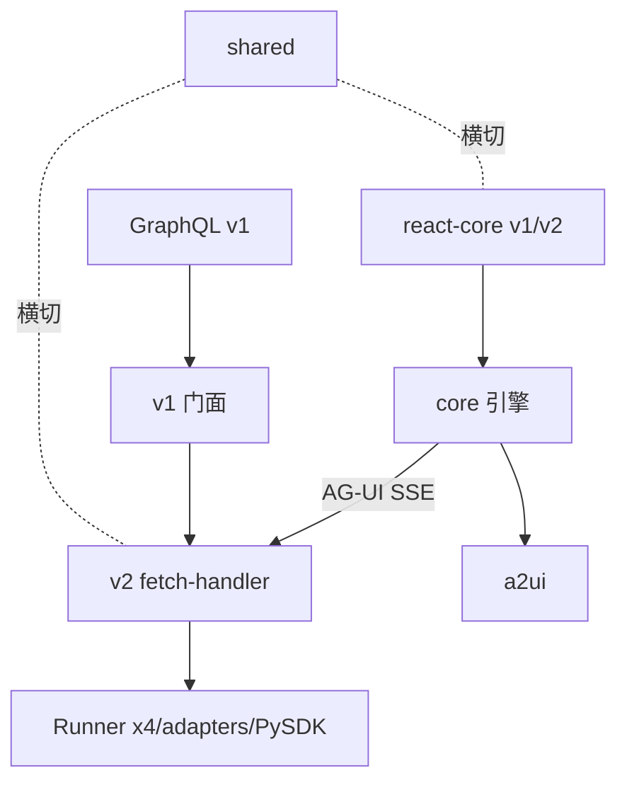

# CopilotKit 新人上手文档（ONBOARDING）

> 基于知识图谱（1892 节点/4250 边/16 层/16 步导览，commit `a0840c0a`）；行号锚经源码核实。

## 1. 项目速览

CopilotKit（38k star）是 **agent-native 全栈框架**：在 React 应用里嵌入能调工具、读写状态、动态生成 UI 的 AI 副驾。三件套——

- **前端**：`@copilotkit/react-core`（Provider+hooks+v2 聊天组件）与 `@copilotkit/react-ui`（v1 视觉组件），五大能力为 Chat UI、工具渲染、Generative UI、共享状态、Human-in-the-Loop；
- **运行时**：`@copilotkit/runtime` 承接 agent 执行与事件流，以 **AG-UI 协议**（SSE 默认、protobuf 可选）推增量事件；
- **多语言**：`sdk-python` 提供 LangGraph/CrewAI 对称接入面；另附面向 AI 编码助手的 skills 体系。

pnpm monorepo：`packages/*` 20 包统一版本 1.59.5（`packages/runtime/package.json:3`），nx 编排、tsdown 构建、oxlint 自定义规则、lefthook+commitlint 门禁。

## 2. 架构总览（16 层）

- L01 构建配置基座（35）：workspace/nx/lefthook、共享配置包
- L02 shared 横切库（41）：AG-UI 消息契约（types/message.ts 唯一真源）、遥测
- L03 core 状态引擎（21）：框架无关 v2 前端内核
- L04 runtime v1 服务端（77）：src/lib 编排、框架集成、GraphQL 层
- L05 v1 服务适配器（22）：13 路模型供给线
- L06 runtime v2 运行时（58）：fetch-handler+中间件+AgentRunner+Intelligence
- L07 runtime 知识镜像（56）：skills/runtime 与包内副本（18 篇接线指南）
- L08 react-core v1（74）：经典 Provider+context+26 个 hooks
- L09 react-core v2（88）：CopilotKitProvider（811 行）+CopilotChat 群+headless
- L10 react-core 镜像（32）：skills/react-core 使用知识
- L11 react-ui v1（81）：29 个 chat 组件+dev-console+14 组 css
- L12 a2ui 渲染器（54）：A2UI 协议 React 渲染器
- L13 外围小包（73）：runtime-client-gql/sdk-js/web-inspector/voice/runner
- L14 Python SDK（40）：sdk.py/langgraph.py/crewai/fastapi
- L15 技能资产（51）：根 skills/ 8 个 lifecycle 技能
- L16 文档工具链（39）：release 发布线、docs 生成器、dev-docs

钥匙：**v1（GraphQL 门面）是包装，v2（AG-UI/fetch 原生）是真实现**。

## 3. 核心链路：一条请求的旅程（v2 useAgent）

1. **组件**：`useFrontendTool`（v1 对应 `useCopilotAction`）向 core 注册前端工具（zod 参数转 JSON Schema 下发）；`useAgent` 按 agentId 解析 agent。
2. **Provider**：`CopilotKitProvider.tsx` 创建稳定 `CopilotKitCoreReact` 实例，setter effects 增量同步（子 hook 先于父 effect 注册防覆盖）。
3. **状态引擎**：`core/core.ts` 组装六大子模块；`run-handler.ts` 执行 connect/run 并处理工具调用回环（具名+通配两路递归续跑）。
4. **HTTP**：`v2/runtime/core/fetch-handler.ts` 为框架无关 `(Request)=>Promise<Response>`；Express/Hono 只做桥接（Express 须经 `endpoints/express-fetch-bridge.ts`）。
5. **执行**：handle-run.ts 取 agent 交 AgentRunner（InMemory/Sqlite/AgentCore/Intelligence 四种）；内置 agent 在 `src/agent/index.ts` 经 Vercel AI SDK 对话模型。
6. **回流**：runner 产出 AG-UI `BaseEvent` RxJS 流经 SSE 回前端增量渲染，A2UI/工具渲染器按事件激活。

**v1 门面委托**：v1 `CopilotRuntime`（`src/lib/runtime/copilot-runtime.ts:354`）持 `private _instance: CopilotRuntimeVNext`，L430-434 惰性实例化后全量委托 v2。v1 前端走 GraphQL：runtime-client-gql → copilot.resolver → service-adapter → ReplaySubject 流（resolver 处于中间态，见坑 1）。

## 4. 目录导览

| 目录 | 职责 |
|---|---|
| `runtime/src/lib` | v1 主线：copilot-runtime 编排、integrations/ 集成、graphql/ 协议层 |
| `runtime/src/v2` | v2 真身：core/handlers/runner/intelligence-platform/open-generative-ui-middleware、express/hono/node 宿主 |
| `runtime/src/agent` | 内置 agent 与多 provider 解析（**@copilotkit/agent 假包名，实在此处**） |
| `runtime/src/service-adapters` | 13 路模型适配器 |
| `core/src` | 框架无关状态引擎，v2 前端的心脏 |
| `react-core/src` 与 `src/v2` | v1 面（Provider/context/hooks）；v2 面（CopilotKitProvider、chat 19 组件、headless） |
| `react-ui/src` | v1 视觉组件；colors.css 设计令牌唯一权威源；`src/v2` 仅 CSS 转发 |
| `a2ui-renderer/src` | A2UI React 渲染器（a2ui-react 组件树+catalog） |
| `sdk-python/copilotkit` | sdk.py / langgraph.py（495 行工具集）/ crewai/ / fastapi 集成 |
| `skills/` | 双层：8 个 lifecycle 独立技能+三组镜像源，`scripts/sync-plugin-skills.ts` 同步进各包（write/check 双模式供 CI 校验） |
| `scripts/release`、`dev-docs/` | 发布线；plugin-points 13 个扩展点全目录 |

（vue/angular/react-native/react-textarea 被裁剪不在图谱。）

## 5. 关键概念

- **AG-UI 协议**：开源事件协议（@ag-ui 三包：core 定义/client 消费/encoder 编码）。agent 实现 `AbstractAgent.run(): Observable<BaseEvent>`，事件分生命周期/文本/工具调用/状态/推理/活动六族；**Deprecated Events**：THINKING 系由 REASONING 系取代（`skills/copilotkit-agui/references/protocol-spec.md:591`）。
- **CopilotRuntime 兼容 shim**：BaseCopilotRuntime 基类 + SSE/Intelligence 两模式子类 + 兼容委托。Intelligence=官方托管云（durable threads/分布式锁/Phoenix WS），与 runner 互斥。
- **shared state**：前端 `useCopilotReadable` 注入上下文；agent 侧经 `AGUISendStateSnapshot/Delta` 回写（Simple 自动注入、Factory 手工注册且 schema 逐字镜像，`agent/index.ts:1129,1139`）。
- **Generative UI（A2UI）**：agent 输出直接渲染为可交互 React 组件；服务端 `open-generative-ui-middleware` 用 clarinet 增量 SAX 解析实现"参数流到一半先渲染一半"；另有 websandbox 与 MCPApps 两条 iframe 支线。
- **前端 actions/tools**：v1 `useCopilotAction` 与 v2 `useFrontendTool` 同构；`followUp` 默认为真（`run-handler.ts:617`），纯副作用工具须显式置 false 防追问死循环。

## 6. 开发工作流

- **编排**：pnpm workspace（首 glob 即 `packages/*`）+ nx（13 类 target 缓存，并行 14）。常用 `pnpm nx build @copilotkit/runtime`。
- **构建**：tsdown 产出 mjs/cjs/umd；runtime 的 banner hack——rolldown 会把裸副作用 import 重排到 chunk 末尾破坏 reflect-metadata 时序，故对产物强制注入 require 头。
- **Lint**：oxlint + 自研插件（`packages/react-ui/oxlint-rules/`）：`require-cpk-prefix.mjs` 强制 Tailwind 类名 `cpk:` 前缀置于变体之前；`.oxlintrc.json` 禁止 `@a2ui/lit` 值导入（副作用破坏 Strict Mode）。
- **门禁**：lefthook pre-commit 并行跑二进制检查/lockfile 同步/oxlint 修复/skills 镜像同步检查；commit-msg 走 commitlint。
- **发版**：`scripts/release/` 半自动线——构建与 bump 在无 secrets 的 CI job，publish 独立 job 才接触 npm 凭据（最小权限）；AI release notes 手写 https.request 调 Anthropic。
- **测试**：vitest，单测在 `packages/*/src/__tests__/`（图谱裁剪未入图，按此定位）；发布脚本测试限定 `scripts/release/lib/**`；文档示例由 `scripts/doc-tests/` 双解析实测。

## 7. 已知坑与勘误精选（行号锚全部源码核实）

1. **generateCopilotResponse 中间态必抛**：`packages/runtime/src/graphql/resolvers/copilot.resolver.ts:255` 声明 `let runtimeResponse` 后未赋值，L257 即解构（L273 TODO-AGENTS 互证迁移中）。
2. **useCopilotChat 承诺不符**：`packages/react-core/src/hooks/use-copilot-chat_internal.ts:757-781` 返回对象不含 `visibleMessages`，L769-770 mcpServers 被注释——解构得 undefined。
3. **lib/index 哨兵类构造即 throw**：`packages/runtime/src/lib/index.ts:18-24` `LangGraphAgent` new 即抛错指路 `/langgraph` 子路径；LangGraphHttpAgent（L29-35）同款。
4. **sdk-python Quick Start 幻觉 API**：`sdk-python/README.md:28-41` 的 `Copilot()/add_tool()/run()` 不在导出面，以 `CopilotKitSDK`（sdk.py:387）为准。
5. **eval.yaml 与 SKILL.md v1.1.2 矛盾**：grader 查旧包名 `@copilotkit/react|core|agent`（`skills/copilotkit-setup/eval.yaml` L19-20、42-51、61-62），按 SKILL.md 装的项目判 0 分。
6. **publicApiKey 才是主字段**：`packages/react-core/src/v2/providers/CopilotKitProvider.tsx:102` 声明，L104 注释称 publicLicenseKey 为别名，L379 解析序 `publicApiKey ?? publicLicenseKey`；runtime skill 反称后者 canonical——以源码为准。
7. **@copilotkit/agent 假包名**：20 个 package.json 零定义；BuiltInAgent/defineTool 实际在 `packages/runtime/src/agent/index.ts`。
8. **skills 快照三层漂移**：多篇 skill 引用不存在的 `packages/v1`/`packages/v2`（磁盘为扁平布局）；旧路径按 `v2/X`→`X/src/v2` 映射再 grep。
9. **TelemetryClient 硬编码 writeKey**：`packages/shared/src/telemetry/telemetry-client.ts:72-75` 明文默认值（env `COPILOTKIT_SEGMENT_WRITE_KEY` 可覆盖）；README 的 Scarf 说法 src 零引用。
10. **typedoc.base.json 断链**：根目录该文件不存在且 git 未跟踪，9 个 `packages/*/typedoc.json:2` extends 悬空；实际基座 `packages/tsconfig/typedoc.json` 无人引用。
11. **utils.ts 死文件**：`packages/react-core/src/utils/utils.ts` 全文止于 import，无导出无消费者。
12. **@a2ui/lit/0.8 幽灵依赖**：`packages/a2ui-renderer/src/A2UIViewer.tsx:4-5` import 之，未声明在 dependencies。
13. **react-ui /v2 仅 CSS**：`packages/react-ui/src/v2/index.ts` 仅一行 `import "./styles.css"`；v2 组件本体在 react-core/src/v2/components/chat。
14. **BasicAgent 废弃子类**：`packages/runtime/src/agent/index.ts:1683` extends BuiltInAgent，构造器 warn deprecated。
15. **createCopilotEndpoint 系 deprecated 别名**：现行 API 为 createCopilotHonoHandler（`packages/runtime/src/v2/runtime/endpoints/hono.ts:52-53`）；Express 同型（`endpoints/express.ts:89`）。

## 8. 新人路径（7 天，对应 16 步导览）

- **D1（步 1-2）**：README + ARCHITECTURE.md 建立三层地图；读 `packages/shared/src/types/message.ts` 看 AG-UI 消息契约。
- **D2（步 3）**：啃 `packages/core`：core.ts 组装 → micro-redux（~660 行复刻 NgRx 形状）→ run-handler 工具回环。
- **D3（步 4-6）**：runtime v1 线：copilot-runtime.ts 门面委托 → GraphQL 层 → service-adapters 与 events.ts 流。
- **D4（步 7-8）**：runtime v2 线：runtime.ts 类体系 → fetch-handler → handle-run → 四种 AgentRunner → express/hono 宿主。
- **D5（步 9-10）**：前端两代：v1 Provider/use-copilot-action → v2 CopilotKitProvider + use-agent + CopilotChat 群。
- **D6（步 11-14）**：react-ui → a2ui-renderer（adapter.tsx 绑定）→ runtime-client-gql/sdk-js/web-inspector → sdk-python。
- **D7（步 15-16）**：skills 双层结构与镜像机制（"自文档"策略）；scripts/release 与 plugin-points.md。

深入单点配合 `讲透CopilotKit/explain/` 系列精讲（六节结构、行号锚实证）；文档与源码冲突以源码为准，回看第 7 节勘误口径。
