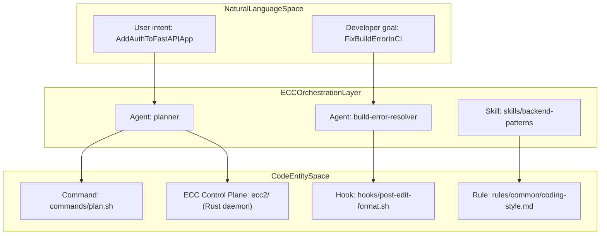
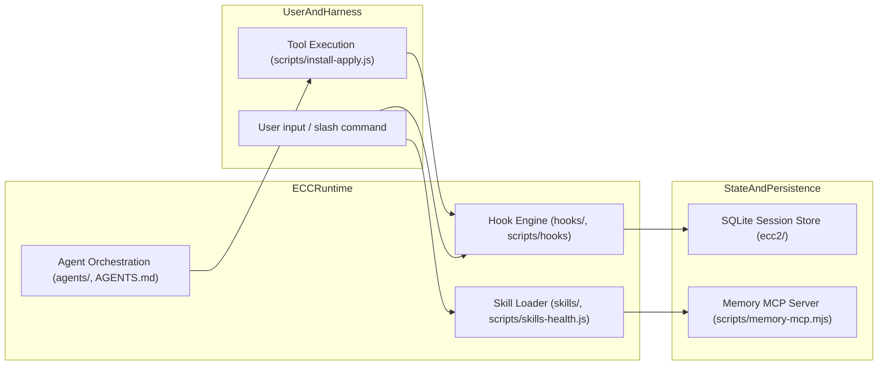

<!-- source: DeepWiki mcp.deepwiki.com · repo affaan-m/ECC · page 1 Overview: Everything Claude Code (ECC) · fetched 2026-10-30 -->

# Overview: Everything Claude Code (ECC)

Relevant source files

The following files were used as context for generating this wiki page:

- [.claude-plugin/marketplace.json](.claude-plugin/marketplace.json)
- [.claude-plugin/plugin.json](.claude-plugin/plugin.json)
- [.gemini/GEMINI.md](.gemini/GEMINI.md)
- [AGENTS.md](AGENTS.md)
- [README.md](README.md)
- [README.zh-CN.md](README.zh-CN.md)
- [SOUL.md](SOUL.md)
- [agent.yaml](agent.yaml)
- [docs/tr/AGENTS.md](docs/tr/AGENTS.md)
- [docs/zh-CN/AGENTS.md](docs/zh-CN/AGENTS.md)
- [docs/zh-CN/README.md](docs/zh-CN/README.md)
- [manifests/install-modules.json](manifests/install-modules.json)
- [package.json](package.json)

Everything Claude Code (ECC) is a production-ready **Agent Harness Operating System** designed to transform AI coding assistants into high-autonomy engineering partners [.claude-plugin/plugin.json:1-4](), [README.md:1-4](). Originating as an Anthropic Hackathon winner, ECC provides a comprehensive suite of 71 specialized agents, 311 skills, 97 commands, and a cross-harness control plane [AGENTS.md:1-5](). It supports multiple AI developer harnesses—including Claude Code, Codex, OpenCode, Cursor, and Gemini—bridging natural language user intent and complex software engineering workflows [.claude-plugin/plugin.json:1-4](), [package.json:2-4]().

---

### Core Value Proposition

- **Multi-Harness Portability:** ECC shares the same underlying agents, skills, commands, and rules across diverse AI harnesses like Claude Code, Codex, OpenCode, Cursor, and Antigravity, ensuring a unified developer experience [.claude-plugin/plugin.json:1-38](), [manifests/install-modules.json:1-87]().
- **Specialized Agent Fleet:** Provides 71 domain-focused agents such as `planner` (`agents/planner.md`), `security-reviewer` (`agents/security-reviewer.md`), and `build-error-resolver` (`agents/build-error-resolver.md`) to automate software lifecycle tasks independently or in orchestrated loops [AGENTS.md:15-51]().
- **Test-Driven, Security-First, Immutable:** Enforces software engineering best practices including TDD with 80%+ coverage requirements, rigorous input validation via `ecc-agentshield`, and immutable data patterns [AGENTS.md:7-14](), [package.json:2-57]().
- **Continuous Learning & Evolution:** Incorporates an instinct system and continuous learning frameworks (`skills/continuous-learning-v2/`) that extract patterns from session histories to evolve project-specific capabilities [README.zh-CN.md:74-77](), [package.json:215]().
- **Integrated Control Plane:** Features a Rust-based session daemon (`ecc2/`) providing session lifecycle management, a TUI dashboard, SQLite persistence, and inter-agent messaging.

Sources: [.claude-plugin/plugin.json:1-38](), [README.md:1-4](), [AGENTS.md:1-51](), [manifests/install-modules.json:1-87](), [package.json:2-215]()

---

### ECC Architectural Layers

The core architecture maps the *natural language space*—user intents and conversational goals—to *code entity space*, which encompasses executable CLI tools, agent definitions, reusable skills, automated hooks, and rules enforced by the control plane.

**Diagram 1: From Natural Language Intent to Code Entities Across Harnesses**

*This diagram illustrates how user requests are processed by specialized agents that invoke commands, trigger automated hooks, apply coding rules, and interact with the persistent Rust control plane.*

Sources: [AGENTS.md:15-51](), [manifests/install-modules.json:1-87](), [package.json:97-106]()

---

### Key Components & Their Code Locations

ECC is modular and extensible, organized into selectable installation components managed via module manifests [manifests/install-modules.json:1-87]().

| Component       | Location                      | Description                                                                                  |
|-----------------|-------------------------------|----------------------------------------------------------------------------------------------|
| **Agents**      | `agents/`, `.agents/`          | Domain-specialized AI personas with behavior instructions for planning, reviewing, and TDD.  |
| **Skills**      | `skills/`                     | The canonical workflow surface containing 311 reusable skills and behavioral modules.        |
| **Commands**    | `commands/`                   | Slash-command library and legacy shims for cross-harness interface adaptation.               |
| **Hooks**       | `hooks/`, `scripts/hooks/`    | Lifecycle event triggers automating quality, safety, observability, and validation.          |
| **Rules**       | `rules/`                     | Language-specific and common coding guidelines enforced during editing and reviews.          |
| **Control Plane** | `ecc2/`                     | Rust-based session daemon and TUI providing persistence, messaging, and lifecycle control.   |

**Diagram 2: High-Level Component Interaction**

*This interaction flow demonstrates how user actions and tool invocations propagate through hooks, skills, and agents while maintaining state and control via persistent storage layers.*

Sources: [.claude-plugin/plugin.json:1-46](), [manifests/install-modules.json:1-87](), [package.json:97-106](), [AGENTS.md:7-134]()

---

### How to Navigate This Wiki

This wiki is structured to guide users from initial installation to advanced operator proficiency. Explore the child pages for detailed deep-dives:

- **[Getting Started & Installation](#1.1)** — Installing ECC via npm (`ecc-universal`), the plugin marketplace (`ecc@ecc`), or git clone with selective profiles. Covers install scripts, migration guides, and Antigravity 2.0 setup.
- **[Core Concepts & Terminology](#1.2)** — Definitions of Skills, Agents, Hooks, Rules, Commands, Instincts, and Harnesses, and how they interrelate.
- **[User Guides (Shortform & Longform)](#1.3)** — Practical daily usage instructions covering command chaining, multi-agent sessions, token optimization, and token budgets.
- **[Contributing & Community Governance](#1.4)** — Overview of contribution workflows (`CONTRIBUTING.md`), moderation policies (`pr-burst-guard`, `issue-submission-guard`), code of conduct, and sponsor integration.

Sources: [README.md:69-95](), [.claude-plugin/plugin.json:25-38](), [AGENTS.md:1-131]()

---

*End of page 1: Overview — links to child pages 1.1, 1.2, 1.3, and 1.4 for in-depth topics.*

Sources:
- README.md:1-95
- AGENTS.md:1-134
- .claude-plugin/plugin.json:1-46
- manifests/install-modules.json:1-87
- package.json:1-215

---

