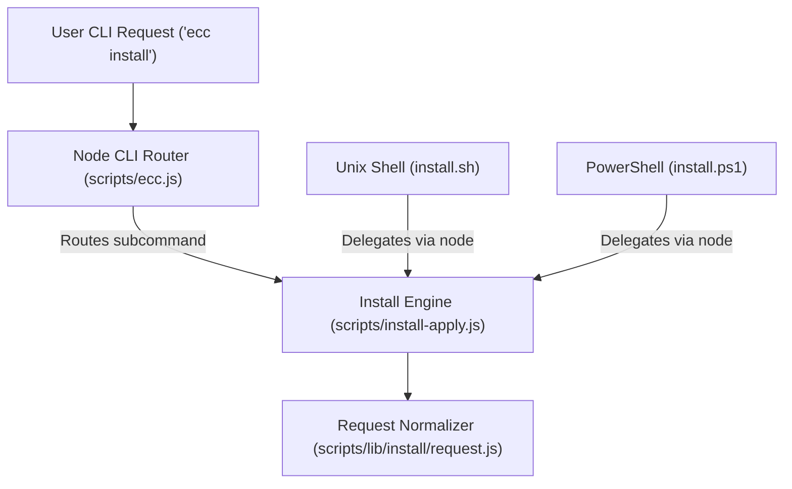
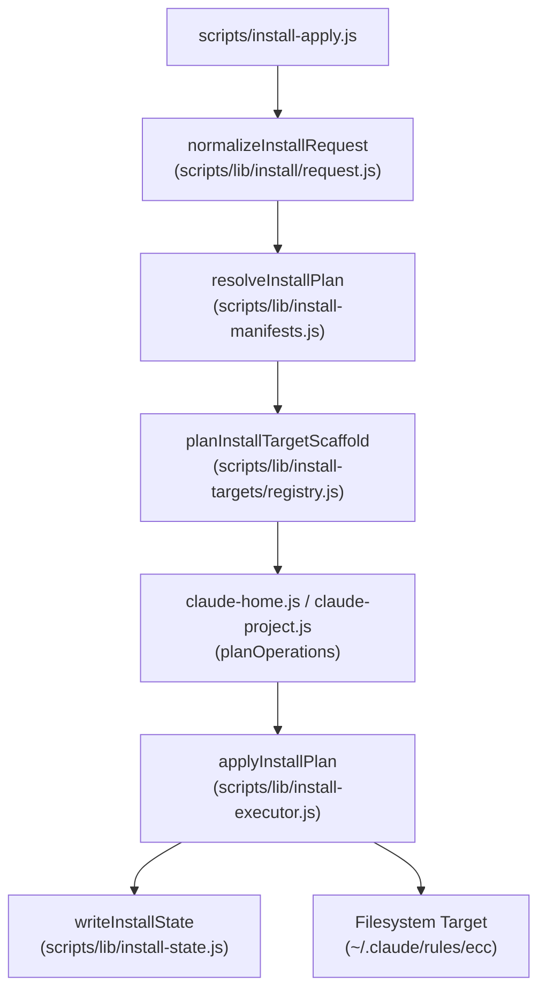
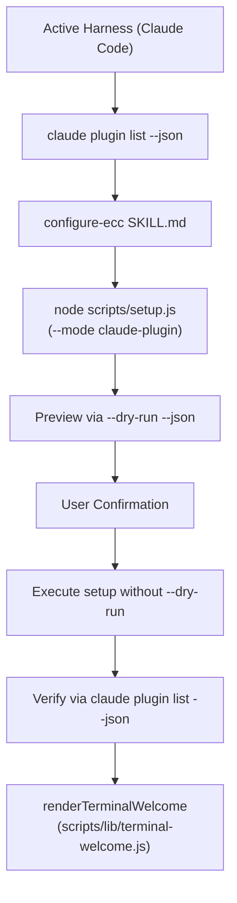

<!-- source: DeepWiki mcp.deepwiki.com · repo affaan-m/ECC · page 1.1 Getting Started & Installation · fetched 2026-10-30 -->

# Getting Started & Installation

<details>
<summary>Relevant source files</summary>

The following files were used as context for generating this wiki page:

- [.mcp.json](.mcp.json)
- [docs/ANTIGRAVITY-GUIDE.md](docs/ANTIGRAVITY-GUIDE.md)
- [docs/ja-JP/skills/configure-ecc/SKILL.md](docs/ja-JP/skills/configure-ecc/SKILL.md)
- [docs/releases/2.2.0/launch-runbook.md](docs/releases/2.2.0/launch-runbook.md)
- [docs/releases/2.2.0/release-notes.md](docs/releases/2.2.0/release-notes.md)
- [docs/zh-CN/skills/configure-ecc/SKILL.md](docs/zh-CN/skills/configure-ecc/SKILL.md)
- [install.ps1](install.ps1)
- [install.sh](install.sh)
- [manifests/install-assets/claude-project-scripts-package.json](manifests/install-assets/claude-project-scripts-package.json)
- [rules/README.md](rules/README.md)
- [schemas/state-store.schema.json](schemas/state-store.schema.json)
- [scripts/claw.js](scripts/claw.js)
- [scripts/codex-git-hooks/pre-commit](scripts/codex-git-hooks/pre-commit)
- [scripts/codex-git-hooks/pre-push](scripts/codex-git-hooks/pre-push)
- [scripts/codex/install-global-git-hooks.sh](scripts/codex/install-global-git-hooks.sh)
- [scripts/codex/merge-mcp-config.js](scripts/codex/merge-mcp-config.js)
- [scripts/doctor.js](scripts/doctor.js)
- [scripts/ecc.js](scripts/ecc.js)
- [scripts/hooks/desktop-notify.js](scripts/hooks/desktop-notify.js)
- [scripts/hooks/mcp-health-check.js](scripts/hooks/mcp-health-check.js)
- [scripts/hooks/run-with-flags-shell.sh](scripts/hooks/run-with-flags-shell.sh)
- [scripts/lib/codex-legacy-sync.js](scripts/lib/codex-legacy-sync.js)
- [scripts/lib/install-targets/claude-project.js](scripts/lib/install-targets/claude-project.js)
- [scripts/lib/nasiko-release.js](scripts/lib/nasiko-release.js)
- [scripts/lib/state-store/migrations.js](scripts/lib/state-store/migrations.js)
- [scripts/lib/state-store/queries.js](scripts/lib/state-store/queries.js)
- [scripts/lib/state-store/schema.js](scripts/lib/state-store/schema.js)
- [scripts/list-installed.js](scripts/list-installed.js)
- [scripts/nasiko.js](scripts/nasiko.js)
- [scripts/repair.js](scripts/repair.js)
- [scripts/status.js](scripts/status.js)
- [scripts/uninstall.js](scripts/uninstall.js)
- [skills/configure-ecc/SKILL.md](skills/configure-ecc/SKILL.md)
- [skills/nasiko-control-plane/SKILL.md](skills/nasiko-control-plane/SKILL.md)
- [skills/nasiko-control-plane/agents/openai.yaml](skills/nasiko-control-plane/agents/openai.yaml)
- [tests/ci/nasiko-control-plane.test.js](tests/ci/nasiko-control-plane.test.js)
- [tests/docs/antigravity-guide.test.js](tests/docs/antigravity-guide.test.js)
- [tests/docs/configure-ecc-install-paths.test.js](tests/docs/configure-ecc-install-paths.test.js)
- [tests/hooks/mcp-health-check.test.js](tests/hooks/mcp-health-check.test.js)
- [tests/lib/codex-legacy-sync.test.js](tests/lib/codex-legacy-sync.test.js)
- [tests/lib/state-store.test.js](tests/lib/state-store.test.js)
- [tests/scripts/claw.test.js](tests/scripts/claw.test.js)
- [tests/scripts/codex-hooks.test.js](tests/scripts/codex-hooks.test.js)
- [tests/scripts/ecc.test.js](tests/scripts/ecc.test.js)
- [tests/scripts/install-ps1.test.js](tests/scripts/install-ps1.test.js)
- [tests/scripts/install-readme-clarity.test.js](tests/scripts/install-readme-clarity.test.js)
- [tests/scripts/install-sh.test.js](tests/scripts/install-sh.test.js)
- [tests/scripts/npm-publish-surface.test.js](tests/scripts/npm-publish-surface.test.js)
- [tests/scripts/uninstall.test.js](tests/scripts/uninstall.test.js)

</details>


## Purpose and Scope

This page provides full technical documentation for installing, configuring, and verifying Everything Claude Code (ECC). It covers installation channels (`npm`, plugin marketplace, or source clone), installation profiles (`minimal`, `core`, `full`), cross-platform bootstrap scripts (`install.sh`, `install.ps1`, `ecc-install`), in-harness conversational setup wizards, the Antigravity 2.0 native installation framework, and the version 1.x-to-2.0 migration guide.

---

## 1. Installation Entrypoints & Runtime Architecture

ECC installation can be executed from multiple entrypoints depending on whether the operator uses a source clone, an npm package, or a harness plugin registry.

- **`install.sh`**: Unix shell wrapper that validates bash features, symlinked paths, auto-installs dependencies via `npm install --ignore-scripts --no-audit --no-fund --loglevel=error`, and executes `scripts/install-apply.js` [install.sh:1-42]().
- **`install.ps1`**: Windows PowerShell wrapper that performs environment detection, path conversion, dependency checks, and delegates to the Node installer runtime [install.ps1]().
- **`scripts/ecc.js`**: The universal selective-install CLI (`ecc`), exposing subcommands like `setup`, `install`, `plan`, `catalog`, `doctor`, `repair`, and `uninstall` [scripts/ecc.js:10-110]().
- **`scripts/install-apply.js`**: Core programmatic install execution engine that coordinates target adapters and applies filesystem operations.

### Diagram: Natural Language Space to Code Entity Space (Bootstrap & CLI Routing)


Sources: [install.sh:1-42](), [scripts/ecc.js:10-110]()

---

## 2. Installation Lifecycle & Data Flow

The installer executes a deterministic pipeline to parse intents, resolve manifests, generate target scaffolds, and commit changes to disk.

1. **Request Normalization**: Parses user options (scope, target, profiles) into a structured request object via `normalizeInstallRequest`.
2. **Manifest Resolution**: Maps requested profiles (`minimal`, `core`, `full`) against `manifests/install-modules.json` and `manifests/install-profiles.json` to compile a complete module graph.
3. **Scaffold Planning**: Target adapters (e.g., `scripts/lib/install-targets/claude-home.js`) generate an operation plan (`planOperations`) containing write, link, and removal steps.
4. **Execution & State Persistence**: `applyInstallPlan` commits file modifications to disk and records state hashes via `writeInstallState` in `scripts/lib/install-state.js`.

### Diagram: Execution Flow of the Installation Pipeline


Sources: [scripts/lib/install/request.js:1-30](), [scripts/lib/install-manifests.js:18-40](), [scripts/lib/install-targets/registry.js:45-85](), [scripts/lib/install-executor.js:130-170]()

---

## 3. Supported Install Targets & Profiles

ECC targets multiple AI harness environments, adapting file placement and layout rules accordingly.

### Supported Targets

| Target | Destination Path | Description |
| :--- | :--- | :--- |
| `claude` | `~/.claude/` | Global install for Claude Code [tests/scripts/npm-publish-surface.test.js:59-125]() |
| `cursor` | `./.cursor/` | Project-local rules and Cursor IDE support [tests/scripts/uninstall.test.js:95-133]() |
| `antigravity` | `./.agents/` | Native Antigravity 2.0 worker layouts [docs/ANTIGRAVITY-GUIDE.md:1-20]() |
| `opencode` | `~/.config/opencode/` | Global config for OpenCode [tests/lib/state-store.test.js:44-60]() |
| `kimi` | `./.kimi-code/` | Project-local files for Kimi Code [skills/configure-ecc/SKILL.md:24-25]() |
| `zed` | `./.zed/` | Flat rules and settings for Zed editor |

### Installation Profiles

Profiles bundle module families defined in `manifests/install-profiles.json`:
- **`minimal`**: Core rules only, omitting the hooks runtime.
- **`core`**: Rules, agents, commands, and hooks runtime.
- **`full`**: All core components plus security, research, and optimization packages.

Sources: [tests/scripts/npm-publish-surface.test.js:59-165](), [docs/ANTIGRAVITY-GUIDE.md:1-60]()

---

## 4. In-Harness Configuration & Guided Setup

The `configure-ecc` skill provides an in-harness conversational wizard that inventories existing installations, collects user choices (scope: `user`, `project`, `local`; hooks: `off`, `minimal`, `standard`, `strict`), previews modifications, and applies changes via `scripts/setup.js` [skills/configure-ecc/SKILL.md:1-139]().


Sources: [skills/configure-ecc/SKILL.md:1-139](), [scripts/ecc.js:10-13]()

---

## 5. Antigravity 2.0 Native Installation

Google Antigravity 2.0 discovers workspace customizations from the project-local `.agents/` directory [docs/ANTIGRAVITY-GUIDE.md:1-10]().

### Quick Start & Source Invocation

Using the published npm package:
```bash
npx ecc-universal@2.2.3 install --profile minimal --target antigravity
```

Using a source checkout:
```bash
ECC_ROOT="/absolute/path/to/ECC"
"$ECC_ROOT/install.sh" --profile minimal --target antigravity
```

### Native Install Mapping

| ECC Source | Antigravity Destination | Purpose |
| :--- | :--- | :--- |
| `rules/` | `.agents/rules/` | Flattened workspace rules [docs/ANTIGRAVITY-GUIDE.md:47-55]() |
| `commands/` | `.agents/workflows/` | User-invoked slash workflows [docs/ANTIGRAVITY-GUIDE.md:47-55]() |
| `skills/<name>/` | `.agents/skills/<name>/` | Agent Skills with required `SKILL.md` [docs/ANTIGRAVITY-GUIDE.md:47-55]() |
| `agents/<name>.md` | `.agents/agents/<name>.md` | Custom agents and subagents [docs/ANTIGRAVITY-GUIDE.md:47-55]() |

Sources: [docs/ANTIGRAVITY-GUIDE.md:1-82]()

---

## 6. Verification, Doctor System & Repair

ECC includes a validation subsystem [scripts/ecc.js:63-73]() that compares on-disk installation hashes against records stored in `install-state.json`.

- **`doctor.js`**: Scans targets for missing or drifted files by computing SHA256 hashes.
- **`repair.js`**: Restores drifted or missing ECC-managed components.
- **`list-installed.js`**: Enumerates installed modules and paths.

Sources: [scripts/ecc.js:58-73](), [tests/scripts/uninstall.test.js:95-133]()

---

## 7. Migration from ECC 1.x to 2.0

ECC 2.0 enforces a strict namespaced rule hierarchy (`rules/common/` and `rules/ecc/`) to prevent file collisions. Legacy installations storing flat files directly in `~/.claude/rules/*.md` are migrated automatically or via `claude-skill-migration.js`, which moves files into the namespaced structure and updates `install-state.json`.

Sources: [rules/README.md:1-100]()

---

